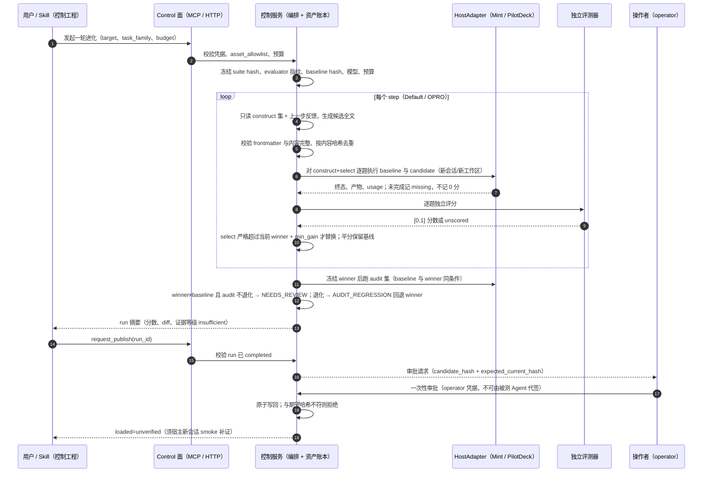

# RSI Toolkit：设计理念、当前落地与后续规划

## 0. 导读

本文回答三个问题：**为什么这样设计、现在做到哪、下一步做什么。**

与产品设计文档的分工是清楚的：产品文档回答“对谁有价值、在生态里占什么位置”，本文回答“技术判断是什么、实现边界在哪、证据强度够不够”。因此本文不重复市场与价值叙事，只保留能支撑或约束工程决策的内容。

全篇遵循同一条口径：**声明与证据分离**。已实现的能力给出证据位置，未实现的适配器一律写“目标”，不用“已支持”描述。文中所有数字取自仓库内可复查的验收记录，不取口头结论。

---

## 1. 设计理念

### 1.1 起点：改造 Agent 的三次失败

让 Agent 在某个任务上变好，常见做法是手改 prompt、手改 Skill、或者换更强的模型。这三种做法各有硬伤：

- **改完无法证明更好。** 没有对照、没有冻结用例，改动效果只能靠主观感受，一次成功就被当成提升。
- **改坏无法退回。** 生产 Skill 被直接覆盖，没有版本、没有审批、没有回滚路径。
- **换个平台全部重来。** 评测、经验、发布各自实现一遍，评分口径随平台分叉，结论无法互相引用。

RSI Toolkit 的出发点是：把“让 Agent 在某类任务上变好”从一次性手工动作，变成**有对照、有证据、可审批、可回滚、可迁移**的流程。

### 1.2 三个基本判断

**判断一：可复用的是进化逻辑，不是 Agent 能力本身。**

Mint、PilotDeck、Claude Code、Codex、DeepSeek Harness 的会话方式、扩展点、Skill 形态、可观测性都不同，但差异集中在四件事：执行、采集、注入、写回。真正平台无关的是另外一套东西——如何把一次执行变成可比较的样本、如何从多次执行中提炼条件化经验、如何冻结任务与评测器做对照、如何判断候选是否真的更好、如何记录证据并审批发布、如何在下一次任务前召回。

因此：**平台相关内容下沉为适配器，进化逻辑收敛为内核。** 这是“一个内核、多种外壳”的全部依据，也是成本能从“每平台一套系统”降到“每平台一层薄适配”的原因。

**判断二：进化的对象是外部资产，不是模型权重。**

模型权重不可控、不可移植、不可审计；而 Skill、经验库、召回策略天然可版本化、可 diff、可审批、可回滚、可迁移。因此插件的产出不是“更聪明的模型”，而是**一组经过证据验证的外部资产**。这条判断直接决定了资产账本、发布审批、回滚机制必须是核心能力，而不是附加功能。

**判断三：形态是插件，不是平台。**

插件不接管会话、不接管 Agent loop、不接管工具执行；它只通过宿主公开的扩展点工作，且**能力不超过宿主**。平台没有隔离，插件就不宣称 held-out 结论；平台没有发布 API，插件就只做到 L2。这条判断换来的是接入成本与信任：宿主不需要迁移用户，用户不需要换工作流。

### 1.3 由判断导出的五条设计约束

1. **进化不离开叶子。** 项目与子项目是一棵层级树，叶子节点对应最具体的任务族（例如“银行流水对账”）。一次运行只针对一个叶子、一个目标、一组允许修改的资产，结论也只在这个叶子上成立——对外不说“Agent 变强了”，只说“这类任务上变好了”。所谓“支持多任务”，是同一套机制在多个叶子上分别跑、分别出结论，而不是一个模型同时学会所有任务。这就是“任务级”落在结构上的样子：叶子级。

2. **经验从叶子长出，共性向父节点晋升。** 叶子上的条件化经验是进化的最小粒度：它最具体、最可靠，也最难直接迁移。只有当同一个父节点下的多个叶子反复出现同类失败、同类修法时，才把这些经验提炼成父节点语义层上的共性经验。晋升不是把结论上卷，而是发起一次新的进化：独立用例、独立评分、独立审批。作用域变大，回滚面也随之变大，所以晋升必须比叶子上的进化更保守。

3. **一次进化，先钉一个坐标。** 在哪个平台、哪个项目、改哪个 Agent 或 Skill、针对哪类任务、允许动哪些资产——五项定完，这次进化才有适用范围。坐标一变，结论就作废：A 项目的证据不能拿去批准 B 项目，“对账”上的提升也不能顺手宣称“客服”也变好了。工程上把这五项记成 `(platform, project, target, task_family, asset_set)`，报告里简称五元组。

4. **跑通了，不等于变好了。** 假模型与回放只能证明管道接得通；真模型跑几道题，只能说明“这几道题上看起来好一点”，报告里标 `insufficient`（证据不足）或 `NEEDS_REVIEW`（待复核）；只有题库冻结、判分独立、样本量足够，才可能标 `accepted`。三种证据能支撑的话不一样，混着说就是夸大。

5. **先定义“支持”，再拿证据说话。** L0–L4 回答“做到哪一步”（能装、能召回、能观察、能优化、能发布），五个标签回答“这一步有什么证据”（装上了、跑通一次、拿到轨迹、注入成功、发布后宿主真加载）。等级可以声明，但每一级都要有对应证据；缺一项，就把等级往下调一档，而不是把话说满。

### 1.4 明确不做的事

不做新的 Agent runtime 或 IDE；不做模型训练、微调、蒸馏；不做通用任务市场；不承诺“装上就自动变强”；不把某个平台的私有接口变成核心依赖。这些非目标的作用是划边界：插件是增强层，不是替代品。

---

## 2. 当前落地

### 2.1 运行形态

一个本地 sidecar 服务（只绑定 `127.0.0.1:18934`）加宿主侧插件。服务用三套互不相同的凭据区分控制、审批、运行时召回；runtime 凭据只读、只能召回；operator 凭据不注入被测模型所在的子进程。状态目录要求放在源码检出之外，重启保留历史，未确认的执行标记 `result_unknown` 且**不自动重放**。Mint 侧以 bundle + stdio-to-HTTP bridge 接入，PilotDeck 侧以原生插件（Gateway WS 1.2）接入。

### 2.2 已经跑通的闭环（0.2.0）

单 Skill 的任务级闭环已经端到端打通：观察 → 沉淀 → 冻结 → baseline → 提案（Default / OPRO）→ 候选执行与独立评分 → 配对判决 → 审批 → 原子发布 → 召回 → 监控 → 回滚。

#### 一次进化的时序

算法本身可以概括成三步递进：**用 construct 学、用 select 选、用 audit 验。** 学习器只能看到 construct 集与上一步的反馈，因此候选无法针对评测集优化；select 集只用于在同一步的多个候选之间挑选赢家；audit 集在赢家冻结之后才执行，只回答“有没有退化”。三个集合在时间上严格分离，是整套结论可信的前提。

#### 算法规则

| 环节 | 规则 | 为什么这样定 |
| --- | --- | --- |
| 冻结 | 执行前锁定用例集、评测器指纹、基线资产哈希、模型与预算 | 任一项漂移即 `measurement_drift`，测量不再可比 |
| 候选生成 | 只读 construct 集与上一步反馈；select / audit 对学习器不可见 | 防止用评测集调参，避免“分数好看但不会迁移” |
| 配对执行 | 同题、同模型、同预算，新会话与新工作区，baseline 与 candidate 各跑一次 | 让差值可归因；隔离不足只能标 exploratory |
| 选择 | select 上严格大于当前最优 + `min_gain` 才替换 winner，平分保留基线 | 抗噪声：偶然一次领先不构成改进 |
| 审计 | audit 只判断是否退化（≥ 基线即通过），不参与选择 | 审计集一旦参与优化，结论就失真 |
| 统计判定 | 配对 bootstrap 2000 次、95% 置信区间；缺失按对抗方向填充（候选缺记 0、基线缺记 1）；缺失率 >10% 直接 `insufficient` | 小样本与缺失不能推出强结论，宁可不下判断 |
| 发布 | 审批凭据 + `expected_current_hash` + 一次性授权；`loaded` 单独验证 | 防误写、防重放、防“文件写了但宿主没加载” |

需要说明判决标签的两套口径：控制面（0.2.0 实际运行的路径）按“严格改进 + `min_gain`”选择、按“audit 不退化”判决，输出 `NEEDS_REVIEW` / `NO_IMPROVEMENT` / `AUDIT_REGRESSION`；实验与晋升服务则走配对 bootstrap 的对抗缺失规则，输出 `promote` / `reject` / `insufficient`。两者冻结的是同一组口径（用例集、评测器指纹、基线哈希），区别只在统计强度，不构成两套事实。

两条使用路径共用上述资产与证据：**主动优化**走完整时序；**日常学习**只做“任务结束 → 轨迹归一 → 经验沉淀 → 索引”，下一次任务前召回，不跑对照实验。

其中被逐项验证过的关键控制点包括：审批权限与角色隔离、授权过期、重放拒绝、外部编辑冲突检测、原子 apply、runtime 只读召回、重启持久化、回滚后哈希精确恢复，以及两个宿主对发布内容的原生读取。发布记录的 `loaded` 字段保持 `unverified`——“文件写入了”和“宿主真的加载了”是两件事，后者只能由宿主侧 smoke 证明，不能自证。

全量回归 745 passed / 2 skipped。真实实验记录如下（均为小型合成任务，不是官方 benchmark 成绩）：

| 实验 | 真实执行 | 选择集 | 审计集 | 结论 |
| --- | --- | --- | --- | --- |
| PilotDeck Default（早期） | 18 + 1 提案 | 2/3 → 3/3 | 各 3/3 | NEEDS_REVIEW；候选当时不是完整原生 Skill |
| Mint OPRO v3 | 15 + 1 提案 | 3/3 → 3/3 | 基线 3/3，候选未测 | NO_IMPROVEMENT，保留基线 |
| Mint 隔离 Default v4 | 18 + 1 提案 | 2/3 → 3/3 | 2/3 → 3/3 | NEEDS_REVIEW，原生 Skill，含负控基线 |
| Mint 第二轮 OPRO | 9 + 1 提案 | 提案与基线重复 | 3/3 | NO_IMPROVEMENT，记录 `candidate.duplicate` |

0.2.0 升级又补了一轮真实样本验收：JobBench 基线 select 12/52，两个候选分别为 0/52、6/52；WorkBuddy 基线 3/3，两个候选均 0/3。两项结论都是 `NO_IMPROVEMENT`，保留基线。这说明**流程可复现、结论可分级，但尚未建立普遍收益**——这是当前最重要的落地事实。

### 2.3 工程化进展（iface v2，M0/M1）

模块化按 15 个核心模块规划，首批抽出无状态、低状态的 8 个（内容寻址存储、契约运行时、工作区资产、模型客户端、测量证据、评测套件、配对证据、执行端口）；状态类模块（存储、轨迹归档、经验账本、词法召回、召回选择、资产账本）留在 M3，组件执行器留 M2，cpmrt 适配器因未发布而挂起。

M1 的验收是可复现的：一条命令完成构建 → `mint add path:` 安装 → 摘要比对 → 安装态用例 → 篡改拒绝 → `mint remove` 清理。结果：6 个包可构建，5 个运行时包递归安装，安装副本与构建副本摘要 5/5 一致，安装态 39 通过 / 2 跳过，篡改任一依赖的 `lib/` 被拒（exit 2），卸载后无孤儿包。未做的部分同样明确：全程 `local/` scope 的 `path:` 安装，没有 `pull`、没有签名、没有信任链，因此“从 MintHub 拉下来也能跑”目前只是推论。

### 2.4 平台状态

| 平台 | 等级 | 依据 |
| --- | --- | --- |
| Mint | L4（单 Skill） | 安装、执行、采集、发布闭环已跑通；MintHub 未发布；加载靠外部 smoke |
| PilotDeck | L4（exploratory） | 原生插件 + Gateway WS；普通 adapter 无 OS 隔离 |
| Claude Code / Codex / DeepSeek Harness | L3–L4 目标 | 注入、观察、结构化历史、受控执行四项能力已核实，适配器未实现 |
| Cursor | L0 | 未核实 |
| 自建 AgentOS | L1–L2 目标 | 依赖 cpmrt 与 Kernel 契约，cpmrt 尚未发布 |

一个值得强调的判断：外部 harness 的门槛比想象中低——三家都有请求前注入、工具与轮次观察、结构化历史、受控执行。缺的不是平台能力，而是适配器与验收。这反过来说明插件路线成立，也说明“已支持”三个字现在还不能用。

### 2.5 现在不能说的话

- 不能说已支持 Claude Code / Codex / DeepSeek Harness——只有能力核实，没有适配器验收。
- 不能说已有普遍收益——所有真实实验要么 NEEDS_REVIEW，要么 NO_IMPROVEMENT。
- 不能说已发布 MintHub——没有所属 scope 与登录，全程本地安装。
- 不能说 OS 级隔离已普适——只有 macOS Seatbelt 下的实测边界，且不含同用户恶意进程与代理被攻陷的威胁。
- 不能说 15 个模块都已独立——首批只抽取了无状态/低状态部分。
- 不能把 `loaded=unverified` 当成“发布成功”的证据。

---

## 3. 后续规划

### 3.1 三条主线

**主线 A：平台适配（决定“能不能复用”）。** 用同一内核接入 Claude Code、Codex、DeepSeek Harness 中的一个作为第二平台，跑满五个标签，达到 L3、争取 L4。验收标准不是“能装上”，而是同一任务族在两个平台上产出的证据结构一致、只有 host 段不同。

**主线 B：模块化与分发（决定“能不能规模化”）。** 补齐 M2/M3 的状态类模块（组件执行、存储、轨迹、经验、召回选择、资产账本），让能力包可以被单独引入；打通 MintHub 的 pull、签名、升级、卸载，把“本地路径安装”升级为“可分发的制品”。这一步的前置条件是发布 scope 与签名信任链，而不是代码量。

**主线 C：能力升级（决定“值不值得”）。** 从单 Skill 扩展到多资产（Skill + 经验库 + RecallPolicy）与 Agent 级（profile + 多 Skill + 工具/记忆策略），配套资产 allowlist 与组合评测。这一步的风险不在实现，而在“一改全坏”——需要组合发布与整体回滚。与之配套的是叶子经验向父节点语义层的晋升：晋升必须带独立用例与独立审批，不能把叶子上的结论直接上卷。

### 3.2 阶段与退出条件

| 阶段 | 目标 | 退出条件 |
| --- | --- | --- |
| P0 单点闭环 | 一个平台、一个 Skill、一个任务族 | 已达成：Mint + PilotDeck 单 Skill 闭环，证据可复现 |
| P1 第二平台 | 同一内核接入 Claude Code 或 Codex | 新平台达 L3、最好 L4；五标签齐全；不复制内核 |
| P2 多资产 / Agent 级 | Skill + 经验 + RecallPolicy；Agent profile 试点 | allowlist、组合评测、整体回滚可用 |
| P3 分发与市场 | MintHub、资产包、版本兼容 | 一键安装；签名、升级、卸载；兼容矩阵 |
| P4 自驱与团队 | 定时/事件触发；共享经验库 | 预算、风控、多租户、隐私边界清楚 |

工程侧的 M0–M6 是这些产品阶段的承载：M0/M1 对应 P0，M2/M3 对应 P2，M4 对应 P0/P1，M5 对应 P3，M6（cpmrt）对应 P4。

### 3.3 近期必须先补的四项证据

1. **一次统计上站得住的提升。** 这是当前最大的缺口：闭环能跑、证据能分级，但所有真实实验都没有观测到改进。没有这一项，P1 之后的所有扩张都缺乏说服力。补齐方式是扩大冻结用例、提高标签强度、增加重复次数，而不是增加平台。
2. **一个非 Mint 平台的五标签。** 优先选 DeepSeek Harness 或 Codex：原生插件形态最贴合，注入点与结构化历史都已核实。
3. **一次从 MintHub pull 的安装与签名验证。** 当前只有 `path:` 安装的证据，分发链路尚未被真实走通。
4. **cpmrt 适配的 M6 gate。** 等 cpmrt 发布后，按 artifact、ABI、协议三项验收后再替换 MintHost，不提前承诺。

### 3.4 开放问题

1. Agent 级资产的 allowlist 与组合评测如何设计，才不会“一改全坏”？
2. 日常学习提炼的经验，何时有资格晋升为 Skill，需要多少独立证据？
3. 跨平台资产迁移的兼容边界：Skill 格式、工具语义、上下文预算如何对齐？
4. 没有可靠评测器的任务，插件应提供什么强度的“弱结论”而不误导？
5. 平台自身开始提供自进化能力后，插件的差异化是否仍是跨平台、证据链与资产治理？

---

## 附：一页速览

| 维度 | 结论 |
| --- | --- |
| 是什么 | 可插拔的 Agent 任务级自进化插件；改外部资产，不改权重 |
| 为什么这样设计 | 平台碎片化但进化逻辑可复用；资产可审计可回滚；插件不接管宿主 |
| 怎么运转 | 一个内核 + 三类适配器 + 五个面 + 九步闭环；两条路径共享资产与证据 |
| 现在到哪 | 单 Skill 闭环可跑通；Mint/PilotDeck 达 L4；模块化完成 M1；无普遍收益证据 |
| 下一步 | 先补“真实提升 + 第二平台五标签 + 分发链路”，再谈多资产与自驱 |
