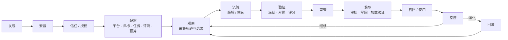
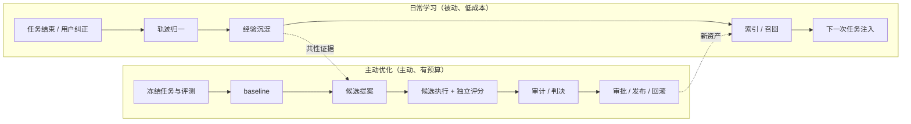

# RSI Toolkit：可插拔的 Agent 任务级自进化插件

> 这是一份**产品与插件设计**文档，不是模块拆包说明。
> 主文回答：插件是什么、插到哪里、替谁进化、进化什么、如何证明、如何不失控。
> 工程承载（模块、包、阶段门禁）压缩在[附录 A](#附录-a当前落地与工程映射)，供研发对照。

---

## 0. 设计摘要

**一句话故事：** 你的 Agent 在 Mint、PilotDeck 或 Claude Code 里照常工作；装上 RSI 插件后，它每次任务都会留下可复用的经验，每次改进都会先在冻结任务上验证、再经你批准，最后以可回滚的 Skill、经验或召回策略回到它身上。**变的是外部资产，不是模型；留下的是证据，不是感觉。**

| 维度 | 设计结论 |
| --- | --- |
| 一句话 | 把“让 Agent 在某个任务上变好”做成一个**可安装、可适配、可回滚的插件**，而不是再造一个 Agent 平台。 |
| 插件角色 | 挂在宿主平台旁边的“自进化层”：观察任务、沉淀经验、生成候选、独立评分、审批发布、按需召回。 |
| 进化对象 | **外部资产**：Skill、经验库、召回策略；未来扩展到 Agent profile、工具策略、记忆策略。 |
| 进化单位 | **任务族 × 目标 × 资产集**。不是“让 Agent 全面变强”，而是“让它在某类任务上可证明地变好”。 |
| 平台策略 | 一个平台无关的内核 + 每个平台一层薄适配；**插件能力不超过宿主能力**，不假装拥有平台没有的能力。 |
| 当前落地 | Mint 与 PilotDeck 已能跑通单 Skill 闭环；Claude Code / Codex / DeepSeek Harness 具备接入所需的 hooks 与结构化历史，但适配器尚未实现；MintHub 未发布。 |

**三个关键词：**

- **Pluggable**：不为每个平台重写一遍，只为每个平台写一层执行/采集/注入适配。
- **Task-level**：以任务族为进化与验收单位，拒绝“通用变强”的模糊承诺。
- **External assets**：模型权重不变，进化发生在可版本化、可回滚的外部资产上。

**五个设计立场：**

1. 插件，不是平台：不接管会话、不接管 Agent loop、不接管工具执行。
2. 增强，不是替代：宿主仍然是 Agent 的家，插件只是让它多一条变好的路径。
3. 资产，不是权重：所有改进都可 diff、可审批、可回滚。
4. 证据，不是感觉：流程跑通、集成成功、统计提升分开报告。
5. 渐进增强：先能装，再能召回，再能观察，最后才谈优化与发布。

---

## 1. 为什么是插件

### 1.1 平台正在碎片化

同一个 Agent 能力，可能运行在完全不同的宿主里：

| 平台 | 会话/执行 | 扩展点 | Skill 形态 | 可观测性 |
| --- | --- | --- | --- | --- |
| Mint | `mint run --json`、MCP | 插件、Skill、MCP、hooks（版本相关） | 包内 Skill | NDJSON 事件 |
| PilotDeck | Gateway WS 1.2 | 原生插件、MCP | 项目 Skill 文件 | 会话与工具事件 |
| Claude Code | `claude -p`、SDK | skills、agents、hooks、MCP | Skill/Agent 包 | hooks + transcript |
| Codex | `codex exec --json`、App Server | skills、hooks、MCP | Skill 包 | hooks + 结构化线程 |
| DeepSeek Harness | headless JSON、SDK | Cordis 插件、bundle | 插件内 Skill | `session/event` + raw log |
| Cursor | 待验证 | 待验证 | 待验证 | 待验证 |
| 自建 AgentOS | cpmrt / Kernel | IFace、插件 | 版本化资产 | 事件与 trace |

如果每接一个平台就重写一套“评测 + 经验 + 发布”，成本会随平台数量线性增长，而且各平台的评分口径会分叉。

### 1.2 真正可复用的，是进化逻辑

平台之间差异很大，但下面这些事情是平台无关的：

- 如何把一次执行变成可比较的样本（trace、结果、代价）。
- 如何从多次执行里提炼“什么条件下、犯了什么错、怎么修”。
- 如何冻结任务与评测器，做 baseline/candidate 对照。
- 如何判断候选是否真的更好，还是只是噪声。
- 如何记录证据、请求审批、发布、回滚。
- 如何在下一次任务开始前，把合适的经验召回给 Agent。

这些构成一个**自进化内核**。平台相关的只有四件事：执行、采集、注入、写回。把它们做成适配器，插件就可以跨平台复用。

### 1.3 外部资产是跨平台的持久接口

模型权重不可控、不可移植、不可审计；而外部资产天然满足：

- **可版本化**：每次改动有 hash、父版本、来源实验。
- **可 diff**：改了什么，人和模型都能看懂。
- **可审批**：发布前可以停下来让人看一眼。
- **可回滚**：坏了能退回去。
- **可迁移**：同一个 Skill 可以装到不同平台（在平台 Skill 模型兼容的前提下）。

因此插件的核心产出不是“更聪明的模型”，而是**一组经过证据验证的外部资产**。

### 1.4 设计命题

> 能否做一个平台无关的插件：它接入任意宿主，针对任意可评测的任务族，通过沉淀和优化外部资产，让该宿主上的 Agent 或 Skill 在任务级别持续变好，并且每一步都可证据化、可审批、可回滚？

这份文档就是对这个命题的回答。

---

## 2. 产品定位

### 2.1 一句话定位

**RSI Toolkit 是一个可插拔的 Agent 自进化插件：它不改变模型权重，而是把任务执行中的经验与反馈沉淀成外部资产，在冻结任务上验证后，按审批发布回宿主，并在后续任务中按需召回。**

### 2.2 三层价值

| 层次 | 对谁有价值 | 价值 |
| --- | --- | --- |
| 任务层 | Agent / Skill 开发者 | 在某个任务族上，拿到“是否变好”的可复核结论，而不是主观感觉 |
| 资产层 | 团队 / 平台 | 经验、Skill、召回策略可版本化、可复用、可回滚 |
| 平台层 | 宿主 / 生态 | 不用自建进化系统，接一个插件就获得“任务级自进化”能力 |

### 2.3 插件拥有什么，不拥有什么

| 插件拥有 | 插件不拥有 |
| --- | --- |
| 进化循环：观察、提炼、提案、评测、判决、发布、召回 | Agent loop、会话管理、工具执行 |
| 资产账本：版本、谱系、审批、回滚 | 模型权重、推理服务 |
| 证据体系：manifest、逐题结果、独立评分、漂移检测 | 宿主的权限系统与 OS 隔离 |
| 任务与评测契约：任务族、用例、评测器、预算 | 通用 benchmark 平台的全部职责 |
| 平台适配层：执行、采集、注入、写回 | 平台私有的 UI、账号、计费 |

### 2.4 与宿主的关系：共生，不接管

```text
宿主平台（Agent 的家）
  ├── 会话 / Agent loop / 工具 / 权限 / UI
  └── RSI 插件（自进化层）
        ├── 观察：任务、轨迹、结果、纠正
        ├── 沉淀：经验、候选资产
        ├── 验证：冻结任务 + 独立评分
        ├── 发布：审批 + 写回 + 加载验证
        └── 召回：下一次任务前注入
```

三条边界：

1. **不接管**：插件不替代宿主的会话与执行；它只通过宿主公开的扩展点工作。
2. **不越权**：插件不能绕过宿主的权限、审批和隔离；平台没有的能力，插件不假装有。
3. **不锁定**：资产格式与证据格式尽量平台中立；换平台时，资产可以带走，适配器重写。

用户不需要迁移平台、改变工作流；插件只是在他的现有环境里多了一个可选的进化入口。

### 2.5 目标用户

| 用户 | 诉求 | 插件给他的东西 |
| --- | --- | --- |
| Agent / Skill 开发者 | 我的 Skill 到底有没有变好 | 冻结任务、对照实验、独立评分、候选 diff |
| 平台 / 宿主团队 | 如何低成本提供自进化能力 | 可安装插件 + 适配器契约 + 能力分级 |
| 操作者 / 评审者 | 谁改的、凭什么、怎么退 | 审批、证据、版本、回滚 |
| 日常使用者 | 别让我每次重新教它 | 经验沉淀与按需召回，不打断任务 |

### 2.6 设计原则

1. **插件优先**：能通过宿主扩展点解决，就不改宿主；能薄适配，就不 Fork。
2. **任务优先**：先定义“什么任务、什么算好”，再谈优化。
3. **资产优先**：所有改进落在可版本化资产上，不落在不可审计的隐式状态里。
4. **证据优先**：没有独立评分的提升，只能叫“候选”，不能叫“改进”。
5. **可逆优先**：默认不自动发布；发布必须可回滚。
6. **能力诚实**：平台支持级别按证据标注，不按愿景标注。
7. **渐进增强**：L0 安装 → L1 召回 → L2 观察 → L3 优化 → L4 发布，逐级承诺。
8. **本地优先**：默认本地数据与本地服务；上云是选项，不是前提。
9. **最小权限**：控制、运行、审批分离；被测 Agent 不持有发布权限。
10. **可组合**：评测、召回、优化可以单独使用，不必整体采用。

### 2.7 非目标

- 不做新的 Agent runtime 或 IDE。
- 不做模型训练、微调、蒸馏。
- 不做通用任务市场或 Prompt 商店（资产分发是后续能力，不是首版定位）。
- 不承诺“装上就自动变强”；没有可评测任务时，插件不产生收益结论。
- 不把某个平台的私有接口变成插件的核心依赖。

---

## 3. 核心概念模型

### 3.1 对象

| 概念 | 含义 |
| --- | --- |
| **Platform** | Agent 运行的环境：Mint、PilotDeck、Claude Code、Codex、DeepSeek Harness、AgentOS 等 |
| **Host** | 插件在某平台上实际调用的执行/采集/注入接口 |
| **Target** | 被进化的对象：一个 Skill，或一个 Agent（profile + skills + 策略） |
| **Task Family** | 一组同类、可重复、可评测的任务；进化的单位 |
| **Episode** | 一次任务执行：输入、轨迹、产物、结果、代价 |
| **Experience** | 从 Episode 提炼出的条件化经验：何时适用、什么错、怎么修 |
| **Asset** | 可版本化的外部资产：Skill、经验库、RecallPolicy 等 |
| **Candidate** | 由学习器生成、尚未被证据接受的资产版本 |
| **Evidence** | 证明候选是否更好的材料：冻结用例、逐题结果、配对统计、漂移检查 |
| **Release** | 经审批后生效的资产版本及加载记录 |
| **Recall** | 在任务开始前，把合适的经验/资产注入 Agent 上下文 |

### 3.2 什么是“任务级自进化”

> 在固定的任务族 **T** 上，针对目标 **G**（Agent 或 Skill），通过可复核的执行证据，持续改进 G 所依赖的外部资产 **A**，使 G 在 T 上的表现提升，并且每次改进都可审批、可回滚。

三个限定词：

- **任务级**：不是“全面变强”，而是“在这类任务上变好”。换任务族要重新定义评测。
- **外部资产**：不是改模型，而是改 Skill/经验/策略等可审计对象。
- **可复核**：不是“跑了一次感觉不错”，而是冻结对照 + 独立评分 + 证据分级。

### 3.3 目标粒度：Skill、Agent、Task

| 粒度 | 优化对象 | 任务单位 | 典型风险 | 当前 |
| --- | --- | --- | --- | --- |
| **Skill 级** | 单个 `SKILL.md` 或技能包 | 该技能覆盖的任务族 | 低：影响面小、易回滚 | ✅ 已支持 |
| **Agent 级** | Agent profile + 多个 Skill + 工具/记忆策略 | Agent 的职责范围 | 中：资产组合、相互影响 | ⏳ 规划 |
| **Task 级** | 任务族本身（用例、评测器、数据） | 单任务或任务集 | 低：是评测单位，不是被改对象 | ✅ 作为评测单位 |

设计上要避免把三者混为一谈：

- **Task 是“考什么”**，不是“改什么”。
- **Skill 是“改什么”的最小单位**。
- **Agent 是“改什么”的更大单位**，需要资产 allowlist 与组合评测。

### 3.4 资产模型

每个资产都应有统一的“资产信封”，平台无关、可审计：

| 字段 | 说明 |
| --- | --- |
| `asset_id` | 稳定身份，不随内容变化 |
| `type` | `skill` / `experience-bank` / `recall-policy` / 未来 `profile`、`tool-policy` |
| `scope` | platform / project / target / task_family |
| `version` | 单调版本 |
| `content_hash` | 内容摘要，发布时校验 |
| `parent` | 父版本，形成谱系 |
| `source_run` | 来自哪次实验/哪批轨迹 |
| `evidence_ref` | 支撑该版本的证据 |
| `status` | 状态机（如 draft / active / retired；经验另有 quarantined） |
| `loaded_state` | 未验证 / 已验证（由宿主侧 smoke 证明） |

资产类型与成熟度：

| 资产 | 作用 | 当前 |
| --- | --- | --- |
| Skill | 任务方法、步骤、注意事项 | ✅ 可优化、可发布 |
| Experience bank | 条件化经验，按需召回 | ✅ 可沉淀、可召回 |
| RecallPolicy | 召回范围、预算、排序、是否调用模型 | ✅ 可作为资产优化 |
| Agent profile | 角色、约束、默认策略 | ⏳ 规划 |
| Tool / Memory policy | 工具选择、记忆读写策略 | ⏳ 规划 |

### 3.5 两种使用模式

| 模式 | 触发 | 输入 | 输出 | 时延 | 典型用户 |
| --- | --- | --- | --- | --- | --- |
| **主动优化** | 用户发起一轮进化 | 任务族、评测器、目标资产、预算 | 对照实验、候选、证据、审查/发布入口 | 分钟到小时 | Skill/Agent 开发者 |
| **日常学习** | 任务结束/用户纠正时被动发生 | 轨迹、反馈、失败信号 | 经验条目、索引、按需召回 | 秒级沉淀，下一次任务生效 | 日常使用者 |

两种模式共享同一套资产、证据和权限模型；区别只是“有没有主动跑对照实验”。

### 3.6 进化单元

一次进化运行绑定一个五元组：

```text
(platform, project, target, task_family, asset_set)
```

含义：**在哪个平台、哪个项目、对哪个 Agent/Skill、针对哪类任务、允许改哪些资产。**

这个五元组决定了：

- 冻结什么（任务、模型、评测器、资产基线）；
- 允许改什么（asset_set / allowlist）；
- 证据对谁有效（平台、项目、任务族）；
- 发布写回到哪里（宿主资产适配器）。

跨平台、跨任务族的结论不能直接合并；需要分别实验、分别报告。

一个插件可以同时管理多个任务族，但每个任务族独立配置、独立证据、独立发布；这就是“支持多任务”的实际含义，而不是一个模型同时学会所有任务。

---

## 4. 插件形态：一个内核，多种外壳

### 4.1 内核（平台无关）

内核负责“进化”本身：

- 任务与评测契约：任务族、用例、评测器、预算、晋升规则。
- 经验与资产：沉淀、版本、谱系、状态机。
- 证据：manifest、逐题结果、配对统计、漂移检测。
- 决策：接受/拒绝/待审、证据分级。
- 召回：范围、预算、排序、注入内容。
- 权限：控制、运行、审批三套角色。

内核不直接调用某个平台的私有 API；所有平台差异通过适配器进入。

### 4.2 五个插件面

| 面 | 作用 | 典型形态 |
| --- | --- | --- |
| **Control** | 发起实验、查状态、审查、请求发布 | MCP、HTTP、CLI |
| **Runtime** | 任务前召回、按需注入 | 运行时 MCP、hook、插件事件 |
| **Capture** | 采集轨迹、结果、纠正、代价 | hook、事件流、日志导入 |
| **Asset** | 读取/暂存/写回资产 | 文件适配器、平台 Skill API、配置中心 |
| **Evaluation** | 评分、资格、统计 | 确定性 verifier、rubric judge、外部评分服务 |

一个平台不必同时支持五个面。支持哪几个面，就对应哪个能力等级。

### 4.3 三类适配器

| 适配器 | 负责 | 必须回答的问题 |
| --- | --- | --- |
| **HostAdapter** | 执行、事件、取消、采集、注入、加载验证 | 能不能开新会话？能不能隔离？能不能拿到终态？ |
| **AssetAdapter** | 资产快照、暂存、应用、校验、回滚 | 资产在哪？怎么写？怎么确认真的加载了？ |
| **EvaluatorAdapter** | 评分、身份、资格 | 什么算对？评分器可信么？换版本还成立么？ |

适配器是插件的“插座”。插座的标准越稳定，平台接入成本越低。

### 4.4 插件生命周期



关键点：

- **配置不是一次性**：任务族、评测器、资产 allowlist 都可版本化。
- **发布不是终点**：发布后要验证“宿主真的加载了”，并在后续任务中监控退化。
- **回滚是常规操作**：不是异常路径。

### 4.5 分发形态

同一个内核，可以按用户场景提供不同外壳：

| 形态 | 适合 | 用户得到什么 |
| --- | --- | --- |
| **Library** | 其他应用/CI 复用评测、存储、召回 | 一组可独立引入的能力包 |
| **Mint bundle** | Mint 用户 | 安装即用，Skill/MCP 入口 |
| **Native plugin** | PilotDeck / 其他宿主 | 原生插件体验，深度集成 |
| **Native service（MCP）** | 跨平台统一服务 | 一个本地服务，多个宿主共用 |
| **App bundle** | 完整产品交付 | 控制面 + 运行时 + Skill + 桥接 |

设计意图：**用户不必关心内核怎么拆；他只选择“装到哪个平台、用什么外壳”。**

### 4.6 渐进增强模型

| 等级 | 能力 | 用户承诺 | 插件需要什么 |
| --- | --- | --- | --- |
| **L0** | 可安装 | 插件能被发现、安装、卸载 | 包清单、安装脚本 |
| **L1** | 可召回 | 任务前能注入经验/Skill | 注入点、运行时凭据 |
| **L2** | 可观察 | 能采集任务、结果、纠正 | 事件/hook、结构化历史 |
| **L3** | 可优化 | 能跑 baseline/candidate 并独立评分 | 受控执行、隔离、评测器 |
| **L4** | 可发布 | 审批后写回资产并验证加载 | 资产 API、审批、加载验证 |
| **L5** | 可自驱 | 按计划/事件自动触发进化 | 调度、预算、风控（未来） |

**只有达到 L4，才能说“该平台支持完整的任务级自进化闭环”。** L1/L2 也有独立价值：先召回、先观察，再谈优化。L5 是未来形态，不在当前验收范围；下文 L0–L4 指可验收等级。

平台等级也决定“能支持什么任务”：L1/L2 适合日常学习与召回；L3 才能主动优化；L4 才能把候选发布回生产资产。**不要在一个 L2 平台上承诺 L4 的任务闭环。**

---

## 5. 平台支持模型

### 5.1 当前平台矩阵

> “安装/执行/采集/注入/发布”列的 ✅ 表示**平台具备该扩展点**，不代表 RSI 适配器已实现；“当前等级”才是 RSI 的实际状态。

| 平台 | 安装 | 执行 | 采集 | 注入 | 发布 | 当前等级 | 说明 |
| --- | --- | --- | --- | --- | --- | --- | --- |
| **Mint** | ✅ bundle + MCP bridge | `mint run --json` | NDJSON + wrapper | Skill / runtime MCP | Skill 文件 | **L4（单 Skill）** | 需本地服务；MintHub 未发布；`loaded` 靠外部 smoke |
| **PilotDeck** | ✅ 原生插件 | Gateway WS 1.2 | 会话/工具事件 | Skill / runtime MCP | `skill_write` + reload | **L4（exploratory）** | 普通 adapter 无 OS 隔离；`loaded` 靠外部 smoke |
| **Claude Code** | ✅ skills/hooks/MCP | `claude -p` / SDK | hooks + transcript | `UserPromptSubmit` 注入 | Skill 文件 | **L3–L4 目标** | 能力具备，适配器未实现 |
| **Codex** | ✅ skills/hooks/MCP | `codex exec --json` | hooks + App Server | hook `additionalContext` | Skill 文件 | **L3–L4 目标** | 有分发限制；适配器未实现 |
| **DeepSeek Harness** | ✅ Cordis 插件 | headless / SDK | `session/event` + raw log | `agent/pre-step` | Skill 文件 | **L3–L4 目标** | 原生插件最合适；适配器未实现 |
| **Cursor** | 待验证 | 待验证 | 待验证 | 待验证 | 待验证 | **L0** | 未核实 |
| **自建 AgentOS** | 规划 | cpmrt / Kernel | 事件契约 | context/tool 契约 | 资产契约 | **L1–L2 目标** | cpmrt 未发布 |

这张表要按证据更新。**不能因为“平台有 hook”就写成“已支持”；也不能因为“我们没接”就否认平台具备能力。**

### 5.2 一个判断：外部 Harness 的门槛比想象中低

对 Claude Code、Codex、DeepSeek Harness 的核实结论是：

- 三家都有**请求前注入**：`UserPromptSubmit` / `additionalContext` / `agent/pre-step`。
- 三家都有**工具与轮次观察**：Pre/PostToolUse、Stop、turn/end 等。
- 三家都有**结构化历史或 raw log**：SDK、App Server、sessionQuery。
- 三家都有**受控执行**：`claude -p`、`codex exec --json`、headless/SDK。

因此，缺的不是“平台能力”，而是**适配器与验收**。这正好印证了插件路线：内核复用，平台薄适配。

### 5.3 “支持一个平台”的五个证据标签

| 标签 | 证明什么 | 证据 |
| --- | --- | --- |
| `installed` | 插件装上了、能被发现 | 安装日志、版本、文件清单 |
| `executed` | 能在该平台跑一次受控任务 | 执行 ID、终态、产物 |
| `captured` | 能拿到轨迹/结果/纠正 | 事件、raw log、字段映射 |
| `injected` | 能在任务前注入经验/资产 | 注入记录、token 预算、来源 |
| `loaded-verified` | 发布后宿主真的加载了 | 新会话 smoke、实际读取到的内容 |

只有五项都有证据，才对外声明“该平台完整支持”。否则只声明已达到的等级。

### 5.4 新平台接入清单

1. **执行**：能否在独立工作区/新会话跑指定任务？终态、取消、超时怎么表示？
2. **采集**：能否拿到稳定 ID、事件顺序、工具调用、产物、usage？
3. **注入**：有没有请求前钩子？能否限制 token？失败时是否允许继续任务？
4. **资产**：Skill/配置在哪？能否原子写？写后如何确认加载？
5. **权限**：控制/审批/运行是否可分离？被测 Agent 是否可能拿到发布权限？
6. **隔离**：能否阻止被测 Agent 读取隐藏标签、verifier、凭据？
7. **版本**：平台/Core 版本变化时，事件与 Skill 格式是否稳定？

答不上来的项，就是该平台的“未验证边界”，不能写进承诺。

### 5.5 同一个任务，两个平台

以 ledger Skill 的“对账任务”为例：

| 维度 | Mint | PilotDeck | 是否变化 |
| --- | --- | --- | --- |
| 任务族 | `ledger-reconciliation` | 同左 | 不变 |
| 评测器 | 精确匹配/字段校验 | 同左 | 不变 |
| 资产 | 项目 `SKILL.md` | 同左 | 不变 |
| 执行 | `mint run --json` | Gateway WS 1.2 | 变：HostAdapter |
| 采集 | NDJSON 事件 | 会话/工具事件 | 变：CaptureAdapter |
| 注入 | runtime MCP / Skill | runtime 插件 / Skill | 变：注入适配 |
| 发布 | 文件原子替换 | `skill_write` + reload | 变：AssetAdapter |
| 证据 | manifest + 逐题结果 | 同结构，host 段不同 | 半变 |
| 审批 | operator API | operator API | 不变 |

结论：**变的是四个适配器，不变的是任务、资产、证据和审批。** 这就是“一个内核，多种外壳”的实际含义。

---

## 6. 任务与 Agent/Skill 支持

### 6.1 任务描述符（TaskSpec）

接入一个任务，本质是填一张“进化任务卡”：

| 字段 | 说明 | 例子 |
| --- | --- | --- |
| `task_family` | 任务族标识 | `ledger-reconciliation`、`office-report` |
| `goal` | 希望变好的方向 | 准确率、一次通过率、返工率 |
| `cases` | construct / select / audit 用例，或日志来源 | 9 条 SQL、6 条 workflow |
| `evaluator` | 确定性 verifier / rubric / 外部评分 | 精确匹配、字段校验、LLM judge |
| `target` | 被优化的 Agent/Skill | `ledger` Skill |
| `asset_allowlist` | 允许改哪些资产 | 只允许 `SKILL.md` |
| `platform` | 在哪个宿主上执行 | Mint / PilotDeck |
| `isolation` | 隔离级别 | fresh workspace / Seatbelt / 容器 |
| `budget` | 执行次数、时长、token、费用 | 18 次执行、45 分钟 |
| `promotion` | 什么条件算接受 | 配对提升 + 无审计退化 |
| `owner` | 谁负责、谁审批 | 项目 owner / operator |

没有 `evaluator` 和 `cases` 的任务，不能进入主动优化；只能做日常经验沉淀。

### 6.2 任务族示例

不同任务族，进化的资产重点不同：

| 任务族 | 希望变好 | 主要资产 | 评测方式 | 当前 |
| --- | --- | --- | --- | --- |
| 代码修复 | 测试通过率/一次修复率 | Skill：调试步骤、检查清单 | 测试/最小复现 | JobBench 集成 |
| 数据查询 | 结果正确率 | Skill：schema 探索、校验步骤 | 结果集/字段校验 | ledger 样例 |
| 办公文档 | 文档合格率 | Skill：结构、格式规范 | rubric/字段 | 待接入 |
| 运维分流 | 分类/路由准确率 | 经验库、RecallPolicy | 标签准确率 | 日常学习 |
| 客服回复 | 回复质量/合规 | 经验 + Skill | rubric/judge | 弱标签，需校准 |

这张表说明：**插件不能只优化 Skill**。有的任务更依赖经验，有的更依赖召回策略；资产类型要按任务选择，而不是反过来。

Agent 级任务还需要额外声明：Agent profile、允许修改的 Skill 集合、工具策略、记忆策略。首版只支持 Skill 级；Agent 级需要组合评测与更严格的 allowlist。

### 6.3 任务来源

| 来源 | 优点 | 风险 | 适用 |
| --- | --- | --- | --- |
| **Benchmark 用例** | 可复现、可比较、可冻结 | 可能与真实业务分布有差距 | 主动优化首选 |
| **生产日志/轨迹** | 贴近真实 | 标签弱、噪声大、隐私 | 日常学习、候选发现 |
| **人工纠正** | 信号强 | 成本高、覆盖窄 | 经验沉淀、评测校准 |
| **合成 fixture** | 接入快 | 不能证明真实收益 | 只做流程/协议验证 |

### 6.4 接入一个新任务的六步

```text
1. 选任务族与目标        → 我要让哪个 Agent/Skill，在哪类任务上变好？
2. 定义成功标准          → 什么算对？谁来判？能不能独立复核？
3. 准备用例与切分        → construct / select / audit 是否隔离？
4. 绑定资产与 allowlist  → 允许改什么？哪些东西绝对不许动？
5. 选平台、隔离、预算    → 在哪个宿主跑？隔离够不够？花多少？
6. 跑 baseline → 首轮进化 → 审查 → 发布/回滚
```

其中第 3、4 步最容易被跳过，也最容易导致“看起来变好、其实泄漏”。

### 6.5 适用范围

**适合：**

- 有重复性的任务族（对账、报表、检索、代码修改、客服话术）。
- 有可判定结果或可校准 rubric 的任务。
- 资产以 Skill/经验/策略为主，允许人工审批。
- 能在隔离环境里跑 baseline/candidate。

**不适合：**

- 一次性、不可重复的开放任务。
- 没有可接受评测标准、也不愿校准 rubric 的任务。
- 要求“全自动改生产资产、不允许审批”的场景。
- 平台无法提供新会话/隔离/终态的任务。

### 6.6 任务族与迁移

- 同一任务族内的结论可以复用；跨任务族必须重新实验。
- 任务族可以分层：`coding/python` ⊂ `coding`，但证据不能自动上卷。
- 资产可以跨项目复用，但“在某项目有效的证据”不能自动变成“在另一项目有效”。
- 平台迁移时，资产与证据可以带走；执行/采集/注入适配器必须重写并重验。

---

## 7. 自进化闭环

### 7.1 九步闭环

| 步骤 | 插件做什么 | 设计约束 |
| --- | --- | --- |
| 1. 观察 | 采集任务、轨迹、结果、纠正、代价 | 不打断任务；失败可降级 |
| 2. 沉淀 | 把 Episode 提炼成条件化经验/候选 | 经验必须有适用范围与来源 |
| 3. 冻结 | 冻结任务、模型、评测器、资产基线、预算 | 审计集不参与调参 |
| 4. Baseline | 在隔离环境跑基线 | 新会话/新工作区；保留原始产物 |
| 5. 提案 | Default / OPRO 等学习器生成候选 | 只读 construct；候选必须有完整内容 |
| 6. 评测 | 候选在相同条件下执行并独立评分 | 基础设施失败不计 0 分 |
| 7. 判决 | 配对统计 + 回归 + 证据分级 | 平分保留基线；审计退化保留基线 |
| 8. 发布 | 审批 → 原子写回 → 加载验证 | 一次性审批、expected hash、可回滚 |
| 9. 召回 | 下一次任务前按 scope 注入 | 可全拒绝、可空注入；预算可控 |

### 7.2 两条路径



两条路径共享资产与证据；日常学习提供“素材”，主动优化提供“结论”。

### 7.3 证据分级

| 证据 | 能说明什么 | 不能说明什么 | 处理 |
| --- | --- | --- | --- |
| Mock / scripted / 回放 | 协议、流程、安装连通 | 真实能力提升 | 不作为收益证据 |
| 真实模型，小样本/弱标签 | 逐题表现与观测差值 | 统计显著、普遍提升 | `NEEDS_REVIEW` / `insufficient` |
| 冻结独立审计、强标签、满足统计条件 | 该模型/任务/预算下的测量结果 | 跨任务族、跨平台通用 | 才可能 `accepted` |
| 跨平台/跨任务族复测 | 迁移覆盖与差异 | 不能直接合并为同一结论 | 分开报告 |

### 7.4 安全与权限

- **三套角色**：控制（发起/审查）、运行（只读召回）、审批（发布/回滚）。
- **被测 Agent 不持有审批权限**；生产项目只装 runtime 面。
- **资产 allowlist**：verifier、隐藏标签、凭据、宿主程序本体不可被候选修改。
- **隔离分级**：无隔离 → exploratory；有 OS 边界 → 才可声明更强结论。
- **网络与密钥**：模型密钥可留在独立代理；子进程不持有 provider key。
- **数据最小化**：不把完整会话、凭据、个人数据写入证据。

### 7.5 失败与恢复

| 情况 | 插件行为 |
| --- | --- |
| 执行提交后失联 | 记 `result_unknown`，不自动重放 |
| 基础设施失败 | 不计 0 分，保留诊断 |
| 评分器/模型描述变化 | `measurement_drift`，阻止发布 |
| 候选退化 | 保留基线，候选留档 |
| 发布后宿主未加载 | 记 `loaded=unverified`，单独 smoke |
| 发布后行为退化 | 回滚到上一版本并复测 |
| 平台能力不足 | 降级到 L1/L2，不伪装 L4 |

### 7.6 反模式

| 反模式 | 为什么错 | 正确做法 |
| --- | --- | --- |
| 自动把候选写入生产 Skill | 无法审查、无法回滚 | 审批 + 一次性授权 + 回滚 |
| 用 audit 集调参 | 结论失真 | audit 只在候选冻结后跑 |
| 一次成功就宣布提升 | 噪声/偶然 | 配对统计 + 证据分级 |
| 用模型自评替代独立 verifier | 自证循环 | 确定性 verifier 优先 |
| 为了“支持多平台”复制多套内核 | 口径分叉 | 一个内核 + 薄适配 |
| 平台没有隔离却宣称可信结论 | 隐藏标签/凭据泄漏 | 标 exploratory，不宣称 held-out |
| 把“能安装”写成“已支持” | 能力虚标 | 五标签 + L0–L4 分级 |

---

## 8. 用户旅程

### 8.1 Mint 用户：在控制工程里发起一轮进化

```text
安装插件 → 初始化/信任工程 → 配置服务地址与凭据
→ 在对话里读取 self-evolve Skill
→ “对 ledger Skill 做一轮改进”
→ 查看 baseline/candidate/评分/diff
→ 请求发布 → 操作者审批
→ 在业务工程新会话验证加载
→ 后续任务按需召回
```

插件角色：control 面 + 执行适配 + Skill 写回。用户不需要理解模块拆分。

### 8.2 PilotDeck 用户：在原生对话里进化

```text
安装 evolution-control / evolution-runtime
→ 控制工程发起实验
→ 业务工程只装 runtime，任务前召回
→ 审查、发布、回滚在控制工程完成
```

插件角色：Gateway WS 适配 + 原生插件体验。普通 adapter 标 exploratory。

### 8.3 新平台接入者：只写适配器，不碰内核

```text
实现 HostAdapter（执行/事件/取消/采集/注入/加载验证）
→ 跑能力探针，确定 L0–L4
→ 用现有任务族跑一次 baseline
→ 跑一次完整进化
→ 记录五标签证据
→ 对外声明该平台等级
```

插件角色：内核复用；平台团队只维护 adapter 与验收。

### 8.4 日常使用者：不发起实验，也能受益

```text
正常任务 → 插件后台采集
→ 提炼经验（draft → eligible → validated）
→ 下次同类任务前召回
→ 用户可纠正/忽略；经验可退休
```

插件角色：capture + runtime；不要求用户理解“进化”。

### 8.5 操作者/评审者：只看证据与风险

```text
收到发布请求 → 看候选 diff、评分、谱系、漂移检查
→ 批准/拒绝 → 应用/回滚
→ 查看 loaded 验证与后续监控
```

插件角色：审批面 + 证据面；审批权限与 Agent 隔离。

---

## 9. 插件契约（概念级）

这一节只定义“插座长什么样”，不绑定具体语言与传输。

### 9.1 HostAdapter

| 方法 | 作用 | 关键语义 |
| --- | --- | --- |
| `capabilities()` | 声明平台能力 | 执行/事件/取消/采集/注入/发布/隔离，逐项支持/不支持/未验证 |
| `execute(task, assets, budget)` | 启动一次受控执行 | 新会话/新工作区；返回 execution_id |
| `events(execution_id, cursor)` | 读取事件 | 稳定 ID、顺序、终态；断流不等于成功 |
| `cancel(execution_id)` | 取消 | 返回取消状态，并确认终态 |
| `collect(execution_id)` | 收集产物/usage/身份 | 缺失字段标 unknown，不造值 |
| `inject(context)` | 任务前注入 | 有 deadline、token 上限；失败可按配置继续 |
| `verify_loaded(asset_ref)` | 验证宿主真的加载 | 新会话 smoke；返回证据 |

### 9.2 AssetAdapter

| 方法 | 作用 |
| --- | --- |
| `snapshot(scope)` | 读取当前资产基线 |
| `stage(base, candidate)` | 写实验副本，不动生产 |
| `apply(candidate, expected_current, approval)` | 原子写回；冲突则拒绝 |
| `verify(asset_ref)` | 回读 hash/内容 |
| `rollback(release, expected_current)` | 恢复旧版本 |

### 9.3 EvaluatorAdapter

| 方法 | 作用 |
| --- | --- |
| `evaluate(case, output, trace_ref)` | 返回分数或 `unscored` |
| `describe()` | 返回身份/版本/实现摘要 |
| `qualify(cases, outputs)` | 判断评测器是否具备资格 |

### 9.4 Evidence

一次进化至少留下：

- run manifest：平台、目标、任务族、模型、评测器、资产基线、预算。
- 逐题结果：输入、输出、分数、终态、代价。
- 候选 diff 与谱系。
- 审批记录与 loaded 验证。
- 失败与 unknown 记录。

### 9.5 兼容性声明

- `implements`：只用于已冻结、可调用、有 conformance 的契约。
- `references`：语义参考，不等于可调用；必须标 `transport-unavailable` / `not-conformant`。
- `proposes`：提出但未冻结的扩展。

平台能力也一样：**L0–L4 是声明，五标签是证据。** 没有证据的声明不算支持。

---

## 10. 与生态结合

| 对象 | 插件角色 | 用户得到什么 | 阶段 |
| --- | --- | --- | --- |
| **Mint** | 首个完整宿主：安装、执行、采集、发布 | 在 Mint 工程里完成一轮任务级进化 | ✅ 当前 |
| **MintHub** | 分发与资产市场 | 一键安装插件/资产包；版本与签名 | ⏳ M5 |
| **PilotDeck** | 原生插件宿主 | 对话内发起/审查；业务工程只读召回 | ✅ exploratory |
| **Claude Code / Codex / DeepSeek Harness** | 薄适配宿主 | 在各自 IDE/CLI 里获得 L1–L4 能力 | ⏳ 适配器 |
| **AgentOS** | 组合发行 | 版本锁定的“AgentOS + RSI”发行包 | ⏳ M5 |
| **Kernel / cpmrt** | 运行时与契约 | 标准化的执行/上下文/审批接口 | ⏳ M6 |
| **StaffDeck 等业务应用** | 复用能力包 | 只装评测/召回，不必装整个 RSI | ⏳ 规划 |
| **Benchmark / 数据生态** | 任务源与评测器 | 任务包、轨迹导入、独立 verifier | ✅/⏳ |
| **团队 / 云端** | 共享资产与控制面 | 团队经验库、集中审批、配额 | ⏳ 未来 |

三个重点展开：

**Mint / MintHub：** Mint 是当前最完整的“安装 + 执行 + 采集 + 发布”宿主；MintHub 是后续的分发与资产市场。首版不把 MintHub 作为前置，先用本地 bundle 验证闭环。

**AgentOS / Kernel / cpmrt：** AgentOS 负责组合与版本锁定，Kernel 定义机制契约，cpmrt 提供 Agent runtime。插件消费这些能力，但不把平台能力复制进内核；cpmrt 未发布前，MintHost 是正式执行适配。

**其他 Harness：** 不追求“一个版本通吃”。每个平台一个 adapter、一张能力表、一组证据；先 L1/L2，再 L3/L4。平台升级后重新验收，不复用旧结论。

---

## 11. 演进路线

| 阶段 | 产品目标 | 用户可感知的结果 | 退出条件 |
| --- | --- | --- | --- |
| **P0 单点闭环** | 一个平台、一个 Skill、一个任务族 | 能发起一轮进化、审查、发布、回滚 | Mint + PilotDeck 单 Skill 闭环；证据可复现 |
| **P1 第二平台** | 用同一内核接入 Claude Code 或 Codex | 新平台达到 L3，最好 L4 | 五标签证据；任务族复用；不复制内核 |
| **P2 多资产/Agent 级** | Skill + 经验 + RecallPolicy；Agent profile 试点 | 一次进化可改多个资产；组合评测 | 资产 allowlist、组合发布、整体回滚 |
| **P3 分发/市场** | MintHub 发布、资产包、版本兼容 | 一键安装；资产可复用 | pull/签名/升级/卸载；兼容矩阵 |
| **P4 自驱/团队** | 定时/事件触发；共享经验库 | 日常自动学习；团队共享 | 预算/风控/多租户/隐私 |

工程侧的 M0–M6 是这些产品阶段的承载，不是产品叙事本身；映射见附录 A。

---

## 12. 成功指标

### 12.1 任务级

| 指标 | 说明 | 目标方向 |
| --- | --- | --- |
| 接受改进率 | 通过证据门禁的候选 / 总候选 | 提升 |
| 配对效应量 | 在冻结任务上的平均提升与置信区间 | 可报告，不夸大 |
| 回归率 | 发布后出现退化的比例 | 降低 |
| 首次进化时间 | 从安装到第一轮可审查结果 | 缩短 |
| 回滚成功率 | 退化后能恢复的比例 | 接近 100% |

### 12.2 插件级

| 指标 | 说明 |
| --- | --- |
| 平台等级 | 各平台达到的 L0–L4 |
| 安装成功率 | 干净环境的安装/升级/卸载 |
| 采集覆盖率 | 有轨迹/结果的任务比例 |
| 召回使用率/精度 | 注入是否被使用、是否相关 |
| 适配器成本 | 新平台接入所需人日 |

### 12.3 信任与生态

- 有独立审计的发布比例。
- 有 loaded 验证的发布比例。
- 漂移/未授权写入事件数（目标为 0）。
- 资产复用项目数、跨任务族迁移成功率。

---

## 13. 风险与开放问题

### 13.1 产品风险

| 风险 | 表现 | 缓解 |
| --- | --- | --- |
| 被当成“万能变强” | 用户期待全面进化 | 任务级定位、证据分级、明确非目标 |
| 平台适配失控 | 每个平台一套逻辑 | 内核/适配器边界；五标签验收 |
| 资产污染 | 坏候选进入生产 | 审批、allowlist、回滚、监控 |
| 评测失真 | 小样本/弱标签/泄漏 | 冻结、独立评分、audit 隔离、资格判定 |
| 体验过重 | 普通用户不愿配置 | 渐进增强；日常模式低配置 |
| 分发受限 | MintHub/Codex 目录限制 | 本地安装与公共分发分开承诺 |
| 许可与合规 | 上游 AGPL、任务数据许可 | 逐项登记；发布前评估 |

### 13.2 开放问题

1. Agent 级资产的 allowlist 与组合评测怎么做，才不会“一改全坏”？
2. 日常学习提炼的经验，何时有资格晋升为 Skill？需要多少独立证据？
3. 跨平台资产迁移的兼容边界：Skill 格式、工具语义、上下文预算如何对齐？
4. 没有可靠评测器的任务，插件应该提供什么“弱结论”而不误导？
5. 商业化/分发形态：插件免费、资产收费、还是企业版控制面？
6. 团队共享经验库的隐私、撤权与审计怎么做？
7. 当平台自身开始提供“自进化”时，插件的差异化在哪里？（答案应是：跨平台、证据链、资产治理。）

---

## 附录 A：当前落地与工程映射

主文是设计意图；本附录说明“现在做到哪、由什么承载”。

### A.1 当前基线

| 面 | 状态 |
| --- | --- |
| 主线 `rsi-toolkit` 0.2.0 | 单体产品已验证：Mint/PilotDeck、control/runtime MCP、HTTP、CLI、单 Skill 闭环、经验召回、发布/回滚 |
| `rsi-toolkit-v2` 分支 | M0/M1：能力包抽取 + 本地 Mint 安装验收；未合并、未发布 |
| 真实平台 | Mint 0.1.11 / Core 0.1.6；PilotDeck Gateway WS 1.2；其他 harness 未接 |
| 真实收益 | JobBench/WorkBuddy 为集成验证；未建立普遍增益 |
| 分发 | 本地 bundle；MintHub 未发布 |

### A.2 概念 → 工程承载

| 产品概念 | 当前承载 |
| --- | --- |
| Control 面 | `service/control/`：MCP 8 工具 + HTTP + 审批 |
| Runtime 面 | runtime MCP `recall`；只读凭据 |
| Capture 面 | `connectors/mint/` NDJSON；`connectors/agentcpm/` Gateway WS |
| Asset 面 | 项目 Skill 文件 + asset/release 账本；RecallPolicy |
| Evaluation 面 | `rsi/evaluation.py`、`rsi/judge.py`；资格与配对统计 |
| Evidence | run manifest、逐题结果、漂移检查、审批记录 |
| 内核能力包 | `rsi-foundation`、`rsi-evaluation`、`rsi-model-client`、`rsi-execution` |
| 分发 | `packaging/`、`plugins/mint`、`plugins/pilotdeck` |

### A.3 模块与包（简表）

| 包 | 包含能力 | 状态 |
| --- | --- | --- |
| `rsi-foundation` | CAS、schema 校验、证据/脱敏 | ✅ 已抽取 |
| `rsi-evaluation` | evaluator、qualify、配对统计 | ✅ 已抽取 |
| `rsi-model-client` | OpenAI 兼容模型客户端 | ✅ 已抽取 |
| `rsi-execution` | Host 端口、结果归一、工作区暂存 | ✅ 已抽取 |
| `rsi-iface-data` | 5 个冻结数据 schema | ✅ 本地构建 |
| `rsi-probe` | 安装态验收 | ✅ 测试应用 |
| `rsi-component-runner` | 组件注册/conformance/invoke | ⏳ M2 |
| `rsi-storage` | SQLite UoW/迁移 | ⏳ M3 |
| `rsi-experience-store` | trace/经验/索引 | ⏳ M3 |
| `rsi-recall-selection` | 选择/预算/渲染 | ⏳ M3 |
| `rsi-asset-ledger` | 版本/发布/回滚 | ⏳ M3 |

更细的模块清单、依赖和门禁见 [rsi-toolkit-modules.toml](rsi-toolkit-modules.toml) 与 [IFace v2 设计](../superpowers/specs/2026-10-28-rsi-iface-v2-design.md)。

### A.4 工程阶段（简）

| 阶段 | 内容 | 与产品阶段的关系 |
| --- | --- | --- |
| M0/M1 | 契约基线、5 包、安装验收 | P0 |
| M2 | 组件执行 | P2 |
| M3 | 状态/经验/召回/资产 | P2 |
| M4 | 宿主适配（Mint/PilotDeck） | P0/P1 |
| M5 | native MCP、应用组装、分发 | P3 |
| M6 | cpmrt 适配 | P4 |

### A.5 不能从当前证据推出的结论

- 不能推出“已支持 Claude Code / Codex / DeepSeek Harness”——只有平台能力核实，没有适配器验收。
- 不能推出“已发布 MintHub”——全程 `local/` scope、`path:` 安装。
- 不能推出“已有普遍收益”——真实 benchmark 覆盖有限，小样本仍是 `insufficient`。
- 不能推出“OS 级隔离已普适”——只有 macOS Seatbelt 的实测边界。
- 不能推出“13 个模块都已独立”——首批只抽取了无状态/低状态部分。

---

## 附录 B：术语

| 术语 | 含义 |
| --- | --- |
| RSI | 本文沿用产品名，指受控的 Agent 任务级自我改进能力集合 |
| Task Family | 同类、可重复、可评测的任务集合；进化单位 |
| Target | 被优化的对象：Skill 或 Agent |
| Asset | 可版本化的外部改进对象：Skill、经验库、RecallPolicy 等 |
| Episode / Trace | 一次任务执行及其记录 |
| Candidate | 尚未被证据接受的资产版本 |
| Evidence | 证明候选是否更好的材料 |
| Release | 审批后生效的资产版本 |
| Recall | 任务前按 scope 注入经验/资产 |
| L0–L5 | 平台能力等级：安装、召回、观察、优化、发布、自驱（L5 为未来） |
| `result_unknown` | 已提交但终态不明的执行；不自动重放 |
| `measurement_drift` | 冻结描述变化导致测量不可比 |
| `loaded="unverified"` | 文件已写但未证明宿主加载 |

---

## 附录 C：参考

- [产品 README](../../apps/plugins/rsi-toolkit/README.md)
- [通用插件总体方案](../superpowers/specs/2026-10-27-pluggable-rsi-toolkit-design.md)
- [宿主 Hooks 与适配复核](../dev/rsi_toolkit/2026-10-27-host-hooks-and-adapter-review.md)
- [易用性与 RSI 生态调研](../dev/rsi_toolkit/2026-10-27-usability-and-rsi-landscape.md)
- [IFace v2 设计](../superpowers/specs/2026-10-28-rsi-iface-v2-design.md)
- [IFace v2 首批实施计划](../superpowers/plans/2026-10-28-rsi-iface-v2-m0-m1.md)
- [模块机器清单](rsi-toolkit-modules.toml)
- [IFace v2 验收证据](../../apps/plugins/rsi-toolkit-v2/conformance/iface-v2/ACCEPTANCE.md)
