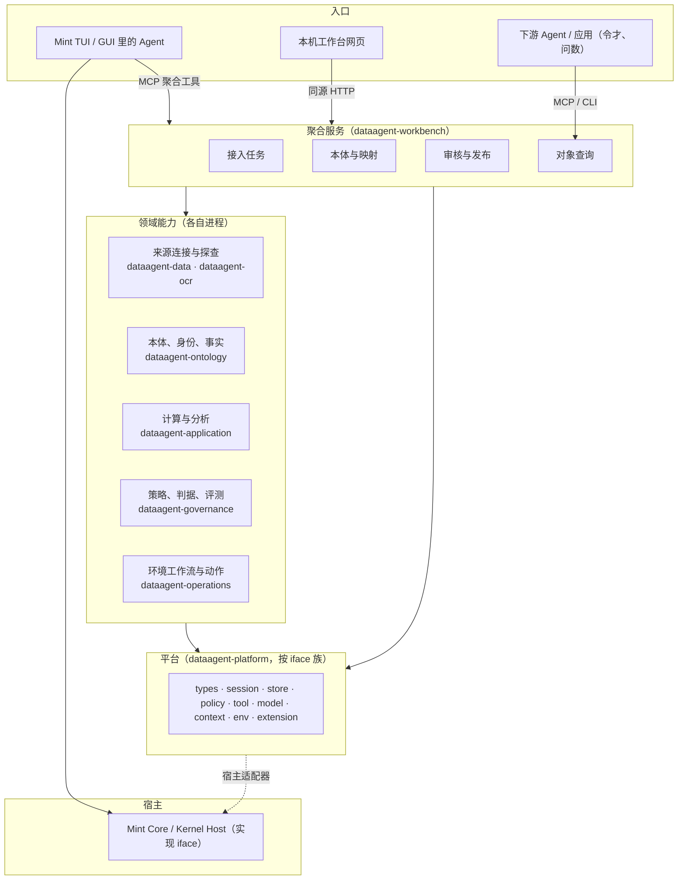
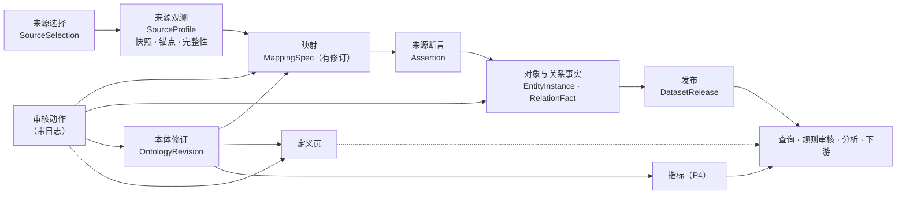
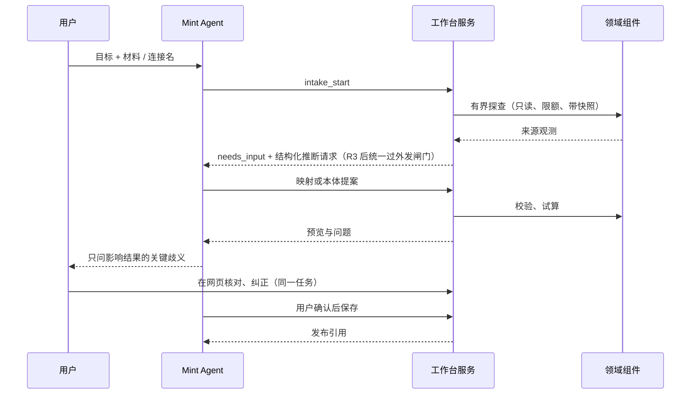

# 00 术语与总览

> 输入：
> 1. 总规划《Pluggable DataAgent》（[飞书](https://modelbest.feishu.cn/docx/TlN4dygs9oJR3Qx1FaictiPEn3c)；本地源 `docs/research/dataagent-2026-11-03/00-pluggable-dataagent.md` v0.2，基线飞书 r1045，2026-11-03）。2026-11-16 已与飞书线上 r1147 比对：线上相对本地源多 3 处人工改动，FDE 部分已合入本篇 §1，比对记录见盘点材料 `docs/dataagent-盘点材料/总规划-飞书r1147-比对.md`。
> 2. 方案 16《多源接入与环境驱动工作流落地方案》、设计 14《本体工作台》、设计 15《映射交互》（`codex/16-local-intake@87d5e8e` 及 worktree）。
> 3. 本文档集其余各篇：[01 iface 依赖与分工](<01 多源接入与本体的 iface 依赖与分工.md>)、[02 借鉴 Palantir Ontology 与 Databricks Genie](<02 借鉴 Palantir Ontology 与 Databricks Genie.md>)、[03 平台方案与 iface 共建](<03 平台方案与 iface 共建.md>)、[04 验收方法与数据](<04 验收方法与数据.md>)、[05 分期路线与 MVP 范围](<05 分期路线与 MVP 范围.md>)、[06 PRD](<06 PRD.md>)、[07 MVP 实施文档](<07 MVP 实施文档.md>)。
>
> 分工：总规划回答「有哪些能力」（18 个模块、141 个能力组、458 项原子）；本篇回答「这些能力怎么组成一个可交付的系统」；[05 分期路线](<05 分期路线与 MVP 范围.md>) 和 [06 PRD](<06 PRD.md>) 回答「分几期、每期做到什么、怎么验收」；[07 MVP 实施文档](<07 MVP 实施文档.md>) 是给执行者（含本地 crew）的任务清单。

## 1 定位

| 层次 | 是什么 | 交付的东西 |
|---|---|---|
| 狭义 DataAgent | 完成一次问答或分析 | 带依据的答案 |
| 广义 DataAgent（本项目主体） | 持续建设并运行数据工作：接入、语义与本体、质量、评测资产 | 可复用、有版本、可追溯的数据与语义资产 |
| FDE DataAgent | 在客户真实环境交付可验收结果，动作面扩到「受控地改」 | 可执行、可恢复、可审计的业务动作 |

总规划定的三个目标不变：

1. 能力模块化，发布到 MintHub，供用户或 Agent 选择、替换、组合；
2. 在 Mint TUI / GUI 里用组件包探索并完成业务闭环，令才以端到端效果验收；
3. 有效组合沉淀为 Skill / Preset，供其他业务快速接入。

FDE Agent 的特点（总规划线上版新增）：基于用户反馈、环境反馈持续建立对客户环境的认知，并据此形成、执行和修订工作流。


这条环在本设计里对应 P6（环境工作流，方案 16 的 M3、M4）；其中「识别业务对象、动作、状态」复用 P2 的本体（对象、关系、状态与生命周期）。总规划线上版还给 DA06.7 契约编译加注了「业务目标是模拟」，含义待原作者确认。

本期落地顺序（2026-11-16 定）：**P1 多源数据接入 → P2 本体的实现、打通与可视化**，之后是质量与治理、基于本体的分析、持续运行、业务动作与分发。

## 2 统一词汇与编号

| 词 | 在本文档集的含义 |
|---|---|
| 来源观测（SourceProfile） | 一次有界读取的结果：不可变快照、字段、样本、逐字段来源锚点、完整性与缺口 |
| 来源锚点 | 定位原值的位置：Excel 单元格、CSV 行、JSON Pointer、PDF 页与区域、数据库主键、REST 响应快照内路径 |
| 映射（MappingSpec） | 来源字段到本体属性的绑定与显式转换，带修订，绑定来源结构指纹与本体修订 |
| 本体修订（OntologyRevision） | 对象类型、属性、链接、约束的一个版本；正式修订只由有权限的人发布 |
| 断言 / 事实 | 断言：某来源对某值的说法，多来源分开保存；事实：按身份与角色去重后的结论，引用全部断言 |
| 发布 | 不可变清单 + 当前发布指针；下游只读已发布修订 |
| 定义页 | 一个术语、口径的权威定义（负责人、同义词、依据），参照 Databricks Pages |
| 核心 / 领域包 | 核心：与行业无关的机制（接入、证据、本体机制、映射、审核发布、查询、平台层）；领域包：本体定义、定义页、规则、映射样例、skill、验收样例 |
| 平台层 | DataAgent 内按 iface 族组织的平台代码（身份、凭据、存储、工具服务等），P1 在 `dataagent-runtime` 里，P2 改名 |
| 宿主 | Mint Core（`mint chat`）与 Kernel Host（打包桌面版回合），iface 的实现方 |
| 镜像 / 消费 / 实现 | 与 iface 的三级关系：形状语义对齐但无通道 / 经真实通道调用宿主 / 有一致性报告的实现 |
| 安装产物 | 由构建工具产出、经 `mint add` 装进全新工作区的包；不是开发仓源码 |
| 双端 | Mint TUI（`mint chat`）与 Mint 桌面 GUI |
| 证据包 | Mint 与组件版本、包摘要、工作区、会话 ID、任务 ID、发布引用、截图或录屏；入库或发 Release，仓内留摘要 |
| 可判定率 | 规则需要的字段被接入并映射上、规则因此能判的比例；不需要真值 |
| 证据可核验率 | 接入值与结论引用的字段能机器回查到原值的比例 |
| L1 / L2 / L3 | 验收数据三层：通用公开集 / 真实流程（无真值）/ 构造真值（变异集），见 [04](<04 验收方法与数据.md>) |
| crew | 本地派工工具：Claude Code 调度 dsh、zcode 实现，codex 只读审核；按 [07](<07 MVP 实施文档.md>) 的任务卡执行 |

| 编号 | 含义 | 出现在 |
|---|---|---|
| P1–P6 | 本项目分期 | 05、06；注意总规划 §2.3 的「平台对接待决 P1–P7」是另一套 |
| G / V | PRD 目标 / 验收指标（命令与期望值），如 G1.3、V1.3 | 06 |
| FR | 功能需求（改动项），如 FR1.4 | 06；同步到飞书「功能拆解」表 |
| C | 验收用例 | 05 |
| Q / D | 各篇决策问题 / 裁决清单编号 | 各篇「待拍决策」（拍板后标「已拍」）；飞书裁决清单 |
| T | MVP 任务卡，如 T11 | 07；同步到飞书「开发交付」表，任务名以编号开头 |
| R0–R7 | 平台收敛步骤 | 03 |
| PR-n | 向 agent-kernel 提的 iface / Mint PR | 03 §8 |
| A1–A7、B1–B8 | 核心包缺口：契约已有待开放 / 契约缺失待新增 | 01 §5、§6 |
| B01–B20 | 09-benchmark 评测任务 | 04；`docs/research/dataagent-2026-11-03/09-benchmark-plan.md` |
| M1–M4、M1-xx | 方案 16 的里程碑与验收矩阵编号（历史，P1 验收仍引用） | `test-inventory.md` |
| S0–S2 | 总规划切片 | 总规划 §4.1 |
| DA01–DA18 | 总规划能力模块 | 总规划 §3 |

## 3 用户与场景

| 用户 | 在哪里用 | 典型场景 |
|---|---|---|
| 业务用户 | Mint TUI / GUI 对话 + 本机工作台网页 | 给一批采购单据（PDF、Excel）和一个数据库连接，让 Agent 接入、对齐到采购本体，在网页上核对、纠正、保存 |
| 数据工程师 / FDE | 同上，加连接配置和领域本体 | 拿到一个陌生 SQLite / PostgreSQL 库，让 Agent 发现本体草案，审核后发布 |
| 下游 Agent 与应用 | MCP 工具、CLI | 令才（ql-audit）用报销本体跑规则审核；问数 Agent 按本体查对象、关系和口径 |
| 平台维护者 | 包、清单、配置 | 安装、升级、替换组件；查看审计与证据 |

## 4 总体架构



| 层 | 职责 | 不做什么 |
|---|---|---|
| 入口 | Agent 理解目标、提出语义提案（映射、本体、流程）；网页给人核对和裁决 | Agent 不直接改正式资产；网页不直接改数据库 |
| 聚合服务 | 把一次接入或审核组织成一个有修订的任务；对 Agent 暴露少量聚合工具，对网页暴露同源 API | 不重写领域算法 |
| 领域能力 | 取数、解析、转换、身份解析、本体校验、计算、策略求值、动作执行 | 不各自实现平台事（身份、凭据、存储、出网） |
| 平台 | 按 iface 族提供端口：调用上下文、任务与事件、存储、访问与外发、凭据、工具服务、推断、路径与子进程、包定位 | 不含业务语义 |
| 宿主 | Agent 回合、模型、工具调用、审批、会话、安装 | 不理解数据和本体 |

层间规则：

1. 依赖只向下：领域包互不导入实现，只经端口或公开工具；平台不依赖领域包。
2. 各领域包是独立的 Python 进程，各自锁依赖（应用层与治理层的 duckdb、sqlglot 版本不同）。
3. 平台代码只有一份，按锁定版本物化进各包（[03](<03 平台方案与 iface 共建.md>) §4 第 1 条、R5）。

## 5 核心对象与流转



| 对象 | 关键不变量 | 现状 |
|---|---|---|
| 来源观测 | 每次读取存不可变快照；每个字段带锚点（单元格、行键、JSON Pointer、PDF 页与区域）；如实报告抽样、缺口、未完成分区 | 已实现（文件、PDF+OCR、SQLite、PostgreSQL、REST） |
| 本体修订 | 对象类型、属性、值类型约束、二元链接（带基数）、关系对象（多元事实，有序角色）、约束；修订号单调；破坏性变更必须带迁移；正式修订只由有权限的人发布 | 只有单实体类型、包内固定一个；关系为多元有序角色，无基数（P2 补） |
| 定义页 | 术语、缩写、业务概念的权威定义：负责人、同义词、相关对象与指标、依据（来源锚点）；草稿 → 发布 → 认证或弃用；回答必须引用 | 无（P2 补） |
| 指标 | 结构化定义：度量、维度、过滤（表达式，不是文字）、连接与基数、时间与单位；绑本体属性；随发布出版本 | 有指标类型，但过滤是自由文本、绑原始列、恒为草稿（P4 补） |
| 映射 | 绑定来源结构指纹与本体修订；转换显式（单位、日期、枚举）；未覆盖字段标扩展、未决或不接入 | 已实现；多来源复用待补 |
| 断言与事实 | 多来源断言分开保存；事实按类型化角色元组去重；身份 = 作用域 + 概念 + 身份策略 + 类型化键元组，不按显示名合并 | 已实现 |
| 审核动作 | 三种范围：当前值、映射、本体定义；带期望修订，过期即拒；有提交条件；每次成功提交记日志，日志本身可查询 | 当前值与映射已实现；本体范围只存草案；日志不可查询（P2 补） |
| 发布 | 不可变清单 + 当前发布指针；未决与排除范围显式列出；可回退 | 已实现：不可变发布记录、断言与事实合并；未实现：当前发布指针、未决与排除清单、回退、影响分析（P2） |

任务（接入或审核的一次工作）贯穿上述对象：聊天、网页、后台处理共用同一个任务和精确修订；冲突返回 `version_conflict` 和差异，不静默覆盖。

## 6 语义栈：含义、定义、方法、目录各归哪里

参照 Databricks Genie 的分工（[02 借鉴 Palantir Ontology 与 Databricks Genie](<02 借鉴 Palantir Ontology 与 Databricks Genie.md>)）：

| 层 | 管什么 | DataAgent 里的载体 | 期 |
|---|---|---|---|
| 本体 | 业务含义：有哪些对象、属性、关系、状态 | `dataagent-ontology` 的本体修订；已发布事实物化为只读语义视图 | P2；语义视图 P4 |
| 定义页 | 权威定义：一个词、一个口径到底指什么 | 本体的一类资产，随本体发布出版本 | P2 |
| 指标 | 可计算的口径 | 结构化指标定义，绑本体属性 | P4 |
| Skills | 做事方法：步骤、检查点、输出格式；只引用定义，不复写定义 | Mint skill 包，带标准答案测试 | 看 [06 PRD](<06 PRD.md>) 的 Q7；选 A 则 P2 起逐期发布 |
| 目录与权限 | 数据在哪、谁能看 | 资产目录（DA01.6）；访问判定（DA12.1）复用来源权限，在执行层强制 | P3、P5 |

问数时，Agent 只经结构化工具碰数据：对象查询、在语义视图上跑只读 SQL、已验证模板；回答引用到对象、定义页和来源锚点。

## 7 协作方式：组件、Agent、人各做什么



1. **组件做确定性的事**：取数、解析、转换、校验、试算、保存，结果可复现。
2. **Agent 做语义判断**：识别字段含义、提出映射和本体草案、决定还要探查什么；组件不调模型，由宿主 Agent 推断，推断请求只含获准进模型的片段。
3. **人做裁决**：核对证据、纠正、批准本体修订和发布；正式目标、验收口径、授权边界只由有权主体改。

## 8 与 Mint / iface 的分工

| 归属 | 内容 | 依据 |
|---|---|---|
| 业务侧（DataAgent） | 来源连接与探查、来源证据、本体全链、推断协作方式、资产库、模型可见范围的策略内容 | [01](<01 多源接入与本体的 iface 依赖与分工.md>) §7 |
| 平台包（DataAgent 内，按 iface 族） | 调用上下文、任务与事件、存储端口、访问与外发、凭据、工具服务、推断端口、路径与子进程、包定位 | [03](<03 平台方案与 iface 共建.md>) §6 |
| 核心包要开放（A 类 7 项） | 调用元数据、工具中途向人要输入、文件与进程围栏、逐请求出网、进展回推、审计、知识登记 | 01 §5 |
| 核心包要加机制（B 类 8 项） | 工具效果注解、包级凭据、后台长任务、组件事件追加、组件侧模型调用、GUI 内嵌视图、主体与租户、包间定位与本地依赖发布 | 01 §6 |
| 我们向 agent-kernel 提的 PR | A、B 两类缺口按「契约类 / 实现类」整理成 PR-1 至 PR-8 的设计；P1 先不提（11-17 已拍），缺口在平台层绕行，提交时机另定 | [03](<03 平台方案与 iface 共建.md>) §8 |

Python 组件今天只能经 bundle 的 MCP 通道消费 tool 契约；其余契约先在平台包里按 iface 语义做本地实现，宿主开放一项切换一项。

## 9 存储布局（目标）

```text
<workspace>/.dataagent/
  content/            内容寻址对象：原件、页面渲染、响应快照（一种布局）
  db/records.sqlite3  任务、修订、断言、事实、决定、发布、事件、发件箱
  db/decisions.sqlite3  访问与外发判定（DA12.1）
  db/operations.sqlite3 动作台账、等待、租约（P6）
  results/            工具全文结果（外置）
  runtime/            本机服务描述（不含凭据）
  exports/            用户明确导出的本体、映射、结果（Ossie 等）
```

连接清单只存逻辑名，凭据值由宿主或系统钥匙串解析（[03](<03 平台方案与 iface 共建.md>) R3），不进任务记录、结果、日志。若用文件引用，只放 `.dataagent/secrets/`（目录 0700、文件 0600），包级凭据（01 的 B2）到位后取消。

## 10 设计约束（不变量）

1. **可追溯**：展示给用户或下游的每个值，都能追到来源快照、锚点、映射修订、本体修订和发布。
2. **不伪造完成**：抽样不等于全量，部分失败不显示为完成，未知不等于通过。
3. **修订与并发**：所有写入带期望修订；聊天、网页、后台改同一任务时以修订号裁决。
4. **只读优先**：P1–P5 不写源系统；P6 的写入必须有动作台账、幂等、未知对账和执行后验证。
5. **凭据不进模型**：凭据不出现在任务记录、日志、工具结果、模型上下文和截图里。
6. **数据即数据**：来源内容、页面文字、接口响应里的指令不当作授权。
7. **安装后验收**：源码环境通过不等于装包通过；每期验收都在安装产物上跑。
8. **通用不硬编码**：采购、报销等领域词表和规则来自领域配置，通用服务不写死字段名。

## 11 能力地图与分期

| 总规划模块 | P1 接入 | P2 本体 | P3 质量治理 | P4 分析 | P5 持续运行 | P6 动作与分发 |
|---|---|---|---|---|---|---|
| DA01 数据接入 | 01.1–01.5、01.10（凭据） | | | | 01.6 目录、01.7 增量 | 01.8–01.9 |
| DA02 准备与探查 | 02.1–02.4、02.12 | | 02.6 清洗、02.10 修复 | | 02.9 结构变化 | 02.13–02.15 |
| DA03 语义与关系 | 03.6 映射（预设本体） | 03.1–03.3、03.5–03.9（含 03.7 血缘视图）、03.13–03.14 | 03.10 冲突 | 03.4 指标与规则、03.15–03.16 | | 03.11–03.12 |
| DA04 轨迹与记忆 | 04.1 轨迹 | | | 04.5 任务上下文 | | |
| DA05–DA10 检索、计算、分析、交付 | | | | 主体 | | |
| DA11 评测与验证 | | | 11.1、11.4–11.5 | 11.2 | | 11.7–11.9 |
| DA12 治理与资产 | 12.1 权限（身份收敛） | 12.2 版本、12.4 影响、12.5 交互变更控制 | 12.1、12.10 审计 | | | |
| DA13 建模与物化 | | | | 13.1–13.3 | | |
| DA14 持续运行 | | | | | 14.1–14.5 | 14.6–14.8 |
| DA15–DA18 FDE | | | | | | 主体 |

各期交付见 [05 分期路线与 MVP 范围](<05 分期路线与 MVP 范围.md>)，P1、P2 的目标与验收指标见 [06 PRD](<06 PRD.md>)，P1 的任务清单见 [07 MVP 实施文档](<07 MVP 实施文档.md>)。

## 12 核心与领域包的分界（防过拟合）

令才是深度验证用例，但不是唯一的设计输入。三条硬规则：

1. **领域词不进核心**：核心包源码不得出现领域词表里的词（报销、发票、采购、招待、差旅、食品等），用 CI 检查拦住；本体定义、定义页、规则、映射样例、skill、验收样例都放领域包。现有违例：采购本体写死在工作台核心里（`dataagent-workbench/src/dataagent_workbench/bootstrap.py:35`），P1 移出。
2. **两次规则**：进入核心的契约或能力，至少两个领域用到（总规划 §4.1「新增 core 契约或能力编号须有至少两个应用或两层需要」）。只有令才需要的放领域包；向 agent-kernel 提的 PR 同样适用。
3. **留出领域验收核心**：新领域只写领域包、核心改动为 0（总规划 S0 退出条件「任何应用都不需要修改 core」），量化为「新领域到第一个可验收结果的人时」和「核心改动行数」。

领域安排：令才报销审核做深（真实流程 + 变异集）；食品安全审核校对等数据（payne 跟进）；通用能力用公开 benchmark 多维验证。评测分两层报：核心指标用通用基准，领域指标用领域金标，核心指标不许靠调令才样本刷上去。细节见 [04 验收方法与数据](<04 验收方法与数据.md>)。

## 13 已拍（payne）

1–6 为 2026-11-16 拍板，7–9 为 2026-11-17 拍板。

| | 事项 | 结果 |
|---|---|---|
| 1 | P1 目标 | 多源数据接入是当前刚需，P1 验收多源接入 |
| 2 | P2 目标 | 本体的实现、打通和可视化 |
| 3 | iface 定位 | iface 是 AgentCPM / AgentOS 的底层协议，我们承担完善它的职责：业务建设中发现缺口，向 agent-kernel 提 PR；业务部分自己承担（见 [03](<03 平台方案与 iface 共建.md>) §8） |
| 4 | 领域锚点 | 不只锚定令才：令才做深度验证；通用能力用公开 benchmark 多维验证；食品安全审核校对场景的数据由 payne 跟进；不做采购对账 |
| 5 | 验收数据 | 真实业务数据暂不可得；令才 Computer Use 数据集用于真实流程验收（流程、映射、回归、变异），不用于准确率验收 |
| 6 | 执行方式 | 标准 PRD、设计方案、任务清单维护在飞书项目；任务由本地 crew（dsh、zcode、codex）按 07 的任务卡执行 |
| 7 | agent-kernel PR | P1 先不向 agent-kernel 提 PR；PR-1 至 PR-8 保留为设计，缺口在平台层绕行，提交时机另定（03 的 Q5，裁决 D-011） |
| 8 | 其余决策 | 本篇 §14 与 01、03–06 的待拍决策按各篇推荐拍板（裁决 D-001 至 D-029，D-011 除外）；推荐里要向 agent-kernel 提的部分随第 7 条暂缓 |
| 9 | P1 数据库验收范围 | PostgreSQL 移出 P1 退出条件：P1 只验 SQLite 加 REST，凭据测试改用带 token 的 REST；PostgreSQL 适配器保留但不验收（06 的 Q12，裁决 D-030，与推荐不同） |

## 14 决策（2026-11-17 已拍）

> Q1–Q3 均按推荐拍板（A），裁决清单 D-001 至 D-003。

| | 决策 | 选项 A | 选项 B | 推荐 | 影响 |
|---|---|---|---|---|---|
| Q1 | 内部本体表达（对外交换格式另见 06 的 Q4） | DataAgent 自有模型（类型化角色、证据、修订），Ossie 只做交换（现状） | 内部改用 OWL / RDF | A | B 要重写身份、证据、修订三套语义，P2 来不及 |
| Q2 | 领域本体放哪 | 预设本体做成 Mint 包（定义 + 说明），用户修订存工作区并可导出 | 全部作为工作区资产 | A | A 能随 MintHub 分发和复用；B 每个工作区从零开始 |
| Q3 | 工作台形态 | 每个工作区一个本机服务 + 浏览器 | 做成常驻共享服务 | A；多用户需求出现在 P6 再议 | B 要先有主体与租户（B7） |
