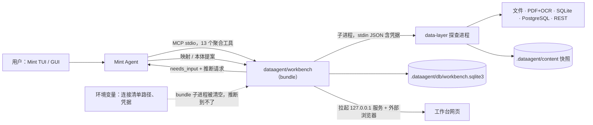
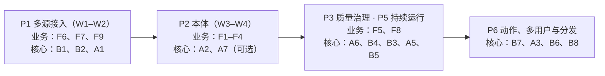

# 01 多源接入与本体的 iface 依赖与分工

> 基线：DataAgent `codex/16-local-intake@87d5e8e`（未推送，位于 `~/Vibe/AgentOS/.worktrees/dataagent-local-intake`）加该 worktree 里未提交的 `dataagent-ocr`；agent-kernel `master@01bef1c12`（2026-11-16 16:31，本次 fetch 后快进）。
> 缩写：`DA` = DataAgent 仓 `packages/capabilities`；`IF` = agent-kernel `kernel/iface/src`；`MC` = `mint/crates/mint-core/src`；`MM` = `mint/crates/mint-manifest/src`；`MP` = `mint/crates/mint-protocol/src`；`GUI` = `mint/packages/gui-tauri/src-tauri/src`。
> 周次：文中「W4 任务」「W5」「官方计划 W6」沿用 AgentOS 旧文档的官方周次（W4 = 2026-11-16 所在周）；本 workspace 记为 W1、W2、W3，§8 起用本 workspace 周次。
> 证据边界：只读代码，没有编译、运行或装包；标「推断」的没有实测。AgentOS 的《DataAgent 实现与 iface 契约对照》基于 `45c45a817`，到 `01bef1c12` 的 7 个提交在 `kernel/iface`、`kernel/core`、`kernel/runtime`、`mint` 范围内只改了 `IF/model_session/input.rs`，那篇引用的 Mint 行号仍然成立。引用经独立复核（约 109 处），偏差已改正。本文收窄到「多源接入 + 本体」，并按「业务侧 / 核心包」重新归类。

## 1 结论

1. **接入和本体本身归业务侧，iface 不需要加「连接器」「本体」这类契约。** 5 类来源（文件、PDF+OCR、SQLite、PostgreSQL、REST）、来源锚点、本体定义 / 映射 / 断言 / 事实 / 审核 / 发布、SQLite 本体发现、Ossie（Apache 的开放语义交换格式）导入导出，都已在 DataAgent 里实现，都是业务语义。
2. **DataAgent 直接依赖宿主的只有三处**：iface-tool（Agent 发现并调用 13 个聚合工具）、iface-policy（调用前审批，但 Mint 按工具名猜类别）、iface-model + iface-loop（组件不调模型，由宿主 Agent 产出映射和本体提案）。身份、凭据、文件和网络围栏、长任务、资产存储、视图全部自建或绕行。
3. **要核心包动的共 15 项：**
   - A 类 · 契约已有，Mint 没开放给 MCP 包（7 项）：调用元数据、工具中途向人要输入、文件与进程围栏、逐请求出网判定、后台进展回推、审计、知识登记。
   - B 类 · 契约缺失，要加机制（8 项）：工具效果注解、包级凭据与连接配置、后台长任务、组件事件追加、组件侧模型调用、GUI 内嵌视图、调用主体与租户、包间定位与本地依赖发布。
4. **卡交付的是两项**：B1 工具效果注解（没有它，默认审批策略下每次调用都弹窗，M1 只能在 `full-access` 下验收）；B2 包级凭据（没有它，M2 的数据库和 API 凭据只能写进项目级 `.mcp.json` 或依赖终端环境，打包桌面版 GUI 下拿不到）。另外 Mint 工具调用默认 60 秒超时，比数据层子进程的 120 秒短，大文件、扫描 PDF 的单次探查可能被宿主截断（推断）。
5. **业务侧还缺的功能不依赖核心包，可以现在做**：本体只能有一个实体类型；本体草案转不成正式修订；发布后的对象没有查询入口；增量接入全部未实现；已验证映射只在单来源时复用；单次探查没有按时间预算分段续跑。
6. **这些缺口由我们推动补齐**：2026-11-16 已拍，iface 是 AgentCPM / AgentOS 的底层协议，我们承担完善职责。A、B 两类缺口按「契约类 / 实现类」转成向 agent-kernel 提的 PR，清单、提交规矩和进度见 [03 平台方案与 iface 共建](<03 平台方案与 iface 共建.md>) §8。

## 2 已经实现了什么

### 2.1 多源接入

| 能力 | 实现 | 证据 |
|---|---|---|
| 来源端口 | 定义了 `describe / read / changes`，只有 SQLite、PostgreSQL、REST 三个类实现，且只在测试里用；生产路径按来源类型直接调用探查函数；`changes` 唯一实现返回 unsupported | `DA/dataagent-data/src/dataagent_data/ports/source.py:7-10`；`observation/cli.py:13-51`；`adapters/sources/base.py:51-53` |
| 文件 | CSV、TSV、JSON、JSONL、XLSX、XLSM、PDF；32 MiB 上限；拒绝绝对路径、`..` 和 `.mint` | `observation/files.py:16-24`、`:33-37` |
| 扫描 PDF | 调 `dataagent-ocr` 本地引擎；远程 OCR 引擎直接停用，理由写在代码里：要先有受控出网 | `observation/cli.py:30-43`（`:38-41`） |
| SQLite | 工作区内只读事务、`query_only`、5 秒进度中断、不超过 100 张表 | `adapters/sources/sqlite.py:9-20`、`:56-62` |
| PostgreSQL | 只读事务、语句超时；定位串不得含凭据；不接受用户 SQL | `adapters/sources/postgres.py:6-19`；`observation/database.py:12-16` |
| REST | 只 GET；来源白名单必填；禁重定向、禁环境代理；查询串里不得带 token；Bearer / Basic 两种认证 | `adapters/sources/rest.py:15-25`、`:28-38`、`:41-43`；`observation/http.py:45-53` |
| 来源证据 | 每次读取存内容寻址快照（CAS，按内容哈希命名、只新建不覆盖的文件）；每个字段带锚点（行键、单元格、JSON Pointer、PDF 页）；结构指纹、完整性与缺口 | `adapters/sources/base.py:29-44`；`observation/database.py:49-63` |
| 进程隔离 | 工作台以子进程调用数据层，环境变量只留 PATH、HOME、TMPDIR、LANG、TZ、`LC_*`，120 秒超时 | `DA/dataagent-workbench/src/dataagent_workbench/adapters/layer_client.py:16-30` |
| 连接与凭据 | 连接清单文件路径从 `DATAAGENT_SOURCE_CONNECTIONS` 读；凭据按 `credential_env` 从环境变量读；经 stdin 交给数据层子进程。`SourceSelection.credential_binding_ref` 已定义但没人用 | `adapters/source_connections.py:9-10`、`:24-29`；`layer_client.py:19-23`；`DA/dataagent-contracts/src/dataagent_contracts/intake.py:25` |

### 2.2 本体

| 能力 | 实现 | 证据 |
|---|---|---|
| 定义 | `OntologyRevision`：一个 `entity_type`、属性、身份字段、多元关系（有序角色） | `DA/dataagent-contracts/src/dataagent_contracts/ontology.py:17-34` |
| 映射 | `MappingSpec`：字段绑定 + 9 种转换（十进制、分转元、日期、枚举、组合等）；未覆盖字段标 extension / unresolved / exclude | `ontology.py:37-53` |
| 身份与事实 | 实体键 = 作用域 + 类型 + 身份策略 + 类型化键元组；关系事实键 = 有序类型化角色元组；多来源断言分开保存 | `DA/dataagent-ontology/src/dataagent_ontology/identity.py:26-27`；`facts.py:5-6` |
| 预览、审核、发布 | 三种修改范围（当前值、映射、本体）；发布写不可变断言、合并事实、生成发布记录 | `dataagent_ontology/service.py:34-56`（预览）、`:66-137`（审核与发布） |
| 本体来源 | 包内固定 `procurement.json`，启动时注册；一个工作台只认这一个目标本体 | `DA/dataagent-workbench/src/dataagent_workbench/bootstrap.py:32-36`；`intake_service.py:120` |
| 本体发现 | SQLite：主键、唯一键、外键与值重合生成关系候选；Agent 提实体和关系，用户在工作台确认；确认后只保存草案 | `ontology_discovery.py:185-202`；`discovery_catalog.py:40-178`；方案 16 `sqlite-ontology-discovery.md:25` |
| 交换 | Ossie 单实体导入导出，附损失报告 | `dataagent_ontology/adapters/ossie.py:1-6` |
| 映射复用 | 按「作用域 + 结构指纹 + 本体修订」登记已验证映射，只在单来源时登记和命中 | `intake_service.py:75-80`、`:203-206` |
| 与 Agent 协作 | 组件返回 `needs_input` 和结构化推断请求，Agent 回交提案，组件校验后试算。有 `.dataagent/model-context.json` 时按字段白名单过滤；没有时全部字段和前 5 行样本都给 Agent | `service_tools.py:24-48`；`inference_requests.py:5-37`；`bootstrap.py:29-31` |
| 存储 | `WorkbenchStore` 端口；SQLite 一个事务内写修订、事件和 outbox | `DA/dataagent-runtime/src/dataagent_runtime/ports/workbench_store.py:32-37`；`adapters/workbench_sqlite.py:73-111` |

### 2.3 现在的调用链

## 3 划分判据

1. **放业务侧**：含业务语义（来源格式、本体概念、映射、身份规则、审核含义）；只有 DataAgent 用；在包内能闭环，不需要宿主担保。
2. **放核心包**，满足任一条：
   - 只有宿主能可信地给出的事实：谁在调用、哪个会话、是不是人点的；
   - 跨进程的强制：文件、网络、凭据、审批，组件自查不算数；
   - 生命周期超过一次工具调用：后台任务、回推进展；
   - 多个应用都在自建：rsi-toolkit 也自建了 SQLite + 内容寻址存储和后台实验，ql-audit 也要向人要澄清答案（平台依赖《01 架构与依赖》§7）。

## 4 需要哪些 iface 包

判定：✓ 已满足；◐ 部分满足；✗ 不满足。主责取自飞书《AgentCPM OS 项目》r767 的 iface 分工表。

| 包系列（主责） | DataAgent 现在在用 | 要开放（A 类） | 要加机制（B 类） |
|---|---|---|---|
| iface-tool（李奕杉） | 工具发现与调用 ✓ | A1 调用元数据 | B1 效果注解、B3 后台长任务、B7 主体与租户 |
| iface-policy（李鹏越） | 调用前审批 ◐（按名猜） | A2 中途要输入、A4 逐请求出网、A6 审计 | B2 包级凭据 |
| iface-env（李鹏越） | 无 | A3 文件与进程围栏、A7 知识登记 | 无 |
| iface-session（彭淳毅） | TUI 指定工作区开会话 ✓ | A5 进展回推 | 无 |
| iface-store（郑达奇、魏耀全） | 工具结果进会话日志 ✓ | 无 | B4 组件事件追加 |
| iface-model（魏耀全） | 宿主 Agent 推断 ✓ | 无 | B5 组件侧模型调用 |
| iface-loop（郑达奇） | 内置回合循环 ✓ | 无 | B3 的执行面可能落在这里，随 B3 定 |
| iface-context（李奕杉） | 大结果由组件写 `result_path` 自行截断 ◐ | 无 | 无 |
| iface-extension（李鹏越，实施范围空白） | bundle / preset 本地安装 ◐ | 无 | B8 包间定位与本地依赖发布；B2、B6 的清单声明部分 |
| Mint GUI（不属 iface） | 无 | 无 | B6 内嵌视图；GUI 拉内核时的环境与 PATH |

## 5 核心包 A 类：契约已有，Mint 要开放给 MCP 包

| # | 机制 | 契约位置 | Mint 现状 | DataAgent 拿来做什么 | 现在的绕行 |
|---|---|---|---|---|---|
| A1 | 调用元数据 CallMeta（session_id、call_id、turn）随工具调用下发 | `IF/types/mod.rs:5-11`：「工具调用时必须可读到」 | MCP `_meta` 只带协议版本和客户端信息（`MC/mcp/client.rs:403-408`） | 任务与会话关联；审计对账；访问复检的主体 | 组件自造调用上下文（`bootstrap.py:42-45`） |
| A2 | 工具执行中向人要输入 | `HumanChannel`（`IF/policy/human.rs:154`） | `input_required` 直接变成错误（`MC/mcp/client.rs:416-419`）；mint 源码里没有引用 `HumanChannel` | 映射关键歧义、表头选择、本体草案确认 | 返回 `needs_input` → 用户在工作台操作 → Agent 再调用 |
| A3 | MCP 子进程纳入文件与进程围栏 | `FsBackend`、`ExecBackend`、`SandboxBackend`（`IF/env/fs_backend.rs:76`、`exec_backend.rs:81`、`sandbox.rs:262`） | 直接 `Command::spawn`，无沙箱（`MC/mcp/client.rs:225-246`）；`fs.read`、`fs.write` 只在插件宿主路径生效（`MC/host/policy.rs:65-66`），对 MCP 子进程只是声明 | 只读用户选定的文件；只写 `.dataagent/` | 组件自查路径（`files.py:16-24`、`sqlite.py:9-20`） |
| A4 | 组件出网逐请求判定、出口泄漏检测 | M21 `EgressRequest`（`IF/policy/egress.rs:15`）；I-45 `LeakDetector`（`IF/policy/leak.rs:106`） | 只在拉起 MCP 时判一次进程级出网（`MC/mcp/client.rs:215-224`），之后子进程整网可用 | PostgreSQL、REST 目标；远程 OCR | 组件自带白名单、禁重定向和代理；远程 OCR 停用 |
| A5 | 后台进展回推到会话 | `InboxContract`（`IF/session/inbox.rs:259`） | mint 源码里没有引用 | 长探查、增量、质量检查结束后通知 Agent | Agent 轮询 `intake_status`；依赖 B3 |
| A6 | 审核、发布决定进 OS 审计 | `AuditSink`（`IF/audit.rs:360`） | 不对组件开放 | 本体修订、映射保存、数据发布留痕 | 只记在 `workbench.sqlite3` 的 review 记录（`service.py:100-102`） |
| A7 | 知识登记：跨应用可见的本体定义和发布指针 | `KnowledgeContract`（`IF/env/knowledge.rs:348-361`）：虚拟路径 + 来源、时间、范围、可信度、权限、状态 + 引用证据 | 参考实现在 kernel runtime（`kernel/runtime/src/knowledge/file_store.rs:300`），Mint 没接 | ql-audit 规则映射到报销本体等跨应用复用 | 业务侧查询工具（§7.2 F4）；本项可选，见 06 PRD 的 Q5 |

## 6 核心包 B 类：契约缺失，要加机制

| # | 机制 | 放在哪 | 现状与证据 | 最小形状建议 | 对应阶段 |
|---|---|---|---|---|---|
| B1 | 工具效果注解 | iface-tool + iface-policy | `ToolSpec` 只有名字、描述、参数（`IF/tool.rs:35-39`）；Mint 按名字关键词猜类别、不读 MCP 工具注解（`MC/mcp/client.rs:738-757`），猜不出一律询问（`MC/approval.rs:148-174`），审批记忆绑定完整参数（`:177`）；DataAgent 13 个工具名（`tool_schema.py:62-65`）全部猜不出 | `ToolSpec` 只加不改地增加效果等级（只读 / 推进 / 副作用，Mint 插件协议已有同义枚举 `CallEffect`，`MP/host.rs:361`）和幂等标记；或 Mint 认 MCP 的 `readOnlyHint`、`destructiveHint`；审批按效果判 | M1 默认配置可用 |
| B2 | 包级凭据与连接配置 | iface-policy（M20 密钥代用）+ iface-extension | bundle 不得声明 `env`、`secrets`（`MM/validate.rs:868`、`:870`）；Mint Core 只加载项目级配置和 bundle 包的 `.mcp.json`（`MC/mcp_loader.rs:194-260`、`:611`），bundle 子进程环境清到基础变量，只有 `.mcp.json` 里写的字面值能进去（`MC/mcp/client.rs:227-241`；`${NAME}` 展开被拦，`MC/mcp_loader.rs:404-418`）；打包桌面版 GUI 拉内核时清空环境并把 PATH 固定为系统目录（`GUI/bridge/lifecycle.rs:47-55`，非打包分支 `:94-96` 继承环境）；`SecretBroker` 只在 kernel core 实现，真正能用的只有出网 Bearer，状态加密只做了登记、调用即报错（`IF/policy/secret.rs:137-148`、`kernel/core/src/guard/secret.rs:142-155`），Mint 源码里没有引用。推断：工作台包内 `.mcp.json` 没写 `env`，经 Mint 拉起时 `DATAAGENT_SOURCE_CONNECTIONS` 和凭据变量到不了工作台进程；方案 16 `offline-input-cases.md:113` 的「同一终端导出」只对直接启动工作台有效（`scripts/verify_local.py:141` 就是直接设环境变量） | bundle 声明 `capabilities.secrets = ["<逻辑名>"]`；用户在 TUI / GUI 设置值；宿主只在拉起声明它的 MCP 进程时注入，不进 shell、不进 Agent 上下文；`LeakDetector` 按已注册值给日志和工具结果打码。非密的连接清单路径现在就能写成包内 `.mcp.json` 的字面值，不必等本项（F7）。形态见 Q1 | M2 前 |
| B3 | 后台长任务 | iface-tool（分工表已列「后台任务查状态、取结果、取消」）；官方计划 W6「后台长任务」 | 无契约；MCP 子进程随内核退出（`MC/mcp/client.rs:245` `kill_on_drop`）；Mint 的 MCP 请求和回合工具调用默认 60 秒超时（`MC/mcp/transport.rs:24`、`MC/config.rs:57`），包内 `.mcp.json` 的 `timeout_s: 120` 只用作发现超时（`MC/mcp_loader.rs:449`）。DataAgent 的任务状态以记录持久（`intake_service.py:74`、`:208`），但没有执行者；`intake_advance` 在一次工具调用里同步探查，数据层子进程超时是 120 秒（`layer_client.py:23`），推断：大来源经 Mint 调用时会先被宿主 60 秒截断 | 提交、状态、取消、取结果；定时与来源变更两种触发；任务寿命独立于回合；结果经 A5 回推 | 持续接入 |
| B4 | 组件事件追加 | iface-store | `StoreContract` 只管会话事件，组件拿不到（`IF/store.rs:119`）；DataAgent 资产、事件、outbox 都在自己的 SQLite | 按方案 06 附录 A：`store.ext_append / ext_read / ext_checkpoint`，命名空间 `ext.<组件>.<事件>`，带 call_id，大内容只记引用和摘要；资产库不上收，见 Q2 | 持续接入、审计 |
| B5 | 组件侧模型调用 | iface-model + iface-extension | bundle 不得声明 `model`（`MM/validate.rs:869`）；MCP sampling 已弃用（`MC/mcp/transport.rs:290`）。交互场景靠推断请求够用；后台任务里没有 Agent 可问 | bundle 可声明模型用途；宿主代调并走预算、出网、审计；或后台任务「挂起等 Agent」，与 B3 一起定 | 持续接入 |
| B6 | GUI 内嵌应用视图 | Mint GUI；声明部分在 iface-extension | `ui` 能力只给 plugin、overlay（`MM/validate.rs:871`），插件宿主调用只有日志、私有 KV、通知、出网四种（`MP/host.rs:370-384`）；DataAgent 拉起脱离会话的本机服务并开外部浏览器（`launcher.py:27-28`、`interfaces/http_api.py:77`） | 包声明视图入口；GUI 打开时带上会话和身份 | 方案 16 允许首批用浏览器，可后置 |
| B7 | 调用主体与租户随调用下发 | iface-tool + iface-policy | `CallMeta` 没有主体和租户字段；身份判决只到连接级（`IF/policy/identity.rs:223`）；DataAgent 主体写死为 `local-owner:<uid>`（`bootstrap.py:24-25`）；S0 评审 X1–X3 指出主体与用途由调用方自报 | `CallMeta` 只加不改地增加主体、租户，由宿主填，组件只读 | 多用户、共享工作区前 |
| B8 | 包间定位与本地依赖发布 | iface-extension | `[requires] interfaces` 与 `interface_versions` 已有，`mint add` 安装期检查提供方与版本区间（`mint/bins/mint/src/install/interfaces.rs:93-136`），DataAgent 没用；`requires.api` 对照的是 Mint 扩展点 API 0.1.0（`MP/lib.rs:45`），不是 iface 0.1.9；只写 path 的依赖不能发布（`mint/crates/mint-pack/src/payload.rs:94-97`）；DataAgent preset 全用 path 依赖（`DA/dataagent-intake/mint.toml:12-16`），工作台按 `.mint/packages/dataagent/data-layer@*` 目录猜数据层位置（`layer_client.py:56-59`） | DataAgent 侧补 `requires.interfaces`；Mint 侧：运行期按依赖名解析已装包目录并注入 MCP 进程，本地 path 依赖有可发布的替代 | MintHub 分发前 |

## 7 业务侧

### 7.1 保留在业务侧、不需要核心改动

1. 连接器：文件、OCR、SQLite、PostgreSQL、REST 的探查实现；`SourcePort` 目前只被 SQLite、PostgreSQL、REST 三个类实现且只在测试里用，应把生产路径（`observation/cli.py:13-51`）和文件、PDF 都收到这个端口下，以后加 MySQL、Hive、对象存储、飞书表格也按它加适配器。
2. 有界探查和来源证据：预算、超时、只读事务、快照、锚点、结构指纹、完整性。
3. 本体全链：定义、映射与转换、身份解析、断言与事实、三种修改范围、发布、本体发现、Ossie 交换。
4. 推断协作方式：组件出结构化推断请求，宿主 Agent 出提案，组件校验。
5. 资产库：`WorkbenchStore` 端口与 SQLite 实现；核心只补 B4 的事件追加用于关联和审计。
6. 模型可见范围的策略内容：哪些字段可以进模型上下文（`model-context.json`）由业务配置和过滤；宿主只需告知当前模型是本机还是远端，见 Q3。

### 7.2 业务侧还要做的功能

| # | 缺口 | 证据 | 要做什么 | 对应 |
|---|---|---|---|---|
| F1 | 本体只能有一个实体类型 | `ontology.py:17-23` | 概念、属性、关系、约束分开建模，支持多概念；与 Ossie 交换对齐 | P2 |
| F2 | 本体草案转不成正式修订 | 本体范围的审核只把草案存进预览（`service.py:74-76`）；发现草案确认后只保存草案（`sqlite-ontology-discovery.md:25`） | 草案 → 校验 → 有权限的人审核 → 新 `OntologyRevision`；兼容性分类与影响分析；发布门禁与回退 | W4 任务 7 |
| F3 | 本体固定在包内、只能有一个 | `bootstrap.py:35-36`；`intake_service.py:120` | 按领域加载、选择本体；领域本体做成独立 Mint 包（skill 包：说明 + 定义文件），工作台从已装包里发现 | 令才报销本体；包间定位暂按目录约定，等 B8 |
| F4 | 发布后的对象没有查询入口 | 13 个工具里 11 个是接入流程、2 个是工作流（`tool_schema.py:62-65`），没有查对象或事实的 | 加只读查询工具：按概念、身份键、关系查，返回发布修订和来源锚点 | 下游 Agent、ql-audit |
| F5 | 增量接入未实现 | `changes` 全部 unsupported（`base.py:51-53`） | 数据库按主键或更新时间游标，REST 按版本或 ETag，文件按摘要；来源变化后局部重验映射 | DA01.7；持续执行要 B3 |
| F6 | 多来源映射不复用 | 只在单来源时登记和命中（`intake_service.py:75`、`:203`） | 按「来源指纹集合 + 本体修订」登记 | P1 |
| F7 | 连接配置靠环境变量 | `source_connections.py:9-10`、`:24-29`；`credential_binding_ref` 未用 | 现在：连接清单路径写进工作台包内 `.mcp.json` 的 `env` 字面值（如 `.dataagent/source-connections.json`），凭据仍按 §8 绕行；B2 落地后凭据改为逻辑名引用 | P1 |
| F8 | 质量规则 | 未实现 | 随本体修订版本化；发布和重新接入时执行 | P3 |
| F9 | 单次探查可能超过宿主超时 | Mint 工具调用 60 秒（`MC/config.rs:57`），数据层子进程 120 秒（`layer_client.py:23`） | 探查按时间预算分段（按页、按表、按分页），每段落盘后返回 `retry_probe`，下次 `intake_advance` 从断点续跑（REST 已有断点续跑，`observation/http.py:35-42`） | M1、M2；彻底解决靠 B3 |

## 8 分阶段与绕行

分期定义见 [05 分期路线](<05 分期路线与 MVP 范围.md>)；对应的 PR 见 [03](<03 平台方案与 iface 共建.md>) §8.3。

| 阶段 | 核心前置没到时的绕行 | 风险 |
|---|---|---|
| P1 文件接入 | 验收时记录审批策略；`approval_policy=never` 或 `full-access` 下的通过不代表默认配置可用。GUI 下在项目级 `.mcp.json` 写 uv 绝对路径和 `UV_OFFLINE`、`UV_CACHE_DIR` | 默认配置的用户每次调用都要点批准 |
| P1 数据库与 API | TUI：项目级 `.mcp.json` 的 `env` 注入连接清单路径和凭据变量（项目级配置没有包清单，继承内核全部环境，`MC/mcp_loader.rs:434-438`）；打包桌面版 GUI：内核环境已被清空，只能写明文值 | 凭据明文落盘；可能进日志和工具结果 |
| 持续接入 | Agent 反复调用 `intake_advance` 推进，每次受 Mint 60 秒工具超时限制 | 关掉会话就停；没有定时；大来源单次探查可能被截断 |
| 多用户 | 只支持本机单用户 `local-owner` | 不能放到共享工作区 |

## 9 待拍决策

| | 决策 | 选项 A | 选项 B | 推荐 | 影响 |
|---|---|---|---|---|---|
| Q1 | 凭据机制向 Mint 提哪种形态 | 宿主在拉起声明它的 MCP 进程时注入密钥值（进程级） | 扩 `SecretBroker` 用途域，组件请宿主代用，值不出宿主 | A：PostgreSQL 等驱动必须拿到明文；与总规划 P1「写后端凭据只发给网关进程」同一原则 | A 要 Mint 放开 bundle 的 `secrets` 声明并改 MCP 加载器；B 对 HTTP 认证可行，对数据库驱动不可行 |
| Q2 | 资产存储是否上收核心 | 业务侧保留 `WorkbenchStore`，核心只加组件事件追加（B4） | 推动 iface-store 定义通用应用资产存储契约 | A | B 能统一 DataAgent 与 rsi-toolkit 的自建存储，但契约面大、W5 前落不了 |
| Q3 | 「哪些数据可进模型」的策略源 | DataAgent 自管 `model-context.json` | 宿主策略下发，含当前模型是本机还是远端 | A，同时向 iface-model 提「当前模型出境属性」只读查询 | 远端模型下不知情地外发样本，是 S0 评审 X4 一类问题 |

## 出处

| 材料 | 位置 |
|---|---|
| DataAgent 方案 16（多源接入与环境驱动工作流） | 分支内 `docs/research/dataagent-2026-11-03/16-local-ingestion-workflow-build-plan.md` |
| 设计 14（本体工作台） | worktree 未提交的 `docs/research/dataagent-2026-11-03/design/14-ontology-workbench-plan.md` §7–§8 |
| 组件事件接口提案 | 本仓 `docs/research/dataagent-2026-11-03/06-data-layer-build-plan.md` 附录 A |
| 平台对接待决 P1–P7 | 本仓 `docs/research/dataagent-2026-11-03/00-pluggable-dataagent.md` §2.3 |
| DataAgent 实现与 iface 契约对照（逐包、清单语义） | `~/Vibe/AgentOS/docs/architecture/2026-11-16-DataAgent与iface契约对照.md` |
| S0 阻断项 X1–X5 | `~/Vibe/AgentOS/docs/progress/2026-11-12-项目进度梳理.md` 第 79–86 行 |
| W4 任务 7、8、9 | `~/Vibe/AgentOS/docs/progress/2026-11-13-广义DataAgent-W4任务拆分.md` |
| iface 分工与官方周历 | `~/Vibe/AgentOS/docs/official/sources/2026-11-16-AgentCPM-OS项目-r767.md`；`docs/official/agentcpm-os-project.md` 第 109、124 行 |
| 官方 D02、D04 方向 | `~/Vibe/AgentOS/docs/official/agent-os-application-components.md` 第 66–118 行 |
| 平台依赖与已知缺口 | agentcpm-os `projects/platform/docs/platform/01 架构与依赖.md` §7 |
