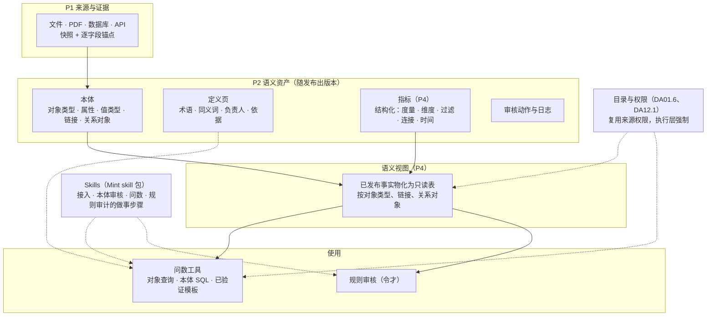

# 02 借鉴 Palantir Ontology 与 Databricks Genie

> 外部资料：palantir.com/docs 与 docs.databricks.com、databricks.com/blog，2026-11-16 访问，编号见文末「出处」（P = Palantir，G = Databricks）。厂商自报的准确率只作参考。
> 内部代码基线：DataAgent `codex/16-local-intake@87d5e8e` 及 worktree。缩写：`A` = `dataagent-application/src/dataagent_application/`，`D` = `dataagent-data/src/dataagent_data/`，`C` = `dataagent-contracts/src/dataagent_contracts/`，`G` = `dataagent-governance/src/dataagent_governance/`，`R` = `dataagent-runtime/src/dataagent_runtime/`，`O` = `dataagent-ontology/src/dataagent_ontology/`，`W` = `dataagent-workbench/src/dataagent_workbench/`，均在 `packages/capabilities/` 下。
> 标「推断」的是我们的判断，不是厂商文档原话。

## 1 结论

1. **两家的共同结构**：
   - 一个受治理的语义层：Palantir 的 Ontology（对象、属性、链接、动作）；Databricks 的 Genie Ontology（建模知识 + 学来的知识）。
   - 模型只能通过结构化工具碰数据：Palantir 用对象查询、Ontology SQL；Genie 只生成只读 SQL，并优先命中已验证的模板。
   - 权限按提问人本人的身份在执行层生效，不靠提示词约束模型。
   - 回答引用到权威对象或定义，SQL 可查看、可自查。
2. **对用户四分法的核对**（G1–G8、G20）：四个概念都有对应的命名功能：Genie Ontology（2026-11-09 GA）、Unity Catalog Pages（2026-11-11 GA）、Genie One skills 与 Unity Gateway Skills（后者为 Beta）、Unity Catalog。需要补两点：
   - Pages 不与 Ontology 并列，而是 Ontology 里「建模知识」的一部分；
   - 指标单独放在 metric views（YAML 结构化定义）；真正执行问数的是 Genie Agents（原名 Genie Spaces）。官方分工是「metric views 管结构化指标，Pages 管文字概念，Skills 管做事步骤」（G6）。
3. **DataAgent 现状最大的断点：本体和计算完全断开**。应用层、数据层、治理层、运行时的源码里搜不到 `ontology`；指标绑的是原始列；问数生成路径只能单表；没有示例查询、术语表、值字典；查询路径不做列行权限；问数评测没接通（§4）。
4. **DataAgent 已有、两家都弱的东西要保留**：逐字段来源锚点和多来源断言。Palantir 把多源合并放在本体之外的数据管线里，多源对象只支持按列合并（P18、P39）；Genie 的知识片段只追溯到资产级血缘（G1）。我们能把一个回答追到原始单元格或 PDF 区域。
5. **落到分期**：
   - P2 补五件事：二元链接与关系对象、值类型约束、审核动作化并留日志、破坏性变更必须带迁移、权威定义页；
   - P4 改成「本体落地的问数」：已发布事实物化为语义视图，指标结构化，加可信资产（示例 SQL、函数、值字典），固定上下文拼装顺序，SQL 自查；评测门禁在 P3 建立，P4 沿用；
   - 新增一条 Skills 包线：把做事方法发布成 Mint skill 包。

## 2 Palantir Ontology 要点

| 构件 | 要点 | 出处 |
|---|---|---|
| 对象类型 / 对象 / 对象集 | 分别类比数据集、行、过滤后的行；主键必须唯一且确定，另有标题键作显示名；时间类型不适合做主键 | P2、P3、P41 |
| 属性 | 共享属性只共享元数据；值类型（value type）是带约束的语义类型，分破坏性与非破坏性编辑；结构体不能嵌套 | P3–P6 |
| 链接类型 | 只连两个对象类型，双向；1:1、1:N 用外键，M:N 必须有连接表；还有由对象承载的链接 | P7、P8 |
| 接口 | 对象类型的抽象形状，不能实例化，可多实现、可继承 | P9 |
| 动作类型 | 一次提交里的一组对象和链接编辑加副作用；提交条件（以前叫校验）可看提交人、参数、对象；成功的提交记入动作日志，日志本身也是可查询的对象 | P10–P14 |
| 函数、派生属性 | 函数在服务端隔离执行，能读、能遍历、能编辑；派生属性查询时计算、只读 | P15、P16 |
| 变更与分支 | 破坏性变更清单（换数据源、换主键、改类型、删已有编辑的属性）；没定义迁移就不让保存；分支上改本体自动生成提案，开启保护后必须评审 | P20、P21 |
| 权限 | 对象安全策略管行、属性安全策略管列，合起来到单元格；但不延伸到导出 | P19 |
| 大模型怎么用 | 对象查询工具按白名单限定类型和属性；动作工具可设为需人确认；引用格式是「类型 + 主键」，点开到对象；AIP Analyst 有 Ontology SQL（把对象集当表跑 SQL），文档建议优先聚合或 SQL，不要把大量对象塞进上下文；Workshop 的 SQL 变量用 AIP 从自然语言生成 SQL 时，限定在 Ontology SQL 方言和已声明的表、列、参数内，并要求上线前人工复核 | P29、P31–P35 |
| 检索建议 | 上下文放得下就先不做检索；答错先查检索 | P36 |
| 设计反模式 | 同一实体按来源系统各建一个类型（系统孤岛）；手工维护计数属性 | P38、P39 |

## 3 Databricks Genie 要点

| 构件 | 要点 | 出处 |
|---|---|---|
| Genie Ontology | 统一上下文层。建模知识：metric views、domains、Pages、认证标记。学来的知识：从仪表盘、SQL、Genie Agents 自动抽出的片段，按来源、使用频率、新鲜度打权威分；冲突时建模知识优先，解决不了就反问用户。片段不能直接改，只能改源资产或升格为建模知识；2026-11-09 GA | G1–G3、G20 |
| Unity Catalog Pages | 业务概念、术语、缩写的权威定义，挂在 domain 下；字段有 owner、synonyms、related assets、sources；普通用户写草稿，Page manager（有 `MANAGE PAGES` 权限）或 curator 才能发布，可认证或弃用；Genie 回答时引用；2026-11-11 GA | G2、G5、G20 |
| Skills | `SKILL.md` 格式的工作流配方：步骤、检查点、输出格式。原话是「本体管定义，技能管步骤」。平时只放元数据，用到才加载全文；发布到 Unity Gateway 后成为 Unity Catalog 里有权限、标签、审计的对象，可经 MCP 访问（Unity Gateway Skills 为 Beta）；建议小而可串、用标准答案测 | G6–G8 |
| Metric views | YAML：`source`、`joins`（含基数）、`filter`、`dimensions`、`measures`（可带窗口）、`parameters`、`materialization`；字段可加同义词 | G14、G15 |
| Genie Agent（问数执行体） | 最多 50 个数据源；指令最多 100 条（示例 SQL、SQL 函数、通用文本）；知识库最多 200 条，计入的是表描述、连接关系、SQL 表达式（度量、过滤、维度），列描述和值匹配设置不计入；值匹配每列最多 1024 个值；命中参数化示例或函数时返回「已验证答案」 | G9、G10、G12 |
| 可信机制 | 可看 SQL；有编辑权的人改 SQL 后可「加为指令」；Inspect 写更小的 SQL 核对过滤、日期窗口、连接、聚合；反馈不会自动改变行为，要作者处理 | G9–G11 |
| 评测 | 每个 agent 最多 500 题；结果集对比判好、坏、需人工；多步报告用模型评判；每题 2–4 种问法；题库不进上下文 | G9、G11 |
| Unity Catalog | 元数据、列级血缘、按最终用户身份执行（行过滤、列掩码自动生效，SQL 只读）；有行过滤的表不进共享样本值；认证标签 `certified / deprecated` | G9、G10、G16–G18 |

Databricks 自报首次正确率 84.5%（对比通用编码 agent 52.4%）、合作基准任务通过率 91%（G2、G3），均为厂商自测。

## 4 对照：概念 → 两家 → DataAgent 现状 → 落在哪期

| 概念 | Palantir | Genie | DataAgent 现状 | 差距 | 期 |
|---|---|---|---|---|---|
| 业务对象与属性 | 对象类型、属性、值类型 | metric view 的 dimensions、Pages 的实体 | 单实体类型、类型化属性、身份字段（`C/ontology.py:17-34`） | 只能一个实体；无值类型约束 | P2 |
| 关系 | 二元链接，标基数；M:N 走连接表 | metric view 的 `joins` 带基数 | n 元有序角色关系（`C/ontology.py:31-33`；`O/facts.py:5-6`） | 无基数；多元关系没法直接给 SQL 用。推断：n 元关系建成「关系对象」，再用二元链接连到各角色 | P2 |
| 写入与审核 | 动作类型 + 提交条件 + 动作日志 | Pages 草稿 → 发布、认证、弃用 | 三种范围的审核决定，带期望修订（`O/service.py:66-108`） | 审核记录不能当对象查询；没有提交条件 | P2 |
| 多源合并 | 管线里先合并；多源对象只按列合并 | — | 逐字段锚点（`C/ontology.py:97`）、多来源断言分开保存、事实按角色元组去重（`O/facts.py:5-6`；`O/service.py:119-137`） | 保持，是我们的长处 | — |
| 版本与破坏性变更 | 破坏性变更没迁移不让存；分支提案 | Pages 版本与发布 | 只有修订号；本体范围的审核只存草案（`O/service.py:74-76`） | 无兼容性分类与迁移门禁 | P2 |
| 权威定义 | — | Pages | 无 | 新增「定义页」资产 | P2 |
| 指标定义 | 派生属性、函数 | metric views（结构化） | `MetricDefinition` 有度量、维度、时间、单位，但过滤是自由文本（`C/core/semantics.py:77-103`）；恒为 draft，没有发布或认证（`D/semantics/metrics_rules.py:489`） | 指标绑原始列，不绑本体属性（`D/semantics/metrics_rules.py:310,392`） | P4 |
| 学来的知识 | — | 片段 + 权威分 + 升格 | 有任务轨迹与用户纠正记录（`D/memory/traces.py:118,168,229`），问数路径不读 | 先做「候选 + 审核升格」 | P4 后 |
| 工作方法 | AIP Logic 函数 | Skills | S0 有固定步骤的 skill（`dataagent-s0/skills/dataagent-s0-compute/SKILL.md:8-27`）；方案 16 有接入 skill | skill 里复述了组件规则（同文件 `:29-36`），定义与方法没分开；没有标准答案测试 | P2 起（看 06 PRD 的 Q7） |
| 问数执行 | 对象查询、Ontology SQL | 只读 SQL + 已验证模板 | Agent 写 SQL，组件用 sqlglot 校验：只支持 DuckDB 方言、单条 SELECT、只引用绑定的表（`A/planning/expressions.py:216-286`）；生成工具只绑一张表（`:1873`），绑定需求时口径校验拒绝任何 JOIN（`:1191-1228`）；执行工具可装多表、不禁 JOIN（`A/execution/sql.py:144-157`），DuckDB 执行 | 生成路径只能单表；只查抽取表；读不到本体 | P4 |
| 可信资产 | — | 示例 SQL、SQL 函数、值字典、同义词 | 无；`certified_ref` 没人用（`C/core/semantics.py:103`） | 全缺 | P4 |
| 引用 | 类型 + 主键，点开到对象 | 引用 Pages 与资产 | 来源锚点（单元格、行键、JSON Pointer、PDF 区域） | 加上对象引用，两级都能点 | P2 |
| 自查 | — | Inspect 小 SQL 核对 | 治理层的粒度、连接膨胀、度量守恒检查（`G/evaluation/computation.py:212-216`） | 加过滤值、时间窗核对 | P4 |
| 权限 | 行、列、单元格级安全策略 | 按用户身份执行；行过滤、列掩码 | 访问判定只到资产级；列、行、掩码约束有字段但执行时不生效；应用层 13 个操作都没声明复检字段（`R/invoke.py:378-408`；`C/core/governance.py:28-30`） | 查询路径没有强制 | P3 |
| 评测 | — | 题库、结果集对比、题库不进上下文 | B05 有 240 题（BEAVER、BIRD、Spider 2.0 等；`09-benchmark/tasks/B05-metric-semantics/dataset/manifest.json`），三个判分器都未实现、无基线（`09-benchmark/harness/graders/README.md:23-25`）；`task.json` 已声明阻断级门禁、门槛待基线 | P3 接通并建门禁，P4 沿用 | P3 |
| 可视化 | 标准对象视图、对象探索、关系图 | 回答里的 SQL、表、图 | 工作台的映射与来源视图 | 06 PRD 已列 6 个视图 | P2 |

## 5 目标形态：DataAgent 的语义栈

问数时给 Agent 的上下文按这个顺序拼（参照 G10，本地包的版本）：

1. 本体结构：相关对象类型、属性、链接与基数（替代 Genie 的表元数据 + 主外键）；
2. 指标与过滤的结构化定义；
3. 定义页：命中的术语与同义词，必须在回答里引用；
4. 已验证模板：参数化示例 SQL 与函数，命中时标为「已验证」；
5. 值字典：每列有上限，有行列限制的列不进共享字典；
6. 通用指令；
7. 对话历史。

## 6 落到了哪里

| 文档 | 位置 | 内容 |
|---|---|---|
| [00 术语与总览](<00 术语与总览.md>) | §5 核心对象 | 增加定义页、指标、审核动作三类对象；关系改为「二元链接 + 关系对象」 |
| [00 术语与总览](<00 术语与总览.md>) | §6 语义栈 | 本体管业务含义、定义页管权威定义、Skills 管做事方法、目录与权限在底层 |
| [06 PRD](<06 PRD.md>) | P2 改动清单 | FR2.11–FR2.16：值类型约束、二元链接与关系对象、审核动作与日志、破坏性变更迁移门禁、定义页、对象引用格式 |
| [06 PRD](<06 PRD.md>) | P2 目标 | G2.10 定义页、G2.11 破坏性变更门禁、G2.12 Skills 包 |
| [05 分期路线与 MVP 范围](<05 分期路线与 MVP 范围.md>) | P3 | G3.3 补「查询路径的列行权限在执行层生效」；G3.5 补 B05 判分器与基线 |
| [05 分期路线与 MVP 范围](<05 分期路线与 MVP 范围.md>) | P4 | 「本体落地的问数与规则」：语义视图、结构化指标、可信资产、上下文顺序、SQL 自查、多表连接；评测沿用 P3 门禁 |

## 7 不照搬的

1. **平台规模的东西**：百亿级索引、微服务拆分、全局分支、低代码应用搭建器（Workshop、Quiver）。我们用发布 + 草稿、通用视图就够（P17、P21）。
2. **自己造权限引擎**：不做 ABAC。复用来源系统本身的权限，查询在执行层按用户凭据或改写 SQL 强制（G17，推断）。
3. **一开始就上向量检索和学来的知识排名**：先把建模知识做全；学来的知识只做「候选 + 审核升格」，不做类 PageRank 排序（P36、G1，推断）。
4. **把行列权限当成管住模型输出的手段**：两家都说明权限只管数据读取，管不到模型说什么（P19、P28）。
5. **反馈自动改行为**：用户反馈只生成候选，走审核和发布（G11）。

## 8 待拍事项去向

本篇提出的待拍问题已并入分期与 PRD，只在那里登记，避免裁决清单重复：

| 问题 | 登记在 |
|---|---|
| 问数在哪一层跑 SQL（语义视图 / 来源库） | [05 分期路线](<05 分期路线与 MVP 范围.md>) Q2 |
| 指标怎么表达（扩展 `MetricDefinition` / 采用 metric view YAML） | [05 分期路线](<05 分期路线与 MVP 范围.md>) Q4 |
| 定义页放哪 | [06 PRD](<06 PRD.md>) Q8 |
| 关系建模（多元有序角色 / 只用二元链接） | [06 PRD](<06 PRD.md>) Q9 |
| Skills 包线 | [06 PRD](<06 PRD.md>) Q7 |

## 出处

Palantir（palantir.com/docs/foundry，2026-11-16 访问）：

- P2 Object types：https://www.palantir.com/docs/foundry/object-link-types/object-types-overview/
- P3 Properties：https://www.palantir.com/docs/foundry/object-link-types/properties-overview/
- P4 Shared properties：https://www.palantir.com/docs/foundry/object-link-types/shared-property-overview/
- P5 Value types：https://www.palantir.com/docs/foundry/object-link-types/value-types-overview/
- P6 Structs：https://www.palantir.com/docs/foundry/object-link-types/structs-overview/
- P7 Link types：https://www.palantir.com/docs/foundry/object-link-types/link-types-overview/
- P8 Create a link type：https://www.palantir.com/docs/foundry/object-link-types/create-link-type/
- P9 Interfaces：https://www.palantir.com/docs/foundry/interfaces/interface-overview/
- P10 Action types：https://www.palantir.com/docs/foundry/action-types/overview/
- P11 Action rules：https://www.palantir.com/docs/foundry/action-types/rules/
- P12 Submission criteria：https://www.palantir.com/docs/foundry/action-types/submission-criteria/
- P13 Webhooks：https://www.palantir.com/docs/foundry/action-types/webhooks/
- P14 Action log：https://www.palantir.com/docs/foundry/action-types/action-log/
- P15 Functions：https://www.palantir.com/docs/foundry/functions/overview/
- P16 Derived properties：https://www.palantir.com/docs/foundry/ontology/derived-properties/
- P17 Object backend：https://www.palantir.com/docs/foundry/object-backend/overview/
- P18 Multi-datasource object types：https://www.palantir.com/docs/foundry/object-permissioning/multi-datasource-objects/
- P19 Managing object security：https://www.palantir.com/docs/foundry/object-permissioning/managing-object-security/
- P20 Manage schema changes：https://www.palantir.com/docs/foundry/object-edits/schema-migrations/
- P21 Branching the ontology：https://www.palantir.com/docs/foundry/ontologies/branching-ontology/
- P28 AIP Logic：https://www.palantir.com/docs/foundry/logic/overview/
- P29 Chatbot Studio tools：https://www.palantir.com/docs/foundry/chatbot-studio/tools/
- P31 Chatbot Studio citations：https://www.palantir.com/docs/foundry/chatbot-studio/citations
- P32 AIP Analyst capabilities：https://www.palantir.com/docs/foundry/aip-analyst/capabilities/
- P33 AIP Analyst compute usage：https://www.palantir.com/docs/foundry/aip-analyst/compute-usage/
- P34 Quiver Ontology SQL card：https://www.palantir.com/docs/foundry/quiver/card-ontology-sql/
- P35 Announcements 2026-08：https://www.palantir.com/docs/foundry/announcements/2026-08/
- P36 Ontology augmented generation：https://www.palantir.com/docs/foundry/ontology/ontology-augmented-generation/
- P38 Structural guidance：https://www.palantir.com/docs/foundry/ontology/ontology-structural-guidance/
- P39 Anti-patterns：https://www.palantir.com/docs/foundry/ontology/ontology-anti-patterns/
- P41 Property metadata：https://www.palantir.com/docs/foundry/object-link-types/property-metadata/

Databricks（2026-11-16 访问）：

- G1 Genie Ontology：https://docs.databricks.com/aws/en/genie/genie-ontology/
- G2 Announcing GA of Genie Ontology（2026-11-11）：https://www.databricks.com/blog/announcing-ga-genie-ontology
- G3 Introducing Genie One, Genie Ontology and Genie Agents（2026-06-16）：https://www.databricks.com/blog/introducing-genie-one-genie-ontology-and-genie-agents
- G4 Unity Catalog semantics：https://docs.databricks.com/aws/en/uc-semantics/
- G5 Pages：https://docs.databricks.com/aws/en/uc-semantics/pages
- G6 Teach Genie One your workflows（skills）：https://www.databricks.com/blog/teach-genie-one-your-workflows-ultimate-guide-skills-genie-one
- G7 Skills support in Unity Gateway：https://docs.databricks.com/aws/en/agents/uc-skills/
- G8 Create and share Unity Gateway Skills：https://docs.databricks.com/aws/en/agents/uc-skills/create-share-uc-skills
- G9 Genie Agents concepts：https://learn.microsoft.com/en-us/azure/databricks/genie-agents/concepts
- G10 Tune quality：https://docs.databricks.com/aws/en/genie-agents/tune-quality
- G11 Monitor：https://docs.databricks.com/aws/en/genie-agents/monitor
- G12 Set up a Genie Agent：https://docs.databricks.com/aws/en/genie-agents/set-up
- G14 Metric views：https://docs.databricks.com/aws/en/uc-semantics/metric-views/
- G15 Metric view YAML reference：https://docs.databricks.com/aws/en/uc-semantics/metric-views/yaml-reference
- G16 Certify and deprecate data：https://docs.databricks.com/aws/en/data-governance/unity-catalog/certify-deprecate-data
- G17 ABAC：https://docs.databricks.com/aws/en/data-governance/unity-catalog/abac/
- G18 Data lineage：https://docs.databricks.com/aws/en/data-governance/unity-catalog/data-lineage
- G20 Release notes, November 2026：https://docs.databricks.com/aws/en/release-notes/product/2026/november
