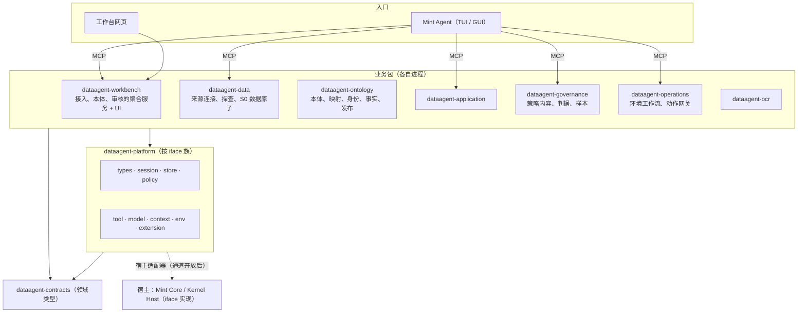
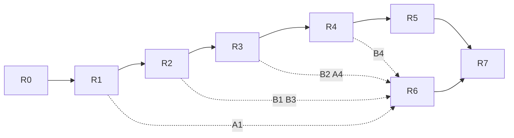

# 03 平台方案与 iface 共建

> 基线：DataAgent `codex/16-local-intake@87d5e8e`（未推送）加 worktree 未提交的 `dataagent-ocr`；agent-kernel `master@33075118`（2026-11-16 17:20）。
> 缩写同 [01](<01 多源接入与本体的 iface 依赖与分工.md>)：`DA` = DataAgent 仓 `packages/capabilities`，`IF` = `kernel/iface/src`，`MC` = `mint/crates/mint-core/src`，`MM` = `mint/crates/mint-manifest/src`；另加 `KH` = `kernel/host/src`。DataAgent 包内路径省略 `src/<包名>/` 前缀，如 `rt/` = `dataagent-runtime/src/dataagent_runtime/`，`wb/`、`data/`、`gov/`、`ops/`、`app/`、`ont/`、`ocr/`、`ct/` 同理。
> 注意：01 的基线是 agent-kernel `01bef1c12`，本篇是 `33075118`（晚 14 个提交，iface 变化只有新增 `blob.rs` 等 5 个文件）；01 引用的 Mint 行号在本篇基线上仍成立。
> 证据边界：只读代码，没有编译、运行；标「推断」的未实测。

## 1 结论

1. **定位（2026-11-16 已拍）**：iface 是 AgentCPM / AgentOS 的底层协议，我们承担完善它的职责。DataAgent 是第一个跑在这套协议上的非 Rust 业务应用，它的另一个作用是暴露协议在「进程外组件」这一面缺什么，再把缺口变成向 agent-kernel 提的 PR；业务部分（接入、本体、规则、工作台）我们自己承担。
2. **「按 iface 包重构」在 Python 侧的含义**：iface 是进程内的 Rust trait，Python 组件今天不能实现它，端到端能用的只有 bundle 的 MCP 通道，且只到 tool 契约（§2）。所以分两条线：
   - **平台层**：平台代码收成一份，按 iface 族分模块，接口和语义对齐对应契约；每个接口配本地实现（现在用）和宿主实现（PR 合入后切换），业务代码只依赖接口。
   - **iface 共建**：缺口按「契约类 / 实现类」转成 PR（§8），按 kernel 的规矩提交，用 DataAgent 的真实调用作验收证据。
3. **当前的主要问题是同一件平台事做了多套，而不是没对齐 iface**：调用上下文至少 10 处来源、授权模型 3 套、内容寻址存储 2 种布局、SQLite 6 个、出网闸门 3 套、凭据 3 套、HTTP 客户端 3 套、MCP 服务框架 2 套（3 个入口）、摘要计算 8 份（§3）。先收敛，再对齐。
4. **分 8 步（R0–R7）**：R0–R3 在 P1 内完成，P1 验收要的身份、凭据、超时、审批都在这几步里；P1 期间平台代码留在 `dataagent-runtime` 包内按族建子模块，不改包名，避免在验收中途大改；R4–R5 在 P2，含改名为 `dataagent-platform` 并抽出通用的 Python 组件 SDK（§8.4）；R6 随 PR 合入逐项切换；R7 在 MintHub 发布前。分期见 [05 分期路线](<05 分期路线与 MVP 范围.md>)，任务卡见 [07 MVP 实施文档](<07 MVP 实施文档.md>)。
5. **P1 不向 agent-kernel 提 PR（2026-11-17 已拍，Q5）**：P1 用到的 4 项机制（工具效果注解、MCP 调用下发调用元数据、bundle 包凭据声明与注入、打包桌面版 bundle 工具可见）在平台层绕行；PR-1 至 PR-8 保留为设计，提交时机另定。绕行与影响见 §8.3 和 [06 PRD](<06 PRD.md>) §7.1。
6. **先核实一个风险**：打包桌面版走 Kernel 回合（`mint/packages/gui-tauri/src-tauri/src/bridge/lifecycle.rs:47-91`），Mint 装的业务包不进 Kernel（`mint/tools/scripts/mint-runtime-launch.sh:477`；唯一例外是脚本里写死查找的 `tool-fs`，`:318-333`），bundle 的 MCP 工具由 cpmrt 装载（`MC/engine.rs:686-693`），但回合在 Kernel 里跑，Agent 很可能看不到这些工具（推断）。这可能就是 GUI 一直停住的原因；如果属实，P1 的 GUI 验收改用非 Kernel 布局，同时做 Kernel command 组件通道的原型（Q1，11-17 已拍）；PR-4 不提。

## 2 非 Rust 包接入 iface 的通道（agent-kernel@33075118）

| 通道 | 宿主 | 怎么声明 | 能到的 iface | 生产是否装配 | 证据 |
|---|---|---|---|---|---|
| ① bundle 的 MCP stdio（DataAgent 现状） | Mint Core | `kind="bundle"` + `.mcp.json`；不能声明 env、secrets、model、ui | 只有 tool：每个 MCP 工具包成一个 `ToolContract`；无会话 / 调用编号；`input_required` 直接报错 | `mint chat` 缺省路径可用；打包桌面版见 §1 第 6 条 | `MC/mcp_loader.rs:611`；`MM/validate.rs:866-871`；`MC/iface_adapters/mcp_tool.rs:92`；`MC/mcp/client.rs:397-419` |
| ② `kind="mcp"` 包 | 无 | `[provides] mcp_servers` | 无 | 清单合法，运行时不装载 | `MC/mcp_loader.rs:611` |
| ③ Kernel command 组件 | Kernel Host | 管理员启动计划 `AGENTCPM_STARTUP_COMPONENTS`，不是包清单 | tool；子进程拿到可信的会话与回合（`AGENTCPM_TOOL_BROKER_SESSION/TURN`），可凭票据回调已装工具 | 桌面启动脚本用它挂 fs、shell 工具 | `KH/transport/service/tool_broker.rs:568-573`；`mint-runtime-launch.sh:490-498` |
| ④ native 副进程 | Kernel Host（监管拉起） | `kind="plugin"`、`subkind="native"`、`child_kind=loop|exec-host`；每个平台一份二进制；不得提供工具 | loop、env 执行面 | 桌面不拉：无 `tool-fs` 时带 `--no-components`，有时组件目录只有启动元数据 | `kernel/packages/tool-sidecar-mcp/mint.toml`；`mint-runtime-launch.sh:458-470`、`:506-508` |
| ④' Kernel 侧 MCP（wasm `agentcpm/tool-mcp` + `tool-sidecar-mcp`） | Kernel Host | 装配方写 `--allow-server` 白名单 | 模型只看到一个通用 `mcp` 工具；只读沙箱 | 只有样例部署 | `kernel/wasm-packages/agentcpm/tool-mcp/src/lib.rs:4-10`；`tool-sidecar-mcp/mint.toml:1-3` |
| ⑤ wasm 插件 | Kernel Host | `plugin`/`wasm`，一个组件一个工具 | tool + 宿主函数（audit、fs、http、kv、approval-ask、delegate-agent、sidecar-call） | 桌面未接；仓里的 guest 全是 Rust | `kernel/wasm-host/wit/tool.wit:20-147` |
| ⑥ js 插件、overlay | Mint Core 的 V8 宿主 | `plugin`/`js` | 无 iface；宿主调用只有日志、私有 KV、通知、出网 | std 档可用 | `mint/crates/mint-protocol/src/host.rs:370-384` |

补充事实：

1. **身份包与声明**：`products/iface-identity/` 有 10 个 `kind="iface"` 包（types、session、store、policy、extension、tool、model、context、loop、env）。包用 `[requires] interfaces` 声明依赖哪个契约，`mint add` 安装时检查「已装包里有没有提供方」（`mint/bins/mint/src/install/interfaces.rs:93-136`），运行期不按它装配。
2. **今天新增了大对象契约** `BlobStoreContract`（`IF/blob.rs:155`，D124，2026-11-16）：会话内内容寻址，`BlobRef` 带会话、摘要、长度。DataAgent 的内容寻址存储按工作区共享，不按会话；两者语义不同，只能镜像，不能直接替换。
3. **没有 Python SDK**：仓里只有 Python 外部 loop 示例（`kernel/host/loops/python/loop.py`），走 L-C 的 loop 作业面，和工具无关。

## 3 现状：平行自建与重复

| 关注点 | 现有实现 | 问题 |
|---|---|---|
| 调用上下文 | `ct/core/envelope.py:44-62` 定义；来源至少 10 处：`rt/interfaces/mcp_server.py:68-87`、`rt/runtime.py:132-133`、`rt/invoke.py:276-296`、`rt/interfaces/unified.py:426-449`、`gov/governance/access.py:37-61`、`gov/runtime/runtime.py:106-107`、`wb/bootstrap.py:23-25`、`ops/bindings.py:178-191`、`ops/mcp.py:144`、`data/observation/cli.py:59`（另有测试用 `dataagent_scenarios/gate.py:147`） | 宿主没注入 `DATAAGENT_HOST_*` 时，主体和用途由调用方自报（S0 评审 X1–X3）；`arguments.context` 在工具 schema 里是必填 |
| 授权与作用域 | DA12.1 判定库、工作台 `local-owner` 哈希、operations 的 HostConfig 与 grant | `scope_ref` 有 4 种写法：`tenant:local`、`workspace:<sha>`、HostConfig 配置值、`tenant:default` |
| 内容寻址存储 | `rt/adapters/local_content.py:54-58`（`<hex2>/<hex>`）；`data/adapters/sources/base.py:29-44`（`<sha>.json`） | 两种布局，两套写入规则 |
| SQLite | runtime、dataagent、governance、decisions、workbench、operations 共 6 个文件；`rt/adapters/sqlite.py`、`rt/adapters/workbench_sqlite.py`、`data/adapters/storage/sqlite.py`、`ops/store.py` | `wb_outbox` 有写入（`workbench_sqlite.py:100`）没有读取方 |
| 数据根目录 | `rt/runtime.py:26-44` 认 `DATAAGENT_DATA_ROOT`；`wb/bootstrap.py:16`、`data/observation/cli.py`、`base.py:31` 写死 `workspace/.dataagent` | 自定义数据根后各包看到的不是同一处（推断） |
| 出网与外发 | `rt/enforcement.py:255`（`egress_check`）、`wb/inference_requests.py:5-37`（字段白名单）、`unified.py:456-477`（CLI 输出清洗）、`ocr/egress.py` | 抽取的原文片段 `candidate_spans`（`data/preparation/extraction.py:415`）不在 `EGRESS_CONTENT_KEYS`（`enforcement.py:52`）里，没过闸 |
| 凭据 | `wb/adapters/source_connections.py:24-29`（环境变量）、`ops/bindings.py:136`（明文 headers）、`ocr/secrets.py`（file、env、keychain 三种引用） | 三套解析，三套打码 |
| HTTP 客户端 | `data/adapters/sources/rest.py`（urllib）、`ops/adapters/api.py`（httpx）、`ocr/providers/openai_compat.py`（urllib） | 关代理、禁重定向、体积上限各写一遍 |
| MCP 服务 | `rt/interfaces/mcp_server.py`（带工具注解与上下文注入）、`wb/interfaces/mcp_server.py`（不读 `_meta`、不带注解）、`ops/mcp.py:131-155`（复用 rt 的服务但自写调用，不走注册表和复检） | 3 种错误格式；审批行为不一致 |
| 结果外置 | CLI 32 KiB 摘要写 `results/`；工作台 24000 字节内联（`wb/service_tools.py:86-95`）；探查子进程写 `probe-*.json`；rt 的 MCP 直接内联（`mcp_server.py:148-159`） | 4 套规则 |
| 长任务 | `rt/jobs.py:6-12` 的 `JobRecord` 无人引用；任务状态以带修订的 job 记录存在工作台 SQLite（`wb/intake_service.py:74`、`:208`）；operations 有自己的租约和等待（`ops/store.py:98-124`） | 没有执行者；超出宿主 60 秒工具超时的探查会被截断（推断） |
| 推断端口 | `rt/ports/inference.py:9` 与 `data/ports/inference.py:7` 重复定义 | `Runtime.inference` 没有消费方 |
| 访问复检 | 工作台调数据层探查直接走 `data/observation/cli.py:54-80`，不经注册表和 DA12.1 复检（`wb/adapters/layer_client.py:21-23`） | 新链路绕开了 S0 的访问控制 |
| 摘要计算 | 至少 8 份独立的规范化与 sha256 实现（rt、data、sources、ops、ont、ocr、gov） | 同一对象可能算出不同指纹 |
| 打包 | 3 个 `build_bundle.py`；`app`、`gov`、`rt` 的 `packaging/bundle/src` 共提交 167 个文件，其中 rt 与 ct 的副本 114 个；`catalog-snapshot.json` 有 9 个跟踪副本、3 种内容；运行时靠 glob `.mint/packages/dataagent/<名>@*` 互相定位（`cli/bin/dataagent:62,74`、`wb/adapters/layer_client.py:56-59`） | 副本会漂移；路径约定脆弱 |

## 4 原则

1. **拆契约，不拆进程**：平台代码合成一个库，按锁定版本物化进各 bundle；数据、应用、治理、工作台、operations 仍是各自的 Python 进程（依赖冲突约束见方案 16 §1 第 9 条）。
2. **端口镜像 iface 语义**：模块名、方法名、语义尽量照抄对应契约，如游标从 1 起单调、`limit == 0` 表示不限、提交带期望修订、未知不等于允许。iface 没有而 DataAgent 需要的，单列为「提议」，进 [01](<01 多源接入与本体的 iface 依赖与分工.md>) 的 B 类清单。
3. **声明分三级**：
   - 镜像（references）：形状和语义对齐，但没有可调用的通道；
   - 消费（consumes）：经真实通道调用宿主实现，写进 `mint.toml` 的 `[requires] interfaces`；
   - 实现（implements）：有冻结 schema 摘要和通过的一致性报告才能写。
4. **业务包只依赖端口**：业务包只能导入 `dataagent_platform.<族>` 的端口和 `dataagent_contracts` 的类型，不能导入适配器；用一条导入守卫测试强制。
5. **积木优先**：自建前先查 MintHub（§11），写明复用了哪个包，或者为什么不能复用。
6. **每步可单独验收、可回滚**：每步先补回归（`scripts/verify_local.sh` 各阶段），再改；改动在验收中途的接入主链路时，用开关保留旧路径一个版本。

## 5 目标结构



| 包 | 来源 | 内容 |
|---|---|---|
| 平台层：P1 为 `dataagent-runtime` 内的子模块，P2 改名 `dataagent-platform` | 现 `dataagent-runtime` 吸收各包的平台代码 | 按 iface 族分模块的端口、本地适配器、宿主适配器、唯一的 MCP / CLI 服务框架；P2 起通用部分抽成 Python 组件 SDK（§8.4） |
| `dataagent-contracts` | 不变 | 只留领域类型：intake、ontology、environment、workflow、引用与证据；`CallContext`、`CapabilityResult` 等调用封套迁到 `platform.types`，保留一个版本的再导出 |
| `dataagent-data` | 不变 | 来源连接（`sources/`）、探查（`observation/`）、S0 数据原子；OCR 改为显式依赖，去掉 `ImportError` 兜底（`data/observation/cli.py:30-34`） |
| `dataagent-ocr` | 先提交入库 | OCR 引擎、模型配置；凭据、出网、HTTP 改用平台端口 |
| `dataagent-ontology` | 不变 | 本体、映射、身份、事实、发布；领域本体定义从工作台移出，做成领域包（见 06 PRD 的 P2） |
| `dataagent-application`、`dataagent-governance`、`dataagent-operations`、`dataagent-workbench` | 不变 | 平台代码移出：治理只留策略内容与判据，执行点归 `platform.policy`；operations 的租约、等待、发件箱改用 `platform.session`；工作台的 MCP、凭据、启动器改用平台模块 |
| `dataagent-cli`、presets | 不变 | 包定位改为按依赖名解析 |

平台层的内部布局（P1 在 `dataagent_runtime/` 下，P2 改名后为 `dataagent_platform/`）：

```text
dataagent_platform/
  types/      CallMeta 镜像、CallContext、Decision、唯一的规范化与摘要
  session/    任务记录（期望修订、阶段）、进度事件、发件箱（效果台账）、租约与围栏
  store/      EventLog（StoreContract 语义）、BlobStore（内容寻址，单一布局）、RecordStore（带修订的记录，提议）
  policy/     上下文解析（身份）、访问判定与复检、出网闸门与打码、凭据（逻辑名）、人工请求、审计
  tool/       操作注册表、唯一 MCP 服务（读 _meta、带效果注解）、CLI、后台作业句柄
  model/      InferencePort（宿主 Agent 推断）、远端模型经出网闸门
  context/    结果摘要与外置（统一阈值）
  env/        工作区与数据根、路径守卫、子进程执行、HTTP 传输
  extension/  已装包定位、清单与 iface 声明、Catalog 快照
  adapters/local/  adapters/host/
```

## 6 端口与 iface 对照

| iface 族 | 对照的契约 | 平台端口 | 收进来的现有代码 | 本地适配器 | 宿主适配器（通道 / 前置） | 声明 |
|---|---|---|---|---|---|---|
| types | `CallMeta`、`Decision`（`IF/types/mod.rs:5-11`、`:38-45`） | `types.CallMeta`、`CallContext`、`resolve_context()`、`canonical()`、`digest()` | §3 调用上下文 8 处；8 份摘要实现 | 解析顺序：宿主 `_meta` → 宿主注入环境 → 本机 `local-owner`；调用参数里的上下文只作提示，不作授权 | MCP `_meta` 带 CallMeta（A1）；Kernel command 的 `AGENTCPM_TOOL_BROKER_SESSION/TURN`（Q1） | 镜像 → 消费 |
| session | `InboxContract`（`IF/session/inbox.rs:259`）、`FenceStore`（`session/fence.rs:222`）、`EffectLedger`（`session/effect.rs:167`） | `session.TaskStore`（任务、阶段、期望修订）、`session.Progress`、`session.Outbox`、`session.Lease` | `wb/session_service.py`、`rt/jobs.py`（删）、`workbench_sqlite.py` 的发件箱、`ops/store.py:98-124`、`ops/runner.py` 的认领与续约 | 现有 SQLite 事务 | 进展回推（A5）；租约与围栏随 B3 定 | 镜像 |
| store | `StoreContract`（`IF/store.rs:119`）、`BlobStoreContract`（`IF/blob.rs:155`）、`TraceSink`（`IF/trace.rs:27`） | `store.EventLog`、`store.BlobStore`、`store.RecordStore` | `rt/ports/content.py` + `local_content.py`；`data/adapters/sources/base.py` 的 `snapshot()`；`rt/ports/versioned.py` + `rt/adapters/sqlite.py`；`data/adapters/storage/sqlite.py`；`rt/ports/workbench_store.py`；`data/ports/trace.py` + `data/memory/traces.py` | SQLite + 文件；`BlobStore` 统一为一种布局，旧布局只读兼容 | 组件事件追加（B4，方案 06 附录 A）；资产库不上收（01 的 Q2） | 镜像；`RecordStore` 为提议 |
| policy | `PolicyContract`（`IF/policy/mod.rs:160`）、`HumanChannel`（`human.rs:154`）、`AuditSink`（`IF/audit.rs:360`）、`SecretUse` / `SecretBrokerContract`（`secret.rs:38`、`:161`）、`EgressRequest`（`egress.rs:15`）、`LeakDetector`（`leak.rs:106`） | `policy.access`、`policy.egress`、`policy.secrets`、`policy.human`、`policy.audit` | `rt/enforcement.py`；`gov/governance/access.py`（其 `_ref_covers` 与 `rt/enforcement.py:108` 重复）；`gov/governance/sensitivity.py` 的扫描与掩码；`wb/inference_requests.py` 字段白名单；`unified.py` 输出清洗；`ocr/egress.py`、`ocr/secrets.py`；`wb/adapters/source_connections.py`；`ops/bindings.py` 的 headers；`rt/errors.py:72` 的 `NeedsInputError` | 访问判定沿用 DA12.1 判定库；外发闸门一套规则覆盖 MCP、CLI、推断请求三个出口；凭据按逻辑名解析（env、file、keychain）；审计写本地追加日志 | 工具中途要输入（A2）；包级凭据（B2）；OS 审计（A6）；逐请求出网（A4，可评估 `agentcpm/net-proxy`） | 镜像 → 消费 |
| tool | `ToolContract`、`ToolSpec`、`ActionDescriptor`（`IF/tool.rs:35-39`、`:62`、`:136`） | `tool.registry`、`tool.mcp`、`tool.cli`、`tool.jobs` | `rt/registry.py`、`rt/interfaces/mcp_server.py`、`wb/interfaces/mcp_server.py`、`wb/tool_schema.py`、`ops/mcp.py`、`rt/interfaces/unified.py`、`rt/interfaces/cli.py` | 一个 MCP 服务；每个工具带 `readOnlyHint`、`destructiveHint`、`idempotentHint`；单次调用设时间预算，超时前返回续跑句柄 | 效果注解进 ToolSpec 或被 Mint 认（B1）；后台长任务（B3） | 消费（tool 是唯一已开放的契约） |
| model | `ModelContract`（`IF/model.rs`） | `model.InferencePort` | `rt/ports/inference.py`、`data/ports/inference.py`（删重复）、`data/adapters/inference/agent_provided.py`、`ocr/providers/openai_compat.py` | 宿主 Agent 推断（结构化推断请求 → 提案）；远端 OCR 模型走 `policy.egress` 和 `env.http` | 组件侧模型调用（B5） | 镜像 |
| context | `ContextContract`、压缩（`IF/context/*`） | `context.offload` | §3 结果外置 4 套 | 统一阈值：内联上限一个值，全文写 `results/`，返回 `result_path` | — | 镜像 |
| env | `FsBackend`、`ExecBackend`、`SandboxBackend`、`HttpTransport`、`Scope`（`IF/env/*`） | `env.workspace`、`env.paths`、`env.exec`、`env.http` | `rt/runtime.py:26-44`；路径检查 `data/helpers.py:91-109`、`data/observation/files.py:16-24`、`data/adapters/sources/sqlite.py:9-20`；子进程 `wb/adapters/layer_client.py`、`wb/adapters/operations_client.py`、`wb/launcher.py`、`ocr/providers/worker.py`；HTTP 三套，及 API 路径校验 `ops/bindings.py:25-32` | 路径统一规则：只在工作区内、排除 `.mint`、拒绝任何符号链接分量；子进程统一环境白名单和超时；HTTP 统一关代理、禁重定向、体积上限、来源白名单 | MCP 子进程纳入宿主围栏（A3） | 镜像 |
| extension | `ExtensionContract`、包与装配（`IF/extension/*`） | `extension.locate`、`extension.manifest` | `cli/bin/dataagent:62,74`、`wb/adapters/layer_client.py:56-59`、`wb/adapters/operations_client.py:11`；9 个 `catalog-snapshot.json` 副本；3 个 `build_bundle.py` | 按依赖名解析已装包目录；构建工具按锁文件物化依赖，仓里不再提交副本 | 包清单与 iface 版本绑定、包间定位（B8） | 消费（安装期检查） |
| loop | `LoopContract`（`IF/loop_.rs:61`） | 不建 | operations 的工作流步进（`ops/runner.py`）是业务流程，不是 Agent 回合 | — | — | 不涉及 |

## 7 分步迁移

| 步 | 目标 | 主要改动 | 验收 | 回滚 | 期 |
|---|---|---|---|---|---|
| R0 入库与守卫 | 有干净可复现的起点 | 分支改名推送；`dataagent-ocr` 提交；新增 `packaging/iface-baseline.toml`，钉住 10 个 `iface/<名>` 身份包版本和 agent-kernel 提交；新增导入守卫测试和一致性测试骨架 | 干净检出后各包测试无失败（含现在因缺 OCR 失败的 data 1 项、CLI 1 项）；守卫测试把现有违规列为基线，只许减少 | 不涉及运行行为 | P1 · W1 |
| R1 身份收敛 | 一个调用上下文来源，主体与用途不再由调用方自报 | 在 `dataagent_runtime/` 下新建 `types/` 与 `policy/context.py`；10 处来源改为调用 `resolve_context()`；`scope_ref` 统一为 `workspace:<sha>`；工具 schema 里 `context` 改为可选 | 代码里只剩一个解析函数；S0 评审 r41 的 X1、X2 复现输入全部被拒（X3 在 R2）；`verify_local.sh` 的 bootstrap、files、sources、discovery 四个阶段通过 | 开关 `DATAAGENT_CONTEXT_RESOLVER=legacy` 保留一个版本 | P1 · W1–W2 |
| R2 工具收敛 | 一个 MCP 服务，工具能被宿主正确分类，不被 60 秒超时截断 | 工作台和 operations 改用 `platform.tool.mcp`；所有工具补效果注解；结果外置统一；`intake_advance` 等长调用设 50 秒预算，超时前落盘并返回 `retry_probe` | 每个工具的 `tools/list` 带注解；30 MB 级样本（文件上限 32 MiB，`data/observation/files.py:33-37`）的单次调用墙钟小于 55 秒且分段完成；三层错误格式一致 | 旧服务入口保留一个版本 | P1 · W2 |
| R3 凭据、出网、HTTP 收敛 | 凭据只在需要它的进程里出现；所有外发过同一个闸门 | `policy.secrets` 按逻辑名解析；连接清单路径写进工作台包内 `.mcp.json` 的字面 `env`；`env.http` 替换三套客户端；`policy.egress` 覆盖 MCP、CLI、推断请求三个出口，补上 `candidate_spans`；工作台探查改经注册表与 DA12.1 复检 | 哨兵凭据扫描（工作区、Mint 会话日志、工具结果）0 命中；外发测试覆盖三个出口；enforce 模式下所有 bundle 生效 | 逐项开关 | P1 · W2 |
| R4 存储收敛 | 一种内容寻址布局，带修订的记录与事件有统一端口 | `store.BlobStore` 合并两种布局，旧布局只读兼容；`RecordStore`、`EventLog` 取代 `VersionedRepository`、`WorkbenchStore`、`TraceRepository` 的重复部分；数据根统一由 `env.workspace` 解析；发件箱补消费方或删除；删 `JobRecord` | 旧工作区读取迁移测试通过；SQLite 文件从 6 个降到不超过 3 个（记录与事件、访问判定、operations 动作台账）；自定义数据根下全部阶段通过 | 迁移只增不删，旧文件保留 | P2 · W3 |
| R5 环境与扩展收敛、改名 | 包互相定位不靠目录猜，仓里没有副本；平台层成为独立包 | `dataagent-runtime` 改名 `dataagent-platform`（保留一个版本的再导出）；通用部分抽成 Python 组件 SDK；路径守卫、子进程执行统一；`extension.locate` 按依赖名解析；一个构建工具按锁文件物化依赖；删除提交的 `packaging/bundle/src` 副本 | 从构建产物安装后 grep 不到开发仓绝对路径；git 里没有副本目录；preset 两种布局（s0、intake）统一 | 构建工具保留旧参数一个版本 | P2 · W3–W4 |
| R6 宿主适配器 | PR 合入一项，切一项 | 按 §8 的 PR 合入情况逐项加 `adapters/host/*`，用开关选择；每项配一致性测试，本地与宿主两种实现跑同一组用例 | 每切一项，同一组用例在两种实现下结果一致 | 关开关回到本地实现 | 随宿主 |
| R7 声明与一致性 | 对外如实声明与 iface 的关系 | `mint.toml` 的 `[requires] interfaces` 只写真正经通道消费的（tool 起步）；`[metadata.iface]` 写镜像关系；一致性报告绑定提交与 schema 摘要后才写 implements | `mint add` 安装期接口检查通过；声明校验脚本在 CI 通过 | — | P6 发布前 |



## 8 iface 共建：PR 清单与规矩

### 8.1 为什么由我们提

1. iface 由 kernel 组维护，但「进程外组件（Python、Node）怎么用 iface」这一面目前没有使用方在推：分工表 9 个包系列都没有把 MCP 包、应用包列为接入对象（`~/Vibe/AgentOS/docs/architecture/2026-11-16-DataAgent与iface契约对照.md` §1）。
2. DataAgent、ql-audit、rsi-toolkit 撞的是同一堵墙（都自建了存储、身份、审批，见平台依赖《01 架构与依赖》§7），由业务方带着真实调用去补，最能证明机制合不合用。

### 8.2 规矩

1. **先对齐方向**：每个 PR 先和对应 iface 负责人确认；契约类改动要进 kernel 的 DECISIONS 拍板（`kernel/docs/notes/DECISIONS.md`）。
2. **先契约后实现**：先改 `kernel/iface/src` 的类型与文档，再改实现；签名冻结前不在组件里复制私有契约（`kernel/README.md` §4 第 3 条）；契约只加不改（`kernel/iface/README.md` 契约轴）。
3. **lineage**：新增源文件在文件头写 `lineage: <repo>:<path>:<line> (A/B/C/D/E)`，否则不合并（`kernel/README.md` §4 第 5 条）。
4. **按调用链验收**：每个 PR 附一致性测试，并附 DataAgent 的真实调用作证据（`kernel/README.md` §4 第 4 条）；证据写清能证明什么、不能证明什么。
5. **两次规则**：只提至少两个应用会用到的机制，PR 说明里写清 ql-audit、rsi-toolkit 是否同样受益；只有 DataAgent 需要的留在平台层。
6. **在哪里写**：`upstream/agent-kernel` 只 pull 不提交；PR 在独立 clone 上开发，写权限见 Q5。P1 不提交（11-17 已拍）。

### 8.3 PR 清单

类型：契约 = 改 `kernel/iface/src`；实现 = 契约已有，改 Mint 让 MCP 包用得上。行号基于 agent-kernel `33075118`。

> 2026-11-17 已拍（Q5）：P1 先不提 PR。下表「期」是用到该机制的期，提交时机另定；PR-1 至 PR-4 的任务 T40–T43 暂缓，P1 期间按 [06 PRD](<06 PRD.md>) §7.1 的绕行验收。

| PR | 类型 | 改什么 | 位置 | 对接 | DataAgent 验收证据 | 期 | 任务 |
|---|---|---|---|---|---|---|---|
| PR-1 工具效果注解与按效果审批 | 契约 + 实现 | `ToolSpec` 只加不改地增加效果等级（只读 / 推进 / 副作用）与幂等标记；Mint 读 MCP 工具的 `readOnlyHint`、`destructiveHint`、`idempotentHint`，审批按效果判 | `kernel/iface/src/tool.rs:35-39`；`MC/mcp/client.rs:738-757`；`MC/approval.rs:148-174` | 李奕杉（tool）、李鹏越（policy） | 默认审批下一次文件接入人工确认不超过 3 次（V1.5） | P1 用到；暂缓提交 | T40（暂缓） |
| PR-2 MCP 调用下发调用元数据 | 实现 | `tools/call` 的 `_meta` 增加 `session_id`、`call_id`、`turn`（契约已要求「工具调用时必须可读到」） | `MC/mcp/client.rs:397-408`；`kernel/iface/src/types/mod.rs:5-11` | 李奕杉 | DataAgent 任务记录里的会话编号与 Mint 会话一致；R1 走宿主路径 | P1 用到；暂缓提交 | T41（暂缓） |
| PR-3 bundle 包凭据声明与注入 | 契约 + 实现 | 允许 bundle 声明 `capabilities.secrets` 逻辑名；用户在 TUI / GUI 设置值；宿主只在拉起声明它的 MCP 进程时注入；`LeakDetector` 按已注册值打码 | `MM/validate.rs:868-870`；`MC/mcp_loader.rs:404-438`；`kernel/iface/src/policy/secret.rs` | 李鹏越 | V1.6 在打包桌面版 GUI 下也通过 | P1 用到；暂缓提交 | T42（暂缓） |
| PR-4 打包桌面版 bundle 工具可见 | 实现（先核实） | Kernel 回合能调到 cpmrt 装载的 bundle MCP 工具，或桌面布局把 bundle 工具注册进 Kernel | `mint/tools/scripts/mint-runtime-launch.sh:458-509`；`MC/engine.rs:686-693` | Mint GUI 负责人（待确认） | GUI 会话工具列表出现 `dataagent-workbench__*`；V1.4 的 GUI 部分 | P1 用到；暂缓提交（T02 先核实） | T02；T43（暂缓） |
| PR-5 工具执行中向人要输入 | 实现 | MCP `input_required` 接到 `HumanChannel`，答复回到工具 | `MC/mcp/client.rs:416-419`；`kernel/iface/src/policy/human.rs:154` | 李鹏越 | 本体审核与令才澄清不必绕到网页 | P2 | — |
| PR-6 组件事件追加 | 契约 | `store.ext_append / ext_read / ext_checkpoint`（方案 06 附录 A） | `kernel/iface/src/store.rs` | 郑达奇、魏耀全 | 接入与发布事件进会话日志，带 `call_id` | P3 | — |
| PR-7 后台长任务与进展回推 | 契约 + 实现 | 提交、状态、取消、取结果；定时与变更触发；结果经 `InboxContract` 回推；对齐官方「后台长任务」排期 | iface-tool、iface-session | 李奕杉、彭淳毅 | P5 持续接入 | P5 | — |
| PR-8 调用主体与租户、包间定位 | 契约 + 实现 | `CallMeta` 增加主体与租户；运行期按依赖名定位已装包；本地依赖可发布 | `kernel/iface/src/types/mod.rs`；`mint/bins/mint/src/install/` | 李鹏越 | P6 多人使用与分发 | P6 | — |

缺口与 PR 的对应：PR-1 = 01 的 B1；PR-2 = A1；PR-3 = B2；PR-5 = A2；PR-6 = B4；PR-7 = B3 + A5；PR-8 = B7 + B8。A3、A4、A6、A7、B5、B6 暂不提，排期见 [06 PRD](<06 PRD.md>) §7。

### 8.4 Python 组件 SDK（积木）

1. **是什么**：把平台层里与 DataAgent 业务无关的部分抽成一个 Python 包：调用元数据读取（`_meta` → 宿主注入环境 → 本机）、带效果注解的 MCP 服务框架、工具中途向人要输入、凭据逻辑名解析、结果外置、组件事件追加客户端。
2. **谁用**：DataAgent、rsi-toolkit（Python）；ql-audit 是 Node 实现，用不上 Python 包，但可按同一份约定写 JS 版。
3. **什么时候**：P1 只在 DataAgent 内用；P2 的 R5 抽出，发布到 MintHub（Q6）。
4. **和 PR 的关系**：PR 合入后，SDK 的宿主实现跟着切换；使用方不改代码。

## 9 R1–R3 对 P1 验收的直接作用

| P1 验收项（见 06 PRD） | 依赖的步 | 没做会怎样 |
|---|---|---|
| Mint 双端发起，默认审批下可用 | R2 效果注解；宿主认注解（PR-1，P1 不提） | 每次调用都弹窗；只能在 `full-access` 下验收 |
| 数据库与 API 凭据安全 | R3 | 凭据经环境变量或明文进日志 |
| 大文件、扫描 PDF 接入不中断 | R2 时间预算与续跑 | 宿主 60 秒超时截断（推断） |
| 主体与用途可信 | R1 | 访问判定可被调用方伪造（X1–X3） |

## 10 借鉴 rsi-toolkit 的做法

1. **声明有校验**：rsi-toolkit 的 `implements` 要求三件事同时成立：契约冻结在基线里、schema 摘要一致、有绑定库摘要且退出码为 0 的一致性报告（`projects/rsi-toolkit/packaging/manifest.py:200-219`）。全仓没有包满足，所以没有包声明 implements。DataAgent 照搬这条规则。
2. **基线钉对对象**：rsi-toolkit 钉的是已停用的 `agentcpm/iface-*@0.1.0`（`packaging/iface-baseline.toml:1-104`），采集脚本把包名和版本写死。DataAgent 改钉 `iface/<名>` 身份包版本加 agent-kernel 提交，脚本参数化。
3. **数据契约和调用协议分开命名**：没有可调用通道时标明「通道不可用」，不写成「消费」。
4. **先解耦再拆**：rsi-toolkit 的方案评审（`~/Vibe/AgentOS/docs/dev/rsi_toolkit/2026-10-28-iface-plans-review.md:131-133`）指出过三类源码硬阻塞：指纹绑定模块路径、`__init__` 预导入整包、包间循环依赖。DataAgent 在 R0 用导入守卫先查。
5. **按「有没有第二个消费者、是否共享事务」决定发包粒度**，不按模块数发包。

## 11 MintHub 积木复用候选（2026-11-16 查询，263 个包；与 platform 盘点材料 `minthub-catalog.json` 一致）

以下「判断」是待评估的初步意见，不是已验证的结论。

| 包@版本 | 是什么 | 可能替代 DataAgent 的 | 判断 |
|---|---|---|---|
| `agentcpm/net-proxy@0.1.0` | M21 出网代理：组件经 UDS 请求代建连接，每条连接过出网判定和审计 | `env.http` 的逐请求出网判定（A4） | 待评估：需要宿主部署代理，Python 侧要改为经 UDS 建连 |
| `wujiahe/tool-connectors@0.4.6`（kind=mcp） | HTTP 与 MCP 连接配置、工具发现、调用、持久回执；可选常驻 manager 经 Kernel command 注册工具 | REST 连接配置与回执；也是通道 ③ 的先例 | 待评估：kind=mcp 不被 Mint Core 装载（§2 ②），只能经它的 Kernel command manager 用；对比连接配置与凭据处理方式 |
| `wujiahe/knowledge-local@0.4.8`（plugin native） | 知识核心，常驻 manager + Kernel command 垫片 | 通道 ③ 的先例 | 参考其接线方式 |
| `heizijian/ocr@0.1.0` | 文档 OCR 与结构化字段抽取（Hub 上只有一句描述，无仓库地址） | `dataagent-ocr` | 用同一组扫描样本比对后再定（Q4） |
| `daynote/store-sqlcipher@0.2.1` | SQLCipher 的 `StoreContract` 与 `AuditSink` 实现 | 事件与审计后端 | 属宿主侧实现，Python 不能直接链接；B4、A6 落地后由宿主装配 |

MintHub 上还没有 `dataagent/*` 包。

## 12 风险

1. **GUI 通道**：§1 第 6 条若属实，现有 bundle 路径在打包桌面版下不可用，P1 的 GUI 验收要么换通道（Kernel command），要么等 Mint 把 bundle 工具注册进 Kernel。11-18 前用一次 GUI 会话核实（看工具列表里有没有 `dataagent-workbench__*`）。
2. **与 P1 验收并行**：R1–R3 改动接入主链路。先把 `verify_local.sh` 的 bootstrap、files、sources、discovery 四个阶段固定为回归，再改。
3. **镜像漂移**：iface 还在快速变化（今天新增 `BlobStoreContract`）。每次对比前更新 agent-kernel，`iface-baseline.toml` 的差异进 CI 提示。
4. **工作量**：R1–R3 涉及 7 个包，必须一人主责平台包，业务包负责人只改调用点。

## 13 决策（2026-11-17 已拍）

> Q1–Q4、Q6 按推荐拍板，裁决清单 D-007 至 D-012。Q5 拍板为：**P1 先不向 agent-kernel 提 PR**（D-011），缺口在平台层绕行，PR 设计保留，提交时机另定。受 Q5 影响，Q1 里「靠 PR-4」一项不走：T02 核实属实时，GUI 改用非 Kernel 布局，同时做 B 的适配器原型。

| | 决策 | 选项 A | 选项 B | 推荐 | 影响 |
|---|---|---|---|---|---|
| Q1 | 打包桌面版的工具通道 | 继续 bundle MCP，靠 PR-4 让 Kernel 回合能调到 bundle 工具，或 GUI 改用非 Kernel 布局 | 加 Kernel command 组件通道：常驻进程经 tool broker 注册工具，拿到可信的会话与回合 | 先核实风险（T02）；属实则 A 为主线，同时做 B 的适配器原型 | B 由管理员启动计划装配，不随 `mint add` 生效，分发方式要另定 |
| Q2 | 平台层何时成为独立包 | P1 留在 `dataagent-runtime` 内按族建子模块，P2（R5）改名 `dataagent-platform` 并抽 SDK | P1 就改名 | A：P1 验收中途不做包级改名 | B 让 P1 多一轮全包改动和重新打包 |
| Q3 | iface 关系声明格式 | `mint.toml` 里 `[requires] interfaces`（只写消费）+ `[metadata.iface]`（镜像），配校验脚本 | 照 rsi-toolkit 另立 `iface.toml` 和校验器 | A | B 与 rsi-toolkit 一致但多一类文件 |
| Q4 | OCR 用哪个 | 继续 `dataagent-ocr` | 改用 MintHub `heizijian/ocr` | P1 用 A；P2 前用同一组扫描样本比对 | B 若胜出，可去掉 2757 行自研代码 |
| Q5 | agent-kernel PR 怎么提 | 我们在独立 clone 上开发，CodeHub 开分支提合并请求；需要开通写权限（现在沙盒只有只读部署密钥） | 只提需求和设计笔，由 iface 负责人实现 | 实现类走 A；契约类先写设计笔进 DECISIONS 拍板，拍板后按 A 实现 | A 要 kernel 组接受外部合并请求；B 进度受对方排期约束 |
| Q6 | Python 组件 SDK 是否作为积木发布 | P2 抽出，发布到 MintHub（团队 scope），DataAgent、rsi-toolkit 共用 | 只在 DataAgent 内部用 | A | A 要定包名、scope 和维护人 |
