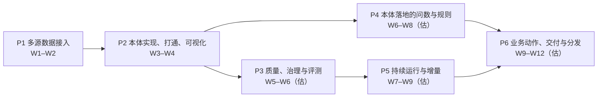

# 05 分期路线与 MVP 范围

> 输入：[00 术语与总览](<00 术语与总览.md>)、[04 验收方法与数据](<04 验收方法与数据.md>)、[02 借鉴 Palantir Ontology 与 Databricks Genie](<02 借鉴 Palantir Ontology 与 Databricks Genie.md>)；总规划切片 S0–S2；方案 16 的 M1–M4 与 `test-inventory.md`（`codex/16-local-intake@87d5e8e`）。
> 周次：本 workspace 的 W1 = 2026-11-16 所在周（AgentOS 旧文档的 W4 即这里的 W1）。
> P1、P2 的目标与验收指标在 [06 PRD](<06 PRD.md>)；P1 的任务清单在 [07 MVP 实施文档](<07 MVP 实施文档.md>)。

## 1 结论

| 期 | 时间 | 一句话交付 |
|---|---|---|
| P1 多源数据接入（MVP） | W1–W2，11-16 至 11-29 | 文件、数据库、API 都能从 Mint 双端接进来，带证据、可恢复、凭据安全；在通用 benchmark、令才真实报文、变异集上有可复核的数 |
| P2 本体的实现、打通、可视化 | W3–W4，11-30 至 12-13 | 本体变成多概念、有版本、可发现、可查询、可视化的资产，并接通令才规则 |
| P3 质量、治理与评测 | W5–W6（估） | 质量规则、冲突裁决、访问控制、审计、评测基线与门禁 |
| P4 本体落地的问数与规则 | W6–W8（估） | 在语义视图上问数、按本体跑规则审核，判定族与计算族在未见样本上端到端验收 |
| P5 持续运行与增量 | W7–W9（估，依赖后台长任务） | 增量、定时与变更触发、新鲜度与质量持续监控 |
| P6 业务动作、交付与分发 | W9–W12（估） | 环境工作流、审批写回、MintHub 分发、多人使用 |

## 2 排期原则

1. **先接进来做扎实，再做本体**：P1 是当前刚需（11-16 已拍）；P2 做本体的实现、打通与可视化。
2. **按用户可见的结果分期**：每期结束时用户能做一件之前做不了的事，在安装产物上验收，附证据包；源码环境通过不等于装包通过。
3. **不过拟合令才**：每期的验收同时用通用 benchmark 和真实流程数据；核心与领域包按 [04](<04 验收方法与数据.md>) §5 的三条硬规则分界。
4. **iface 共建随需求走**：哪一期用到哪个机制，就在那一期向 agent-kernel 提对应 PR（[03](<03 平台方案与 iface 共建.md>) §8.3）；没合入时有绕行，并登记为外部阻断。
5. **平台收敛跟着期走**：R0–R3 在 P1（只改到 P1 验收需要的程度），R4–R5 在 P2，R6 随 PR 合入，R7 在 P6。

## 3 各期交付

| 期 | 用户能做的事 | 主要模块（总规划编号） | 平台步 | 要提的 PR |
|---|---|---|---|---|
| P1 | 给材料或选连接 → Agent 自动探查并映射到预设本体 → 网页核对纠正 → 保存；令才真实报文映射到规则字段目录 | DA01.1–01.5、01.10，DA02.1–02.4、02.12，DA03.6，DA04.1，DA12.1 | R0–R3 | PR-1 至 PR-4 |
| P2 | 发现或编辑本体 → 审核发布 → 多源对象和关系进同一本体 → 在网页看结构、对象、关系、血缘 → Agent 和令才按本体查询与审核 | DA03.1–03.3、03.5–03.9、03.13–03.14，DA12.2、12.4、12.5 | R4–R5 | PR-5 |
| P3 | 发布前自动检查质量，冲突在网页裁决，看评测趋势 | DA11.1、11.4–11.5，DA12.1、12.10，DA03.10，DA02.6、02.10 | R6 部分 | PR-6 |
| P4 | 用自然语言问指标、跑规则审核，结果带口径、SQL、定义页与来源 | DA03.4、03.15–03.16，DA05–DA10，DA13 | — | — |
| P5 | 设好来源后自动更新，异常推送到会话 | DA01.6–01.7，DA14.1–14.5，DA02.9 | R6（PR-7） | PR-7 |
| P6 | 环境工作流、审批写回、从 MintHub 安装、多人使用 | DA15–DA18，DA07.4、07.7，DA14.6–14.8 | R7 | PR-8 |

### 3.1 P1 多源数据接入（MVP）

目标 G1.1–G1.16 与验收指标见 [06 PRD](<06 PRD.md>) §2、§6；边界见本篇 §4。

### 3.2 P2 本体的实现、打通与可视化

| | 含义 | 交付 |
|---|---|---|
| 实现 | 本体从单实体变成多概念、有版本、有生命周期的资产 | 多概念模型（值类型约束、带基数的二元链接、关系对象）；审核动作与日志；破坏性变更迁移门禁；定义页；对象引用格式；修订流程（草案 → 校验 → 审核 → 发布 → 回退）；兼容性分类与影响分析；本体发现转正式修订；领域本体包 |
| 打通 | 本体连起来源、Agent、下游 | 多源对象与关系进同一本体；Agent 和下游可按本体查询；令才规则绑定报销本体并在测试数据上跑；Ossie 多实体交换 |
| 可视化 | 人能看懂并操作本体和数据 | 网页里的本体结构图、对象页、关系图、映射视图、血缘视图、修订差异视图；从 Mint 双端打开同一任务 |

目标 G2.1–G2.13 与验收指标见 [06 PRD](<06 PRD.md>)。

### 3.3 P3 质量、治理与评测

| 目标 | 内容 | 验收要点 |
|---|---|---|
| G3.1 质量规则 | 随本体修订版本化：必填、范围、枚举、格式、唯一、缺失、跨源对账（复用 G1.3 的冲突断言）；发布与重新接入时执行；阻断级规则拦截发布（DA11.1，官方 D03.1–D03.2） | 跨源样本组检出缺必填、重复、跨源金额不一致，与金标一致；发布清单记录规则修订与结果；规则改版后能重跑历史批次 |
| G3.2 冲突裁决与修复闭环 | 冲突集、裁决、修复建议；接受或驳回的理由沉淀为可复用规则（DA03.10、DA02.6、DA02.10，官方 D03.4–D03.5） | 同类冲突第二次出现时自动给出上次裁决依据；修复建议保留原值与影响范围 |
| G3.3 访问控制闭环 | 关闭 S0 评审 X1–X5、D1–D2；所有 bundle 默认 enforce；主体与用途由宿主给（PR-2、PR-8），未到位时本机单用户 fail-closed；查询路径的列、行、掩码约束在执行层生效，不靠提示词（DA12.1） | r41 复现脚本全部被拒；越权读取返回拒绝且留审计；有列掩码的字段在问数结果里被掩码、也不进共享值字典 |
| G3.4 审计 | 本体修订、映射保存、发布、凭据使用、外发写审计；本地按 `AuditSink` 形状追加，PR-6 合入后进会话日志（DA12.10） | 任一发布能列出谁、何时、依据什么批准 |
| G3.5 评测基线与门禁 | 映射、证据、本体发现、查询准确率；补齐 B04 金标缺口与 B05 判分器（结果集对比不看行序、口径一致率、无法表达时拒答率）；专家金标子集（04 的 Q2）；题库不进上下文；门槛写进 CI，每次本体发布跑一遍 | 正式轮次至少 1 轮；指标进 `trend.md`；门槛只升不降 |

### 3.4 P4 本体落地的问数与规则

做法参照 Palantir 的 Ontology SQL 和 Databricks Genie（[02](<02 借鉴 Palantir Ontology 与 Databricks Genie.md>) §5）：Agent 只经结构化工具碰数据，SQL 只跑在语义视图上，回答引用对象、定义页和来源锚点。现状是应用层与本体完全断开、问数生成路径只能单表、没有可信资产（02 §4）。

| 目标 | 内容 | 验收要点 |
|---|---|---|
| G4.0 语义视图（含建模与物化） | 已发布事实按对象类型、链接、关系对象物化为本地只读表（DuckDB），带发布修订，也可导出宽表、事实表供 SQL 与 BI 使用；问数工具「本体 SQL」只能引用已声明的视图、列、参数（DA13.1–13.3） | 物化结果与 `object_query` 结果一致；引用未声明的表或列被拒 |
| G4.1 计算族 | 指标结构化定义（度量、维度、过滤表达式、连接与基数、时间与单位），绑本体属性，随发布出版本、可认证（表达方式见 Q4）；问数支持多表连接（按声明的链接）；回答带口径、SQL 与来源（DA03.4、DA06、DA07） | 计算族至少一个应用样本在未见验收样本上按 DA11.5.5 端到端验收；同口径同快照结果一致；B05、B20 执行准确率不低于 P3 基线（Q3） |
| G4.2 判定族（令才） | 制度提取 → 规则 → 报销本体 → 审核结论 → 补件与疑点；复核结果回流，区分抽取错误、规则错误、业务例外（DA03.15–03.16，官方链路 1） | 判定族在未见样本上端到端验收；报告列出未覆盖范围与不可判定项；六类指标并报（总规划 S0 退出条件） |
| G4.3 可信资产 | 参数化示例 SQL、SQL 函数、值字典（每列有上限，有行列限制的列不进）、同义词；命中模板时标「已验证」；用户反馈只生成候选，走审核发布 | 已验证模板覆盖的问题，结果与模板一致；反馈不会直接改变下次回答 |
| G4.4 上下文与自查 | 上下文按本体结构 → 指标 → 定义页 → 已验证模板 → 值字典 → 指令 → 对话历史拼装；生成 SQL 后用小查询核对过滤值、时间窗、连接与聚合；有歧义先问 | 自查发现的问题在回答前修正或说明；回答里能看到 SQL |
| G4.5 交付 | 报告、图表、表格，带依据（DA10） | 每个数字可点回对象与来源 |

### 3.5 P5 持续运行与增量

| 目标 | 内容 | 验收要点 |
|---|---|---|
| G5.1 增量接入 | 数据库按主键或更新时间游标，REST 按版本或 ETag，文件按摘要；只重验受影响的映射（DA01.7，官方 D02.4） | 来源新增 10 行，只新增对应断言；已发布对象不重复创建 |
| G5.2 资产目录 | 来源、对象、发布、责任人、使用条件登记，可搜索（DA01.6，官方 D01） | 按业务名找到来源和概念，看到新鲜度与覆盖 |
| G5.3 触发与监控 | 定时与变更触发；新鲜度、质量持续检查；告警（DA14.1–14.4） | 来源变更后在约定时间内产出新发布与质量报告；异常推送到会话 |
| G5.4 后台执行 | 任务寿命独立于对话；进展回推（PR-7） | 关闭会话后任务继续，重开能看到进展；PR-7 未合入时用本机常驻进程绕行并登记 |
| G5.5 结构漂移 | 字段、接口、编码变化 → 兼容判断 → 映射修订建议（DA02.9，官方 D02.5） | 改名、加字段、类型变化三类漂移被识别并给出修订草案 |

### 3.6 P6 业务动作、交付与分发

| 目标 | 内容 | 验收要点 |
|---|---|---|
| G6.1 环境工作流 | 方案 16 的 M3、M4，按总规划的 FDE 环（观察环境 → 识别对象、动作、状态 → 生成工作流候选 → 执行、核验、按反馈修订 → 保存已验证路径与适用条件）：API 与网页探查、流程候选、真实提交、未知对账、局部重规划（DA15–DA17） | M3-02 至 M3-06、M4-01 至 M4-04 在 Mint 会话中由 Agent 生成候选并通过；M4-06 跨机安装矩阵通过 |
| G6.2 数据写回 | 修复结果、主数据合并经审批写回源系统；动作台账、幂等、未知只对账、执行后验证（DA07.4、07.7、DA16） | 写回全部经动作网关；结果未知时不重复提交 |
| G6.3 沉淀 | 有效组合发布为 Skill / Preset（DA18.6–18.7） | 第二个业务领域只换领域包即可接入 |
| G6.4 分发 | MintHub 发布：版本化依赖、`requires.interfaces`（Mint 已支持安装期检查）、团队 scope；包间定位不靠目录猜（R7，PR-8） | 全新机器 `mint add dataagent/preset-intake@<版本>` 复现 P1、P2 验收 |
| G6.5 多人使用 | 主体与租户由宿主给（PR-8）；共享工作区；GUI 内嵌视图 | 两个用户在同一工作区各自的审核留痕可区分 |

## 4 MVP 边界（P1）

### 4.1 边界清单

| 做 | 不做 |
|---|---|
| 文件：CSV、TSV、Excel（xlsx、xlsm）、JSON、JSONL、文本 PDF、扫描 PDF、文本与扫描混排 PDF | 多实体本体、本体修订发布（P2） |
| 数据库：SQLite（工作区内）、PostgreSQL（只读角色）；有界读取，不接受用户 SQL | MySQL、Hive、对象存储、飞书表格等新来源（P2 起按需加适配器） |
| API：REST GET，页码或游标分页，429 与中断续跑，来源版本漂移检测 | 增量与定时（P5） |
| 映射到预设本体，跨源同一业务键对齐，冲突保留；预设本体移入领域包 | 质量规则（P3） |
| 令才真实报文（JSON）接入，映射到 ql-audit 规则字段目录；产出可判定率、证据可核验率 | 令才审核结论的对错验收（需专家金标，P3） |
| 验收数据：09-benchmark 通用任务 + 令才 Computer Use 数据集 + 以其为底的变异集 | 食品安全审核校对（等数据，04 的 Q1） |
| Mint TUI 与 GUI 双端发起；网页核对、纠正、保存 | 写回源系统（P6） |
| 连接按名字选择，凭据不进对话和模型 | MintHub 分发（P6） |
| 平台收敛 R0–R3；向 agent-kernel 提 PR-1 至 PR-4 | 存储与打包收敛、平台层改名（R4–R5，P2） |

### 4.2 验收用例

| 编号 | 用例 | 怎么验 | 期望结果 |
|---|---|---|---|
| C-01 | 采购专员把 3 份采购单 PDF（其中 1 份扫描件）和 1 个 Excel 拖进 Mint，说「把这些采购单接进来」 | Mint TUI、GUI 各一次，留证据包 | Agent 只问影响结果的歧义（如「金额是元还是分」）；网页能点开每个金额看到原图高亮；纠正 1 处后保存，得到发布引用 |
| C-02 | FDE 配好一个 PostgreSQL 连接名和一个发票 REST 连接名，说「把发票库和发票 API 对到采购单上」 | `verify_local.sh --phase sources` + 一次 Mint 会话 | 同一单据号的 4 种来源合并为 1 个对象；金额冲突的单据被标出，保存被拦下；凭据不出现在会话、日志、结果里 |
| C-03 | 第二周同样结构的 Excel（单来源）与同样组合的多来源再次接入 | 二次接入 | 直接复用已验证映射（`mapping_reused=true`），只展示新数据的预览和问题 |
| C-04 | 接 API 时第 2 页被限流，大 PDF 探查超过一次工具调用的时间 | 注入 429；30 MB 级样本 | 任务停在「待重试」后续跑完成；第 1 页不重复请求；单次调用小于 55 秒 |
| C-05 | 把令才 29 份真实报文接进来，映射到 ql-audit 规则字段目录 | `verify_local.sh --phase lingcai-payloads`（新增） | 全部接入、字段有锚点；可判定率高于现状 11.8% 并达到门槛；新补字段都能回查到原值；缺口逐项分类 |
| C-06 | 以 9 张令才单据为底的变异集 | B19 判分 | 6 类变异的检出率与干净单误报率达到门槛；漏检逐条归因 |
| C-07 | 通用能力首轮正式跑分 | 09-benchmark `r001`：B02、B03、B16、B17 | 四个任务有分数并写入基线 |
| C-08 | 新领域只写领域包 | 领域词 CI；把采购本体移到领域包后全部阶段通过 | 核心包里领域词 0 命中；核心改动 0 行即可加载领域包 |

## 5 风险与待定项

1. **P1 范围与两周时间**：P1 同时有平台收敛、4 个 PR、3 个新评测任务、令才接入、双端验收。关键路径与优先级见 [07 MVP 实施文档](<07 MVP 实施文档.md>) §6；W2 中（11-25）复核，P1 级卡可顺延到 W3，不影响 P1 退出。
2. **GUI 通道**：打包桌面版很可能看不到 bundle 工具（[03](<03 平台方案与 iface 共建.md>) §1 第 6 条），11-18 前核实。
3. **PR 合入节奏不由我们决定**：PR-1、PR-3 未合入时，G1.5、G1.6 的 GUI 部分登记外部阻断。
4. **代码仍在本机未推送的分支上**：`codex/16-local-intake` 与 `dataagent-ocr` 只在 `~/Vibe/AgentOS` 的 worktree 里，T00 先入库；入库前 crew 无法派工。
5. **令才引擎**：重跑审核需要引擎地址与凭据。

## 6 待拍决策

| | 决策 | 选项 A | 选项 B | 推荐 | 影响 |
|---|---|---|---|---|---|
| Q1 | P4 与 P5 的先后 | 先 P4（用起来），P5 等内核后台长任务就绪再启动 | 先 P5，对齐内核「后台长任务」排期 | A | B 依赖内核交付时间，风险高 |
| Q2 | 问数在哪一层跑 SQL | 语义视图（已发布事实物化，本地只读），类似 Palantir 的 Ontology SQL | 直接在来源库上跑，本体只作上下文，类似 Genie 跑在 Unity Catalog 表上 | P4 先 A，大库、实时需求再加 B | A 可追溯、权限好控，受物化规模与新鲜度限制；B 要解决来源库权限与方言 |
| Q3 | B05、B20 执行准确率门槛（G3.5 建门禁、G4.1 沿用） | 固定 ≥ 80% | P3 跑出基线后定，门槛不低于基线 | B：现在没有基线 | 无门槛则 G4.1 只能人工判 |
| Q4 | 指标怎么表达 | 扩展现有 `MetricDefinition`：过滤改结构化表达式，加连接与基数，绑本体属性；可导出 metric view 风格 YAML | 直接采用 metric view YAML 作为内部格式 | A（G4.1 已按 A 写） | B 与 Databricks 互通更好，但要重写现有校验 |

## 7 参考资料

1. 总规划《Pluggable DataAgent》：https://modelbest.feishu.cn/docx/TlN4dygs9oJR3Qx1FaictiPEn3c（线上 r1147 与本地源比对见盘点材料 `总规划-飞书r1147-比对.md`）
2. 方案 16 与验收矩阵：`docs/research/dataagent-2026-11-03/16-local-ingestion-workflow-build-plan.md`、`16-local-ingestion-workflow-build/test-inventory.md`（`codex/16-local-intake@87d5e8e`）
3. 09-benchmark 计划：`docs/research/dataagent-2026-11-03/09-benchmark-plan.md` v0.3
4. 官方项目周历：`~/Vibe/AgentOS/docs/official/agentcpm-os-project.md`
