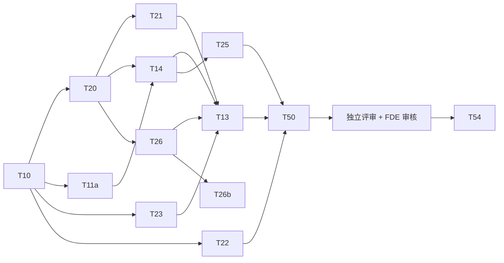
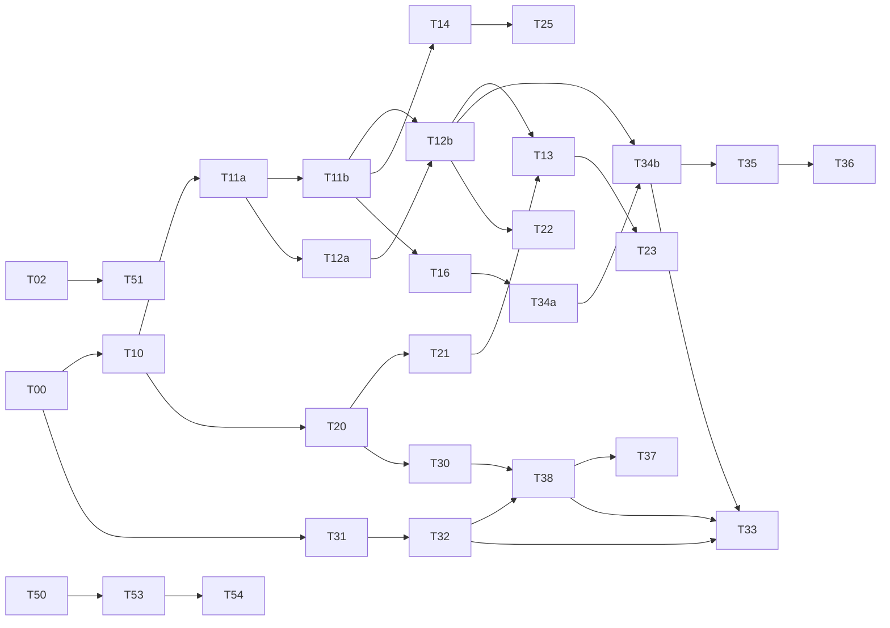

# 07 MVP 实施文档

> 输入：[06 PRD](<06 PRD.md>)（目标 G、验收 V、改动 FR）、[05 分期路线与 MVP 范围](<05 分期路线与 MVP 范围.md>)、[03 平台方案与 iface 共建](<03 平台方案与 iface 共建.md>)（R0–R3；PR-1 至 PR-4 暂缓）、[04 验收方法与数据](<04 验收方法与数据.md>)。
> 代码基线：DataAgent `codex/16-local-intake@87d5e8e` 加 worktree 未提交内容（T00 后以集成分支 `feat/p1-intake` 为准）；agent-kernel `master@33075118`。
> 11-18 调整的基线：DataAgent `feat/p1-intake@f84a514`；agent-kernel@ae6c3d5。iface 缺口与贡献的完整清单见 [08 iface 协议缺口与贡献](<08 iface 协议缺口与贡献.md>)。

## 最小 MVP（M1）调整（2026-11-18）

> 来源：盘点材料 `最小MVP推进计划-2026-11-18.md`（codex 已审）。本节与下文卡片冲突时，以本节为准。

### M1 的定义

M1（最小 MVP）：用户在 Mint（以 TUI 为主）里装好 preset-intake 后，能做到下面 5 件事。

1. 接入 8 类本地文件（含扫描 PDF，用本机 OCR）、Word（docx）、SQLite、带 token 的 REST。
2. 跨源对齐同一对象，冲突不静默覆盖。
3. 在工作台网页上看对象、纠正值或映射，回到对话保存。
4. 单次工具调用不超过宿主 60 秒，长探查分段续跑；同结构二次接入复用映射。
5. 凭据只按逻辑名注入，不进对话、日志、结果；doctor 能指出缺什么。

验收证据：

1. 安装产物上的 `verify_local`（files、sources 阶段）与 `verify_browser` e2e；
2. T50 的 TUI 证据包；
3. 范围明确的独立评审（codex，可复现，登记 test-inventory 与验收矩阵）；
4. FDE 子 agent（扮演一线交付工程师的子 agent，用截图和本地服务挑使用与功能问题）的审核报告，作为补充，不替代第 3 条。

真实数据冒烟：令才线上导出 `$LINGCAI_POLICY_DATA`（只读，不进仓库，报告只写聚合数），含 18 份制度原件（14 份 docx、4 份 pdf）、45 个解析目录、15 个规则库版本，没有真值。只看能不能接、覆盖率、缺口、单次耗时，不判对错；脚本放 `$PRIVATE_DIR`。冒烟发现原件大多是 docx，由此新增 T26、T26b。

### 卡片分层

| 层 | 卡 | 状态（11-18） |
|---|---|---|
| 前置 | T10、T11a；T02 | T10、T11a 已合入；T02 已完成（结论见 T02 卡） |
| M1 核心接入（关键路径） | T20、T21、T14、T13、T22、T23、T25、T26、T26b | 全部已合入 |
| 回归修复 | T11c | 已合入 |
| 证据 | T50（TUI，覆盖 C-01、C-02、C-03，含带 token 的 REST 接入与会话、结果、日志的哨兵扫描）；T51（GUI） | T50 进行中，完成哪条场景先采哪条证据；T51 外部阻断 |
| 评测基线（并行，不占关键路径） | T30、T31、T32、T38、T37 | T30、T31、T32、T38 已合入；T37 进行中 |
| 暂缓到 M1 之后 | T11b、T12a、T12b、T15、T16、T24、T33、T34a、T34b、T35、T36、T52、T40–T43 | 卡头标「11-18：最小 MVP 暂缓」，卡保留不删 |
| 收口 | 范围明确的独立评审 + FDE 子 agent 使用审核；T54 记「M1 合入」 | 未开始；合 main 前问 payne |

与原 P1 范围的偏离（payne 知情）：G1.5（默认审批）、G1.10（平台收敛 R2）、G1.13–G1.15（令才）不进 M1。

### 依赖放宽

按改动文件不重叠排并行。下表覆盖 §2.0 依赖图里对应的边。

| 卡 | 原依赖 | 放宽后 | 理由 |
|---|---|---|---|
| T22 | T12b | T10 | 限定新增或指定的测试文件；合入时重放工作台完整测试与 browser e2e；不等于 TUI 流程完成 |
| T23 | T13 | T10 | 只改 `intake_service` 的映射登记与命中；补测试：所有来源探查完成才命中、来源指纹集合规范化、部分完成或 429 续跑不误复用；T13 合入后复跑多来源二次接入 |
| T13 | T12b、T21 | T23、T21（并排在 T14、T26 之后） | 预算与分段在 `intake_service` 与数据层 observation，与 MCP 框架无关 |
| T14 | T11b | T11a、T20 | 范围补 `adapters/layer_client.py`、数据层 `observation/cli.py`：凭据改为把逻辑名传给探查子进程、在子进程里解析；T14 先于 T13 合入，T13 在其上改 `layer_client` |
| T26（新） | — | T20 | 改数据层 observation/documents；排在 T13 之前，避免同改一个文件 |
| T26b（新） | — | T26 | 安装产物依赖与网页上传补齐 docx |
| T25 | T14 | T14 | 不变；跨源金标在 T13 合入后复验 |
| T21、T30、T32 | T20、T20、T31 | 不变 | 文件重叠 |
| T50 | T12b、T14、T21、T22、T23、T25 | 去掉 T12b | T12b 暂缓 |

### M1 与 P1 的关系

1. M1 是单独里程碑，不等于原 P1 验收完成。
2. T54 在 M1 只记「M1 合入」；原 P1 退出条件（G1.10、G1.12、G1.13、G1.15 等）照旧待补。
3. `feat/p1-intake` 合入 main 前问 payne。

### 边界与风险

1. **只验采购场景**：工作台仍固定加载采购本体（`bootstrap.py:35`，`feat/p1-intake@f84a514`）；T16 暂缓，不支持通用领域加载。
2. **推断请求带样本值（T24 暂缓）**：没有白名单（`model-context.json`）时，推断请求会带前 5 行样本值和 PDF 文字摘录（`inference_requests.py:8-24`）。用令才真实数据冒烟时，若当前模型在远端，这些内容会离开本机。
3. **GUI 走不通**：T02 核实打包桌面版拿不到 DataAgent 的 MCP 工具，T51 登记外部阻断，M1 只用 TUI 证据；需要 Mint 侧改（[08](<08 iface 协议缺口与贡献.md>) IF-13、IF-14）。
4. **平台收敛只做到 R1 的一部分**：T11b 其余调用点、R2（T12a、T12b）暂缓；工具没有统一效果注解，默认审批下仍会弹确认（G1.5 不进 M1）。T11c 已顺带把 governance、operations、scenarios 三处入口改走 `resolve_context()`。
5. **`env:` 凭据**：明文必然存在于工作台进程环境（继承自宿主），见 T14 的 11-18 裁定；宿主级注入记为 [08](<08 iface 协议缺口与贡献.md>) IF-04。

## 0. 怎么用这份文档

### 0.1 规则

1. 每个任务一张卡。卡头写：编号、执行方、审核方、依赖、优先级、周次、对应的 FR 与 G；卡身一张表，列固定为「目标、文件、改法、命令、验收、回滚」。
2. 「文件」列就是允许改动的范围，改了范围外的文件算失败。写到目录时，指该目录下的源码与测试。
3. 「命令」列由派工方在任务分支上自己跑，不信执行方自报；「验收」列全部满足才算完成。依赖的卡没验收，不派。
4. 命令在 DataAgent 仓库根目录执行，先设好 §0.2 的环境变量。涉及安装后验收的命令前面都有 `bash scripts/prepare_acceptance.sh`（T10 产出），它建各包的 `.venv` 并把安装产物构建到 `build/local/`。
5. 包测试统一用 `bash scripts/test_all.sh [<包名>…] [-- <pytest 参数>]`（T10 产出）：它进入每个包的目录，按该包的 extras 或依赖组跑 pytest。不要在仓库根目录直接 `uv run --project … pytest`。
6. 跑 09-benchmark 的命令每次取一个新的探索轮号 `$RID`（形如 `x101-2026-11-20`）；同一个轮号的 run 目录不能重用，派工方复跑时换新号。
7. 私有数据（令才数据集、映射结果、变异集）只放在 `$PRIVATE_DIR`，不进 Git、不进日志正文、不进飞书；报告只写聚合计数。
8. 推送、开合并请求、删除分支或目录、对外发消息，先经 payne 确认（workspace AGENTS.md「推进与安全」）。
9. 与规范或已拍的裁决冲突时，以规范和裁决为准，并提醒 payne。还没拍板的问题，卡里写明按哪个推荐选项做，拍板不同时回改。

### 0.2 环境变量

| 变量 | 含义 | 取值 |
|---|---|---|
| `CAP` | 能力包目录 | `packages/capabilities` |
| `BENCH` | 09-benchmark 目录 | `docs/research/dataagent-2026-11-03/09-benchmark` |
| `KERNEL` | agent-kernel 开发 clone（不是 `upstream/agent-kernel`） | P1 不需要（[03](<03 平台方案与 iface 共建.md>) 的 Q5 已拍：P1 不提 PR） |
| `OCR_ROOT` | 已验证的本机 OCR 目录 | Claude Code 在阶段 A 从 `13-ocr-build/` 实施记录里找；找不到再问 payne |
| `PG_LOCATOR` | 本机 PostgreSQL 测试库地址 | P1 不需要（PostgreSQL 移出 P1 验收，[06](<06 PRD.md>) 的 Q12） |
| `LINGCAI_DATASET` | 令才 Computer Use 数据集 | `~/.codex/visualizations/2026/10/28/01a182a2-1762-7d71-a3b1-f35548b004be/lingcai-dataset-2026-10-28` |
| `QL_AUDIT` | ql-audit 插件目录（只读，只调用不修改） | `~/Vibe/AgentCPM-agent-evolution/products/ql-audit/plugins/ql-audit` |
| `PRIVATE_DIR` | 本机私有输出目录 | 默认 `~/Vibe/dataagent-private`（`chmod 700`，不在任何 git 仓库里）；各变量写在其中的 `p1.env` |
| `RID` | 探索轮号 | 每条 harness 命令取新值 |

### 0.3 分支与合并

1. T00 建集成分支 `feat/p1-intake`，它包含 main 上的文档集（00–07、09 计划 v0.3），crew 执行者在 worktree 里能读到。
2. 每张卡在自己的分支 `crew/<编号>` 上做，crew 放在 `.crew/worktrees/<编号>`（`.crew/` 由 crew 写进 `.git/info/exclude`，不改 `.gitignore`）。
3. 验收通过、codex 审核结论为「通过」后，Claude Code 出合并计划，payne 确认后 `merge --yes` 合入 `feat/p1-intake` 并推送；crew 不自动合并、不推送。
4. agent-kernel 的卡（T40–T43）P1 暂缓；将来恢复时在 `$KERNEL` 上建分支 `dataagent/pr-<n>`，执行方只做到本地测试通过，推送和开合并请求由 payne 确认后执行。
5. P1 退出时（T54）`feat/p1-intake` 合入 main，两个宿主各自更新指针。

### 0.4 crew 派工约定

1. 派工方是 payne Mac 上的 Claude Code（Claude 桌面应用的沙盒里没有 dsh、zcode、codex）。启动方式、各阶段步骤和需要 payne 的时刻见盘点材料 `P1-操作清单.md`。
2. 调用：`node <crew skill 目录>/scripts/crew.mjs <命令>`，在 DataAgent 仓库（`feat/p1-intake`）里运行；skill 目录按 crew skill 说明查找，版本 0.1.0。常用命令：`doctor`、`check <任务单>`、`dispatch <任务单> [--yes] --master <会话名>`、`wait <ID…> --timeout 540`、`show <ID>`、`retry`、`continue`、`merge <ID> [--yes]`、`status`、`review --doc|--task`。
3. 任务单（`.crew/specs/<卡号>.yaml`，字段以 crew 的 `references/task-spec.md` 为准）：任务 ID = 卡号；目标 = 卡的「目标」加「改法」；范围 = 「文件」列；验收命令 = 「命令」列（先 `source ~/Vibe/dataagent-private/p1.env`）；审核要点 = 「验收」列；implementer = 「执行」；`dev_record` = 盘点材料 `feishu-records.json` 的 `dev_records.<卡号>`；`--master` 按 `dataagent-<模块>-<卡号>-<日期>`。
4. 派工、`continue`、`retry`、`merge` 都先出计划，payne 确认后加 `--yes`；一批可以一次确认。
5. 卡的编号即 crew 的任务 ID；飞书「开发交付」表里任务名以同一编号开头。crew 按 `dev_record` 更新那一行的任务状态、进展、测试证据、CI 结果与会话名，不改验收状态与验收人。
6. 执行方：`dsh`、`zcode` 实现，`codex` 只读审核；`auto` 由派工方判断；标「Claude Code」的卡不派 crew，由派工方的 Claude Code 自己做，只在需要人眼看界面、凭据、真人或签字时找 payne。
7. 返工最多 2 轮（crew 自动），仍不过就停在「待决定」，交给 payne 选。
8. 标「暂不派」的卡，条件满足后重写再派。

### 0.5 执行者常见误区

- 用源码环境的测试结果冒充安装产物验收；`verify_local.sh` 必须先跑 `prepare_acceptance.sh`，在它新建的临时工作区里验收。
- 期望文件、金标由被测程序生成；必须独立编写。
- 为了让可判定率好看给报文硬加映射；空数组就是空数组，按缺口如实分类。
- 把领域词（报销、发票、采购等）写进核心包；放领域包。
- 在验收中途给平台层改包名；P1 不改名（03 的 Q2 已拍 A）。
- 在 `upstream/agent-kernel` 里提交；那是只读跟随的副本。
- 直接改 `test-inventory.md` 的状态；统一由 T53 登记。

## 1. 前置条件

1. T00 完成：代码在 GitHub 可见，集成分支存在。
2. crew 在 payne 的 Mac 上可用（T01）；Claude 桌面应用的沙盒调不到本机 CLI，派工和本机操作都由 Mac 上的 Claude Code 执行（启动方式见盘点材料 `P1-操作清单.md` §0）。
3. 本机有 Mint CLI、uv、Node、Chrome；环境变量由 Claude Code 在阶段 A 定好并写进 `~/Vibe/dataagent-private/p1.env`。

## 2. 分步清单（一期）

### 2.0 总览

| 步 | 卡 | 周 |
|---|---|---|
| 2.1 入库与准备 | T00、T01、T02 | W1 |
| 2.2 平台收敛（R0–R3） | T10、T11a、T11b、T11c、T12a、T12b、T13、T14、T15、T16 | W1–W2 |
| 2.3 接入能力补齐 | T20–T26、T26b | W1–W2 |
| 2.4 评测与验收数据 | T30–T38 | W1–W2 |
| 2.5 iface PR（暂缓） | T40–T43 | — |
| 2.6 双端、评审与收尾 | T50–T54 | W2 |

上图是 v0.4 的原依赖；M1 的卡按「最小 MVP（M1）调整」一节的依赖放宽表执行。

改同一批文件的卡已用依赖串起来：`bootstrap.py`（T11b → T16）、`bin/dataagent`（T20 → T30）、`BENCH` 的登记文件（T31 → T32 → T33）、验收脚本的 files 阶段（T20 → T21 → T13）与 sources 阶段（T14 → T25）、`layer_client.py`（T13 → T15）、`intake_service.py`（T13 → T23）、`inference_requests.py`（T15 → T24）。

### 2.1 入库与准备

**T00 代码入库与集成分支** · 执行：Claude Code（Mac），不派 crew；推送按 payne 的授权 · 依赖：无 · 优先级：P0 · W1（11-17）· FR1.16 / G1.10

| 目标 | 文件 | 改法 | 命令 | 验收 | 回滚 |
|---|---|---|---|---|---|
| 三个 checkout 的改动按顺序入库；方案 16 代码、OCR 包、方案与设计文档在 GitHub 可见；集成分支包含 main 上的文档集 | `~/Vibe/AgentCPM-OS/projects/dataagent`（main）；`~/Vibe/AgentOS/domains/dataagent`（main）；`~/Vibe/AgentOS/.worktrees/dataagent-local-intake`（分支） | 按「同一仓库同一时间只在一个 checkout 里改」依次处理：① agentcpm-os 的 checkout 在 main 提交文档集并推送；② AgentOS 的 main checkout 拉取，逐条处理 `git status` 列出的改动（含删除与修改）后推送；③ worktree 合入 `origin/main`，逐条处理未提交内容（`dataagent-ocr`、`13-*`、`design/`、`archive/`、`fde-agent-2026-11-09/` 等），分支改名 `feat/16-local-intake` 推送，再拉 `feat/p1-intake` 推送；DataAgent 仓 `AGENTS.md`「与 mint / iface 对比前」一节随合入 `origin/main` 带进来。逐条命令见盘点材料 `P1-操作清单.md` 阶段 B（11-17 核对：AgentOS 的 main checkout 里的未提交改动是 worktree 的副本或旧版，先拷两份较新的索引再整体 stash 备份） | `git ls-remote origin feat/16-local-intake feat/p1-intake`；`git merge-base --is-ancestor origin/main origin/feat/p1-intake && echo ok`；三个 checkout 各跑 `git status --porcelain` | 两个分支都在远端；merge-base 输出 ok；三个 `git status --porcelain` 都为空 | 推送前各留本地备份分支；只增不删 |

**T01 crew 冒烟** · 执行：Claude Code（Mac）· 依赖：T00 · 优先级：P0 · W1

| 目标 | 文件 | 改法 | 命令 | 验收 | 回滚 |
|---|---|---|---|---|---|
| crew 能在 DataAgent 仓库派工、验收、审核、回写飞书 | 无代码改动 | 在 DataAgent 仓库跑 crew 自检（`doctor --smoke` 先经 payne 同意），派一个只新增 `docs/dataagent-盘点材料/crew-smoke.md` 的试验任务 | `node <crew 目录>/scripts/crew.mjs doctor`；试验任务按 §0.4 派工、`wait`、`show` | doctor 通过；试验任务有 diff、验收结果、codex 审核结论；飞书开发交付对应行被更新，带会话名 | 试验分支经 payne 确认后删除 |

**T02 打包桌面版 GUI 工具通道核实** · 执行：Claude Code（Mac）；日志确认不了时请 payne 看一眼界面 · 依赖：无 · 优先级：P0 · W1（11-18 前）· G1.4、03 的 Q1 · 11-18 已完成

| 目标 | 文件 | 改法 | 命令 | 验收 | 回滚 |
|---|---|---|---|---|---|
| 确认打包版 Mint.app 的回合里 Agent 能不能看到 bundle 的 MCP 工具 | `docs/research/dataagent-2026-11-03/16-local-ingestion-workflow-build/gui-channel-check.md`（新增）、同目录 `README.md`（登记） | 在装了 `preset-intake` 的工作区打开 Mint.app，让 Agent 列出可用工具；记录 Mint.app 版本、`runtime_layout`、工具列表、通知里的 MCP 拉起错误；先从 `~/.mint` 的会话与日志里确认 | 见盘点材料 `P1-操作清单.md` 阶段 C；必要时截图 | 记录写明「工具列表是否出现 `dataagent-workbench__*`」；结论写回 03 的 Q1；看不到时按 Q1（11-17 已拍）GUI 验收改用非 Kernel 布局，Kernel command 组件通道原型由派工方另开卡（P1 级） | — |

11-18 结论（`gui-channel-check.md`，提交 `9c4c941`）：

1. 打包版 Mint Agent 0.1.40（`runtime_layout = kernel-stdio-v1`）用 `mint-gui --cwd <项目>` 能在装了 preset-intake 的项目里起会话，能加载 4 个 DataAgent 技能；但模型只有 6 个内核工具，拿不到任何 `dataagent-*` MCP 工具。同一工作区命令行 `mint run` 有 73 个工具。
2. 原因在 Mint 侧：`kernel-stdio-v1` 静态装配，项目包声明的 MCP 服务不进工具面。另有启动问题：不认 Finder 打开的目录、`/var` 软链路径报错、`provider = "openai-compatible"` 报 `provider_unsupported`。
3. 影响：T51 登记外部阻断；T43 的触发条件已成立；Mint 侧需求记为 [08](<08 iface 协议缺口与贡献.md>) IF-13（工具不进 GUI）、IF-14（启动问题）。

### 2.2 平台收敛（R0–R3）

**T10 R0：干净基线、验收脚手架与守卫** · 执行：dsh · 审核：codex · 依赖：T00 · 优先级：P0 · W1 · FR1.16 / G1.10 · 已合入（`9824930`）

| 目标 | 文件 | 改法 | 命令 | 验收 | 回滚 |
|---|---|---|---|---|---|
| 干净检出后各包测试全过；有统一的测试与验收脚手架、分层守卫和 iface 基线 | `$CAP/dataagent-cli/**`；`$CAP/dataagent-data/pyproject.toml`、`uv.lock`；`scripts/test_all.sh`、`scripts/prepare_acceptance.sh`、`scripts/check_layering.py`、`scripts/layering-baseline.json`（新增）；`scripts/verify_local.py`（只拆分）、`scripts/acceptance/`（新增）；`packaging/iface-baseline.toml`（新增） | 修 `bin/dataagent:109` 的 ops 分发与 `tests/test_dispatcher.py:77-82` 的不一致；`dataagent-data` 声明对 `dataagent-ocr` 的路径依赖；`test_all.sh` 按 §0.1 第 5 条的接口实现（operations 用 dependency-groups）；`prepare_acceptance.sh` 逐包 `uv sync --frozen` 并跑 `$CAP/dataagent-workbench/tools/build_bundle.py --out build/local`；`verify_local.py` 拆成主文件分发加 `scripts/acceptance/<阶段>.py`，行为不变；`check_layering.py` 检查业务包不导入平台层适配器，现有违规写进基线、只许减少；`iface-baseline.toml` 钉 10 个 `iface/<名>` 身份包版本与 agent-kernel 提交 | `bash scripts/test_all.sh`；`python3 scripts/check_layering.py --baseline scripts/layering-baseline.json`；`bash scripts/prepare_acceptance.sh && bash scripts/verify_local.sh --phase bootstrap` | 三条命令退出码 0；`test_all.sh` 打印每个包的通过数，无失败；守卫违规数不超过基线 | revert 该任务分支 |

**T11a R1：上下文解析模块与 runtime 内调用点** · 执行：dsh · 审核：codex · 依赖：T10 · 优先级：P0 · W1 · FR1.17 / G1.10 · 已合入（`4b41b6c`）

| 目标 | 文件 | 改法 | 命令 | 验收 | 回滚 |
|---|---|---|---|---|---|
| 一个 `resolve_context()`；runtime 内的调用点改用它；关闭 S0 评审 X1、X2 在 runtime 的部分 | `$CAP/dataagent-runtime/src/dataagent_runtime/{types,policy}/`（新增）、`interfaces/`、`invoke.py`、`runtime.py`、`enforcement.py`、`registry.py`；`$CAP/dataagent-runtime/tests/`；`scripts/check_layering.py`（加规则） | 解析顺序：宿主 `_meta` → 宿主注入环境 → 本机 `local-owner`；调用参数里的上下文只作提示；`scope_ref` 统一为 `workspace:<sha>`；工具 schema 里 `context` 改为可选；注册时校验 `resource_fields` 声明（X2）；保留开关 `DATAAGENT_CONTEXT_RESOLVER=legacy` 一个版本；`check_layering.py` 加「`resolve_context` 只能定义一次」规则；把 `08-governance-layer-build/r41-repro/runtime/runtime_probe.py` 改写成带断言的 `tests/test_r41_x1_x2.py` | `bash scripts/test_all.sh dataagent-runtime`；`python3 scripts/check_layering.py --baseline scripts/layering-baseline.json` | 通过；新测试里 X1、X2 的复现输入全部被拒 | 开关切回 legacy；revert |

**T11b R1：其余包的调用点** · 执行：dsh · 审核：codex · 依赖：T11a · 优先级：P0 · W1–W2 · FR1.17 / G1.10 · 11-18：最小 MVP 暂缓

| 目标 | 文件 | 改法 | 命令 | 验收 | 回滚 |
|---|---|---|---|---|---|
| 其余 7 处上下文来源改用 `resolve_context()` | `$CAP/dataagent-governance/src/dataagent_governance/governance/access.py`、`runtime/runtime.py`；`$CAP/dataagent-workbench/src/dataagent_workbench/{bootstrap,session_service}.py`；`$CAP/dataagent-operations/src/dataagent_operations/{bindings,mcp}.py`；`$CAP/dataagent-data/src/dataagent_data/observation/cli.py`；`$CAP/dataagent-scenarios/src/**/gate.py`；以上各包 `tests/` | 来源清单见 [03](<03 平台方案与 iface 共建.md>) §3「调用上下文」；把 `08-governance-layer-build/r41-repro/governance/r1_wire_identity.py`、`r2_policy_bootstrap.py`、`r9_misc.py` 改写成 governance 包里带断言的 `tests/test_r41_x1_x2.py` | `bash scripts/test_all.sh`；`python3 scripts/check_layering.py --baseline scripts/layering-baseline.json`；`bash scripts/prepare_acceptance.sh && bash scripts/verify_local.sh --phase bootstrap && bash scripts/verify_local.sh --phase files --ocr-root "$OCR_ROOT" && bash scripts/verify_local.sh --phase sources --postgres-locator "$PG_LOCATOR" && bash scripts/verify_local.sh --phase discovery` | 全部通过；X1、X2 复现输入全部被拒 | revert |

11-18：T11c 已把 governance `access.py`、operations `mcp.py`、scenarios `gate.py` 三处改走 `resolve_context()`；恢复本卡时只做其余调用点。

**T11c 合并回归修复：全量包测试转绿** · 执行：dsh · 审核：codex · 依赖：T11a · 优先级：P0 · W1（11-18 新增）· FR1.17 / G1.10 · 已合入（`da7291b`）

| 目标 | 文件 | 改法 | 命令 | 验收 | 回滚 |
|---|---|---|---|---|---|
| `feat/p1-intake` 干净检出后 11 个包测试全过（T11a 等卡合入时只跑各自的包，11-18 全量跑 application、governance、operations、scenarios 共 15 个失败） | `$CAP/dataagent-{governance,application,operations}/**`；`$CAP/dataagent-scenarios/{src,tests}/**`；`$CAP/dataagent-runtime/src/dataagent_runtime/{interfaces,types}/**` | 根因：T11a 引入 `resolve_context()` 后，其余包仍按旧上下文传主体，访问判定得到 `indeterminate` 或 `da12.access_denied`。修法：governance `governance/access.py`、operations `mcp.py`、scenarios `gate.py` 改用 T11a 的解析器（T11b 的最小必要部分）；operations 的授权以宿主配置的 `authorization_ref` 为准；application 包内的 runtime 副本用同步脚本重新生成；不放宽访问判定、不删测跳测 | `bash scripts/test_all.sh`；`python3 scripts/check_layering.py --baseline scripts/layering-baseline.json` | 11 个包全过；拒绝仍为拒绝，缺主体仍拒绝；包内副本与 runtime 现源一致 | revert |

**T12a R2：平台层 MCP 服务框架与效果注解** · 执行：dsh · 审核：codex · 依赖：T11a · 优先级：P0 · W1–W2 · FR1.8 / G1.5、G1.10 · 11-18：最小 MVP 暂缓

| 目标 | 文件 | 改法 | 命令 | 验收 | 回滚 |
|---|---|---|---|---|---|
| 平台层有唯一 MCP 服务框架：注册时必须给效果等级；错误格式与结果外置统一；关闭 X3 | `$CAP/dataagent-runtime/src/dataagent_runtime/{tool,context}/`（新增）、`interfaces/mcp_server.py`、`registry.py`；`$CAP/dataagent-runtime/tests/`；`$CAP/dataagent-application/.mcp.json`、`$CAP/dataagent-application/packaging/bundle/.mcp.json`、`$CAP/dataagent-operations/.mcp.json`、`$CAP/dataagent-workbench/.mcp.json`；`scripts/check_tool_annotations.py`（新增） | 效果等级映射为 `readOnlyHint`、`destructiveHint`、`idempotentHint`；内联上限一个值，全文写 `results/` 并返回 `result_path`；所有 bundle 的 `.mcp.json` 注入 `DATAAGENT_ENFORCEMENT_MODE=enforce`（X3）；`check_tool_annotations.py` 用各包已装好的 `.venv` 逐个拉起 MCP 服务读 `tools/list` | `bash scripts/test_all.sh dataagent-runtime`；`bash scripts/prepare_acceptance.sh && python3 scripts/check_tool_annotations.py --servers data,application,governance` | 通过；三个服务的每个工具都有三项注解；application 在 enforce 下运行 | revert |

**T12b R2：工作台与 operations 迁到平台层 MCP 服务** · 执行：dsh · 审核：codex · 依赖：T12a、T11b · 优先级：P0 · W2 · FR1.8 / G1.5 · 11-18：最小 MVP 暂缓

| 目标 | 文件 | 改法 | 命令 | 验收 | 回滚 |
|---|---|---|---|---|---|
| 所有 MCP 入口用同一框架 | `$CAP/dataagent-workbench/src/dataagent_workbench/{interfaces/mcp_server,service_tools,tool_schema}.py`；`$CAP/dataagent-operations/src/dataagent_operations/mcp.py`；两包 `tests/` | 两个入口改用平台层框架，所有工具标效果等级；operations 改走注册表与复检（现 `ops/mcp.py:131-155` 自写调用） | `bash scripts/test_all.sh dataagent-workbench dataagent-operations`；`bash scripts/prepare_acceptance.sh && python3 scripts/check_tool_annotations.py --servers data,application,governance,workbench,operations` | 通过；五个服务的每个工具都有三项注解 | 旧入口保留一个版本；revert |

**T13 R2：时间预算与续跑** · 执行：dsh · 审核：codex · 依赖：T12b、T21（11-18 放宽为 T23、T21，并排在 T14、T26 之后）· 优先级：P0 · W2 · FR1.8 / G1.7 · 已合入（`f84a514`）

| 目标 | 文件 | 改法 | 命令 | 验收 | 回滚 |
|---|---|---|---|---|---|
| 单次工具调用在宿主 60 秒超时前返回；长探查分段续跑 | `$CAP/dataagent-workbench/src/dataagent_workbench/{intake_service,adapters/layer_client}.py`；`$CAP/dataagent-data/src/dataagent_data/observation/{files,documents,cli}.py`；两包 `tests/`；`scripts/acceptance/files.py` | `intake_advance` 设 50 秒预算；探查按页、按表、按分页分段落盘，超预算返回 `retry_probe` 与续跑点；files 阶段在运行时生成 30 MB 级样本并断言单次墙钟 | `bash scripts/test_all.sh dataagent-workbench dataagent-data`；`bash scripts/prepare_acceptance.sh && bash scripts/verify_local.sh --phase files --ocr-root "$OCR_ROOT"` | 单次 `intake_advance` 墙钟小于 55 秒；30 MB 级样本经多次 advance 完成，结果与一次性探查一致；M1-08 达到「已验证」条件（由 T53 登记） | revert |

11-18 补充（令才冒烟发现：docx 探查失败时连续 12 次只得到 `retry_probe`）：

1. 改法加一条：探查子进程失败（依赖缺失、解析异常）时，`intake_advance` 返回带错误码的问题与缺口，不能无限返回 `retry_probe` 且来源为空。
2. 验收加一条：有对应测试；T21 的 8 类样本比对仍通过；多来源复用在分段未完成时不误复用。

**T14 R3：凭据逻辑名** · 执行：dsh · 审核：codex · 依赖：T11b（11-18 放宽为 T11a、T20）· 优先级：P0 · W2 · FR1.7 / G1.2、G1.6 · 已合入（`2e5e24e`）

| 目标 | 文件 | 改法 | 命令 | 验收 | 回滚 |
|---|---|---|---|---|---|
| 凭据按逻辑名解析，只进探查子进程；不进对话、日志、结果 | `$CAP/dataagent-runtime/src/dataagent_runtime/policy/secrets.py`（新增）；`$CAP/dataagent-workbench/src/dataagent_workbench/adapters/source_connections.py`；`$CAP/dataagent-ocr/src/dataagent_ocr/secrets.py`；三包 `tests/`；`scripts/acceptance/sources.py`；`scripts/verify_local.py`（只改 `--postgres-locator` 为可选）（工作台 `.mcp.json` 在 T12a 已改，本卡只加连接清单的 `env` 一行） | 逻辑名支持 `env:`、`keychain:`、`file:`（`file:` 只读 `.dataagent/secrets/`，目录 0700、文件 0600）；连接清单只存逻辑名，路径写进工作台包内 `.mcp.json` 的字面 `env`；OCR 的凭据解析改用同一模块；按 06 的 Q12：sources 阶段的 `--postgres-locator` 改为可选，不给时跳过 PostgreSQL 来源，其余断言按文件、SQLite、REST 三类来源；本机 REST 测试源改为要求 `Authorization: Bearer <token>`，token 用哨兵值，经连接清单的逻辑名注入；用这个哨兵跑一遍 sources 阶段，并扫描临时工作区与本次 Mint 会话日志，命中即非零退出 | `bash scripts/test_all.sh dataagent-runtime dataagent-workbench dataagent-ocr`；`bash scripts/prepare_acceptance.sh && bash scripts/verify_local.sh --phase sources` | 通过；不给 `--postgres-locator` 时退出码 0；token 错误时 REST 读取返回鉴权失败，错误信息不含 token；哨兵扫描 0 命中；`intake_status`、`intake_inference` 输出不含凭据字段；M2-01、M2-03、M2-04 达到「已验证」条件 | revert |

11-18 调整：

1. 范围补 `$CAP/dataagent-workbench/src/dataagent_workbench/adapters/layer_client.py` 与数据层 `observation/cli.py`：工作台只把逻辑名传给探查子进程，在子进程里解析（原先是工作台解析出明文、经标准输入传给数据层）。
2. 派工方裁定：`env:` 凭据的明文必然存在于工作台进程环境（继承自宿主），工作台无法避免持有。验收相应调整为「工作台不读取、不转发、不输出」；标准输入载荷里只有逻辑名。
3. 宿主级注入（只给声明它的 MCP 进程注入）记为 [08](<08 iface 协议缺口与贡献.md>) IF-04。

**T15 R3：外发闸门与 HTTP 统一** · 执行：dsh · 审核：codex · 依赖：T13 · 优先级：P1（不进 P1 退出条件，可顺延 W3）· W2 · FR1.18 · 11-18：最小 MVP 暂缓

| 目标 | 文件 | 改法 | 命令 | 验收 | 回滚 |
|---|---|---|---|---|---|
| 所有外发过一个闸门；只有一个 HTTP 客户端；工作台探查经访问复检 | `$CAP/dataagent-runtime/src/dataagent_runtime/{policy/egress.py,env/http.py}`（新增）、`enforcement.py`、`interfaces/unified.py`；`$CAP/dataagent-data/src/dataagent_data/{adapters/sources/rest.py,preparation/extraction.py}`；`$CAP/dataagent-operations/src/dataagent_operations/adapters/api.py`；`$CAP/dataagent-ocr/src/dataagent_ocr/{egress.py,providers/openai_compat.py}`；`$CAP/dataagent-workbench/src/dataagent_workbench/{inference_requests.py,adapters/layer_client.py}`；各包 `tests/` | 一套外发规则覆盖 MCP 结果、CLI 输出（`unified.py:456-477`）、推断请求三个出口，`candidate_spans` 纳入；三套 HTTP 客户端改用 `env/http`（关代理、禁重定向、体积上限、来源白名单）；工作台探查改经注册表与 DA12.1 复检 | `bash scripts/test_all.sh` | 通过；新增的外发测试覆盖三个出口与 `candidate_spans` | 逐项开关；revert |

**T16 领域包与领域词检查** · 执行：zcode · 审核：codex · 依赖：T11b · 优先级：P0 · W2 · FR1.14 / G1.10 · 按 00 的 Q2（已拍 A）执行 · 11-18：最小 MVP 暂缓

| 目标 | 文件 | 改法 | 命令 | 验收 | 回滚 |
|---|---|---|---|---|---|
| 核心包不含领域词；预设本体从领域包加载并进安装产物 | `packages/domains/procurement/`（新增：`ontology.json`、`README.md`）；`$CAP/dataagent-workbench/src/dataagent_workbench/{bootstrap.py,ontologies/}`；`$CAP/dataagent-workbench/web/src/pages/{IntakePage,MappingPage}.tsx`；`$CAP/dataagent-data/src/dataagent_data/anchors.py`；`$CAP/dataagent-ocr/src/dataagent_ocr/probe.py`；`$CAP/dataagent-workbench/tools/build_bundle.py`；`$CAP/dataagent-intake/mint.toml`；`scripts/check_domain_words.py`、`scripts/domain-words.txt`（新增） | 采购本体移到领域包，工作台按配置选择本体；核心源码里的领域词改为通用措辞；初始词表：报销、发票、采购、招待、差旅、食品、procurement、invoice、reimburse；扫描 `$CAP/*/src` 与 `web/src`，排除 `tests/`、`fixtures/`、`static/`、`$CAP/dataagent-scenarios` | `python3 scripts/check_domain_words.py`；`bash scripts/test_all.sh dataagent-workbench dataagent-data dataagent-ocr`；`bash scripts/prepare_acceptance.sh && bash scripts/verify_local.sh --phase files --ocr-root "$OCR_ROOT"` | 领域词 0 命中（现状 6 个文件）；测试与 files 阶段通过；安装产物里有领域包 | revert |

### 2.3 接入能力补齐

**T20 OCR 打包与 doctor** · 执行：zcode · 审核：codex · 依赖：T10 · 优先级：P0 · W1 · FR1.10 / G1.8 · 已合入（`bc7b3c9`）

| 目标 | 文件 | 改法 | 命令 | 验收 | 回滚 |
|---|---|---|---|---|---|
| OCR 是数据层的显式依赖；装包后 setup / doctor 配置并检查 OCR 引擎与模型 | `$CAP/dataagent-workbench/tools/build_bundle.py`；`$CAP/dataagent-cli/bin/dataagent`、`$CAP/dataagent-cli/tests/`；`$CAP/dataagent-ocr/src/**`；`scripts/acceptance/files.py`、`scripts/acceptance/bootstrap.py` | 构建不再按目录是否存在静默跳过 OCR（`build_bundle.py:60-64`）；`dataagent doctor` 输出引擎与模型版本，缺失时给出配置项；扫描件验收不再 `copytree` 预置 OCR 目录（原 `verify_local.py:66-69`），改走 setup | `bash scripts/test_all.sh dataagent-cli dataagent-ocr`；`bash scripts/prepare_acceptance.sh && bash scripts/verify_local.sh --phase bootstrap && bash scripts/verify_local.sh --phase files --ocr-root "$OCR_ROOT"` | 通过；bootstrap 阶段断言 doctor 输出含引擎与模型版本；缺引擎时扫描页返回 `needs_input` 或部分完成，不显示为成功；M1-01 达到「已验证」条件 | revert |

**T21 files 阶段扩到 8 类样本** · 执行：zcode（样本与比对）+ Claude Code 另开子 agent 独立编写期望文件（不给实现方的 diff 和输出）· 审核：codex · 依赖：T20 · 优先级：P0 · W1–W2 · FR1.1 / G1.1 · 已合入（`3102be0`）

| 目标 | 文件 | 改法 | 命令 | 验收 | 回滚 |
|---|---|---|---|---|---|
| 8 类文件在安装产物上验收，有独立期望文件 | `$CAP/dataagent-scenarios/fixtures/intake/`（新增样本与 `expected/`）；`scripts/acceptance/files.py` | 补齐 CSV、TSV、Excel（含合并表头、多表区）、JSON、JSONL、文本 PDF、扫描 PDF、混排 PDF（含失败页、跨页表、低置信度页）；期望文件按原件手工编写，不得由抽取程序生成；files 阶段逐样本比对 `coverage`、缺口页号、锚点覆盖率 | `bash scripts/prepare_acceptance.sh && bash scripts/verify_local.sh --phase files --ocr-root "$OCR_ROOT"` | 退出码 0；每个样本与期望一致；锚点覆盖率 100%；M1-04、M1-05、M1-06 达到「已验证」条件；codex 审核时抽查 5 处期望值与原件一致 | revert |

11-18：本卡只验安装产物上的 files 阶段；M1-04、M1-05、M1-06 要在 Mint 会话里复验的部分移到 T50（TUI）与 T51（GUI，外部阻断）。

**T22 工作台缺项** · 执行：zcode · 审核：codex · 依赖：T12b（11-18 放宽为 T10）· 优先级：P0 · W2 · FR1.6 / G1.4 · 已合入（`20a1e27`）

| 目标 | 文件 | 改法 | 命令 | 验收 | 回滚 |
|---|---|---|---|---|---|
| 对象页与三种修改范围可用 | `$CAP/dataagent-workbench/src/dataagent_workbench/view_service.py`（新增）、`interfaces/http_api.py`；`$CAP/dataagent-workbench/web/src/{main.tsx,client.ts}`、`web/src/pages/ObjectPage.tsx`（新增）；`web/tests/intake.spec.ts`、`source-preview.spec.ts`（新增）；`$CAP/dataagent-workbench/tests/`；`scripts/verify_browser.py` | 按设计 14 §7.1 实现当前值纠正、映射修订、本体草案三种范围；本体草案未经审核不改正式本体；并发、刷新、重启恢复；`verify_browser.py` 负责起服务、注入 `DATAAGENT_TEST_URL` 与令牌后跑 e2e | `npm --prefix $CAP/dataagent-workbench/web ci && npm --prefix $CAP/dataagent-workbench/web run build`；`bash scripts/prepare_acceptance.sh && $CAP/dataagent-workbench/.venv/bin/python scripts/verify_browser.py`；`bash scripts/test_all.sh dataagent-workbench` | 全部通过；M1-07、M1-08 达到「已验证」条件 | revert |

**T23 多来源映射复用** · 执行：dsh · 审核：codex · 依赖：T13（11-18 放宽为 T10）· 优先级：P0 · W2 · FR1.9 / G1.7 · 已合入（`61f6feb`）

| 目标 | 文件 | 改法 | 命令 | 验收 | 回滚 |
|---|---|---|---|---|---|
| 多来源组合二次接入也复用已验证映射 | `$CAP/dataagent-workbench/src/dataagent_workbench/intake_service.py`；`$CAP/dataagent-workbench/tests/test_proposal_loop.py` | 已验证映射按「作用域 + 来源指纹集合 + 本体修订」登记与命中（现只在单来源时，`intake_service.py:75`、`:203`） | `bash scripts/test_all.sh dataagent-workbench -- tests/test_proposal_loop.py` | 新增用例：同样组合的多来源二次接入 `mapping_reused=true`；来源指纹变了不误复用 | revert |

**T24 默认最小披露** · 执行：dsh · 审核：codex · 依赖：T15（06 的 Q3 已拍 A）· 优先级：P1 · W2 · FR1.4 / G1.9 · 11-18：最小 MVP 暂缓

| 目标 | 文件 | 改法 | 命令 | 验收 | 回滚 |
|---|---|---|---|---|---|
| 没有白名单时只给字段名和统计 | `$CAP/dataagent-workbench/src/dataagent_workbench/{inference_requests.py,bootstrap.py}`；`$CAP/dataagent-workbench/tests/` | 无 `model-context.json` 时样本与 PDF 文字摘录不进推断请求；白名单显式允许的才进 | `bash scripts/test_all.sh dataagent-workbench` | 新增用例：无白名单时推断请求不含样本值与原文；有白名单时只含获准字段 | revert |

**T25 跨源样本组与金标** · 执行：dsh（样本）+ Claude Code 另开子 agent 独立编写金标（不给实现方的 diff 和输出）· 审核：codex · 依赖：T14 · 优先级：P0 · W2 · FR1.5 / G1.3 · 已合入（`c9ef914`）

| 目标 | 文件 | 改法 | 命令 | 验收 | 回滚 |
|---|---|---|---|---|---|
| 跨源对齐与冲突处理有独立金标 | `$CAP/dataagent-scenarios/fixtures/intake/cross-source/`（新增）；`scripts/acceptance/sources.py` | PDF、SQLite、REST（带 token）共享单据号，含同名异对象、冲突金额、缺键记录（PostgreSQL 不在 P1 验收，06 的 Q12）；金标独立编写；sources 阶段比对对象数、冲突数并断言冲突对象保存被拦 | `bash scripts/prepare_acceptance.sh && bash scripts/verify_local.sh --phase sources` | 对象数、冲突数与金标一致；冲突对象保存返回阻断问题；M2-05 达到「已验证」条件 | revert |

**T26 Word（docx）文本接入** · 执行：dsh · 审核：codex · 依赖：T20 · 优先级：P0 · W1（11-18 新增，M1）· FR1.1 / G1.1 · 已合入（`1d1c693`）

| 目标 | 文件 | 改法 | 命令 | 验收 | 回滚 |
|---|---|---|---|---|---|
| 数据层能接入 Word 制度文件，每个值能定位到来源；令才 18 份原件里 14 份是 docx | `$CAP/dataagent-data/src/dataagent_data/observation/{files,documents}.py`；`$CAP/dataagent-data/{pyproject.toml,uv.lock}`；`$CAP/dataagent-data/tests/` | 支持后缀加 `.docx`，走文档分支；`documents.py` 新增 `probe_docx`：抽段落（含标题层级）与表格（行列，合并单元格展开）；锚点为 `paragraph:<n>`、`table:<t>/row:<r>/col:<c>`（从 1 起）；结构指纹只用段落样式与表格结构，不含正文；非 zip 或缺 Word 部件的文件返回明确错误；依赖 `python-docx>=1.2,<2`；测试样本由代码合成，不放真实制度文件 | `bash scripts/test_all.sh dataagent-data` | 合成 docx（标题、正文、3x3 表、合并单元格）抽出的文本与锚点正确，`coverage=full`；坏文件不崩溃；结构指纹不随正文变化；其他文件类型行为不变 | revert |

**T26b docx 进安装产物与网页上传** · 执行：dsh · 审核：codex · 依赖：T26 · 优先级：P0 · W1（11-18 新增，M1）· FR1.1 / G1.1 · 已合入（`89928a0`）

| 目标 | 文件 | 改法 | 命令 | 验收 | 回滚 |
|---|---|---|---|---|---|
| 安装产物（Mint 装的 data-layer）能接入 docx，工作台网页能上传 docx；起因是令才冒烟时 14 份 docx 在安装产物上全部探查不到内容 | `$CAP/dataagent-data/scripts/build_bundle.py`、`$CAP/dataagent-data/tests/`；`$CAP/dataagent-workbench/src/dataagent_workbench/interfaces/http_api.py`、`$CAP/dataagent-workbench/tests/test_http_*.py` | `build_bundle.py` 原先把安装产物的依赖写死，缺 `python-docx`（T26 只加进了开发用 `pyproject.toml`）；改为读 `pyproject.toml` 的 `[project].dependencies`（去掉 `dataagent-*` 路径依赖），加测试防两边再不一致；网页上传的后缀白名单加 `.docx` | `bash scripts/test_all.sh dataagent-data dataagent-workbench`；`bash scripts/prepare_acceptance.sh && sh "$PRIVATE_DIR/bin/docx_install_check.sh"`（私有脚本，不进仓库） | 安装产物上两份合成 docx 都 `coverage=full`；网页上传接受 docx，未登记的后缀仍被拒 | revert |

### 2.4 评测与验收数据

**T30 评测运行入口** · 执行：dsh · 审核：codex · 依赖：T20 · 优先级：P0 · W1 · FR1.11 / G1.12 · 已合入（`9acb15e`）

| 目标 | 文件 | 改法 | 命令 | 验收 | 回滚 |
|---|---|---|---|---|---|
| `dataagent run --case` 能在安装产物上跑 B02、B03 用例 | `$CAP/dataagent-cli/bin/dataagent`、`$CAP/dataagent-cli/tests/`；`$CAP/dataagent-runtime/src/dataagent_runtime/interfaces/bench.py`（新增）、`$CAP/dataagent-runtime/tests/`；`$BENCH/harness/config.local.json`（新增，含 `cli` 指向安装产物里的 `dataagent`）；`$BENCH/tasks/{B02,B03}-*/history/runs/`（探索轮产物） | 按 `$BENCH/harness/adapters/dataagent-cli.py:29-33` 的约定读用例、调用对应能力、写 `<out>/result.json`；失败显式写 `status` 与 `error` | `bash scripts/prepare_acceptance.sh && cd $BENCH && python3 -I harness/run.py --task B02 --adapter dataagent-cli --round-id $RID --split development --limit 3 --config harness/config.local.json` | 3 条用例 `status=ok` 且有输出（不再是 `x003` 的 CLI 缺失）；判分链路出分；B03 同样跑通 | revert |

**T31 B16 多源对齐任务** · 执行：dsh · 审核：codex · 依赖：T00 · 优先级：P0 · W1 · FR1.13 / G1.12 · 已合入（`5715ef1`）

| 目标 | 文件 | 改法 | 命令 | 验收 | 回滚 |
|---|---|---|---|---|---|
| B16 有用例、金标与判分器 | `$BENCH/{datasets.lock.json,registry.json,README.md}`、`$BENCH/tasks/B16-*/`（新增）、`$BENCH/tools/converters/B16.py`、`$BENCH/tools/check.py`（放开 B01–B15 的写死范围）、`$BENCH/harness/graders/{__init__.py,entity_pair_f1.py}`、`$BENCH/schema/` | 按 `$BENCH/README.md` §10「加任务」建目录并同步 README §4；核实 DeepMatcher / Magellan 各数据集许可，不合适的换候选；转换器固定哈希切分；判分器算实体对 F1 与错误合并率，并在 `graders/__init__.py` 的 REGISTRY 登记 | `cd $BENCH && python3 -I tools/fetch.py --only <B16 的源>`；`python3 -I tools/build_cases.py --task B16`；`python3 -I harness/run.py --task B16 --adapter oracle --round-id $RID`；换一个新 `$RID` 跑 `--adapter empty`；`python3 tools/check.py` | oracle 满分、empty 为地板；`check.py` 通过；manifest 记许可与覆盖 | revert |

**T32 B17 字段映射任务** · 执行：dsh · 审核：codex · 依赖：T31 · 优先级：P0 · W1–W2 · FR1.13 / G1.12 · 已合入（`e026fd9`）

| 目标 | 文件 | 改法 | 命令 | 验收 | 回滚 |
|---|---|---|---|---|---|
| B17 有公开子集（Valentine）的用例与判分器 | 同 T31，任务换成 B17；判分器 `mapping_top1.py` | 同 T31；私有子集（令才）先在 manifest 登记为缺口，由 T34b 的结果补 | 同 T31，任务换成 B17 | 同 T31 | revert |

**T33 B19 令才变异集** · 执行：dsh · 审核：codex · 依赖：T32、T34b、T38 · 优先级：P0 · W2 · FR1.13 / G1.15 · 11-18：最小 MVP 暂缓

| 目标 | 文件 | 改法 | 命令 | 验收 | 回滚 |
|---|---|---|---|---|---|
| 以 9 张令才单据为底的变异集，真值由构造给出；被测系统跑出检出率 | `$BENCH/tasks/B19-*/`（新增，只含元数据）、`$BENCH/{registry.json,README.md}`、`$BENCH/tools/{mutate_lingcai.py,check_private_leak.py}`（新增）、`$BENCH/tools/check.py`、`$BENCH/harness/`（`private://` 解析：读 `$PRIVATE_DIR`）、`$BENCH/harness/graders/{__init__.py,mutation_detection.py}`；`$CAP/dataagent-runtime/src/dataagent_runtime/interfaces/bench.py`（B19 分支） | 6 类变异（超标金额、日期越界、跨单重复发票号、购方名称不符、税号不符、缺必需附件）各正反成对，生成到 `$PRIVATE_DIR`；同一 split_group 不跨切分；判分器算检出率、干净单误报率与漏检归因；`check_private_leak.py` 从私有目录读单号、扫仓库，只输出命中数 | `cd $BENCH && python3 -I tools/mutate_lingcai.py --dataset "$LINGCAI_DATASET" --out "$PRIVATE_DIR/b19"`；`python3 -I harness/run.py --task B19 --adapter oracle --round-id $RID`；换新 `$RID` 跑 `--adapter dataagent-cli --config harness/config.local.json`；`python3 -I tools/check_private_leak.py --dataset "$LINGCAI_DATASET"`；`python3 tools/check.py` | oracle 满分；dataagent-cli 的检出率与误报率有分数，达到 06 的 Q11 门槛；泄漏检查命中 0 | revert；私有目录经 payne 确认后清理 |

**T34a 令才字段目录领域包** · 执行：zcode · 审核：codex · 依赖：T16 · 优先级：P0 · W2 · FR1.12 / G1.13 · 进仓前由 payne 确认字段目录可入库 · 11-18：最小 MVP 暂缓

| 目标 | 文件 | 改法 | 命令 | 验收 | 回滚 |
|---|---|---|---|---|---|
| 把 ql-audit 规则字段目录作为领域包导入，作为通用映射的目标 | `packages/domains/lingcai-expense/`（新增：`target-catalog.json`、`README.md`、`import_catalog.py`） | `import_catalog.py` 从 `$QL_AUDIT/catalog/fields.json` 导入字段别名、说明与类型，只含字段名与路径，不含报文值；记录来源文件摘要 | `python3 packages/domains/lingcai-expense/import_catalog.py --ql-audit "$QL_AUDIT" --check`；`python3 scripts/check_domain_words.py` | 导入结果与来源一致（`--check` 比对摘要）；核心包领域词仍为 0 | revert |

**T34b 令才报文接入阶段与可判定率** · 执行：dsh · 审核：codex · 依赖：T34a、T12b · 优先级：P0 · W2 · FR1.12 / G1.13 · 11-18：最小 MVP 暂缓

| 目标 | 文件 | 改法 | 命令 | 验收 | 回滚 |
|---|---|---|---|---|---|
| 29 份令才报文接入，映射到字段目录，算出可判定率与缺口 | `scripts/acceptance/lingcai_payloads.py`（新增）、`scripts/verify_local.py`（登记新阶段）、`scripts/lingcai_preflight.mjs`（新增） | 报文按 JSON 来源接入，字段带 JSON Pointer 锚点；映射读自 `--mapping <文件>`（T35 产出），不给时为「无映射」现状口径，另报一行名称相似度基线；可判定率由 `lingcai_preflight.mjs` 调 `$QL_AUDIT/server/audit.mjs` 导出的 `planAudit`（`:25`）与 `preflight`（`:247`），字段表 = `fields.json` 加映射结果；按前置、后置分开统计；输出缺口分类；输出只含聚合计数 | `bash scripts/prepare_acceptance.sh && bash scripts/verify_local.sh --phase lingcai-payloads --dataset "$LINGCAI_DATASET" --ql-audit "$QL_AUDIT" --version <规则包版本> --scenes common,8.5,8.8` | 29 份全部接入；无映射时复现现状口径（3683 次规则参与，就绪约 11.8%；与规则包版本有出入时说明）；报告只含聚合计数 | revert |

**T35 令才映射提案（Mint 会话）** · 执行：Claude Code（Mac，驱动 Mint TUI；没有非交互模式时写好逐句提示请 payne 照发），不派 crew · 依赖：T34b · 优先级：P0 · W2 · G1.13 · 11-18：最小 MVP 暂缓

| 目标 | 文件 | 改法 | 命令 | 验收 | 回滚 |
|---|---|---|---|---|---|
| 由 Mint Agent 给出报文到字段目录的映射提案，并测出提升 | 映射文件存 `$PRIVATE_DIR/lingcai/mapping.json`；证据摘要 `16-local-ingestion-workflow-build/evidence-lingcai.md` | 在 Mint TUI 发起接入，目标选 `lingcai-expense` 字段目录；Agent 按推断请求提案，组件校验试算；导出映射 | T34b 的命令加 `--mapping "$PRIVATE_DIR/lingcai/mapping.json"` | 可判定率达到 06 的 Q11 门槛；新补字段证据可核验率 100%；证据摘要含会话 ID 与版本，不含报文值 | — |

**T36 冻结版本回归** · 执行：dsh（组件回归）+ Claude Code（引擎重跑，需 payne 给引擎地址与凭据）· 审核：codex · 依赖：T35 · 优先级：P0（组件）/ P1（引擎）· W2 · G1.14 · 11-18：最小 MVP 暂缓

| 目标 | 文件 | 改法 | 命令 | 验收 | 回滚 |
|---|---|---|---|---|---|
| 同一版本结果稳定；有引擎回归基线 | `scripts/acceptance/lingcai_payloads.py`（加 `--repeat`）；基线快照存 `$PRIVATE_DIR/lingcai/baseline/`，仓库只存摘要 | 同一组件版本连续跑两次，逐项比对快照摘要、映射结果、可判定规则集合；有令才引擎地址与凭据时，用 ql-audit 当前规则包重跑审核，记录规则版本、引擎版本与结果快照 | T35 的命令加 `--repeat 2` | 两次逐项一致；引擎重跑完成或登记外部阻断 | — |

**T37 首个正式轮 r001** · 执行：dsh（`set_baseline.py`）+ Claude Code（开轮、裁定）· 审核：codex · 依赖：T38 · 优先级：P0 · W2 · G1.12 · 11-18 进行中

| 目标 | 文件 | 改法 | 命令 | 验收 | 回滚 |
|---|---|---|---|---|---|
| B02、B03、B16、B17 有正式分数与基线 | `$BENCH/rounds/`、`$BENCH/tasks/*/history/`、`$BENCH/monitor/trend.md`、`$BENCH/tools/set_baseline.py`（新增） | 开轮、冻结数据版本、跑四个任务、校验；按 06 的 Q10「首轮只建基线」的例外口径，用 `set_baseline.py` 把本轮写进四个任务的 `baseline.json` 与 `registry.json`（`$BENCH/README.md` §5 的 block 规则对其余任务照旧） | `cd $BENCH && python3 tools/new_round.py --label p1-intake --model <模型> --kernel agent-kernel@<sha>`；对 B02、B03、B16、B17 各跑 `python3 -I harness/run.py --task <任务> --adapter dataagent-cli --round-id <r001 轮次号> --config harness/config.local.json`；`python3 tools/set_baseline.py --round <r001 轮次号> --tasks B02,B03,B16,B17`；`python3 tools/check.py`；`python3 tools/report.py` | 四个任务主指标有分数并写入基线；`check.py` 通过；`trend.md` 更新 | 不换基线（`set_baseline.py --revert`） |

**T38 B16、B17 的运行入口适配** · 执行：dsh · 审核：codex · 依赖：T30、T32 · 优先级：P0 · W2 · FR1.11 / G1.12 · 已合入（`d2b883a`）

| 目标 | 文件 | 改法 | 命令 | 验收 | 回滚 |
|---|---|---|---|---|---|
| `dataagent run --case` 能跑 B16、B17 | `$CAP/dataagent-runtime/src/dataagent_runtime/interfaces/bench.py`、`$CAP/dataagent-runtime/tests/`；`$BENCH/tasks/{B16,B17}-*/history/runs/` | B16 调身份对齐能力输出实体对；B17 调映射能力输出字段对应 | `bash scripts/prepare_acceptance.sh && cd $BENCH && python3 -I harness/run.py --task B16 --adapter dataagent-cli --round-id $RID --split development --limit 3 --config harness/config.local.json`；换新 `$RID` 跑 B17 | 两个任务各 3 条 `status=ok` 且出分 | revert |

### 2.5 iface PR（agent-kernel，暂缓）

**2026-11-17 已拍（03 的 Q5）：P1 先不向 agent-kernel 提 PR。T40–T43 暂缓，不派 crew，不进 P1 退出条件；下面的卡保留为将来恢复时的起点，恢复时先重写前置与行号。**

原前置：03 的 Q5 拍板、`$KERNEL` 已建；每个 PR 先和对接人确认方向，契约类先写设计笔进 `kernel/docs/notes/` 并在 DECISIONS 拍板。执行方只做到本地测试通过；推送与开合并请求由 payne 确认后执行。行号基于 `33075118`，开工前更新并核对。

**T40 PR-1 工具效果注解与按效果审批** · 执行：dsh · 审核：codex · 对接：李奕杉、李鹏越 · 依赖：T12a · 优先级：暂缓（原 P0）· FR1.15 / G1.5、G1.16 · 11-18：最小 MVP 暂缓

| 目标 | 文件 | 改法 | 命令 | 验收 | 回滚 |
|---|---|---|---|---|---|
| MCP 工具的效果注解进入审批判断 | `$KERNEL/kernel/iface/src/tool.rs`；`$KERNEL/mint/crates/mint-core/src/mcp/client.rs`；`$KERNEL/mint/crates/mint-core/src/approval.rs`；`$KERNEL/kernel/docs/notes/`（设计笔） | `ToolSpec` 只加不改地增加效果等级与幂等标记；MCP 适配时读 `readOnlyHint` 等注解；审批按效果判，只读不弹确认；新文件写 lineage | `cd $KERNEL && cargo test -p agentcpm-iface && cargo test -p mint-core` | 测试通过；新增用例覆盖注解到审批的映射；附 DataAgent 默认审批下一次接入的确认次数（V1.5） | 关闭合并请求 |

**T41 PR-2 MCP 调用下发调用元数据** · 执行：dsh · 审核：codex · 对接：李奕杉 · 依赖：T11a · 优先级：暂缓（原 P0）· FR1.15 / G1.16 · 11-18：最小 MVP 暂缓

| 目标 | 文件 | 改法 | 命令 | 验收 | 回滚 |
|---|---|---|---|---|---|
| MCP 工具能读到 `session_id`、`call_id`、`turn` | `$KERNEL/mint/crates/mint-core/src/mcp/client.rs`（`call_tool` 的 `_meta`）及其测试 | 按 `kernel/iface/src/types/mod.rs:5-11` 的 `CallMeta` 在 `tools/call` 的 `_meta` 里下发 | `cd $KERNEL && cargo test -p mint-core` | 测试通过；DataAgent 的 `resolve_context()` 在 Mint 会话里取到宿主下发的会话编号，与 Mint 会话一致 | 关闭合并请求 |

**T42 PR-3 bundle 包凭据声明与注入** · 执行：dsh · 审核：codex · 对接：李鹏越 · 依赖：T14 · 优先级：暂缓（原 P0）· FR1.15 / G1.6、G1.16 · 按 01 的 Q1（已拍 A）执行 · 11-18：最小 MVP 暂缓

| 目标 | 文件 | 改法 | 命令 | 验收 | 回滚 |
|---|---|---|---|---|---|
| bundle 能声明凭据逻辑名，宿主只在拉起它的 MCP 进程时注入 | `$KERNEL/mint/crates/mint-manifest/src/validate.rs`；`$KERNEL/mint/crates/mint-core/src/mcp_loader.rs`；必要时 `$KERNEL/kernel/iface/src/policy/secret.rs`；设计笔 | 放开 bundle 的 `capabilities.secrets`；用户在 TUI / GUI 设置值；注入只到声明它的进程；按已注册值打码 | `cd $KERNEL && cargo test -p mint-manifest && cargo test -p mint-core` | 测试通过；合入后 V1.6 在打包桌面版 GUI 下也通过 | 关闭合并请求 |

**T43 PR-4 打包桌面版 bundle 工具可见** · 执行：auto · 审核：codex · 对接：Mint GUI 负责人 · 依赖：T02 结论为「看不到」· 优先级：暂缓（原 P1）· G1.4 · 暂不派 · 11-18：最小 MVP 暂缓；触发条件已成立（T02 结论为看不到），P1 仍不提 PR，转为向 Mint GUI 负责人提需求（[08](<08 iface 协议缺口与贡献.md>) IF-13）

| 目标 | 文件 | 改法 | 命令 | 验收 | 回滚 |
|---|---|---|---|---|---|
| 打包桌面版的回合能调到 bundle 工具 | 按 T02 结论定（可能涉及 `$KERNEL/mint/tools/scripts/mint-runtime-launch.sh`、`$KERNEL/mint/crates/mint-core/src/engine.rs`） | 方案先和 Mint GUI 负责人对齐再动手 | 按方案定 | GUI 会话工具列表出现 `dataagent-workbench__*` | 关闭合并请求 |

### 2.6 双端、评审与收尾

**T50 Mint TUI 证据包** · 执行：Claude Code（Mac；网页操作用 `scripts/verify_browser.py` 自动化，录屏权限请 payne 授予），不派 crew · 依赖：T12b、T14、T21、T22、T23、T25（11-18 去掉 T12b）· 优先级：P0 · W2 · G1.4、G1.7 · 11-18 进行中；M1 的主证据，含带 token 的 REST 接入与会话、结果、日志的哨兵扫描

| 目标 | 文件 | 改法 | 命令 | 验收 | 回滚 |
|---|---|---|---|---|---|
| TUI 完成 C-01、C-02、C-03 | 证据包入 Release，仓内留摘要 `16-local-ingestion-workflow-build/evidence-tui.md` 并在同目录 `README.md` 登记 | 全新工作区装 preset-intake；按 05 §4.2 操作；记录审批策略 | Claude Code 操作并录屏；做不到的界面步骤请 payne 操作 | 证据包含版本、会话、任务、发布引用、录屏；M1-09、M2-06 达到「已验证」条件 | — |

**T51 Mint GUI 证据包** · 执行：Claude Code（Mac；日志与自动化覆盖不到的界面操作请 payne 做），不派 crew · 依赖：T02、T50 · 优先级：P0（或登记外部阻断）· W2 · G1.4 · 11-18：外部阻断（依据 T02 的 `gui-channel-check.md`；升级对象 Mint GUI 负责人，[08](<08 iface 协议缺口与贡献.md>) IF-13、IF-14）

| 目标 | 文件 | 改法 | 命令 | 验收 | 回滚 |
|---|---|---|---|---|---|
| GUI 完成 C-01、C-02，或登记外部阻断 | `16-local-ingestion-workflow-build/evidence-gui.md`、同目录 `README.md` | 同 T50；T02 结论为看不到时改用非 Kernel 布局，并在证据里写明所用布局 | Claude Code 操作并录屏；界面步骤做不到时请 payne 操作 | M1-10 达到「已验证」条件；不通则写明阻断原因、升级对象与日期 | — |

**T52 体验观察** · 执行：真人（payne 找一个没参与开发的人），Claude Code 准备记录表与计时 · 依赖：T50 · 优先级：P1 · W2 · G1.9 · 11-18：最小 MVP 暂缓

| 目标 | 文件 | 改法 | 命令 | 验收 | 回滚 |
|---|---|---|---|---|---|
| 一次目标用户无提示操作观察 | `16-local-ingestion-workflow-build/ux-observation.md`、同目录 `README.md` | 按方案 16 §10 记录首次预览时间、完成时间、主动操作、澄清轮次、重做次数 | 人工 | 达到 06 的 Q2 门槛，或记录差距与改进项 | — |

**T53 独立评审与登记** · 执行：dsh（复跑与记录）+ codex（审核结论）· 依赖：T10、T11a、T11b、T12a、T12b、T13、T14、T16、T20–T23、T25、T30–T38、T50、T51（T15、T24、T52 完成的话一并纳入）· 优先级：P0 · W2 · G1.11 · 11-18：M1 收口只做范围明确的独立评审（M1 已合入的卡加 T50，登记 test-inventory 与验收矩阵）；V1.1–V1.15 全量复跑留给原 P1 验收

| 目标 | 文件 | 改法 | 命令 | 验收 | 回滚 |
|---|---|---|---|---|---|
| P1 可验收结论；验收矩阵登记 | `16-local-ingestion-workflow-build/{r1-review.md,r1-fixes.md,test-inventory.md,README.md}` | 按 06 §6 的 V1.1–V1.15 逐条复跑命令（V1.16 暂缓）、核对证据，区分已修复、部分修复、新缺陷，附复现输入与 `file:line`；把达到条件的 M1-xx、M2-xx 改为「已验证」；codex 只读审核记录并给结论 | `bash scripts/test_all.sh`；各卡的验收命令（逐条列在 r1-review.md） | codex 结论为「通过」，r1-review.md 结论为「可验收」；或缺陷清单转成新卡 | — |

**T54 合入与登记** · 执行：Claude Code（Mac；合入与推送 main 前经 payne 确认，验收状态由验收人填），不派 crew · 依赖：T53 · 优先级：P0 · W2（11-29）· 11-18：M1 只记「M1 合入」，不算 P1 验收；合 main 前问 payne

| 目标 | 文件 | 改法 | 命令 | 验收 | 回滚 |
|---|---|---|---|---|---|
| P1 收口 | DataAgent main；两个宿主仓库的指针；飞书 | `feat/p1-intake` 合入 main；agentcpm-os 与 AgentOS 各自更新指针；飞书开发交付与里程碑的验收状态由验收人填写；在 main 上用 bigproj 发布更新后的文档（先出计划、经确认后发布；有评论的篇不整篇重发） | `git log origin/main -1`；`bigproj status` | main 含全部 P1 改动；里程碑 P1 的验收状态由验收人填写 | — |

## 3. 测试与门禁

| 门禁 | 命令 | 何时跑 |
|---|---|---|
| 单元与集成测试 | `bash scripts/test_all.sh` | 每张卡 |
| 分层守卫 | `python3 scripts/check_layering.py --baseline scripts/layering-baseline.json` | 每张卡 |
| 领域词 | `python3 scripts/check_domain_words.py` | T16 之后每张卡 |
| 工具注解 | `python3 scripts/check_tool_annotations.py --servers data,application,governance,workbench,operations` | T12b 之后改 MCP 工具的卡 |
| 安装后验收 | `bash scripts/prepare_acceptance.sh && bash scripts/verify_local.sh --phase <阶段>` | 改动接入链路的卡；合入集成分支前 |
| 浏览器 e2e | `bash scripts/prepare_acceptance.sh && $CAP/dataagent-workbench/.venv/bin/python scripts/verify_browser.py` | 改工作台前端、对象页、发现/发布/修订流程的卡；M1 收口与合入集成分支前。报告缺失或结构不符即失败；flaky 清单为空才记通过 |
| 验收脚本单测 | `cd scripts/acceptance && uv run --no-project --with 'pytest>=8,<9' python -m pytest tests -q` | 改 `scripts/acceptance/` 的卡 |
| D7 本体发现端到端 | `D7_GOLD_DIR="$PRIVATE_DIR/d7-discovery" bash scripts/verify_local.sh --phase ontology` | 本体发现接入链路改动后；M1 收口与合入集成分支前 |
| 评测 | `$BENCH` 下 `harness/run.py` + `tools/check.py`（每次新 `$RID`） | T30 之后改动能力的卡跑对应任务的探索轮 |
| 私有数据 | `python3 -I $BENCH/tools/check_private_leak.py --dataset "$LINGCAI_DATASET"` | T33 之后每次合入 |
| 审核 | codex 只读审核，结论为通过 / 要改 / 阻塞 | 每个 crew 任务 |

## 4. 完成定义

一期完成 = 下面几条同时成立：

1. [06 PRD](<06 PRD.md>) §7.5 的 P1 退出条件成立（V1.1–V1.15 达标，或按规定登记外部阻断；V1.16 暂缓）。
2. [05 分期路线](<05 分期路线与 MVP 范围.md>) §4.2 的验收用例 C-01 至 C-08 全部通过或登记外部阻断。
3. 飞书开发交付里 P1 的 P0 卡全部为「已完成」，验收状态由验收人填写。

## 5. 不在一期（只列，不做）

1. 平台层改名、存储与打包收敛（R4–R5）、Python 组件 SDK 抽出（P2）。
2. 多概念本体、定义页、本体查询工具、可视化视图（P2）。
3. 向 agent-kernel 提 PR（PR-1 至 PR-8；11-17 已拍 P1 不提，T40–T43 暂缓）。
4. 质量规则、专家金标、B04 / B05 判分器补齐（P3）。
5. 食品安全场景（等数据）。
6. PostgreSQL 等服务端数据库的验收（适配器保留，P2 接真实库时验；06 的 Q12）。

## 6. 风险与待定项

1. 两周内任务多：37 张卡里 P0 有 30 张（含 Claude Code 自己做的卡；T40–T43 暂缓）。关键路径是 T00 → T10 → T11a → T12a → T12b → T13 → T23 → T50 → T53 → T54，以及 T10 → T11a → T11b → T16 → T34a → T34b → T35 → T36。W2 中（11-25）复核；P1 级的 T15、T24、T52 可顺延到 W3，不影响 P1 退出。（v0.4 口径；11-18 起先按「最小 MVP（M1）调整」一节推进，M1 的边界与风险见该节。）
2. 不提 PR 的代价（03 的 Q5，11-17 已拍）：宿主不认工具效果注解，默认审批下只读工具仍弹确认（V1.5）；GUI 下凭据只能走钥匙串逻辑名（V1.6 的 GUI 部分）；会话编号由本机解析，主体按本机单用户 fail-closed。这几项按绕行验收，不通时登记外部阻断。对应的 iface 缺口与沟通状态见 [08](<08 iface 协议缺口与贡献.md>)。
3. T34a、T34b 只读调用 `$QL_AUDIT`（来源仓 `~/Vibe/AgentCPM-agent-evolution`）；字段目录能否进 DataAgent 仓由 payne 确认。
4. 期望文件与金标（T21、T25）必须独立编写，否则 V1.1、V1.3 不可信。
5. 平台卡（T11a–T14）改动接入主链路，与验收并行；每张卡都跑安装后验收，保留旧路径开关一个版本。

## 7. 参考资料

1. 方案 16 与验收矩阵：`docs/research/dataagent-2026-11-03/16-local-ingestion-workflow-build-plan.md`、`16-local-ingestion-workflow-build/test-inventory.md`
2. S0 评审与复现脚本：`docs/research/dataagent-2026-11-03/08-governance-layer-build/r41-review.md`（X1–X5 在 :26-30）、`r41-repro/`
3. 09-benchmark：`$BENCH/README.md`（§5 裁定、§10 加任务）、`$BENCH/harness/adapters/README.md`、`docs/research/dataagent-2026-11-03/09-benchmark-plan.md`
4. ql-audit 可判定率口径：`$QL_AUDIT/server/audit.mjs:25`、`:247`；`$QL_AUDIT/server/service.mjs:212`；`~/Vibe/AgentCPM-agent-evolution/docs/analysis/2026-10-29-lingcai-dataset-analysis.md`
5. agent-kernel 开发规则：`kernel/README.md` §4
