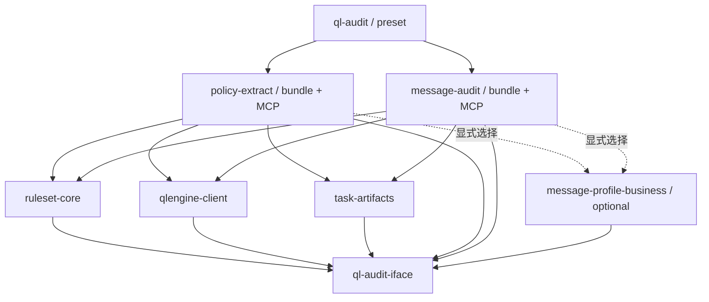
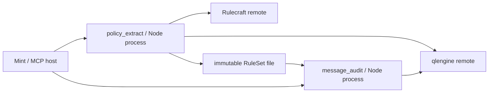

# ql-audit 接入 MintHub：模块化优化方案

日期：2026-10-30。状态：架构提案，未实现、未发布。

> 开发进展：用户已要求在独立仓库 [`apps/plugins/ql-audit`](/Users/payne/Vibe/AgentOS/apps/plugins/ql-audit/README.md) 实现首版。该仓库的[开发设计](/Users/payne/Vibe/AgentOS/apps/plugins/ql-audit/docs/design.md)与[任务计划](/Users/payne/Vibe/AgentOS/apps/plugins/ql-audit/docs/implementation-plan.md)是当前实施依据；本文保留架构决策与调研时边界，不作为实时完成状态。

本文根据“MintHub 提供基础 plugin，两项能力共同依赖可复用模块”的要求，替代[原调研方案](2026-10-30-minthub-research-and-proposal.md)中“首版只发一个实现包”的建议。原报告的源码调查、后端协议、规则语义问题和验收证据继续有效。

## 1. 目标与推荐结论

已确认的目标：

1. 制度 PDF 输入后得到可独立交付的规则包。
2. 报文和规则包输入后得到可追溯的审核结果。
3. 复用远端 Rulecraft、qlengine，地址、CA 和凭据引用可配置。
4. 两项能力独立安装、调用和升级；公共能力可供其他 MintHub 插件复用。

**推荐：4 个基础包 + 2 个能力插件 + 1 个组合包；业务 profile 按需独立发行。** 基础包各自版本化并声明依赖，运行时由能力入口显式装配。提取能力和审核能力通过不可变 RuleSet 交接。

“plugin”在此表示可分发、可组合的能力。当前 Mint 的实际载体建议使用 `bundle`，组合使用 `preset`；Node ESM 库的装配由本方案新增的局部 bootstrap 完成。不能把包依赖声明等同于 Mint 已有跨插件调用功能。

这是架构设计，尚未进入产品实现。本轮新增核对以 `agent-kernel@d9507669ea1abba203ed9943111cf93f0d363820` 为准；没有重新运行业务测试或连接远端后端。

## 2. 方案选择

| 方式 | 收益与代价 | 选择 |
| --- | --- | --- |
| 基础库包 + 两个能力入口 + 显式依赖注入 | 公共代码独立发布；能力可替换；只增加两个业务进程和少量装配逻辑 | **首版推荐** |
| 每个基础能力都提供独立 MCP/HTTP 服务 | 可跨语言、跨机器共享实例；需要额外服务发现、凭据传递、并发、超时和生命周期管理 | 有独立部署需求时再增加适配 |
| 单实现包，仅内部划分目录 | 发布简单；其他插件不能独立依赖基础实现 | 保留作迁移过渡，不能作为模块化终态 |

**包边界不等于进程边界。** 两个能力依赖同一版本的库代码，拥有各自的实例、配置和任务目录。基础包默认不启动进程、不注册模型可见工具。

## 3. 模块清单与依赖

以下名称为拟议 ID；发布时补充实际拥有的 scope。

| 包 | 类型与职责 | 主要公开面 | 消费方 |
| --- | --- | --- | --- |
| `ql-audit-iface` | 基础契约；schema、端口说明、错误分类、语义规范及合成 conformance fixtures，不含服务实现 | `RuleSet`、`AuditResult`、`FieldProfile`、`Job`、`EnginePort`、`ArtifactRef` | 以下所有相关实现包 |
| `ruleset-core` | 规则资产处理；结构/语义校验、门控图检查、来源保留、规范化、digest、字段快照 | `validateRuleSet`、`freezeRuleSet`、`verifyRuleSet`、`checkCompatibility` | 提取、审核；未来规则编辑器或 RSI |
| `qlengine-client` | 可配置引擎适配；HTTP、CA、鉴权、预算、协议版本校验 | `createEngine` → `health/compile/executeBatch`；返回原始布尔值及缺值/错误 | 提取中的编译；审核中的求值 |
| `task-artifacts` | 持久任务和产物机制；原子状态更新、请求去重、锁、恢复、内容寻址、路径限制 | `createTaskStore`、`createArtifactStore`、`accept/get/update`、`put/get/verify` | 两个能力；不包含解析/审核业务状态迁移 |
| `policy-extract` | 领域能力；Rulecraft 适配、澄清、提取结果转换、编译和可执行性诊断 | `extract_rules/job_get/job_resolve/job_reconcile/health` | Agent、其他应用 |
| `message-audit` | 领域能力；输入归一、规则选择、字段预检、执行计划、结果解释和报告 | `audit_message/job_get/health` | Agent、其他应用 |
| `ql-audit` | `preset` 组合；固定两能力版本，提供完整工作流的使用约定 | 安装依赖和组合说明，不再复制实现或注册第三个服务 | 需要全流程的用户 |
| `message-profile-<business>` | **可选业务包**；字段/集合表、输入 schema、有限且版本化的报文归一器、样例 | `getProfile`、可选 `normalizeMessage` | 提取读取字段契约；审核处理对应业务报文 |

最小主线是 7 个包；选用一份业务 profile 时为 8 个。profile 不是通用基础能力，不在所有用户安装中强制携带。



图中实线表示安装/代码依赖。profile 作为发行组合的明确依赖或用户选择的已锁定依赖；不能只写一个 profile 名就声称 Mint 会自动匹配提供者。

### 3.1 拆分的判断依据

- `ruleset-core` 的两个真实消费者分别负责生产和消费规则资产，需要相同的校验、快照和 digest 规则。
- `qlengine-client` 的两个真实消费者分别执行 compile 和 executeBatch；引擎连接与认证应只有一份实现。
- `task-artifacts` 共享任务和文件机制；两项业务的 phase、澄清及终态判断由各自能力拥有。
- `ql-audit-iface` 独立定义数据和调用语义，使替代实现不必依赖默认实现包。
- Rulecraft 当前只服务提取，先作为 `policy-extract/adapters/rulecraft`；出现独立消费者后再抽包。
- 规划、规则结果解释及 Markdown 报告目前只用于审核，留在 `message-audit`；通用 HTTP 小函数、hash helper 不另立插件。
- PDF/OCR/模型调用仍归远端 Rulecraft；RSI、PilotDeck UI 不成为这两能力的基础依赖。

`ruleset-core` 不拥有第二份整单审核算法。判定规范归契约，资产校验归规则核心，实际执行与结果聚合归审核能力。

## 4. 能力如何组合

### 4.1 制度 PDF → RuleSet

```text
policy_extract__extract_rules(document, request_id, profile?)
  -> task-artifacts 先保存受理记录、源文件哈希与配置指纹
  -> Rulecraft 适配上传原文件，保存 taskId/docId
  -> job_get 取进度；needs_human 时经 job_resolve 提交人工裁定
  -> 转换器保留原始规则、完整来源与澄清记录
  -> ruleset-core 检查结构、规则方向、门控、字段快照
  -> qlengine-client 检查能力并编译表达式
  -> 形成 readiness 和逐规则诊断
  -> task-artifacts 写入不可变 RuleSet，返回路径、digest 和摘要
```

抽取结果与可执行规则包分别保存。表达式、映射、语义或编译未确认时，允许返回 partial 规则资产，但不能标成全部可自动审核。

### 4.2 报文 + RuleSet → AuditResult

```text
message_audit__audit_message(message, rules, request_id, scene_ids?)
  -> task-artifacts 保存请求和输入快照
  -> 读取外部 RuleSet；ruleset-core 校验 schema、digest、语义和兼容性
  -> 将已验证规则包复制进自己的产物库，冻结此次输入
  -> 按声明的 profile 归一报文，或接收符合约定的 canonical JSON
  -> message-audit 选规则、展开门控、生成计划和预检诊断
  -> qlengine-client 执行 batch，验证实际引擎版本和响应
  -> 按 trueMeans/action/gates 解释结果，计算覆盖情况
  -> task-artifacts 保存 AuditResult JSON / Markdown
```

审核插件无需安装提取插件，无需配置 Rulecraft。它直接接受规则文件或 inline RuleSet；单传提取进程的本地 `version_id` 不构成跨插件协议。

审核默认覆盖规则包的全部场景；显式选择子集时返回 selected/excluded 清单。未就绪规则仍计入覆盖诊断，不能静默排除后返回 pass。

两个入口都要求稳定的 `request_id` 并快速返回 `job_id`。辅助工具通过 MCP 服务前缀区分；示例前缀来自拟议 server ID，实施时以实际工具发现结果为准。

### 4.3 一份 RuleSet 的交接示例

下列是拟议结果片段，不是当前 API：

```json
{
  "status": "completed",
  "ruleset": {
    "path": "/work/project/.ql-audit/policy-extract/exports/policy.ruleset.json",
    "digest": "sha256:<canonical-ruleset-content>",
    "readiness": "ready"
  }
}
```

审核请求使用 `rules:{path,digest}`。审核进程验证允许的导入目录、内容摘要和 schema 后，复制到自己的内容寻址目录。路径只是定位符；digest 只证明内容一致性，不证明制度经过业务授权或人工批准。

在另一工程或机器使用时，需要实际传递规则文件；不能把本机路径当远程上传。提取输出目录应显式纳入审核输入许可范围。

## 5. 契约如何防止两能力分叉

### 5.1 RuleSet 与业务 profile

`RuleSet` 是可执行规则资产，不只是 QL 文本列表，至少绑定：

- schema 版本、规则资产 ID、内容 digest；摘要算法和 canonical JSON 规则在契约中固定，计算时排除自身 digest 字段。
- 制度文件哈希、Rulecraft 任务及版本、规则和前置、场景、完整来源、澄清记录。
- 每条规则的 `trueMeans=violation|compliant`、`action=reject|warn|manual`、显式 `gates[].expect`；前置的 `trueMeans=applicable`。
- fields/collections 的不可变快照、profile ID/版本/digest、输入 schema 和归一器契约；所需引擎/函数能力。
- 已编译证据、逐规则就绪诊断及未决项；不能把 compile 成功当作业务语义正确。

业务 profile 是独立数据/适配包。提取时用它约束字段词汇；审核时用同一版本解释报文。外部 RuleSet 已含字段快照，审核不能再叠加“当前最新”的全局 overlay。

RuleSet 不携带任意可执行 JS。输入已经符合 canonical schema 时可不安装 profile 归一器；输入是原始业务报文且需要归一时，必须有匹配的已锁定 profile 实现，否则明确拒绝。profile 的数据 digest 和归一器实现版本/制品身份均写进运行记录。

现有 `catalog/fields.json` 只能作为某个业务 profile 的来源，不能直接声称通用。客户专属字段或样例如需分发，使用权限合适的私有包或工程配置。

### 5.2 真假、门控、动作与覆盖

当前规则中同时存在“true=违规”和“true=合规”的表达式，旧审核实现统一 true=通过。模块化时必须修正，不能只移动目录。

- 旧规则缺 `trueMeans` 时进入待确认；不根据 action 猜方向，不统一取反。
- 多门控按 AND，`expect` 比较被引用表达式的原始布尔值。R 引用的上游自身门控也生效；引用缺失和环在校验时拒绝。
- 有确定不成立的门控则不适用；其余情况按 error、null/review、全部成立的顺序处理。需要 OR 时使用明确的前置表达式。
- reject 命中产生 fail；warn 单独记录；必要人工、缺数或执行错误未解决时为 review。没有足够检查证据时不得 pass。
- `total=selected+excluded`；selected 的 pass/fail/warning/review/error/not_applicable/skipped 桶互斥且相加对账；实际引擎调用数另计。

这些语义及反例作为 `ql-audit-iface` 的公共 fixtures。生产规则的实现与消费规则的实现必须通过同一套 conformance，不能只保证 JSON 形状相同。

### 5.3 引擎端口与可替换性

```text
EnginePort/v1:
  health() -> engine identity, version, functions/capabilities
  compile(expression, bindings) -> diagnostics, compiler identity
  executeBatch(payload, bindings, expressions) -> raw results, measurementVersion
```

这是拟议领域端口，尚不是 kernel-iface 的现有 trait。`qlengine-client` 是默认实现，测试 fake 或将来的其他引擎适配可实现同一端口。

客户端只归一协议响应、错误和原始求值，不把 true 改成 pass，不计算整单合规性。替换引擎需声明相同的语言/函数语义，并用真实表达式正反例验证；有同名方法不代表 QL 兼容。

## 6. 在当前 Mint 中如何真正运行

### 6.1 已有机制与新增机制

| 环节 | 当前源码事实 | 本方案新增内容 |
| --- | --- | --- |
| 安装依赖 | `[dependencies]` 经 Mint 安装、锁定 | 基础包及能力包真实依赖图 |
| 工具入口 | bundle 的 `.mcp.json` 可拉起 stdio MCP | 两能力各自的 Node 入口及工具面 |
| 库绑定 | 没有证实的 Node 库注入或通用插件间 RPC；`provides.interfaces` 为声明 | 根据 lock 和受约束 exports 的局部 bootstrap |
| workspace | MCP adapter 不传入 CallCtx；启动不保证工程 cwd | 显式工程根、配置文件、独立数据目录 |
| 公共包形态 | 当前没有通用 library kind；严格 plugin/js 不是 Node | 首版以无 MCP 的 bundle 分发 ESM/schema |

两能力运行拓扑：



基础包共享代码版本，不共享可变单例；图中没有基础包服务器。两能力进程各自加载所需实现，并不通过模型调用基础工具来完成底层工作。

### 6.2 显式装配

能力包入口包含一段由相同源码构建的 bootstrap；这是分发适配代码，不再独立创建一个基础插件。流程如下：

1. 从显式 `QL_AUDIT_PROJECT_ROOT` 和受控配置取得工程根；不从进程 cwd 或任意向上搜索猜测。
2. 用打包进入口的 TOML/semver 库读取能力包清单和工程 `mint.lock`，只解析已声明依赖的闭包；不临时安装 npm 包，不用正则解析 TOML。
3. 按锁定包名/版本定位 `.mint/packages/<scope>/<name>@<version>/`，核对包 manifest 与依赖约束，检查导出协议版本和安装完整性。
4. 按基础包的普通 `exports.json` 读取相对 ESM/schema 入口；`realpath` 后限制在对应包内，用文件 URL 导入。
5. 在组合根按拓扑顺序注入依赖。基础包内部仅导入自己的相对文件；跨包依赖通过显式参数注入，不依赖 Node bare import 自动解析 Mint 依赖。
6. 缺包、重复/不兼容版本、错误导出或越界路径均在启动时报错；不回退源码 checkout、全局 npm 或最新目录。进程内冻结本次绑定，更新后重启切换。

`exports.json` 是**本方案定义的应用装配协议**，不是新增 Mint manifest 字段。示例：

```json
{
  "schema_version": "ql-audit.exports/v1",
  "package": "your-scope/ruleset-core",
  "api": "ruleset-core/v1",
  "entry": "dist/index.mjs"
}
```

伪代码说明依赖注入；未实现：

```js
const rulesets = loaded.rulesetCore.create({ contracts: loaded.contracts });
const engine = engineConfig
  ? loaded.qlengineClient.createEngine({ config: engineConfig })
  : null;
if (capability === 'message-audit' && !engine) throw new Error('ENGINE_REQUIRED');
const tasks = loaded.taskArtifacts.createTaskStore({ root: capabilityDataDir });
const artifacts = loaded.taskArtifacts.createArtifactStore({ root: capabilityDataDir });
const service = createCapability({ rulesets, engine, tasks, artifacts, profile });
```

提取能力接收 `engine=null` 时将编译诊断设为 unavailable、readiness 设为 partial；审核能力缺引擎配置则明确报配置错误。示例变量由已验证配置及入口选择提供，不是模型可任意指定的绑定。

lock 的 artifact cksum 与解包目录 integrity 不应混算。安装完整性优先复用固定版本 Mint 的校验能力；若必须在 bootstrap 重验，须使用同一 dirhash 规范并做互验。lock 仍是工程可写文件，不能由其声明推导授权或沙箱隔离。

### 6.3 包形态与布局

基础包建议布局：

```text
ruleset-core/
  mint.toml
  README.md
  LICENSE
  exports.json
  dist/index.mjs
  skills/README.md
```

`skills/README.md` 是当前 bundle 布局的兼容载体，说明该包只供代码消费者使用；不声明 skill，也不放 `skills/*/SKILL.md`。空目录不能代替此文件，打包后可能消失。基础包不放 `.mcp.json`，不声明虚假的 tools 或常驻服务。

`ql-audit-iface` 首版同样采用 bundle 兼容载体，内容是 schemas、端口文档与 fixtures，无运行实现；待目标发行版验证支持后，可决定是否使用正式 `kind=iface`。领域接口使用 `ql-audit-ruleset` 等合法标签，版本置于契约内部，不假称内核已有接口。

能力包在此基础上增加 `.mcp.json`、自己的 Skill 和 launcher。两服务 ID 分别为 `policy_extract`、`message_audit`；组合 preset 不重复声明 `.mcp.json`，避免同名服务和重复工具。

组合包清单片段，仅展示正式支持的字段；scope、许可、发行版本实施时固定：

```toml
[package]
name = "your-scope/ql-audit"
version = "0.1.0"
kind = "preset"
description = "Policy extraction and message auditing workflow"

[provides]
presets = ["ql-audit"]

[dependencies]
"your-scope/policy-extract" = "=0.1.0"
"your-scope/message-audit" = "=0.1.0"

[artifacts]
layout = "any"
```

单能力发布包声明自身全部直接依赖，包括 `ql-audit-iface`；例如提取与审核都直接依赖 `ruleset-core/qlengine-client/task-artifacts`。原型阶段可先用同一组精确版本收敛依赖，后续再开放验证过的兼容范围。

声明过的环境变量应包含工程根、配置路径及必要的 secret 引用；提取和审核分别配置自己的后端。仅安装审核插件时不要求 Rulecraft 凭据。`$PKG` 只在 command/args 展开；不要放进 env 值期待替换。

实现与发布描述放在新建独立 Git 仓库 `/Users/payne/Vibe/AgentOS/apps/plugins/ql-audit` 内的 `modules/`、`capabilities/` 与 `packaging/`。旧 AgentCPM-agent-evolution 仓库只读参考；构建和运行均不依赖它的本地路径。AgentOS 外层不是 Git 仓库，只保留调研文档；制品应记录新仓库来源版本，不能靠旧源码绝对路径复现。

## 7. 安装、数据和升级边界

### 7.1 三种使用方式

| 场景 | 安装内容 | 后端配置 |
| --- | --- | --- |
| 只提取制度规则 | `policy-extract` 及基础依赖，可选 profile | Rulecraft；如需 ready 规则包再配 qlengine 编译 |
| 只审核外部规则包 | `message-audit` 及基础依赖；必要时装匹配归一器 | qlengine |
| 制度到报文完整闭环 | `ql-audit` preset 安装两能力，可选 profile | Rulecraft + qlengine |

未配置编译引擎的提取仍可交付原始规则和诊断，readiness 保持 partial。它不能假装满足完整闭环的 ready 验收要求。

Mint 当前安装依赖不会自动安装 Node 或执行 setup。先在选定 CLI/Core 发行版验证自动发现；若不兼容，再用显式 setup 合并工程 MCP 配置并写绝对入口，避免重复注册。

### 7.2 任务和产物所有权

- 数据根位于安装目录外，例如 `.ql-audit/policy-extract/` 和 `.ql-audit/message-audit/`，各自管理 jobs、sources、artifacts、exports。
- 两进程不共同改写一个 catalog、overlay 或任务 JSON；首次通过文件导入后，审核持有自己的不可变快照。
- 幂等键为 `(workspace, capability, request_id)`；相同键和输入/配置指纹返回原任务，指纹不同则冲突。`job_get` 支持 job_id 或 request_id 找回受理记录。
- `task-artifacts` 提供原子写和锁机制；业务能力决定 phase 迁移。多个进程意外使用同一能力数据根时必须取得排他/租约，不能并发执行同一个已受理任务。
- MCP 超时不自动取消业务。已知远端 taskId 可续查；提交是否受理不明时保存 unknown，不自动重放 Rulecraft 上传。无远端幂等/对账协议时由人工核对并 reconcile。
- 后端模型配置仍归 Rulecraft，不把模型 API key 变成两个插件共同必需的配置。

### 7.3 升级和可替换性

公共包按 API 版本演进，RuleSet 数据 schema 与软件包 semver 分别管理。每次运行保存基础包版本、制品身份、RuleSet/profile digest、引擎 measurementVersion 和非敏感配置指纹。

共享基础依赖的兼容约束冲突时，首版拒绝组成这一套安装；不自行扫描并加载多份“最新”规则核心。历史规则包按其 schema 和快照验证，软件升级不会改写内容。数据目录不随卸载/升级自动删除。

替换默认适配需更新明确的包依赖和 binding，并通过同一 conformance；单独修改 `provides.interfaces` 不会生效。执行中的 job 固定既有绑定；升级通过重启和恢复检查切换，未知远端提交不因升级而重放。

重启恢复前比较 job 中记录的依赖/配置指纹。指纹变化时暂停推进并要求显式迁移；首版不承诺并行运行多套旧引擎。已知 taskId 的状态查询可在服务身份兼容性检查后继续，但后续规则转换或审核执行不能静默换用新版本实现。

## 8. 与 iface 的关系

| 层次 | 本方案的定位 |
| --- | --- |
| Kernel `iface-tool` | 工具调用、身份、unknown/abort 等机制契约的参考；当前 MCP adapter 注册为 `mint_api::Tool`，尚未实现 AgentCPM `ToolContract/CallMeta/unknown/abort` 的直接适配 |
| `ql-audit-iface` | 新的领域数据与服务端口规范；按领域扩展治理，不混入宿主 `iface-policy` |
| 领域实现 | `ruleset-core`、两个能力和引擎适配消费对应端口与 schema |
| MintHub | 分发与依赖锁定；不决定领域规则真假的含义 |

可信 session/turn/workspace 身份应由宿主提供。当前 MCP 缺 CallCtx 透传，首版固定启动工程范围，不能让模型参数伪造租户身份。未来接通正式宿主 binding 后可替换 launcher/adapter，领域契约和 RuleSet 无需跟着换。

## 9. 渐进落地与验收

| 阶段 | 主要交付 | 必要证据 |
| --- | --- | --- |
| M0 契约和后端基线 | schemas、语义 fixtures、真实服务 profile | trueMeans/action/gates 明确；health/compile/batch 协议与部署相符 |
| M1 两项共享实现 | ruleset-core、qlengine-client；从旧服务注入消费 | 两消费者实际导入同一发行实现；原源码路径不再是运行依赖 |
| M2 任务与独立能力 | task-artifacts、两个独立 MCP 入口、RuleSet 导入导出 | 跨工程规则包审核；请求丢响应恢复；重启续查和 unknown 不重放 |
| M3 Mint 分发装配 | 基础 bundle、两能力 bundle、preset、bootstrap | 干净工程安装、锁定解析、工具调用成功；缺包/冲突有明确诊断 |
| M4 业务 profile 与真实闭环 | 版本化字段/归一器、授权 PDF 和报文验收集 | PDF 产出规则包；真实合规/违规/缺数结果与人工判断一致 |

必须包含的组合验收：

1. 只装 `message-audit`，没有 Rulecraft 配置，使用外部 RuleSet 完成审核。
2. 只装 `policy-extract`，输出规则包，未安装审核插件也能结束任务。
3. 安装 preset 后，只出现两个预期 MCP 服务；基础包没有额外工具或后台进程。
4. 提取产物在第二个干净工程审核，fields/profile 不漂移；规则篡改被 digest 校验拒绝。
5. 引擎适配从 fake 切换真实服务，调用者契约相同；真实 QL 正反例验证方向和动作。
6. 公共依赖缺失、版本冲突、profile 不匹配、归一器缺失、空覆盖等均明确失败或 review。
7. 两种能力并发运行，任务互不覆盖；升级后可恢复但不自动重提未知请求。

沿用原报告的 Node/CLI/Core 发行兼容门、许可核对和干净 staging。原有 55/55 mock 测试仅证明旧代码的本机测试通过，不证明本方案实现、真实后端兼容性或审核准确率。

## 10. 关键源码依据

以下支持本方案的边界判断；模块名、工具名、exports 协议均为新增设计：

- [已有依赖注入入口 createAuditService](/Users/payne/Vibe/AgentCPM-agent-evolution/products/ql-audit/plugins/ql-audit/server/service.mjs:55)：可注入目录、字段、引擎与 Rulecraft。
- [Rulecraft 客户端](/Users/payne/Vibe/AgentCPM-agent-evolution/products/ql-audit/plugins/ql-audit/server/rulecraft.mjs:28)、[qlengine 客户端](/Users/payne/Vibe/AgentCPM-agent-evolution/products/ql-audit/plugins/ql-audit/server/qlengine.mjs:44)：两个服务的真实边界。
- [任务与规则构建](/Users/payne/Vibe/AgentCPM-agent-evolution/products/ql-audit/plugins/ql-audit/server/parse.mjs:45)、[审核计划与解释](/Users/payne/Vibe/AgentCPM-agent-evolution/products/ql-audit/plugins/ql-audit/server/audit.mjs:25)：领域所有权的拆分依据。
- [Mint 包扫描](/Users/payne/Vibe/AgentOS/packages/agent-kernel/mint/crates/mint-core/src/loader.rs:135)、[bundle MCP 扫描](/Users/payne/Vibe/AgentOS/packages/agent-kernel/mint/crates/mint-core/src/mcp_loader.rs:440)：安装与入口发现不等于库注入。
- [安装目录规则](/Users/payne/Vibe/AgentOS/packages/agent-kernel/mint/crates/mint-protocol/src/dirs.rs:112)、[锁文件字段](/Users/payne/Vibe/AgentOS/packages/agent-kernel/mint/crates/mint-pack/src/lib.rs:598)：显式 bootstrap 的版本定位依据。
- [bundle 布局](/Users/payne/Vibe/AgentOS/packages/agent-kernel/mint/crates/mint-manifest/src/layout.rs:107)、[技能扫描](/Users/payne/Vibe/AgentOS/packages/agent-kernel/mint/crates/mint-core/src/loader.rs:343)：无 MCP 基础载荷的当前兼容方式。
- [preset 约束](/Users/payne/Vibe/AgentOS/packages/agent-kernel/mint/crates/mint-manifest/src/validate.rs:406)、[发布依赖约束](/Users/payne/Vibe/AgentOS/packages/agent-kernel/mint/crates/mint-pack/src/payload.rs:87)：组合和实际可发布依赖的要求。
- [iface-tool](/Users/payne/Vibe/AgentOS/packages/kernel-iface/iface-tool/src/tool.rs:8)、[MCP 工具适配](/Users/payne/Vibe/AgentOS/packages/agent-kernel/mint/crates/mint-core/src/mcp/client.rs:509)：kernel 机制协议与领域库调用的区别。

最终建议：先完成可复用的规则资产、引擎和任务基础包，再装配两项独立能力；`ql-audit` 作为组合入口。后续消费者直接依赖需要的模块，UI 或 RSI 无需整体依赖审核产品。
