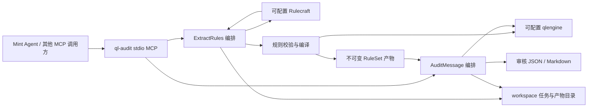

# ql-audit 接入 MintHub：调研与方案

日期：2026-10-30，Asia/Shanghai。状态：调研完成，方案待评审，未实施、未发布。

> **2026-11-02 更新**：文中 `packages/kernel-iface` 已冻结为 0.1.0 历史快照，勿作对比基线；iface 契约现以
> `packages/agent-kernel/kernel/iface/src` 为权威源，可读副本为 `packages/agent-kernel/packages/iface-*`（0.1.2）。
> 对比前先同步 agent-kernel，见 AgentOS 根 `README.md`。

> 后续更新：根据“基础插件供两个能力共同依赖”的要求，包拆分与装配推荐已由[模块化优化方案](2026-10-30-minthub-modular-proposal.md)替代。本文保留原调研与初始方案作为依据；其中单实现包推荐不再是当前建议。

## 1. 目标与结论

用户明确要求两项能力：

1. 输入制度 PDF，提取相应规则。
2. 输入报文和规则，执行审核。

本轮确认的首版边界：**复用现有 Rulecraft 和 qlengine，服务地址与凭据可配置**。PDF 解析算法、OCR、模型部署和 QL 引擎部署由现有后端负责。插件负责输入校验、任务编排、规则包转换、审核结果解释与产物交付。

**推荐：一个 ql-audit 包，按 `kind = "bundle"` 发布，包含 stdio MCP 服务和 Skill；两项领域能力共享同一套实现。**

这里要区分用户所说的“插件”和 Mint manifest 的严格 `kind = "plugin"`：前者可以用 bundle 交付完整工具体验；后者当前的 JS、native 运行支持不足以原样承载这份 Node 服务。不能把已有 `plugin.json` 或 Web manifest 换个名字就作为 Mint 原生插件发布。

最重要的工作有三项：

- 把“规则”定义为可独立传递、可校验、可复现的规则包，打通提取与审核。
- 在发布前解决现有规则的真假含义、前置引用和处置动作差异。
- 用选定的 CLI/Core 发行版实测“安装后工具可见且能调用”，不能只验 manifest。

## 2. 调研基线与证据边界

| 范围 | 版本与状态 | 本轮验证方式 |
| --- | --- | --- |
| AgentOS 根目录 | 非 Git 仓库；根 AGENTS.md 为空 | 读取目录、项目说明与接入文档 |
| agent-kernel / Mint | `d9507669ea1abba203ed9943111cf93f0d363820`；相关工作树干净 | 读取 iface、manifest、loader、MCP、JS host 与发布实现 |
| kernel-iface 分发目录 | 已冻结的 0.1.0 历史快照（无独立 Git 元数据；同步至 `d950766`）；现行分发包为 `packages/agent-kernel/packages/iface-*` | 核对 `iface-tool` 等实际类型；不把旧线上包或该快照视为当前源码 |
| ql-audit | `AgentCPM-agent-evolution@1eeae06f11d7b562671e17c8180513879b875467`；目标源码干净 | 两条调用链、协议、字段表、规则目录与测试 |
| rsi-toolkit | `44235f1060c64c3e3f1d8c32ea51ed9363e99850`；存在既有修改，分发实现未改 | 核对真实 staging/setup/stdio bridge 先例 |
| 额外语义核对 | `令才/qlengine@8f7258f93511f42267d4a888380759b0495693be`；`lingcai_new@2684a0b3a263b54b0d29cf9de9a70712132ff4f5` | 只读核对 QL 求值与导出约定；后者有既有 `config/models.yaml` 修改，未读取其凭据 |
| 本机二进制 | `mint 0.1.11`；`cpmrt 0.1.14` | 只读 version/help；未对发行版做插件安装调用实测 |

三个子 Agent 分别调查 iface 运行边界、ql-audit 实现、Mint 分发；主 Agent 交叉核对调用链与规则语义。未访问远端服务、未上传 PDF/报文、未读取发布令牌，未改业务代码。

现有 `node --test tests/*.test.mjs` 由调研子 Agent 执行：退出码 0，55 tests / 55 pass / 0 fail，311.726917ms。测试只用本机模拟 Rulecraft/qlengine；运行时 Node 为 v24.21.0，而插件声明 `>=22.13.0 <23`，声明支持的 Node 22 仍需验收。这一结果不证明真实 QL 判定正确，也不等同于 `npm test` 的完整发布门禁。

## 3. ql-audit 现在怎样工作

### 3.1 组件地图

以下文件位于 `/Users/payne/Vibe/AgentCPM-agent-evolution/products/ql-audit/plugins/ql-audit/`。

| 组件 | 职责 | 迁移判断 |
| --- | --- | --- |
| `mcp/server.mjs` | NDJSON JSON-RPC、工具列表、参数转交、文本结果 | 复用传输形态，重做首版工具面 |
| `server/service.mjs` | 配置、报文入库、版本/场景选择、审核、历史记录 | 已有依赖注入，拆出独立装配入口 |
| `server/rulecraft.mjs` | 上传制度、查任务、拉项目规则库 | 复用，补可配置鉴权与服务契约校验 |
| `server/parse.mjs` | 解析任务、澄清裁定、构建规则版本 | 复用流程，调整持久化与规则包输出 |
| `server/catalog-builder.mjs` | 逐条编译、前置检查、场景分组、版本构建 | 复用编译机制，补语义/映射/来源完整性 |
| `server/audit.mjs` | 归一报文、选规则、组 batch、解释结果、预检 | 复用规划结构；判定语义须修订 |
| `server/qlengine.mjs`、`http.mjs` | CA、BasicAuth、超时、编译与批量求值 | 保留 Node 实现，抽配置和凭据入口 |
| `catalog/fields.json` | 字段别名与集合路径 | 作为既有报文 profile，不能当所有客户通用映射 |
| `browser/index.mjs`、Web manifest、`host.mjs` | PilotDeck UI 与宿主身份/生命周期 | 首版不进入能力内核 |
| `server/rsi/` | 数据集、诊断、改规则、确认写回与复测 | 首版两能力不依赖此功能 |

关键装配证据：[createAuditService](/Users/payne/Vibe/AgentCPM-agent-evolution/products/ql-audit/plugins/ql-audit/server/service.mjs:55) 已支持 `dataDir/catalogFile/fieldsFile/engineFactory/rulecraftFactory/keychain/now` 注入。PILOT_HOME 主要是现有入口的默认配置，不是所有业务函数的硬编码依赖。

### 3.2 能力一：制度 PDF 到规则

```text
ql_parse_policy(path)
  -> 读取文件，先保存 source
  -> Rulecraft POST /api/projects/{pid}/docs
  -> 接收 taskId / docId 后保存 job.json
ql_parse_status(job_id)
  -> GET ingest/{taskId}
  -> needs_resolution 时交人裁定
ql_parse_resolve(job_id, answers)
  -> 带全量 resolutions 重传原文件
  -> 成功后 GET 项目 rules
  -> toPackage 筛选本制度规则及前置
  -> qlengine health + 逐条 compile
  -> buildVersion + 写本地 catalog
  -> ready，当前只返回版本 ID 与数量摘要
```

事实：插件不在本机读 PDF 文字、不做 OCR、不调用模型抽规则。Rulecraft 接受原文件字节，实际解析在后端。支持 PDF、DOCX、MD、TXT；本地文件上限 50 MiB。解析通常是分钟级，现有协议已采用任务 ID。

现实现提交抛错后会删除任务目录，所以“先持久化受理记录、未知提交仍保留来源”是首版新增改造，不能视为现有保证。

Rulecraft 当前客户端消费的协议：

```text
POST /api/projects/{pid}/docs
multipart: file；可选 resolutions=[{clarId, answer, note?}]
  -> {taskId, docId, status}

GET /api/projects/{pid}/ingest/{taskId}
  -> {status, stage, progress, progressMessage, error?,
      result:{stats:{ruleCount}, deferred:[澄清项]}}

GET /api/projects/{pid}/rules
  -> {rules:[...], preconditions:[...]}
```

代码入口：[MCP 解析工具](/Users/payne/Vibe/AgentCPM-agent-evolution/products/ql-audit/plugins/ql-audit/mcp/server.mjs:126)、[Rulecraft 客户端](/Users/payne/Vibe/AgentCPM-agent-evolution/products/ql-audit/plugins/ql-audit/server/rulecraft.mjs:28)、[任务状态机](/Users/payne/Vibe/AgentCPM-agent-evolution/products/ql-audit/plugins/ql-audit/server/parse.mjs:45)。

后端源码还接受 `fields/functions/references/samples`，现有 ql-audit 客户端只传文件与裁定，未利用这些对齐能力。首版可把选定业务 profile 的字段及函数契约随请求传入，前提是确认部署版本支持；映射候选仍需校验，不能直接采纳猜测路径。[后端上传实现](/Users/payne/Vibe/令才/lingcai_new/server.py:1534)

### 3.3 能力二：报文与规则到审核结果

```text
ql_load_bill(path | json)
  -> JSON 校验、normalizeBill、内容哈希保存
ql_list_versions / ql_list_scenes
  -> 选择已有 catalog 版本及场景
ql_preflight（可选）
  -> 检查字段映射缺口与本报文缺值
ql_audit(bill_id, version_id, scene_ids)
  -> planAudit 合并规则并收集门控
  -> batchRules 去重，key=pre:<id> / rule:<id>
  -> 一次 qlengine /execute/batch
  -> evaluate 解释结果
  -> 保存 result.json，返回卡片与 run_id
```

引擎请求的实际形状：

```json
{
  "payload": {"bill": {}, "invoices": [], "others": {}},
  "fields": {"amount": ["$.bill.amount"]},
  "collections": {"invoices": "$.invoices[]"},
  "mode": "both",
  "rules": [{"key": "rule:R001", "ql": "toNumber(amount) > 500"}]
}
```

插件预期响应包含 `measurementVersion` 及 `results[{key, verdict, missing, errorCode, error}]`；`verdict` 为 true/false/null。批量协议本身不携带 `action` 或规则方向，因此业务结论必须由插件解释。

代码证据：[auditVersion](/Users/payne/Vibe/AgentCPM-agent-evolution/products/ql-audit/plugins/ql-audit/server/service.mjs:203)、[批量客户端](/Users/payne/Vibe/AgentCPM-agent-evolution/products/ql-audit/plugins/ql-audit/server/qlengine.mjs:44)、[planAudit/batchRules](/Users/payne/Vibe/AgentCPM-agent-evolution/products/ql-audit/plugins/ql-audit/server/audit.mjs:25)。

当前公开工具不能直接接收任意规则对象，只能引用本机已有 `version_id`。虽然内部 `auditVersion` 已接受版本对象，首版仍需增加独立规则包输入与验证。

## 4. iface 与 Mint 的实际接入边界

### 4.1 两层协议不能混用

| 层次 | 当前真实接口 | 对本方案的意义 |
| --- | --- | --- |
| kernel-iface | Rust `ToolContract::register/list/invoke/abort`；参数是 UTF-8 不透明字节，结果含 `ok/bytes/unknown` | 借用调用、环境归属、错误及未知结果语义 |
| Mint 内部扩展 | `mint_api::Tool::spec/call`，`CallCtx` 含 session/turn/cwd/deadline | 由 Core 适配器实现；不要求 Node 实现 Rust trait |
| Mint MCP 装载 | bundle `.mcp.json` -> stdio server -> `McpToolAdapter` -> 工具注册 | 首版可用的运行路径 |
| JS plugin | `activate(ctx)` -> `ctx.tool(spec, handler)`；由 mint-host 执行 | 不等于 Node.js，不能直接导入当前服务 |

源码：[iface-tool](/Users/payne/Vibe/AgentOS/packages/kernel-iface/iface-tool/src/tool.rs:8)、[CallMeta 与 Unknown](/Users/payne/Vibe/AgentOS/packages/kernel-iface/iface-types/src/mod.rs:5)、[Mint Tool/CallCtx](/Users/payne/Vibe/AgentOS/packages/agent-kernel/mint/crates/mint-api/src/lib.rs:44)。

`session_id/call_id/turn/environment` 属于可信宿主上下文，不能让模型在业务参数里自填身份。当前 MCP adapter 忽略 CallCtx，首版应在启动时固定 workspace 数据目录和服务 profile；不能宣称自动获得 kernel 的租户/环境隔离。未来直接 kernel adapter 再由宿主传入这些信息。

不把 `iface-policy` 的宿主策略审核当作报销领域审核；不为 ql-audit 替换 loop、model 或 approval policy。

### 4.2 已证实的装载限制

1. 当前 Core 扫 lock 包的 MCP 配置时，只处理 `Kind::Bundle`。`Kind::Mcp` 可以解析清单，不代表此链路会启动它。[mcp_loader.rs](/Users/payne/Vibe/AgentOS/packages/agent-kernel/mint/crates/mint-core/src/mcp_loader.rs:469)
2. `$PKG` 会在包 `.mcp.json` 的 command/args 中替换为安装目录；不要假定子进程 cwd 是包目录，也不要假定 env 里的 `$PKG` 会展开。[替换实现](/Users/payne/Vibe/AgentOS/packages/agent-kernel/mint/crates/mint-core/src/mcp_loader.rs:483)
3. 当前通用 MCP loader 只拉 stdio，HTTP 配置会被拒绝。插件内部 Node HTTP 客户端访问 Rulecraft/qlengine 不受这个传输选择影响。[prepare_server](/Users/payne/Vibe/AgentOS/packages/agent-kernel/mint/crates/mint-core/src/mcp_loader.rs:327)
4. 普通 native tool loader 尚未接通；有 native UI/CUA 专门路径，不等于任意 Node launcher 都会成为工具。[JS-only discovery](/Users/payne/Vibe/AgentOS/packages/agent-kernel/mint/crates/mint-core/src/host/load.rs:395)、[native 先例声明](/Users/payne/Vibe/AgentOS/packages/agent-kernel/mint/packages/computer-use/mint.toml:36)
5. MCP 单次请求兜底超时 60 秒；配置 `timeout_s` 影响 discover，不能把十分钟解析变成同步工具。[transport](/Users/payne/Vibe/AgentOS/packages/agent-kernel/mint/crates/mint-core/src/mcp/transport.rs:24)
6. MCP 普通工具适配只保留 text；结构化结果必须同时序列化为 JSON 文本。不能只返回 `structuredContent` 或 resource。[结果转换](/Users/payne/Vibe/AgentOS/packages/agent-kernel/mint/crates/mint-core/src/mcp/client.rs:535)
7. 项目需通过 Mint trust；bundle 的 exec/env 声明有启动检查，但没有自动给整个 Node 子进程套文件/网络沙箱。[启动与 env](/Users/payne/Vibe/AgentOS/packages/agent-kernel/mint/crates/mint-core/src/mcp/client.rs:197)

### 4.3 三种路线比较

| 路线 | 能否复用现有 Node | 额外工程 | 建议 |
| --- | --- | --- | --- |
| bundle + stdio MCP + Skill | 大部分可复用 | 新规则包、语义校验、装配与分发 | 首版推荐 |
| 严格 plugin/js + HTTP facade | HTTP 服务端可复用 | Core 网络策略/grants 接线、文件上传入口、服务任务化 | 后续有严格 plugin 要求时再做 |
| 严格 plugin/native | 理论上能保留 Node sidecar | 先实现并发布通用 native 工具装载协议/loader，再做平台制品 | 不作为首版前置 |

JS 路线的具体障碍：HostCall 只有 log/store.get/store.set/notify/net.fetch，没有 fs/exec/model；隔离环境无 Node imports。net.fetch 的 body 是字符串，单次请求/响应各限 1 MiB、30 秒，无自签 CA 注入；标准入口默认禁网且 grants 为空。每次 RPC 后 timer/调用绑定失效，不能作为持久后台任务。纯函数 JS 可以规划规则，却不能自行完成 QL 执行或本地 PDF 上传。[HostCall](/Users/payne/Vibe/AgentOS/packages/agent-kernel/mint/crates/mint-protocol/src/host.rs:367)、[网络约束](/Users/payne/Vibe/AgentOS/packages/agent-kernel/mint/crates/mint-core/src/host/network.rs:11)、[实际授予能力](/Users/payne/Vibe/AgentOS/packages/agent-kernel/mint/crates/mint-core/src/host/load.rs:545)

## 5. 推荐架构



首版保持一个包，不拆成许多 Mint 依赖包。内部划分以下职责：

- `core/extraction`：提交、查询、澄清、规则转换。
- `core/audit`：报文归一、规则选择、字段预检、batch 和结果解释。
- `contracts`：RuleSet、AuditRequest、AuditResult、Job、Error 的 schema 与 fixtures。
- `adapters/rulecraft`、`adapters/qlengine`：远端协议、CA、鉴权和版本核对。
- `storage`：任务、规则包、审核产物；固定 workspace 范围。
- `transports/mcp`：工具定义与错误映射，不包含领域判定。

PilotDeck 以后也应消费同一内核或同一 MCP 服务，避免两份审核口径长期分叉。首次提取可以携带上游来源 commit；发布包自身应独立构建和运行，不依赖源仓绝对路径。

## 6. 两项能力的公开契约（建议）

以下是新方案，**不是当前已经存在的 API**。两项领域工具加四项日常辅助工具，以及一个异常对账工具；“两个能力”无需限制成两次同步调用。

| 工具 | 输入 | 输出 |
| --- | --- | --- |
| `ql_extract_rules` | `document.path`、必填 `request_id`、可选 `profile_id` | 快速返回 `job_id/status`，最终产出 RuleSet |
| `ql_audit_message` | `message`、`rules`、必填 `request_id`、可选 `scene_ids` | 快速返回 `job_id/status`，最终产出 AuditResult |
| `ql_job_get` | `job_id` 或 `request_id` 二选一、`view=status/result` | 状态、阶段、澄清或结果摘要及产物引用 |
| `ql_job_resolve` | `job_id`、明确的 `answers` | 带全部裁定重新提交，返回任务状态 |
| `ql_rules_get` | `ruleset_id`、分页/规则 ID | 规则包元信息或规则明细 |
| `ql_health` | 空对象 | 本地配置/目录检查与两后端健康、版本、能力 |
| `ql_job_reconcile` | 未知任务、已核实的 `task_id` 或“未受理”证据引用 | 人工核对后绑定远端任务，或将未受理任务关闭；不自动重传 |

`document.path` 是 MCP 服务所在机器的路径。其他机器不能把自己的本地路径直接交过来；远程上传/对象存储引用需另外定义，不在首版假装已支持。

`message` 用 oneOf 接受 `{json:{...}}` 或 `{path:"..."}`；`rules` 用 oneOf 接受 `{ruleset_id:"..."}`、`{path:"...ruleset.json"}` 或 `{inline:{...}}`，严格禁止同时填多个分支。同一个 RuleSet JSON 无需导入 catalog 就能审核。大输入用文件，MCP 文本只带摘要和路径。

场景默认建议为规则包全部场景，返回明确的 selected/excluded 清单；调用方指定子集时报告覆盖范围。若想沿用 `common + recommended`，必须在请求中显式选择该策略，不能静默漏审。

### 6.1 RuleSet 是两个能力的连接点

规则包至少包含：

- `schema_version/id/digest`；完整摘要绑定内容而不是只依赖日期 ID。
- 制度文件 SHA-256、名称、提取后端版本、任务来源。
- 规则和前置、场景；原始规则形态和编译/人工状态。
- `fields/collections` 的版本快照、报文 profile、函数/引擎要求。
- 每条规则的来源数组，保留 clauseId/quote，页码只在后端确实提供时记录。
- 表达式方向 `trueMeans`、处置动作 `action`、显式门控关系。
- 澄清裁定及来源；未确认字段映射、自造字段、编译缺口清单。

示意片段：

```json
{
  "schema_version": "ql-audit.ruleset/v1",
  "id": "rs-example",
  "fields": {"amount": ["$.bill.amount"], "billType": ["$.bill.billType"]},
  "collections": {},
  "preconditions": [{"id": "P001", "ql": "billType == 'expense'", "trueMeans": "applicable"}],
  "rules": [{
    "id": "R001",
    "name": "Amount limit",
    "kind": "auto",
    "ql": "toNumber(amount) > 500",
    "trueMeans": "violation",
    "action": "reject",
    "gates": [{"ref": "P001", "expect": true}],
    "sources": [{"clause_id": "3.1", "quote": "Single expense must not exceed 500."}]
  }]
}
```

示例省略完整 provenance/digest，正式 schema 应要求齐全。旧 catalog 导入需转换；**不能根据 `action=驳回` 推断表达式方向，也不能统一把旧表达式取反**。没有可靠方向信息的规则进入 `needs_confirmation`，不允许默认为可自动通过。

正式约束：普通规则 `trueMeans=violation|compliant`，前置 `trueMeans=applicable`；`gates[].expect` 比较被引用表达式的原始布尔值。v1 的多个门控按 AND 组合，需要 OR 时建一条明确的前置表达式。

门控图按依赖顺序解释：R 被引用时，其自身门控也要先成立；上游不适用使引用它的下游不适用。存在确定不满足的门控时按不适用处理；没有确定不满足但存在执行异常时为 error；其余有 null 时为 review；全部满足才解释本条结果。引用缺失和真正的环在规则包校验时拒绝。后端 P 规则里的自指 preIds 是元数据，导入时去掉该自指，不当作依赖边。

R 规则被其他规则引用时，不能默认 R 的 true 与 P 的 true 意义相同，也不能默认门控应当检查“该 R 规则通过”。导入器必须确认 expect。函数与字段契约必须和实际 qlengine 部署对齐。

### 6.2 抽取完成不等于可自动审核

分开保存后端原始提取结果和可执行 RuleSet。编译器不可用时，允许交付已提取规则及诊断，但 `readiness` 只能是 partial，不能标成 ready。存在未裁定澄清时保持 needs_human；字段候选不能当作已确认映射。

当前 `buildVersion(engine=null)` 会把非空 QL 标为 compileOk，不能把这一捷径作为正式已编译证据。[编译逻辑](/Users/payne/Vibe/AgentCPM-agent-evolution/products/ql-audit/plugins/ql-audit/server/catalog-builder.mjs:85)

### 6.3 审核结果

建议 AuditResult 保留以下独立维度：

- `execution_status`：completed / partial / failed / unknown。
- `verdict`：pass / fail / review；任务是否成功与业务是否合规分开。
- 每条结果：pass / fail / warning / review / error / not_applicable / skipped，连同 rawVerdict、action、missing、来源及定位。
- `coverage`：`total=selected+excluded`；selected 按 pass/fail/warning/review/error/not_applicable/skipped 终态互斥分桶，相加等于 selected。人工/不可执行作为 reason 维度，实际引擎调用数另计，不能与这些桶混加。
- 输入摘要、RuleSet digest、字段快照 digest、引擎实际 measurementVersion、执行时间。
- 审核 JSON 与 Markdown 的产物路径及摘要。

建议聚合口径：已确认的 reject 规则命中则 fail；只有 warning 不拦截；存在未决缺数、人工规则、执行异常或必要覆盖不足且无明确拒绝时为 review；适用检查充分完成且无上述问题才能 pass。没有选中可执行规则不能自动返回 pass。此处是相对旧产品的明确契约调整，应通过 fixtures 固定。

例如上例传入 `{"bill":{"billType":"expense","amount":600}}`，前置为 true，后置 rawVerdict=true 且 trueMeans=violation，所以 R001 命中 reject，整单 fail。amount=400 时后置 false，R001 pass；amount 缺失则 review。这个例子需要真实引擎的合规/违规/缺数三份 fixture 验证，不能只让 mock 返回预设真假。

## 7. 任务、配置与存储

### 7.1 任务模型

两项入口都快速写入任务并返回 job_id；长时间上传、解析、逐条编译、引擎 batch 放在任务执行器里。现有上传 60 秒、审核 120 秒的后端预算都可能超过 MCP 的 60 秒，不能只把 PDF 的轮询异步化。

业务状态建议为 accepted / running / needs_human / completed / failed / unknown；记录明确 phase。查询可有界推进任务，编译工作须可重启续跑，服务退出后不依赖悬空 Promise 存活。避免仅靠原版 20 分钟 stale lock 恢复。

调用方在首次提交前生成稳定 `request_id`，幂等键固定为 workspace + request_id。相同键且输入/配置摘要相同返回原任务；摘要不同返回冲突。`ql_job_get` 支持按 request_id 找回首次响应丢失的任务。记录先落盘，再发送远端请求，这部分是新增实现。

MCP 超时只移除本次响应等待者，不向服务发送取消，也不会自动改变业务任务状态。调用方先按 request_id 查本地记录；本地受理可恢复与远端提交幂等是两件事。只有服务观察到远端受理/副作用不确定时才记录 unknown。

当前 Rulecraft 客户端没有已验证的幂等提交或无 taskId 对账 API，不能声称端到端 exactly-once。已知 taskId 直接续查；没有 taskId 时保持 unknown，转人工到后端核对。`ql_job_reconcile` 只允许有人工确认与证据的补绑定，或把确认未受理的任务关闭为 failed；如需再提交，由调用方明确发起新 request_id。不能因为查不到本地结果就推断远端未受理。对账动作写入审计记录，模型不得自行确认。

现有 Rulecraft 接口无已验证的远端取消能力。首版不承诺“取消即停止远端解析”；如提供本地停止跟踪，应把 remote_effect 明示为 may_continue。

错误返回至少包含 `code/message/category/retryable/effect_state/job_id?`。JSON-RPC 协议错误、配置错误、远端执行错误与领域 review 分开；正常 fail/review 不是 MCP isError。

### 7.2 配置

配置保存在包目录与版本库之外，由 `QL_AUDIT_CONFIG_PATH` 指向。包含：

- Rulecraft 的 endpoint、project、CA、鉴权模式及 secret 引用。
- qlengine 的 endpoint、CA、Basic/Bearer 等实际支持模式及 secret 引用。
- 固定 workspace 数据目录、允许输入根目录、大小限制、后端预算。
- 报文 profile、字段/函数版本以及不匹配时的处理策略。

保留当前 qlengine 的显式 CA 与 BasicAuth 能力；Rulecraft 当前客户端没有发送鉴权头，统一可配置鉴权是新增工作。需要与实际部署网关约定，不能把“地址可配”视为“已支持所有认证方式”。首版插件不需要用户提供模型 API key，模型配置归 Rulecraft 后端。

服务健康检查对缺 Node/缺配置/缺 CA/401/403/429/版本不兼容给出明确错误。Node 缺失只能在启动诊断发现，MCP 内 health 无法在进程没起来时报告。

### 7.3 文件与快照

每个工程独立数据根，建议包含 `jobs/`、`rulesets/`、`runs/`、`sources/`。规则包不可变、按 digest 寻址；任务更新原子写入，目录索引更新串行或加全局锁。避免多 job 共同覆盖一个大 catalog.json。

服务自身约束输入/输出根目录、校验真实路径和符号链接、读前检查文件大小。凭据只从受控文件/环境或系统凭据服务读，日志不输出正文、认证头与签名附件 URL。报告中的业务信息按实际敏感度保存在工程数据根，不能把“JSON 结果”一概当成无敏感数据。

## 8. 发布前必须解决的事实问题

| 问题 | 源码证据与影响 | 首版措施 |
| --- | --- | --- |
| 规则方向混合 | R001/R002 为违规命中式，R423/R424 为合规式；evaluate 一律 true=通过 | RuleSet 显式 trueMeans，历史导入核验；每类真实正反例 |
| 门控混用 P 与 R | gateOf 直接取 R 的原 QL，前置 false 一律不适用 | 门控 expect 明确化，检查引用/缺失/环 |
| action 未参与判定 | 预警和驳回最终使用同一整单不通过逻辑 | 规范化 reject/warn/manual，分别聚合 |
| 人工/不可执行规则被跳过 | 可能在自动规则全通过时掩盖覆盖不足 | 独立 coverage，必要人工未完成则 review |
| 字段表全局漂移 | 所有版本叠加同一 fields.overlay.json，历史结果无完整快照 | 字段表随 RuleSet 固定，运行时冻结输入及配置 |
| 预检不完整 | collect 不展开过滤 JSONPath；标识符扫描抹掉字符串，可能漏掉 countWhere 条件串的行内字段 | 区分静态提示与真实引擎结论；使用与引擎一致的解析/依赖提取能力 |
| 来源丢失 | toPackage 仅保留首 clauseId，clauses=[] | 保留完整后端规则及来源数组，再生成执行投影 |
| 并发 catalog 丢更新 | appendVersion 读改写无跨 job 全局锁 | 不可变独立规则文件加索引锁 |
| 报文归一与附件字段不一致 | 顶层 attachmentInfo 搬到 others，字段表却读 bill.attachmentInfo | profile fixture 校验；不臆造字段或 OCR |
| 服务协议漂移 | 本地旧 Java 引擎回 error/engine，插件预期 errorCode/measurementVersion；旧文档也有与代码相反的真假说明 | 对真实部署做 health、compile、batch 契约探测，绑定服务 profile/version |

关键证据：[R001](/Users/payne/Vibe/AgentCPM-agent-evolution/products/ql-audit/plugins/ql-audit/catalog/catalog.json:962)、[混合规则](/Users/payne/Vibe/AgentCPM-agent-evolution/products/ql-audit/plugins/ql-audit/catalog/catalog.json:8980)、[evaluate](/Users/payne/Vibe/AgentCPM-agent-evolution/products/ql-audit/plugins/ql-audit/server/audit.mjs:69)、[导出语义](/Users/payne/Vibe/令才/lingcai_new/knowledge/ql-conventions.md:8)、[Java 求值](/Users/payne/Vibe/令才/qlengine/src/main/java/com/lingcai/qlengine/Ql.java:480)、[本地 batch 响应](/Users/payne/Vibe/令才/qlengine/src/main/java/com/lingcai/qlengine/Server.java:116)。本地服务源码不代表远端当前部署，不能未经比对直接替换。

补充证据：[字段 overlay](/Users/payne/Vibe/AgentCPM-agent-evolution/products/ql-audit/plugins/ql-audit/server/service.mjs:79)、[预检扫描](/Users/payne/Vibe/AgentCPM-agent-evolution/products/ql-audit/plugins/ql-audit/server/audit.mjs:240)、[来源转换](/Users/payne/Vibe/AgentCPM-agent-evolution/products/ql-audit/plugins/ql-audit/server/parse.mjs:33)、[catalog 更新](/Users/payne/Vibe/AgentCPM-agent-evolution/products/ql-audit/plugins/ql-audit/server/catalog-builder.mjs:137)。

已知的真实验收记录显示 29 份报文基线没有可判定的通过/未通过，需复核率为 100%；契约缺口下降不代表审核准确率改善。[历史验收](/Users/payne/Vibe/AgentCPM-agent-evolution/docs/analysis/2026-10-29-ql-audit-rule-rsi-acceptance.md:11)。它与其他系统名为“规则2”的规则集也不等价。首版不得把现有 55 个 mock 测试和这些历史读数包装成准确率证明。

## 9. MintHub 包与分发

### 9.1 建议布局

```text
ql-audit/
  mint.toml
  .mcp.json
  README.md
  LICENSE
  dist/                  # 独立可运行 Node 服务，不依赖源仓路径
  contracts/             # schema、契约文档与脱敏 fixtures
  skills/ql-audit/SKILL.md
```

不随包默认分发客户制度、现有整份 catalog、真实报文、运行目录、CA 私有配置和凭据。只携带允许再分发的通用 profile 与合成样例。当前 Node 服务无三方依赖，首版没有必要引入模型 SDK 或 PDF 本地工具。

示例 manifest，需在实现时用实际 scope、许可和发行兼容范围定稿：

```toml
[package]
name = "your-scope/ql-audit"
version = "0.1.0"
kind = "bundle"
description = "Extract policy rules and audit messages with configurable services"
# license 必须按上游许可及发布权利填写，不能直接改成 MIT。

[provides]
skills = ["ql-audit"]
mcp_servers = ["ql_audit"]

[capabilities]
exec = ["node"]
env = ["QL_AUDIT_CONFIG_PATH", "QL_AUDIT_DATA_DIR",
       "QL_AUDIT_ENGINE_PASSWORD", "QL_AUDIT_RULECRAFT_TOKEN"]

[capabilities.reason]
exec = "Run the audit stdio MCP service."
env = "Read workspace configuration and explicit backend secret references."

[artifacts]
layout = "any"
```

`.mcp.json`：

```json
{
  "mcpServers": {
    "ql_audit": {
      "command": "node",
      "args": ["$PKG/dist/mcp-server.mjs"],
      "timeout_s": 30
    }
  }
}
```

`timeout_s=30` 只是启动发现预算。config/dataDir 都在启动时解析成明确绝对路径；服务不向安装目录写数据。以上文件是方案示例，未生成可发布制品，缺失的 license 应在发布前按实际权利填入。

首版不需要把 iface 资料包写成运行时依赖。`provides.interfaces` 不是自动绑定机制；若将领域 schema 单独发行，可后置 `ql-audit-contracts` 参考包，接口标签遵守当前小写字母/数字/连字符规范，版本放 schema 内。不要照抄旧方案中带点的标签。

### 9.2 安装与发布门

1. 使用独立干净 staging，只复制允许发布的文件；pack 默认递归收文件，不能靠敏感文件名过滤防止客户 JSON/PDF 进包。
2. 在声明支持的 Node、目标 CLI/Core 上，验证 bundle 自动发现、MCP 握手、七工具可见及离线 mock 全流程。当前 Mint 先尝试 server/discover，再回退 initialize/tools/list，适配器须验证协商结果。
3. 自动发现若与目标发行版不兼容，提供显式 setup，把绝对 Node 路径和入口注册到工程 `.mcp.json`，按 RSI 已有方式合并配置；不能覆盖既有 server，也不能重复注册同一份工具。
4. 用本人拥有的 scope、实际许可和固定包版本发布；`mint publish --dry-run` 只验证本地，不证明远端权限或安装可运行。
5. 发布后从 Hub 拉取到另一个干净工程，核验 digest/锁文件、trust、工具调用及规则包跨工程审核。

命令形态如下，仅供实施阶段使用，本轮未执行：

```sh
mint --offline pack /absolute/staging/ql-audit --out /absolute/release/packed
mint publish /absolute/staging/ql-audit --dry-run
mint publish /absolute/staging/ql-audit
mint add your-scope/ql-audit@0.1.0
mint trust
mint run --json "Use ql-audit with the supplied policy or message."
```

Registry 使用目标环境配置；真实验收固定 CLI/Core 版本与制品 digest。Node 为外部先决条件，`mint add` 不自动安装 Node，也不自动执行 setup。bundle 加 MCP 才是运行部分，Skill 负责指导发现任务状态、展示澄清及结果，不承担实际审核。

RSI 的可参考实物：[staging 生成器](/Users/payne/Vibe/AgentOS/apps/plugins/rsi-toolkit/service/toolkit/mint_distribution.py:36)、[显式 MCP 注册](/Users/payne/Vibe/AgentOS/apps/plugins/rsi-toolkit/service/toolkit/mint_install.py:75)。旧文档宣称 bundle 只装 skills，而本地当前 Core 已扫描 bundle `.mcp.json`；发行版仍需实测，不能只选择对方案有利的一份文档。

## 10. 落地顺序与验收

| 阶段 | 交付 | 验收条件 |
| --- | --- | --- |
| M0 服务与契约基线 | 后端版本/profile、RuleSet/Result/Job schema、语义 fixtures | health/compile/batch 真实形状确定；真假/动作/门控无歧义 |
| M1 两能力内核 | 独立 Node 装配、规则包导入/导出、不可变映射、正确结果解释 | 同一 RuleSet 先由提取生成，再在独立工程审核；无源仓/宿主依赖 |
| M2 MCP 与任务 | 七工具、持久任务、澄清、错误、产物查询与人工对账 | 所有 RPC 有界；重启可恢复；未知提交不自动重放 |
| M3 Mint 发行 | 干净 staging、manifest、Skill、安装诊断 | 锁定发行版真实安装调用成功；包中无客户/运行数据 |
| M4 真实闭环 | 授权的 PDF 与正反/缺数报文集、验收报告 | PDF 经澄清/编译形成规则包；审核与人工确认一致；覆盖不足明确呈现 |

重点用例：

- 同一规则分别传合规、违规、缺数；违规式/合规式表达式都验证。
- 前置 false/null/error、R 被引用、无效引用、门控环、manual、warn、全跳过、空场景。
- 字段未映射与报文缺值分开；聚合表达式条件串和过滤路径不误报就绪。
- 解析澄清不由 Agent 代填；未回答不得静默用默认建议。
- 提取 succeeded 但 compile/映射失败时产物为 partial，不伪装 ready。
- 服务 401/403/429、CA 错误、batch 超时、提交结果未知、进程退出与恢复。
- 两个解析任务同时完成，索引不丢版本；字段新版本不改变旧运行快照。
- 干净安装、缺 Node、缺配置、换工程/升级后不读旧 PilotDeck 全局数据。

首版完成的定义：**在干净工程安装后，能提交制度 PDF、处理必要澄清、拿到独立规则包，再用该规则包审核报文并返回可追溯结果。** 只列出工具、只生成 catalog ID 或只通过 mock，不算完成。

## 11. 尚需确定的发布信息

- 实际 scope 和发布权限；上游 AGPL 代码的许可与发布方式。
- 首批支持的报文 profile、目标 Rulecraft/qlengine 部署及其版本/鉴权。
- 是否必须在 Mint manifest 中显示为严格 `kind=plugin`；如必须，需把第 4.3 节对应的 Core 运行支持纳入实施范围。

这些信息不妨碍采用本方案拆清能力与契约；进入发布阶段前应固定。当前推荐仍是先交付 bundle + stdio MCP 方案。
