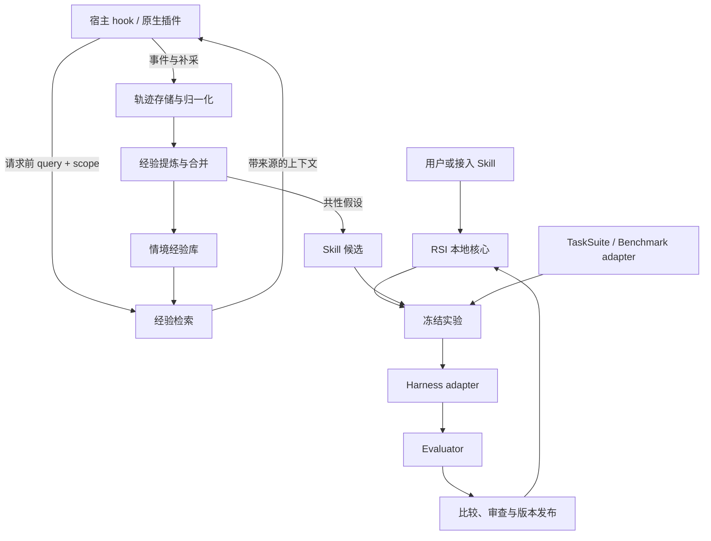

# RSI Toolkit 宿主 Hooks、业务接入与双模式方案复核

## 1. 结论与范围

**双模式、情境经验召回、多轨迹共性晋升 Skill 的方向合理。宿主扩展能力足以支撑这个方向，主要工程问题是接入语义、可复用执行契约和效果验证。**

对原[可行性调研](/Users/payne/Vibe/AgentOS/docs/dev/rsi_toolkit/2026-10-27-pluggable-plugin-and-experience-feasibility.md)的判断：可以保留控制、经验、评测三个模块的职责划分；不能直接采用其中所有现状判定、强制进程外方案和工期估计。具体需要修正：

1. JobBench/WorkBuddy 已是具体业务接入，当前工作树也有连接新 Controller 的桥接；缺少的是标准安装入口的配置、注册与导入体验。
2. Claude Code、Codex、DeepSeek Harness 都有 hooks/插件与结构化会话能力，不能继续以“可能没有 hook”作为这三家的设计前提。
3. 可插拔要求可注册、可版本化、可独立分发，不要求所有 adapter 必须进程外。
4. 可信 judge 可以按评测契约读取 gold/reference；应保护的是 solver 与 learner 的数据边界。
5. 多轨迹数量是证据之一，不能替代独立任务验证，也不应机械要求每个专用 Skill 覆盖多个任务族。

研究对象为产品仓 HEAD `a9e536fc1bba53d287e6d75cce32600b0daadffc`，同时检查 2026-10-27 当前工作树。`README.md`、`service/control/{controller,evidence,mcp}.py` 有未提交修改；真实 benchmark runner、bridge、judge、相关测试和 runbook 多为未跟踪文件。原报告主要描述交付基线，本复核补充这些工作树进展，不把它们当作已发布版本。

本轮实际读取官方在线文档、DeepSeek 固定 commit 源码和本地实现；未安装外部 harness、未运行付费模型、未重新执行 benchmark 或测试。历史实验状态来自已有证据，不是本轮实测。Claude Code/Codex 的在线文档是访问当日快照，安装版本和账号可用性仍需安装自检。

## 2. 宿主能力核实

### 2.1 能力总表

| 能力 | Claude Code | Codex | DeepSeek Harness |
| --- | --- | --- | --- |
| 原生插件 | skills、agents、hooks、MCP | skills、MCP、生命周期 hooks；有分发限制 | Cordis JS/TS 插件、bundle、profile |
| 请求前经验注入 | `UserPromptSubmit`、`SessionStart` 等返回 `additionalContext` | 同名 hook 返回 `additionalContext`；App Server 也有注入接口 | `agent/pre-step` waterfall 修改进入步骤的消息批次 |
| 工具观察 | `PreToolUse`、`PostToolUse`、失败/批次事件 | `PreToolUse`、`PostToolUse`，覆盖多数本地 function tools | `tools/pre-execute`、`tools/post-execute`、`tools/result` |
| 日常轮次信号 | `Stop`、`StopFailure`、子 agent 事件 | `Stop`、`Interrupt`、子 agent 事件 | `session/event` 的 `turn/end`；`agent/turn-stopping` 是关闭前事件 |
| 结构化历史读取 | SDK `listSessions/getSessionMessages/getSessionInfo` | App Server `thread/list/read`、`thread/turns/list`、`thread/items/list` | 原生 `sessionQuery.readSession()` 读取完整 raw log |
| 文件/人工导出 | JSONL transcript；`/export` 可读文本 | transcript 路径；`/export` Markdown | 默认 zstd JSONL，可用官方持久化读取接口 |
| 受控实验执行 | `claude -p`、`stream-json`、Agent SDK | `codex exec --json`、App Server | headless `--json`、官方 TS/Python SDK |
| 关键区别 | transcript 异步落盘且格式内部化 | transcript 格式不稳定；优先结构化 API | headless NDJSON 有截断；SDK 无现成历史导出方法 |

三家都具备实现双模式的基础。这里的“结构化历史”不等于逐字恢复所有原始模型请求，事件可见范围、压缩、输出截断和持久化策略都要记录。

### 2.2 Claude Code

官方 [Hooks](https://code.claude.com/docs/en/hooks) 支持 `SessionStart`、`UserPromptSubmit`、工具前后、`Stop`、`StopFailure`、`SessionEnd` 和子 agent 生命周期。Hook 输入带 `session_id`、`transcript_path` 等字段；子 agent 轨迹还要使用 `agent_transcript_path`。

经验召回可以在 `UserPromptSubmit` 同步查询本地服务，返回 `hookSpecificOutput.additionalContext`，作为 system reminder 进入下一次模型请求。单个上下文字符串超过 10,000 字符会转为文件路径和预览，Toolkit 仍应设自己的 token 预算。

会话数据有两条读取路径：

- 官方 SDK 的 `listSessions()`、`getSessionMessages()`、`getSessionInfo()`，Python 有对应 snake_case API；消息体仍需按版本归一化，部分类型为 `unknown`。
- 默认 `~/.claude/projects/<project>/<session-id>.jsonl`。官方明确其 entry 格式为内部格式、可能随版本变化；文件异步写入，Stop 时读取可能缺最后消息。可先记录 `last_assistant_message`，随后补采历史。

[外部 SessionStore](https://code.claude.com/docs/en/agent-sdk/session-storage) 可镜像会话，但失败为 best effort，不能替代可靠本地采集。压缩后的消息链与完整原始 entries 也应区分。

异步 hook 的结果通常等待后续用户交互；`asyncRewake` 有额外唤醒能力。`-p` 退出会清理仍在运行的异步 hook。SessionEnd 有较短的总时间预算，settings 可调整，而插件中的 timeout 不会自行提高总预算。因此学习流程适合“hook 快速入队，本地 worker 持续处理”。TS/Python SDK callback hook 的事件覆盖不完全相同，首版可使用文件式 hook 脚本统一接入。

原生[插件清单](https://code.claude.com/docs/en/plugins/manifest-reference)可打包 skills、agents、hooks 和 MCP。持久状态应放可写 data 目录，不能放会随插件升级替换的安装目录。

### 2.3 Codex

实际读取的 [OpenAI 官方 Hooks 文档](https://developers.openai.com/codex/hooks)已经提供完整生命周期扩展，包含：

`SessionStart / SessionEnd / UserPromptSubmit / PreToolUse / PostToolUse / PermissionRequest / PreCompact / PostCompact / SubagentStart / SubagentStop / Stop / Interrupt`。

- 用户、项目配置和插件可带 hook；非 managed hook 要审阅并信任当前定义，定义变更后重新审阅。
- 支持 command 与 `mcp_tool` handler；当前 prompt/agent handler 虽能解析但会跳过。
- `UserPromptSubmit` 可读取 prompt，返回 `additionalContext`；SessionStart 也可注入。默认过大上下文处理阈值约 2500 tokens，可配置，Toolkit 应主动限制输出。
- `mcp_tool` hook 使用已连接的 MCP server；SessionStart 时连接可能尚未就绪，SessionEnd 不支持该 handler。需要可靠启动期行为时可用 command bridge。
- 后台 command hook 不能阻塞或改写原操作；完成本身不会启动新 turn。会话结束会取消未完成后台 hook，SessionEnd 始终同步且最多 3 秒。
- `transcript_path` 可为 null，官方明确其格式不是稳定 hook 接口。
- 工具 hook 不覆盖 hosted web search 等所有路径，因此不能据其宣称得到全量工具审计。

结构化会话读取优先用 [App Server](https://developers.openai.com/codex/app-server)：`thread/list` 找会话，`thread/read` 读元信息，`thread/turns/list` 和 `thread/items/list` 分页读历史；`includeTurns=true` 的全历史模式对分页线程已弃用。受控启动的线程还可订阅 `turn/*`、`item/*`，最终以 `turn/completed.status` 区分 completed/interrupted/failed。

[非交互执行](https://developers.openai.com/codex/non-interactive-mode)支持 `codex exec --json`，输出 JSONL 事件及 usage。它适合 Toolkit 管理的实验任务；不能据此声称任意现有 GUI 会话已被被动采集。不要把 `--ephemeral` 会话当作可事后恢复的持久历史。

[插件打包文档](https://developers.openai.com/plugins/build/plugins#bundled-mcp-servers-and-lifecycle-hooks)还给出产品限制：**含生命周期 hook 的插件支持手动安装到 Codex desktop，目前不符合公共插件目录的上架条件。** 可提供本地安装包或独立项目/用户 hooks 配置；“本地可安装”与“公共目录一键安装”要分别承诺。托管云编排的 hooks 规则另有约束，本方案先面向本地 Codex。

[开发命令](https://developers.openai.com/codex/developer-commands)提供 `/export session.md`，用于人工阅读；机器采集采用结构化接口。

### 2.4 DeepSeek Harness

确认是官方 [deepseek-ai/deepseek-harness](https://github.com/deepseek-ai/deepseek-harness)，不是 DeepSeek 模型 API，也不是第三方同名 CLI。锁定 commit `22ddee3792402c3e70ec5f86a63c3e3e895a2f60`，源码 CLI 为 `0.2.1-rc.3`；未核实 registry 最新发布标签。它是外部 harness，原报告“自有 DSH”的说法没有依据。

原生 Cordis 插件更适合完整 RSI 接入：

- [`agent/pre-step`](https://github.com/deepseek-ai/deepseek-harness/blob/22ddee3792402c3e70ec5f86a63c3e3e895a2f60/packages/core/agent/src/runtime-types.ts#L337) 是 awaited waterfall，可修改进入步骤的消息；每步可能触发，包括空消息的工具续跑，需避免每步重复召回。
- [`session/event`](https://github.com/deepseek-ai/deepseek-harness/blob/22ddee3792402c3e70ec5f86a63c3e3e895a2f60/packages/core/session/src/index.ts#L76) 观察规范会话事件；原生 [`readSession()`](https://github.com/deepseek-ai/deepseek-harness/blob/22ddee3792402c3e70ec5f86a63c3e3e895a2f60/packages/session-query/session-query/src/index.ts#L184) 返回 header、继承边界和完整 raw events。
- `agent/turn-stopping` 是准备结束一轮；`turn/end` 是已提交轮次结果，原因含 completed/blocked/aborted/error 等。仍需要评测器或人工反馈判断业务结果。
- 默认持久化为 zstd JSONL；当前源码格式 V4，README 的 V3 示例已过时，应使用官方 codec/service 读取。
- [headless JSON 实现](https://github.com/deepseek-ai/deepseek-harness/blob/22ddee3792402c3e70ec5f86a63c3e3e895a2f60/packages/bundle/headless/src/json-stream.ts#L15)对非 final 字符串/键限制 8 KiB，单事件 32 KiB，深度 64；它是监督用投影，不能替代完整学习轨迹。
- 官方 SDK 有 prompt/resume/wait/events，但当前文档没有历史 `session/read/export` 方法。历史读取需要原生插件桥接 sessionQuery，而不是臆造 SDK 方法。

官方 [Claude hook 兼容桥](https://github.com/deepseek-ai/deepseek-harness/blob/22ddee3792402c3e70ec5f86a63c3e3e895a2f60/packages/experimental/hooks-claude-code/README.md)只支持 7 类 command hooks，`TaskCompleted/SessionEnd` 等不支持，`transcript_path` 恒为空。它可以复用部分 hook 配置，不能代替完整原生 adapter。README 有 SessionStart detached 的过时描述，同 commit [实现](https://github.com/deepseek-ai/deepseek-harness/blob/22ddee3792402c3e70ec5f86a63c3e3e895a2f60/packages/experimental/hooks-claude-code/src/index.ts#L208)实际 `await run`，本复核以源码为准。

**召回上下文会进入持久日志。** DSH 明确要求模型可见内容经过 logged channels；`agent.inject` 是带 source 的 synthetic user message。可以保证不修改全局 Skill，但不能保证“只进请求、不进 trace”。这有利于复查实际注入内容，也要求学习时识别已有经验，避免循环重复提炼。

### 2.5 AgentOS 可提出的宿主需求

AgentOS 是自建平台，可把能力作为明确需求。现有[Kernel 架构说明](/Users/payne/Vibe/AgentOS/docs/official/kernel-architecture-v0.1.md:70)已经描述 `before_model/on_tool_call/after_tool/should_stop`，但这是设计资料，本轮未核验实现。

| 宿主需求 | 验收语义 |
| --- | --- |
| 请求前上下文注入 | 在约定请求边界等待本地 recall；有 deadline、取消、token 上限；服务失败按配置继续任务 |
| 事件订阅与补采 | 稳定 session/turn/tool ID、递增 cursor；实时订阅后可从 cursor 补采，声明截断与缺口 |
| 历史导出 | 支持完整 raw log 和当前压缩视图；标识 schema/版本/继承关系，两种视图不可混淆 |
| 生命周期与任务结果 | turn ended、session ended、显式 task/goal outcome 分开；保留中断、错误、预算耗尽 |
| 候选执行 | 新会话与独立工区、指定资产版本、超时取消、终态查询、产物及 usage 导出 |
| 注入来源与加载确认 | 记录经验 ID/版本/哈希；可核实加载的 Skill bundle，升级与回滚有明确生效边界 |

这是需求草案，未向其他线程、系统或维护者提交。Cursor 不在本轮用户指定的三家外部核实范围内，仍需单独验证。

## 3. JobBench / WorkBuddy 算不算新业务接入

**算。** 当前代码已有[真实业务桥接](/Users/payne/Vibe/AgentOS/apps/plugins/rsi-toolkit/conformance/benchmark/rsi_benchmark.py:461)，返回 `(cases, host, verifier)`；[launcher](/Users/payne/Vibe/AgentOS/apps/plugins/rsi-toolkit/conformance/benchmark/run_rsi_benchmarks.py:371)将它们注入新 Controller。

真实链路是：

```text
准备业务公共任务与独立评测资料
→ 构造 cases / MintBenchmarkHost / RealBenchmarkVerifier
→ 控制 Agent 读 self-evolve Skill，经 MCP 启动 run
→ Controller 冻结实验与候选
→ Mint 在独立工区读 benchmark-worker Skill，执行公共任务
→ 独立上游 verifier / judge 评分
→ Controller 选择、审计，控制 Agent 经 MCP 查看结果
```

JobBench 的 judge 模型、源码哈希等也已写入 [`RealBenchmarkVerifier.describe()`](/Users/payne/Vibe/AgentOS/apps/plugins/rsi-toolkit/conformance/benchmark/rsi_benchmark.py:413)，并可进入 manifest。原报告“没有任何代码写这些字段”只能描述较早基线，不能描述当前工作树。WorkBuddy Office 的单独 runner 也有 rule + LLM judge；当前 RSI bridge 的 WorkBuddy 分支是 code 子集，不应混为同一条已验收能力。

仍有两个准确的缺口：

- 标准 [`build_controller()`](/Users/payne/Vibe/AgentOS/apps/plugins/rsi-toolkit/service/toolkit/config.py:65)仍未配置 suite/verifier，普通安装入口会使用 ledger；需要把现有具体接入变成可配置组件。
- [`MintBenchmarkHost`](/Users/payne/Vibe/AgentOS/apps/plugins/rsi-toolkit/conformance/benchmark/rsi_benchmark.py:201)同时做业务文件准备和 Mint 执行，`RealBenchmarkVerifier`也按 benchmark 分支；还没有做到 `BenchmarkAdapter × HarnessAdapter` 独立组合。

证据范围：WorkBuddy v3 的[补充审查记录](/Users/payne/Vibe/AgentOS/evidence/rsi-toolkit/rsi-benchmarks/2026-10-27/workbuddy-code-v3/control-review-recovery-1/summary-supplement.json:75)记载 completed、6 次执行、1 个候选、`NEEDS_REVIEW`，且未新增实验。该轮使用保存的修订源码快照，与当前工作树不完全相同。本轮看到的 JobBench RSI v1 摘要仍为 running，不能认定该轮已完成。当前三 split 是同一任务的新副本，只能研究 same-task repair，不能作为跨任务泛化证据。

## 4. Toolkit 能否驱动 Agent 自己接入

**可以，推荐 Skill 引导接入、代码执行正式实验。** Skill 和代码各自承担一部分流程，新业务接入不必都由 Toolkit 开发者手写。

### 4.1 分工

| 层 | 应承担的工作 | 应交付的结果 |
| --- | --- | --- |
| 接入 Skill | 理解用户目标；收集数据/日志；阅读 benchmark 文档；探测宿主；生成配置/adapter/rubric；调试 smoke/conformance | 可查看、可保存、可重用的接入包 |
| Benchmark/TaskSuite adapter | 解析数据源、准备输入与初始状态、重置环境、约定提交物、划分真实任务族 | 宿主无关的 TaskSpec/TaskSuite |
| Harness adapter | 启动会话、加载候选、执行、取消、采集事件与产物 | 标准 ExecutionResult |
| Evaluator | 使用冻结程序、rubric 或 judge 检查产物，保留原始证据 | 分项分数、总分或 unscored |
| RSI 核心代码 | 冻结输入、预算、版本、候选比较、审查与发布记录 | 可复查的实验与学习版本 |
| 目标 Agent | 使用候选资产完成公开任务 | 业务提交物与执行轨迹 |

“benchmark 需要 harness 适配”通常指实现一次 agent runner 集成。还需要 benchmark 自己的数据/环境/评分适配。应将两者分开，避免每多一个 benchmark 都重写各 harness，或每多一个 harness 都重写所有 benchmark。

### 4.2 建议用户流程

```text
用户：用这个任务集/日志目录优化这个 Skill
→ 接入 Skill 探测本机 harness、已有数据与评测入口
→ 已支持格式直接生成配置；新格式由 Agent 生成 adapter
→ 运行数据校验、环境检查和小样本接入验证
→ 固定并注册 TaskSuite / Harness / Evaluator
→ 估算预算，执行 baseline / candidate 对照
→ 输出差异、收益、失败案例和发布候选
```

复杂接入时，Agent 可以写代码并修复接入错误；代码最终成为版本化产物。原始 benchmark evaluator、隐藏资料和实验审计集由可信侧持有，目标 solver 不应在每次任务中自行发明或改写评分流程。接入 Agent 与被评估 Agent 应有明确角色和数据边界。

用户提供批量日志时，区分“可用于学习”和“可重跑”：日志未包含初始文件、外部工具状态或提交物规则时，可以提炼带限制的经验，暂不能宣称完成可重复评测。可由接入 Agent 尝试恢复并报告缺项。数据必须来自用户给定的数据集/日志；自动生成样例可做 smoke，不冒充业务测试数据。

### 4.3 可直接借鉴的社区产品行为

Claude Code 的官方 [`claude plugin eval init`](https://code.claude.com/docs/en/plugin-evals)正是这个模式：Agent 询问成功标准、提出测试和 grader、试跑并写成文件；随后 `claude plugin eval` 代码执行器运行固定评测。文档要求 CLI >=2.1.269，默认每 case 三次 with-plugin 和三次 without-plugin。该功能也有服务端可用性限制，本轮未验证账号可用。

RSI 可参考其交互方式，但仍需自行控制 candidate/current 比较、用户数据来源和独立保留集。其 without 是移除整个插件，增益不直接决定退出码；没有 custom-code grader，不能直接承接所有 JobBench/WorkBuddy 评分。官方也指出插件 hook/MCP 在 agent sandbox 外运行，原生 eval 隔离不能自动保护评分材料免受待测插件代码影响。本轮没有执行这些命令。

## 5. 对原方案的逐项评审

| 原方案位置 | 判断 | 建议修正 |
| --- | --- | --- |
| 第 3、6 节：控制/经验/评测三部分 | 合理 | 作为一个本地服务的模块职责即可，不必部署成三个服务 |
| R2/R4：数据集和 judge 缺失 | 对标准安装入口部分成立，对当前工作树过宽 | 标明已有真实接入桥接；新增通用导入、注册和兜底选择面 |
| 第 6.2、7.1 节：必须进程外 | 过强 | 先建立 registry/factory、契约版本和能力探针；Python entry point、子进程、原生宿主桥均可实现 |
| 第 6.2 节：execute/collect/cancel | 方向合理，恢复协议不完整 | 长任务要能先获得 execution ID，再查状态/订阅/取消；把同步调用作为小型 adapter 实现方式 |
| 第 6.4 节：经验单条可自动生效 | 需加质量状态 | 单条可形成 draft；来源、纠正/结果证据、冲突与失效条件决定能否进入可召回集合 |
| 第 6.4 节：Skill 必须 N 轨迹、M 任务族 | 不宜作为统一硬门槛 | 自动共性晋升要求独立案例与声明范围覆盖；专用 Skill 可仅一个任务族；数量不能替代 holdout |
| 第 6.5 节：judge 不得看隐藏标签 | 错误 | 可信 evaluator 可看 gold/reference；solver 不可看，learner 只读允许的构造反馈，审计材料隔离 |
| 第 6.5 节：冻结即可重算 | 对程序检查较强，对模型评分有限 | 冻结身份与原始输出保证可审查；模型重跑仍可能变化，不能保证完全同分 |
| 第 7.2 节：“自有 DSH” | 无依据 | 自建的是 AgentOS；DSH 为外部官方项目，分别接入 |
| 第 7.3 节：120 秒固定上限 | 当前工作树已过时 | 默认 120 秒，operator execution_limits 已可覆盖，runner 已使用 1200 秒 |
| 第 7.3 节：进程外解决许可 | 不成立 | IPC 边界不自动确定 AGPL 义务；这是分发方式与法律判断，不作架构保证 |
| 第 7.4 节：所有数据都要求确定性与 judge 双评 | 过强 | 有适用程序检查则使用；缺少时用 rubric judge，代表性样本校准，不要求每题都有两种真值 |
| 第 8 节：先完整模式一再经验面 | 不必串行 | 复用现有实验内核；最小经验采集/召回可同步验证，共享身份与评测记录 |
| 第 8 节：周数估计 | 尚无任务分解支持 | 先用可验收里程碑排序，探针和接入工作量明确后再估工期 |

仍成立的关键现状：新 runtime [`recall(question)`](/Users/payne/Vibe/AgentOS/apps/plugins/rsi-toolkit/service/control/mcp.py:36)没有查询经验库；日常轨迹采集、提炼、召回、效果反馈尚未接成新服务闭环。legacy 组件有复用价值，需要接入新身份、存储和评测边界。

## 6. 推荐的最小架构



图中均可为同一服务内模块，宿主薄包使用其原生 hook/plugin 能力。共享核心可提供 MCP、CLI 或本地 IPC；传输方式与业务契约分开。

建议将宿主能力分开协商，避免只有一个笼统的 `trace_export=true`：

- `capture.live`、`capture.history`、`capture.subagents`、`capture.completeness`；
- `inject.user_prompt`、`inject.pre_step`、上下文预算与是否持久化；
- `execute.fresh_session`、`execute.isolation`、`execute.cancel`、终态查询；
- `assets.stage/apply/verify_loaded`。

经验 scope 使用独立的 user/project/target、任务类型、工具版本、harness/model 条件；`target_id` 不天然等于 project。相关条件先过滤，再相关性检索，允许无匹配，条目需要来源、负反馈、失效和版本管理。

### 主动学习的两个必要补充

1. **Stop 是采集触发点，业务成功是另一个字段。** 插件先保存实际轮次结果，用户纠正、程序评测、明确 task/goal outcome 才提供质量证据。后台任务与子 agent 未结束时，不将整件任务标为完成。
2. **防止经验反复学习自身。** 记录 `experience_id/version`、召回决策、注入位置和来源；学习投影识别这些 synthetic 消息。fork 继承的轨迹和同一案例重试也不能重复增加独立支持数。

`hook → 快速持久入队 → 独立 worker 提炼` 支持会话结束后继续工作；`请求前 hook → 有预算的 recall → 注入`负责在线使用。实验运行及控制 Agent 的 self-evolve 调用要带 lineage，避免被采集后反复触发自身实验。

## 7. 建议验收顺序

1. **收敛现有具体业务接入**：用同一 suite/evaluator 注册机制表达 JobBench 与 WorkBuddy，复用 Mint 执行层；记录真实任务分组，保留接入失败与未评分状态。
2. **验证跨宿主插件最小闭环**：一个外部宿主完成安装、轮次采集、请求前召回、指定候选执行；AgentOS 用同一能力清单补齐需求。无需等所有完整发布功能都迁移完成。
3. **产品化接入 Skill**：用户给数据或日志地址，Agent 生成配置或 adapter 并验证；有程序 evaluator 优先使用，缺少时起草可查看的 rubric judge。
4. **验证日常经验效果**：在独立同类任务上做 recall on/off 配对比较；固定经验版本，报告质量、回归、延迟和 token 变化。
5. **验证 Skill 共性晋升**：基于多个独立任务形成假设，在声明范围内验证候选；按既有批准策略发布，确认加载和回滚。

这些是建议里程碑，不是已完成事项，也不附未经拆解的工期承诺。

## 8. 证据位置

- Claude 官方文档快照：`/private/tmp/rsi-host-research-20261027/claude/`。
- DeepSeek 固定 commit 源码及笔记：`/private/tmp/rsi-host-research-20261027/deepseek/`。
- Codex 实际抓取页面：`/private/tmp/rsi-codex-{hooks,app-server,noninteractive,developer-commands,plugins}-20261027.html`。独立 SDK 页获取失败，本报告未依赖该页作能力判断。
- 本地产品、实验记录和原报告的关键链接已在正文列出。本轮没有改产品代码，也没有重跑原报告的测试数量或继承其通过结论。
