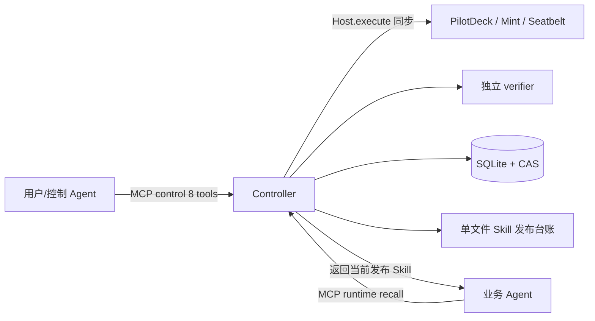

# RSI Toolkit 可插拔化与双模式经验学习可行性调研

调研对象：`apps/plugins/rsi-toolkit`，交付 commit `a9e536f`（独立仓库 `codex/rsi-toolkit-delivery`）。  
调研问题：它能否演进为“可插拔、跨 agent harness 复用”的 RSI 插件，并同时支持两种模式：

1. 用户主动发起 Skill / Agent 优化，由用户提供测试数据集与评测标准，缺标准时允许 LLM-as-judge 兜底；
2. Toolkit 主动从 agent 执行轨迹中提炼经验，让 agent 越用越好。

> 说明：用户提到的 `docs/REAMD.md` 在工作区不存在。本调研按根目录 [README](../../../README.md)、[RSI Toolkit 设计入口](README.md)、[插件架构](../../../apps/plugins/rsi-toolkit/docs/design/plugin-architecture.md)、[设计](../../../apps/plugins/rsi-toolkit/docs/design/design.md)、[进度](progress.md)、[验收](../../../apps/plugins/rsi-toolkit/docs/design/acceptance.md) 以及产品仓文档理解背景。

## 0. 结论摘要

**判定：当前版本不能“原样”支撑目标形态；但控制面、冻结评测和发布治理可作为基础，经三项结构性改造后可行。**

三条硬结论：

1. **控制面已经是“单宿主、离线、Skill 级实验”的可用内核。** 冻结 construct/select/audit、独立 verifier、审计退化回退、操作者一次性审批、哈希校验、回滚、`result_unknown` 不重放，这些保证是真实的，且有回归测试与真实宿主记录支撑。
2. **“可插拔跨 harness”尚未成立。** 目前只有 PilotDeck、Mint、Mint-Seatbelt 三个宿主适配；适配器是**进程内 Python 类**，由 `toolkit/config.py` 硬编码分支构造。新增 Claude Code、DeepSeek Harness、Codex、Cursor 需要改核心代码并重新发版，不是安装一个插件包。
3. **“模式二”在新控制面中基本不存在。** 新服务的 `recall` 接收 `question` 但**完全忽略它**，只返回当前已发布的 Skill；经验库、轨迹池、ExpeL/AWM/Mine、主动触发都留在 legacy engine 中，且与新控制面、新状态目录、新 MCP 入口没有接通。

| 目标能力 | 现状判定 | 一句话理由 |
| --- | --- | --- |
| R1 跨 harness 可插拔安装 | **部分（2 个宿主产品 / 3 个适配器）** | Host 契约存在，但适配器进程内实现、无第三方注册机制、无其他 harness 包 |
| R2 用户数据集接入 | **缺失（仅 Python 注入 / 固定 fixture）** | 新控制面没有导入 API；数据集在 `Controller` 构造时固定 |
| R3 用户评测标准接入 | **部分** | 只接受 Python verifier；无 rubric / LLM judge 选择面 |
| R4 LLM-as-judge 兜底 | **缺失** | 新路径无 judge verifier；`llm_reviewer` 只审提案，不评任务 |
| R5 轨迹采集（日常执行） | **缺失（仅实验内 events）** | 无会话结束 hook、无日常轨迹入库入口 |
| R6 经验提炼（案例级） | **部分（仅 legacy）** | ExpeL/AWM/Mine 在 legacy engine，新控制面 learner 目录只有 default/opro |
| R7 本地经验召回服务 | **部分（legacy）** | legacy 有按 query 的 bank recall；新 runtime MCP 的 recall 与 query 无关 |
| R8 多轨迹共性 → 全局 Skill | **缺失** | 新控制面按单次 run 的 construct 反馈提案，无跨轨迹支持度门槛 |
| R9 发布治理与安全 | **已具备（有边界）** | 审批、哈希、回滚、隔离声明齐全；单文件、verified isolation 才能 apply |

**Go / No-Go 判断：**

- 如果目标是“把现有能力包装成多个 harness 都能装的插件”，**按现状直接发版为 No-Go**；需要先做适配器外置与经验面 MVP。
- 如果目标是“以现有控制面为底座，分阶段建设双模式”，**Go**；但必须接受“先收敛范围，再逐个 harness 接入”，不能同时承诺 Claude Code、Codex、Cursor、DSH 全覆盖。

## 1. 调研问题拆解

把用户描述拆成可检验条目，避免用“有没有某个模块”代替“能不能完成闭环”。

| 编号 | 可检验问题 | 判定标准 |
| --- | --- | --- |
| Q1 | 新 harness 接入是否需要改核心代码？ | 仅安装包 + 配置即可接入 = 通过；需改核心 = 不通过 |
| Q2 | 用户能否在不写 Python 的情况下提供数据集？ | MCP/HTTP/CLI 可导入 = 通过 |
| Q3 | 用户能否提供评测标准？缺标准能否自动兜底？ | 可选 verifier + judge，且可冻结复用 = 通过 |
| Q4 | 日常 agent 执行是否会被采集为轨迹？ | 会话结束/事件 hook 自动入库 = 通过 |
| Q5 | 经验是否按 query 召回并注入上下文？ | 召回与 query 相关，且能被宿主消费 = 通过 |
| Q6 | 全局 Skill 更新是否有多轨迹共性证据门槛？ | 支持度/聚类/重复出现达到阈值才可提案 = 通过 |
| Q7 | 经验层与 Skill 层是否有不同的发布策略？ | 经验可自动、Skill 必须审批 = 通过 |
| Q8 | 既有治理保证是否被保留？ | 冻结、审计、回滚、凭据边界不被绕过 = 通过 |

## 2. 调研过程（可复现）

### 2.1 文档基线

先读背景与边界，避免把设计稿当成已实现：

- 根 [README](../../../README.md)：AgentOS 只保存包清单、适配器与一致性验证，产品源码在 `apps/plugins/rsi-toolkit`。
- [RSI Toolkit 设计入口](README.md)：交付范围、当前结构与行为、`partial deliverable` 的判定口径。
- [插件架构](../../../apps/plugins/rsi-toolkit/docs/design/plugin-architecture.md)：单服务、两条调用链、target/凭据/发布/隔离语义。
- [设计](../../../apps/plugins/rsi-toolkit/docs/design/design.md)：`rsi.host/v1`、`rsi.assets/v1`、`rsi.run/v1` 的原始设计；注意其中 `events()/collect()` 只存在于设计，不在当前契约。
- [进度](progress.md)、[验收](../../../apps/plugins/rsi-toolkit/docs/design/acceptance.md)：真实实验、P0 结果与公开边界。
- [易用性与社区方案调研](2026-10-27-usability-and-rsi-landscape.md)：已有的“主动学习闭环”“recall 名不副实”“TaskSuite/Evaluator”建议。本报告在其基础上做代码级核对与双模式判定，不重复其外部竞品综述。
- 产品 [README](../../../apps/plugins/rsi-toolkit/README.md) 与 [LEGACY.md](../../../apps/plugins/rsi-toolkit/docs/LEGACY.md)：明确“新控制面”和“legacy 入口”的边界。

关键原文（产品 README 第 114–116 行）：

> Runtime MCP provides `recall` of the current published Skill; it does not search a legacy experience bank.

这句话基本决定了模式二的现状：**新服务没有经验召回，只有已发布 Skill 的读取**。

### 2.2 代码走读

按“入口 → 控制面 → 宿主 → 评测 → 发布 → legacy 学习器”的顺序走读，重点核对调用关系，而不是只看文件是否存在。

| 走读对象 | 目的 | 关键发现 |
| --- | --- | --- |
| `service/toolkit/cli.py` | 用户入口 | 只有 `serve` / `check` / `api` 三个子命令 |
| `service/toolkit/config.py` | 装配 | 宿主类型硬编码 `pilotdeck` / `mint` / `mint-seatbelt`；构造 `Controller` 时不传 `cases/verifier`，因此总是落到内置 ledger |
| `service/control/controller.py` | 实验与发布 | learner 白名单只有 default/opro；数据集在构造时固定；发布单文件；recall 只读已发布 Skill |
| `service/control/mcp.py` | MCP 工具面 | control 8 个工具；runtime 只有 1 个 `recall(question)`，实现忽略 `question` |
| `service/control/http.py` | HTTP API | 无 dataset / evaluator / trace 相关端点 |
| `service/connectors/common/host.py` | 宿主契约 | `Host` 只有 `capabilities()` 与 `execute()`；同步、进程内 |
| `contracts/host.v1.json` | 契约 schema | 请求/响应是单次 payload；无 `events()` / `collect()` 生命周期接口 |
| `service/harness/services/trajectories.py` | legacy 轨迹池 | 有 schema 校验、去重、评价、统计 |
| `service/harness/learners/recall.py` | legacy 经验召回 | 按 query 的字符二元组 Jaccard 召回 |
| `service/harness/learners/expel.py` | legacy 经验提炼 | 失败/成功对照 → `applies_when/mistake/fix`，按相似度合并 support |
| `service/harness/learners/awm.py` / `mine.py` | legacy 共性归纳 | 成功轨迹归纳 workflow；整池聚类归纳知识文档 |
| `service/harness/services/automation.py` | legacy 主动触发 | 有 trigger/signals/冷却/配额；`trigger/signals` 只在测试中被调用，`tightened` 在 review 中使用 |
| `service/harness/plugin.py` | legacy 适配器协议 | `harness.adapter/v1` 的 JSONL 子进程协议，是一套可外置的适配器接口，但新控制面未使用 |
| `plugins/` | 宿主包 | 只有 pilotdeck / mint；无 Claude Code、Codex、Cursor、DSH 包 |

### 2.3 运行探针

静态走读之外，跑了三个小探针，验证“接口存在”与“行为符合预期”不是一回事。

**P1：控制面 learner 与工具面**

```python
# fixture host + fixture verifier + 临时项目
c.run("t", learner="expel", token=...)
```

输出：

```text
capabilities: ['default', 'opro']
expel rejected: invalid_request unsupported learner
control tools: ['cancel', 'capabilities', 'catalog', 'datasets', 'publish', 'review', 'run', 'status']
```

结论：新控制面确实只支持 default/opro；ExpeL 等 legacy learner 无法从 MCP/HTTP 调用。

**P2：runtime recall 是否使用 query**

在同一 target 完成一次实验并发布后，用两个完全不同的 query 调用 runtime MCP：

```text
runtime tools: ['recall']
recall(q=ledger): {"target_id": "t", "published": true, "asset_hash": "sha256:056c...", ...}
recall(q=calendar): {"target_id": "t", "published": true, "asset_hash": "sha256:056c...", ...}
```

结论：两次返回完全相同的已发布 Skill 内容；`question` 参数不参与检索。这与用户要求的“有类似 query 请求时召回相应经验”相反。

**P3：legacy 经验召回的质量信号**

用一个小 bank 测试 `harness.learners.recall.recall`：

```text
ledger reconciliation with decimal totals -> [('e-0001', 0.4483), ('e-0002', 0.1304)]
calendar scheduling in time zones          -> [('e-0002', 0.6222), ('e-0001', 0.2154)]
something unrelated                        -> [('e-0001', 0.1186), ('e-0002', 0.0909)]
```

结论：默认 `min_score=0.05` 时，**完全不相关的 query 也会召回两条经验**；排序只看字符相似度，没有使用 `support` / `verified` 等质量信号。legacy 的召回机制存在，但不能直接当作生产级“本地召回服务”。

### 2.4 回归测试抽查

只跑与结论直接相关的子集，避免把全量测试当成行为证明：

```sh
cd apps/plugins/rsi-toolkit/service
PYTHONDONTWRITEBYTECODE=1 .venv/bin/python -m pytest -p no:cacheprovider \
  tests/test_control_core.py tests/test_runtime.py tests/test_learners.py \
  tests/test_review.py tests/test_rsi_strategy.py -q
```

结果：**127 passed in 7.76s**（2026-10-27 本轮）。这说明控制面、legacy 学习器、审查和策略模块本身有测试支撑；不代表跨 harness 或经验面已经接通。

### 2.5 证据分级与限制

| 等级 | 本轮使用 | 说明 |
| --- | --- | --- |
| A 源码事实 | 主要依据 | 行号可追溯；描述的是当前 commit 的行为 |
| B 运行探针 | P1–P3 | 本机 fixture，不调用真实模型；验证接口语义 |
| C 回归测试 | 127 项子集 | 验证已有保证，不验证新目标 |
| D 文档声明 | 用于边界与历史 | 与源码冲突时以源码为准 |
| E 外部资料 | **未执行** | 本轮 web search 无可用 API key；Claude Code / Codex / Cursor / DSH 的扩展面未独立核验，相关判断仅基于本仓文档与通用工程知识，标注为“待验证” |

本轮**没有**：安装真实 Claude Code / Codex / Cursor / DSH；调用真实模型；跑全量 436 项 Python 测试；验证外部 harness 的 hook 能力；做 LLM judge 校准实验。因此下文对“其他 harness 是否支持会话 hook”的判断属于设计假设，不是实测结论。

## 3. 现状架构

### 3.1 新控制面



特点：

- 一个服务进程、一个 `state_dir`、一个 MCP 实例绑定一个 `target_id`。
- 实验对象是项目里的一个 `SKILL.md`；候选由提案模型生成，独立 verifier 打分，操作者审批后原子替换。
- 这是“控制面”，不是“学习面”。它不负责日常轨迹采集，也不负责经验库。

### 3.2 legacy engine

```mermaid
flowchart LR
    T[宿主会话/轨迹] --> P[(轨迹 JSONL / SQLite)]
    P --> L[ExpeL / AWM / ACE / Mine]
    L --> B[经验 bank 文件]
    B --> M[legacy runtime MCP recall(question, bank)]
    D[数据集/cohort] --> E[Evolution / 门链 / 审查]
    E --> G[发布/部署/回滚]
    A[Automation triggers] -.-> E
```

特点：

- 能力更全：数据集上传、cohort 切分、轨迹 ingest、策略推荐、经验提炼、召回、门链、自动触发。
- 但它是 legacy：入口是旧 console/MCP，状态布局是 `<HARNESS_WS>/harness-home`，与新控制面的 `state_dir`、凭据、发布台账不同。
- [LEGACY.md](../../../apps/plugins/rsi-toolkit/docs/LEGACY.md) 明确：legacy 入口不继承新控制面的持久化执行、鉴权和发布保证。

### 3.3 两套引擎的边界

新控制面只 import 了 legacy 的 `Store`、`CAS` 和 OPRO 的解析/提示常量；legacy 的轨迹、数据集、学习器、门链没有进入新控制面。结果是：

- **同仓、同 SQLite 实现，但不是同一个学习闭环。**
- 新控制面有“评测与发布”的强保证，legacy 有“采集与学习”的组件，二者尚未组合。

## 4. 逐项核对

### 4.1 R1：跨 harness 可插拔

**已有基础：**

- `Host` 协议清晰：`capabilities()` 声明能力，`execute()` 执行一次任务（[host.py](../../../apps/plugins/rsi-toolkit/service/connectors/common/host.py#L15-L18)）。
- `rsi.host/v1` 有 JSON schema，要求 `fresh_session` 与 `assets` 能力，未知结果不重放（[contracts/README.md](../../../apps/plugins/rsi-toolkit/contracts/README.md)）。
- MCP 传输本身是 harness-neutral 的：任何支持 HTTP MCP 的客户端理论上都能连接 `/mcp/control` 或 `/mcp/runtime`。
- 已有两个真实适配（PilotDeck Gateway WS、Mint CLI/NDJSON），以及一个 macOS Seatbelt 包装器。

**不成立的地方：**

1. **适配器是进程内 Python 类。** `toolkit/config.py` 用 `if host["type"] == "pilotdeck" ... elif "mint" ... elif "mint-seatbelt"` 构造（[config.py](../../../apps/plugins/rsi-toolkit/service/toolkit/config.py#L48-L63)）。新增 harness 要改这个文件，属于核心代码变更。
2. **没有第三方适配器注册机制。** 没有 entry points、插件目录扫描、`describe` 握手或版本协商；`Host` 是 `typing.Protocol`，不是可分发 ABI。
3. **没有 Claude Code / Codex / Cursor / DSH 的包。** `plugins/` 只有 `pilotdeck/` 与 `mint/`（[plugins](../../../apps/plugins/rsi-toolkit/plugins)）。PilotDeck 用 `plugin.json`，Mint 用 `mint.toml` + `.mcp.json`，没有其他格式。
4. **一个 MCP 实例绑定一个 target。** `create_app(..., target_id=...)` 在启动时固定；多项目要么多进程、要么改造路由（[mcp.py](../../../apps/plugins/rsi-toolkit/service/control/mcp.py#L90-L109)）。
5. **宿主协议只有同步 `execute`。** 设计稿里的 `events()` / `collect()` 没有落地；长任务、流式轨迹、取消后的状态查询都压在一次同步调用里。对 Claude Code / Codex 这类以会话/事件为中心的宿主，适配需要额外桥接。
6. **legacy 有一套可外置的 `harness.adapter/v1` JSONL 协议**（[plugin.py](../../../apps/plugins/rsi-toolkit/service/harness/plugin.py#L1-L45)），包含 measure/execute/propose 等方法。它本可以作为第三方适配器基础，但新控制面没有使用它。

**判定：部分。** “服务可被任意 MCP 客户端调用”是成立的；“插件可安装到多个 harness、无需改核心”不成立。

### 4.2 R2：用户数据集接入

**现状：**

- `Controller.__init__` 接受 `cases` 与 `verifier`，不传时加载内置 ledger（[controller.py](../../../apps/plugins/rsi-toolkit/service/control/controller.py#L56-L59)）。所以 Python 集成方可以注入自己的数据集。
- `build_controller()` 不传 `cases/verifier`（[config.py](../../../apps/plugins/rsi-toolkit/service/toolkit/config.py#L65-L67)），所以走配置启动的服务**永远是内置 ledger**。
- `datasets()` 只返回已注册集合的 split 计数与 verifier 描述，不接受导入（[mcp.py](../../../apps/plugins/rsi-toolkit/service/control/mcp.py#L46-L56)）。
- HTTP API 没有 dataset/evaluator 端点（[http.py](../../../apps/plugins/rsi-toolkit/service/control/http.py#L43-L64)）。
- 用户通过 MCP 只能看到 `datasets` 的只读摘要；无法上传、选择或校验自己的数据。

**legacy 有但未接通：**

- `/api/datasets/upload` 支持 jsonl/csv/xlsx → 新数据集版本（[console.py](../../../apps/plugins/rsi-toolkit/service/connectors/agentcpm/console.py#L255)）。
- 但上传要求每行有 `question` + `gold`，并由应用的 `dataset_import` 钩子生成标签（[dataset_import.py](../../../apps/plugins/rsi-toolkit/service/connectors/agentcpm/dataset_import.py#L1-L14)）。这不是通用“用户给日志/数据”的接口，而是 PilotDeck 应用特定的金标导入。
- `/api/pool/import` 只导入 PilotDeck 主 project 的会话（[sessions.py](../../../apps/plugins/rsi-toolkit/service/connectors/agentcpm/sessions.py#L147-L203)），不是通用“批量日志地址”。

**判定：缺失（新控制面）；legacy 有局部能力，但不能作为目标模式一的现成入口。**

### 4.3 R3/R4：评测标准与 LLM-as-judge 兜底

**现状：**

- 评测标准就是一个 Python callable：`verifier(case, result) -> {"score": ..., "passed": ...}`，必须在构造 `Controller` 时传入。
- 内置 verifier 是确定性的：ledger 与 workflow 都是程序化校验（[benchmarks/ledger.py](../../../apps/plugins/rsi-toolkit/service/benchmarks/ledger.py)）。
- 没有 rubric 解析、没有 judge 选择、没有 judge 模型配置、没有 judge 输出的原始记录与校准流程。
- 有一个“看起来像”的东西：`verifier_description()` 会读取 `judge_model` / `judge_source_sha256` 字段（[evidence.py](../../../apps/plugins/rsi-toolkit/service/control/evidence.py#L82)），`datasets()` 也会暴露它们。但**没有任何代码写入这些字段**，属于预留元数据，不是可用能力。
- `llm_reviewer()` 用模型审查候选改动（[review.py](../../../apps/plugins/rsi-toolkit/service/harness/services/review.py#L112-L140)），但它是 legacy 的“提案审查者”，不是任务评分器；不能替代 verifier。
- AWM 内部有一个 `Judge` 角色判断执行是否成功（[awm.py](../../../apps/plugins/rsi-toolkit/service/harness/learners/awm.py#L16-L22)），但它是 learner 内部信号，不是独立、可冻结、可复核的评测标准。

**判定：部分。** 用户可以在 Python 层提供 verifier；但“无标准时 LLM-as-judge 兜底”完全缺失，且没有 judge 的版本、提示、校准与置信声明。

### 4.4 R5：日常轨迹采集

**现状：**

- 新控制面只在**实验执行**时保存 `result["events"]`、`output`、`usage`、`artifacts` 到 CAS（[controller.py](../../../apps/plugins/rsi-toolkit/service/control/controller.py#L369-L398)）。
- 没有会话结束 hook、没有 trace 订阅、没有“把一次普通业务对话写入轨迹池”的入口。
- legacy 有一条 PilotDeck 专用链：`import_sessions` → `turns()` 把 Gateway 归档转成 `harness.trajectory/v2` → 写 JSONL 池。只支持 AgentCPM 的会话键，且需要人工/控制台触发。
- legacy 还有一个 SQLite 轨迹表与 `TrajectoryService`（[trajectories.py](../../../apps/plugins/rsi-toolkit/service/harness/services/trajectories.py#L49-L100)），但 JSONL 池到 SQLite 的入库只在 bench 辅助类里出现（`benches/shared/learner_bench.py`），不是产品服务路径。

**判定：缺失。** 对新目标而言，最关键的“日常使用即采集”没有产品化。

### 4.5 R6：经验提炼

**legacy 已有：**

- **ExpeL**：失败/成功对照 → `{applies_when, mistake, fix, keywords}`，按 `applies_when` 相似度合并，维护 `support` 与 `verified`（[expel.py](../../../apps/plugins/rsi-toolkit/service/harness/learners/expel.py#L43-L127)）。
- **AWM**：从成功执行归纳 workflow，追加到 memory（[awm.py](../../../apps/plugins/rsi-toolkit/service/harness/learners/awm.py)）。
- **Mine**：整池按任务相似度聚类，逐簇归纳再合并成知识文档，条目带 support（[mine.py](../../../apps/plugins/rsi-toolkit/service/harness/learners/mine.py#L60-L79)）。
- **ACE**：维护 playbook；**APE**：从示范反推指令。

**新控制面：**

- `capabilities` 与 `catalog` 只列 `default` 与 `opro`（[controller.py](../../../apps/plugins/rsi-toolkit/service/control/controller.py#L203-L204)；[mcp.py](../../../apps/plugins/rsi-toolkit/service/control/mcp.py#L58-L61)）。
- `_work()` 的候选只来自当前 run 的 construct feedback；没有跨 run、跨会话的轨迹输入（[controller.py](../../../apps/plugins/rsi-toolkit/service/control/controller.py#L575-L644)）。

**判定：部分（legacy）；新路径缺失。** 这些 learner 是“可复用组件”，不是“已交付的双模式能力”。

### 4.6 R7：本地经验召回服务

**legacy：**

- `harness/learners/recall.py` 实现了按 query 的 top-k 召回，条目文本 = `applies_when + keywords`，默认 `min_score=0.05`（[recall.py](../../../apps/plugins/rsi-toolkit/service/harness/learners/recall.py#L27-L36)）。
- legacy runtime MCP 的工具签名是 `recall(question, bank)`，按 bank 读取经验库（[mcp_server.py](../../../apps/plugins/rsi-toolkit/service/connectors/agentcpm/mcp_server.py#L141-L162)）。
- 经验库位置是 `<HARNESS_WS>/harness-home/experience/exp-<sha12>.json`，注释明确“多应用共享”（[layout.py](../../../apps/plugins/rsi-toolkit/service/harness/layout.py#L13)）。

**新控制面：**

- runtime MCP 只有一个 `recall(question)`，实现直接调用 `controller.recall(target_id)`，**不读经验库、不使用 query**（[mcp.py](../../../apps/plugins/rsi-toolkit/service/control/mcp.py#L36-L40)）。
- `controller.recall()` 只做“当前发布 Skill 的哈希校验与内容读取”（[controller.py](../../../apps/plugins/rsi-toolkit/service/control/controller.py#L788-L800)）。
- 产品 README 明确“不搜索 legacy experience bank”（[README.md](../../../apps/plugins/rsi-toolkit/README.md#L114-L116)）。

**质量问题（P3 已复现）：**

- 字符二元组 Jaccard 对短 query 区分度有限；`min_score=0.05` 过低，不相关 query 也会召回。
- 排序未使用 `support` / `verified`；没有负反馈、没有“召回后是否真的有用”的闭环。
- bank 是全局共享，不是按 target/project 隔离；与“case-by-case、本地召回”的隔离要求冲突。
- 召回结果需要 Agent 主动调用 MCP 才会进入上下文；没有 pre-turn 自动注入，也没有“没调用就不注入”的显式策略。

**判定：部分（legacy 机制）；新服务缺失。**

### 4.7 R8：多轨迹共性 → 全局 Skill 更新

**要求：** Skill 改动是全局的，必须从历史多个轨迹中提炼共性，不能把单 case 的经验直接写进 Skill。

**现状：**

- 新控制面一次 run 只使用该 run 的 construct 反馈；`steps`/`per_step` 产生多个候选，但都基于同一组 construct case，不是“历史多个轨迹”。
- 没有 `support` 计数、没有“同一模式在 N 条不同轨迹/任务中出现”的门槛、没有跨 run 聚类。
- 决策只有 `NEEDS_REVIEW` / `NO_IMPROVEMENT` / `AUDIT_REGRESSION`；`NEEDS_REVIEW` 不等于“多轨迹证据充分”，只是“小样本待审”。
- legacy 的 Mine/ExpeL 有 support 与聚类，`case_reviewer` 也会阻止把构造组 case id 写进全局资产（[review.py](../../../apps/plugins/rsi-toolkit/service/harness/services/review.py#L95-L110)），但这些不在新控制面的发布链上。
- 单文件发布限制：`register_target` 要求 `*/SKILL.md`，`_release` 只原子替换一个文件（[controller.py](../../../apps/plugins/rsi-toolkit/service/control/controller.py#L137-L140)、[L716-L767](../../../apps/plugins/rsi-toolkit/service/control/controller.py#L716-L767)）。经验 bank 不是可发布的 Skill 资产。

**判定：缺失。** 目前是“单 run 的 Skill 候选”，不是“多历史轨迹共性归纳后的全局升级”。

### 4.8 R9：发布治理与安全

这是现状最强的一块，应保留：

- 冻结 construct/select/audit，并要求三组都存在（[controller.py](../../../apps/plugins/rsi-toolkit/service/control/controller.py#L207-L227)）。
- 独立 verifier、分项分数、`unscored` 不伪造 0 分。
- 审计退化回退基线；平分保留基线；`min_gain` 严格大于。
- 测量漂移检测：提案模型、verifier 源码、host capabilities 在边界处复核（[controller.py](../../../apps/plugins/rsi-toolkit/service/control/controller.py#L288-L316)）。
- 操作者独立凭据、一次性 approval、绑定 target/run/版本/当前哈希/操作、过期与重放校验（[controller.py](../../../apps/plugins/rsi-toolkit/service/control/controller.py#L673-L786)）。
- `isolation="verified"` 才允许 live publish；`loaded` 永远 `unverified`，不把文件写入等同于宿主已加载。
- `result_unknown` 不自动重放；重启恢复不重放未确认执行。

边界也要说清楚：

- 单文件发布；不支持 Skill + references + scripts 的多资产事务。
- verified isolation 依赖操作者声明，服务不自动证明隔离。
- 一个服务同一时间只跑一个实验；预算 40 次执行、单次 120 秒，不适合长任务/大任务集。
- 没有独立的多租户隔离；一个 MCP 绑定一个 target，多项目需要多实例或网关路由。

**判定：已具备，但它是“实验发布治理”，不是“经验学习治理”。**

### 4.9 其他观察（低严重度）

- **凭据脱敏对短 token 过于激进。** 探针首次运行时用了单字符 token，`Redactor` 把 `"probe"` 中的 `r`/`o` 替换成 `[REDACTED]`，导致 `KeyError: 'p[REDACTED][REDACTED]be'`（[redaction.py](../../../apps/plugins/rsi-toolkit/service/control/redaction.py#L12-L30)）。真实部署的 token 不会这么短，但配置校验没有最小长度约束，建议补上。
- **配置无 schema 校验。** `load_config` 只做 JSON 解析与内联密钥拒绝；拼错字段会被静默忽略，用户可能以为数据集/verifier 已生效（[config.py](../../../apps/plugins/rsi-toolkit/service/toolkit/config.py#L23-L26)）。
- **MCP control 工具面很小**（8 个），且 `datasets` 只读；这与“用户主动提供数据集/标准”的产品叙事不匹配。
- **许可为 AGPL-3.0-only**（[pyproject.toml](../../../apps/plugins/rsi-toolkit/service/pyproject.toml#L1-L6)）。如果要把插件嵌入闭源 harness 或商业分发，需要单独评估；这不是技术阻塞，但是产品化阻塞。

## 5. 差距清单（按优先级）

| 编号 | 差距 | 影响 | 建议方向 |
| --- | --- | --- | --- |
| G1 | 新控制面与 legacy 学习引擎分裂 | 有评测无学习、有学习组件无新治理；两套状态/凭据/语义 | 选定单一运行时；把 legacy 的轨迹/经验能力以新契约迁入，或明确 legacy 只做参考实现 |
| G2 | 适配器进程内、不可分发 | 每接一个 harness 都要改核心并发版 | 定义 out-of-process `rsi.harness/v1`（stdio JSON-RPC 或 HTTP），能力握手、版本协商、conformance kit |
| G3 | 经验面缺失 | 模式二无法成立 | 新增 trace ingest → normalize → experience store → index → recall MCP 的独立面 |
| G4 | 数据集/评测契约缺失 | 模式一只能写 Python，普通用户不可用 | `rsi.tasksuite/v1` + `rsi.evaluator/v1`；CLI/API 导入；按 target 绑定 suite/evaluator |
| G5 | LLM-as-judge 缺失 | 无标准时无法兜底 | 冻结 judge 模型/提示/rubric；保留原始输出；校准集；与确定性检查分歧报告 |
| G6 | 多轨迹支持度门槛缺失 | 单 case 经验可能被写进全局 Skill | 跨 run/跨会话聚合；support ≥ N、覆盖 ≥ M 个任务族、去重/冲突检测；全局 diff 禁含 case id |
| G7 | 主动触发缺失 | 只能用户手动“再优化一次” | 会话结束/失败阈值/纠正事件 → 学习机会队列；去重、冷却、预算、暂停 |
| G8 | 召回质量与作用域 | 召回不准或跨项目泄漏 | 按 target/project 分 bank；BM25/embedding/混合检索；`min_score` 校准；support/verified 参与排序；召回命中日志 |
| G9 | 多 harness 打包与许可 | 无法真正“装到各处” | 每 harness 一个薄包 + 通用 MCP bridge；明确 AGPL 分发边界；提供安装自检 |
| G10 | 多项目路由 | 一个 MCP 一个 target | gateway 模式（token → target 路由）或每项目独立实例 + 明确文档 |

## 6. 目标架构建议

### 6.1 三个平面

```mermaid
flowchart TB
    subgraph H[Harness 适配层]
      HC[Claude Code 包]
      CD[Codex 包]
      CU[Cursor 包]
      DS[DeepSeek Harness 包]
      MT[Mint 包]
      PD[PilotDeck 包]
    end
    subgraph A[Adapter SDK / rsi.harness/v1]
      AS[stdio JSON-RPC 或 HTTP]
      CAP[capabilities / describe]
      EXE[execute / collect / events]
      TR[trace export / session hook]
    end
    subgraph C[Control Plane]
      CT[Controller: 冻结/评测/判决/发布]
      REL[Release ledger / rollback]
    end
    subgraph E[Experience Plane]
      IN[Trace ingest / normalize]
      ST[(Experience store)]
      IX[Index: BM25 / embedding]
      RC[Recall MCP: query → top-k]
      EX[Extractor / Consolidator]
    end
    subgraph D[Eval Plane]
      TS[TaskSuite]
      EV[Evaluator: deterministic / rubric / judge]
      CAL[Judge calibration]
    end
    H --> A --> C
    H --> TR --> IN
    IN --> ST --> IX --> RC
    ST --> EX --> ST
    C --> TS
    C --> EV
    EV --> CAL
    RC -->|recall(query)| H
```

### 6.2 适配器 SDK

建议把当前的 `Host` 升级为可分发协议，而不是继续在 `config.py` 加 `elif`：

```text
rsi.harness/v1 (stdio JSON-RPC 或 loopback HTTP)
  describe() -> {id, version, harness, capabilities}
  capabilities() -> {fresh_session, assets, cancel, events, trace_export, install}
  execute(request) -> result
  collect(execution_id) -> {output, events, artifacts, usage, model}
  cancel(execution_id) -> {status}
  export_trace({since, cursor}) -> [trace_record]   # 日常经验采集
  apply_asset(asset, expected_hash) / reload()       # 可选，宿主侧发布
```

要点：

- **进程外**：宿主可以用自己的运行时（Node/Python/Rust）实现适配器，不必把业务代码塞进 RSI 服务进程。
- **能力协商**：不支持 `events` 就显式降级，而不是假装支持。
- **trace schema 复用** legacy `harness.trajectory/v2` 的字段（source/session/turn/task/steps/execution/versions/evidence），但去掉本机路径。
- **conformance kit**：与 `contracts/` 并列，提供 fixture、负例和真实宿主探针。

### 6.3 经验面

建议新增独立的 `/mcp/experience`（或扩展现有 `/mcp/runtime`），只读、低权限、按 target/project 隔离：

```text
recall(query, scope, k?) -> {
  bank_version, hits: [
    {id, applies_when, mistake, fix, score, support, verified, source_trajectories}
  ]
}
```

- **按 query 召回**：BM25 或 embedding + 关键词混合；`min_score` 用校准集确定，而不是拍 0.05。
- **作用域**：bank 按 `target_id`（项目）隔离；跨项目共享必须是显式授权。
- **质量信号**：`support`、`verified`、最近使用/有效性参与排序。
- **注入**：runtime Skill 指示 Agent 在开始任务前调用；有 hook 的 harness 可在 pre-turn 自动注入，但必须记录“注入了什么、是否被使用”。
- **不提全局 Skill**：经验条目永远留在经验面，除非满足 6.4 的门槛。

### 6.4 两条晋升通道

| 通道 | 产物 | 触发 | 证据门槛 | 审批 |
| --- | --- | --- | --- | --- |
| 经验晋升 | experience entry / bank 版本 | 失败、纠正、重复成功 | 单条轨迹即可，但要有适用条件与来源 | 自动（可回滚） |
| Skill 晋升 | 项目 SKILL.md（全局） | 多轨迹共性、周期性归纳 | ≥ N 条不同轨迹、≥ M 个任务族、support 计数、无 case id、冻结评测不退化 | 操作者显式审批 + 隔离已验证 |

这与用户描述的两条约束一致：**经验 case-by-case 地召回，Skill 只在共性足够时全局更新**。

### 6.5 评测面

- `rsi.tasksuite/v1`：`{case_id, task, files, split, task_family, source}`；支持 JSONL/目录导入；split 可冻结。
- `rsi.evaluator/v1`：
  - `deterministic`：现有 ledger/workflow 风格；
  - `rubric`：rubric 版本 + 判分规则；
  - `llm_judge`：模型 ID、provider、提示哈希、温度、最大 token、原始输出保留、校准集与一致性报告；
- judge 不能看到隐藏标签；judge 调用与目标 Agent 隔离；judge 结果标记 `label_strength`（weak/medium/strong），小样本继续 `NEEDS_REVIEW`。
- 评测结果必须可重算：冻结 judge 描述，像现在冻结 verifier 源码一样。

## 7. 可行性判断

### 7.1 技术可行性

**可行，但不是“改一个配置”级别的可行。** 三个结构性改造：

1. **适配器外置**（G2）：把进程内 `Host` 变成 out-of-process 协议。工作量中等，但会触及 `Controller` 的调用边界、错误语义、取消和结果恢复。
2. **经验面**（G3/G8）：新增 trace ingest、store、index、recall MCP、注入策略。legacy 的 ExpeL/recall 可复用算法与数据结构，但需要重新做作用域、质量信号和索引。
3. **数据/评测契约**（G4/G5）：新增 suite/evaluator 配置与导入 API；LLM judge 需要校准与证据链，不能只加一个模型调用。

### 7.2 产品可行性

**可行，但要收窄首发范围。**

- 不建议首发同时支持 Claude Code、DeepSeek Harness、Codex、Cursor、Mint、PilotDeck。每个 harness 的扩展面不同：有的只有 MCP，有的有 skills/rules，有的有 hooks，有的能导出会话。适配成本与验证成本会叠加。
- 建议首发：**MCP 通用接入 + 一个自有 harness 深适配（DSH）+ 一个外部 harness 验证（Claude Code 或 Codex）**。先把“经验面 + MCP”跑通，再扩展安装包。
- 模式一的首发可以不做“任意 harness 自动执行”，而是先做“用户提供数据集 + evaluator + 用已有 host 执行”的闭环；这比跨 harness 更重要。

### 7.3 主要风险

| 风险 | 说明 | 缓解 |
| --- | --- | --- |
| 评测有效性 | LLM judge 可能被候选“讨好”，或与确定性检查冲突 | judge 冻结 + 校准集 + 分歧报告 + 小样本不晋升 |
| 经验污染 | case-specific 经验被误写进全局 Skill | 双通道 + support 门槛 + case id/实例值检测 + 人工审批 |
| 跨项目泄漏 | 经验 bank 共享导致 A 项目经验进入 B 项目 | 按 target 隔离；共享需显式授权 |
| 召回噪声 | 低阈值召回不相关经验，反而干扰上下文 | 校准 min_score、混合检索、support 排序、命中日志 |
| 成本/延迟 | 轨迹提炼与 judge 调用消耗模型预算；长任务超出 120 秒限制 | 异步队列、预算上限、任务级 timeout、批量归纳 |
| 许可 | AGPL-3.0-only 影响商业宿主嵌入 | 提前明确分发模式；必要时做接口隔离/独立进程 |
| 安全 | 经验库/轨迹含敏感数据；judge 可能看到隐藏标签 | 脱敏、隔离、最小权限、judge 与目标 Agent 分环境 |

### 7.4 Go / No-Go 门槛

建议用三个可验证的门槛决定是否进入完整建设：

1. **适配器门槛**：DSH + 一个外部 harness 能在不改核心代码的情况下完成 `describe → execute → trace export → recall`；否则先解决 G2。
2. **评测门槛**：用户数据集 + 确定性 verifier + LLM judge 三者在同一批任务上能产出可复核的逐题结果，且 judge 与人工/确定性检查的分歧有记录；否则先解决 G4/G5。
3. **经验门槛**：在 holdout 任务上，有 recall 与无 recall 的配对比较能显示可重复的差异（不是单次 demo）；否则模式二只是“存了经验”，不是“越用越好”。

## 8. 建议路线图

| 阶段 | 范围 | 退出标准 |
| --- | --- | --- |
| P0 契约冻结（约 1 周） | 定义 `rsi.harness/v1`、`rsi.tasksuite/v1`、`rsi.evaluator/v1`、`rsi.experience/v1`；确定 target 作用域与凭据模型 | 契约评审通过；有 fixture 与负例 |
| P1 模式一 MVP（约 2–3 周） | 数据集/评测配置 + 导入 API + LLM judge 兜底（先只在一个 host 上执行） | 用户不写 Python 即可跑一次自有数据实验；结果可复核 |
| P2 经验面 MVP（约 3–4 周） | 轨迹 ingest + 经验 store + query recall MCP + 运行时 Skill 注入；先接 DSH | 日常执行可入库；相似 query 能召回相关经验；不修改全局 Skill |
| P3 Skill 共性晋升（约 4–6 周） | 跨轨迹聚类/支持度 + 全局 diff 检查 + 冻结评测 + 审批 | 至少 N 条轨迹支撑的候选才能进入发布；单 case 经验被拒绝 |
| P4 多 harness（每 harness 约 1–2 周 + 验证） | Claude Code / Codex / Cursor 薄包 + MCP bridge + 安装自检 | 不改核心代码即可安装；conformance 通过 |

顺序建议：**先 P1 再 P2**。模式一能先证明“评测与发布”对用户有价值；模式二的经验面如果没有可靠评测，很难证明“越用越好”。

## 9. 待验证问题

1. DeepSeek Harness、Claude Code、Codex、Cursor 各自能提供什么级别的会话/trace 导出与 hook？是否支持 pre-turn 注入？本轮未实测。
2. LLM judge 与确定性 verifier 在同一批任务上的排序一致性如何？需要多少校准样本？
3. 经验召回在 holdout 上的真实收益是多少？是否会出现“召回越多越干扰”？
4. 跨 harness 的轨迹 schema 能否无损归一？工具调用、权限、错误码的差异如何处理？
5. 多项目场景下，是一个 gateway 路由多 target，还是每项目一个服务实例？凭据与审计如何拆分？
6. AGPL-3.0-only 对目标分发模式的影响；是否需要独立的插件协议层来隔离许可。

## 10. 附录

### 10.1 关键证据索引

| 结论 | 证据 |
| --- | --- |
| 新控制面只有 default/opro | [controller.py L203-L204](../../../apps/plugins/rsi-toolkit/service/control/controller.py#L203-L204) |
| 数据集在构造时固定、默认 ledger | [controller.py L56-L59](../../../apps/plugins/rsi-toolkit/service/control/controller.py#L56-L59)、[config.py L65-L67](../../../apps/plugins/rsi-toolkit/service/toolkit/config.py#L65-L67) |
| 新 API 无数据集/评测端点 | [http.py L43-L64](../../../apps/plugins/rsi-toolkit/service/control/http.py#L43-L64) |
| runtime recall 忽略 query | [mcp.py L36-L40](../../../apps/plugins/rsi-toolkit/service/control/mcp.py#L36-L40)、[controller.py L788-L800](../../../apps/plugins/rsi-toolkit/service/control/controller.py#L788-L800) |
| 产品自述不搜索经验库 | [README.md L114-L116](../../../apps/plugins/rsi-toolkit/README.md#L114-L116) |
| 宿主适配器硬编码 | [config.py L48-L63](../../../apps/plugins/rsi-toolkit/service/toolkit/config.py#L48-L63) |
| Host 只有同步 execute | [host.py L15-L18](../../../apps/plugins/rsi-toolkit/service/connectors/common/host.py#L15-L18) |
| legacy 轨迹池与去重 | [trajectories.py L49-L100](../../../apps/plugins/rsi-toolkit/service/harness/services/trajectories.py#L49-L100) |
| legacy 经验召回 | [recall.py L27-L36](../../../apps/plugins/rsi-toolkit/service/harness/learners/recall.py#L27-L36) |
| ExpeL 经验提炼/合并 | [expel.py L43-L127](../../../apps/plugins/rsi-toolkit/service/harness/learners/expel.py#L43-L127) |
| Mine 聚类归纳 | [mine.py L60-L79](../../../apps/plugins/rsi-toolkit/service/harness/learners/mine.py#L60-L79) |
| legacy 主动触发的 trigger/signals 只在测试中调用 | [automation.py L39-L67](../../../apps/plugins/rsi-toolkit/service/harness/services/automation.py#L39-L67) |
| legacy 可外置适配器协议 | [plugin.py L1-L45](../../../apps/plugins/rsi-toolkit/service/harness/plugin.py#L1-L45) |
| 单文件 Skill 发布 | [controller.py L137-L140](../../../apps/plugins/rsi-toolkit/service/control/controller.py#L137-L140)、[L716-L767](../../../apps/plugins/rsi-toolkit/service/control/controller.py#L716-L767) |
| 发布治理/审批/回滚 | [controller.py L673-L786](../../../apps/plugins/rsi-toolkit/service/control/controller.py#L673-L786) |
| legacy 边界声明 | [LEGACY.md](../../../apps/plugins/rsi-toolkit/docs/LEGACY.md) |

### 10.2 本轮执行命令

```sh
# 目录与规模
cd apps/plugins/rsi-toolkit
git log --oneline -5
find service -name '*.py' | wc -l

# 核心文件走读
sed -n '1,220p' service/control/controller.py
sed -n '1,130p' service/control/mcp.py
sed -n '1,100p' service/toolkit/config.py
sed -n '1,110p' service/control/http.py
sed -n '1,100p' service/connectors/common/host.py

# legacy 能力
sed -n '1,220p' service/harness/services/trajectories.py
sed -n '1,140p' service/harness/learners/expel.py
sed -n '1,120p' service/harness/learners/awm.py
sed -n '1,120p' service/harness/learners/mine.py
sed -n '1,110p' service/harness/services/automation.py

# 探针
PYTHONDONTWRITEBYTECODE=1 .venv/bin/python /tmp/rsi_probe.py
PYTHONDONTWRITEBYTECODE=1 .venv/bin/python /tmp/rsi_probe2.py
PYTHONDONTWRITEBYTECODE=1 .venv/bin/python - <<'PY'
from harness.learners import recall as R
...
PY

# 回归子集
PYTHONDONTWRITEBYTECODE=1 .venv/bin/python -m pytest -p no:cacheprovider \
  tests/test_control_core.py tests/test_runtime.py tests/test_learners.py \
  tests/test_review.py tests/test_rsi_strategy.py -q
# 127 passed in 7.76s
```

### 10.3 探针原始输出

**P1**

```text
capabilities: ['default', 'opro']
expel rejected: invalid_request unsupported learner
control tools: ['cancel', 'capabilities', 'catalog', 'datasets', 'publish', 'review', 'run', 'status']
```

**P2**

```text
datasets -> {"id": "registered-benchmark", "splits": {"construct": 1, "select": 1, "audit": 1}, "label_strength": "unknown", "verifier": {"name": "verify", "policy": "unspecified/v1"}, "evidence": "insufficient"}
catalog -> {"learners": [{"id": "default", ...}, {"id": "opro", ...}]}
runtime tools: ['recall']
recall(q=ledger): {"target_id": "t", "published": true, ...}
recall(q=calendar): {"target_id": "t", "published": true, ...}
```

**P3**

```text
ledger reconciliation with decimal totals -> [('e-0001', 0.4483), ('e-0002', 0.1304)]
calendar scheduling in time zones          -> [('e-0002', 0.6222), ('e-0001', 0.2154)]
something unrelated                        -> [('e-0001', 0.1186), ('e-0002', 0.0909)]
```

### 10.4 与既有调研的关系

[易用性与社区方案调研](2026-10-27-usability-and-rsi-landscape.md) 已经指出：

- `build_controller()` 未传 cases/verifier，默认 ledger；
- MCP `datasets()` 只报告计数；
- `recall` 名不副实；
- 日常学习入口缺失；
- 建议第二阶段做轨迹采集、人工纠正、学习机会队列、任务相关经验检索。

本报告与其结论一致，但进一步给出：

- 用户双模式约束下的可检验判定；
- 代码级证据与运行探针；
- “经验面 / 控制面 / 评测面”三平面目标架构；
- 两条晋升通道（经验自动、Skill 审批）与 Go/No-Go 门槛。
