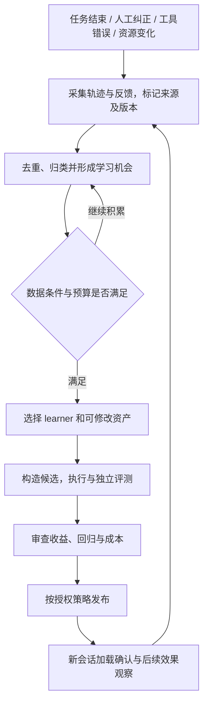

# RSI Toolkit 易用性与社区方案调研

## 1. 结论

当前 `rsi-toolkit` 已有可追溯的 Skill 优化实验与受控发布基础，比较适合开发者操作、小规模离线实验和宿主接入验证。面向普通用户的首次使用、自己的业务任务接入、日常经验积累和主动学习，仍需要较多工程工作。

最值得优先解决的三个问题：

1. **任务与反馈接入**：标准配置入口仍默认使用 ledger fixture；自己的任务、评分器和诊断反馈应能通过稳定协议接入。
2. **已有能力整合**：历史引擎已保留轨迹池、ACE、AWM、ExpeL、Mine、策略推荐与经验检索，新控制链目前只提供 Default、OPRO 和单 Skill 发布。
3. **主动学习闭环**：将任务结束、人工纠正、重复失败等事件转为学习机会，再在预算内生成候选、验证并送审。

建议的产品方向是：**让用户指定“什么任务希望变好、以什么衡量、允许改变什么、预算多少”，系统负责选择学习方式并交付有证据的候选。**

社区中可以分别借鉴 PenguinHarness 的集成体验、GEPA 的通用优化接口、Harness² 的多组件与双层递归、Hermes/LangMem/ReMe 的日常经验学习。上述能力解决不同问题，不能用算法数量或“自动运行”一个指标概括。

## 2. 调研范围与证据

用户所写 `rsl_toolkit`，本报告按工作区中的 `apps/plugins/rsi-toolkit` 理解。

本地分析基准为独立仓库分支 `codex/rsi-toolkit-delivery`，HEAD `a9e536fc1bba53d287e6d75cce32600b0daadffc`。父目录 AgentOS 不是 Git 仓库。分析时产品仓存在未跟踪的 JobBench/WorkBuddy 适配与测试文件；它们作为当前工作区进展单独观察，不算入上述 commit 的交付范围。

证据分为三类：当前源码可直接核实的行为、已有真实实验/交付记录、本轮建议。外部资料为 2026-10-27 联网读取的官方仓库、文档和技术文章；未安装或复跑外部优化器，未开展新的付费模型实验。本文是工程与产品调研，不是用户访谈或竞品性能实测。

网页阅读原计划使用 `paper-reader` 的轻量准备脚本；本机缺少 `trafilatura`，因此改读官方 Markdown 源文件及实现。论文仅作为相关出处，不声称完成论文全文精读。

## 3. 当前有几种用法

按用户实际接触的入口，可分为 **5 种用法**。这些入口大多共享一个 Controller，并非五套独立 RSI 系统。

| 用法 | 典型用户与操作 | 当前能完成的工作 | 主要前置条件 |
| --- | --- | --- | --- |
| Mint 对话控制 | 在控制工程加载 `self-evolve`，让 Agent 调用 control MCP | 查看能力、启动 Default/OPRO、查进度、看 diff、请求发布审查 | Python 服务、已初始化并信任的 Mint 工程、本地包、stdio bridge、环境变量 |
| PilotDeck 对话控制 | 安装 `evolution-control`，读取 namespaced Skill；有 evolve/review/rollback 命令提示 | Agent 发起和审查实验；真实批准与回滚走 operator API | 支持 Gateway WS 1.2 的宿主、项目注册与凭据；普通 adapter 为 exploratory |
| CLI / HTTP | `rsi-toolkit api /api/runs ...` 或调用 JSON API | 脚本化运行、查状态、审查、批准、应用与回滚 | 手工组织 endpoint、JSON、run ID、哈希和独立 operator 凭据 |
| Python 集成 | 创建 `Controller(hosts=..., cases=..., verifier=...)` | 接自己的任务、verifier、模型客户端和实现 Host 协议的宿主 | 编写接入代码；自定义宿主也要满足执行与隔离要求 |
| 运行时消费 | 在业务工程只安装 runtime 包，调用 `recall` 或读取发布的原生 Skill | 使用已发布 Skill 及版本 | 已有发布记录；runtime 凭据只能 recall |

现存的 legacy console、Docker/dev 启动方式和可选 evolution-ui 也能在目录中找到，但不属于新控制 API 的等价用法。当前 UI 尚未接入新控制 API，不能作为正式的图形操作入口。

这里有两组容易混淆的概念：

- **控制入口支持 MCP**：另一个 Agent 可以调用 Toolkit 的控制工具。
- **可被优化的宿主支持**：该 Agent 还需要 HostAdapter，才能执行冻结候选并收集真实结果。仅连接 MCP 不会自动补齐执行适配器。

按学习能力统计，新控制入口支持 **Default 与 OPRO 两种**；历史 learner registry 保留 **Default、OPRO、APE、ACE、AWM、ExpeL、Mine 七种**。后五种尚未整合进本版新控制闭环，不能作为现成菜单向用户承诺。

依据：[产品 README](/Users/payne/Vibe/AgentOS/apps/plugins/rsi-toolkit/README.md:12)、[MCP 工具](/Users/payne/Vibe/AgentOS/apps/plugins/rsi-toolkit/service/control/mcp.py:19)、[Python 接入示例](/Users/payne/Vibe/AgentOS/apps/plugins/rsi-toolkit/contracts/README.md:35)、[历史入口边界](/Users/payne/Vibe/AgentOS/apps/plugins/rsi-toolkit/docs/LEGACY.md:1)、[历史 learner registry](/Users/payne/Vibe/AgentOS/apps/plugins/rsi-toolkit/service/harness/learners/__init__.py:15)。

### 3.1 一次具体使用流程

前提：Mint 控制工程、RSI 服务和 ledger target 已配置，基线 Skill 已存在。以下为按源码推演的使用示例，未在本轮调用真实模型。

1. 用户在控制工程说：“对账本 Skill 做一次改进，用 Default。”
2. `self-evolve` 调用 `capabilities`、`datasets`、`catalog`，再调用 `run(learner="default")`，返回 run ID。
3. Controller 冻结任务、模型、宿主、verifier 描述和基线 Skill；先跑 construct/select 基线。
4. 提案模型读取 construct 题目、输出和分数，生成完整 `SKILL.md` 候选。
5. 候选在全新工区/会话执行；独立 verifier 评分；select 严格提高才替换当前胜者，平分保留基线。
6. 选定胜者后才跑 audit。出现 audit 退化则恢复基线判决。
7. 用户通过 `status`、`review` 查看结果。`publish` 仅生成 operator 审查请求。
8. verified target 的操作者批准并 apply；业务工程在新会话消费 Skill，并单独验证实际加载与行为。

ledger 每组各 3 题，默认一轮、一个非重复候选且进入候选审计时，需 **18 次任务执行 + 1 次提案调用**。无提升或重复候选时执行量可能减少。“一轮优化”不能理解为一次模型调用。

依据：[Skill 协议](/Users/payne/Vibe/AgentOS/apps/plugins/rsi-toolkit/assets/skills/self-evolve.md:7)、[实验主循环](/Users/payne/Vibe/AgentOS/apps/plugins/rsi-toolkit/service/control/controller.py:490)。

## 4. 易用性评估

### 4.1 已有优势

| 方面 | 当前实现带来的价值 |
| --- | --- |
| 对话控制 | Agent 能通过少量 MCP 工具操作，实验返回 run ID 后在后台执行 |
| 实验可追溯 | 冻结 manifest、逐题结果、原始提案、候选哈希、谱系和 diff 都有保留 |
| 失败处理明确 | 未知执行不自动重放；基础设施失败不伪造业务零分；取消需确认终态 |
| 候选比较 | construct/select/audit 分离，平分保留基线，审计退化阻断候选 |
| 发布可控 | 独立 operator、一次性 approval、当前哈希检查、单文件原子替换和回滚 |
| 宿主边界 | Host 协议已独立；Mint 与 PilotDeck 可共享控制与判决实现 |

这些是适合继续建设的基础。它们证明流程纪律与工程边界，不直接证明优化收益或新用户上手容易。

### 4.2 影响体验的主要问题

| 问题 | 当前源码事实 | 对用户的影响 | 优先建议 |
| --- | --- | --- | --- |
| 首次安装步骤分散 | Python/uv、服务配置、宿主、插件、bridge、凭据与 target 分别配置 | 首次跑通需要理解内部组件 | 统一初始化向导、打包安装、连接诊断和模板 |
| “检查通过”覆盖有限 | `check` 只查本地资产/可执行文件；`/ready` 只表示服务进程就绪 | 宿主或 provider 未接通时，用户仍可能误判已可用 | 分层显示 service/host/provider/asset/benchmark 状态；联网探针单独触发 |
| 自己的业务任务接入不直接 | `build_controller()` 未传入 cases/verifier；Controller 默认 ledger；MCP `datasets()` 只报告已注册集合计数 | 换业务任务目前要用 Python 注入或专门脚本 | TaskSuite registry、数据导入和 verifier 接入协议 |
| 优化对象受限 | target 必须是项目 `SKILL.md`；发布单文件 | 无法完整交付 Skill + references + scripts，或工作流/工具配置 | 先增加 Skill bundle，再按组件扩展 artifact 类型 |
| 诊断反馈不够 | `_construct_feedback()` 只向 proposer 提供 case ID、score、截断 output、version ID | verifier 的细项失败、工具错误和产物差异虽有留存，未有效进入提案 | 显式构建可公开的 construct FeedbackBundle |
| recall 名称容易引起误解 | MCP 接收 `question`，但直接返回 target 当前发布 Skill，不使用问题检索 | 不能按任务挑经验，也没有跨 Skill 的相关性检索 | 明确区分 `current_asset` 与未来的 `search_experience(query)` |
| 日常学习入口缺失 | 新控制面未接入轨迹 ingest、会话结束 hook、人工反馈或学习策略推荐 | 通常要用户主动说“再优化一次” | 采集日常信号，积累学习机会并生成候选 |
| 预算适合小型 fixture | 默认 max_steps=12、单执行 timeout<=120 秒、总执行<=40；一服务同一时间只跑一个实验 | 长文档/办公任务容易受运行上限影响；大任务集无法直接使用 | 任务级预算 profile、预估执行量、token/费用额度与队列 |
| 审查与发布仍偏 API 操作 | CLI 仅 `serve/check/api`；批准和 apply 需分别调用 operator endpoint | 人要复制 ID、哈希，理解审批引用 | 统一审查页/高级 CLI，汇总收益、回归、费用和加载状态 |
| 多项目操作有限 | 可登记多个 target，但一个 MCP 实例绑定一个 target；Controller 共用 cases/verifier | 每个项目的任务集与服务入口需要额外编排 | target 绑定 suite，显式项目选择与授权域 |

源码定位：[CLI](/Users/payne/Vibe/AgentOS/apps/plugins/rsi-toolkit/service/toolkit/cli.py:43)、[配置装配](/Users/payne/Vibe/AgentOS/apps/plugins/rsi-toolkit/service/toolkit/config.py:36)、[默认数据集](/Users/payne/Vibe/AgentOS/apps/plugins/rsi-toolkit/service/control/controller.py:48)、[资产限制](/Users/payne/Vibe/AgentOS/apps/plugins/rsi-toolkit/service/control/controller.py:114)、[反馈构造](/Users/payne/Vibe/AgentOS/apps/plugins/rsi-toolkit/service/control/controller.py:391)、[recall 实现](/Users/payne/Vibe/AgentOS/apps/plugins/rsi-toolkit/service/control/mcp.py:35)、[预算与单实验限制](/Users/payne/Vibe/AgentOS/apps/plugins/rsi-toolkit/service/control/controller.py:174)。

### 4.3 当前最关键的整合机会

旧引擎并非只有历史 UI。它已有可复用机制：

- `TrajectoryService`：校验/去重轨迹，记录结果、评分与反馈，统计成功失败及任务覆盖。
- `strategy.assess/recommend`：按数据条件推荐 learner，区分不可运行的 blockers 与数据不足的 gaps。
- ExpeL：从失败与成功重试对照中提炼经验，按任务召回。
- AWM：从成功执行归纳 workflow；ACE：维护 playbook；Mine：整池归纳知识。

当前策略规则还区分冷启动、bad case 积累期和规模期。推荐逻辑并不等于自动触发系统，也不能直接证明这些 learner 在真实业务上有效。

合理的工作是让这些 learner 通过新控制面的冻结输入、持久化执行、独立评测与发布门槛运行，逐个迁移和验收。直接把旧 UI 或旧 MCP 重新暴露出来，会形成两套行为与保证不同的入口。

依据：[轨迹池](/Users/payne/Vibe/AgentOS/apps/plugins/rsi-toolkit/service/harness/services/trajectories.py:49)、[策略规则](/Users/payne/Vibe/AgentOS/apps/plugins/rsi-toolkit/service/harness/learners/strategy.py:1)、[策略与经验测试](/Users/payne/Vibe/AgentOS/apps/plugins/rsi-toolkit/service/tests/test_rsi_strategy.py:1)。

## 5. 社区与相邻竞品

### 5.1 先区分四类“改进”

| 类型 | 改变什么 | 是否要长期积累 | 典型参照 |
| --- | --- | --- | --- |
| 当前任务修正 | 当前输出、执行步骤或当前任务 harness | 可不持久化 | Harness² 的任务级递归 |
| 跨任务经验学习 | 事实、经验、playbook、Skill、检索规则 | 是 | Hermes、LangMem、ReMe、Voyager |
| 可复测的 harness 优化 | 提示词、工具描述、脚本、组件组合等 | 通常保留版本与评测 | DSPy/GEPA、PenguinHarness、Opik |
| 模型策略训练 | 模型权重/策略 | 是，需要训练基础设施 | Agent Lightning、AgentEvolver |

定时任务或 hook 解决“何时运行”。要形成 RSI，还需要可变化的对象、反馈、比较和可重复使用的改进产物。

### 5.2 重点对比

| 方案 | 已核对的机制 | 对通用性/多样化/主动性的启示 | 边界 |
| --- | --- | --- | --- |
| [PenguinHarness](https://github.com/Prism-Shadow/penguin-harness) | 桌面/Web/CLI/SDK，共用 benchmark 与版本；五种 RSI Skill；另有 continual-learning stop hook | 用户先选目标与任务；显式实验和日常复盘分别提供入口 | 多种算法主要由 Skill 驱动；本轮所读 Default 仍依赖 Agent 维护 scoreboard，不应照搬为我方正式验分来源 |
| [DSPy / GEPA](https://github.com/gepa-ai/gepa) | 可组合程序；GEPA candidate 为命名文本组件；evaluate + reflective dataset；Pareto 候选池与 merge；`optimize_anything` | 通过通用 evaluator 与组件接口扩展任务和优化对象；把失败原因作为搜索输入 | evaluator 与任务仍需业务方提供；开箱使用不等于接管生产发布 |
| [Harness²](https://github.com/google-research/harness2) | 固定权重；Propose-Probe-Compose；任务级与 harnessing 级递归；八类可编辑组件；parallel/sequential | 区分当前任务适配和跨任务持久学习；支持组件比较、组合与经验传递 | 无 ground-truth 的任务内选择与独立 benchmark judge 是不同层；默认网络/沙箱设置不能直接用于我方受控发布 |
| [Hermes Agent](https://github.com/NousResearch/hermes-agent) | 过程记忆与 Skill；非平凡任务、绕过错误、用户纠正等学习机会；`/learn`；后台复盘与 cron | 学习入口贴近日常操作；用户不必先选论文算法；已有流程可蒸馏为 Skill | 保存经验与独立验证改善是两件事；文档提供可配置的写入审批 |
| [LangMem](https://github.com/langchain-ai/langmem) | 热路径记忆工具；后台抽取/整合；存储 namespace；提示词 refinement | 将采集与整理移出主任务，支持按用户/项目隔离；延迟处理降低重复成本 | 基础教程的 InMemoryStore 不持久；后台能力仍需宿主集成，不自动提供实验审计与部署 |
| [ReMe](https://github.com/agentscope-ai/ReMe) | 文件化记忆；capture/index/consolidate/recall；auto_memory/auto_resource/auto_dream；CLI/HTTP/MCP/Python 及宿主 hooks | 经验可读可编辑；统一协议支撑多宿主；资源变化与会话结束都可成为学习信号 | `proactive_read` 只读已生成的兴趣主题，不独立浏览、通知或改知识库；行动由宿主决定 |
| [Opik Agent Optimizer](https://github.com/comet-ml/opik/tree/main/sdks/opik_optimizer) | 多优化器统一 API/结果，optimizer chaining，调用计数，与数据集/实验平台整合 | 算法切换应共享输入输出与预算；实验比较、反馈和成本应在同一操作面 | 各 optimizer 能力不一致；使用工具不等于优化工具，部分优化器不支持工具描述优化 |

### 5.3 主动性的两个具体实现

**PenguinHarness continual-learning 的 stop hook**：在本轮所读版本中，任务结束后检查该任务已完成模型 turn 数；只有 **超过 30 turn**、trace 可读且存在已安装 Skill 时，才提交后台复盘提示。复盘要求提炼用户纠正、环境坑和有效做法，更新相关已有 Skill；该 hook 不创建新 Skill。实现是可核查的触发逻辑，但不包含独立改善评测。

**ReMe 的生命周期**：会话 hook 生成有来源的日常记忆，后台 watcher 建索引，定期 `auto_dream` 将日常内容归纳成长期节点，任务开始时按相关性 recall。这里“记住一次交互”“整理可复用规则”“验证规则能改善任务”可以分开运行、分别记录证据。

对我方的直接启示：采集事件后先形成候选经验与学习机会，按条件决定何时花评测预算。经验库变化与正式 Skill 发布采用各自适合的验证方式。

### 5.4 更多长期参考

| 方案 | 可借鉴机制 | 适用边界 |
| --- | --- | --- |
| [Voyager](https://github.com/MineDojo/Voyager) | 自动 curriculum、可执行 Skill 库、环境反馈与自验证 | Minecraft 环境；机制可迁移，成绩不能推及办公/编码 |
| [Darwin Gödel Machine](https://github.com/jennyzzt/dgm) | 修改 Agent 自身代码并用 coding benchmark 验证，保留开放式演化候选 | 自修改执行代码显著扩大验证与隔离范围，适合作为后期探索 |
| [AgentEvolver](https://github.com/modelscope/AgentEvolver) | 自主生成任务、经验引导探索、长轨迹贡献归因 | 包含模型训练；任务生成和经验复用思路可单独参考 |
| [Agent Lightning v1.0](https://github.com/microsoft/agent-lightning) | 真实 harness 经 API Gateway 采集数据，Trainer 与 Rollout Controller 分离 | 当前 v1.0 重心是 RL 与权重更新，需要 GPU/训练设施；不能直接当固定权重 Toolkit 的替代品 |

### 5.5 一个具体可借鉴案例：GEPA gskill

官方技术文章介绍了“仓库 -> SWE-smith 可验证任务 -> train/validation/test -> GEPA 反思优化 -> repo Skill -> 跨 Agent 消费”的流程。每仓约 300 个生成任务，并报告在 Jinja/Bleve 上有改善；这些是上游自报、特定仓库与生成任务分布的结果，本轮未复现。

这比简单说“换更好的优化算法”更有启发：**任务生成与验证环境是泛化能力的重要来源，学习到的产物还需要跨任务、跨模型、跨宿主单独检验。**

该文章开头与图表 alt 文本中的部分 Claude Code 百分比不一致，本报告不引用这些数值作可靠横比。文章也明确指出生成任务偏简单，Skill 可能更适合 SWE-smith 式修复任务；不能据此推导为任意仓库或任意工作流的稳定收益。

来源：[官方文章固定版本](https://github.com/gepa-ai/gepa/blob/d7918ba2f382d5d0652c10814bb278c1c7ffa7c3/docs/docs/blog/posts/2026-02-18-automatically-learning-skills-for-coding-agents/index.md)。

## 6. 如何做得更通用、多样化、主动

以下均为建议，不表示已经实现，也不是实施计划或审批后的架构规格。

### 6.1 通用性：扩展稳定接口

现有 Host 协议可继续保留，优先明确其他变化点。下面是概念职责，不是已有 API 名称：

| 变化点 | 应解决的问题 | 推荐方向 |
| --- | --- | --- |
| Host | 在哪个 Agent/runtime 中真实执行 | CLI、HTTP、SDK 接入分别实现 adapter；声明新会话、资产、取消和隔离能力 |
| TaskSuite | 用什么任务衡量好坏 | target 关联 suite；JSONL/目录导入、现成 benchmark adapter、版本与 split 冻结 |
| Evaluator | 如何判断结果、解释失败 | 确定性检查、业务终态、人工反馈、LLM rubric 分型；冻结版本，保留来源与置信限制 |
| Artifact | 允许改变和交付什么 | 从单 Skill 到 Skill bundle，再到 prompt、workflow、tool guidance、配置；记录组件和依赖 |
| Learner | 采用什么生成/搜索方式 | 统一候选与反馈接口，逐个接入历史 learner、GEPA 等优化器 |
| Trigger | 为什么现在应该学习 | 手工、结束事件、人工纠正、失败阈值、定时/空闲、依赖变化；都进入持久化调度 |

需保留已有的冻结评测与发布门槛。接入通用优化器时，基础设施失败仍应保持 unscored；不能因为上游接口只有一个标量，就统一填成零分。

### 6.2 多样化：提供以问题命名的学习模式

建议默认用 `auto` 推荐并解释原因，保留高级用户的算法选择。用户入口可以围绕下面六类需求：

| 用户想改善什么 | 优先学习方式 | 主要产物与评测 |
| --- | --- | --- |
| 同类错误反复发生 | 失败经验提炼，ExpeL 式对照 | 带适用条件与来源的经验；新任务上对比有/无经验 |
| 一段操作每次重新探索 | 成功轨迹归纳，AWM | workflow/脚本/Skill；检查正确性与步骤/成本 |
| 指令表述不稳定 | OPRO/GEPA；有示范时考虑 APE | prompt/Skill；冻结任务集对比 |
| 规则越积越乱 | ACE/Mine 式整理，并检查冲突/冗余 | playbook/知识文档；历史失败与留出任务回归 |
| 新任务需要临时适配 | Harness² 式任务级探索 | 临时 overlay；有证据后再进入持久候选 |
| 正确率足够但太贵/慢 | 约束质量下优化 token、时间或工具次数 | Pareto 候选；质量门槛和资源指标分开报告 |

多样化还包括场景、反馈来源和产物，而不仅是算法：代码、表格、文档、多工具业务流程，需要不同的结果检查；模型对自己结果的评分与程序验证应分别记录。

### 6.3 主动性：建立学习机会队列

建议的闭环：



主动性可逐步开放：

| 阶段 | 系统主动完成的事 | 用户仍需决定的事 |
| --- | --- | --- |
| 观察 | 采集、去重、记录纠正和失败；提示有值得学习的机会 | 是否为项目启用采集 |
| 建议 | 自动选学习模式、估计预算并说明收益假设 | 是否启动该次实验，或预先授予预算 |
| 实验 | 在已授权预算内生成候选、评测、整理审查材料 | 审查发布 |
| 发布 | 在明确授权范围与验证条件内推进，确认加载和回归 | 项目边界与风险策略；高影响修改的批准 |

可先试的触发条件包括：同类失败积累到阈值、人工明确纠正、重复成功流程、有足够新轨迹且系统空闲、宿主/工具版本发生变化。具体阈值需实验确定，不把旧引擎的经验阈值当普适标准。

调度需要去重、冷却时间、每项目/每日预算、失败退避、人工暂停和无有效新证据时的停止条件。完成记录应区分“生成了候选”“独立任务变好”“已发布”“新会话确认加载”。只对有意义的新候选、回归、失败或需要操作的情况通知。

## 7. 建议推进顺序

| 顺序 | 建议范围 | 可检查的完成标准 |
| --- | --- | --- |
| 第一阶段：自己的任务能用 | 初始化/doctor；TaskSuite 与 evaluator 配置；construct FeedbackBundle；统一实验审查 | 同事在干净环境中接入一个自己的任务集，无需修改 Controller；能看到细项失败、候选 diff 和预算 |
| 第二阶段：日常经验能复用 | 轨迹采集、人工纠正、学习机会队列；迁移 ExpeL/AWM；任务相关经验检索 | 已授权触发后自动形成候选；同任务族的新任务上对比有/无经验，记录错误率与成本 |
| 第三阶段：扩大优化范围 | Skill bundle 与组件化 artifact；GEPA/Harness² 插件；预算与候选池 | 多组件可回滚；跨任务族和跨宿主实验分别报告，产物能重用 |

第一阶段可同步设计 Skill bundle 的版本模型，实际发布先维持当前单文件边界，避免让用户等完整多资产事务才接入自己的任务。

建议持续观测五类指标：首次独立跑通率与人工操作次数；新任务接入所需工程量；独立留出任务的配对收益；每个被保留候选的评测成本；主动学习的有效触发率与无效打扰次数。

## 8. 用现有真实任务验证方向

工作区已有 JobBench 与 WorkBuddy 的独立真实任务记录。它们使用 Mint solver 和上游 grader，不是完整 Harness² 递归实验，也没有形成 RSI 前后提升对照。

| 已观察任务 | 当前记录 | 对学习设计的启示 |
| --- | --- | --- |
| WorkBuddy code：`bug_fix-easy-a_crash_in_local` | 1/3 官方测试通过，分数 0.3333 | 可构造“异常路径下清理已处理状态”的经验；后续用新任务验证，不能直接把原题修好算泛化 |
| WorkBuddy office：`calendar-dida-sync-state` | rule 82/109，composite 0.8018；LLM rubric 5/5 | 将幂等、精确状态保留、ID 约定和产物一致性作为客观反馈；保留 LLM 与确定性验分分歧 |
| JobBench bookkeeping | 6/52（11.54%）；solver 完成于 19 步 | 优先分析数值勾稽与 XLSX/memo 一致性，避免只改文案 |
| JobBench support | 14/56（25%）；solver 达到 40 步上限 | 先区分步骤预算、工具可靠性和任务推理问题；已生成产物可评分，但执行不能标 completed |

办公任务曾自然完成于 25 步、约 867 秒，并有 14 次长 `fs_write` 参数 JSON EOF。新控制器默认 12 步、单执行最多 120 秒，不适合直接复用这类任务。需要先接入任务预算、结构化诊断和更稳健的产物生成方式，再比较 learner。

本轮观察期间，其他工作将原 `artifacts/real-benchmarks/` 证据归档到产品包外的 `evidence/rsi-toolkit/real-benchmarks/2026-10-27/`。最终已重新读取 [持久化汇总](/Users/payne/Vibe/AgentOS/evidence/rsi-toolkit/real-benchmarks/2026-10-27/summary.json) 核对上表四条记录，并确认清单文件 SHA-256 为 `519a51bd6f51d320b00b7646362493d49cd2e925a46181a2277289bc9dbb1540`；本轮未逐个重新验证清单列出的 181 个文件。说明入口见 [结果摘要](/Users/payne/Vibe/AgentOS/apps/plugins/rsi-toolkit/docs/benchmarks/real-results-2026-10-27.md:1)、[WorkBuddy 运行记录](/Users/payne/Vibe/AgentOS/apps/plugins/rsi-toolkit/docs/benchmarks/workbuddy-real-runbook.md:3)、[JobBench 运行记录](/Users/payne/Vibe/AgentOS/apps/plugins/rsi-toolkit/docs/benchmarks/jobbench-real-runbook.md:1)。

下一次实验可选一个已有失败家族作为 construct，在其他任务/时间/数据结构上留出 select/audit，并对比基线、人工提炼规则和自动学习候选。报告任务质量、完成率、资源消耗、回归和未评分情况。用作学习后的题目不再充当独立测试证据；长期循环还需要轮换保留集，避免持续对同一 audit 试探。

## 9. 本轮验证与限制

本轮实际运行：

```sh
cd /Users/payne/Vibe/AgentOS/apps/plugins/rsi-toolkit/service
env PYTHONDONTWRITEBYTECODE=1 .venv/bin/python -m toolkit --help
env PYTHONDONTWRITEBYTECODE=1 .venv/bin/python -m pytest -p no:cacheprovider tests/test_control_core.py tests/test_control_audit_regression.py tests/test_runtime.py tests/test_rsi_strategy.py -q
```

CLI help 确认仅有 `serve`、`check`、`api` 三个子命令。首次测试 **93 passed，1 failed**；证据归档后重跑相同命令，最终结果 **94 passed in 8.15s**，不是全量回归。

首次失败项为 `tests/test_runtime.py::test_kernel_has_no_business_words`。其发布扫描覆盖产品目录中的外部 benchmark 结果，将 `stable_update_task-local-2001_task_fields` 中的 `sk-local-2001_task_fields` 匹配为密钥形态。已用同一正则做最小字符串匹配验证。其他工作将 benchmark 证据移出产品包后，本轮单独重跑此测试得到 **1 passed**。本轮没有修改扫描器。

本轮没有安装宿主、启动服务、生成候选、批准发布、回滚或执行外部仓库代码。没有新增真实模型费用。分析不替代干净环境的新用户可用性测试；已有交付测试数量与本轮抽查结果分别看待。

## 10. 外部来源与版本

以下固定 commit 用于可回溯引用；标记 `main` 的补充方案仅记录本轮读取范围。

| 来源 | 本轮读取版本 / 关键材料 |
| --- | --- |
| PenguinHarness | [`0a5c35df`](https://github.com/Prism-Shadow/penguin-harness/blob/0a5c35df87a30a40de7c96837cb6d5f2608f05ad/README.md)；[Default Skill](https://github.com/Prism-Shadow/penguin-harness/blob/0a5c35df87a30a40de7c96837cb6d5f2608f05ad/plugins/default-rsi-toolkit/skills/agent-optimization/SKILL.md)；[continual-learning hook](https://github.com/Prism-Shadow/penguin-harness/blob/0a5c35df87a30a40de7c96837cb6d5f2608f05ad/plugins/continual-learning/hooks/stop.mjs) |
| GEPA | [`d7918ba2`](https://github.com/gepa-ai/gepa/blob/d7918ba2f382d5d0652c10814bb278c1c7ffa7c3/README.md)；[adapter 接口](https://github.com/gepa-ai/gepa/blob/d7918ba2f382d5d0652c10814bb278c1c7ffa7c3/src/gepa/core/adapter.py)；[gskill 文章](https://github.com/gepa-ai/gepa/blob/d7918ba2f382d5d0652c10814bb278c1c7ffa7c3/docs/docs/blog/posts/2026-02-18-automatically-learning-skills-for-coding-agents/index.md) |
| DSPy | [main README](https://github.com/stanfordnlp/dspy/blob/main/README.md)，核对模块化程序与优化定位 |
| Harness² | [`1cfe254e`](https://github.com/google-research/harness2/blob/1cfe254e8d25b15f37048c3730134686abe60335/README.md)，与工作区此前调研的固定版本一致 |
| Hermes | [`fa59cb99`](https://github.com/NousResearch/hermes-agent/blob/fa59cb998af6ca2fb160031c16f061e00dc6637f/website/docs/user-guide/features/skills.md)；[`/learn` 提示构造](https://github.com/NousResearch/hermes-agent/blob/fa59cb998af6ca2fb160031c16f061e00dc6637f/agent/learn_prompt.py) |
| LangMem | [`48e3c11f`](https://github.com/langchain-ai/langmem/blob/48e3c11f5bb527282c7d5339c6a87a0b35abccfc/README.md)；[后台处理指南](https://github.com/langchain-ai/langmem/blob/48e3c11f5bb527282c7d5339c6a87a0b35abccfc/docs/docs/background_quickstart.md) |
| ReMe | [`2767836b`](https://github.com/agentscope-ai/ReMe/blob/2767836b21d1084f0cec0fe5be7012cd0f26c78d/README.md)，核对当前文件记忆、宿主集成及主动能力边界 |
| Opik Agent Optimizer | 本轮 main 快照及 [`8c98b39f`](https://github.com/comet-ml/opik/tree/8c98b39f745830aed2fa02b59874cf814e78084c/sdks/opik_optimizer)，统一 API 与 capability 限制 |
| Voyager | [main README](https://github.com/MineDojo/Voyager/blob/main/README.md)，机制参考 |
| DGM | [main README](https://github.com/jennyzzt/dgm/blob/main/README.md)，机制参考 |
| AgentEvolver | [main README](https://github.com/modelscope/AgentEvolver/blob/main/README.md)，机制参考 |
| Agent Lightning | [main README](https://github.com/microsoft/agent-lightning/blob/main/README.md)，核对 v1.0 重构后的定位 |

外部项目采用不同任务、模型、预算与评分方式，本文不做分数排名。Toolkit 当前 AGPL-3.0-only；未来直接复用第三方实现时，按实际依赖单独核对许可与分发方式。
