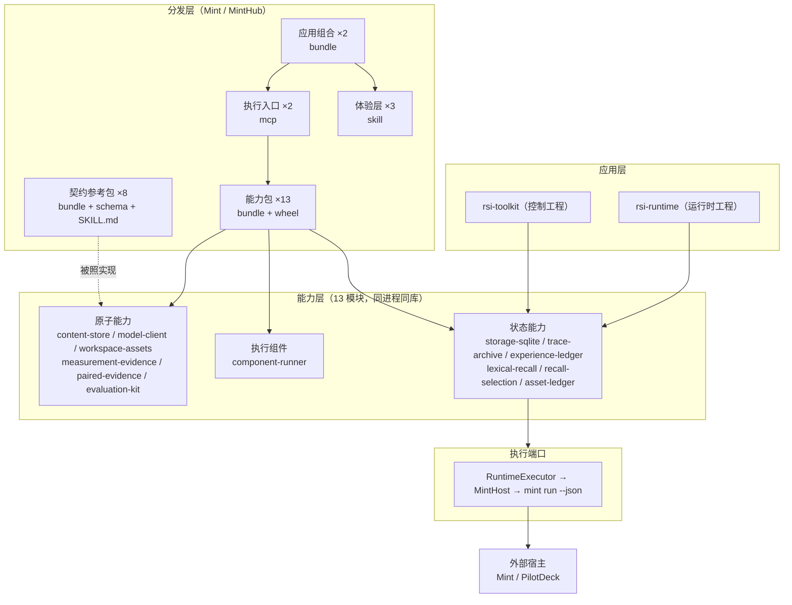

# rsi_toolkit：iface 拆分与 MintHub 发布方案

日期：2026-10-28（v3，精简版）· 状态：待评审 · 时区：Asia/Shanghai
基线：`apps/plugins/rsi-toolkit` v0.2.0（`44235f1`）、`packages/kernel-iface` v0.1.0
实测环境：`mint 0.1.11`、`mint-hub.ea.modelbest.co`（2026-10-28）

> **2026-11-02 更新**：`packages/kernel-iface` 已冻结为 0.1.0 历史快照，勿作对比基线；iface 契约现以
> `packages/agent-kernel/kernel/iface/src` 为权威源，可读副本为 `packages/agent-kernel/packages/iface-*`（0.1.2）。
> 对比前先同步 agent-kernel，见 AgentOS 根 `README.md`「iface 契约：位置与对比流程」。

本页只写**方案本身**。平台事实与实测命令见 [Mint 平台笔记](2026-10-28-mint-platform-notes.md)；
更正记录、与并行方案的对比、完整风险登记见 [取舍说明](2026-10-28-iface-plan-rationale.md)。

---

## 0. 五条决策

| # | 决策 | 理由（一句话） |
| --- | --- | --- |
| D1 | **拆契约，不拆进程** | 一次性审批 + 文件原子替换 + `current` 指针切换三者无法跨进程原子；模块同进程、同库即可独立发包 |
| D2 | 内部按**能力**拆 13 个模块，不按目录拆 | "可复用"必须先于"可发布"成立；`Store` 一体 ≈50 方法，得先拆 repositories + UoW |
| D3 | 对外只发**五类包**：契约参考 / 能力 / 执行入口 / 应用组合 / 体验 | 分别对应"照它实现""拿来实现""装起来跑""装起来用""注入提示词" |
| D4 | 调用协议定稿前，契约包用 **`<iface>.data`** 命名 | 数据形状已冻结 ≠ 可调用接口；`rsi.evaluator/v1` 只描述结果，不描述怎么调、什么错、能否取消 |
| D5 | 执行适配继续用 **`MintHost` + `mint run --json`** | 已发布制品里仍是 `bin/mint-core`，`which cpmrt` 为空；cpmrt 只有文档口径 |

---

## 1. 目标形态



**三条边界**：
1. **应用层不拥有公共实现**——`rsi-toolkit` / `rsi-runtime` 只做装配与发布入口。
2. **能力层禁止反向导入** `rsi/ control/ harness/ toolkit/ connectors/`；`rsi.redact → control` 这类倒置依赖必须先切干净。
3. **契约层零代码**——`provides.interfaces` 是给别人实现的，不是给自己用的。

---

## 2. 能力模块（13）

13 = 1 个事务基础库 + 12 个功能能力包。名称是设计 ID，不是已注册包名。

| # | 模块 | 当前来源 | 目标公开面 | 依赖 | 阶段 |
| --- | --- | --- | --- | --- | --- |
| 1 | `storage-sqlite` | `rsi/store.py` 连接/tx/migration、`harness/store/db.py` | ProjectUnitOfWork、事务、迁移协调；**SQL 连接不对外** | — | M3 |
| 2 | `content-store` | `harness/store/cas.py`、`harness/util.py` | put/get/put_json/get_json/verify；canonical JSON 兼容既有 digest | — | M1 |
| 3 | `workspace-assets` | `connectors/common/host.py` | 安全相对路径、原子文本 staging、symlink 拒绝 | — | M1 |
| 4 | `model-client` | `toolkit/model.py`、`toolkit/network.py` | 模型请求/响应、capabilities、usage；旧 str callable 作适配入口 | — | M1 |
| 5 | `measurement-evidence` | `control/evidence.py`、`control/redaction.py`、`rsi/redact.py` | 指纹、usage 归一、redact | — | M1 |
| 6 | `paired-evidence` | `rsi/promotion.py` | paired_bootstrap、worst_case_evidence（纯函数） | — | M1 |
| 7 | `evaluation-kit` | `rsi/evaluation.py`、`rsi/judge.py` | Case/TaskSuite/Evaluator、qualify；judge 走 port | 2,5 | M1 |
| 8 | `component-runner` | `rsi/components.py`、`rsi/worker.py` | register/discover/conformance/load/invoke/close；持久化走 port | 5 | M2 |
| 9 | `trace-archive` | `rsi/store.py:163-206` + trace 归一 | put/get/list trace、原始引用、scope | 1,2,5 | M3 |
| 10 | `experience-ledger` | `rsi/experience.py:116-262`、`rsi/store.py:209-338` | add/revise/transition/ingest、support、不可变 bank；**整条学习命令幂等** | 1,2,9 | M3 |
| 11 | `lexical-recall` | `experience.py` 索引/检索、`rsi/store.py:341-403` | 从显式 bank 建不可变 index、snapshot、query | 1,2,10 | M3 |
| 12 | `recall-selection` | `rsi/policy.py:17-110` | select/render、预算、**允许全拒绝与空注入**；模型走注入 port | — | M3 |
| 13 | `asset-ledger` | `rsi/store.py:452-572` + `policy.py` 通用资产 | version/read、expected-current、release intent/receipt、集合指针 | 1,2 | M3 |

**不塞进通用库的**：evaluator/suite/experiment/promotion 的存储留在 RSI repository 适配层；
component 表由 RSI 注入 `RegistryRepository`；schema loader 随契约制品走，不再依赖 `toolkit`。

---

## 3. 契约

### 3.1 数据契约（6，已冻结，今天可发）

`rsi.trace/v1`、`rsi.experience/v1`、`rsi.evaluator/v1`、`rsi.recall/v1`、`rsi.component/v1`、`rsi.host/v1`

它们只描述**数据形状**，因此以 `<iface>.data` 声明（D4）：

| 包 | `provides.interfaces` | 内容 |
| --- | --- | --- |
| `rsi-iface-host` | `["rsi-host.data"]` | `host.v1.json` + SKILL.md |
| `rsi-iface-trace` | `["rsi-trace.data"]` | `rsi.trace.v1.json` |
| `rsi-iface-experience` | `["rsi-experience.data"]` | `rsi.experience.v1.json` |
| `rsi-iface-evaluator` | `["rsi-evaluator.data"]` | `rsi.evaluator.v1.json` |
| `rsi-iface-recall` | `["rsi-recall.data"]` | `rsi.recall.v1.json` |
| `rsi-iface-component` | `["rsi-component.data"]` | `rsi.component.v1.json` |

调用协议定稿后，**追加**裸名（`["rsi-evaluator.data", "rsi-evaluator"]`），不覆盖旧值。

### 3.2 调用契约（7，待编写）

| 候选 | 最小调用面 |
| --- | --- |
| `blob/v1` | `put(bytes)->digest`、`get(digest)`、`verify`；跨进程二进制编码须显式定义 |
| `index/v1` | `build(immutable bank)`、`snapshot`、`query(snapshot, scope, budget)`；返回固定 revision/hash |
| `evaluation/v1` | `evaluate(case, output, trace_ref)`、`describe`、`qualification`；`unscored` 独立于 `score=0` |
| `evidence/v1` | 身份/来源/观测值/用途/完整性封装 |
| `asset/v1` | `version`、`read`、`prepare/commit receipt`、`active/rollback`；绑定 expected-current 与授权引用 |
| `workspace-staging/v1` | 目录创建、同目录原子 replace、路径围栏、symlink 拒绝、能力声明 |
| 领域调用契约 | trace ingest/read、experience revise/support、recall select、component invoke 的错误/幂等/取消语义 |

**权威归属**：kernel 机制契约以 `packages/agent-kernel/kernel/iface/src` 为上游（0.1.0 时代的
`packages/kernel-iface` 快照已废弃，勿再引用）；新增通用/领域契约先在 RSI 仓库
`contracts/` 审核冻结，AgentOS `packages/contracts/` 只投影已冻结版本。缺正式协议的组件只能标
`contract-proposed`，不能带兼容声明发布。

### 3.3 缺口（2，拆不出来）

`rsi-experiment`（run/status/cancel/review）与 `rsi-release`（approve/apply/rollback）目前只有
Python 方法与 MCP 工具帮助文本——那是实现，不是契约。补 schema 是发布前置，不是拆分结果。

```
rsi.experiment/v1  run/status/cancel/review；settings: steps, per_step, max_executions(≤40),
                   timeout(≤120s), max_steps(≤100), wall_time(≤2700s), model, min_gain
rsi.release/v1     approve/apply/rollback；不变量: approval_ref 一次性/有期限/绑定
                   target+run+candidate+hash；release.loaded 恒为 "unverified"
```

---

## 4. 分发形态（五类包）

| 类 | 数量 | kind | 载荷 | 消费者的动作 |
| --- | --- | --- | --- | --- |
| 契约参考包 | 8 | `bundle` | `schema.json` + `CONTRACT.md` + `skills/<pkg>/SKILL.md` | `mint pull` 后照它实现 |
| 能力包 | 13 | `bundle` | wheel + `setup.py` + skills | 作为依赖被装进项目 |
| 执行入口 | 2 | `mcp` | MCP 声明 + stdio bridge | 装完起服务，工具才可见 |
| 应用组合 | 2 | `bundle` | 依赖清单 + 装配说明 | `mint add` + 跑 setup |
| 体验层 | 3 | `skill` | `SKILL.md` | 直接注入提示词 |

**为什么不用 `plugin`**：`plugin` 必须声明 `subkind ∈ {wasm,native,js}`，rsi 是 Python sidecar，不属于任何一种。

**硬约束**：控制工程与运行时工程**永不合并**——合并等于把 `run/publish` 权限发给被评测的 Agent。

**依赖声明**：mint 只有 `[dependencies]`（包→包），没有 `requires.interfaces`（包→契约）。
所以"某实现实现了某契约"只能写进 README 与 `provides.interfaces`，**无法被解析器校验**。

---

## 5. Mint 平台硬约束

| # | 约束 | 应对 |
| --- | --- | --- |
| 1 | `kind = "iface"` 在 0.1.11 中被拒（`unknown variant`） | 用 `bundle` + `provides.interfaces`；线上 10 个 `agentcpm/iface-*` 也是这个形态 |
| 2 | 契约的官方消费方式是 `mint pull`，**不是 `mint add`** | 文档、README、发布脚本都按 `pull` 写 |
| 3 | `mint inspect --abilities` 在 0.1.11 **尚未发布** | 本期用 `mint info` 验收，不写成阻塞项 |
| 4 | `bundle` 在 0.1 **只装载 `skills/`** | 不依赖 bundle 携带 `.mcp.json`；MCP 走独立 `mcp` 包 + stdio bridge |
| 5 | `publish --dry-run` **不验证远端权限**；制品装前逐项校验 minisign | dry-run 不算验收；发布后用 `mint pull` 复核 |

其余平台细节（单元/OCI、loop 契约、令牌与错误码、三档、私服）见
[Mint 平台笔记](2026-10-28-mint-platform-notes.md)。

---

## 6. 发布顺序

```
第 1 批（叶子，可并行）
  8 个契约参考包            rsi-iface-{host,trace,experience,evaluator,recall,component}
                            + 待补的 experiment / release
  6 个原子能力包            content-store / workspace-assets / model-client
                            measurement-evidence / paired-evidence / evaluation-kit
  3 个 Skill               self-evolve / experience-recall / learned-assets
第 2 批
  component-runner         → 依赖 measurement-evidence
  rsi-control-mcp / rsi-runtime-mcp → 依赖能力包
第 3 批
  7 个状态能力包            storage-sqlite / trace-archive / experience-ledger
                            lexical-recall / recall-selection / asset-ledger
  rsi-toolkit / rsi-runtime → 依赖执行入口 + 能力包 + Skill
```

---

## 7. 阶段与验收门

| 阶段 | 工作 | 进入下一阶段的门 |
| --- | --- | --- |
| **M0 契约基线** | 固定 iface 上游版本；核对 trait/schema/docs 漂移；定义调用 DTO/error/cancel/idempotency；记录现有行为 | 每个对外组件有契约映射、fixture、Unknown 规则；无 transport 的标 `blocked-by-contract` |
| **M1 无状态原子** | 6 个原子能力包 + 8 个契约参考包 | 各包脱离 checkout 构建；原测试迁移；消费者不 import RSI；**第二消费者/替身验证替换边界** |
| **M2 执行组件** | `component-runner`、schema/loader 协议 | artifact/conformance/limits/kill/reap/sandbox 负例通过；保留现有 Mint 执行与隔离 |
| **M3 状态模块** | 7 个状态包；消除 direct SQL；`release-set` 驱动召回 | 迁移/备份恢复；并发重放与故障注入；hash/snapshot/scope；ingest 与发布提交边界 |
| **M4 应用组装** | `rsi-toolkit` / `rsi-runtime` 上线，改掉 `local/` path 依赖 | 干净工程走通"装 → setup → 跑 → MCP 调用"；卸载无残留 |
| **M5 cpmrt（后置）** | cpmrt 有正式 CLI/协议后再接 | 与 M4 同等执行/隔离验收；先验产物里的真实可执行名 |

**M1 的硬门**：任何声称"可替换"的包，必须有一个**同一调用方跑两个实现**的可执行测试。
只有一个实现、没有替换测试的，只能叫"拆开了"，不能叫"模块化了"。

---

## 8. 主要风险

| 风险 | 说明 | 应对 |
| --- | --- | --- |
| 伪模块化 | 13 个包互相 import，各只有一个实现 | M1 硬门；`Store` 是首要目标 |
| 过度声明接口 | 数据契约当调用接口发 | D4 的 `.data` 命名 |
| 跨存储原子性丢失 | 审批置位 + 文件替换 + 指针切换 | 保持单进程；`result_unknown` 兜底 |
| 装完不能用 | `mint add` 不装 Python 依赖、不起服务 | bundle 必带 `setup.py`；README 首行写"还要两步" |
| 小样本被误读 | 0.2.0 真实实验是 `NO_IMPROVEMENT` | 发布文案保留"同任务重复测量，不构成泛化收益" |

完整风险登记与更正记录见 [取舍说明](2026-10-28-iface-plan-rationale.md)。

---

## 9. 待拍板

| # | 问题 | 卡住什么 |
| --- | --- | --- |
| 1 | 用哪个 scope？owned namespace 还是借用 `agentcpm/` | 所有发布动作 |
| 2 | 契约包许可：保持 AGPL-3.0-only，还是给 schema 单独许可 | 第三方能否写闭源实现 |
| 3 | 能力包 wheel 走 bundle 内嵌还是独立分发 | M4 的包数量与升级路径 |
| 4 | `Store` 的内存实现只作测试替身，还是作为正式第二实现发布 | M1 的替换测试形态 |

---

## 索引

| 文档 | 内容 |
| --- | --- |
| [Mint 平台笔记](2026-10-28-mint-platform-notes.md) | 四层架构、包类型、单元/OCI、loop 契约、发布流程与错误码、CLI 与文档差异、实测命令 |
| [取舍说明](2026-10-28-iface-plan-rationale.md) | 更正记录（v1→v3）、与并行方案的对比与分工、完整风险与待确认 |
| [并行方案 B](../../superpowers/specs/2026-10-28-rsi-iface-modularization-design.md) | 同为 2026-10-28 的另一份设计；本文 §2 的 13 模块沿用其分解 |
| [模块机器清单](../../architecture/rsi-toolkit-modules.toml) | 13 模块的来源、依赖、阶段、契约关系的可解析版本 |
| [契约包生成器](mint-iface/README.md) | `gen_contract_packages.py` + `publish-rsi-iface.sh` |
| [现有交付与安装细节](../../../apps/plugins/rsi-toolkit/docs/design/mint-distribution-0.2.md) | setup、bridge、双 bundle 的实测记录 |
