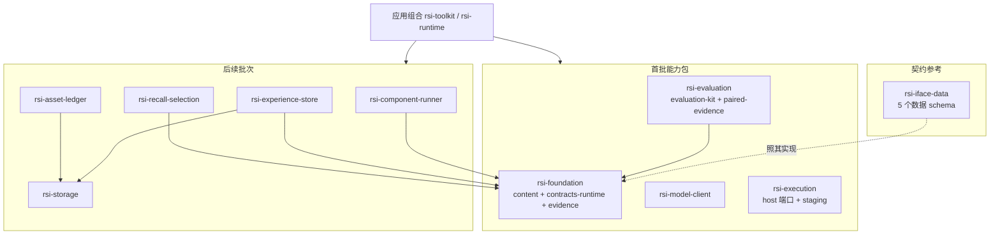

# 附录 A：首批包设计与分发

本附录属于 [IFace 两方案评审](../2026-10-28-iface-plans-review.md)。源码路径相对 `apps/plugins/rsi-toolkit/service/`。包名都是 `<scope>/` 下的设计 ID；scope 和许可证不在本次范围内。

## A.1 内部模块与发布包分开

- **内部模块**：保留方案 A 的 13 个模块，再补上两个：`contracts-runtime`（schema loader、共享 DTO 和错误类型）和 `execution-port`（Host 端口、结果归一、RuntimeExecutor DTO），共 15 个。它们是源码命名空间和依赖规则的边界。
- **发布包**：按“有没有第二个消费者”“是否共享事务”合并。合并后各内部模块的命名空间保持不变，以后要单独发布时不需要改 API。
- **不变的约束**：
  - 同进程、同库运行，不拆成独立服务。
  - 公共包禁止导入 `rsi/control/harness/toolkit/connectors`。
  - 旧导入路径通过 re-export 兼容，同一份代码不复制两份维护。



## A.2 内部模块到发布包的映射

| 内部模块 | 发布包 | 批次 |
| --- | --- | --- |
| （契约 schema：trace/experience/evaluator/recall/component） | `rsi-iface-data` | 首批 |
| content-store | `rsi-foundation` | 首批 |
| contracts-runtime（新增） | `rsi-foundation` | 首批 |
| measurement-evidence | `rsi-foundation` | 首批 |
| model-client | `rsi-model-client` | 首批 |
| evaluation-kit | `rsi-evaluation` | 首批 |
| paired-evidence | `rsi-evaluation` | 首批 |
| execution-port（新增） | `rsi-execution` | 首批 |
| workspace-assets | `rsi-execution` | 首批 |
| component-runner | `rsi-component-runner` | 第 2 批 |
| storage-sqlite（含 backup/restore 协调） | `rsi-storage` | 第 3 批 |
| trace-archive | `rsi-experience-store` | 第 3 批 |
| experience-ledger | `rsi-experience-store` | 第 3 批 |
| lexical-recall | `rsi-experience-store` | 第 3 批 |
| recall-selection | `rsi-recall-selection` | 第 3 批 |
| asset-ledger | `rsi-asset-ledger` | 第 3 批 |

合并理由：

- **paired-evidence 并入 evaluation**：只有 61 行，现有消费者只有 ExperimentService 和 PromotionService，而且 evaluation 本来就导入了它。
- **workspace-assets 并入 execution**：staging 只在执行前用到，和 `Host`、`normalize_result` 一起才构成完整的执行端口。
- **trace-archive、experience-ledger、lexical-recall 合并为 experience-store**：三者之间有外键（`trace_learning`、`bank_snapshot_item`、`index_build`）；一次 ingest 的工作单元（UoW）横跨其中两个；索引构建直接 join 账本表。拆开发布，只会让包与包之间互相引用对方的私有表。
- **storage-sqlite 单独成包**：experience-store 和 asset-ledger 都依赖它，不能埋进其中任何一个。
- **recall-selection 单独成包**：其他应用可能有自己的检索，只复用选择和渲染。它是状态侧最可能出现第二个消费者的模块。

## A.3 首批 5 个包

Python 导入命名空间用下划线形式（例如 `rsi_foundation`），与现有的 `rsi` 命名空间不冲突。

### `rsi-iface-data`：契约参考包，零代码

- **形态**：`kind = "bundle"`，与 `agentcpm/iface-*` 同形。载荷是 5 个 schema、`CONTRACT.md` 和 `skills/rsi-iface-data/SKILL.md`，不带 `lib/`。
- **声明**：
  - `provides.interfaces = ["rsi-trace.data", "rsi-experience.data", "rsi-evaluator.data", "rsi-recall.data", "rsi-component.data"]`
  - `provides.skills = ["rsi-iface-data"]`
- **消费方式**：用 `mint pull`。
- **不包含 `rsi.host/v1`**：它作为旧边界留在仓库 `contracts/` 里，README 标为 deprecated，将由 `runtime-executor/v1`（[附录 B](B-capability-contracts.md) C7）取代。`rsi.experiment/v1` 和 `rsi.release/v1` 在 schema 写好之前不生成。
- **版本**：包用 SemVer，各 schema 的 `schema_version` 独立演进。某个 schema 需要单独做 major 升级时，再把它拆成独立的包。
- **前置**：先修好生成器：
  - 接口名改用 `.data` 后缀；
  - 包 README 改为教 `pull`；
  - 写入 source-ref（完整 SHA、subdir、digest）；
  - 去掉 `--scope agentcpm` 示例；
  - 多包输出改为单包输出。

### `rsi-foundation`：共享基础

- **内容**：
  - `rsi_foundation.content`：CAS 的 put/get/put_json/get_json/verify，以及 canonical JSON，digest 必须与现有数据兼容。
  - `rsi_foundation.contracts`：schema loader、共享 DTO 和错误类型，例如 `RecallPolicy`。schema 作为包数据内置，并校验 digest 与 `rsi-iface-data` 一致。
  - `rsi_foundation.evidence`：redact、usage 归一，以及基于显式 ID 的稳定指纹工具。
- **来源**：
  - `harness/store/cas.py`；
  - `harness/util.py` 只迁 canonical，`workspace_root/new_id/now` 留在原处；
  - `rsi/store.py` 里的私有 CAS 子类；
  - `toolkit/contracts.py`；
  - `control/redaction.py`、`rsi/redact.py`；
  - `control/evidence.py` 的通用部分。其中写死了 `benchmarks.*` 模块名的 `verifier_description` 留在 RSI。
- **不依赖 jsonschema**：现有 loader 依赖 jsonschema（`toolkit/contracts.py:14`），它会经由 referencing 带进需要按平台编译的 rpds-py。5 个 schema 只用到 JSON Schema 的一个小子集：
  - 关键字：`type/required/additionalProperties/const/enum/pattern/minimum/maximum/minLength/maxLength/minItems/maxItems/uniqueItems/items/allOf/if/then/oneOf`，加本地 `$ref/$defs`；
  - format：只有 `date-time`。

  因此改为用标准库实现一个子集校验器，在开发环境用 `contracts/examples` 和 `contracts/invalid` 两组 fixture，与 jsonschema 做差分测试。遇到不支持的关键字直接报错，不静默放行。
- **IFace 关系**：`proposes blob/v1`、`proposes evidence/v1`，不实现任何现有 kernel IFace。
- **依赖**：无，只用标准库。

### `rsi-model-client`

- **内容**：模型请求/响应、capabilities、非敏感身份、usage，以及兼容旧 `str` prompt callable 的适配入口。
- **来源**：`toolkit/model.py`、`toolkit/network.py`。`toolkit/proxy.py` 和 `scripts/launch-model-proxy.py` 不迁移，它们属于 Mint 隔离工具。
- **IFace 关系**：`consumes iface-model`（call/capabilities）。在拿到 transport 之前，不声明 `implements`。
- **为什么单独发**：模型是最常被替换的后端，PilotDeck、StaffDeck 可以提供自己的实现。本包是 recall-selection 和 judge 所注入 port 的默认实现。
- **依赖**：无，只用标准库（`toolkit/model.py` 只导入了 `toolkit/network.py`）。

### `rsi-evaluation`

- **内容**：Case、TaskSuite、Evaluator、qualify、`qualification_matches`、paired bootstrap、worst-case evidence。judge 通过注入的模型 port 调用。
- **来源**：
  - `rsi/evaluation.py:18-391`。其中 `ExperimentService` 不迁移，留在 RSI 应用层；
  - `rsi/judge.py`；
  - `rsi/promotion.py:11-71`。
- **IFace 关系**：`provides.interfaces = ["rsi-evaluator.data"]`，同时 `proposes evaluation/v1`。
- **依赖**：`rsi-foundation`。`rsi-model-client` 只是可选的默认 judge 实现，不是硬依赖。YAML 套件是延迟导入 pyyaml 的（`rsi/evaluation.py:94-96`），这条路径改为可选功能。
- **前置**：必须先完成 M0-pre 的指纹改造，否则迁移后已有的 qualification 会全部失效。

### `rsi-execution`：执行端口

- **内容**：
  - RuntimeExecutor 的请求/结果 DTO：`execution_id`、目标引用、独立 workspace、冻结资产引用、预算、取消；
  - `Host` Protocol 和 `normalize_result`，作为 `execution_id` 的统一校验点；
  - `result_unknown` 语义；
  - 安全相对路径与文本 staging。
- **来源**：`connectors/common/host.py`。
- **staging 规则**：首批把两套现有规则原样迁入，分别命名为两种策略：
  - common：现有的 `stage_assets`；
  - strict：`MintHost._stage` 的规则，拒绝 `.mint` 和 `.git`，使用 `O_NOFOLLOW`，文件权限 0600。

  把两套合并成一套属于显式的行为变更，需要单独验收。
- **不包含**：`MintHost`、`SeatbeltMintHost`、`PilotDeckHost` 留在 RSI 的 integration 里，到 M4 再改为实现本端口。
- **IFace 关系**：`proposes runtime-executor/v1` 和 `workspace-staging/v1`。只有当 `iface-env` 的 FsBackend 具备 staging 所需的能力时才 `consumes` 它；目前缺 mkdir、原子 replace 和路径围栏，所以不声明。
- **依赖**：无，只用标准库。

## A.4 IFace 声明约定

**主声明使用 `provides.interfaces`。** 同一个字段同时承担“我就是这个契约”和“我实现了这个契约”两种含义，两者按包的形态区分：

- **契约包**：零代码，不带 `lib/`。`provides.interfaces` 写的是它自己定义的契约，与线上 `agentcpm/iface-*` 一致。
- **实现包**：带 `lib/`。`provides.interfaces` 写它实现的契约，只能写已冻结、并有 conformance 证据的契约。

该字段在 Mint 中只是声明：CLI 原样透传、不做校验，也没有 `requires.interfaces`。能不能信，要靠我们自己的 conformance 测试。

`provides.interfaces` 表达不了另外两种关系：“消费了某个契约”和“提议了某个尚未冻结的契约”。这两种写进包根目录的补充文件 `iface.toml`：

```toml
schema = "rsi.iface-manifest/v0"

[[implements]]                 # 与 provides.interfaces 一一对应，额外记录证据位置
contract = "rsi-evaluator.data"
version = "1"
evidence = "conformance/capabilities/rsi-evaluation/"

[[consumes]]
contract = "agentcpm/iface-model"
version = "0.1.0"
via = "python-port"

[[proposes]]
contract = "evaluation/v1"
status = "contract-proposed"
draft = "contracts/proposed/evaluation.v1.json"
```

规则：

- 包的 `mint.toml` 中，`provides.interfaces` 由 `iface.toml` 的 `[[implements]]` 生成，两者不一致时构建失败。
- 现有的 kernel IFace 只能出现在 `consumes` 中，直到拿到可调用的 transport 为止。
- `proposes` 中的契约冻结后，从 `proposes` 移到 `implements`，同时写入 `provides.interfaces`。

## A.5 不用 pip 的分发方式

### 首批 5 个包：零 pip，零第三方依赖

首批 5 个包都是纯 Python，并且只用标准库（见 A.3）。因此 bundle 里**直接放源码目录，不放 wheel，也不带 `setup.py`**：

```text
.mint/packages/<scope>/
  rsi-iface-data@0.1.0/   mint.toml  CONTRACT.md  schemas/  skills/rsi-iface-data/SKILL.md
  rsi-foundation@0.1.0/   mint.toml  iface.toml  skills/rsi-foundation/SKILL.md  lib/rsi_foundation/...
  rsi-evaluation@0.1.0/   mint.toml  iface.toml  skills/rsi-evaluation/SKILL.md  lib/rsi_evaluation/...
  rsi-toolkit@0.3.0/      mint.toml  closure.json  bin/rsi-launch.py  lib/rsi_app/...
```

几点说明：

- 包之间的依赖写在 mint 的 `[dependencies]` 里，由 `mint.lock` 唯一决定版本。
- 每个能力包的 `SKILL.md` 是 bundle 校验的必需项，内容写给 Agent 看：用法和边界，不放占位文本。
- 应用包在构建时生成 `closure.json`，记录依赖闭包中每个包的名称、版本和 digest。
- 启动器以 `python3 -I` 运行，按闭包拼出 `sys.path`，不依赖 PYTHONPATH，也不需要 venv：

```python
# rsi-toolkit@0.3.0/bin/rsi-launch.py
import json, sys
from pathlib import Path
here = Path(__file__).resolve().parents[1]
packages = here.parent
for dep in json.loads((here / "closure.json").read_text()):
    root = packages / f"{dep['name']}@{dep['version']}"
    if not root.is_dir():
        sys.exit(f"missing dependency {dep['name']}@{dep['version']}; run mint install")
    sys.path.insert(0, str(root / "lib"))
sys.path.insert(0, str(here / "lib"))
from rsi_app.cli import main
raise SystemExit(main())
```

现有的 schema loader 通过 `__file__` 定位文件（`toolkit/contracts.py:16`、`:34-35`），以源码目录形式分发时照常可用。以后如果改成 zipapp，需要换成 `importlib.resources`。

**好处**：

- 安装时不访问 PyPI，可以离线安装，不存在依赖混淆风险；
- 全部代码都在 Mint 制品里，受 minisign 签名覆盖；
- 不会出现 pip 和 mint 各解析出一套版本的情况。

**代价**：

- 用户机器上仍然需要 Python >= 3.13；
- 没有 console script，入口统一走启动器；
- 代码里不能用 `importlib.metadata.version()` 读版本，要改成读包内常量。

### 应用层：编译型依赖

应用层依赖 mcp（经 pydantic 带进编译型的 pydantic-core）、uvicorn、websockets、pyyaml、openpyxl，本机 venv 中确实存在 `pydantic_core/` 和 `_yaml/`。有三条路线，用户端都不需要跑 pip：

1. **CI 构建按平台区分的依赖目录**：pip 或 uv 只在构建机上运行，产出的 `lib/` 打进制品。需要先确认 bundle 能否像 `graph-loop` 那样按平台分发制品；如果不能，应用改用 `plugin/native` 形态。
2. **冻结成独立可执行文件**：把解释器和依赖一起打包，作为 `plugin/native`，由启动器拉起，做法同 `knowledge-local`。这条路线不需要用户机器上有 Python，代价是每个平台单独构建、体积更大。
3. **削减依赖**：stdio MCP 本质上是按行分隔的 JSON-RPC，用标准库就能实现，这样可以去掉 mcp 和 pydantic。uvicorn 只有 HTTP 模式才需要，openpyxl 只给 benchmark 用，两者都可以移到可选组件。代价是要自己维护 MCP 协议的兼容性。

**建议**：应用层先走路线 1；到 M5 时再评估路线 3，看能否让 runtime 应用也只依赖标准库。

### M1 分发探针要验证的事项

- `mint add` 是否递归展开 `[dependencies]`，各兄弟包的目录布局是否稳定；
- 启动器能否在干净工程里按 `closure.json` 找到全部依赖；
- 卸载应用包和依赖包后是否没有残留；
- bundle 能否按平台分发制品（决定应用层走路线 1 还是改用 `plugin/native`）。

如果 `mint add` 不展开依赖，退回备选方案：能力包的 `lib/` 只随应用 bundle 内嵌，能力包本身只承担来源和契约声明。
