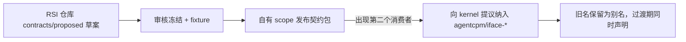

# 附录 B：通用能力契约草案与上游沟通清单

本附录属于 [IFace 两方案评审](../2026-10-28-iface-plans-review.md)。做法是**先实现，同时把需要的通用能力契约留档**，供与 Mint 和 kernel 开发者沟通。

> **2026-11-02 更新**：`packages/kernel-iface` 已冻结为 0.1.0 历史快照，勿作对比基线；iface 契约现以
> `packages/agent-kernel/kernel/iface/src` 为权威源，可读副本为 `packages/agent-kernel/packages/iface-*`（0.1.2）。
> 对比前先同步 agent-kernel，见 AgentOS 根 `README.md`。

> **复核（2026-10-29）**：本文写于 2026-10-28，依据线上 `agentcpm/iface-*@0.1.0` 快照。此后 kernel master
> 的 iface 契约面从 10 个 trait 扩到 22 个，且 hub 制品未重发。**“上游现在有什么”一律以
> [附录 F](F-upstream-delta-2026-10-29.md) 为准**；C1–C7 的需求定义仍然有效。
> 逐条判定见 F.2 / F.4，修订后的沟通清单见 F.6。
> **对外版本**：[B 修订版](B-revised-2026-10-29.md)（2026-10-29，已同步到飞书
> <https://modelbest.feishu.cn/docx/GNDkdtF2goAAopx8Nxtc2ylGnKb>）——C1–C7 的现行口径以它为准，本文件保留为初稿与修订痕迹。

## B.1 契约分层与治理

| 类别 | 例子 | 治理归属 |
| --- | --- | --- |
| Kernel 机制契约 | session、loop、tool、model、store、policy、context、extension、env | 由 kernel 维护，线上发布为 `agentcpm/iface-*@0.1.0` 的 bundle 制品。这些制品原定为本项目的权威来源（**已失效，见下方 2026-10-29 修正**）；本地 `packages/kernel-iface` 快照只作参考 |
| 通用能力契约 | 下文 C1–C7 | 先在 RSI 仓库起草并发布，出现第二个消费者后再向 kernel 提议晋升 |
| RSI 领域数据契约 | `rsi-trace.data`、`rsi-experience.data`、`rsi-evaluator.data`、`rsi-recall.data`、`rsi-component.data` | 始终放在自有命名空间，遵守与 IFace 相同的规则 |

> **2026-10-29 修正**：hub 上的 `iface-*` 自 2026-10-27T15:37+0800 未再更新，已落后 kernel master 至少
> 两个批次（D93 模型流式、D96 模型会话）；本地 `packages/kernel-iface/` 已于同日按 master 同步
> （22 个 trait，`kind` 改为 `bundle`）。
> 权威来源应改为 **kernel repo 的 release tag + commit**，hub 制品由该 tag 重新生成并记录 digest。
> 详见[附录 F](F-upstream-delta-2026-10-29.md) F.7 第 1、2 条。

“治理”具体包括以下几项：

- 只有一份权威源码；
- 包按 SemVer 发版，`schema_version` 独立演进；
- 明确哪些变更算破坏性变更；
- 变更要经过评审；
- 提供 conformance fixture；
- 有弃用流程。



落地方式：

- 每个契约在 RSI 仓库的 `contracts/proposed/<name>.v1.json` 放一份草案，另附 `CONTRACT.md`。
- 代码里用同形的 Python Protocol 实现，并在 `iface.toml` 中记为 `proposes`（见[附录 A](A-first-batch-packages.md) A.4）。
- 被上游采纳后，只需改名或加别名。

下面的伪签名沿用 kernel-iface 的写法：返回 `BoxFuture<Result<_, Error>>`，错误类型为 `Error { category, code, message }`。状态和结论复用 `iface-types` 已有的 `RequestState` 和 `Verdict`（两者都含 `Unknown`），不另造名字。

## B.2 七个通用能力契约

### C1 `blob/v1`：内容寻址存储

- **作用**：按 digest 存取不可变内容，比如原始轨迹、候选 Skill、索引文件、证据附件。同样的内容只存一份，可以随时校验是否损坏。
- **RSI 之外的消费者**：任何需要保存制品或附件的应用，比如会话附件、文档快照。
- **设计要点**：
  - 同样的内容得到同样的 digest，所以 `put` 天然幂等。
  - 契约里不定义删除。垃圾回收是单独的维护操作。
  - 跨进程传输时，二进制的编码方式必须写清楚。
  - **canonical JSON 必须把算法写死。** 现有实现是 Python 的 `json.dumps(sort_keys=True, separators=(",",":"), ensure_ascii=False)`（`harness/util.py:15-16`），不是 RFC 8785。为了兼容已有的 digest，契约要逐条写明：浮点数怎么格式化，禁止 NaN 和 Infinity（Python 默认允许），Unicode 不转义。
  - **digest 命名空间要和 mint 分开**（2026-10-29 补）：本契约只使用 `sha256:`，不占 mint 打包层已有的 `h1:`（dirhash）；并写明本 digest 不参与 mint 的包完整性校验。
- **与现有 IFace 的关系**：`iface-store` 是会话事件日志，不能拿来存内容。
- **当前实现**：`rsi-foundation` 的 `rsi_foundation.content`。

```rust
trait BlobContract {
    fn put(&self, bytes: Vec<u8>, media_type: Option<String>) -> BoxFuture<Result<Digest, Error>>;
    fn get(&self, digest: &Digest) -> BoxFuture<Result<Vec<u8>, Error>>;   // 不存在时返回 NotFound
    fn has(&self, digest: &Digest) -> BoxFuture<Result<bool, Error>>;
    fn verify(&self, digest: &Digest) -> BoxFuture<Result<bool, Error>>;
}
```

### C2 `index/v1`：不可变检索索引

- **作用**：从一个固定版本的条目集合（bank）构建不可变索引，再按作用域和预算查询。同一个快照、同一个查询，结果必须一致，这样召回才可以复现。
- **RSI 之外的消费者**：记忆召回、知识库。**2026-10-29 复核**：可替换的记忆后端已经落地——`mint-api` 的 `MemoryProvider`（store/recall/consolidate）与 WIT `memory.wit`，cpmrt 内置 `file-jsonl`，挂在 `before_model` / `turn_end` / `session_end`。接口与本契约高度重合，但它没有不可变快照与 `bank_hash`，且 `consolidate` 会在后台改库，不能直接用于可复现评测。详见[附录 F](F-upstream-delta-2026-10-29.md) F.4-C2；沟通策略应从“请给我一个新契约”改为“`MemoryProvider` 能否加快照维度”。
- **设计要点**：
  - 构建是原子的，失败的构建对外不可见。
  - 返回结果带 `bank_hash` 和 `index_hash`。
  - 作用域（project、target、task_family）严格过滤，结果不能跨作用域泄漏。
  - 每条命中都带条目的 revision hash。
  - 本契约不管“选哪些条目、怎么渲染进提示词”，那属于 RSI 领域逻辑（recall-selection）。
- **当前实现**：第 3 批的 `rsi-experience-store` 中的 lexical-recall。

```rust
trait IndexContract {
    fn build(&self, bank: BankRef /* id + revision_hash */, spec: IndexSpec /* lexical|vector + params */) -> BoxFuture<Result<IndexBuild, Error>>;
    fn snapshot(&self, build: &IndexBuildId) -> BoxFuture<Result<SnapshotRef, Error>>;
    fn query(&self, snap: &SnapshotRef, q: Query /* terms, scope, filters, budget{k,max_chars} */) -> BoxFuture<Result<QueryResult /* hits + snapshot hash */, Error>>;
}
```

### C3 `evaluation/v1`：评测器

- **作用**：对“用例 + 输出 + 轨迹”打分，同时给出评测器的身份和资格。baseline 和 candidate 的比较完全建立在它之上。
- **RSI 之外的消费者**：benchmark、回归测试、A/B 实验、质检。
- **设计要点**：
  - **`unscored` 和 `score = 0` 严格区分。** 超时、缺数据、judge 失败都记为 `unscored` 并写明原因，不能伪造分数。
  - **指纹由显式的稳定 ID 构成**：评测器 ID、版本、实现 digest、配置。不能依赖语言层面的模块路径。
  - 请求带 `data_use`（evaluation、calibration、audit），标为 forbidden 的数据直接拒绝。
  - 用模型做 judge 时，通过注入的 `iface-model` 端口调用，并且支持取消。
- **当前实现**：`rsi-evaluation`。
- **2026-10-29 复核**：上游没有任何评测/打分契约（`kernel/iface` 零命中）。两点可借：`unscored` 的纪律与上游 `StepOutcome::Unknown` / `SessionState::Unknown` 同源，可引作先例；fingerprint 建议带 `capabilities` 标签，与 `ContractDescriptor` 同构，而不是自由拼接的字符串。见[附录 F](F-upstream-delta-2026-10-29.md) F.4-C3。

```rust
trait EvaluationContract {
    fn describe(&self) -> EvaluatorDescriptor;   // id, version, fingerprint, output_schema, uses_model
    fn evaluate(&self, req: EvalRequest /* case, output, trace_ref?, data_use */) -> BoxFuture<Result<EvalResult /* scored|unscored + reason */, Error>>;
    fn qualify(&self, calib: CalibrationSet) -> BoxFuture<Result<Qualification, Error>>;
}
```

### C4 `evidence/v1`：测量证据封装

- **作用**：统一回答“这个数字是谁、在什么条件下、用什么测出来的”。内容包括观测方指纹、模型和端点（只含非敏感部分）、观测值、用途、原始引用和完整性哈希。审计、复现和发布审批都依赖它。
- **RSI 之外的消费者**：用量与计费统计、合规审计、任何对外报告实验结果的应用。
- **设计要点**：
  - 以数据契约为主，操作只有 `seal`、`verify`、`redact` 三个。
  - usage 统一归一为 `{input_tokens, output_tokens, cached_tokens, cost?}`。**2026-10-29 复核**：上游 `ModelUsage` 是 `{input_tokens, output_tokens, total_tokens}`，三个都是 Option，没有 `cached_tokens` / `cost`。建议改成与上游同构，`cached_tokens` / `cost` 标为 opt-in 扩展，`cost` 不进 v1 核心（价格表是外部事实）。见[附录 F](F-upstream-delta-2026-10-29.md) F.4-C4。
  - 供应商没有披露的模型变化，明确标记为“无法检测”。上游 `ModelResponse.model` 已有同一条规则（`None` = 不暴露，不得伪造），我们的字段应对齐为 `observed_model`。
  - 脱敏操作要同时返回脱敏报告。
- **当前实现**：`rsi-foundation` 的 `rsi_foundation.evidence`。

```rust
trait EvidenceContract {
    fn seal(&self, ev: Evidence) -> BoxFuture<Result<Digest, Error>>;
    fn verify(&self, ev: &Evidence) -> BoxFuture<Result<bool, Error>>;
    fn redact(&self, payload: Value, policy: RedactPolicy) -> BoxFuture<Result<(Value, RedactionReport), Error>>;
}
```

### C5 `asset/v1`：版本化资产账本

- **作用**：管理 Skill、Policy、Index、Bank 等资产的不可变版本，以及“当前激活的集合”。一组资产可以一次性激活、整体回滚，所有变更都绑定“期望的当前版本”和授权引用。它解决的是评审中指出的“`release_set` 不驱动召回”问题。
- **RSI 之外的消费者**：任何需要管理提示词、技能或配置的版本并发布的应用。
- **设计要点**：
  - 发布分两步：先 `prepare` 提交发布意图，再 `commit` 原子切换指针。
  - expected-current 的比较和写入在同一个事务里完成，不能先查后写。
  - `authorization_ref` 只能使用一次，有 TTL，并绑定 target、版本和哈希。
  - 本契约不负责授予权限，授权来自 `iface-policy`。
  - “宿主已加载”的回执和“账本已切换”的记录分开保存。
- **与现有 IFace 的关系（2026-10-29 补，见 [F](F-upstream-delta-2026-10-29.md) F.4-C5）**：上游 `ExtensionContract` 的 `AssemblyIntent → AssemblyHandle → AssemblyState{Pending,Ready,Failed,RolledBack}` 是“一次装配”的两阶段先例，可直接拿来类比；`mint.lock` 是包管理器账本（记录装了什么），不记“哪套在生效”，替代不了本契约。注意 `policy.request_approval` 的 `ApprovalRequest.timeout_ms` 只是等待时长，**不是**一次性消费/TTL——沟通时把这两个概念分开问，否则会被答“我们已经有 timeout 了”。
- **当前实现**：第 3 批的 `rsi-asset-ledger`。

```rust
trait AssetContract {
    fn put_version(&self, asset: AssetId, kind: String, content: Digest, schema_ref: String) -> BoxFuture<Result<VersionId, Error>>;
    fn read(&self, asset: &AssetId, at: VersionSel /* version | active */) -> BoxFuture<Result<AssetVersion, Error>>;
    fn prepare_release(&self, intent: ReleaseIntent /* set, expected_current, authorization_ref */) -> BoxFuture<Result<IntentId, Error>>;
    fn commit(&self, intent: &IntentId) -> BoxFuture<Result<ReleaseReceipt, Error>>;
    fn rollback(&self, to: SetId, expected_current: SetId, authorization_ref: String) -> BoxFuture<Result<ReleaseReceipt, Error>>;
    fn active(&self) -> BoxFuture<Result<SetSnapshot, Error>>;
}
```

### C6 `workspace-staging/v1`：工作区暂存

- **作用**：执行前把冻结的资产安全地写进一个全新的工作区，需要支持：
  - 创建目录；
  - 同目录内原子替换；
  - 路径围栏：禁止 `..`、绝对路径和 symlink 逃逸；
  - 按名称拒绝，比如 `.git`、`.mint`；
  - 声明自身具备哪些能力。
- **RSI 之外的消费者**：任何需要把文件送进沙箱或远端环境执行的应用。
- **设计要点**：
  - 先查询能力，能力不足时直接拒绝，不能用多次 `write_file` 模拟原子替换。
  - 暂存完成后返回回执，列出每个条目的 digest，事后可以校验。
- **与现有 IFace 的关系**：**最适合作为 `iface-env` 的增补，而不是新建一个契约。** 现有的 `FsBackend` 只有 `read_file`、`write_file`、`list_dir`、`stat`。
- **2026-10-29 复核（三点，详见 [F](F-upstream-delta-2026-10-29.md) F.4-C6）**：
  - `FsBackend` 仍是 4 个方法，`EnvironmentCapabilities` 仍是 `fs`/`exec`/`signals`/`streams` 四个粗开关。
  - `PathUri` 已在契约层做词法围栏（拒 `..`、控制字符、反斜杠），实现层 `LocalFsBackend` 也用 `canonicalize` 做了 root 围栏。所以“路径围栏”应表述为“**词法已有，缺 fs 层的 symlink nofollow 与原子替换契约化**”，否则会被答“已经有 PathUri 了”。
  - `ToolStaging`（3 个同步方法）证明上游接受窄能力契约。建议把 `StagingCaps` 换成 `ContractDescriptor.capabilities` 的能力标签（如 `env.fs.mkdir`、`env.fs.atomic-replace`、`env.fs.nofollow`），直接复用上游的能力协商与 fail-closed 拒绝。
- **当前实现**：`rsi-execution`，提供 common 和 strict 两种策略。

```rust
trait WorkspaceStaging {
    fn capabilities(&self) -> StagingCaps;   // atomic_replace, nofollow, mkdir, max_file_size
    fn create(&self, spec: WorkspaceSpec /* fresh = true */) -> BoxFuture<Result<WorkspaceRef, Error>>;
    fn stage(&self, ws: &WorkspaceRef, entries: Vec<Entry>, policy: StagePolicy) -> BoxFuture<Result<StageReceipt, Error>>;
    fn dispose(&self, ws: WorkspaceRef) -> BoxFuture<Result<(), Error>>;
}
```

### C7 `runtime-executor/v1`：隔离执行一次完整任务

- **作用**：给定目标 Agent、工作区、冻结资产、模型和预算，完整跑一次任务，拿回结果和原始事件。RSI 的每一次 baseline 和 candidate 执行都走这里。当前实现是 MintHost 调用 `mint run --json`；以后换成 cpmrt，也只是替换这个契约的实现。
- **RSI 之外的消费者**：评测平台、批量任务执行、Agent 回归测试。
- **设计要点**：
  - `execution_id` 由调用方生成，作为幂等键。重复提交返回的是同一次执行；结果中的 id 必须与请求一致。
  - **不做隐式重放。** 提交后失联、又无法确认是否已经终止的执行，返回 `Unknown`。
  - `Completed` 只表示宿主执行结束，不等于业务上成功。
  - 取消必须有明确应答：已取消、本来就已结束、或者未知。
  - 原始事件存进 blob，结果里只放 digest 和事件数。
- **与现有 IFace 的关系**：它和 session、loop 不在同一层。它相当于“驱动整个运行时跑一次”的批处理入口。
- **2026-10-29 复核（见 [F](F-upstream-delta-2026-10-29.md) F.5）**：
  - cpmrt 0.1.14 与 kernel master **都没有 `execution_id`**（全仓 grep 零命中），也没有 `submit`/`status`/`result` 三段式。
  - 三条可用执行面各自的缺口：`cpmrt run --json` 无调用方 id、无取消应答；ACP 的 `session/cancel` 只有成功/会话不存在两态；kernel L-C 有 `RequestState`（含 `Unknown`）、`operation.get` 作业视图和必填 `idempotency_key`，但 `operation.cancel` 目前只支持 `kind="tool"`。
  - **结论：缺的是入口，不是语义。** 近期实现自带执行账本（自己持久化 `execution_id` → 进程/session），中期只提三条诉求：`execution_id` 透传、取消三态应答、`EventRecord.v` 进 ABI 文档。
- **当前实现**：`rsi-execution` 提供 DTO 和端口；到 M4，由 MintHost 实现它。

```rust
trait RuntimeExecutor {
    fn submit(&self, req: ExecRequest /* execution_id, target, workspace, assets, model, budget, approval_mode */) -> BoxFuture<Result<RequestState, Error>>;
    fn status(&self, id: &ExecutionId) -> BoxFuture<Result<RequestState, Error>>;
    fn cancel(&self, id: &ExecutionId) -> BoxFuture<Result<CancelAck, Error>>;
    fn result(&self, id: &ExecutionId) -> BoxFuture<Result<ExecResult /* same id, Verdict, events digest, usage, isolation */, Error>>;
}
```

## B.3 不做成契约的部分

- **storage-sqlite 的工作单元（UoW）**：是同进程内的机制，不跨包暴露 SQL 连接。
- **schema loader**：只是工具函数。
- **model-client**：直接消费 `iface-model`，不另立契约。
- **recall-selection、经验账本**：属于 RSI 领域的调用契约，留在 RSI 的命名空间里。

## B.4 与开发者沟通的清单

> **2026-10-29**：下面 1–7 条已被[附录 F](F-upstream-delta-2026-10-29.md) F.6 改写（问题更具体、依据换成 kernel master 的事实）。本节保留原始问题作为背景，实际沟通请用 F.6。

按影响从大到小排序：

1. **C7 runtime-executor**（决定 M4 和 M6 的路径）：
   - `mint run --json` 的 NDJSON 事件 schema 会不会作为稳定接口（L-E）？
   - cpmrt 会不会提供 headless 执行协议，支持 `execution_id` 透传，并定义取消和超时语义？
2. **C6 workspace-staging**：`iface-env` 愿不愿意增补 mkdir、原子 replace、路径围栏和能力声明？远端环境的原子性由谁保证？
3. **C5 asset**：`iface-policy` 的 `request_approval` 能否支持一次性消费和 TTL？如果不能，是在 policy 侧补齐，还是由 asset 契约自带 receipt？
4. **C2 index**：Mint 规划中的可替换记忆后端接口，能否与本契约合并？向量索引和词法索引是用同一个契约，还是按 `kind` 分型？
5. **C3 evaluation**：分数只支持标量，还是支持多维？kernel 有没有内置评测的计划？
6. **C4 evidence**：`iface-model` 的响应和 `iface-context.trace_input` 里有没有 usage 字段？字段名应与上游对齐。脱敏规则由谁制定？
7. **C1 blob**：kernel 或 cpmrt 有没有制品存储的规划？digest 算法是否统一？大对象要不要支持流式读写？

和契约一起确认的 Mint 平台问题：

- 实现包也写 `provides.interfaces`，是否符合 Mint 对这个字段的预期？这一条不阻塞：它只是声明，Mint 不做校验。
- `mint add` 会不会递归展开 `[dependencies]`？兄弟包的目录布局是否稳定？
- bundle 能否按平台分发制品？这决定应用层的编译型依赖怎么交付，见[附录 A](A-first-batch-packages.md) A.5。
