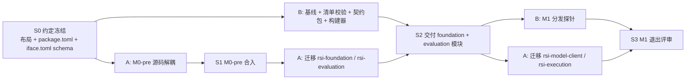

# 附录 E：执行分工与协作约定

> **2026-11-02 更新**：`packages/kernel-iface` 已冻结为 0.1.0 历史快照，勿作对比基线；iface 契约现以
> `packages/agent-kernel/kernel/iface/src` 为权威源，可读副本为 `packages/agent-kernel/packages/iface-*`（0.1.2）。
> 对比前先同步 agent-kernel，见 AgentOS 根 `README.md`。

本附录属于 [IFace 两方案评审](../2026-10-28-iface-plans-review.md)。执行由两个 worker 并行推进：

- **Worker A**（方案 A 作者）：负责源码与契约，执行方案见 [E1](E1-worker-a.md)。
- **Worker B**（方案 B 作者）：负责分发与平台，执行方案见 [E2](E2-worker-b.md)。

本文件是双方共同遵守的约定。约定有变化时，先改本文件，再改各自的执行方案。

## E.1 范围

本轮覆盖 M0-pre、M0、M1（见[附录 C](C-phases-and-gates.md)）。M2 及以后只列方向，不排具体任务。

本轮**不做**：

- 发布到 MintHub。scope 与许可证不在范围内，一律使用 `local/` scope。
- 接入 cpmrt。
- 改动 kernel-iface。
- 让用户端执行 pip。

## E.2 仓库与分支

- **代码改动**都在 RSI Git 仓库 `apps/plugins/rsi-toolkit` 中进行。基线是 `codex/rsi-toolkit-delivery@44235f1`。
  - Worker A 用分支 `iface/a-source`，Worker B 用分支 `iface/b-distribution`，各自使用独立的 worktree。
  - 合并顺序：A 的 M0-pre 先合入；B 在此之后 rebase。
- **AgentOS 根目录**不是 Git 仓库。`docs/` 下的修改直接写入，每次修改都要在执行记录里写明改了哪些文件。
- 仓库里现有 12 个未跟踪文件（benchmark、docs、tests），双方都**不碰、不提交、不删除**。

## E.3 文件所有权

| 路径（相对 `apps/plugins/rsi-toolkit/`，另注明的除外） | 所有者 | 另一方 |
| --- | --- | --- |
| `service/rsi/**`、`service/control/**`、`service/harness/**`、`service/connectors/**` | A | 只读 |
| `service/toolkit/**`，但下一行列出的文件除外 | A | 只读 |
| `service/toolkit/mint_distribution.py`、`mint_bootstrap.py`、`mint_install.py`、`plugins/mint/**` | B | 只读 |
| `modules/<pkg>/src/**`、`modules/<pkg>/tests/**`、`modules/<pkg>/SKILL.md` | A | 只读 |
| `modules/<pkg>/package.toml`、`modules/<pkg>/iface.toml` | A 写内容 | B 定义 schema 并校验 |
| `contracts/*.json`（已冻结的数据契约） | A；改动需通知 B | 只读 |
| `contracts/proposed/**`（C1–C7 草案） | A | 只读 |
| `packaging/**`（新建：构建器、清单校验、启动器、探针） | B | 只读 |
| `conformance/mint/**` | B | 只读 |
| `service/tests/**` 中现有测试 | A | B 只改 `test_mint_distribution`、`test_mint_install` |
| AgentOS `docs/superpowers/specs/2026-10-28-rsi-iface-modularization-design.md`、`docs/architecture/rsi-toolkit-modules.toml` | A | 只读 |
| AgentOS `docs/dev/rsi_toolkit/2026-10-28-iface-modularization-and-minthub.md`、`2026-10-28-mint-platform-notes.md`、`2026-10-28-iface-plan-rationale.md`、`mint-iface/**` | B | 只读 |
| AgentOS `docs/dev/rsi_toolkit/iface-review/**` | 双方各自更新执行记录；约定类内容的改动需双方确认 | — |

## E.4 共享约定

### 能力包目录布局

```text
apps/plugins/rsi-toolkit/modules/<pkg>/
  package.toml        # 包身份与依赖，A 填写
  iface.toml          # 契约声明，A 填写，B 校验
  SKILL.md            # 写给 Agent 的用法与边界，A 填写
  src/<namespace>/    # 只依赖标准库，以及 package.toml 中声明的 RSI 包
  tests/
```

### `package.toml`（v0，由 B 定义 schema）

```toml
name = "rsi-evaluation"
version = "0.1.0"
namespace = "rsi_evaluation"
python = ">=3.13"
depends = ["rsi-foundation"]          # 只能写 RSI 包；第三方依赖一律不允许
optional_third_party = ["pyyaml"]     # 只登记，不打包，代码中必须延迟导入
```

### `iface.toml`（v0，由 B 定义 schema，见[附录 A](A-first-batch-packages.md) A.4）

- `[[implements]]` 只能引用已冻结的契约，目前限于 `rsi-{trace,experience,evaluator,recall,component}.data` 五个，并且必须带 `evidence` 路径。
- `[[consumes]]` 只能引用 `agentcpm/iface-*`，版本固定为 0.1.0。
- `[[proposes]]` 引用 `contracts/proposed/` 下的草案。
- B 的构建器从 `[[implements]]` 生成 `provides.interfaces`；两者不一致时构建失败。

### 首批 5 包

- 包名：`rsi-iface-data`、`rsi-foundation`、`rsi-model-client`、`rsi-evaluation`、`rsi-execution`。
- 命名空间：`rsi_foundation`、`rsi_model_client`、`rsi_evaluation`、`rsi_execution`。

### 兼容要求

- 旧导入路径（`rsi.*`、`toolkit.*`、`harness.*`、`connectors.common.*`）全部保留，以 re-export 的方式指向新包。
- 现有测试全部保持绿色：`cd service && .venv/bin/python -m pytest`。

## E.5 同步点



| 同步点 | 内容 | 判定方 |
| --- | --- | --- |
| S0 | B 提交 `package.toml` 和 `iface.toml` 的 schema 与校验器；A 确认能表达首批 5 包 | 双方 |
| S1 | A 的 M0-pre 合入，import-closure 测试与全量测试通过 | B 在 rebase 后复跑确认 |
| S2 | A 交付 `modules/rsi-foundation` 和 `modules/rsi-evaluation`，并通过 B 的清单校验 | B |
| S3 | 对照附录 C 中 M1 的门禁逐项检查；分发探针的结论决定是否启用退路方案 | 用户 |

## E.6 风险与升级规则

- 迁移中如果必须改变现有行为（例如 staging 规则合并、Selector 降级策略），**停下来**，记录为显式的行为变更，交用户决定。不能顺手改掉。
- 契约 schema（`contracts/*.json`）一旦有任何改动，A 要通知 B 重建 `rsi-iface-data`，并重新计算 digest。
- 分发探针证明 `mint add` 不会递归展开依赖时，B 按[附录 A](A-first-batch-packages.md) A.5 启用退路方案：能力包的 `lib/` 只内嵌在应用 bundle 里。A 侧的模块布局不受影响。
