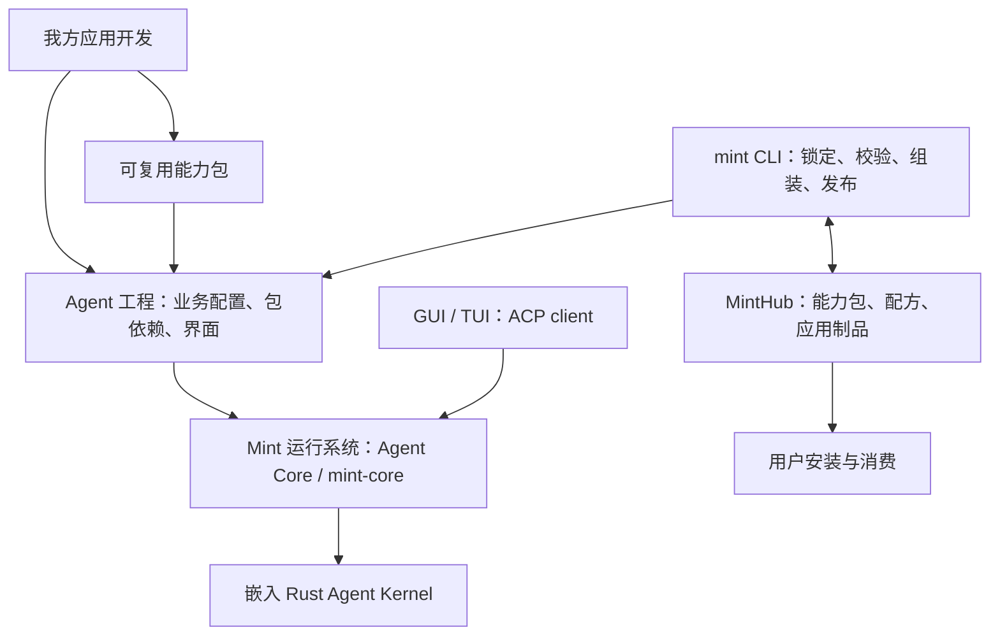

# Mint 应用开发与 MintHub 发布指南

本文汇总 Mint 的现状、目标 PRD 和 Rust Agent 框架设计，供我们开发应用、封装能力并发布到 MintHub 时查阅。整理日期：2026-10-26，时区：Asia/Shanghai。

**协作前提，按本次沟通确认：我们是使用 Mint 的应用开发方；Mint 会嵌入 Rust Agent Kernel；我们建设的能力和应用需要发布到 MintHub。** 因此，本页以应用接入、包契约和发布消费为主线。Mint 平台自身的建设路线用于识别上游依赖。

## 1. 我们与 Mint、Kernel、MintHub 的关系

| 组成 | 职责 | 我们需要对齐的内容 |
| --- | --- | --- |
| Rust Agent Kernel | 作为 Mint 将嵌入的执行底座，提供执行循环、会话、事件、工具调用与权限等基础机制 | Kernel 接口、生命周期、能力注册、事件与取消语义 |
| Mint | Agent 组装与运行系统，通过清单、Core、宿主和包组织应用；当前资料称运行内核为 Agent Core / `mint-core` | 可用扩展点、Core 档位和版本、模型配置、运行入口 |
| `mint` CLI | 检索、依赖解析、锁定、安装、组装、校验及发布 | 开发流程、锁文件、制品与发布命令 |
| MintHub | 包与成品的中央仓库，提供检索、版本、制品分发和发布者控制台 | 我方命名空间、令牌权限、包元数据、版本与平台制品 |
| 我方能力包 | 可供多个应用复用的技能、工具、服务适配或其他扩展 | 包类型、真实入口、兼容范围、权限、独立版本与消费验证 |
| 我方应用 | 组合 Kernel / Core 能力、业务包、配置和界面，交付可安装使用的 Agent | 业务行为、依赖组合、应用制品、用户配置与验收 |

下图表达接入方向；Kernel 的具体嵌入方式、版本绑定和接口仍需与 Mint 侧对齐。



当前文档确认 GUI / TUI 通过 **stdio ACP** 使用 Rust Core。早期框架设计使用 `app-server` 表述，不能直接据此认定 Mint 当前提供同名接入协议。Mint Core 与本项目 Kernel 的具体代码对应、嵌入方式和 ABI 尚未在本轮核验。

## 2. 资料入口与使用顺序

| 入口 | 定位 | 适合回答的问题 |
| --- | --- | --- |
| [Mint 官网](https://mint.ea.modelbest.co/) | 产品、安装和开发入口 | 如何安装 CLI、组装 Agent、进入文档 |
| [MintHub](https://mint-hub.ea.modelbest.co/) | 实际发布的包与成品 | 有哪些包、哪些版本和平台制品可消费 |
| [Mint / MintHub：现状、架构与建设路线](https://modelbest.feishu.cn/wiki/UQ9awtkv6ioOh3kRmp8cf7m8nb8?from=wiki) | 当前能力、公开版本命令、边界与建设建议 | 现在能用什么、哪些尚未接通；应用接入时优先读 |
| [Mint 调研与 PRD v0.3（草稿）](https://modelbest.feishu.cn/wiki/Ehd4wo76liski4kSif3c9DOInre) | 目标设计与整个文档集的目录 | 希望达成什么、包规范和扩展点如何设计 |
| [Rust Agent 框架架构设计 V0.1](https://modelbest.feishu.cn/wiki/JV7TwNyQqiY8J5kTwx2cB1Fonce) | 初版 Rust 框架设计 | Core、JS 引擎、插件生命周期、宿主 API 的设计来源 |
| [MintHub 使用与发布指南](https://mint-hub.ea.modelbest.co/docs) | 安装、模型配置、组件流程、发布说明 | 实际站点操作入口与常见问题 |
| [Mint GUI 短指南](https://mint.ea.modelbest.co/guide.html) | 桌面使用入口 | 安装官方成品、配置模型与重新打开 |

阅读建议：先读现状文档，再看本页开发与发布流程；准备实现具体包时读 PRD 的 02 / 03 / 12 及对应工程规范。PRD 和初版架构中的示例、分期与性能数据都需要结合当前发布版本理解。

## 3. 当前可以依赖什么

### 3.1 发布基线与能力边界

以下为现状文档 2026-10-26 的基线，**不是各组件永远的最新版**。读取时 MintHub 首页还列出了 Core 0.1.10；本页没有验证它的档位或兼容变化，也不据此改写官方 Agent 的冻结依赖。

| 对象 | 现状文档记录 |
| --- | --- |
| CLI | 0.1.10 |
| 独立 GUI / 完整 Agent | GUI 0.1.6；`mint/agent-gui` 0.1.6 |
| 完整 Agent 冻结依赖 | Core/std 0.1.9、CLI 0.1.10、GUI 0.1.6、Host 0.1.8、helper 0.1.0 |
| Core 默认渠道 | 现状文档称 stable 仍指向基础档 0.1.0；渠道指针与指定版本、指定档位分别核对 |
| 桌面验收平台 | macOS arm64；本地 ad-hoc 签名，尚未 Apple 公证 |

| 领域 | 当前范围 | 对应用开发的影响 |
| --- | --- | --- |
| 包管理与分发 | 检索、发行、依赖锁定、下载、组装、完整 App 验签安装已形成闭环 | 可以围绕真实已发布包建立交付流程；CLI bootstrap 仅 HTTPS + SHA256，与完整 App 验签链分开理解 |
| 基础 Agent | 执行循环、会话、上下文、审批、文件工具与模型适配可用 | 复用 Core；Provider、基础工具、记忆等仍主要内置 |
| 默认 GUI | 模型、effort、Plan/Coding、授权、工作区和额外目录已接通 | 真实任务需自行配置模型；effort 与 Core 档位无关 |
| JS / TS 扩展 | std 有独立 V8 Host，支持受限 JS 工具、部分 Hook 和 Core store；工程需显式 trust | TS 先编译为 `dist/index.js`；GUI Coding 模式与 `exec` / `wait` code mode 是两种能力 |
| 协作、记忆与 Cache | 多 Agent 限一层只读；记忆主要是 episode 与关键词召回；Cache 主要采集上游计数 | 复杂协作、长期记忆和本机 KV 复用需要额外确认 |
| A2A、外部执行、主题、CUA | 局部能力或实验 | 按具体包、场景和平台验证，不能据包名推断完整可用性 |
| WASM、QuickJS/lite、code mode | WASM 有独立源码但未接发布 Core；其余尚待接入 | 尚不能作为已支持的应用运行依赖 |
| 动态后端替换 | Provider、记忆、沙箱等后端包仍待接线 | 自定义后端需求应先确认接口及实际消费链 |
| 系统隔离与平台覆盖 | 基础 sandbox 为 Partial；完整跨平台隔离和任意应用 CUA 未完成，Host 体积超预算 | 权限、平台、资源预算须在我方目标环境单独验收 |

现状文档报告 GUI 前端 409 项、Rust 144 项、完整 App 安装 16 组场景通过，并有真实 Core 联调记录。这些是来源报告的证据范围，本次整理未复跑；固定回放也不能替代我方真实模型与业务任务验收。

### 3.2 三档设计与当前命名

| 初版框架名称 | Mint 档位 | 设计形态 | 当前接入判断 |
| --- | --- | --- | --- |
| FULL | `std` | 独立 V8 进程，丰富 JS / TS 插件 | std 已有发布版，但能力范围以已接通接口为准；TS 需预编译 |
| LITE | `lite` | 进程内 QuickJS-NG | 未接入，PRD 放在后续阶段 |
| CORE | `core` | 无 JS 引擎的 Rust Core | 基础档可用，不能运行 JS 扩展 |

初版骨架参考：FULL 46.6 MB / 空载 23 MB，LITE 6.5 MB / 7.8 MB，CORE 约 5 MB / 小于 5 MB 为估算。条件为 macOS M5 arm64、fat LTO，原文声明约正负 10% 至 20% 误差。它们不能作为当前 Mint 成品的体积、性能或硬件适配承诺。完整框架摘要见[本地 Kernel 架构资料](../official/kernel-architecture-v0.1.md)。

## 4. 我们的能力与应用如何封装

### 4.1 选择交付单位

| 交付内容 | Mint 形态 | 使用方式与当前注意事项 |
| --- | --- | --- |
| 业务知识、操作流程、提示词与参考资料 | `skill` | `SKILL.md` 加 `scripts/`、`references/`、`assets/`；技能说明本身不授予执行权限 |
| 多个技能及兼容已有插件布局的内容集合 | `bundle` | 可组织 skills、hooks、MCP 等内容；需逐项确认当前装载范围，不能把兼容清单当全部内容都已接线 |
| 业务工具或代码扩展 | `plugin`，子类 `js` / `native` / `wasm` | 当前 JS 有限定支持；native 需要真实可执行入口及消费协议；WASM 待接发布 Core |
| 外部工具服务连接 | `mcp` 或包含 MCP 声明的 `bundle` | 包声明服务及配置，服务运行时、外部依赖、凭据和权限仍须验证 |
| 审批、提示词等既有行为调整 | `overlay` | 设计原则为安全策略只能收紧；具体覆盖点支持需核验 |
| 一套能力依赖与默认配置 | `preset` | 适合复用业务 Agent 的组合配方；不会自动成为完整应用成品 |
| 工程骨架 | `template` | 目标形态为初始化展开模板；实际命令与可用包以当前 CLI 为准 |
| 我方应用源工程 | `kind = "agent"` | 开发时组合 Core、界面与能力包；不直接作为该 kind 发布 |
| 我方应用发行成品 | `kind = "app"` | 从 Agent 工程 `build` 后 `release`；`app` 不自动等于 macOS `.app` |
| 内核与 JS 宿主 | `core`、`host` | 属于 Mint 运行底座的发行单位；应用声明兼容范围并锁定依赖 |

早期 PRD 的“九种 kind”为 `core / host / plugin / overlay / bundle / skill / mcp / preset / template`。当前现状与网站另说明 `app` 成品及 `agent → app` 流程，发布应用时应采用这一实际流程。

### 4.2 包契约与 Kernel 边界

每个可发布包需要维护：自己的 `scope/name`、递增的 SemVer、`description`、`license`、README、真实入口与实际平台制品。使用我方有权限的 scope；`mint/` 是官方命名空间，默认 `local/` 名称只用于本地。

清单与运行边界的重点：

- `mint.toml` 描述包、兼容要求、提供的扩展、配置、权限及依赖；`mint.lock` 记录精确版本、来源和哈希，由 CLI 维护。
- PRD 用 `[requires] api / core / flavors / host` 表达兼容范围；同版本清单、握手、制品和实际 Core 必须一致。0.x 的兼容窗口与完整稳定性承诺需逐版本核对。
- 能力接入 Kernel 的公开扩展点；循环状态机、权限裁决、取消和会话等基础语义由运行内核维护。界面经 ACP 接入。
- 安装、签名验真、工程 trust、系统授权和单次动作审批分别生效；能力包不能通过安装或工具调用扩大权限。
- 开发包可用本地 path；发布前确认其依赖可分发且 lock 完整。包内不包含真实模型 Key、发布令牌、凭据、用户配置和会话数据。

PRD 的 ABI 是广义接口契约，以下是设计分层，并不说明所有接口已稳定实现：

| 层 | 契约 | 我方接入意义 |
| --- | --- | --- |
| L-A | `mint-api` Rust API、`mint-protocol` DTO | 给同仓、同工具链构建的内核与 built-in；不支持据此推导 Rust 动态库 ABI 稳定 |
| L-B | WIT / WASM 组件接口 `mint:api` | 后续 WASM 包的接入面，当前发布 Core 尚未接通 |
| L-C | ACP、`mint-host`、native sidecar 的 JSON-RPC 协议 | 界面、宿主与进程包的接入与握手；三条协议的版本分别核对 |
| L-D | 清单、lock、索引、制品元数据和事件等数据格式 | 包的可重现安装与新旧版本读取兼容 |
| L-E | CLI 命令、退出码、环境变量与 Registry 端点 | 我方脚本、CI 与分发流程的依赖面 |

PRD 明确不采用 `cdylib` 插件。内部数据库表、缓存布局和日志文案不宜作为应用契约；自动化使用公开 CLI、协议与结构化事件。`mint --json run` 输出 NDJSON 事件流，需要逐行处理。

## 5. 应用开发流程

以下命令转录自现状文档的 CLI 0.1.10 路径，**本次仅整理，未在本机执行安装、信任或发布**。示例中的 `YOUR_SCOPE` 和包路径需要替换为实际值。

### 5.1 准备 CLI 和应用工程

```bash
curl -fsSL https://mint.ea.modelbest.co/install.sh | sh -s -- --cli-only --yes
"$HOME/.mint/mint" --version
```

这里的 `--yes` 只同意 CLI 引导替换。后续 `mint` 命令需已在 PATH 中；尚未生效时可使用 `"$HOME/.mint/mint"` 完整路径。

创建可发布命名的应用工程，并使用现状文档已验证的 GUI 组合：

```bash
mint init my-agent --name YOUR_SCOPE/my-agent --no-preset
cd my-agent
mint core install std@0.1.9 --use
mint add mint/preset-gui@0.1.1
mint chat --ui mint/gui
```

该组合保留工程原有默认 UI，因此显式传 `--ui mint/gui`。GUI 设置或 `mint config edit` 中配置真实供应商、端点、模型和凭据来源。模型 Key 留在私有凭据或环境变量中，工程只保存环境变量名。已有工程进入目录后运行 `mint install`，无需再次初始化。

应用定制主要落在 `AGENTS.md`、`skills/<技能名>/SKILL.md`、能力包及 `mint.toml` 的组合配置。仅做终端 Agent 时可采用默认工程与 `mint chat --ui mint/tui` 路径，界面需已安装并与 Core 兼容。

### 5.2 开发能力包并验证实际调用

```bash
mint search echo
mint info mint/echo
mint add mint/echo@0.1.1
mint add ./packages/my-capability
mint dev
```

本地包目录必须已具备正确清单与布局；上面的 `./packages/my-capability` 是我方待创建包的示例路径。Rust / TS 源码使用对应工具链先编译；`mint dev` 监视变更，`mint build` 收集制品，两者都不能代替任意语言编译器。

启用 JS 或其他受信任扩展前，先审阅当前工程的信任范围，再按需执行：

```bash
mint trust . --show
mint trust .
```

未启用 JS 包时 V8 Host 可保持 dormant。使用真实模型跑一次能触发我方能力的任务，检查输入、实际调用、输出、权限拒绝与取消；Demo 的 scripted 回放只验证流程。

常用检查：`mint list`、`mint tree`、`mint doctor`、`mint verify`。依赖升级先看 `mint update --dry-run`。复现安装用 `mint --locked install`；缓存齐备后才可用同时禁止联网的 `mint --frozen install`。

## 6. 发布到 MintHub

### 6.1 发布者准备

公开浏览和安装不要求登录。发布时在 [MintHub 控制台 → 令牌](https://mint-hub.ea.modelbest.co/console/tokens) 创建具备所需 `publish-new` / `publish-update` 权限的令牌，并确认我方 scope 的归属。

浏览器登录与 CLI 登录分别生效。由发布者通过标准输入登记令牌：

```bash
mint --registry https://mint-hub.ea.modelbest.co login --token-stdin
```

不要将令牌放入命令参数、README、日志或制品。名称与版本发布后不可覆盖，修改需递增版本。

### 6.2 发布可复用能力包

在应用工程内完成集成验证后，对实际包目录执行：

```bash
mint pack ./packages/my-capability
mint publish ./packages/my-capability --dry-run
mint --registry https://mint-hub.ea.modelbest.co publish ./packages/my-capability
```

`pack` 只打包；`publish` 会重新 pack 指定目录并上传。上传前保留待发布内容并检查元数据、兼容范围、权限和真实入口；单独检查过的旧归档不代表目录后来未发生变化。

发布后在“我的包”和版本页核对元数据，并从干净工程安装指定版本：

```bash
mint add YOUR_SCOPE/my-capability@0.1.0
mint verify
```

随后运行实际任务，验证能力确实被装载和调用。仅上传成功不算完成交付。

### 6.3 发布完整应用

源工程为 `kind = "agent"`，先完成依赖锁定、源码编译、真实模型与界面联调，再在应用工程目录执行：

```bash
mint build
mint release --dry-run
mint --registry https://mint-hub.ea.modelbest.co release
```

`mint build` 是 `dist` 的别名，收集已经编译或安装的制品并产出 `kind = "app"` 成品；`release` 上传已有归档的原始字节。源码工程与发行成品保持相同名称和版本。使用指定归档时，先执行 `mint release --artifact PATH --dry-run`，`PATH` 取实际构建输出。

需要单独确认我方应用的消费入口：官方完整桌面 Agent 使用 `mint install mint/agent-gui`；该路径不能自动推广为任意自定义应用都支持同样的桌面安装体验。自定义 `app` 的启动、目录布局和平台制品，以实际包页、CLI 支持及干净机器验收结果为准。`mint build --gui` 只用于 Mint 自身源码仓库。

### 6.4 我方交付验收

| 检查项 | 交付证据 |
| --- | --- |
| 身份与元数据 | 我方 scope、名称、版本、license、README、变更说明与发布权限 |
| 依赖与兼容 | 完整 lock、对应 Core / API / Host 版本、实际平台制品和权限说明 |
| 干净环境消费 | 从 MintHub 安装；实际装载包并调用，应用有明确启动入口 |
| 真实业务行为 | 自有模型配置下完成代表性任务；失败、拒绝、超时和取消可解释 |
| 生命周期 | 升级、卸载或取消不遗留子进程与无主状态；保留用户配置和数据 |
| 凭据隔离 | 包与成品不含模型 Key、发布令牌、用户凭据和会话数据 |

## 7. 上游建设路线与我方对齐事项

现状文档建议依次推进以下三阶段，没有给出已批准的排期或资源承诺：

| 阶段 | Mint 侧重点 | 我方接入时需要的确认 |
| --- | --- | --- |
| 稳住交付 | 桌面升级与恢复、公证与多平台准备、会话恢复、主题消费、受控 CUA 与外部执行验收 | 我方目标平台、应用安装与更新机制、业务所需外部执行能否真实使用 |
| 形成模块接口 | WASM 完整消费链、Provider / 记忆 / 存储可替换接口、Hook；另行建设 lite 与 code mode | 我方能力对应扩展点、可使用的 API、版本协商、权限和生命周期 |
| 扩展执行与生态 | Cache 收益、本机推理、多 Agent、远端 A2A、跨平台沙箱 / CUA、SDK 与包生态 | 按业务需要验证资源、协作、远端数据与平台边界 |

我方优先对齐：Kernel 如何嵌入 Mint、与 `mint-core` 的版本和 ABI 对应；能力采用何种已可用包入口；我方 scope 与发布权限；完整应用的安装启动方式。PRD 的双工 loop、`duplex.codec`、`background.bridge` 与 Computer Use 提供后续设计方向，本页不将其视为完整可用的上游承诺。

## 8. 完整资料索引

以下保留 PRD 首页的全部篇目入口。此次额外阅读全文的是 00 上册、02 上册、03 上册、12 上册、15 上册；其余子文档与调研、工程规范仅作为索引，未逐篇展开。各上册开头可继续进入下册。

### 8.1 PRD 与设计篇

| 编号 | 文档 | 主要内容 |
| --- | --- | --- |
| 00 | [总览上册](https://modelbest.feishu.cn/wiki/FfddwvfD5irmAxkdqjlc31ZXnAf) / [下册](https://modelbest.feishu.cn/wiki/SzBhwc0MhiaLIXkjhGOcxuLsnEe) | 定位、分层、分期、决策与风险 |
| 01 | [Agent Core 内核与三档发行](https://modelbest.feishu.cn/wiki/UeP2wEr4GilCNNkHKNxcAZKRnTc) | Core 分层、构建、扩展点与性能 |
| 02 | [可替换模块与扩展点](https://modelbest.feishu.cn/wiki/SN56wysMBiOxySkrpincYpKtngK) | 模块归属、扩展点、覆盖机制和顺序 |
| 03 | [包规范](https://modelbest.feishu.cn/wiki/GUmrwMuzniYGs5kHITRcrxI3nvg) | 清单、kind、兼容、布局、制品、lock 与签名 |
| 04 | [mint 命令行与版本管理](https://modelbest.feishu.cn/wiki/AjUwwFhh6ihCY8kAnkccoRrKnLe) | 命令、配置分层、Core 版本与更新 |
| 05 | [中央仓库 Registry](https://modelbest.feishu.cn/wiki/MyuUw1cSliL2REk6p31cvRV8nnc) | 协议、存储、鉴权、发布与检索 |
| 06 | [GitHub 源、镜像、代理与离线](https://modelbest.feishu.cn/wiki/SwO7wETxRihVWYk9SwScByP7nvb) | GitHub 来源、镜像、scope 路由与 vendor |
| 07 | [安全与供应链](https://modelbest.feishu.cn/wiki/JYQhwglBIi0z27k2aeZc2DCWn3c) | 信任根、签名、权限、沙箱、命名空间与审计 |
| 08 | [协议与记忆能力包](https://modelbest.feishu.cn/wiki/VElNwZcAbiKCJwkYiDic2WfanWe) | MCP / ACP / A2A 与记忆 provider |
| 09 | [Codex 与 Grok Build 参考清单](https://modelbest.feishu.cn/wiki/FHKRwtUTMibcY8kqRrdcpYZdnZd) | 能力参考及取舍 |
| 10 | [分期路线、MVP 与人力](https://modelbest.feishu.cn/wiki/WrW3wGMYkisfCRkFW0McllvanYf) | 优先级、里程碑与验收 |
| 11 | [双工 loop 与前后台](https://modelbest.feishu.cn/wiki/YiUMwcRIRiBGIykohltcRtOOnuh) | 全双工、实时通话与后台任务桥接 |
| 12 | [ABI 规范](https://modelbest.feishu.cn/wiki/REO2wwBhwiewZVkyHzEcabJCnah) | 五层契约、稳定性、协商、测试与治理 |
| 13 | [Computer Use 与 loop](https://modelbest.feishu.cn/wiki/LRYCwrd1YioByKk17uacwNlVnzc) | 观察注入、历史裁剪、动作审批与显示沙箱 |
| 14 | [MintHub 站点与控制台](https://modelbest.feishu.cn/wiki/OGqQwDPjBipaBmkTJhZcxTO4nvf) | 搜索、包页、多版本、令牌、owners 与 yank |
| 15 | [实施顺序与基础设施](https://modelbest.feishu.cn/wiki/TOydwSw4Xijj5ik75f1cM0H6nJe) | S1–S5、首版验收和平台基础设施 |
| 附 A | [架构骨架 v0.6](https://modelbest.feishu.cn/wiki/N3Flw9me7if5p9kqmdVcGkcGnKe) | 原则、模块、D1–D35、扩展点、流程与待定问题 |
| 附 B | [需求条目](https://modelbest.feishu.cn/wiki/B9RIwbjaaisOWrkRztMcFlrEnKe) | U-01 至 U-29、K-01 至 K-10 的来源与归属 |
| 附 C | [品牌：薄荷标识](https://modelbest.feishu.cn/wiki/DwD8w8XpoiS3q9kAjWYcnmWhnic) | 标识、变体、配色与使用规范 |

### 8.2 工程规范

| 编号 | 文档 | 应用开发的阅读场景 |
| --- | --- | --- |
| E0 | [工程规范总则](https://modelbest.feishu.cn/wiki/LtQ4wfEGdiz0uFkvNNwcIJmrnPb) | 总体工程约定与评审 |
| E1 | [Rust 内核与扩展工程规范](https://modelbest.feishu.cn/wiki/O8jKwUZhliPPrRkBZgKcwr34n1e) | Rust 扩展、API、feature 与平台制品 |
| E2 | [V8 宿主与 JS / TS 插件工程规范](https://modelbest.feishu.cn/wiki/QcZgwU61HirmDDkSajEcSMMfnBc) | JS / TS 插件、Context、构建与宿主边界 |
| E3 | [WASM / WIT 与 native sidecar 工程规范](https://modelbest.feishu.cn/wiki/JfWYwt2Z4iFbLLkiNbccsbdon3b) | sidecar 协议；后续 WASM 接入 |
| E4 | [ABI 与协议契约工程规范](https://modelbest.feishu.cn/wiki/AHoUwlb47ir3IRk00OBcYKehn6c) | 接口变更、版本与兼容门禁 |
| E5 | [MintHub 服务端与 Web 工程规范](https://modelbest.feishu.cn/wiki/Q0kpwDJJgi8uIMkHYoxcGg3jn5c) | 参与 Hub 本身开发时参考 |
| E6 | [界面组件（TUI / GUI 壳）工程规范](https://modelbest.feishu.cn/wiki/Wv8GwLMIZi8WJqkePAwcxvRXn1e) | 自定义 ACP client 与应用界面 |

### 8.3 调研依据

| 编号 | 文档 | 主题 |
| --- | --- | --- |
| R1 | [npm / Node.js / React 生态](https://modelbest.feishu.cn/wiki/GKfqwPEtcicpMDkximechWRHn7c) | registry、lock、镜像与 provenance |
| R2 | [Go 模块体系](https://modelbest.feishu.cn/wiki/TjpKwDI6Li4Ct7k1gfYcvwtxnTw) | proxy、sumdb、MVS 与工具链 |
| R3 | [Cargo / crates.io / rustup](https://modelbest.feishu.cn/wiki/FzH3wrZJqiWQ7XkW0MPcEKAIneI) | 索引、发布、依赖与分发 |
| R4 | [Maven / pip / Linux 包](https://modelbest.feishu.cn/wiki/SoJ1wcPmSi6fnxk55SGcC2dRnlb) | 仓库模型、索引与签名 |
| R5 | [新一代制品库与插件市场](https://modelbest.feishu.cn/wiki/KZSMwZs2viy9w6kZjnkcgt8wnuh) | JSR、Nix、OCI、Sigstore / TUF 与 MCP Registry |
| R6 | [Codex 与 Grok Build 源码模块拆分](https://modelbest.feishu.cn/wiki/IcZgw3iYKix5wgkw1ddcKUmOnze) | crate、插件、技能、协议与可拆模块 |
| R7 | [A2A / ACP / MCP 与记忆框架](https://modelbest.feishu.cn/wiki/UhCywl1E3iSI58k1JdycDCy8nVt) | 协议角色、Rust 实现与包形态 |
| R8 | [版本管理器与依赖解析](https://modelbest.feishu.cn/wiki/D43FwrhR0iQXNyk7w6CcllJcn2f) | mise / aqua / rustup / uv、PubGrub 与 MVS |
| R9 | [双工 Agent loop 与前后台](https://modelbest.feishu.cn/wiki/VHYxwssBuiatGGk4sxIcJdoAn4d) | O5、Realtime、Live、内部实践与桥接 |
| R10 | [ABI 设计规范范本](https://modelbest.feishu.cn/wiki/ILO3wRoFPihTaQkPUZGcT4oJnxh) | Rust、WIT、JSON-RPC 与稳定性政策 |
| R11 | [Computer Use 与 loop](https://modelbest.feishu.cn/wiki/SLqgwZO8yiuDt5krv8jcmMvFn5g) | 模型接口、开源 GUI Agent 与 loop 约束 |

## 9. 来源版本与待核验事项

| 已读取来源 | document revision / 范围 |
| --- | --- |
| Mint / MintHub：现状、架构与建设路线 | 13，正文 |
| Mint 调研与 PRD v0.3（草稿） | 39，首页正文与完整篇目索引 |
| Rust Agent 框架架构设计 V0.1 | 20，正文；已有本地摘要另含分层和硬件画板整理 |
| 00 / 02 / 03 / 12 / 15 上册 | 分别为 10 / 10 / 17 / 8 / 17，正文 |
| Mint 官网、MintHub 首页及使用指南 | 浏览器只读访问页面，2026-10-26 快照 |

飞书正文通过 `lark-cli` 以用户身份只读获取。本轮未重新读取内嵌画板节点或成熟度表原始数据；本文流程图依据正文和本次沟通归纳。未检查 Mint 仓库代码、制品字节，也未执行安装、真实模型调用或发布命令。

需要持续核对的差异：官网部分文案仍将 std 视为后续阶段，而现状文档已记录 std 发布；MintHub 使用指南保留 GUI 0.1.0 / Core 0.1.1 的兼容示例，现状文档使用更新的组合；早期 PRD 包规范没有完整反映当前 `app` 发行流程。采用具体版本前，以目标包的实际元数据、CLI 帮助和干净环境消费结果共同确认。

相关本地资料：[AgentCPM OS 官方资料索引](../official/README.md)、[项目核心信息](../official/agentcpm-os-project.md)、[Rust Agent Kernel 架构核心信息](../official/kernel-architecture-v0.1.md)。
