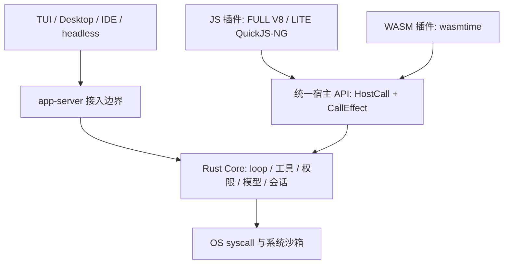

# Rust Agent Kernel 架构核心信息 V0.1

## 一句话总结

Rust Agent 框架是 AgentCPM OS Kernel 的重要组成：以 Rust Core 承载 ReAct loop、工具路由、安全管控、模型客户端和会话状态，通过统一宿主 API 接入可替换的 JS 与 WASM 插件，通过 app-server 对接多种界面，并以 FULL / LITE / CORE 三档覆盖不同设备。

## 核心要点

- CLI-first、端侧到云、单一 binary 分发；Rust loop 与 JS 引擎解耦。
- 三档共享 Rust Core；FULL 使用独立 V8 进程，LITE 使用进程内 QuickJS-NG，CORE 不带 JS 引擎。
- 插件采用 Cordis 风格 Context / dispose 生命周期，能力与工具视图每步重建，宿主 API 使用封闭枚举与 CallEffect 分级。
- 界面通过 app-server 协议接入；FULL 可选 code mode，工具调用继续经过 Rust 侧路由、hooks 与审批。
- 体积、内存和启动数据是原文给出的特定环境骨架测量；CORE 数据为估算，均不代表完整 OS 已验收。

本文覆盖来源正文及“分层架构”“硬件覆盖”两张画板。源文档是 V0.1 设计说明；未检查框架实现，也未验证其引用的外部项目源码。项目版本与里程碑见 [项目核心信息](./agentcpm-os-project.md)。

## 1. 总体分层与职责

| 层 | 组成 | 关键职责与约束 |
| --- | --- | --- |
| 可替换界面层 | TUI、Desktop GUI、IDE、headless / CI | 共享 app-server 接入边界；具体传输方式见第 7 节 |
| 脚本插件层 | FULL：V8 独立进程；LITE：QuickJS 进程内；CORE：无引擎、仅声明式扩展 | TS / JS 插件、Context / dispose 热拔插、统一宿主 API |
| WASM 插件层 | wasmtime；Cranelift JIT 或 Pulley 解释器 | 通过 HostCall 封闭枚举访问宿主能力；低端设备可使用无 JIT 的 Pulley |
| Rust Core，所有档位共用 | ReAct loop、每步重建的工具路由、权限与审批、上下文压缩、多 provider 模型客户端、会话持久化 | Rust 持有核心循环与会话状态，与 JS 引擎解耦 |
| 系统调用与沙箱 | macOS Seatbelt；Linux bwrap + seccomp；Windows 受限令牌 | 在操作系统边界约束执行权限 |

设计关系简图，按职责归纳，不表示所有扩展调用都必须经过 WASM：



### 与 Kernel 版本目标的对应

项目页将最小内核归为会话与循环、事件、外部调用管控、模型调用、扩展。后续补调度、资源池、模型路由、分布式、恢复与 kv / blob。框架 V0.1 主要说明执行框架、插件和接入方式，没有给出这些后续机制的完整接口规范。

## 2. 三档构建

| 指标 | FULL | LITE | CORE |
| --- | --- | --- | --- |
| JS 引擎 | V8，deno_core / rusty_v8 | QuickJS-NG，rquickjs | 无 |
| JS 插件宿主 | 独立进程，崩溃隔离 | 进程内 | 无 |
| JS 插件热拔插 | 支持 | 支持 | 不支持；保留 skills / hooks / MCP |
| TypeScript | deno_ast，增加约 4.5 MB | oxc 去类型，增加约 2.2 MB，能力受限 | 不支持 |
| 骨架二进制 | 46.6 MB | 6.5 MB | 约 5 MB，估算 |
| 空载内存 | 23 MB | 7.8 MB | 小于 5 MB，估算 |
| 典型设备 | 桌面、服务器 | 树莓派 4/5、工控机 | 尽可能覆盖所有设备，受 Rust 目标支持约束 |
| code mode | 支持，模型写 JS 编排工具 | 不支持，直接调用工具 | 不支持，直接调用工具 |

原文骨架包含引擎、reqwest / rustls、tokio、SQLite、wasmtime-Pulley。数据来自 macOS M5 arm64、fat LTO 测量，原文声明约有正负 10% 至 20% 误差。

“CORE 无插件宿主”特指没有 JS 宿主；架构画板仍列出了 CORE / 端侧可使用的 WASM Pulley 层。

## 3. ReAct Loop 扩展点

| 扩展点 | 时机 | 插件可做的事 | CORE 替代方式 |
| --- | --- | --- | --- |
| 工具注册 | 会话初始化，以及每步重建 | 注册工具、修改 schema | MCP server、命令行工具 |
| `before_model` | 模型请求组装前 | 修改 prompt、注入记忆、选择模型 | skills + prompt 模板 |
| `on_tool_call` | 工具路由前 | 放行、拒绝或改写参数 | Starlark 规则、命令 hook |
| `after_tool` | 工具返回后 | 加工结果、截断输出 | 命令 hook |
| `should_stop` | 每轮结束 | 按业务判断终止条件 | 最大轮次 / 预算配置 |
| 编排层 | loop 之上 | 多 agent、SOP 工作流、code mode | 仅单 agent |

工具路由每个采样步骤重建一次，工具在会话中途增删后，可在后续步骤生效，无需重启会话。项目页的扩展目标进一步要求能力注册 / 注销、作用域生命周期与热拔插。

## 4. 插件系统与宿主 API

### 生命周期

插件通过 Context 注册工具、监听器和服务等副作用。卸载时通过 `ctx[Symbol.dispose]()` 一次性清理该 Context 的注册内容；热拔插流程为清理旧 Context，再 `import()` 新版本。

ESM 缓存不能直接卸载，原文方案是在模块 URL 后添加 `?v=timestamp`，强制加载新版本。模块重新加载与旧 Context 副作用清理是两个必要步骤。

### 宿主调用边界

插件只能通过宿主 API 请求副作用，不直接访问文件系统或网络。原文给出以下示意类型，`Message` 等业务类型未在该片段中定义，调用枚举也未完整列出：

```typescript
type HostCall =
  | { type: 'tool.execute'; name: string; args: unknown }
  | { type: 'model.stream'; messages: Message[] }
  | { type: 'store.get'; key: string }
  | { type: 'store.set'; key: string; value: unknown }

type CallEffect = 'ReadOnly' | 'Advance' | 'SideEffect'
```

`HostCall` 设计为封闭枚举，穷举允许的宿主副作用，跨引擎保持统一。原文明确的重放规则是：`SideEffect` 调用派发后，若未收到确认，则永不重放，避免不确定结果导致重复副作用。`ReadOnly` / `Advance` 的完整判定和恢复协议尚未在本文定义。

### 与 PilotDeck / chord 的关系

- chord 是纯 TypeScript 的 Cordis 风格插件 runtime，可在 FULL 的 V8 进程中复用或重写，原文未确定最终选择。
- 参考 chord 的 Typed Contracts 与 Replicated state。
- `HostCall` 封闭枚举与 `CallEffect` 分级借鉴 PilotDeck rust-core 的 `ports.rs`。

### 隔离与恢复

FULL 将 V8 宿主放入独立进程，以限制插件宿主崩溃对主会话的影响。会话状态全部由 Rust 侧管理，设计目标是插件进程重启后恢复。LITE 的 JS 宿主在进程内，不具备这项进程隔离边界。

## 5. WASM 插件

框架采用 wasmtime 支持 WASM 插件。分层画板提出 FULL / LITE 可使用 Cranelift JIT，CORE / 端侧可使用 Pulley 解释器；Pulley 无需 JIT，原文给出的独立体积为约 0.8 MB。

需要区分骨架测试配置与可选方案：三档构建表的骨架测量明确包含 wasmtime-Pulley，而画板同时给出 FULL / LITE 的 Cranelift 路径。Cranelift 是否进入默认发布构建尚需确认，不能直接把 Pulley 骨架体积当作 Cranelift 成品体积。

## 6. code mode，可选且仅 FULL

1. 模型调用 `exec` 工具，参数是一段 JavaScript。
2. 代码在独立 V8 isolate 中执行；FULL 的宿主位于独立进程。
3. JS 通过 `tools.*` 调用工具，例如 `await tools.exec_command(...)`。
4. 每次工具调用经 stdio 回到主进程，执行正常路由、hooks 和审批。

| JS 侧能力 | 约束 |
| --- | --- |
| 可用全局 | `tools`、`store` / `load`，跨调用状态、`notify`、`setTimeout` |
| 禁止直接使用 | 文件系统、网络、`console`、`import` |
| FULL host 不可用 | 自动降级为直接调用工具，会话继续 |

这里的禁止 `import` 是 code mode 执行环境的限制；插件热拔插中的 `import()` 属于插件加载机制，二者不能混为同一运行环境。

已知缺口：原文指出 V8 isolate 尚需自行增加堆上限和执行超时 watchdog。macOS 分发还需要 JIT entitlement。以上属于设计中需要落实的约束，本文未验证其实现状态。

## 7. 界面层与协议

| 界面 | 技术 | 接入 / 传输 | 阶段 |
| --- | --- | --- | --- |
| TUI | ratatui，Rust | app-server 进程内客户端 | MVP |
| Desktop GUI | Tauri | app-server，WebSocket / UDS | 后续 |
| IDE 集成 | app-server JSON-RPC，参考 Codex protocol v1/v2 | UDS / TCP | 后续 |
| headless / CI | exec 模式 | stdio | MVP |

设计要求连 TUI 也经过协议边界，以便多前端共享同一 core 会话、界面故障不影响 agent，并使后续 Desktop 接入无需修改 core。TUI 如何部署为进程内客户端、同时实现原文提出的故障隔离目标，仍需实现方案明确。

## 8. 硬件覆盖

以下来自硬件覆盖画板，是设计兼容性矩阵，未逐设备实测。

| 档位 | 云服务器 x86 | 树莓派 4/5、RK3588 | Pi Zero 2 W、3A+ | 32 位 ARMv7 | 龙芯 LoongArch | 申威 / 单片机 |
| --- | --- | --- | --- | --- | --- | --- |
| FULL，V8 | 支持，官方预编译 | 支持，标注 aarch64-musl | 有条件，需控制堆上限 | 有条件，需自编 V8 | 有条件，需自编 V8 | 不支持 |
| LITE，QuickJS-NG | 支持 | 支持 | 支持 | 支持，需 C 编译器 | 支持 | 不支持 |
| CORE，纯 Rust | 支持 | 支持 | 支持 | 支持 | 支持 | 取决于 Rust 支持 |

画板列出的 rusty_v8 v152.2 预编译目标包括 Linux x86_64 / aarch64 的 gnu 与 musl、riscv64-gnu、macOS x64 / arm64、Windows x64 / arm64。正文同时说明 deno_core 0.412 锁定 V8 150.4；因此画板上的最新预编译目标不能直接视为 deno_core 当前依赖版本均可使用。

## 9. 性能参考

测试条件为原文的 macOS M5 arm64、release、fat LTO + strip；原文声明约有正负 10% 至 20% 误差。下表保留原始参考值，不作为跨设备性能承诺。

| 方案 | 二进制 MB | xz 后 MB | 空载内存 MB | 脚本内存 MB | 空载启动 ms | JS fib(27) ms |
| --- | --- | --- | --- | --- | --- | --- |
| 裸 V8 crate | 41.0 | 9.4 | 9.9 | 18.2 | 4.3 | 2，JIT |
| deno_core 0.412 | 41.6 | 9.9 | 17.5 | 22.0 | 6.7 | 2 |
| deno_core + TS 转译 | 46.1 | 10.9 | 18.1 | 24.3 | 6.7 | 1 |
| rquickjs，QuickJS-NG | 1.3 | 0.45 | 2.3 | 2.9 | 2.4 | 12.5，解释执行 |
| Boa，纯 Rust | 6.4 | 1.5 | 4.0 | 10.6 | 2.5 | 55.5 |
| oxc，仅 TS 转 JS | 2.2 | 0.7 | 2.1 | 2.6 | 未提供 | 未提供 |
| wasmtime + Cranelift | 7.8 | 2.2 | 7.1 | 7.0 | 2.9 | 小于 1，原文同列参考值 |
| wasmtime，仅 Pulley | 0.8 | 0.25 | 2.0 | 2.0 | 1.9 | 8，原文同列参考值 |
| FULL 骨架 | 46.6 | 11.6 | 23 | 31 | 7.6 | 未提供 |
| LITE 骨架 | 6.5 | 2.3 | 7.8 | 12 | 3.5 | 未提供 |

原文将 FULL 骨架相对 deno_core 约 5 MB 的增加归于 HTTP / TLS、SQLite、文件遍历、diff、wasmtime-Pulley。另列成品体积作对照：Codex 229 MB、Claude Code 211 MB、Grok Build 143 MB；未提供版本与统一构建条件，不宜直接作同口径比较。wasmtime 两行的测试工作负载未进一步解释，不能据此推断其原生执行 JS。

## 10. 构建、分发与安全注意事项

以下为源文档的避坑清单摘要，版本与判断均按原文记录，未在本地复现。

| 事项 | 原文要求 / 风险 |
| --- | --- |
| deno_core 与 V8 版本 | deno_core 0.412 锁定 V8 150.4，与原文所称 v8 crate 最新 152.2 不同；还需匹配 simdutf 静态库变体，升级需同步处理 |
| V8 静态库下载 | 原文测得 GitHub 单流约 90 KB/s、40 MB 约 7 分钟；CI 使用缓存、`RUSTY_V8_ARCHIVE` 或内网镜像 |
| macOS entitlement | 原文要求 `com.apple.security.cs.allow-jit` 与 `allow-unsigned-executable-memory`，打包时核查声明 |
| 目标三元组缓存 | arm64 与 musl 等目标使用不同静态库，应按目标三元组分别缓存 |
| ARMv7 / LoongArch | 无官方 V8 预编译时需自编；原文建议使用 LITE，自编耗时示例为 Linux x86_64 约 1.5 小时、Windows arm64 约 3 小时 |
| 禁用 JIT 的环境 | SELinux execmem 限制可能使 V8 只能 `--jitless`；检测后可降级 LITE |
| ESM 缓存 | 首次 import 后缓存，热拔插需版本化 URL，并清理旧 Context |
| 插件宿主崩溃 | FULL 的 V8 使用独立进程；会话状态放 Rust 侧，以支持宿主重启 |
| Starlark 与沙箱 | 原文警示命令规则全量 Allow 可能绕过沙箱，核心 shell exec 工具不能全量 Allow；具体行为需结合策略实现核验 |
| rquickjs 引擎 | 底层为 QuickJS-NG，而非原版 QuickJS；原文要求按 QuickJS-NG 0.16.2 对齐文档与测试 |

## 11. 参考项目与差异定位

| 项目 | 原文参考点 |
| --- | --- |
| Codex，`openai/codex` | Rust crate 分层、app-server、code mode 独立 V8 进程、工具路由每步重建 |
| Grok Build，`xai-org/grok-build` | TUI / headless / ACP 运行模式、Cargo workspace 分层 |
| Pi / chord，`earendil-works/pi` | Cordis 风格插件、Typed Contracts、Replicated state；可复用 chord |
| PilotDeck rust-core，`OpenBMB/PilotDeck` | `ports.rs` 封闭枚举、CallEffect、agent loop sidecar |

原文的产品对比将本框架定位为“Rust + 单 binary + 端侧覆盖 + FULL / LITE JS 插件 + Cordis 热拔插”；并将 Codex、Grok Build 归为 Rust 单 binary 工具，将 Claude Code 归为 TS / Bun，将 Pi / chord 归为 TS / Node。比较表认为现有工具的端侧或扩展方式各有局限；这些是该设计文档的对比判断，未在本轮独立验证。

## 12. 待确认事项

| 项目 | 当前资料的边界 |
| --- | --- |
| 默认 WASM 后端 | 画板为 FULL / LITE 标注 Cranelift，但骨架测量使用 Pulley；需要确认默认与可选构建组合 |
| 依赖版本与平台支持 | deno_core 锁定的 V8 版本与画板所列 rusty_v8 版本不同，需以实际依赖版本重新核查目标矩阵 |
| 宿主 ABI 与效果语义 | HostCall 仅有示例，ReadOnly / Advance、序列化、错误与恢复语义未完整定义；项目 W1 正在安排 ABI 文档 |
| V8 资源限制 | 堆上限、执行超时和 watchdog 被明确列为待补能力 |
| 前端故障隔离 | TUI 为进程内客户端的描述，与界面崩溃不影响 agent 的目标如何同时满足，尚缺实现说明 |
| CORE 覆盖与性能 | 无 JS 引擎不意味着任意硬件均已支持；取决于 Rust、OS 与依赖支持，体积和内存为估算 |
| 完整 Kernel 机制 | 调度、资源池、分布式、恢复、存储等需要进一步阅读 [【RFC】Kernel](https://modelbest.feishu.cn/wiki/FJ3BwWjR5iNrctkk6Eycnqj2noB) 及后续接口文档，本文未展开该 RFC |

这些问题是基于已读取资料标注的确认项，不额外引入实现承诺。
