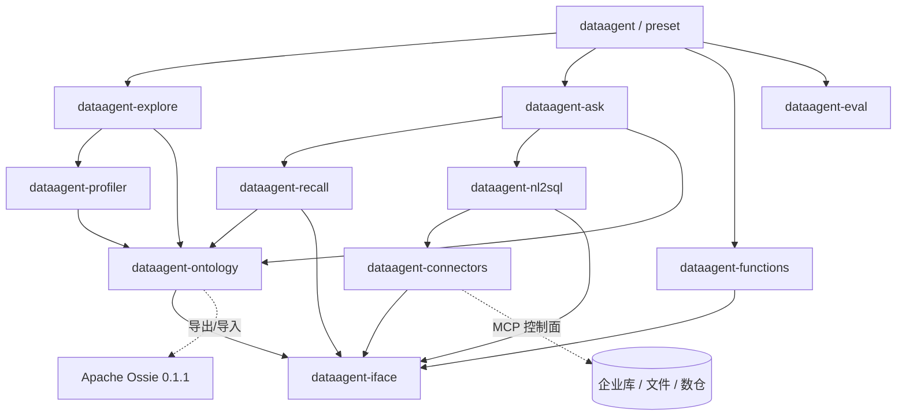

# DataAgent 调研与 MintHub 落地方案

**日期**：2026-10-30　**时区**：Asia/Shanghai　**状态**：调研完成，方案待评审；未实施、未发布
**范围**：市场/竞品/开源/benchmark/标准/中国市场，以及"DataAgent 作为 MintHub bundle / preset / app"的产品与工程方案
**证据**：7 个并行子 Agent 分工调研 + 主 Agent 交叉核对；所有关键事实附来源链接，无法核实的显式标注

---

## 目录

1. [一页结论](#1-一页结论)
2. [研究范围、方法与证据等级](#2-研究范围方法与证据等级)
3. [市场地图：四种形态，正在互相渗透](#3-市场地图四种形态正在互相渗透)
4. [能力拆解：探查建模 / 智慧问数 / 分析预测](#4-能力拆解探查建模--智慧问数--分析预测)
5. [Benchmark 与真实差距](#5-benchmark-与真实差距分数涨了产品没跟上)
6. [中国市场：需求差异与进入策略](#6-中国市场需求差异与进入策略)
7. [MintHub 产品设计：bundle / preset / app](#7-minthub-产品设计dataagent-作为一个-bundle--preset--app)
8. [路线图：现在做什么，未来做什么](#8-路线图现在做什么未来做什么)
9. [风险、开放问题与待确认](#9-风险开放问题与待确认)
- [附录 A：Ontology 载体草案](#附录-aontology-载体草案)
- [附录 B：Mint 包清单示例](#附录-bmint-包清单示例)
- [附录 C：关键来源](#附录-c关键来源)

---

## 1. 一页结论

**市场已经给出答案：Data Agent 的竞争，不在"能不能写对 SQL"，而在"有没有一套可维护的语义资产 + 能不能把模糊问题问清楚 + 交付物能不能被信任"。**

十条结论：

1. **单轮 NL2SQL 已商品化。** BIRD Test 榜首 83.40%（AT&T AskData，2026-10-22），人类 Test 基准 72.37%（Dev 92.96%）；华为 82.39、腾讯 82.28、京东（4B 模型）76.19。Test 上机器已越过人类平均线，靠的不是更大的模型，是"更多候选 + 更好的选择器 + schema 压缩"。
2. **真正的差距在交互与企业系统能力。** BIRD-Interact（ICLR 2026 Oral）600 个交互式任务，SOTA 16.33%；Spider 2.0-Snow 同一 547 题，Spider-Agent+o1-preview 23.58%、Genloop Sentinel v2 Pro 96.70%——4 倍差距来自 scaffold（元数据检索、方言、长上下文、执行反馈），不是基座模型。**分数不可跨 harness 比较。**
3. **商业产品收敛到四种形态**：语义层优先（Snowflake/dbt/AtScale/Cube）、catalog + 生成式（Databricks Genie/Fabric/BigQuery）、BI 内嵌 Copilot（Power BI/Spotter/Sigma）、Ontology 平台（Palantir）。赢家是 **A+B 混合**：语义层兜住"必须对"，生成式兜住长尾，再用反馈把长尾沉淀回语义层。
4. **语义层正在从"BI 的内部配置"变成"可分发的一等资产"。** Snowflake 的 Semantic View 是 schema 级对象、可当 listing 共享；Palantir 有 ontology 分支 + 提案评审；dbt 的指标即代码。**这正是 MintHub 的机会：把 ontology 做成可版本化、可评审、可安装的包。**
5. **开源能覆盖约八成工作量，但三个关键件没有现成实现**：产品级 join/关系发现、语义层 diff→影响面→召回重排、开源 RLS DSL。这三个必须自研，也正好是差异化所在。
6. **标准用 Apache Ossie，不要自造。** OSI 已更名 Apache Ossie（2026-06 进 ASF 孵化），0.1.1 已被 dbt 1.12 原生解析；0.2.0.dev0 新增 ontology + mapping。**锁 0.1.1 落盘、按 0.2.0 语义思考**，否则 dbt 互通立刻断。
7. **中国市场的最锋利空档：文件即席分析 → 一键升格为受治理指标。** 所有厂商都把 Excel 当"又一个 connector"，没人把文件里的临时口径沉淀回指标层。这同时命中"口径治理"与"Excel 文化"两个中国特有痛点。
8. **MintHub 形态：`bundle`（能力入口，含 `.mcp.json` + Skill + 资产）+ `preset`（精确锁组合），后期再上 `app`。** `plugin` 要求 wasm/native/js，装不下常驻进程；`kind=mcp` 今天内核零消费。三条硬约束：**工具命名即权限**（`get_/list_/search_` 自动放行）、**MCP 单请求 60s 超时**（必须 job 化）、**升级不迁用户数据**（迁移自己实现）。
9. **产品架构一句话：一个 ontology，两个物理适配器（DuckDB 处理文件 / MCP 连接企业库），三层上下文（画像 → 候选 ≤30 列 → M-Schema 子集），澄清做成显式协议。**
10. **最大风险不是技术，是 ontology 维护成本与准确率预期管理。** 客户会拿 BIRD 83% 要求"什么都答"；能不能把"域内 80%+、域外拒答/澄清"的边界说清楚，决定产品生死。

### 如果只做三件事

| # | 做什么 | 为什么是它 |
|---|---|---|
| 1 | **文件问数闭环**（上传 → 探查 → ontology 草案 → 问数 → 导出） | 最快验证、最少依赖、覆盖中国客户"先文件后库"的真实路径 |
| 2 | **ontology 版本化 + 评测 harness** | 没有这两样，准确率无法回归、口径无法治理，产品会停在 demo |
| 3 | **`bundle` + `preset` 打包，`get_/list_/search_` 工具面** | 决定能不能被安装、被信任、被别的 Agent 复用；也是 MintHub 的入场券 |

### 现在 / 未来 一览

| 阶段 | 时间 | 关键词 | 成功标准 |
|---|---|---|---|
| 现在 | 0–3 月 | 文件 + Postgres、30 题评测、3 家设计伙伴 | 文件 30 题 ≥80%，库 50 题 ≥70% |
| 下一步 | 3–9 月 | join 发现、语义 diff、8 个连接器、RLS、3 个行业包 | 100 表库可用，2 个付费 POC |
| 未来 | 9–18 月 | 跨源 ontology、行业市场、主动分析、Agent 间调用 | 1000 表库、300 题回归、app GA + 3 行业包 |

---

## 2. 研究范围、方法与证据等级

### 2.1 怎么做的

7 个并行子 Agent，各自负责一个面，主 Agent 做交叉核对与综合：

| 子 Agent | 负责 | 产出 |
|---|---|---|
| A | 商业厂商（Databricks/Snowflake/Microsoft/Google/ThoughtSpot/Tableau/Qlik/AWS/Palantir/AtScale/Cube/dbt/Kyligence/Sigma/Dataiku） | [A-commercial.md](parts/A-commercial.md) |
| B | 开源代码（WrenAI/DB-GPT/Cube/MetricFlow/SuperSonic/Vanna/MCP 生态/剖析/表格） | [B-opensource.md](parts/B-opensource.md) |
| C | Benchmark（BIRD/Spider 2.0/BIRD-Interact/LiveSQLBench/DABench 等） | [C-benchmarks.md](parts/C-benchmarks.md) |
| D | 学术前沿（CHESS/CHASE-SQL/Alpha-SQL/ReFoRCE/LinkAlign/SemJoin/Uber-Join/DSABench） | [D-academic.md](parts/D-academic.md) |
| E | 标准与接入（Apache Ossie/MCP 2026-07-28/dbt/Cube/Palantir/OpenLineage） | [E-standards-connectors.md](parts/E-standards-connectors.md) |
| F | 中国市场（Quick BI/FineBI/SmartBI/Kyligence/观远/国产库） | [F-china-market.md](parts/F-china-market.md) |
| G | MintHub/Kernel 能力边界（源码级） | [G-kernel-packaging.md](parts/G-kernel-packaging.md) |
| H | Ontology 载体草案（主 Agent） | [H-ontology-schema-draft.md](parts/H-ontology-schema-draft.md) |

### 2.2 证据等级

| 等级 | 含义 | 本文用法 |
|---|---|---|
| L1 | 一手规范/源码/官方文档（可复查） | 直接引用，附路径或链接 |
| L2 | 官方榜单/论文自报 | 引用但标注"自报/官方"；不同口径不混用 |
| L3 | 厂商宣称、媒体转述 | 标"宣称"，不单独作为决策依据 |
| L4 | 未核实 | 显式写"未核实"，不做推断 |

### 2.3 本次调研的局限（必须知道）

1. **本机 web_search 不可用**（无 API key），所有检索靠 `web_fetch` / `curl` / GitHub API / arXiv API 直取。搜索引擎类站点（Bing/DuckDuckGo/Google）不可达，因此**可能遗漏没有直接 URL 的新闻与评测**。
2. **部分国内站点 JS 渲染或超时**（瓴羊、火山 DataWind、华为 DataArts、百度 Sugar、数势），其产品细节标"未核实"。
3. **厂商版本与文档在快速变化**：Snowflake Intelligence 已更名 CoWork、Genie Spaces 已更名 Genie Agents、QuickSight 已更名 Quick；本文以 2026-10-30 抓取为准。
4. **平台代码存在版本落差**：bundle 的 MCP 能力在 HEAD（0.1.14）可用，0.1.11 实测拒绝；文中已标注。
5. **部分榜单分数为论文自报**，与官方 leaderboard 可能不一致（例如 D 报告写"BIRD 公开天花板 81.67%"，而官方榜 2026-10 已到 83.40%）；本文以官方榜为准，并保留论文数字作为方法参考。

## 3. 市场地图：四种形态，正在互相渗透

> 本节基于 2026-10 直连官方文档的抓取（41 条来源见 [A-commercial.md](parts/A-commercial.md)）与开源仓库实测（[B-opensource.md](parts/B-opensource.md)）。凡厂商自述、无第三方复现的，标"宣称"。

### 3.1 四种形态

**A. 语义层优先**（Snowflake Semantic Views、dbt、AtScale、Cube、Kyligence）
Agent 只做"业务术语 → 指标/维度"的解析，SQL 由语义层编译。口径唯一、聚合正确、可审计、跨工具复用；代价是建模重人力，且对语义层没覆盖的探索型问题几乎无解。

**B. Catalog + Agent 生成式**（Databricks Genie、Fabric data agent、BigQuery data agents）
元数据 RAG + few-shot + 执行验证，模型直接写 SQL/DAX/KQL。接入快、覆盖长尾；代价是非确定性，必须靠反馈与 benchmark 闭环维持质量。

**C. BI 内嵌 Copilot**（Power BI Copilot、ThoughtSpot Spotter、Sigma Assistant、Tableau Agent）
复用既有 BI 语义模型与权限，在报表里加问答。分发零成本、天然继承 RLS；上限被 BI 模型质量锁死，输出形态受宿主限制。

**D. Ontology 平台**（Palantir 一枝独秀）
object/link/action/function/interface 类型齐备，带 **ontology 分支 + 提案评审**——这是目前最接近"语义层 PR 流程"的实现，也是我们做版本化评审时最值得抄的交互。

现实中的赢家是 **A+B 混合**：语义层兜住"必须对"的核心指标，生成式兜住长尾，再用 benchmark 与反馈把长尾沉淀回语义层。Databricks 的 knowledge mining（从点赞/下载反推指标与 join 建议）就是这条沉淀通道；Snowflake 的 Autopilot 支持上传 YAML/Tableau/PBI 文件做迁移，说明企业不会从零建模。

### 3.2 关键事实（只列会改变产品决策的）

| 事实 | 出处 | 对我们的含义 |
|---|---|---|
| Databricks 的语义层不在 UC 里，而在 **Agent 级 knowledge store**（≤200 片段、≤100 指令），明确"不写回 UC" | Genie Agents 文档 | 语义层可以"轻"到跟着 Agent 走；但这也意味着它不可复用、不可治理——正是我们的机会 |
| Databricks 值级召回：entity matching 支持至多 **120 列 × 1024 个 distinct 值**；**带行过滤/列掩码的表禁止开启** | 同上 | 值召回与权限强耦合，必须在编译期而非查询期判断 |
| Databricks 内建 benchmark：每 Agent **≤500 题**，Chat 模式比对结果集（5000 行、4 位有效数字容差），Agent 模式交 LLM judge | Genie monitor 文档 | 评测要成为交付物的一部分，不是上线后补的 |
| Fabric data agent 已 GA，但输出**上限 25 行 × 25 列**、不可换模型、暂不支持非英文、不支持非结构化文件 | Microsoft Learn | "对话式洞察"与"取数工具"是两个产品；我们做后者 |
| Snowflake 语义视图是 **schema 级对象**，可 `SELECT` 直查，可作为 listing/Marketplace 商品共享 | Snowflake 文档 | 语义层"可分发"已被验证；MintHub 可以把 ontology pack 做成商品 |
| Snowflake CoWork 内置代码执行、文档生成（PDF/Word/PPT/HTML）、skills、MCP connectors | Snowflake 文档 | "交付物生成"是刚需，不是附加项 |
| Palantir ontology 有**分支 + 提案评审**，value type 有版本 | Palantir 文档 | 版本化的正确形态是"分支 + 提案 + 合并"，不是"改完即生效" |
| Sigma 是唯一明确**双向 MCP**（既 client 又 server）的 BI | Sigma 官网（宣称） | DataAgent 也应双向：既被外部 agent 调用，也能调用外部工具 |
| Snowflake 文档明确列出 Cortex Analyst 的限制：多轮上下文能力有限、**无法访问上一次 SQL 的查询结果** | Snowflake 文档 | 单轮问答是当前商业产品的普遍水位；"连续追问 + 复用中间结果"是差异化空间 |
| Databricks Genie Code 2026-07-08 起按量计费；Genie One/Agents 免费至 2027-01-31 | Databricks 文档 | 云厂商在用"免费"换入口，纯 SaaS 问数没有定价空间 |

### 3.3 开源格局：八成工作量有现成件，两个关键件没有

| 层 | 代表项目 | 事实 | 我们的用法 |
|---|---|---|---|
| 语义层 | WrenAI（18.0k★，core Apache-2.0）、Cube（21.1k★）、MetricFlow（1.9k★）、Apache Ossie（2.6k★） | WrenAI 的 MDL `schema_version=5`，`models/relationships/views/cubes + knowledge/` 双层，未声明列 = 列级不可见 | **抄 MDL 的结构与版本策略**；对外用 Ossie 做互操作 |
| Agent 编排 | DB-GPT（20.2k★，MIT） | agent + AWEL DAG + skills + 沙箱，流程可声明、可落盘 | 学"三条显式 DAG"，不要一个万能 chat loop |
| 连接器 | MCP Toolbox（16.8k★，Apache-2.0）、DBHub（3.8k★，MIT） | Toolbox 一份 `tools.yaml` 覆盖 20+ 库、带连接池/IAM/OTel；DBHub 默认 2 工具仅 1.4k tokens，Toolbox 28 工具 19k tokens | 用 Toolbox 做长尾库；**工具面必须收敛** |
| 执行 | DuckDB（42.7k★，MIT）、Polars、Arrow | 本地零运维直读 CSV/Parquet/Postgres | 文件即席分析的首选执行层 |
| SQL 解析 | sqlglot（9.7k★，MIT） | 20+ 方言解析/转写/列级血缘 | 方言归一与 dry-plan 必用 |
| 剖析 | DataProfiler、ydata-profiling、GX、soda-core | 列统计/实体识别/契约断言成熟 | 直接复用，别自研 |
| **join 发现** | Metanome（197★，2025-06 停更）、HPI IND 算法集（13★，2019 停更） | **没有产品级实现**，语义层里的 join 全靠手写 | **自研**（见 4.1.2） |
| **语义层版本化 + 召回** | WrenAI 最接近（Git Sync + knowledge + LanceDB） | 但**没有** MDL diff → 影响面 → 召回重排 | **自研** |
| **行级/列级权限** | 无开源 RLS DSL | MCP 生态只有只读/限行/超时/authorized parameters | **自研**，且下推到数据库 |

许可证雷区（打包前必须过法务）：Chat2DB 5.3+ 禁"对外提供服务/白标/OEM"；SuperSonic 衍生分发需商业授权；WrenAI 预留 AGPL 模块；Lightdash/PandasAI 有 `ee/` 目录；DBCopilot 无 LICENSE。**参考设计可以，复制代码不行。**

### 3.4 三个不该做的判断

1. **不做通用 ChatBI 前端**。红海，且被云厂商免费化（腾讯云 BI 促销 9.9 元/年，Quick BI 三档订阅）。
2. **不追 NL2SQL 准确率军备竞赛**。BIRD 公开榜 Test 已到 83.40%（人类 Test 72.37%），边际收益递减；真正的差距在 harness（Spider 2.0 同题 23.58% vs 96.70%）和交互（BIRD-Interact 16.33%）。
3. **不自研 OLAP 引擎/不微调基座模型（前期）**。DuckDB + 现成模型足够；把预算放在 ontology 生命周期与评测上。

### 3.5 我们的位置：和谁像、和谁不像

| 对手 | 像在哪 | 不像在哪 | 打法 |
|---|---|---|---|
| **WrenAI**（最接近） | 开源 GenBI、MDL 语义层、MCP、22+ 连接器、Git 化上下文 | 它服务"你已有的 agent"（Claude Code/Cursor），我们是一个可安装的产品；它没有中国部署/国产方言/口径审批；RLS 属商业版 | 不拼引擎，拼"版本化治理 + 中国交付 + 行业包"；它的 MDL 结构可借鉴，代码不复制（AGPL 预留） |
| **Databricks / Snowflake** | 语义层 + agent + 内建评测 | 绑定自家平台与数据；跨库/跨文件/离线不行；按云计费 | 做"云外与混合"：客户的 ERP、Excel、国产库、私有化 |
| **国内 BI**（帆软/观远/SmartBI/Quick BI） | 渠道、报表、指标平台 | 问数体验与"文件→受治理指标"闭环弱；口径争议仍靠人 | 补位而非替代：以 MCP/Skill 被它们集成，或做经营分析会场景 |
| **Palantir** | ontology 分支、提案评审、动作类型 | 重、贵、绑定 Foundry；无轻量本地形态 | 抄交互（分支+提案），用开源与低价切入 |
| **DB-GPT / SuperSonic / Chat2DB** | 开源框架、中文 NL2SQL、连接器 | 是框架/客户端，不是可交付产品；缺治理与评测 | 做"最后一公里"：交付、评测、行业包；社区版可互操作 |

一句话定位：**开源的、可私有化的、以版本化 ontology 为核心的 DataAgent 交付件——不是又一个 ChatBI，也不是又一个语义层引擎。**

## 4. 能力拆解：三个子问题，各自的最优解与坑

> 这一节回答"具体怎么做"。结论来自开源代码（B）、论文（D）、标准（E）与厂商文档（A）的交叉验证；凡是只有厂商宣称、没有第三方复现的，标注"宣称"。

### 4.1 数据探查与 ontology 构造

#### 4.1.1 自动化的天花板在哪

把这件事拆成 8 步，每步的自动化程度差别很大：

| 步骤 | 能自动到什么程度 | 主要方法 | 人的角色 |
|---|---|---|---|
| 枚举对象 | 100% | `information_schema` / catalog API，分页 + 上限 | 选建模范围 |
| 画像 | 100% | SQL 直算：类型、空值率、基数、分位、Top-K、唯一性 | 无 |
| 主键/唯一键 | 90% | 唯一性 + 非空 + 命名模式 + 与业务 ID 格式匹配 | 冲突时裁决 |
| 外键/包含依赖 | 70–85% | 值重叠率、IND 算法（Spinder/Binder/Mind）、命名相似、类型兼容 | 低置信度确认 |
| 表/列语义命名 | 80% | LLM + 领域词典 + 历史注释 | 抽样审阅 |
| **指标口径** | **30–50%** | LLM 从列名/枚举/历史 SQL 提议公式 | **必须人审** |
| 已验证问答 | 40% | 从历史查询日志、用户反馈挖掘 | 逐条确认 |
| 发布 | 95% | 校验 + 审批流 | 审批人 |

**判断：把工程预算压在 1–5 步，把人力压在 6–7 步。** 反过来做（追求全自动指标生成）会得到一堆"看起来对、口径不对"的指标，比没有更危险。

#### 4.1.2 join 发现：唯一没有产品级开源实现的关键件

现状很清楚：语义层里的 join 全靠手写；开源只有 Metanome（197★，2025-06 停更）和 HPI 的 IND 算法集（13★，2019 停更）。学术界 2026 年开始工程化：SemJoin 用 advisor 在"聚类剪枝"和"分类器"间路由（比 adaptive block join 高 20–33 F1 且 token 更少）；Uber-Join 把 join 放进预算约束的多臂老虎机，用抽样验证给出精度保证。这两个工作说明一件事：**LLM 全量 pair 比较在成本上不可行，必须先剪枝再判定。**

建议的四段流水线（也是我们的差异化点）：

```text
probe       对每列采样（如 2000 行）、算基数/空值/最小最大/长度分布
candidates  候选生成：命名相似（customer_id / cust_id）+ 类型兼容 + 值重叠率
            + 共现（同一查询里出现过）+ 复合键组合；剪到每表 top-20
verify      对候选做有界采样验证：重叠率、包含方向、唯一性 → 推断基数
            （1:1 / 1:N / N:1 / N:M），记录失败样本
propose     LLM 只做「语义判定 + 命名 + 解释」，输入是证据包而非裸 schema；
            输出带 confidence、evidence、proposed_by，进入 review 队列
```

成本控制：`verify` 阶段的采样查询要合并成一条 SQL（多列 `COUNT(DISTINCT)` + 交集），单表一次，避免 N×M 次往返。经验阈值：重叠率 <0.6 直接丢弃，0.6–0.95 进人工，>0.95 且方向唯一自动通过；唯一性决定基数。

#### 4.1.3 ontology 的载体：用 Ossie，不自造

2026 年这件事已经没有争议：**Open Semantic Interchange（OSI）已于 2025-12-11 发布 0.1.1，2026-06-22 进入 Apache 孵化并更名 Apache Ossie**，50+ 组织站台（Snowflake、Databricks、dbt Labs、Cube、AtScale、Salesforce、Oracle、DataHub、Collibra、Alation、Atlan、Informatica），7 个官方转换器，dbt v1.12 已能原生解析 `osi/` 目录。Ossie 0.2.0.dev0（2026-05-29）还加了 **ontology 规范 + mapping 文档**：concept（EntityType/ValueType）、relationship（roles、multiplicity、verbalizes、identify_by、derived_by、requires）、可选 IRI，以及 object_mappings / link_mappings。

对我们的三个直接结论：

1. **不要自造对外格式，也不要用 OWL 承载。** 用 Ossie 的维度模型表达 dataset/field/metric/relationship，用 Ossie ontology 表达概念与关系，用 mapping 落到物理字段；需要外部知识图谱时用 `iri` 单向挂接（schema.org / org / FOAF），只做导出视图。
2. **锁 0.1.1，不追 0.2.0。** 0.2.0 是破坏性的（`semantic_model` 数组 → 扁平单文档；名字解析从 source 列改为 dataset field），而 dbt v1.12 只接受 `0.1.0`/`0.1.1`，其他版本字符串直接 parse error。做法：**按 0.2.0 的语义思考，按 0.1.1 落盘**，中间加一层 `to_ossie_0_1_1()` 适配器，等 dbt v2 支持再切。
3. **三层文件，各自独立版本。** 语义模型（随数仓变）、概念本体（随业务语言变）、物理映射（随建模习惯变）分开；合成一个文件会让每次物理改动都触发本体版本跳变，diff 噪声淹没真正的语义变更。

版本化必须自己补三样 Ossie 没有的东西：

| 缺口 | 我们的做法 |
|---|---|
| 稳定 ID | 每个 entity/field/metric/join 一个 ULID，**与 name 解耦**。Ossie 的 name-as-id 仍是未决 issue #31；没有稳定 ID，重命名 = 删除+新建，血缘断链。 |
| 内容寻址 | canonical JSON（RFC 8785 JCS）+ sha256，用于检测"语义没变但序列化变了"，避免无意义重编译。 |
| 语义 diff | 机器用 RFC 6902 JSON Patch；人用按 entity/field/metric/join 分类的语义 diff，标 breaking / non-breaking。再加**影响面分析**：这个改动会让哪些指标、哪些 verified query、哪些 dashboard 失效。 |

#### 4.1.4 企业库的坑（按痛感排序）

1. **万级表**：物理枚举绝不进上下文。只暴露"已建模"对象；未建模走 `list_objects` 分页（单次 ≤50），服务端检索，命中后才回传候选。
2. **方言**：不要写"通用 SQL"。Ossie 的多方言表达式就是为此设计；落库按 dialect 选形，缺失回退主形并记 warning。国产库（达梦、人大金仓、GaussDB、OceanBase）必须有方言适配包，BIRD 上达梦 Blender-SQL 74.51 已证明可行。
3. **权限**：行级/列级必须**下推到数据库**（RLS/CLS、Snowflake row access policy、PG RLS）。MCP server 里的过滤只是二次校验；ClickHouse 文档自己写明"destructive gate 不是安全边界，边界是 grant"。连接必须用专用只读角色。
4. **视图/存储过程**：只把视图当表读；存储过程一律不进 agent 可见面（副作用不可控）。
5. **成本**：三道闸——`EXPLAIN` 预估 → `max_scan_bytes` 拒绝 → 运行时 `timeout_ms` + `KILL QUERY`。没有 EXPLAIN 的库退化为"采样估算 + 强制 LIMIT"。
6. **连接池**：MCP 2026-07-28 已变无状态（删了 initialize 握手、删了 Mcp-Session-Id），连接复用完全落在 server 内部，必须显式配池上限，否则 agent 并发一上来就打爆数据库连接数。

### 4.2 智慧问数：召回、生成、校验、澄清

#### 4.2.1 召回顺序：指标优先，不是表优先

传统 RAG 是"表 → 列 → 值"，企业问数应该反过来：

```text
问题 → 意图（指标/维度/时间/过滤/对比）
     → 指标召回（metric 名 + 同义词 + 描述 + 历史问法）      ← 先命中"GMV"这个业务概念
     → 实体召回（metric 所属 entity，以及可以下钻的维度实体）
     → 字段召回（该实体下参与计算的列，≤30 列）
     → 值召回（枚举/Top-K/同义词/脏值映射）
     → join 路径（在 join 图上找最短且基数安全的路径）
```

为什么指标优先：业务用户问的是"上月华东 GMV"，不是"orders 表里 sum(pay_amount)"。先命中指标，join 路径和过滤条件都由指标定义带出来，准确率和可解释性都更高。Snowflake Cortex Analyst 的 Semantic Views、Databricks 的 Metric Views、dbt 的 metric 都是这个思路。

值召回是最容易被低估的一环。痛点不是"找不到"，而是"值和问题里的表述不同形"：枚举里是 `paid/refunded`，用户说"已付款"；地区表里是"华东大区"，用户说"华东"。工程上成熟的做法是 **embedding + BM25 混合 + LSH/倒排剪枝，再对 top-k 列做 cell matching**；领域同义词表人工维护一小份高置信映射，比让 LLM 每次现推稳定。

上下文预算的硬指标：**生成阶段 ≤30 列**。CHESS 的 Schema Selector 把列数压到几十，换来约 +2% 准确率和 5 倍 token 下降；ReFoRCE 的表分组压缩也是同一逻辑。召回阈值应偏松（漏一列几乎必错，多几列只是费 token），用"候选集 + 二次判定"而不是"一次硬过滤"。

#### 4.2.2 生成与选择：按难度路由，不要全局开满

2024–2026 的方法论已经收敛：单次生成 → 多候选 + 选择器是主线，但收益与成本是对数关系。CHASE-SQL（三生成器 + 成对比较选择）、MCS-SQL（多 prompt + 置信度过滤）、Agentar-Scale-SQL（RL + 迭代精修 + 锦标赛选择）都是这个套路；BIRD 公开榜从 55.9% 推到 81.67%（2025-09），2026-10 已被推到 83.40%（AT&T AskData）。

dbt 的 join 逻辑已经证明：join 不是"模型自由发挥"，而是语义层的能力——它有 allowed matrix（哪些实体允许 join）、EXPLAIN 与 hop 上限。我们的 join 路径规划也应如此：**先在图上找合法路径，再让模型写条件**，而不是让模型直接拼 JOIN。

生产上不应该对所有问题开满候选。建议路由：

| 问题特征 | 策略 | 预算 |
|---|---|---|
| 单表、指标明确 | 单次生成 + 校验 | 1 次 LLM |
| 2–3 表 join、有指标定义 | 单次 + 执行反馈修复（最多 2 轮） | 2–3 次 |
| 多表/多库、口径歧义、超大 schema | 多候选（3–5）+ 选择器 + 澄清 | 5–8 次，带硬上限 |

#### 4.2.3 校验：语法、逻辑、质量三段

- **语法**：parse（sqlglot 或目标库 parser）+ 列存在性 + 方言合法性。dry-run / `EXPLAIN` 能挡住大部分低级错误。
- **逻辑**：指标定义是否被正确展开（过滤条件、时间窗口、去重口径）；join 是否造成 fan-out（一对多放大）；NULL 语义；除零。
- **质量**：结果行数/量级是否异常（同比突变 10 倍）、空结果是否有合理解释、是否有未使用的过滤条件。
- **语义**：执行通过 ≠ 语义正确。2026-10 的 Beyond Correctness 指出 agent 会用"碰巧对上答案的未验证假设"蒙混过关，必须让模型显式披露假设，并配语义校验。

#### 4.2.4 澄清：做成显式协议，不是模型的即兴行为

这是当下投入产出比最高的体验改进。DSABench（2026-10）显示多库任务 Route+Exec 成功率仅 6.69–7.98%，给一次澄清后升到 11.44–13.25%，最优 16.99%；歧义任务上，澄清把"正确分支源召回"提高 39.8–43.2pp。BIRD-Interact（ICLR 2026 Oral）更直接：SOTA 模型在 600 个交互式任务上只有约 16% 成功率，最好的模型也只在"交互时间扩展"（ITS）上勉强成立。

落地要点：
- 维护 **question pool**：每个识别出的歧义必须"问"或"显式放弃并记录假设"，不能静默跳过。PlanPool 指出的失败根因正是"过早终止澄清"。
- 默认 1 轮、最多 2 轮；问题要可点选（口径 A / 口径 B / 都不是），不要开放式提问。
- 最终答案必须附"我假设了什么"，让用户能一眼看出偏差来源。

#### 4.2.5 失败模式清单（上线前逐条打勾）

| 失败模式 | 症状 | 对策 |
|---|---|---|
| 指标错配 | 用了相似名字的另一个指标 | 指标优先召回 + 同义词白名单 + 口径确认 |
| join 放大 | 金额翻倍 | 基数感知的 join 路径 + fan-out 检测 |
| 时间窗口错 | 同比/环比差一天 | 时间语义显式建模（财年、时区、闭开区间） |
| 值不匹配 | 空结果 | 值索引 + 同义词 + 模糊匹配 + 澄清 |
| 方言错 | 函数不存在 | 方言适配层 + dry-run |
| 权限越界 | 看到了不该看的数据 | 数据库 RLS/CLS 下推 + 只读角色 |
| 幻觉列 | 列名不存在 | 列存在性校验 + 只允许 ontology 内字段 |
| 成本炸 | 全表扫 | EXPLAIN + scan budget + timeout |

### 4.3 分析 / 表格 / 预测：function 层怎么接

#### 4.3.1 原则：算术交给代码，判断交给模型

CodeAct 的结论（动作 = 可执行 Python 比 JSON 工具调用成功率高至多 20%）和 Data Interpreter 的层次图分解都指向同一件事：**让模型规划，让确定性代码执行**。LLM 做算术是不可靠的；但 LLM 决定"先按区域拆，再算同比，再做 Top-N"是可靠的。

因此 function 层应该是**窄而确定的工具**，不是"给模型一个 Python 解释器随便写"：

| 函数 | 输入 | 输出 | 说明 |
|---|---|---|---|
| `aggregate` | 表 + 维度 + 度量 + 过滤 | 表 | 走 SQL，不拉回本地 |
| `pivot` | 表 + 行/列/值 | 表 | 交叉表 |
| `window_compare` | 表 + 时间列 + 粒度 | 表 | 同比/环比/累计 |
| `cohort` | 表 + 用户/时间 + 行为 | 表 | 留存/复购 |
| `attribution` | 表 + 目标 + 维度 | 表 | 贡献度分解（Shapley/加法分解） |
| `detect_anomalies` | 序列 | 标注 | STL + 残差阈值 |
| `forecast` | 序列 +  horizon | 序列 + 区间 | ETS/ARIMA/Prophet，必须回测 |
| `export_xlsx` | 表 + 模板 | 文件 | 保留公式与格式 |

预测的三条纪律：
1. **先跑基线**：naive、季节 naive、ETS；深度模型只有在回测显著优于基线时才用。
2. **必须回测**：滚动 origin，报告 MAPE/sMAPE/MASE 与预测区间覆盖率；没有回测的预测不要给业务看。评测基准用 GIFT-Eval / Monash 这类时序专用集，不要拿通用 LLM 评测代替。
3. **把不确定性说出来**：给区间，不给单点；给"驱动因素"，不给"必然结论"。

#### 4.3.2 输出契约

每次分析返回固定结构，GUI 和下游 agent 都能消费：

```json
{
  "answer_id": "01J...",
  "question": "上月华东 GMV 同比",
  "sql": "SELECT ...",
  "rows": [["华东", 1234567, 0.183]],
  "columns": [{"name":"region","type":"string"}, ...],
  "chart": {"type":"bar","x":"region","y":"gmv_yoy"},
  "narrative": "华东 9 月 GMV 123.5 万元，同比 +18.3%，主要来自……",
  "assumptions": ["GMV 含税不含退款", "华东按 customers.region 归属"],
  "confidence": 0.86,
  "lineage": {"ontology_version":"2.3.0","metrics":["gmv"],"tables":["orders","customers"]},
  "artifacts": [{"path":"/.../answer.parquet","digest":"sha256:...","rows":128}]
}
```

`assumptions` 和 `lineage` 不是可选项。企业客户对"数字对不对"的追问，最终都要落到这两项上；没有它们，Agent 永远只是玩具。

#### 4.3.3 表格/Excel 的两个现实约束

- **不要试图在服务端做完整电子表格引擎**。读：SheetJS / openpyxl；写：模板填充 + 保留公式；复杂计算落 DuckDB。
- **文件即席分析的终点不是一张图，而是"可沉淀的口径"**。这是中国市场的空档（见第 6 节）：用户在 Excel 里算出的临时口径，应该能被提议为 ontology 里的一个新指标或一次修订，走审批流。SmartBI 只做到"模板 → 数据"的反向，Quick BI 的即席分析与指标层割裂，没有人做"文件 → 受治理指标"的正向闭环。

## 5. Benchmark 与真实差距：分数涨了，产品没跟上

### 5.1 榜单现状（截至 2026-10-30）

| Benchmark | 考什么 | 规模/形态 | 当前最好成绩 | 关键结论 |
|---|---|---|---|---|
| **BIRD** | 单轮 text-to-SQL，真实脏数据 + 外部知识 + 效率 | 95 个库、33.4GB、12,751 问 SQL 对、37 领域（官方页） | Test EX **83.40%**（AT&T AskData，2026-10-22）；人类 Test 72.37% / Dev 92.96% | Test 上机器已越过人类均值；前排被中国团队占据（华为 82.39、腾讯 82.28） |
| **BIRD-Interact**（ICLR 2026 Oral） | 交互式：对话澄清 + agentic 主动探索，含 CRUD | 600 任务（Full）/300（Lite），PostgreSQL | Full **16.33%**（2025-08）；GPT-5 Medium 8.67%（c-Interact）/17.00%（a-Interact） | **交互是真正的鸿沟**；"交互时间扩展"（ITS）只有少数模型成立 |
| **Spider 2.0** | 企业级真实工作流：超大 schema、多方言、项目级上下文 | 632 题（Snow 547 / DBT 68 / Lite 547） | Snow 榜首 **96.70**（Genloop Sentinel v2 Pro，2026-10）；同一题集 Spider-Agent+o1-preview 仅 **23.58%**；论文期 o1-preview 17.1% | **分数是 scaffold 的产物**：同一题集从 5.48% 到 96.70%，差 17 倍；真正考验元数据检索、方言、长上下文 |
| **LiveSQLBench / DII**（BIRD 团队，2025-05 起） | 防污染、持续更新的活库；2026 起加"业务上下文理解 + 语义建模" | Base/Large；Large 每库约 54 表、~1K 列、480 任务、平均 84K prompt tokens | Gemini-2.5-pro 口语化查询 28.67、常规 35.67（Base） | 明确把 **语义建模** 纳入评测——与我们的方向一致 |
| **Spider 1.0 / SParC / CoSQL** | 经典单轮/多轮 | — | 已被刷到 90%+ | 只适合做回归，不适合做卖点 |
| **Dr.Spider / AmbiQT** | 鲁棒性 / 歧义 | — | — | 企业场景必测，但少有人报 |
| **BIRD-CRITIC（=SWE-SQL）** | SQL 调试与修复（不是生成） | 600 dev + 200 OOD，多方言 | — | 与问数链路只部分重叠，但对 Agent 自我修复有参考价值 |
| **DABench / DA-Code / DSBench / DABstep / SpreadsheetBench / InfiAgent-DABench** | 数据分析 agent：多步、代码、表格、真实业务 | 规模不一 | Data Interpreter 在 InfiAgent-DABench 上 75.9→94.9（论文自报） | 更接近"分析"而非"问数"；适合验证 function 层 |

三条必须说清楚的话：

1. **BIRD 高分不等于企业可用。** BIRD 的 schema 是给定的、问题是有标准答案的、外部知识是标注好的；企业现场是"1000 张表、没有注释、口径在老板脑子里"。
2. **Spider 2.0 的分数差才是企业真相。** 同一 547 题，Spider-Agent+o1-preview 23.58%，Genloop Sentinel v2 Pro 96.70%——差 4 倍。差距不在基座模型，在 scaffold（元数据检索、方言、项目上下文、执行反馈）。**引用 Spider 2.0 分数必须同时报 harness，否则没有意义。**
3. **BIRD-Interact 的 16% 说明"会问问题"比"会写 SQL"更难。** 这正是我们把澄清做成显式协议的理由（见 4.2.4）。

### 5.2 现有 benchmark 测不到的东西

| 能力 | 为什么测不到 | 我们的替代验证 |
|---|---|---|
| ontology 构造质量 | 没有"给定库，产出语义层"的标准评测 | 自建：给定 20 张表，人工标注 30 个实体/指标/join，比 P/R |
| 指标口径一致性 | BIRD 只比结果集，不比口径 | 自建：同一指标多问法，检查是否走同一 metric |
| 权限与治理 | 公开集没有 RLS/CLS | 自建：带行过滤的账号，检查越权率 = 0 |
| 多轮协作 | 单轮为主 | BIRD-Interact + 自建澄清集 |
| 成本/延迟 | 论文很少报 | 自建：每次问答的 LLM 调用数、token、P95 |
| 可维护性 | 无法评测 | 自建：ontology 升级后回归通过率 |

### 5.3 我们自己的评测集：DA-Bench（内部）

**六个任务族，首版 150 题**（每族 25 题），跑在 3 个真实库 + 5 个文件数据集上：

| 族 | 考什么 | 通过标准 | 题数 |
|---|---|---|---|
| A. 元数据问答 | "orders 表的主键是什么""哪些表有 region" | 精确匹配 / 集合匹配 | 20 |
| B. 指标问答 | "上月华东 GMV""今年新客 ARPU" | 结果集比对（容差 0.1%）+ 必须命中指定 metric | 40 |
| C. 值召回 | "已付款订单""华东大区" | 生成的 WHERE 必须包含正确枚举/值映射 | 20 |
| D. Join 推理 | 跨 3 表、含桥表、含 fan-out 陷阱 | 结果正确 + join 路径合法 | 25 |
| E. 歧义澄清 | "最近的销售情况""大客户" | 必须提问或显式声明假设；不得静默选一个 | 20 |
| F. 多步分析 | 同比 + 下钻 + Top-N + 归因 | 最终表正确 + 中间产物可追溯 | 25 |

**指标口径**（每次回归都报）：

- **答案正确率**：执行结果比对，B/C/D 族用；A 族用精确匹配。
- **口径符合率**：答案是否走了指定的 metric/ontology 版本（人工抽检 30%）。
- **澄清精确率**：该问的问了、不该问的没问（E 族）。
- **平均轮次 / P95 延迟 / 单问 LLM 调用数 / 单问 token**：成本四件套。
- **越权率**：必须为 0（红线）。
- **回归通过率**：ontology 升级后重跑，作为发布门禁。

**任务模板示例**（可直接落 YAML）：

```yaml
- id: B-001
  family: metric
  question: 上个月华东区的 GMV 是多少？
  ontology: sales@2.3.0
  expect:
    metric: gmv
    filters: {region: 华东, month: "2026-09"}
    tolerance: 0.001
  must_not: [use_raw_sum_without_tax]
- id: E-003
  family: ambiguity
  question: 最近的销售情况怎么样？
  expect:
    behavior: clarify        # 必须问"最近"指哪段时间、销售指 GMV 还是订单数
    max_rounds: 2
- id: D-007
  family: join
  question: 每个客户的首次下单金额分布
  expect:
    joins: [orders, customers]
    forbid_fanout: true
```

### 5.4 对外怎么报数

- 只报**可复现**的数字：benchmark 版本、日期、模型、prompt 版本、候选数、成本。
- 同时报 **BIRD（单轮能力）、BIRD-Interact（交互能力）、DA-Bench（企业能力）** 三个维度，不要只报最高的那个。
- 把"我们没做什么"写清楚（例如"未做跨库联邦""未做写回"），比夸大更能建立信任。

## 6. 中国市场：需求差异与进入策略

> 本节依据 [F-china-market.md](parts/F-china-market.md)，其中国内站点部分为 JS 渲染、未能取到正文的已标"未核实"；榜单数据来自 BIRD 官方页面（2026-10）。

### 6.1 五个真实差异

1. **数据源结构不同。** 欧美以 Snowflake/BigQuery/dbt 的"已建模数仓"为主；中国大量客户是"ERP/用友金蝶 + 手工 Excel + 一堆孤岛库"，没有 dbt 层。同一句"上月毛利率"，美国能直接映射到 dbt metric，中国要先做 ETL 和口径拉齐。→ **产品必须能"先吃文件、再吃库"。**
2. **部署是硬约束而非偏好。** 中大型客户默认私有化/专有云，数据不出域写进合同，信创点名 CPU（鲲鹏/海光）、OS（麒麟/统信）、库（达梦/人大金仓/OceanBase/GaussDB）、模型（不能出境）。→ 必须可离线、可换模型、可换库。
3. **口径治理是政治问题，不是技术问题。** 客户买的是"谁的数为准"的裁决机制——指标权责、版本、审批、留痕。欧美更多是 catalog/lineage 的工程问题。
4. **交互习惯是"对话 + 报表 + 微信"。** 企微/钉钉/飞书登录、移动端看板、日报周报推送是刚需，最终交付物常常是"一张能贴进 PPT 的图"。
5. **合规与评测是采购门票。** 信通院"可信 AI"/"大模型驱动的智能数据分析工具"专项评测、等保、ISO 27001/27018 是标书加分甚至资格项。

### 6.2 竞争格局：NL2SQL 已不是护城河

BIRD 2026-10 榜单：华为 2012 Labs DataGallery 82.39、腾讯 SiriusAI-SQL 82.28、京东 JoyDataAgent 76.19（仅 4B）、蚂蚁 Agentar 74.90、小米 80.83；人类 DB 工程师基准 Dev 92.96 / Test 72.37。**Test 上机器已越过人类平均线。**

国内头部已集体转向"语义层 + Agent"：帆软 FineBI 7.0 把架构从"数据表分析"重构为"指标语义层"（Next = 分析 Agent 已上线 + 场景 Agent 共创中）；SmartBI 白泽 V5 做多智能体 + 统一指标模型 + 企业知识库 RAG；Kyligence Zen、观远指标中心、Quick BI 的 AI-ready 语义层，路径高度一致。**指标平台是入场券，不是差异点。**

云厂商的壁垒是**渠道 + 合规资质**，不是模型：Quick BI 首批过信通院双评测、连续 7 年进 Gartner ABI 魔力象限（厂商口径）。

### 6.3 三个空档（按锋利度排序）

**Wedge 1｜"文件即席分析 → 一键升格为受治理指标"（最锋利）**
全行业把 Excel 当"又一个 connector"，没人把文件里临时算出的口径沉淀成带 owner、版本、审批的指标。SmartBI 只做到"识别 Excel 模板自动填报"（模板→数据的反向）；Quick BI 即席分析仅专业版且与指标层割裂。切入点：业务人员拖一个 Excel 问数 → Agent 识别计算逻辑 → 提示"这个口径和库里『毛利率』差 2.3pp，是否登记为新指标/申请修订" → 走审批流。同时命中"口径治理"与"Excel 文化"两个中国特有痛点，且欧美产品（无强审批文化）不会优先做。

**Wedge 2｜"国产库方言 + 离线可换模型"的交付包（最容易签单）**
三件事：① 达梦/人大金仓/OceanBase/GaussDB/StarRocks 的方言适配与查询改写（BIRD 上达梦 Blender-SQL 74.51 已证明可行，但产品化不足）；② 全离线镜像 + 国产 CPU/OS 兼容清单；③ 信通院评测/等保材料模板。**把"合规"做成 SKU，而不是做成文档。**

**Wedge 3｜"指标口径争议的仲裁者"（最高价值场景）**
不做"全员自助 BI"（打不过帆软/观远的渠道），做经营分析会场景：两个部门报出不同的数，Agent 当场给出差异归因（口径差异 / 时间窗 / 含税与否 / 渠道归属），并留痕。帆软官网自己用这个故事教育市场，说明需求真实；他们用"事前建指标"解决，我们可以用"事后解释 + 反哺指标"差异化。

### 6.4 生态与定价

**生态优先级**：数据库/OLAP 厂商（OceanBase DataPilot、SelectDB、StarRocks、达梦、GaussDB 都在抢"Agent 入口"，但不擅长分析体验与指标治理，诉求是"证明我的库跑问数更快/更准"）> BI 厂商做语义层互补（Kyligence、SmartBI 已有文件侧能力但缺"文件→受治理指标"闭环）> 信创 SI（带 POC、垫资、做等保，需要"SI 可交付包"）> 开源社区（SuperSonic/DB-GPT/Chat2DB 是开发者入口）。

**定价锚点**：云订阅已被打到地板（腾讯云 BI 促销 9.9 元/年，DataWorks 资源包 109 元），**不要按席位定价**。可行锚点是"按数据域/Agent 数 + 实施人天"，并把 tokens 成本转嫁给客户自带模型（BYO model）。私有化仍是 License + 首年实施 + 年维保。

---

## 7. MintHub 产品设计：DataAgent 作为一个 bundle / preset / app

> 本节平台结论以 `packages/agent-kernel` HEAD `86ae83c`（core 0.1.14 / CLI 0.1.13）源码为准；与 2026-10-28 文档口径不同处已标注。证据见 [G-kernel-packaging.md](parts/G-kernel-packaging.md)。

### 7.1 先定形态：bundle + preset，不是 plugin

| 候选 | 判定 | 理由 |
|---|---|---|
| `plugin` | ❌ | 必须声明 `subkind ∈ {wasm, native, js}`（`validate.rs:222-227`）。DataAgent 的核心是常驻进程，三者都不属于。 |
| `mcp` | ❌（今天） | `Kind::Mcp` 只出现在清单与布局校验里，`mcp_loader` 只认 bundle 与项目配置；发成 `mcp` 今天"装得下、跑不起来"。 |
| `bundle` | ✅ | HEAD 已支持 bundle 携带 `.mcp.json` 并拉起 stdio server（`mcp_loader.rs:442`），同时可带 `skills/`、任意资产与可执行文件；`capabilities.exec/env` 做白名单。 |
| `preset` | ✅（组合层） | 唯一能"一次装齐 + 精确锁版本"的声明式手段；`[policy]` 只能收紧；本身不带代码、不注册工具。 |
| `app` | ⚠️（后期） | 自包含成品树，`deps=[]`，一键交付体验最好；但等于把运行时一起发，且要按 target 签名。适合"给最终用户"。 |
| `iface` | ⚠️（未发布） | 源码已有枚举与校验（`lib.rs:50-53`、`validate.rs:393`），但 0.1.11 报 `unknown variant iface`。短期用 bundle + `provides.interfaces`。 |

**包清单**：

```text
dataagent-iface        bundle   契约：schema / fixtures / SKILL.md，provides.interfaces
dataagent-ontology     bundle   schema、校验、diff、版本、迁移
dataagent-profiler     bundle   画像、键/外键/包含依赖发现（候选 + 证据）
dataagent-connectors   bundle   MCP 连接器声明 + 只读网关（可再拆每库一包）
dataagent-recall       bundle   实体/指标/值/join 路径召回
dataagent-nl2sql       bundle   规划、方言 SQL、校验、执行、修复
dataagent-functions    bundle   BI 运算、预测、异常、导出
dataagent-explore      bundle   MCP + Skill：探查与建模
dataagent-ask          bundle   MCP + Skill：智慧问数
dataagent-eval         bundle   评测 harness + 金话题集
dataagent              preset   精确锁上面全部，提供默认配置
ontology-pack-<行业>    bundle   纯内容：指标、同义词、样例问题、评测集
dataagent-desktop      app      可选：面向最终用户的一键成品
```



依赖单向：`ask → recall → ontology`、`ask → nl2sql → connectors`、`explore → profiler → ontology`；`functions` 只依赖 `iface`，保证能被其他应用单独安装。

### 7.2 工具面：命名即权限

内核**按工具名推断审批类别**（`mcp/client.rs:706-725`）：`get_/list_/search_` 落 Search/Read 自动放行；`create_/write_/edit_` 走审批；`exec_/run_` 落 Execute。所以只读路径必须用 `get_/list_/search_`，写入/执行必须显式 `create_/exec_`，否则要么被静默放行，要么每次弹审批。

| 包 | 默认工具 |
|---|---|
| `dataagent-explore` | `list_sources`、`get_source_schema`、`profile_table`、`search_candidates`、`propose_ontology`、`get_ontology_diff`、`publish_ontology` |
| `dataagent-ask` | `ask_question`、`get_answer`、`get_answer_trace`、`search_verified_queries` |
| `dataagent-ontology` | `get_ontology`、`list_versions`、`get_impact`、`validate_ontology` |
| `dataagent-profiler` | `profile_dataset`、`detect_keys`、`detect_joins`、`sample_values` |
| `dataagent-functions` | `analyze_table`、`forecast_series`、`detect_anomalies`、`export_xlsx` |

工具面预算：默认 ≤6 个/包、总量 ≤20 个、≤3k tokens。对照：DBHub 2 工具 1.4k tokens，MCP Toolbox 28 工具 19k tokens。工具一多，选 tool 准确率就掉。

**Skill 写法**：每个能力入口一个 `SKILL.md`，只写"何时用、调用顺序、失败怎么办、产物在哪"，不写 schema（由工具返回）。参考 ql-audit 的 6 行：稳定 request_id、轮询 job_get、澄清必须用户显式回答、未知不重放。

### 7.3 运行链路

```text
用户提问
  ├─ [skill 注入] 何时问数 / 何时建模 / 何时分析
  ├─ ask_question(question, ontology_version?, budget?)
  │     ├─ 语义解析：指标/实体/时间/维度/过滤
  │     ├─ 召回：metric → entity → field → value → join path（见 4.2）
  │     ├─ 规划：单 SQL / 多步 / 澄清 / 拒绝
  │     ├─ 生成：方言 SQL（Ossie 多方言表达式展开）
  │     ├─ 校验：parse → 列存在 → dry-run/EXPLAIN → 行数上限
  │     ├─ 执行：DuckDB（文件）或 MCP connector（库），带 timeout/max_rows/scan budget
  │     ├─ 复核：空结果、量级异常、口径冲突 → 重写或澄清
  │     └─ 产出：answer + sql + rows + chart spec + assumptions + confidence + lineage
  └─ 长任务（画像/建模/大查询）→ job_id → get_answer 轮询
```

**为什么必须 job 化**：MCP 单请求硬超时 60s（`mcp/transport.rs:24`），内核无后台 job 原语，shell 上限 600s。ql-audit 已验证"受理返 job_id + worker 推进 + 未知不重放"的形状。

**产物怎么回 GUI**：`SessionEvent` 没有文件/附件事件，`ContentBlock` 只有 Text/Image/Json，shell 输出截断 32 KiB。所以表格 → 文本前 N 行 + 产物路径 + digest；图 → 内容寻址 blob；大结果 → 落 parquet/csv，返回 `path + rows + schema + digest`。

### 7.4 数据、凭据与升级

| 资产 | 位置 | 理由 |
|---|---|---|
| ontology schema、连接器声明、Skill、默认配置 | 包内 | 随 `mint.lock` 内容哈希固定 |
| 项目的 ontology 版本、verified queries、评测集 | 项目目录（`$DATAAGENT_PROJECT_ROOT`） | 升级整目录替换包，不能放包内 |
| job、产物、缓存、值索引 | 数据目录（`$DATAAGENT_DATA_ROOT`） | `$PKG_DATA` 只有规范没有实现 |
| 数据库凭据 | 只写 env 引用（`capabilities.env` 白名单） | MCP 子进程环境被清空，只留 `BASELINE_ENV` + 声明变量 |

三个必须自己实现的迁移动作：schema 迁移（`model_version` 与包版本分离，指纹不一致就暂停要求显式 migrate）、索引重建（带 `built_from_digest`）、向后兼容（至少能读旧版本 ontology）。

### 7.5 版本门槛与降级

bundle 的 `.mcp.json` + `capabilities.env` 在 HEAD（0.1.14）可用，但 **0.1.11 明确拒绝**，中间版本未测。因此：`mint.toml` 写 `[requires] api` 与 core 下限；对旧 core 提供 legacy 构建（`scripts/install-local.mjs` 把绝对入口写进工程 `.mcp.json`，ql-audit 已验证）；对外文档明确"需要 core ≥ X"。

### 7.6 商业化与分发

| 层 | 内容 | 收费 |
|---|---|---|
| 开源核心 | iface、ontology、profiler、recall、nl2sql、DuckDB 执行、基础 Skill | 免费（Apache-2.0） |
| 企业包 | 连接器（Oracle/DB2/达梦/人大金仓/GaussDB）、RLS/审计网关、私有化包、行业 ontology pack | 订阅/项目制 |
| 服务 | 建模实施、口径治理咨询、评测验收、SI 赋能 | 人天 |

两条红线：① 不把 WrenAI/DB-GPT/Chat2DB/SuperSonic 代码直接打进可分发包（许可风险）；② 不按席位定价（中国锚点已被打到 9.9 元/年）。

### 7.7 接入千行百业：三种包，不 fork 代码

行业差异必须落在"内容"和"连接器"里，不能落在引擎里。一旦发现"要改引擎才能接这个行业"，说明抽象错了。

| 方式 | 载体 | 内容 | 谁来做 | 复用度 |
|---|---|---|---|---|
| **行业语义包** | `ontology-pack-<industry>`（bundle，纯内容） | ≥30 指标、≥50 同义词、join 模板、≥20 样例问题、≥15 评测题、看板模板 | 行业顾问 + 数据工程 | 高（跨客户复用） |
| **系统连接包** | `connector-<system>`（bundle） | 用友/金蝶/SAP/CRM/HIS 的表映射、增量策略、只读视图、字段字典 | 集成商 + 我们 | 中（跨客户复用） |
| **交付覆盖包** | overlay / 项目配置 | 客户特有口径、权限、报表模板、术语 | SI / 客户 | 低（项目制） |

**行业选择矩阵**（按"数据就绪度 × 付费意愿 × 竞争强度"）：

| 行业 | 数据形态 | 付费意愿 | 竞争 | 建议 |
|---|---|---|---|---|
| 零售/消费 | 门店/商品/订单/会员，Excel 多 | 强 | 激烈（观远、帆软） | **首发**：指标最标准、文件场景最多，适合验证"文件→指标" |
| 制造 | ERP/MES/BOM/工单/供应链 | 强 | 较少 | **第二**：口径复杂、交付深，适合做高客单 |
| 金融 | 数仓成熟、强合规、私有化 | 很强 | 激烈（蚂蚁、Kyligence） | 只做"口径仲裁 + 审计"切面，不做通用问数 |
| 医疗/政务 | HIS/EMR/政务数据，信创 | 中 | 项目制、关系驱动 | 通过 SI 合作，不直销 |

**行业包的质量门槛**（否则就是"换个名字的 demo"）：
1. 每个指标必须有口径、单位、时间语义、owner；
2. 每个同义词必须能映射到具体字段或枚举值；
3. 每个样例问题必须有可执行的 gold SQL 与预期结果；
4. 每个包必须有对应的评测集，且随包版本升级跑回归；
5. 包内不得含客户数据、凭据、真实 PII。

## 8. 路线图：现在做什么，未来做什么

### 8.1 五条判断（路线图的假设）

| # | 判断 | 依据 | 如果判断错了 |
|---|---|---|---|
| T1 | **单轮 NL2SQL 已商品化**，价值转移到语义资产、交互与交付物 | BIRD 83.40%、五家中国团队 80%+、云厂商免费送 | 若某天单轮仍是瓶颈，就回到模型/候选策略，不影响架构 |
| T2 | **ontology 是唯一能同时解决准确率、口径、权限、可维护性的载体** | Snowflake/dbt/AtScale/Cube 全部收敛到语义层；Palantir 证明分支+评审可行 | 若客户不愿建模，退化为"轻语义 + 值索引"，用文件场景养 |
| T3 | **文件与库不是两个产品，是一个 ontology 的两个物理适配器** | 中国客户"先文件后库"；Databricks 支持文件与 UC 混答 | 若企业只买库场景，文件仍是最低成本的获客入口 |
| T4 | **行业包可行，因为内容与代码可分离** | Ossie 可分发、Snowflake 语义视图可当 listing、WrenAI MDL 可 Git | 若行业包卖不动，退回"连接器 + 服务" |
| T5 | **澄清是性价比最高的体验提升** | BIRD-Interact 16%、DSABench +4~7pp、歧义任务 +40pp | 若用户嫌烦，改成"默认假设 + 一键纠正" |

### 8.2 现在（0–3 个月）：把"文件问数 + 库问数"跑通

**目标**：一个可安装的 `preset`，能在本机对 Excel/CSV/JSON 和 1 个企业库（Postgres）完成"探查 → 建模 → 问数 → 分析 → 导出"，并有一份可复现的评测报告。

| 交付物 | 验收标准 |
|---|---|
| `dataagent-iface` + `dataagent-ontology` + `dataagent-profiler` | schema 通过 Ossie 0.1.1 校验；能对 20 张表生成带证据的 join 候选 |
| `dataagent-ask`（文件 + Postgres） | 30 题内部集 ≥80% 正确；单问 P95 < 30s；单问成本 < $0.05 |
| `dataagent-explore`（Skill + MCP） | 用户上传 3 个文件，10 分钟内得到可用 ontology 草案 |
| `dataagent-eval` | 30 题金话题 + 回归脚本；CI 可跑 |
| `preset dataagent` | 一条 `mint add` 装齐；旧 core 有 legacy 路径 |
| 设计伙伴 | 3 家（零售/制造/金融各 1），每周真实问题 ≥20 条 |

**这一阶段明确不做**：多源联邦、自动指标生成、Web GUI、预测、国产库、RLS 网关。

**关键技术选择**：
- 执行层：DuckDB（文件）+ Postgres 直连（库），不引入额外服务。
- 服务层：Node ESM 单文件 MCP server（对齐 ql-audit 先例，无 pip 安装钩子）；重分析用 Python 子进程可选增强。
- SQL 校验：DuckDB `EXPLAIN` + sqlglot（Python 可选，缺失时降级为 DuckDB parser）。
- 存储：SQLite（job/verified queries）+ 文件（ontology 版本、产物）。

### 8.3 下一步（3–9 个月）：企业化

| 方向 | 做什么 | 验收 |
|---|---|---|
| 建模自动化 | join 发现流水线（probe → candidates → verify → propose）；主键/唯一键推断；LLM 命名与描述 | 100 张表库，join 候选 P@5 ≥0.8，人工确认时间 <2h |
| 语义治理 | ontology 分支 + 提案 + 评审；语义 diff；影响面分析；迁移脚本 | 一次指标修订可生成"影响 3 个指标/12 条 verified query"报告 |
| 连接器 | Postgres/MySQL/ClickHouse/Snowflake/BigQuery + 达梦/人大金仓/OceanBase/GaussDB（选 2） | 每个连接器有只读、超时、行数上限、EXPLAIN 预检 |
| 权限 | RLS/CLS 下推 + 网关二次校验 + 审计日志 | 越权率 0；审计可回溯到人/问题/SQL |
| 分析函数 | 同比环比、cohort、归因、异常、预测（带回测）、xlsx/pptx 导出 | 预测必须报 MAPE 与区间覆盖率 |
| 行业包 | 零售/制造/金融 3 个 `ontology-pack-*`（纯内容） | 每个包含 ≥30 指标、≥50 同义词、≥20 样例问题、≥15 评测题 |
| 评测 | DA-Bench 扩到 150–300 题；接入 BIRD mini-dev 与 BIRD-Interact Lite | 对外可报三个维度的数字 |
| 形态 | 发布 `app`（设计伙伴预览）；preset 支持按行业选择 | 干净机器安装 ≤10 分钟 |

**商业目标**：3 个付费 POC，客单价按"数据域 + 实施人天"，不按席位。

### 8.4 未来（9–18 个月）：从产品到生态

1. **DataAgent 变成 AgentOS 的"数据面"**：不只服务自己的 GUI，而是作为 MCP server 被 PilotDeck / StaffDeck / 第三方 agent 调用。Snowflake 的 agent toolsets、Sigma 的双向 MCP 都是这个方向。
2. **行业 ontology 市场 + app GA**：零售/制造/医疗/政务的指标、术语、join 模板、评测集作为独立 bundle 售卖；`app` 正式发行；与数据库厂商联合发布"方言适配包 + 联合 benchmark"。
3. **跨源 ontology**：数仓 + SaaS（CRM/ERP）+ 文件 + 事件流统一到一套实体；难点是身份解析（同一客户在不同系统 ID 不同），需要实体消解与主数据。
4. **主动式分析**：从"你问我答"到"指标异常主动告警 + 归因 + 建议动作"；这要求常驻调度与 ontology 版本监控。
5. **从反馈中学习**：verified query 库 → 指标建议 → ontology 修订提案；用真实使用数据反过来改进召回与澄清策略（注意：不是训练基座模型）。
6. **标准贡献**：Ossie 的 ontology/mapping 层还在 0.2.0.dev0，稳定 ID、权限表达、评测口径都缺；我们可以带着真实企业样本参与，比自己造标准划算。

### 8.5 决策门（Go / No-Go）

| 时间 | 门 | 通过条件 | 不通过怎么办 |
|---|---|---|---|
| 第 6 周 | 文件场景可用 | 20 个真实文件、30 题 ≥80%、用户愿意连续用 3 天 | 缩到"单文件 + 模板化问题"，先做深 |
| 第 3 月 | 库场景可用 | 100 表库、50 题 ≥70%、3 家设计伙伴 | 退回"文件 + 轻库"，或只做行业包 |
| 第 6 月 | 可收费 | 2 个付费 POC、ontology 维护成本 <2 人天/月/域 | 转"服务 + 行业包"，不做平台 |
| 第 12 月 | 可规模化 | 1000 表库、300 题回归、app + 3 个行业包 | 聚焦 1–2 个行业纵深，不铺开 |

---

## 9. 风险、开放问题与待确认

### 9.1 平台风险（需与 Mint 团队确认）

| # | 问题 | 影响 | 我们的应对 |
|---|---|---|---|
| 1 | bundle `.mcp.json` + `capabilities.env` 的首个支持版本（HEAD 有，0.1.11 拒绝，中间未测） | 装得上跑不起来 | 写死 core 下限 + legacy 路径；发布前在干净机器验收 |
| 2 | MCP 单请求 60s 硬超时，`ToolSpec.timeout_hint_ms` 未生效 | 大查询/画像必超时 | 全部 job 化，受理即返回 |
| 3 | MCP 无 CallCtx，租户/用户身份只能由 server 启动参数固定 | 多租户/多用户场景无法区分身份 | 单用户本地模式先做；企业版由网关按项目隔离进程 |
| 4 | `$PKG_DATA` 只有规范没有实现 | 包级可写目录无官方约定 | 用 `DATAAGENT_DATA_ROOT` 显式变量 + realpath 校验 |
| 5 | 无安装钩子（pip/npm 依赖、写绝对入口都要 setup） | Python 依赖不可控 | 默认零依赖 Node；Python 作为可选增强，缺失时降级 |
| 6 | MCP 子进程无沙箱，egress 默认 allow | 企业安全评审过不了 | 只读角色 + 网络白名单 + 交付前做威胁建模 |
| 7 | 工具类别靠名字猜（`get_/list_/search_` 自动放行） | 命名不当的写工具被静默放行 | 命名规范进 lint；写操作一律 `create_/exec_` 前缀 |
| 8 | `kind = mcp` 内核零消费、`kind = iface` 未发布 | 形态选择受限 | 短期全用 bundle；等官方接通再迁 |

### 9.2 产品风险

1. **准确率预期错配**：客户会拿 BIRD 83% 预期要求"什么问题都能答"。应对：明确"已建模域内 80%+、域外会拒答/澄清"，把边界写进产品。
2. **ontology 维护成本**：这是最可能拖垮交付的一项。应对：只让客户维护指标与 verified query，实体/join 由系统提议；行业包预填 60%。
3. **"最后一公里"信任**：数字对不对，最终要靠 assumptions + lineage + 可点的 SQL。缺一项，客户就不会用它做决策。
4. **成本**：多候选 + 澄清 + 执行修复会放大调用数。应对：按难度路由；把"单问 LLM 调用数"作为一等指标。
5. **组织能力**：这件事需要数据工程（建模）+ 评测 + 行业顾问，不是纯研发项目。缺行业顾问，行业包就是拍脑袋。

### 9.3 竞争与法律风险

- **WrenAI** 是最接近的开源对手（GenBI + MDL + MCP + 22 连接器），且已商业化。我们的差异必须是"版本化治理 + 中国市场 + MintHub 组合"，而不是"又一个语义层"。
- **云厂商免费化**：Genie One/Agents 免费到 2027-01，Quick BI 三档订阅，腾讯云 BI 9.9 元/年。不要在"通用问数"上正面竞争。
- **许可**：Chat2DB 5.3+ 禁对外服务、SuperSonic 衍生分发需授权、WrenAI 有 AGPL 预留、DBCopilot 无 LICENSE。打包前做许可证清单，按文件核对。
- **数据合规**：单元格内容可能含 PII，进 prompt 前要脱敏/转义；跨境场景默认关闭；审计日志保留策略要可配置。

### 9.4 需要立即回答的开放问题

1. 首版到底做"文件"还是"库"？——建议文件优先（快、可控、覆盖中国客户），库作为第二条腿。
2. ontology 放包内还是项目内？——schema 放包内，实例放项目内（见 7.4）。
3. 要不要自研 SQL 执行/解析？——不要，DuckDB + sqlglot + 目标库 parser。
4. 行业包先做哪个？——零售（指标最标准、数据最脏、付费意愿强）或制造（口径复杂、竞争少）。
5. 评测谁来做？——必须有专职（哪怕 0.5 人），否则回归会烂掉。

## 附录 A：Ontology 载体草案

> 目标：给"探查 → 建模 → 问数 → 分析"一条链上的所有组件一个唯一的、可版本化、可 diff、可被人审阅的语义载体。
> 原则：**对外兼容 Apache Ossie 0.1.1，对内扩展证据、版本与策略字段**；不另造对外格式。

### A.1 分层

| 层 | 文件 | 变更频率 | 责任方 | 说明 |
|---|---|---|---|---|
| L0 物理画像 | `profile/<dataset>.json` | 每次探查 | 系统自动 | 类型、空值率、基数、分位、Top-K、采样。**可再生，不进 Git** |
| L1 语义模型 | `semantic/model.yaml` | 随数仓 | 数据工程 | Ossie 兼容：dataset / field / metric / relationship |
| L2 概念本体 | `semantic/concepts.yaml` | 随业务语言 | 业务/治理 | 实体类型、值类型、关系语义、同义词。可选 |
| L3 物理映射 | `semantic/mapping.yaml` | 随建模习惯 | 数据工程 | 概念 ↔ 物理字段。可选 |
| L4 运行策略 | `semantic/policy.yaml` | 随合规要求 | 安全/平台 | 只读、行过滤、脱敏、预算。**与语义解耦** |
| L5 证据与记忆 | `memory/`（SQLite + 向量索引） | 每次问答 | 系统自动 | verified queries、失败样本、澄清记录。**本机数据** |

**关键判断**：L0/L5 不进版本库——体积大、变化快、含敏感值。语义版本只覆盖 L1–L4。

### A.2 `semantic/model.yaml`（Ossie 0.1.1 兼容子集 + 扩展）

```yaml
version: 0.1.1
name: sales
description: 销售域语义模型
ai_context:
  instructions: |
    金额统一为人民币元；GMV 含税、不含退款。
    “本月”默认按自然月，财年从 4 月开始。
  synonyms: [销售域, 交易域]

datasets:
  - name: orders
    source: dw.sales.orders
    primary_key: [order_id]
    unique_keys: [[order_no]]
    description: 订单主表，一行一个订单
    fields:
      - name: order_id
        expression: { sql: order_id }
        datatype: String
      - name: paid_at
        expression: { sql: pay_time }
        datatype: Timestamp
        dimension: { is_time: true }
        ai_context: { synonyms: [支付时间, 成交时间] }
      - name: status
        expression: { sql: order_status }
        datatype: String
        ai_context:
          synonyms: [订单状态]
          enum: [paid, refunded, cancelled, pending]
      - name: amount_cents
        expression: { sql: pay_amount }
        datatype: Decimal
        ai_context: { synonyms: [支付金额, 成交额], unit: cent }

  - name: customers
    source: dw.crm.customers
    primary_key: [customer_id]
    fields:
      - name: customer_id
        expression: { sql: cust_id }
        datatype: String
      - name: region
        expression: { sql: region_name }
        datatype: String
        ai_context: { synonyms: [大区, 区域] }

relationships:
  - name: orders_to_customers
    from: orders
    to: customers
    from_columns: [customer_id]
    to_columns: [customer_id]
    ai_context: { description: 订单归属客户，多对一 }

metrics:
  - name: gmv
    expression: { sql: "SUM(orders.amount_cents) / 100.0" }
    datatype: Decimal
    ai_context:
      synonyms: [GMV, 成交总额, 商品交易总额]
      unit: CNY
      examples: ["上个月华东区 GMV", "今年 GMV 同比"]

custom_extensions:
  - vendor_name: AGENTOS
    data: |
      {
        "schema": "dataagent.agentos/v1",
        "ontology_id": "01J8ZK3Q7M2R9V6T0W4X8Y2B5C",
        "model_version": "2.3.0",
        "digest": "sha256:9f2c…",
        "stable_ids": { "orders": "01J8ZK3Q", "orders.gmv": "01J8ZK4A" },
        "evidence": {
          "orders.customer_id->customers.customer_id": {
            "kind": "many_to_one",
            "confidence": 0.997,
            "signals": ["declared_fk_pg_constraint", "value_overlap=0.997", "distinct_ratio=0.12"],
            "proposed_by": "profiler@0.4.2",
            "reviewed_by": "u_1024"
          }
        },
        "value_index": {
          "orders.status": { "kind": "enum", "values": ["paid","refunded","cancelled","pending"] },
          "customers.region": { "kind": "topk", "values": ["华东","华南","华北","西南"], "coverage": 0.98 }
        }
      }
```

### A.3 `semantic/policy.yaml`（与语义版本独立）

```yaml
version: 1
read_only: true
budgets:
  max_scan_bytes: 2000000000
  timeout_ms: 30000
  max_rows: 5000
  max_llm_calls_per_question: 8
row_filters:
  orders: "region_id IN (SELECT region_id FROM auth.user_region WHERE uid = :uid)"
column_masks:
  customers.phone: sha256
  customers.id_card: deny
export:
  allow_raw_rows: false
```

### A.4 版本与 diff 规则

| 维度 | 规则 |
|---|---|
| 版本号 | `major.minor.patch`。删字段/改表达式/改 join 基数 = major；加同义词/样例/描述 = minor；措辞 = patch |
| digest | canonical JSON（RFC 8785 JCS）+ sha256；digest 变而语义未变不触发重编译 |
| 稳定 ID | 每个 entity/field/metric/join 一个 ULID，与 name 解耦（Ossie 的 name-as-id 未决） |
| 状态机 | `draft → review → published → deprecated`；只有 published 被问数链路默认使用 |
| diff | 机器 RFC 6902 JSON Patch；人读语义 diff（breaking / non-breaking）+ 影响面分析 |
| 迁移 | `migrations/<from>-<to>.yaml` + `supersedes` 链 + 等价性断言 |
| 兼容 | 导出 `to_ossie_0_1_1()` / `to_ossie_0_2()`；dbt / Snowflake / Cube 转换器作为回归门禁 |

### A.5 自动化水位

| 步骤 | 自动化 | 人的角色 |
|---|---|---|
| 枚举对象 / 画像 | 100% | 选范围 |
| 主键/唯一键 | 90% | 冲突裁决 |
| 外键/包含依赖 | 70–85% | 低置信确认 |
| 表/列语义命名 | 80% | 抽样审阅 |
| **指标口径** | **30–50%** | **必须人审** |
| 已验证问答 | 40% | 逐条确认 |
| 发布 | 95% | 审批 |

---

## 附录 B：Mint 包清单示例

### B.1 能力入口 bundle（`dataagent-ask`）

```toml
[package]
name = "dataagent/ask"
version = "0.1.0"
kind = "bundle"
description = "DataAgent 智慧问数：召回、NL2SQL、澄清、执行"

[provides]
mcp_servers = ["dataagent_ask"]
skills = ["dataagent-ask"]

[dependencies]
"dataagent/iface" = "=0.1.0"
"dataagent/ontology" = "=0.1.0"
"dataagent/recall" = "=0.1.0"
"dataagent/nl2sql" = "=0.1.0"
"dataagent/connectors" = "=0.1.0"

[capabilities]
exec = ["node"]
env = ["DATAAGENT_PROJECT_ROOT", "DATAAGENT_DATA_ROOT", "DATAAGENT_CONFIG"]

[capabilities.reason]
exec = "Run the DataAgent MCP service and bounded workers."
env = "Read explicit project configuration and secret references."

[artifacts]
layout = "any"
```

`.mcp.json`：

```json
{
  "mcpServers": {
    "dataagent_ask": {
      "command": "node",
      "args": ["$PKG/dist/index.mjs"]
    }
  }
}
```

目录：

```text
ask/
├── mint.toml
├── .mcp.json
├── dist/index.mjs
├── skills/dataagent-ask/SKILL.md
├── schemas/            # 工具入参/出参 JSON Schema
└── README.md
```

### B.2 契约 bundle（`dataagent-iface`）

```toml
[package]
name = "dataagent/iface"
version = "0.1.0"
kind = "bundle"
description = "DataAgent 契约：Ontology / Answer / Job / Connector 的形状"

[provides]
interfaces = ["dataagent-ontology", "dataagent-answer", "dataagent-connector"]
skills = ["dataagent-iface"]
```

### B.3 组合 preset（`dataagent`）

```toml
[package]
name = "dataagent/dataagent"
version = "0.1.0"
kind = "preset"
description = "DataAgent 默认组合：探查 + 问数 + 分析"

[provides]
presets = ["dataagent"]

[dependencies]
"dataagent/explore" = "=0.1.0"
"dataagent/ask" = "=0.1.0"
"dataagent/functions" = "=0.1.0"
"dataagent/eval" = "=0.1.0"

[artifacts]
layout = "any"
```

### B.4 安装与验证（发布前必须做）

```bash
mint publish --dry-run                     # 本地检查，不上传
mint add dataagent/dataagent@0.1.0         # 干净项目
mint inspect dataagent/dataagent --abilities
# 启动后确认：工具可见、ask_question 可调用、job 可轮询、产物路径可读
```

注意：`mint publish --dry-run` **不验证远端权限**；真实发布需要 `publish-new`/`publish-update` 令牌；版本不可重复发布。

---

## 附录 C：关键来源

**标准与协议**
- Apache Ossie：https://github.com/apache/ossie ｜ 规范：https://github.com/apache/ossie/blob/main/core-spec/spec.md ｜ ontology：https://github.com/apache/ossie/blob/main/ontology/ontology.md
- dbt 对 Ossie 的支持：https://docs.getdbt.com/docs/build/ossie-semantic-models
- MCP 规范（current = 2026-07-28）：https://modelcontextprotocol.io/specification/versioning
- MCP Toolbox for Databases：https://github.com/googleapis/mcp-toolbox

**商业产品**
- Databricks Genie：https://docs.databricks.com/aws/en/genie/ ｜ Genie Agents：https://docs.databricks.com/aws/en/genie-agents/
- Snowflake Cortex Agents：https://docs.snowflake.com/en/user-guide/snowflake-cortex/cortex-agents ｜ Semantic Views：https://docs.snowflake.com/en/user-guide/views-semantic/overview
- Microsoft Fabric data agent：https://learn.microsoft.com/en-us/fabric/data-science/concept-data-agent
- Palantir Ontology：https://www.palantir.com/docs/foundry/ontology/overview/
- Cube：https://cube.dev/ ｜ dbt Semantic Layer：https://www.getdbt.com/product/semantic-layer ｜ AtScale：https://www.atscale.com/
- ThoughtSpot：https://docs.thoughtspot.com/cloud/latest/ ｜ Sigma：https://www.sigmacomputing.com/product/ai

**开源**
- WrenAI：https://github.com/Canner/WrenAI ｜ MDL：https://github.com/Canner/WrenAI/blob/main/docs/core/reference/mdl.md
- DB-GPT：https://github.com/eosphoros-ai/DB-GPT ｜ SuperSonic：https://github.com/TencentMusic/SuperSonic
- Cube：https://github.com/cube-js/cube ｜ MetricFlow：https://github.com/dbt-labs/metricflow
- DuckDB：https://github.com/duckdb/duckdb ｜ sqlglot：https://github.com/tobymao/sqlglot
- DataHub：https://github.com/datahub-project/datahub ｜ OpenMetadata：https://github.com/open-metadata/OpenMetadata

**Benchmark 与论文**
- BIRD：https://bird-bench.github.io/ ｜ BIRD-Interact：https://bird-interact.github.io/ ｜ LiveSQLBench：https://livesqlbench.ai/
- Spider 2.0：https://arxiv.org/abs/2411.07763
- CHESS：https://arxiv.org/abs/2405.16755 ｜ CHASE-SQL：https://arxiv.org/abs/2410.01943 ｜ XiYan-SQL：https://arxiv.org/abs/2411.08599
- ReFoRCE：https://arxiv.org/abs/2502.00675 ｜ LinkAlign：https://arxiv.org/abs/2503.18596
- DSABench：https://arxiv.org/abs/2610.14700 ｜ SemJoin：https://arxiv.org/abs/2606.29532 ｜ Uber-Join：https://arxiv.org/abs/2610.25178

**中国**
- Quick BI：https://www.aliyun.com/product/quick-bi ｜ FineBI：https://www.finebi.com/ ｜ SmartBI：https://www.smartbi.com.cn/
- Kyligence：https://cn.kyligence.io/ ｜ 观远：https://www.guandata.com/ ｜ 腾讯云 BI：https://cloud.tencent.com/product/bi
- OceanBase：https://www.oceanbase.com/ ｜ SelectDB：https://www.selectdb.com/ ｜ StarRocks：https://www.starrocks.io/

> 完整来源见 `parts/A–G` 各文件末尾；本附录只列决策直接依赖的一手链接。
