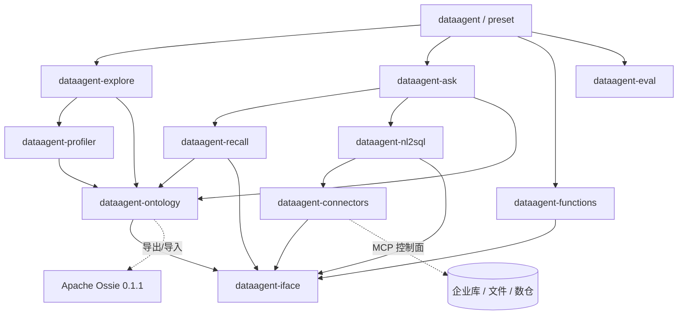

## 6. 中国市场：需求差异与进入策略

> 本节依据 [F-china-market.md](parts/F-china-market.md)，其中国内站点部分为 JS 渲染、未能取到正文的已标"未核实"；榜单数据来自 BIRD 官方页面（2026-10）。

### 6.1 五个真实差异

1. **数据源结构不同。** 欧美以 Snowflake/BigQuery/dbt 的"已建模数仓"为主；中国大量客户是"ERP/用友金蝶 + 手工 Excel + 一堆孤岛库"，没有 dbt 层。同一句"上月毛利率"，美国能直接映射到 dbt metric，中国要先做 ETL 和口径拉齐。→ **产品必须能"先吃文件、再吃库"。**
2. **部署是硬约束而非偏好。** 中大型客户默认私有化/专有云，数据不出域写进合同，信创点名 CPU（鲲鹏/海光）、OS（麒麟/统信）、库（达梦/人大金仓/OceanBase/GaussDB）、模型（不能出境）。→ 必须可离线、可换模型、可换库。
3. **口径治理是政治问题，不是技术问题。** 客户买的是"谁的数为准"的裁决机制——指标权责、版本、审批、留痕。欧美更多是 catalog/lineage 的工程问题。
4. **交互习惯是"对话 + 报表 + 微信"。** 企微/钉钉/飞书登录、移动端看板、日报周报推送是刚需，最终交付物常常是"一张能贴进 PPT 的图"。
5. **合规与评测是采购门票。** 信通院"可信 AI"/"大模型驱动的智能数据分析工具"专项评测、等保、ISO 27001/27018 是标书加分甚至资格项。

### 6.2 竞争格局：NL2SQL 已不是护城河

BIRD 2026-10 榜单：华为 2012 Labs DataGallery 82.39、腾讯 SiriusAI-SQL 82.28、京东 JoyDataAgent 76.19（仅 4B）、蚂蚁 Agentar 74.90、小米 80.83；人类 DB 工程师基准 Dev 92.96 / Test 72.37。**Test 上机器已越过人类平均线。**

国内头部已集体转向"语义层 + Agent"：帆软 FineBI 7.0 把架构从"数据表分析"重构为"指标语义层"（Next = 分析 Agent 已上线 + 场景 Agent 共创中）；SmartBI 白泽 V5 做多智能体 + 统一指标模型 + 企业知识库 RAG；Kyligence Zen、观远指标中心、Quick BI 的 AI-ready 语义层，路径高度一致。**指标平台是入场券，不是差异点。**

云厂商的壁垒是**渠道 + 合规资质**，不是模型：Quick BI 首批过信通院双评测、连续 7 年进 Gartner ABI 魔力象限（厂商口径）。

### 6.3 三个空档（按锋利度排序）

**Wedge 1｜"文件即席分析 → 一键升格为受治理指标"（最锋利）**
全行业把 Excel 当"又一个 connector"，没人把文件里临时算出的口径沉淀成带 owner、版本、审批的指标。SmartBI 只做到"识别 Excel 模板自动填报"（模板→数据的反向）；Quick BI 即席分析仅专业版且与指标层割裂。切入点：业务人员拖一个 Excel 问数 → Agent 识别计算逻辑 → 提示"这个口径和库里『毛利率』差 2.3pp，是否登记为新指标/申请修订" → 走审批流。同时命中"口径治理"与"Excel 文化"两个中国特有痛点，且欧美产品（无强审批文化）不会优先做。

**Wedge 2｜"国产库方言 + 离线可换模型"的交付包（最容易签单）**
三件事：① 达梦/人大金仓/OceanBase/GaussDB/StarRocks 的方言适配与查询改写（BIRD 上达梦 Blender-SQL 74.51 已证明可行，但产品化不足）；② 全离线镜像 + 国产 CPU/OS 兼容清单；③ 信通院评测/等保材料模板。**把"合规"做成 SKU，而不是做成文档。**

**Wedge 3｜"指标口径争议的仲裁者"（最高价值场景）**
不做"全员自助 BI"（打不过帆软/观远的渠道），做经营分析会场景：两个部门报出不同的数，Agent 当场给出差异归因（口径差异 / 时间窗 / 含税与否 / 渠道归属），并留痕。帆软官网自己用这个故事教育市场，说明需求真实；他们用"事前建指标"解决，我们可以用"事后解释 + 反哺指标"差异化。

### 6.4 生态与定价

**生态优先级**：数据库/OLAP 厂商（OceanBase DataPilot、SelectDB、StarRocks、达梦、GaussDB 都在抢"Agent 入口"，但不擅长分析体验与指标治理，诉求是"证明我的库跑问数更快/更准"）> BI 厂商做语义层互补（Kyligence、SmartBI 已有文件侧能力但缺"文件→受治理指标"闭环）> 信创 SI（带 POC、垫资、做等保，需要"SI 可交付包"）> 开源社区（SuperSonic/DB-GPT/Chat2DB 是开发者入口）。

**定价锚点**：云订阅已被打到地板（腾讯云 BI 促销 9.9 元/年，DataWorks 资源包 109 元），**不要按席位定价**。可行锚点是"按数据域/Agent 数 + 实施人天"，并把 tokens 成本转嫁给客户自带模型（BYO model）。私有化仍是 License + 首年实施 + 年维保。

---

## 7. MintHub 产品设计：DataAgent 作为一个 bundle / preset / app

> 本节平台结论以 `packages/agent-kernel` HEAD `86ae83c`（core 0.1.14 / CLI 0.1.13）源码为准；与 2026-10-28 文档口径不同处已标注。证据见 [G-kernel-packaging.md](parts/G-kernel-packaging.md)。

### 7.1 先定形态：bundle + preset，不是 plugin

| 候选 | 判定 | 理由 |
|---|---|---|
| `plugin` | ❌ | 必须声明 `subkind ∈ {wasm, native, js}`（`validate.rs:222-227`）。DataAgent 的核心是常驻进程，三者都不属于。 |
| `mcp` | ❌（今天） | `Kind::Mcp` 只出现在清单与布局校验里，`mcp_loader` 只认 bundle 与项目配置；发成 `mcp` 今天"装得下、跑不起来"。 |
| `bundle` | ✅ | HEAD 已支持 bundle 携带 `.mcp.json` 并拉起 stdio server（`mcp_loader.rs:442`），同时可带 `skills/`、任意资产与可执行文件；`capabilities.exec/env` 做白名单。 |
| `preset` | ✅（组合层） | 唯一能"一次装齐 + 精确锁版本"的声明式手段；`[policy]` 只能收紧；本身不带代码、不注册工具。 |
| `app` | ⚠️（后期） | 自包含成品树，`deps=[]`，一键交付体验最好；但等于把运行时一起发，且要按 target 签名。适合"给最终用户"。 |
| `iface` | ⚠️（未发布） | 源码已有枚举与校验（`lib.rs:50-53`、`validate.rs:393`），但 0.1.11 报 `unknown variant iface`。短期用 bundle + `provides.interfaces`。 |

**包清单**：

```text
dataagent-iface        bundle   契约：schema / fixtures / SKILL.md，provides.interfaces
dataagent-ontology     bundle   schema、校验、diff、版本、迁移
dataagent-profiler     bundle   画像、键/外键/包含依赖发现（候选 + 证据）
dataagent-connectors   bundle   MCP 连接器声明 + 只读网关（可再拆每库一包）
dataagent-recall       bundle   实体/指标/值/join 路径召回
dataagent-nl2sql       bundle   规划、方言 SQL、校验、执行、修复
dataagent-functions    bundle   BI 运算、预测、异常、导出
dataagent-explore      bundle   MCP + Skill：探查与建模
dataagent-ask          bundle   MCP + Skill：智慧问数
dataagent-eval         bundle   评测 harness + 金话题集
dataagent              preset   精确锁上面全部，提供默认配置
ontology-pack-<行业>    bundle   纯内容：指标、同义词、样例问题、评测集
dataagent-desktop      app      可选：面向最终用户的一键成品
```



依赖单向：`ask → recall → ontology`、`ask → nl2sql → connectors`、`explore → profiler → ontology`；`functions` 只依赖 `iface`，保证能被其他应用单独安装。

### 7.2 工具面：命名即权限

内核**按工具名推断审批类别**（`mcp/client.rs:706-725`）：`get_/list_/search_` 落 Search/Read 自动放行；`create_/write_/edit_` 走审批；`exec_/run_` 落 Execute。所以只读路径必须用 `get_/list_/search_`，写入/执行必须显式 `create_/exec_`，否则要么被静默放行，要么每次弹审批。

| 包 | 默认工具 |
|---|---|
| `dataagent-explore` | `list_sources`、`get_source_schema`、`profile_table`、`search_candidates`、`propose_ontology`、`get_ontology_diff`、`publish_ontology` |
| `dataagent-ask` | `ask_question`、`get_answer`、`get_answer_trace`、`search_verified_queries` |
| `dataagent-ontology` | `get_ontology`、`list_versions`、`get_impact`、`validate_ontology` |
| `dataagent-profiler` | `profile_dataset`、`detect_keys`、`detect_joins`、`sample_values` |
| `dataagent-functions` | `analyze_table`、`forecast_series`、`detect_anomalies`、`export_xlsx` |

工具面预算：默认 ≤6 个/包、总量 ≤20 个、≤3k tokens。对照：DBHub 2 工具 1.4k tokens，MCP Toolbox 28 工具 19k tokens。工具一多，选 tool 准确率就掉。

**Skill 写法**：每个能力入口一个 `SKILL.md`，只写"何时用、调用顺序、失败怎么办、产物在哪"，不写 schema（由工具返回）。参考 ql-audit 的 6 行：稳定 request_id、轮询 job_get、澄清必须用户显式回答、未知不重放。

### 7.3 运行链路

```text
用户提问
  ├─ [skill 注入] 何时问数 / 何时建模 / 何时分析
  ├─ ask_question(question, ontology_version?, budget?)
  │     ├─ 语义解析：指标/实体/时间/维度/过滤
  │     ├─ 召回：metric → entity → field → value → join path（见 4.2）
  │     ├─ 规划：单 SQL / 多步 / 澄清 / 拒绝
  │     ├─ 生成：方言 SQL（Ossie 多方言表达式展开）
  │     ├─ 校验：parse → 列存在 → dry-run/EXPLAIN → 行数上限
  │     ├─ 执行：DuckDB（文件）或 MCP connector（库），带 timeout/max_rows/scan budget
  │     ├─ 复核：空结果、量级异常、口径冲突 → 重写或澄清
  │     └─ 产出：answer + sql + rows + chart spec + assumptions + confidence + lineage
  └─ 长任务（画像/建模/大查询）→ job_id → get_answer 轮询
```

**为什么必须 job 化**：MCP 单请求硬超时 60s（`mcp/transport.rs:24`），内核无后台 job 原语，shell 上限 600s。ql-audit 已验证"受理返 job_id + worker 推进 + 未知不重放"的形状。

**产物怎么回 GUI**：`SessionEvent` 没有文件/附件事件，`ContentBlock` 只有 Text/Image/Json，shell 输出截断 32 KiB。所以表格 → 文本前 N 行 + 产物路径 + digest；图 → 内容寻址 blob；大结果 → 落 parquet/csv，返回 `path + rows + schema + digest`。

### 7.4 数据、凭据与升级

| 资产 | 位置 | 理由 |
|---|---|---|
| ontology schema、连接器声明、Skill、默认配置 | 包内 | 随 `mint.lock` 内容哈希固定 |
| 项目的 ontology 版本、verified queries、评测集 | 项目目录（`$DATAAGENT_PROJECT_ROOT`） | 升级整目录替换包，不能放包内 |
| job、产物、缓存、值索引 | 数据目录（`$DATAAGENT_DATA_ROOT`） | `$PKG_DATA` 只有规范没有实现 |
| 数据库凭据 | 只写 env 引用（`capabilities.env` 白名单） | MCP 子进程环境被清空，只留 `BASELINE_ENV` + 声明变量 |

三个必须自己实现的迁移动作：schema 迁移（`model_version` 与包版本分离，指纹不一致就暂停要求显式 migrate）、索引重建（带 `built_from_digest`）、向后兼容（至少能读旧版本 ontology）。

### 7.5 版本门槛与降级

bundle 的 `.mcp.json` + `capabilities.env` 在 HEAD（0.1.14）可用，但 **0.1.11 明确拒绝**，中间版本未测。因此：`mint.toml` 写 `[requires] api` 与 core 下限；对旧 core 提供 legacy 构建（`scripts/install-local.mjs` 把绝对入口写进工程 `.mcp.json`，ql-audit 已验证）；对外文档明确"需要 core ≥ X"。

### 7.6 商业化与分发

| 层 | 内容 | 收费 |
|---|---|---|
| 开源核心 | iface、ontology、profiler、recall、nl2sql、DuckDB 执行、基础 Skill | 免费（Apache-2.0） |
| 企业包 | 连接器（Oracle/DB2/达梦/人大金仓/GaussDB）、RLS/审计网关、私有化包、行业 ontology pack | 订阅/项目制 |
| 服务 | 建模实施、口径治理咨询、评测验收、SI 赋能 | 人天 |

两条红线：① 不把 WrenAI/DB-GPT/Chat2DB/SuperSonic 代码直接打进可分发包（许可风险）；② 不按席位定价（中国锚点已被打到 9.9 元/年）。

### 7.7 接入千行百业：三种包，不 fork 代码

行业差异必须落在"内容"和"连接器"里，不能落在引擎里。一旦发现"要改引擎才能接这个行业"，说明抽象错了。

| 方式 | 载体 | 内容 | 谁来做 | 复用度 |
|---|---|---|---|---|
| **行业语义包** | `ontology-pack-<industry>`（bundle，纯内容） | ≥30 指标、≥50 同义词、join 模板、≥20 样例问题、≥15 评测题、看板模板 | 行业顾问 + 数据工程 | 高（跨客户复用） |
| **系统连接包** | `connector-<system>`（bundle） | 用友/金蝶/SAP/CRM/HIS 的表映射、增量策略、只读视图、字段字典 | 集成商 + 我们 | 中（跨客户复用） |
| **交付覆盖包** | overlay / 项目配置 | 客户特有口径、权限、报表模板、术语 | SI / 客户 | 低（项目制） |

**行业选择矩阵**（按"数据就绪度 × 付费意愿 × 竞争强度"）：

| 行业 | 数据形态 | 付费意愿 | 竞争 | 建议 |
|---|---|---|---|---|
| 零售/消费 | 门店/商品/订单/会员，Excel 多 | 强 | 激烈（观远、帆软） | **首发**：指标最标准、文件场景最多，适合验证"文件→指标" |
| 制造 | ERP/MES/BOM/工单/供应链 | 强 | 较少 | **第二**：口径复杂、交付深，适合做高客单 |
| 金融 | 数仓成熟、强合规、私有化 | 很强 | 激烈（蚂蚁、Kyligence） | 只做"口径仲裁 + 审计"切面，不做通用问数 |
| 医疗/政务 | HIS/EMR/政务数据，信创 | 中 | 项目制、关系驱动 | 通过 SI 合作，不直销 |

**行业包的质量门槛**（否则就是"换个名字的 demo"）：
1. 每个指标必须有口径、单位、时间语义、owner；
2. 每个同义词必须能映射到具体字段或枚举值；
3. 每个样例问题必须有可执行的 gold SQL 与预期结果；
4. 每个包必须有对应的评测集，且随包版本升级跑回归；
5. 包内不得含客户数据、凭据、真实 PII。

