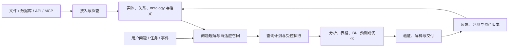
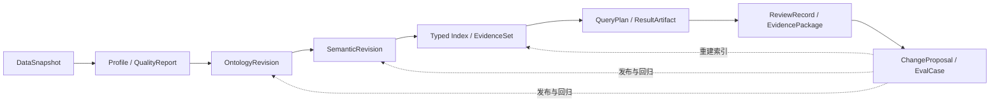

# DataAgent 模块能力草案

> 这是一版模块能力草稿，不是最终架构、产品 PRD 或实施计划。它参考[当前 DataAgent Brainstorm 飞书文档](https://modelbest.feishu.cn/docx/TlN4dygs9oJR3Qx1FaictiPEn3c)和[Agent OS 应用组件整体规划](../../official/agent-os-application-components.md)的组织方式，先回答“应该有哪些一级、二级能力”，再决定哪些能力做成 bundle、preset、app 或领域包。

## 一、定位：两个范围、同一条资产链

当前草稿已经区分了 DataAgent 与 General DataAgent。这里保留这个区分，并把它改写成产品范围，而不是两个完全不同的产品：

| 范围 | 主要目标 | 数据和语义 | 主要交付物 |
| --- | --- | --- | --- |
| **狭义 DataAgent** | 基于当前输入，回答一个问题或完成一次分析 | 使用已有数据库、文件和语义；只为当前任务补足必要解释 | 答案、SQL、表格、图表、报告、分析过程和证据 |
| **广义 General DataAgent** | 持续建设并运行数据工作 | 探查、清洗、身份对齐、ontology、语义版本、质量和关系持续维护 | 可查询数据集、语义层、ontology、分析流程、预测方法、评测集和可复用资产 |

两者共享同一条链路：



狭义产品可以在任务内临时完成一小段探查和语义映射；广义产品则把经过验证的结果提升为可复用、可审阅、可回滚的资产。一次回答的上下文、猜测或反馈不能自动成为企业级事实。

## 二、一级模块总览

本草案暂定 **12 个 DataAgent 专属一级模块、72 个二级能力**。编号使用 `DA` 前缀，以免与 Agent OS 规划中的 `D`（数据与决策）和 `R`（执行与协作）混淆。

| 编号 | 一级模块 | 解决的主要问题 | 狭义 | 广义 |
| --- | --- | --- | --- | --- |
| DA01 | 数据接入与任务数据空间 | 数据怎样安全、稳定、可追溯地进入任务 | 必需 | 必需并持续接入 |
| DA02 | 数据探查与画像 | 当前有哪些数据、粒度、质量和关系 | 任务内探查 | 持续资产画像 |
| DA03 | 数据质量与修复 | 数据是否可信，问题怎样修复和复核 | 关键结果校验 | 质量治理与回归 |
| DA04 | 实体、身份与 ontology | 数据中的对象是什么，怎样对齐和关联 | 局部对象理解 | 企业对象和关系资产 |
| DA05 | 语义层、指标与业务规则 | 指标、维度、时间和规则怎样计算 | 复用或临时定义 | 版本化语义与发布 |
| DA06 | 自适应检索与证据 | 从值、列、指标或规则等入口找到足够证据 | 问题级召回 | 多入口索引和维护 |
| DA07 | 智慧问数与 NL2SQL | 将问题转为可执行、可解释的查询 | 核心入口 | 查询服务与回归 |
| DA08 | 深度分析与诊断 | 解释变化、比较方案、设计分析验证 | 分析工件 | 分析方法资产 |
| DA09 | 表格、BI 与可视化交付 | 把结果变成可编辑、可复算的工作成果 | 直接交付 | 模板、报表和持续刷新 |
| DA10 | 预测、仿真与优化 | 对未来、情景和约束方案进行计算 | 受控函数 | 方法、模型和回测资产 |
| DA11 | 结果验证、治理与业务交付 | 结果是否满足证据、权限、口径和审阅要求 | 回答前后检查 | 发布、审计和责任链 |
| DA12 | 反馈、评测与资产演进 | 如何从使用结果中改进并沉淀资产 | 会话反馈 | 版本、回归和持续改进 |

### 2.1 一级模块与二级能力的关系

一级模块是**能力域**，回答“这一类问题由哪组能力负责”；二级能力是这个能力域中的**可组合能力单元**，回答“具体需要完成什么”。二级能力不默认等于一个服务、一个 Agent、一个插件或一个 Mint 包。

同一个二级能力可以被多个流程调用，一个流程也通常会跨越多个一级模块。例如：

| 业务动作 | 参与的一级/二级能力 | 交互关系 |
| --- | --- | --- |
| “按去年 12 月的口径重算收入” | DA01-数据快照与截至时间、DA05-指标定义与语义发布、DA07-查询计划、DA11-证据化结果包 | 以数据 snapshot、semantic revision 和 policy revision 共同固定可重算条件 |
| “客户名映射到 CRM 与订单系统” | DA02-取值画像、DA04-身份对齐、DA05-实体/指标关系、DA06-值反向定位、DA11-人工审阅 | 探查提供候选，ontology 保存身份关系，检索消费稳定 ID，审阅决定是否发布 |
| “新规则是否影响已有报表” | DA04-ontology 修订、DA05-业务规则与语义发布、DA06-影响对象召回、DA11-版本验证、DA12-回归评测 | 语义变更触发影响分析、查询回放和发布/回滚判断 |

因此，模块树不是严格的流水线。真实流程可能从 DA06 的值或列检索进入，再调用 DA04/DA05 补齐对象和语义；也可能先从 DA01 的快照或 DA05 的认证指标开始，直接进入 DA07。

### 2.2 “版本控制”是横切能力，不是单一模块

本草案中的几处“版本”需要拆开管理。它们可以共用一套 revision/lineage/approval 基础设施，但不能用一个 Git commit 或一个 schema hash 代替全部版本：

| 版本维度 | 解决的问题 | 典型标识 | 主要使用者 |
| --- | --- | --- | --- |
| **源结构版本** | 表、列、API、文件布局发生了什么变化 | `source_revision`、schema fingerprint | DA01、DA02、DA06 |
| **数据快照版本** | 这次答案读的是哪一批数据，能否按 as-of 重放 | `snapshot_id`、partition、file digest、query timestamp | DA01、DA02、DA07、DA11 |
| **ontology 版本** | 实体、身份、关系、状态模型怎样修订 | `ontology_revision` | DA04、DA06、DA12 |
| **语义发布版本** | 指标、维度、规则何时生效，哪个版本可用于查询 | `semantic_revision`、`effective_from/to`、发布状态 | DA05、DA07、DA11 |
| **权限策略版本** | 谁在什么时间能看到哪些对象、值、结果和导出 | `policy_revision`、subject/tenant scope | DA01、DA06、DA07、DA11 |
| **索引与上下文版本** | 检索使用了哪一版值索引、文档、历史 SQL 和重排配置 | `index_revision`、freshness | DA02、DA06、DA12 |
| **计算与交付版本** | 查询计划、代码、预测模型、表格和报告如何产生 | `plan_revision`、`code/model/artifact_revision` | DA07、DA08、DA09、DA10、DA11 |
| **评测与组件版本** | 哪套题集、规则、函数和 bundle 通过了验收 | `eval_revision`、`bundle_version` | DA11、DA12、AgentOS 分发 |

三个选中文本的归属可以这样理解：

- DA01 的“快照与数据截至时间”是 **数据版本 / 数据时间**。它回答“读了哪批数据”，不回答“指标定义是哪一版”。
- DA04 的“ontology 修订与历史”是 **对象模型版本**。它回答“客户、订单及其关系怎样定义和对齐”。
- DA05 的“语义发布与历史重现”是 **语义发布版本**。它回答“收入指标和规则哪个版本在什么时间生效”。

要重现一次结果，至少需要把这些版本组合起来：

```text
ReproducibleResult
  = source_revision
  + snapshot_id / as_of
  + ontology_revision
  + semantic_revision
  + policy_revision
  + index_revision
  + plan/code/model/artifact_revision
```

这里还要区分两个时间：**业务生效时间**和**系统记录时间**。例如一条退款规则在 10 月 1 日生效，但 10 月 5 日才录入系统；历史重现需要知道查询是按哪一个时间解释规则。语义回滚也只改变当前可用发布版本，不能凭空恢复已经被覆盖的源数据；缺少数据快照或事件日志时，只能说明“定义可回退”，不能承诺完整历史结果可重算。

## 三、按层次归类：数据与语义基础、应用智能、治理演进

如果一级模块全部平铺，容易把“建设数据资产”和“运行一次分析任务”混在一起。建议增加一个比 DA 编号更高层的分类。这个分类表示能力主要服务哪一层，不表示严格的执行顺序，也不要求每层部署成独立服务。

| 层次 | 模块 | 主要职责 | 主要产物 | 典型生命周期 |
| --- | --- | --- | --- | --- |
| **L0 AgentOS 运行基础** | AgentOS 通用能力，不使用 DA 编号 | 会话、模型、工具、身份、审批、沙盒、长任务、artifact、trace、分发 | 可运行的 Agent、任务、工具调用和包 | 平台级维护 |
| **L1 数据基础层** | DA01–DA03 | 接入、探查、质量、修复和数据可用性 | SourceProfile、DataSnapshot、Profile、QualityReport、RepairProposal | 持续刷新、按快照重放 |
| **L2 语义基础层** | DA04–DA05 | 实体、身份、ontology、指标、维度、规则和语义发布 | OntologyRevision、SemanticRevision、Metric、Rule、Join/Mapping | 提案、验证、审核、发布、回滚 |
| **L3 应用智能层** | DA06–DA10 | 面向用户问题和任务进行检索、问数、分析、表格交付、预测、仿真和优化 | EvidenceSet、QueryPlan、ResultArtifact、Forecast、Scenario、OptimizationPlan | 按任务运行，必要时调用基础层 |
| **L4 治理与演进层** | DA11–DA12 | 结果验证、权限审阅、证据交付、反馈、评测、漂移和资产演进 | EvidencePackage、ReviewRecord、EvalCase、ChangeProposal、Release | 横跨任务与版本持续运行 |

从产品叙事上，可以使用更粗的三层称呼：

- **DA01–DA05：数据与语义基础层**。它们负责把原始来源变成可理解、可验证、可复用的数据和语义资产。
- **DA06–DA10：应用能力层或应用智能层**。它们根据用户问题和任务动态选择证据、查询、分析和交付方式。
- **DA11–DA12：治理与持续改进层**。它们验证结果、控制风险，并把反馈沉淀为下一轮可复用资产。

工程上仍建议把 DA01–DA03 和 DA04–DA05 分开。前者处理物理数据的可用性，后者处理对象、关系和业务语义；两者的版本、发布责任和失效条件不同。对外介绍时可以合并为“数据与语义基础层”，内部设计时保留两个子层。

### DA06 的层次边界

DA06 是应用层的入口，但它不是把 DA01–DA05 再包装成一个固定前置流程。它根据用户问题、已有线索和当前证据动态选择下一步动作，因此可能从值、列、指标、实体、规则或历史 SQL 进入；当证据不足时，再回到 DA02、DA04 或 DA05 补查。DA06 消费基础层产出的索引、对象关系、语义版本和权限信息，同时也会把新的检索缺口反馈给 DA12。

因此，DA01–DA05 是“可被应用调用的数据与语义基础”，DA06–DA10 是“运行时面向任务的应用能力”。两者是依赖关系和反馈关系，而不是固定的线性流水线。

### 第二条分类轴：建设时机与运行时机

层次划分还可以增加一条正交的生命周期轴，用来区分哪些能力主要在数据准备阶段运行，哪些能力主要在用户任务中运行：

| 时机 | 主要模块 | 说明 |
| --- | --- | --- |
| **离线/增量建设** | DA01–DA05，以及 DA12 的索引和资产发布部分 | 连接刷新、画像、质量检查、实体对齐、ontology/语义发布、值索引、回归题集和版本准备 |
| **在线任务执行** | DA06–DA11 | 根据问题动态召回、查询、分析、生成交付物、验证并按权限返回结果 |
| **跨时机能力** | DA03、DA11、DA12 | 质量门禁、治理审批、漂移监测、反馈归因和回归评测既可以阻塞在线任务，也可以持续后台运行 |

这条轴说明了为什么“层次”不等于“调用顺序”：DA06 可能在线触发一次 DA02 的增量探查，DA11 也可能在离线发布前运行同一套验证，而 DA12 同时负责在线反馈和离线回放。

### 模块之间通过领域对象交互

一级模块是能力域，二级能力可以跨域组合。为了避免模块之间直接依赖内部 Agent 或 prompt，建议通过稳定的领域对象交互：



| 领域对象 | 主要生产模块 | 主要消费模块 | 必要交互信息 |
| --- | --- | --- | --- |
| `DataSnapshot` | DA01 | DA02、DA03、DA07、DA11 | 来源、digest/分区、as-of、读取权限、刷新和失效状态 |
| `Profile / QualityReport` | DA02、DA03 | DA04、DA05、DA06、DA11 | 统计范围、样本、异常、置信度、覆盖和探查时间 |
| `OntologyRevision` | DA04 | DA05、DA06、DA07、DA12 | 稳定对象 ID、关系、粒度、映射证据、版本和有效期 |
| `SemanticRevision` | DA05 | DA06、DA07、DA08、DA11 | 指标/规则定义、编译表示、生效时间、发布状态和依赖 |
| `EvidenceSet` | DA06 | DA07–DA11 | 候选对象、来源、匹配方式、权限、版本、新鲜度和缺口 |
| `QueryPlan / ResultArtifact` | DA07–DA10 | DA09、DA11、DA12 | 计划、代码/SQL、输入版本、参数、结果、限制和可复跑入口 |
| `ChangeProposal / EvalCase` | DA11、DA12 | DA04–DA07、DA10、AgentOS 分发 | 提议变更、作用域、验证结果、兼容性、审批和回滚信息 |

这也意味着一个二级能力可以同时出现在多个产品流程中，但不必复制实现。例如“值反向定位”既可以服务企业问数，也可以服务数据质量调查和领域应用；它只需要遵守统一的权限、版本和证据契约。

## 四、DataAgent 专属模块与二级能力

### DA01｜数据接入与任务数据空间

解决文件、数据库、API、MCP 和已存在语义服务如何进入一个有边界的任务空间。

1. **文件与连接器接入**：读取 CSV、Excel、JSON/JSONL、数据库、API、MCP 等来源，保留来源类型和连接配置引用。
2. **结构解析与规范化**：识别工作簿 sheet、表块、表头、嵌套对象、分页结果和字段类型，生成统一的可查询表示。
3. **数据快照与截至时间**：记录文件 digest、查询时间、分区、快照或增量位置，区分当前数据与历史 as-of 数据；这是数据可重放标识，不等同于代码版本。
4. **源能力与读取契约**：登记可读对象、分页/游标、过滤能力、采样能力、刷新频率、失败和截断状态。
5. **任务级数据空间**：把本次任务可用的文件、连接、临时表、查询结果和中间数据组织成隔离空间。
6. **接入权限与敏感数据边界**：在读取、采样、缓存、索引、模型上下文和导出各阶段传递授权范围。

**边界：** 连接器提供数据访问，不负责自动理解企业业务；文件读取成功也不代表公式、隐含表头或业务粒度已经正确。

### DA02｜数据探查与画像

解决“数据是什么、能不能用、还缺什么证据”，为语义构造和查询计划提供事实基础。

1. **结构画像**：统计表、字段、类型、嵌套层级、空列、重复列和工作簿区域。
2. **取值与分布画像**：统计空值、基数、频率、范围、格式、枚举候选和代表样本。
3. **时间与粒度识别**：识别事件时间、业务时间、更新时间、时区、周期、主记录粒度和快照粒度。
4. **质量与异常初筛**：发现缺失、重复、类型冲突、突变、异常分布和跨源不一致，并标注样本范围。
5. **关系与 join 候选发现**：结合 PK/FK、名称、类型、值覆盖、历史 SQL 和基数提出关系候选。
6. **探查计划与覆盖报告**：根据任务和预算选择下一步探查，记录已覆盖对象、未探查区域、索引缺口和不确定性。

**边界：** 相似列、值重合或历史上有人 join 过，只能形成候选，不能直接发布为合法业务关系。

### DA03｜数据质量与修复

解决数据问题如何被定位、提出修复、验证影响并保留原始证据。

1. **结构与取值契约**：检查列存在、类型、唯一性、非空、范围、枚举和格式等明确断言。
2. **跨表对账与一致性**：检查总分、余额、计数、外键覆盖、时间连续性和跨源对账关系。
3. **异常与缺失定位**：定位异常记录、异常分区和异常模式，区分真实业务变化与数据错误。
4. **修复方案生成**：提出去重、标准化、类型转换、缺失补齐、值映射和关系修订候选。
5. **修复执行与效果复核**：在隔离或开发空间执行修复，比较前后质量指标，不覆盖原始输入。
6. **质量事故影响分析**：沿 lineage 定位受影响指标、查询、报表和任务，生成重算、回滚或人工处理范围。

**边界：** 修复建议和写回执行分开；修复通过断言不等于业务口径正确，发布仍需要 DA11 的审阅和授权。

### DA04｜实体、身份与 ontology

解决“客户、订单、设备、合同等业务对象是什么，以及不同来源是否指向同一个对象”。

1. **概念与实体类型提取**：从 schema、文档、指标、代码和用户问题中形成对象类型和候选定义。
2. **稳定身份与主数据对齐**：识别主键、自然键、别名、编码和跨系统身份，保留合并、拆分和冲突证据。
3. **粒度与状态模型**：描述对象是一行、一次事件、一个版本还是一段有效期，以及状态如何变化。
4. **对象关系与约束**：表达一对一、一对多、多对多、桥表、租户键、时态条件和允许的业务路径。
5. **ontology 映射与实例化**：将逻辑对象、属性、关系映射到表、列、文件区域、API 和已认证数据集。
6. **ontology 修订与历史**：处理同名对象、跨域定义冲突、关系失效、合并/拆分变更和历史重现，形成可追踪的 ontology revision。

**边界：** ontology 不等于 glossary、表目录或图数据库；第一版可以使用关系表、稳定 ID、索引和 adjacency API 实现。

### DA05｜语义层、指标与业务规则

解决指标、维度、时间、单位和规则如何形成可执行且可审阅的业务语义。

1. **指标与度量定义**：记录公式、过滤、分子分母、聚合、可加性、非加性和派生关系。
2. **维度与可切分范围**：记录可用于分组或过滤的维度、适用实体、粒度和与指标的合法组合。
3. **时间、日历与单位语义**：表达事件/下单/支付/结算时间、时区、财务日历、币种、计量单位和有效期。
4. **业务规则与例外**：管理制度、阈值、排除条件、优先级、例外、来源和生效范围。
5. **语义计划与受控编译**：把指标和约束编译为查询计划、SQL、函数参数或其他计算表示，并暴露解释计划。
6. **语义发布与历史重现**：维护 draft、proposed、validated、reviewed、published、deprecated 等状态，支持语义 revision、回滚和按生效时间重现。

**边界：** dbt/MetricFlow、Cube、Wren 等可以提供参考机制，但不自动替代企业定义、权限、业务生效时间和发布责任。

### DA06｜自适应检索与证据

解决新问题不必沿固定 `问题理解 → 表 → 业务逻辑 → 列 → 值` 链路，能够从任意有效线索出发并按缺口补证据。

1. **多入口问题理解**：识别值、实体、列、指标、规则、已有 SQL、文件和会话对象等线索，并允许理解随证据修订。
2. **类型化对象索引**：分别索引表、列、值、实体、指标、规则、代码、文档、历史分析和查询结果，返回稳定对象 ID。
3. **反向定位与渐进导航**：支持值→列/实体、列→指标/规则、指标→依赖、规则→来源、已知 ID→详情和邻接关系。
4. **缺口驱动的下一动作**：根据候选冲突、缺字段、未知值、连接风险或时间口径选择搜索、取样、文档读取、SQL probe 或澄清。
5. **证据与权限感知召回**：返回来源、版本、匹配方式、采样范围、ACL 状态、截断和索引新鲜度，不把自由文本摘要当完整证据。
6. **停止、澄清与回退**：按照任务证据清单判断是否足够；关键歧义触发澄清，覆盖不足或预算耗尽明确返回限制。

**边界：** 动态下一步不等于无限图遍历；值索引属于受权限约束的数据内容索引，不能因为有一个 `search_values` 工具就宣称支持任意全库反查。

### DA07｜智慧问数与 NL2SQL

解决用户问题如何转为绑定语义对象、可执行、可解释且可修复的查询。

1. **任务类型与需求澄清**：识别问数、解释、对比、下钻、追问和不可回答情形，澄清真正影响结果的缺失项。
2. **候选绑定与查询计划**：将用户提及绑定到稳定的实体、指标、维度、值、时间和产物角色，保留多个候选解释。
3. **语义查询优先与 NL2SQL fallback**：已有认证指标走受控语义计划；未建模问题进入有范围、有权限的 NL2SQL。
4. **SQL 生成与安全检查**：使用参数绑定、AST 解析、只读/写入策略、对象范围、成本预算、超时和结果行数限制。
5. **执行反馈与有界修复**：根据空集、错误、重复膨胀、结果异常和小查询验证结果修订计划或 SQL，限制循环次数。
6. **答案解释与引用**：输出定义、时间、数据版本、SQL/计划、结果引用、假设、限制和下一步，而不是只返回数字。

**边界：** SQL 可执行不等于业务正确；语义计划、SQL、结果和解释必须分别验收。

### DA08｜深度分析与诊断

解决“发生了什么、差异来自哪里、哪些解释值得验证”，将问数扩展为可复现分析。

1. **问题到分析计划**：把开放问题拆成目标、假设、数据、分析方法、检验和交付条件。
2. **描述性 BI 分析**：支持同比/环比、分组比较、贡献度、漏斗、留存、cohort、分层和下钻。
3. **统计分析与不确定性**：支持分布、相关、回归、假设检验、区间和样本量判断，并记录适用条件。
4. **异常与根因调查**：按时间、结构、维度和关系寻找解释候选，明确区分相关性、贡献和因果。
5. **关系与网络分析**：对客户、供应商、工单、交易和组织关系进行多跳、聚集、路径和异常结构分析。
6. **可复现分析工程**：保存代码、查询、参数、中间结果、数据版本、图表和结论，使分析可以重跑和继续编辑。

**边界：** 分析 Agent 负责方法选择、假设说明和结果解释；统计库、SQL 引擎和领域函数负责实际计算。

### DA09｜表格、BI 与可视化交付

解决答案怎样变成用户可以检查、编辑、分享和继续使用的工作成果。

1. **表格清洗与结构整理**：处理多 sheet、表头、空行、类型、格式、重复和多个文件合并，保留原件与变换记录。
2. **透视、公式与表格计算**：生成透视、分组汇总、查找、公式和校验，明确重算引擎与公式缓存限制。
3. **图表与交互探索**：根据数据类型和问题选择图表、筛选、下钻和对比，保留数据绑定和生成参数。
4. **报告与 dashboard**：把指标、图表、文字解释和证据组合成可更新的报告、看板或简报。
5. **可编辑与可复跑产物**：交付 SQL、Python、表格、Notebook、报告源文件和结果快照，支持修改、重跑和差异查看。
6. **导出、分享与刷新**：按权限导出 PDF/XLSX/CSV/图像或嵌入页面，记录分享范围、数据截至时间和刷新状态。

**边界：** 交付格式、图表完整性和分享权限不能由“生成成功”推断，需要 DA11 验收。

### DA10｜预测、仿真与优化

解决“未来可能怎样、不同假设会怎样、在约束下应怎样选择”。

1. **时间序列与概率预测**：明确目标、粒度、预测窗口、历史长度、外生变量和预测区间。
2. **回测、基线与漂移**：使用时间切分和 rolling backtest，比较 naive/seasonal naive 与候选模型，持续监测误差。
3. **情景与 what-if 仿真**：表达假设、参数、机制、随机性和敏感性，比较调价、扩产、预算等方案。
4. **约束建模与求解**：表达硬约束、软约束、资源、顺序、容量、时间窗和不可行原因。
5. **多目标方案比较**：展示成本、质量、交付、风险和公平等权衡，保留目标权重与约束版本。
6. **建议、执行反馈与校准**：输出方案及可行性/最优性边界，跟踪实际结果并修订模型、参数和业务约束。

**边界：** 预测、仿真和优化不能共用一个“分析函数”概念；它们的真值分别是未来误差、情景校准和约束/目标满足情况。

### DA11｜结果验证、治理与业务交付

解决结果如何被证明、审阅、授权并交给业务，而不是只看模型自报 confidence。

1. **数据与查询验证**：检查对象绑定、过滤、时间、单位、空集、重复膨胀、聚合守恒和必要关系。
2. **语义与口径验证**：核对指标定义、适用版本、业务规则、例外、生效时间和数据 as-of。
3. **统计与方法验证**：检查样本、基线、回测、区间、泄漏、假设和方法适用范围。
4. **权限、脱敏与外发治理**：检查查询身份、行列权限、采样/缓存/索引/导出和跨境或外部模型范围。
5. **人审、审批与责任交付**：按风险和副作用分级确认，记录审阅人、结论、异议、授权和待补事项。
6. **证据化结果包**：将问题、输入、计划、版本、调用、结果、工件、来源和限制组织为可复核交付物。

**边界：** DA11 是 DataAgent 的业务验证与交付契约；AgentOS 提供通用身份、审批、审计、沙盒和执行边界的基础设施。

### DA12｜反馈、评测与资产演进

解决一次任务如何变成下一次更可靠的能力，同时防止错误反馈污染共享知识。

1. **会话和运行轨迹记录**：保存问题、候选、检索、工具、SQL、结果、澄清、成本和用户操作。
2. **错误归因与反馈结构化**：区分源数据、探查、语义、召回、值匹配、计划、SQL、执行、解释和交付错误。
3. **修订提案与资产提升**：把确认过的映射、指标、规则、示例、函数参数或检索提示形成带作用域的 proposal。
4. **离线回放与回归题集**：以固定数据、语义、权限和工具版本重放问题，比较必要证据召回、业务结果和成本。
5. **线上漂移与失效监测**：监测 schema、值、分布、关系、规则、模型、权限和用户任务变化，触发重探查或人工复核。
6. **版本发布、回滚与复用**：为 ontology、语义、索引、函数、提示、问题集和 bundle 维护版本、兼容矩阵、发布和回滚。

**边界：** 点赞、一次成功 SQL 或聊天记忆不能自动发布成企业事实；提案、验证、审核、发布和回滚必须分开。

## 五、与 Agent OS 通用能力的边界

DataAgent 不应复制 Agent OS 已经提供或计划提供的通用运行机制。DataAgent 主要提供数据领域对象、语义、检索、分析函数和验证契约；AgentOS 负责让这些能力在不同应用中运行。

| AgentOS 通用能力 | DataAgent 使用方式 | DataAgent 需要补充的领域契约 |
| --- | --- | --- |
| 会话、任务与长流程 | 承载一次问数、探查、分析或持续调查 | 任务证据条件、as-of、可复现状态和业务完成条件 |
| 模型、工具与 MCP 调用 | 调用连接器、语义查询、SQL、Python、BI 和领域函数 | 工具的输入语义、数据范围、返回证据、成本和副作用 |
| 身份、权限、审批与沙盒 | 传递用户/租户身份，限制查询、代码、导出和写回 | 行列/值索引/缓存/外发的 DataAgent 权限矩阵 |
| 上下文、记忆与检索基础设施 | 保存当前候选、缺口、历史问题和已确认对象 | 类型化 metadata、值索引、语义版本、证据引用和失效条件 |
| 事件、队列、重试与取消 | 驱动刷新、监测、回测、报告和持续调查 | 幂等、数据快照、部分结果和业务补偿语义 |
| artifact、trace、版本和分发 | 保存 SQL、表格、报告、模型、语义和评测资产 | DataAgent bundle/preset/app 的依赖、默认 scope、领域包和迁移规则 |

因此，“DataAgent 是一个 bundle / preset / app”描述的是交付形态，不是模块划分本身。相同的 DA06 检索、DA07 问数或 DA10 预测能力，可以被不同 preset 组合为企业问数、文件分析、运营调查或行业应用。

## 六、能力复用和升级的初步判断

| 能力层 | 可以直接复用 | 需要升级 | 需要新建或按领域补建 |
| --- | --- | --- | --- |
| 即席文件分析 | 文件读取、查询/代码执行、基础图表、artifact 和 trace | Excel 多 sheet/公式、JSON 嵌套、临时语义和文件间实体对齐 | 文件级数据空间、临时 ontology、文件保留和共享规则 |
| 企业问数 | 连接器、SQL 引擎、模型调用、基础检索、权限入口 | 语义指标、值/列/实体召回、join 约束、SQL 验证和多轮追问 | 企业 ontology、语义发布、值索引和业务回归集 |
| 业务调查与诊断 | 上下文、查询、统计、报告、任务状态 | 证据链、调查计划、关系分析、反例和根因表达 | 行业 taxonomy、方法包、规则和人工复核工作台 |
| 预测/仿真/优化 | 任务运行、artifact、函数注册和资源预算 | as-of、回测、区间、约束、结果校准 | 领域目标、损失函数、仿真模型、solver 配置和业务验收 |
| 持续监测与动作 | 定时/事件、通知、审批和执行基础设施 | 漂移检测、幂等、重试、回执和补偿 | 领域阈值、升级规则、外部动作适配和授权策略 |

## 七、第一版讨论时需要先定的事项

1. **第一版范围**：是先做 DA01–DA07 的“可信数据到有证据答案”，还是同时纳入 DA08–DA10 的深度分析和预测函数。
2. **数据源范围**：即席文件、一个企业数据库、dbt/语义服务、API/MCP 是否都进入第一版验收。
3. **Ontology 最小对象集**：首版是否只支持实体、字段、指标、维度、值映射、关系和规则，暂不支持完整业务动作 ontology。
4. **检索自由度**：先做多类型固定并行作为基线，再增加 DA06 的缺口驱动动态补查；不能直接用 Agent 数量衡量能力。
5. **发布门槛**：哪些映射/指标/关系必须人工审核，哪些可在隔离任务空间自动使用，哪些反馈允许提升为共享资产。
6. **AgentOS 复用边界**：明确连接器、身份、审批、沙盒、长任务、artifact、trace 和 package registry 的现有接口，避免 DataAgent 重造运行时。

## 八、草案与原组件规划的关系

这版 DataAgent 草案沿用原组件规划的组织原则，但没有把 DataAgent 的 12 个一级模块直接等同于 AgentOS 的 20 个通用技术方向：

| DataAgent 草案 | 原组件规划中的主要参考 | 说明 |
| --- | --- | --- |
| DA01–DA03 | D01–D03、D10 | 数据目录、接入、质量、外部变量按 DataAgent 任务重组 |
| DA04–DA05 | D04–D05 | 实体、ontology、语义和业务规则是 DataAgent 的核心领域资产 |
| DA06–DA07 | D05、D06、R03、R05 | 自适应召回和问数需要 AgentOS 的上下文、任务和工具基础设施 |
| DA08–DA10 | D06–D09、R01 | 深度分析、表格、预测、仿真和优化共享计算库与函数执行边界 |
| DA11–DA12 | D03、R07–R10 | DataAgent 定义数据/语义验收，AgentOS 承载通用交付、运行、评测和分发机制 |

本草案最重要的设计选择是：**把数据领域能力做成可组合模块，把会话、工具、权限、审批、长任务、artifact 和分发交给 AgentOS；把企业的 ontology、指标、规则、值索引和回归题集作为可版本化资产。**
