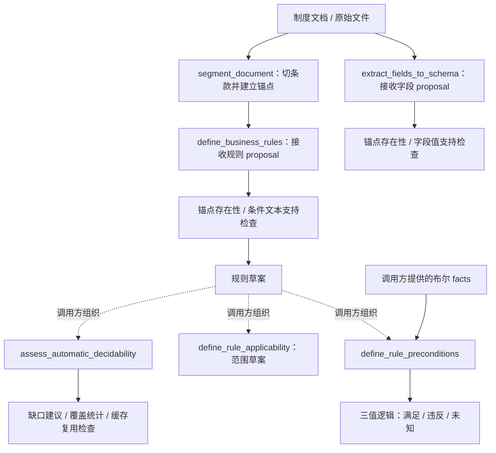

# DataAgent 规则相关判断代码清单

核查时间：2026-11-04，以下结论以 16:14:55（Asia/Shanghai）保存的源码快照为准。工作区本轮有并行修改，清单已据新快照重新核对。

范围：`packages/capabilities/dataagent-data/src/dataagent_data/` 的实现、`dataagent-contracts` 中直接相关的约束，以及判定族 Skill。以源码行为为准，计划和注释只作为设计意图。`packaging/bundle` 是生成副本，本清单不重复列入口；源码摘要列于文末。

## 1. 先明确“规则判断”在当前实现中的含义

当前代码完成的是：**准备候选材料 → 接收 Agent 的结构化 proposal → 做确定性的结构/证据检查 → 保存规则或评估草案 → 给出补证、人工、缓存复用建议**。

没有发现将 `RuleCondition.text` 编译为数值/日期/对象条件、读取单据执行整条业务规则、应用例外优先级并给出最终业务通过/不通过的执行器。规则里的 `exceptions` 目前是保存的条款描述。

唯一直接对条件真假做逻辑运算的业务相关实现是 `_three_valued`；它消费调用方已经给出的 `facts[condition_id]: bool`，不从金额、审批人、单据字段或条件自然语言中推导事实。

应区分三类输出：

| 输出 | 实际含义 | 不能据此推出 |
|---|---|---|
| `SemanticDraft(kind=rule)` | 一份通过当前结构和文本支持检查的规则草案 | 规则已执行、已生效或已人工确认 |
| `Assessment(auto/needs_evidence/needs_human)` | 能否自动判断的评估 | 单据已经符合/违反规则 |
| `PreconditionEvaluation(satisfied/violated/unknown)` | 调用方布尔事实在指定组合下的结果 | 事实来源真实、规则主体已通过 |
| `ApplicabilityDraft` | 规则覆盖对象/场景的描述 | 某个具体对象已经被判为适用 |
| `CapabilityResult.status=ok` | 此次操作按其实现正常返回 | 业务成立、证据充分或结论没有 unknown |

以下图是推荐的数据关系，不代表代码中存在自动串起各步的总控函数：



## 2. 对外入口：判定族全部 14 个原子

下表的“策略”描述当前执行的判断，不把函数名当作已经具备的能力。

| 编号 | 入口、代码位置 | 作用与当前规则策略 | 输出及关键边界 |
|---|---|---|---|
| J01 / DA02.8.1 | [segment_document](/Users/payne/Vibe/AgentOS/packages/capabilities/dataagent-data/src/dataagent_data/preparation/documents.py:112) | 默认按标题正则切分；`paragraphs` 按空行切分。为条款生成原文锚点、序号、类型和最近的序号前缀父节点；持久化条款正文与源版本绑定索引。 | 返回条款单元。当前为确定性实现，没有 `proposal` 参数；不是两段式推理。`max_units` 默认 2000，直接截断；`context_window` 未参与计算。 |
| J02 / DA02.8.2 | [maintain_source_anchors](/Users/payne/Vibe/AgentOS/packages/capabilities/dataagent-data/src/dataagent_data/preparation/documents.py:291) | 先核对所给文档 revision 等于 `current_revision`。锚点 revision 相同进入 `valid` 候选；有映射且指向当前版本则替换 revision，进入 `remapped` 候选；无映射为 `expired`；错误映射为 `unresolved`。前两类还必须有文档、source id 相同、selector 可解析。 | 输出每个锚点的 `valid/remapped/expired/unresolved`。映射只替换 revision，没有搜索新坐标或比较新旧条文含义；旧坐标仍有文本，并不证明仍指向原条款。 |
| J03 / DA02.12.1 | [extract_fields_to_schema](/Users/payne/Vibe/AgentOS/packages/capabilities/dataagent-data/src/dataagent_data/preparation/extraction.py:295) | 无 proposal 时给出 schema 字段和最多 30 个候选片段，返回 `needs_input`；有 proposal 时拒绝未知字段，按字段分组，交 `_evaluate_field` 判断缺失、冲突和证据支持。 | 生成抽取记录；任何字段 issue 使整体为 `partial`。字段值“出现在原文”是主要检查，未把自然语言规则求值。详见 §3。 |
| J04 / DA02.12.3 | [anchor_extracted_values](/Users/payne/Vibe/AgentOS/packages/capabilities/dataagent-data/src/dataagent_data/preparation/extraction.py:414) | 记录必须属于同一文档和 revision。逐个过滤错误锚点；`extracted` 值还要通过值匹配。没有可用锚点时，全文找该值的首次位置补锚；仍找不到则清值并降为 `missing`。 | 重新生成记录与定位映射。全文找同值不区分字段语境；非 `extracted` 状态只核锚点存在。整体 `partial` 只看 `unlocated` 列表，不能仅凭 `ok` 推断没有警告。 |
| J05 / DA02.12.4 | [register_extraction_schema_version](/Users/payne/Vibe/AgentOS/packages/capabilities/dataagent-data/src/dataagent_data/preparation/extraction.py:562) | 预期版本与当前版本不同则 `version_conflict`；schema payload 内容相同复用旧版本，变化则产生新 revision；存储事务内部再次检查预期版本。 | 固定字段标签体系的版本。摘要涵盖 `schema_id/fields/document_type/change_note`，修改 change_note 也会影响版本；`previous_ref` 是元数据，未证明迁移兼容性。 |
| J06 / DA03.4.3 | [define_business_rules](/Users/payne/Vibe/AgentOS/packages/capabilities/dataagent-data/src/dataagent_data/semantics/metrics_rules.py:320) | 无 proposal 时从前 5 页取最多 40 行候选，超预算时告警并标 truncated；有 proposal 时解析组合表达式、核条件 id、核锚点源版本及存在性，再做条件文本支持检查；无依据条件删除，例外条款同样核证据。 | 至少留下一个有支持的条件才保存 `draft`。全部被删时 `needs_input`；有损失但仍能构造规则时 `partial`。不计算规则真假，不校验 `referenced_fields` 是否真实存在。详见 §4。 |
| J07 / DA03.15.1 | [assess_automatic_decidability](/Users/payne/Vibe/AgentOS/packages/capabilities/dataagent-data/src/dataagent_data/semantics/decidability.py:99) | 无 proposal 时请求 Agent 给出评估。接受 `auto/needs_evidence/needs_human`；`auto` 没有 `basis_refs`，或仍带 `unknowns`，降为 `needs_evidence`；需求必须有 revision。 | 保存可判定性 Assessment。`basis_refs` 只检查列表非空，不解析存在性；没有算法验证数据和工具是否足够，`target_quality` 未使用。 |
| J08 / DA03.15.2 | [identify_evidence_or_human_gaps](/Users/payne/Vibe/AgentOS/packages/capabilities/dataagent-data/src/dataagent_data/semantics/decidability.py:207) | `needs_human` → 一个人工复核 gap；`needs_evidence` → 每条 unknown 一个补证 gap，无 unknown 时生成默认缺证项；`missing_materials` → 逐项索取材料；routes 去重排序。 | 返回 `GapPlan`，不执行补证或人工派单。`allowed_methods` 未参与决策；`auto` 加缺失材料仍可产生 data gap，但不会反向修改原 verdict。 |
| J09 / DA03.15.3 | [mark_automation_coverage](/Users/payne/Vibe/AgentOS/packages/capabilities/dataagent-data/src/dataagent_data/semantics/decidability.py:270) | 对输入的每项要求按 verdict 分桶：`auto` 计 covered，`needs_evidence` 计补证，其余计人工；total 为输入项数。 | 返回数量及明细，自动覆盖比例可由 covered/total 得出。未去重 requirement id，未验证 assessment.target_ref 与 requirement_id 对应；不重验 auto 依据，`allowed_scope` 未使用。 |
| J10 / DA03.15.4 | [resolve_decidability_cache](/Users/payne/Vibe/AgentOS/packages/capabilities/dataagent-data/src/dataagent_data/semantics/decidability.py:329) | 若传入的需求引用与 prior 不同则 miss；新旧 statement 都传且不相等则 miss；旧依赖为空则 miss；新旧版本化依赖集合有对称差则 miss；否则 hit。 | 返回“能否复用”的判断，不读取持久缓存。调用方可覆盖 previous_dependencies；缺任一 statement 时跳过文本比较，未比较方法/工具/质量目标的变化。 |
| J11 / DA03.16.1 | [define_rule_applicability](/Users/payne/Vibe/AgentOS/packages/capabilities/dataagent-data/src/dataagent_data/semantics/applicability.py:65) | 无 proposal 时请求范围表达；proposal 必须配来源，逐个核来源和 selector，至少一个可验证才保存。object_types/scenarios 优先用 proposal 非空列表，否则用输入列表。 | 返回 `ApplicabilityDraft`。`scope_expression` 是自由文本，未检查其与原文语义一致，也没有对具体单据执行 `applies/not_applies` 判断。 |
| J12 / DA03.16.2 | [define_rule_preconditions](/Users/payne/Vibe/AgentOS/packages/capabilities/dataagent-data/src/dataagent_data/semantics/applicability.py:242) | 无 proposal 时请求前置条件；有 proposal 时解析 `all/any/not`，拒绝未知 id；缺省 all/any 的 id 时使用全部条件；从 `facts` 取布尔值，缺失为 unknown，经三值逻辑得出 verdict。 | 保存前置草案并返回 `satisfied/violated/unknown`。Round 12 起逐个核对条件 anchors 的存在性和 `anchor_supports_text`；无有效锚点的条件保留但标 unresolved，verdict 强制 unknown。未带 `document_ref` 且未带 anchors 的旧调用仍接受；facts 无来源信息，同 id 条件在字典中覆盖。详见 §6。 |
| J13 / DA03.16.3 | [normalize_precondition_references](/Users/payne/Vibe/AgentOS/packages/capabilities/dataagent-data/src/dataagent_data/semantics/applicability.py:338) | 先使用调用方的 exact-text synonyms 映射，再去空白及部分标点、转小写；相同规范化文本合并保留首项；另外信任 `proven_equivalences` 成对合并，再压平映射链。 | 返回规范条件、id 映射和 conflicts。没有自动证明同义关系，没有实际矛盾检测，conflicts 始终为空；数字逗号会删除，`1,5万` 与 `15万` 会合并。 |
| J14 / DA03.16.4 | [resolve_unknown_applicability](/Users/payne/Vibe/AgentOS/packages/capabilities/dataagent-data/src/dataagent_data/semantics/applicability.py:411) | 只接收 verdict=unknown。policy=`human` → 人工建议，`wait` → 等待建议，`collect_evidence` → 补证建议；追加 missing_evidence，生成新 Assessment id。 | 始终保留 unknown，返回 warning 与 next_actions；不执行外部动作，也不保存新 Assessment。 |

## 3. 事实与证据判断：哪些值能成为 extracted

### 3.1 `_evaluate_field` 的分支顺序

位置：[extraction.py:124](/Users/payne/Vibe/AgentOS/packages/capabilities/dataagent-data/src/dataagent_data/preparation/extraction.py:124)。

| 顺序 | 判断 | 处理策略 |
|---|---|---|
| 1 | 字段没有 proposal | `missing`，不补默认值。 |
| 2 | 多个 proposal 的 `str(value)` 不一致 | `conflict`，保留 alternatives；此步先于逐项锚点核验。 |
| 3 | 选中的 proposal.value 为 None | `missing`。 |
| 4 | 锚点 source id/revision 不等于当前文档 | 排除该锚点。 |
| 5 | selector 解析失败，或原文不支持该值 | 排除该锚点。 |
| 6 | 没有锚点，或筛选后无有效锚点 | `missing`。 |
| 7 | 有有效锚点，但 proposal.alternatives 非空 | `conflict`。 |
| 8 | 前面检查通过 | `extracted`，复制 value/type/unit/confidence 及有效锚点。 |

边界：同值多个 proposal 只继续检查第一项；不会融合后面项的锚点。`str(value)` 比较可能把不同类型的同形值当作相同。此处没有按 `FieldSpec.value_type` 对 value 做强类型校验，没有核验 unit 的语义，也没有根据 confidence 自动产生 `low_confidence`。

### 3.2 候选、值匹配、重新定位

| 函数 | 位置 | 实际策略 |
|---|---|---|
| `_resolve_schema` | [extraction.py:80](/Users/payne/Vibe/AgentOS/packages/capabilities/dataagent-data/src/dataagent_data/preparation/extraction.py:80) | 优先内联 target_schema，其次 fields，最后读取 target_schema_ref；没有定义则 invalid_input。不是 schema 兼容性推导。 |
| `_candidate_spans` | [extraction.py:102](/Users/payne/Vibe/AgentOS/packages/capabilities/dataagent-data/src/dataagent_data/preparation/extraction.py:102) | 以中文句号、分号、换行分片；最多 30 段，显示文本最多 300 字。没有基于目标字段做相关性排序。 |
| `_normalize_with_index` / `normalize_text` | [anchors.py:495](/Users/payne/Vibe/AgentOS/packages/capabilities/dataagent-data/src/dataagent_data/runtime/anchors.py:495) | 去空白、英文/中文逗号及 ¥/￥/$，转小写，保留原坐标映射；保留小数点、百分号、斜杠和连字符。 |
| `_as_decimal` | [anchors.py:572](/Users/payne/Vibe/AgentOS/packages/capabilities/dataagent-data/src/dataagent_data/runtime/anchors.py:572) | int、有限 float/Decimal、可解析数字字符串转 Decimal；字符串去货币符号和英文逗号；bool 不当数字。没有汇率、百分比、万/亿等量纲换算。 |
| `_decimal_tokens` | [anchors.py:598](/Users/payne/Vibe/AgentOS/packages/capabilities/dataagent-data/src/dataagent_data/runtime/anchors.py:598) | 用 `_NUMBER_TOKEN` 取完整数值 token，再按 Decimal 比较；避免 999 命中 1999、从日期切出负数片段。 |
| `anchor_value_mismatch` | [anchors.py:664](/Users/payne/Vibe/AgentOS/packages/capabilities/dataagent-data/src/dataagent_data/runtime/anchors.py:664) | None/空值或无原文直接不支持；数字要求在锚点数值列表中；其他值规范化后必须在两端满足 token 边界。返回空字符串表示通过，否则为原因。 |
| `find_text_span` | [anchors.py:608](/Users/payne/Vibe/AgentOS/packages/capabilities/dataagent-data/src/dataagent_data/runtime/anchors.py:608) | 按页面顺序对边界保持型规范化文本做匹配，返回首次满足完整 token 边界的原坐标。 |
| `find_value_span` | [anchors.py:632](/Users/payne/Vibe/AgentOS/packages/capabilities/dataagent-data/src/dataagent_data/runtime/anchors.py:632) | 数值走完整 token 的 Decimal 相等；非数值走 find_text_span。 |

这些策略证明的是“锚点覆盖的文本里能找到该值”。范围过大的锚点、不同字段出现同值，仍不能由当前匹配算法排除。当前新增的完整 token 边界检查可拒绝 Acm/cme 命中 Acme，不能据此证明字段语义正确。

数字 tokenizer 仍有格式边界：紧邻中文的 `5000元` 本次探针未提取到数值 token；紧接逗号的 `5000,`、句号结尾的 `200.` 已能提取数字。这些格式识别不提供单位语义判断。

新增的值匹配辅助函数：[_match_with_index/_match_text](/Users/payne/Vibe/AgentOS/packages/capabilities/dataagent-data/src/dataagent_data/runtime/anchors.py:513) 保留空白分隔、压缩连续空白、去货币符号；数字之间的逗号删除，其他逗号变分隔符；[_is_token_char/_whole_token_index](/Users/payne/Vibe/AgentOS/packages/capabilities/dataagent-data/src/dataagent_data/runtime/anchors.py:552) 将字母数字和下划线视为 token 内字符，要求匹配左右邻字符都不是 token 内字符。它们不等同于规则文本使用的 `normalize_text`。

## 4. 条件和例外的文本支持判断

### 4.1 规则构造流程

[define_business_rules](/Users/payne/Vibe/AgentOS/packages/capabilities/dataagent-data/src/dataagent_data/semantics/metrics_rules.py:320) 依次执行：

1. [_rule_prep_clauses](/Users/payne/Vibe/AgentOS/packages/capabilities/dataagent-data/src/dataagent_data/semantics/metrics_rules.py:254) 准备候选：前 5 页、最多 40 行、行长度至少 6 字、显示最多 300 字。每页独立游标，按本行起点搜索，已避免重复同文行总取首次位置。页数超限、候选数达到上限、预览文本超限，会产生 `inference_scope_truncated` 和 `CompletenessExtent.truncated`。规则相关性仍由 Agent 选择，代码不按规则主题筛选。
2. 用 `_parse_combination` 检查组合形式；`not` 必须显式给一个 id；组合引用先与原始 proposal 的条件 id 对照。
3. 内部 `anchor_reason` 先核对 document 的 source id/revision，再交 selector 解析器核验位置；无 document 时依赖解析器可获取的来源。
4. 每个条件的锚点必须既可定位，又让 `anchor_supports_text(...)` 返回空字符串；一个条件有任一通过的锚点即可保留。
5. 条件来源合并到 sources，去重；无条件留下则 `needs_input`。
6. 每个 exception 也至少需要一个存在且支持该例外文本的锚点；否则删除并给 warning。例外锚点留在 exception 中，未追加到此前已构造的顶层 sources。
7. 最后再次构造 `RuleDefinition`。若删除条件后组合出现悬空引用，会转为 invalid_input；没有自动修复组合。
8. 保存 `SemanticDraft(status=draft)`；有 issue 则 partial，否则 ok。`unresolved` 当前固定为空，细节在外层 issues 中。

`statement` 不单独做文本支持检查；`referenced_fields` 仅复制；没有重复 condition_id 的唯一性约束；没有填充 `applicability_ref/precondition_refs/decidability_ref` 的自动组装逻辑。

### 4.2 `anchor_supports_text` 的实际验收顺序

位置：[anchors.py:853](/Users/payne/Vibe/AgentOS/packages/capabilities/dataagent-data/src/dataagent_data/runtime/anchors.py:853)。条件与 exception 共用。

| 步骤 | 判断策略 | 通过条件 |
|---|---|---|
| 1 | 解析锚点 | 原文和待验文本都非空。 |
| 2 | `_has_negation` | 整段原文与条件“是否含英文否定标记”的布尔值相同。 |
| 3 | `_comparison_bounds` | 双方都没有比较，或双方都有且条件中的每个 `(方向, Decimal数值)` 都在原文集合中；单边有比较则拒绝。 |
| 4 | `_decimal_tokens` | 条件里的每个数都在原文中；条件一个数都没有而原文有数则拒绝。并不要求原文所有数都保留。 |
| 5 | 规范化子串 | 完成以上检查后，条件是原文子串则直接通过。 |
| 6 | `_content_tokens` | 否则要求条件中的所有内容 token 都出现在原文 token 集合中，覆盖率为 100%；不核词序、角色关系或原文词语保留比例。 |
| 7 | [_is_contiguous_slice](/Users/payne/Vibe/AgentOS/packages/capabilities/dataagent-data/src/dataagent_data/runtime/anchors.py:838) | 若条件 token 不是原文 token 的连续片段，且原文存在条件未保留的 token，则拒绝“省略限定语”；若原文 token 全被条件保留，仍允许词序变化。 |

因此，它是文本依据筛查，不是自然语言蕴含证明。允许条件表达原文的局部内容，有时适合拆出前件；但不能单靠此函数保证整条义务的主体、阈值、审批角色和例外完整保留。

### 4.3 硬编码词表和规则

| 代码 | 策略 |
|---|---|
| [_NEGATION / _has_negation](/Users/payne/Vibe/AgentOS/packages/capabilities/dataagent-data/src/dataagent_data/runtime/anchors.py:712) | 标记为 `not/no/never/without/none/neither/nor/exclude/except/unless`。只比较整段是否出现，不按子句和作用域计算，不覆盖中文“不/未/无/除外”。例如 no less than 与 at least 的同义表达仍可能被否定有无检查区分。 |
| [_COMPARISON_PATTERNS / _comparison_bounds](/Users/payne/Vibe/AgentOS/packages/capabilities/dataagent-data/src/dataagent_data/runtime/anchors.py:730) | 英文 above/over/greater than/more than/exceed/at least/no less than/minimum 等、中文超过/高于/大于/不低于/至少/以上及 `>`/`>=` → 代码标签 `upper`；below/under/less than/at most/no more than/maximum/within、低于/小于/不超过/以下及 `<`/`<=` → `lower`；exactly/equal to/equals → `equal`。标签按源码原名列出：`upper` 表示朝大于一侧，`lower` 表示朝小于一侧。 |
| [_comparison_bounds](/Users/payne/Vibe/AgentOS/packages/capabilities/dataagent-data/src/dataagent_data/runtime/anchors.py:816) | 存成集合，只保留方向和数字；`>` 与 `>=`、`<` 与 `<=` 没有区别；没有绑定字段、主体、币种、单位、比例、子句或比较次数。中文正则可在“不超过”内再次命中“超过”，产生两个方向。 |
| [_STOPWORDS / _content_tokens](/Users/payne/Vibe/AgentOS/packages/capabilities/dataagent-data/src/dataagent_data/runtime/anchors.py:698) | 忽略冠词、介词、连词、must/shall/should/can/may 等情态词、if/when/then、above/below/least/more/less/all/any/each 等。Unicode 连续字母数字分 token，长度必须大于 1；没有中文分词或字符二元组。 |

### 4.4 本次已实际复核的边界

以下不是只根据注释推测，而是调用当前实现得到的结果：

| 原文 / 输入 | proposal / 操作 | 当前结果及含义 |
|---|---|---|
| `Claims above 5000 CNY require department head approval.` | `Claims at least 5000 CNY require department head approval.` | 文本支持检查通过；严格大于与大于等于未区分。 |
| 同上 | `Claims above 5000 CNY require approval.` | 已拒绝；新增连续片段检查识别出被跳过的 department/head。 |
| `Meals above 5000 CNY require approval; Travel below 5000 CNY require review.` | `Meals below 5000 CNY require approval` | 通过；同值方向可以从另一子句借用。 |
| `Claims above 5000 CNY and below 10000 CNY require approval.` | `Claims above 5000 CNY require approval` | 已拒绝；新增限定语检查识别出被跳过的 10000。 |
| 同上 | `Claims above 5000 CNY` | 仍通过；属于连续原文片段，未要求保留原文全部比较约束。因此局部前件可提取，但不能宣称完整规则等价。 |
| `不超过5000元` / `不低于5000元` | `_comparison_bounds` | Round 7 起分别只返回 lower 5000 / upper 5000；否定短语先消费，不再让同一锚点同时导出两个方向。 |
| 前置条件 `fabricated condition`、伪造 anchors、facts.c1=true，rule_ref 为裸 id | `define_rule_preconditions` | Round 12 起返回 `partial`，条件保留但 anchors 清空、verdict 强制 `unknown`，issues 含 `da02.anchor_not_found` / `da03.unanchored_condition`；不保存伪造锚点。 |
| 同上，rule_ref=`rule:test@r1` | `define_rule_preconditions` | Round 12 起接受：draft id 使用 `@` 前的 id 部分，`rule_ref` 保留调用方的完整引用，不再触发 execution_unknown。 |
| auto proposal 的 basis_refs 只有 `nonexistent:evidence` | `assess_automatic_decidability` | 仍未修复（reviewer F5）：`ok + auto`；只核非空，不核引用存在。数据层没有 EvidenceRef 仓库，需由应用层补解析。 |
| `金额 1,5万` 与 `金额 15万` | `_normalize_condition` | 规范化都为 `金额15万`。 |

## 5. 可判定性、缺口和缓存的策略细节

### 5.1 需求引用 `_requirement_target_ref`

位置：[decidability.py:45](/Users/payne/Vibe/AgentOS/packages/capabilities/dataagent-data/src/dataagent_data/semantics/decidability.py:45)。

- 空白 requirement_ref 或不合法字符串引用：invalid_input。
- 包含 `@`：按 `VersionedRef` 字符串解析，要求 `<id>@<revision>`。
- 不含 `@`：用 `context.expected_revision` 补 revision；也没有此字段则返回 None，第二阶段要求补输入。
- 不查询需求是否真实存在；完整引用和 expected_revision 同时给出时，不核两者 revision 一致。

### 5.2 自动判定安全降级

`assess_automatic_decidability` 的确定性判断只有：

```text
Agent verdict=auto 且 basis_refs 为空 → needs_evidence + warning
仍为 auto 且 unknowns 非空           → needs_evidence + warning
其余                                 → 接收 Agent verdict
```

两次判断是顺序执行：先因无依据降级后，不再进入“仍为 auto”的第二项。依赖列表取 proposal.dependency_refs 的非空值，否则回退 available_data。statement 没有写入 Assessment，因此当前缓存函数也不能自行从该对象恢复旧 statement。

### 5.3 缓存检查顺序

`resolve_decidability_cache` 的命中依据是调用方给出的 prior 和依赖集合，不是实际缓存存取：

1. 选 previous_dependencies；调用方显式给出时覆盖 prior.dependency_refs。
2. 提供 requirement_ref 才对需求版本做字符串比较。
3. statement 和 prior_statement 都提供才对文本做比较。
4. 旧依赖为空时保守失效。
5. 比较版本化依赖字符串集合，对称差非空则失效，否则命中；忽略列表次序和重复项。

需要区分：锚点源 revision 变化检查、前置条件事实变化，以及可判定性缓存变化检查，是三个独立入口，目前没有自动联动失效机制。

## 6. 前置条件的三值逻辑和去重

### 6.1 组合语法

[_parse_combination](/Users/payne/Vibe/AgentOS/packages/capabilities/dataagent-data/src/dataagent_data/semantics/applicability.py:203) 只解析扁平 `all/any/not` 和逗号分隔 id，例如 `all(c1,c2)`。它没有嵌套 AST，因此不支持组合 `all(c1,any(c2,c3))`。

在前置条件入口中：`all`、`any`、`all()`、`any()` 的空 id 列表会被替换成所有条件 id；`not` 则必须显式给一个条件 id。facts 缺少某个被引用 id 时，值为 None。

### 6.2 真值策略

位置：[_three_valued](/Users/payne/Vibe/AgentOS/packages/capabilities/dataagent-data/src/dataagent_data/semantics/applicability.py:215)。U 代表未知。

| A | B | all(A,B) | any(A,B) |
|---|---|---|---|
| T | T | T | T |
| T | F | F | T |
| T | U | U | T |
| F | F | F | F |
| F | U | F | U |
| U | U | U | U |

`not(T)=F`、`not(F)=T`、`not(U)=U`。True → satisfied，False → violated，None → unknown。

因此，“有缺失事实”不必然让组合结果 unknown：all 已有 False 时可判 violated；any 已有 True 时可判 satisfied。missing_facts 仍列出缺失项，草案 unknowns 也保留它们。这是短路可判定逻辑的结果。

### 6.3 规范化与等价合并

[_normalize_condition](/Users/payne/Vibe/AgentOS/packages/capabilities/dataagent-data/src/dataagent_data/semantics/applicability.py:326) 删除空白及 `，,。;；:：、（）()`，转小写，保留英文小数点。规范化文本一致即合并。

`synonyms` 和 `proven_equivalences` 都是调用方声明，代码没有验证等价证明。`proven_equivalences` 的内部映射更新在 [applicability.py:374](/Users/payne/Vibe/AgentOS/packages/capabilities/dataagent-data/src/dataagent_data/semantics/applicability.py:374) 使用字符串 `is`；对象身份不能作为字符串值相等的通用保证。后续有映射链压平，但这不等于前面的身份判断合理。

没有金额单位换算、数值歧义标记、冲突规则检测、条件反义识别或 rule combination 引用自动重写。

## 7. 锚点解析：条件判断所依赖的底层证据规则

入口：[AnchorResolver.resolve](/Users/payne/Vibe/AgentOS/packages/capabilities/dataagent-data/src/dataagent_data/runtime/anchors.py:202)。

| selector / 函数 | 位置 | 可验证策略与边界 |
|---|---|---|
| `_page` / `_resolve_pdf`：pdf_text_span | [anchors.py:217](/Users/payne/Vibe/AgentOS/packages/capabilities/dataagent-data/src/dataagent_data/runtime/anchors.py:217) | 按实际 page 编号取页面；字符区间必须在页文本内且非空。不是页数组下标。PDF 解析本身依赖调用方给出的 DocumentContent，其 source id/revision 由上层入口核对。 |
| `_resolve_pdf`：pdf_bbox | [anchors.py:225](/Users/payne/Vibe/AgentOS/packages/capabilities/dataagent-data/src/dataagent_data/runtime/anchors.py:225) | bbox 面积须为正；取所有与 bbox 有正交叠的文本块并拼接。取整块文本，不按交叠区域重新裁剪块内文字；大块可带入额外语句。 |
| `_unit_text` / `_resolve_text_span` | [anchors.py:255](/Users/payne/Vibe/AgentOS/packages/capabilities/dataagent-data/src/dataagent_data/runtime/anchors.py:255) | runtime 回读时，必须存在 source@revision:unit_ref 索引，且索引 source/ref/revision 全匹配，正文可读取；随后检查局部区间。调用方直接注入 units 的路径信任注入内容。 |
| `_resolve_json_pointer` / `resolve_json_pointer` | [anchors.py:323](/Users/payne/Vibe/AgentOS/packages/capabilities/dataagent-data/src/dataagent_data/runtime/anchors.py:323) | 按 JSON pointer 逐层取值，检查路径、转义、数组范围，读取 `-` 拒绝。空 pointer 可指根对象，`/` 可指空 key。对象/数组也会转成文本，不强制字段级叶子节点。 |
| `_resolve_excel_cell` / `_grid_range_text` | [anchors.py:336](/Users/payne/Vibe/AgentOS/packages/capabilities/dataagent-data/src/dataagent_data/runtime/anchors.py:336) | 核 sheet/range 并把范围内所有非空值串接；范围无值则不可解析。允许多单元格大范围，未绑定值属于哪个字段。runtime 读 workbook 使用 data_only=False，公式可能以公式文本出现。 |
| `_resolve_record_key` | [anchors.py:369](/Users/payne/Vibe/AgentOS/packages/capabilities/dataagent-data/src/dataagent_data/runtime/anchors.py:369) | 所有 keys 值须匹配同一行，而且必须恰好匹配一行；零条或多条都拒绝；必须指定 field，返回该字段值的文本。已经收紧为字段级，field 不存在则拒绝；字段值为对象时仍可转成 JSON 文本。 |
| `anchor_invalid_reason` | [anchors.py:484](/Users/payne/Vibe/AgentOS/packages/capabilities/dataagent-data/src/dataagent_data/runtime/anchors.py:484) | 解析成功返回空原因，异常也转成不可解析原因；失败不会被当成有效锚点。只证明位置可解析。 |
| `anchor_span_text` | [anchors.py:655](/Users/payne/Vibe/AgentOS/packages/capabilities/dataagent-data/src/dataagent_data/runtime/anchors.py:655) | 返回解析文本；解析有原因则 None。是读取辅助，不额外核验含义。 |

来源版本相关辅助：

- [_seeded / _json_document / _workbook](/Users/payne/Vibe/AgentOS/packages/capabilities/dataagent-data/src/dataagent_data/runtime/anchors.py:125)：JSON、workbook 解析缓存按 `(source_ref, source_revision)` 隔离；注入 source@revision 精确匹配，裸 source id 注入只绑定首次使用的 revision。
- [_file_ref / _source_bytes](/Users/payne/Vibe/AgentOS/packages/capabilities/dataagent-data/src/dataagent_data/runtime/anchors.py:101)：按来源和版本找文件引用、读取并核内容 digest；读取失败转为不可解析。
- [workspace_path / read_file_ref](/Users/payne/Vibe/AgentOS/packages/capabilities/dataagent-data/src/dataagent_data/runtime/helpers.py:87)：拒绝越界路径，读取时核 SHA-256；内容变化报 source_changed。
- [register_file_ref / find_file_ref](/Users/payne/Vibe/AgentOS/packages/capabilities/dataagent-data/src/dataagent_data/runtime/helpers.py:153)：索引对象 key 已含 source@revision；读取 repository 的 r1 是索引记录版本，不是把源文件强制读成源 r1。不要把这行误报为一般性的跨源 revision 读取。

## 8. 指标规则和输入识别中的其他判断策略

这些代码会影响业务规则收到什么数据，但不属于业务规则真假的执行器。

| 代码 | 作用、策略与限制 |
|---|---|
| [define_metric_formula / DA03.4.1](/Users/payne/Vibe/AgentOS/packages/capabilities/dataagent-data/src/dataagent_data/semantics/metrics_rules.py:80) | 两段式接收指标口径；至少一个有效来源；available_fields 非空时核 measure_field/time_field；核 aggregation 词表及 additivity 三选一。filters 为自由文本，dimensions 未逐项核字段；来源只核存在性，未证明公式从原文得出；只保存草案，不执行计算。Aggregation 内建 sum/count/count_distinct/avg/min/max/custom，也支持合法点分命名空间扩展值；接收词表不等于实现该聚合算法。 |
| [HEADING / _unit_type](/Users/payne/Vibe/AgentOS/packages/capabilities/dataagent-data/src/dataagent_data/preparation/documents.py:28) | 中文“第…章/节/条/款”等、数字层级、括号项号判断条款边界；章→chapter、节→section、条→clause、括号项→item，其余 paragraph。是排版启发式，不理解制度概念和交叉引用。 |
| [detect_regions](/Users/payne/Vibe/AgentOS/packages/capabilities/dataagent-data/src/dataagent_data/preparation/regions.py:40) | 非空连续行成行带，各带内非空连续列成区域；少于 2 行或 2 列不当表；confidence=非空格数/区域面积。空白分隔影响切区，置信度是密度，不是识别正确概率。 |
| [_mostly_data / _plausible_header_row / _suspect_as_data / _detect_header_rows](/Users/payne/Vibe/AgentOS/packages/capabilities/dataagent-data/src/dataagent_data/preparation/structure.py:46) | 非空值中数值/日期/布尔占比 ≥50% 视为数据行；候选额外表头必须填充率 ≥50%、无日期或缺失标记；在 1–3 行内找首个数据行决定表头层数，否则默认一行。缺失词包括 n/a/na/n.a./null/none/-/—/未知/无。稀疏首条数据保留并报歧义。 |
| [_expand_merged_header / recover_header_block / recover_headers](/Users/payne/Vibe/AgentOS/packages/capabilities/dataagent-data/src/dataagent_data/preparation/structure.py:114) | 表头合并范围只在表头区传播左上值，且只填空格；多层列名按 ` / ` 合并，空名补 column_N，重复名加后缀；已有 TableRef 直接返回。header_strategy 参数当前未参与策略选择；不规则 Excel 入口另有 header_rows hint。 |
| [expand_merged_cells](/Users/payne/Vibe/AgentOS/packages/capabilities/dataagent-data/src/dataagent_data/preparation/structure.py:371) | 映射源行号和表内坐标；allow_propagation 允许且左上值非空时向范围传播。表内普通展开会给覆盖范围赋值，不同于只填空格的表头展开。越界范围给 warning。 |
| [classify_rows / classify_table_rows](/Users/payne/Vibe/AgentOS/packages/capabilities/dataagent-data/src/dataagent_data/preparation/structure.py:472) | 优先小计关键词，再合计关键词，再任一 `=` 公式行→total，再单个无数字文本格→title，否则 detail；空行 unknown。关键词是子串命中，没有上下文推理，公式明细行也会被判 total。 |
| [infer_scalar_type / merge_type / column_types](/Users/payne/Vibe/AgentOS/packages/capabilities/dataagent-data/src/dataagent_data/adapters/parsers/excel.py:135) | bool 优先于 number；数字字符串正则→number，ISO 外形日期→date，true/false→boolean，其余 string；列忽略 null 后混合类型→mixed。只识别格式，不验证日期是否真实存在。 |
| [dedupe_names](/Users/payne/Vibe/AgentOS/packages/capabilities/dataagent-data/src/dataagent_data/adapters/parsers/excel.py:114) | 压缩空白、空名补 column_N、用占用名集合递增后缀，确保列名唯一；没有业务字段同义合并。 |
| [_field_stats / profile_table_structure](/Users/payne/Vibe/AgentOS/packages/capabilities/dataagent-data/src/dataagent_data/preparation/profiles.py:33) | 统计空值、类型、distinct、数值范围；budget_rows 超限只取前 N 行并标 sampled；distinct 用 str(value)，数值统计只用原生 int/float 且排除 bool。sample_spec 保存为元数据，不决定采样算法。 |
| [infer_field_types](/Users/payne/Vibe/AgentOS/packages/capabilities/dataagent-data/src/dataagent_data/preparation/profiles.py:155) | 无观测→unknown；最多的类型不在 allowed_types→unknown；单一观测类型→inferred；否则 conflict，不用多数值掩盖混合类型。confidence 为最高类型频率；schema_ref 未使用。 |
| [parse_regular_excel](/Users/payne/Vibe/AgentOS/packages/capabilities/dataagent-data/src/dataagent_data/ingestion/files.py:81) | formula_policy=cached_values 使用缓存，缓存缺失留空并 warning；formula_text 保留公式文本。不会自行计算 Excel 公式。 |
| [extract_irregular_excel](/Users/payne/Vibe/AgentOS/packages/capabilities/dataagent-data/src/dataagent_data/ingestion/files.py:322) | 组合区域、表头、行分类策略；preserve_ambiguity 保留歧义并警告，strict 发现表头歧义则 invalid_input。strict 判断在已保存该区域表之后，不能把 failed 当作没有写入任何中间对象。 |
| [inspect_workbook_calc_state](/Users/payne/Vibe/AgentOS/packages/capabilities/dataagent-data/src/dataagent_data/ingestion/files.py:699) | `=` 开头视为公式；无缓存列入 needs_recalc；任一公式有缓存就让 cached_values_available=true。不能据此认定所有公式缓存齐全或未过期。 |
| [_pages_to_content / ocr_image](/Users/payne/Vibe/AgentOS/packages/capabilities/dataagent-data/src/dataagent_data/ingestion/ocr.py:47) | 页内 OCR block 平均置信度 <0.6 列低置信度页并 warning；空 OCR 也 warning。该阈值没有自动传成字段 low_confidence 判定；页均值也不能保证每个关键数字可靠。 |
| [detect_text / detect_delimiter / parse_delimited](/Users/payne/Vibe/AgentOS/packages/capabilities/dataagent-data/src/dataagent_data/adapters/parsers/delimited.py:16) | 编码按 utf-8-sig/utf-8/gb18030/latin-1 顺序尝试；前 20 行猜分隔符，失败按扩展名回退；行宽不符进 bad_rows，不补齐或截断为正常数据。 |
| [parse_json_records](/Users/payne/Vibe/AgentOS/packages/capabilities/dataagent-data/src/dataagent_data/adapters/parsers/json_records.py:68) | auto 优先尝试整个 JSON，失败可按 JSONL 逐行；坏行进 bad_records；records_path 选择子节点，递归枚举字段路径。不是字段业务有效性校验。非 object 条目会记坏记录但当前仍保留在 records 中，下游不能只看 record_count。 |

行分类的精确优先级和词表在 [structure.py:28](/Users/payne/Vibe/AgentOS/packages/capabilities/dataagent-data/src/dataagent_data/preparation/structure.py:28)：

```text
subtotal: 小计 / subtotal / sub-total
total:    合计 / 总计 / total / grand total / 汇总
优先级:   empty → subtotal → total → formula total → single-text title → detail
```

`TITLE_WORDS=(明细,清单)` 当前有定义，但未用于该分类判断。

## 9. 契约和调用边界中的约束

### 9.1 直接影响规则链路的模型约束

| 代码 | 执行的规则 | 边界 |
|---|---|---|
| [RuleCondition / ExceptionClause](/Users/payne/Vibe/AgentOS/packages/capabilities/dataagent-contracts/src/dataagent_contracts/core/semantics.py:35) | id/text 必填；anchors 为列表。 | anchors 默认可空。直接构造模型不等于经过 define_business_rules 的证据核验。 |
| [RuleDefinition._combination_refs_conditions](/Users/payne/Vibe/AgentOS/packages/capabilities/dataagent-contracts/src/dataagent_contracts/core/semantics.py:57) | 把括号、逗号换成空白后逐 token 检查引用；跳过 and/or/not/all/any。 | 不是完整语法；空组合直接通过；以 all/any/not 开头的其他 token 也被跳过。比 handler 的 _parse_combination 更宽松，不能把两层校验当作同一种保证。 |
| [SemanticDraft._definition_matches_kind](/Users/payne/Vibe/AgentOS/packages/capabilities/dataagent-contracts/src/dataagent_contracts/core/semantics.py:129) | kind=rule 要 RuleDefinition，metric 要 MetricDefinition；状态只准 draft/validated；sources 至少一个。 | 不执行来源真实性、字段绑定、规则满足性检查；validated 不是此模型自行验证得出。 |
| [Assessment](/Users/payne/Vibe/AgentOS/packages/capabilities/dataagent-contracts/src/dataagent_contracts/core/semantics.py:140) | 承载 target、verdict、basis、dependencies、unknowns、next_actions。 | 没有“auto 必须有有效依据且无 unknown”的模型级不变量，降级逻辑只存在于评估入口。其他入口可直接接收调用方构造的 Assessment。 |
| [FieldValue._evidence_and_value](/Users/payne/Vibe/AgentOS/packages/capabilities/dataagent-contracts/src/dataagent_contracts/core/data.py:137) | extracted 要非空值和至少一个 anchor；missing 不得带值；conflict 要 alternatives 或 evidence。 | 不检查原文是否存在，也不强制 value 符合 value_type；这是结构约束。 |
| [CoverageMap._counts_add_up](/Users/payne/Vibe/AgentOS/packages/capabilities/dataagent-data/src/dataagent_data/contracts/layer.py:157) | 三桶计数之和等于 total；items 为空或长度等于 total。 | 不验证每项计数、去重或 verdict 依据。 |
| [VersionedRef._from_string](/Users/payne/Vibe/AgentOS/packages/capabilities/dataagent-contracts/src/dataagent_contracts/core/refs.py:43) | 字符串必须恰有一个 @，id/revision 非空且无空白；对象形式新增 id 不得含 @。 | 对象形式尚未统一拒绝空白和 revision 中的 @，仍可能生成不能按字符串格式读回的引用。 |
| [Selector validators](/Users/payne/Vibe/AgentOS/packages/capabilities/dataagent-contracts/src/dataagent_contracts/core/refs.py:109) | 页号至少 1，字符偏移非负、end≥start，bbox 顺序、JSON pointer 外形、record key 非空。 | 模型允许零长度 span/bbox，解析器再拒绝空证据；Excel range 在模型里只是非空字符串。 |
| [CapabilityResult._status_constraints](/Users/payne/Vibe/AgentOS/packages/capabilities/dataagent-contracts/src/dataagent_contracts/core/envelope.py:141) | failed 要 issues 且无 data；partial 要 issues 或不完整声明；pending 要 job_ref；needs_input 要可操作提示。 | 不约束 ok 必须无 warning/unknown，不保证业务真值。 |

### 9.2 通用调用和推理边界

- [invoke](/Users/payne/Vibe/AgentOS/packages/capabilities/dataagent-data/src/dataagent_data/runtime/invoke.py:57)：找 operation；核 context、非空 authorization_ref、调用前 deadline；按 input_model 校验；CapabilityError 转标准失败，其他异常转 execution_unknown；补 execution_ref。这里没有执行业务规则、策略授权引擎或调用期间的 deadline 中断。
- [AgentProvidedInference.infer](/Users/payne/Vibe/AgentOS/packages/capabilities/dataagent-data/src/dataagent_data/adapters/inference/agent_provided.py:18)：缺 provider 回 dependency_unavailable，callback 必须返回 dict；不调用模型。当前各语义 handler 自行拼 inference_request，没有调用 runtime.inference，也没有请求 token 绑定来强制先第一阶段再第二阶段。
- [SqliteVersionedRepository.save_content_addressed](/Users/payne/Vibe/AgentOS/packages/capabilities/dataagent-data/src/dataagent_data/adapters/storage/sqlite.py:199)：在 BEGIN IMMEDIATE 中核 expected_revision、比较内容并决定复用或增版本。这是版本一致性规则，不是业务条件判断。

### 9.3 同包中另外存在的“策略判断”契约

这些不是当前 14 个原子实际串入的业务规则链路，但为避免漏掉包内 policy/judgment 代码，单独列出：

| 代码 | 策略 |
|---|---|
| [AccessDecision.effective_outcome / is_allowed](/Users/payne/Vibe/AgentOS/packages/capabilities/dataagent-contracts/src/dataagent_contracts/core/governance.py:35) | 只有显式 allow 才允许，deny 和 indeterminate 均按 deny；不自行评估访问策略，也没有在这两个方法中检查 valid_until。 |
| [EgressDecision._masked_requires_ref](/Users/payne/Vibe/AgentOS/packages/capabilities/dataagent-contracts/src/dataagent_contracts/core/governance.py:61) | allow_masked 必须有 masking_ref；不执行脱敏或外发。 |
| [CriteriaRef._active_requires_confirmation](/Users/payne/Vibe/AgentOS/packages/capabilities/dataagent-contracts/src/dataagent_contracts/core/evaluation.py:46) | 验收标准只允许 draft/active，active 必须有 confirmation_ref。unknown_policy 和 thresholds 是声明，未在此执行评分判定。 |
| [validate_acceptance_report](/Users/payne/Vibe/AgentOS/packages/capabilities/dataagent-contracts/src/dataagent_contracts/core/evaluation.py:153) | 必须传 criteria 和 evaluation_set；核 criteria ref 匹配、active、确认记录；核样本集 ref、frozen、有 unseen_acceptance 样本、内联 case 数不超过其数量。不根据 thresholds 自动重算 overall。 |
| [MetricBundle / EvaluationSetRef / AcceptanceReport validators](/Users/payne/Vibe/AgentOS/packages/capabilities/dataagent-contracts/src/dataagent_contracts/core/evaluation.py:54) | 样本计数非负、coverage 不超 total、内联 case 最多 1000 且 case/ref 至少一种。属于验收数据一致性约束。 |

通用路径处理、分页、哈希、轨迹去重及枚举/数值区间校验没有逐个展开：它们不是业务规则策略。与规则链路直接相关的来源、并发、状态和治理判断已如上列入。

## 10. Skill 中的规则，哪些由代码强制

位置：[dataagent-judgment/SKILL.md](/Users/payne/Vibe/AgentOS/packages/capabilities/dataagent-data/skills/dataagent-judgment/SKILL.md:10)。这里作为被审查的产品策略材料读取。

| Skill 策略 | 当前代码落点 |
|---|---|
| 必须先不带 proposal，再带 proposal；只在候选范围生成 | handler 支持两种调用形状，但没有记录第一阶段已执行，也未把第二阶段锚点限制为原候选集合。segment_document 当前不接 proposal。 |
| 每项结论须能回到原文 | 规则 condition/exception、抽取字段、前置条件 anchors 有锚点检查；可判定性的 basis_refs 仍只判空、适用范围只检查来源存在性（reviewer F3/F5 仍未修复）。 |
| 原文没有的字段不补默认值 | `_evaluate_field` 缺 proposal/值/依据均 missing。 |
| 冲突来源不任取其一 | `_evaluate_field` 检测不同 proposal 值和 alternatives；未做独立来源语义冲突识别。 |
| unknown 不当 false 或 failed | `_three_valued` 与 resolve_unknown_applicability 有明确实现；但不能把函数正常 ok 误当业务 known。 |
| OCR 低置信度要保留依据并复核 | OCR 层有 0.6 页均值告警，抽取字段层复制 confidence；未自动根据字段置信度标 low_confidence。 |
| partial 逐条读 issues；未知执行不盲重试 | 主要是 Agent 使用约定，不能仅靠调用返回值强制下游遵循。 |

## 11. 与计划的定位关系

[06-data-layer-build-plan.md §5](/Users/payne/Vibe/AgentOS/docs/research/dataagent-2026-11-03/06-data-layer-build-plan.md:108) 将 Agent 侧语义判断与工具确定性核验分开。此清单也按该边界理解实现：没有完整规则执行器，不应仅据此认定 S0 违约；但也不能把 S0 的规则草案能力宣传为已经完成业务自动审核。

[r5-plan.md](/Users/payne/Vibe/AgentOS/docs/research/dataagent-2026-11-03/06-data-layer-build/r5-plan.md:17) 中与此直接相关的待核查项，在当前源码中表现为：

- 已有数值与方向配对，并放在子串验收之前；新增连续片段限定语检查，已拒绝部分删减审批角色的改写。仍为整段否定、扁平比较集合，没有实现按子句和中文字符二元组核验。
- 缓存仍依赖调用方的 prior_statement/requirement_ref，没有自行读取 statement digest。
- 去重中的字符串 `is`、数字逗号删除仍在。
- runtime.inference 已有接口与适配器，但两段式 handler 尚未统一经该端口。

这部分仅标出代码现状，不在此展开计划评分或修改方案。

## 12. 本次验证与复核基线

因工作区发生并行修改，重新运行了以下现有测试文件，最新合计 **79 项，全部通过，退出码 0**：

```bash
uv run --frozen pytest -o addopts='' -q \
  tests/test_semantics.py \
  tests/test_round5_regressions.py \
  tests/test_anchor_selector_matrix.py \
  tests/test_anchor_value_acceptance.py \
  tests/test_round4_unit_anchors.py \
  tests/test_documents.py \
  tests/test_inference.py
```

另运行了 §4.4 的临时 Python 探针，未添加或修改实现和测试代码。测试通过说明已有覆盖场景满足断言，不覆盖上述所有语义边界。

核心源码快照 SHA-256，供后续变更后复核（未以生成包副本充当源码）。收尾时 metrics_rules.py 又发生一次调用参数换行格式调整，AST 无行为差异；以下保留 16:14:55 快照摘要，不追随外部后续编辑滚动改写结论：

| 文件（相对 dataagent-data/src/dataagent_data） | SHA-256 |
|---|---|
| semantics/metrics_rules.py | 470705d3fba39825523a5fb0b2b92e98e1a2b8ac80c39309a6d328c9a8cbd10a |
| semantics/decidability.py | 26c502668c6e6a4c121e33cba0c483f292cb990699b7d039f8b80f7c53e8066e |
| semantics/applicability.py | 8be5702fb21bbf9febb6a42f3de2750d7733963595c36b8f0412a77ef67b0832 |
| runtime/anchors.py | 11601614ec0b72f682fbc6ceedbe817e56f717ac930798f6844c80bd1ba2cd43 |
| preparation/documents.py | 1ba6bc57f1c3cfc3c16dd4df5fb226d6bdd1105fc04ff790a7f0bb0013a72cfb |
| preparation/extraction.py | a769687305635b3c515009e705efa5a617c76018a311c03c6826f778b7ca9d48 |
| preparation/structure.py | 038d011796d5761f558ee43203e93ae643ff397611879ac02431c84ee7b6edf9 |
