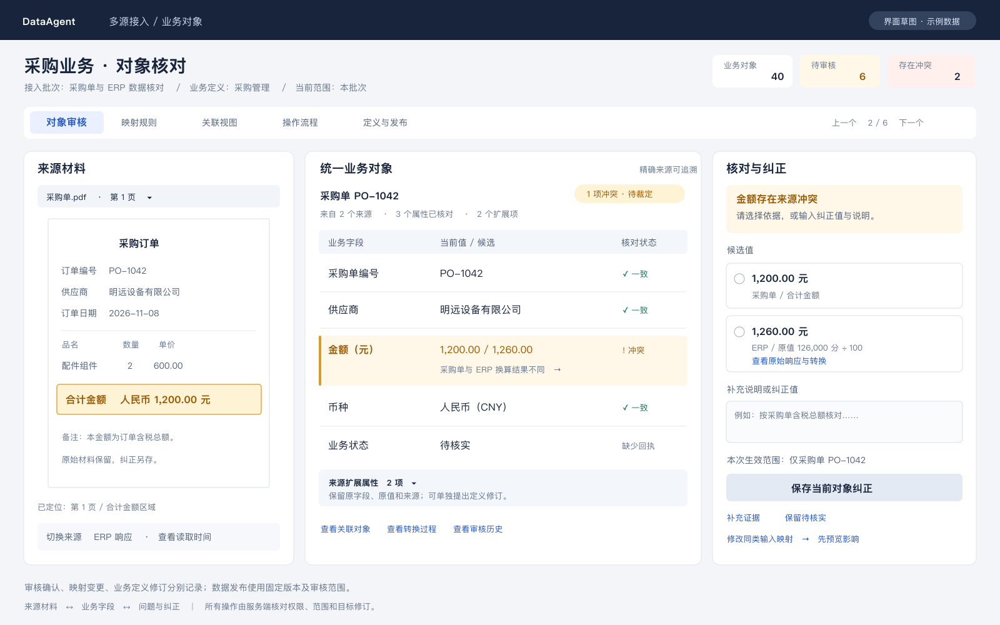
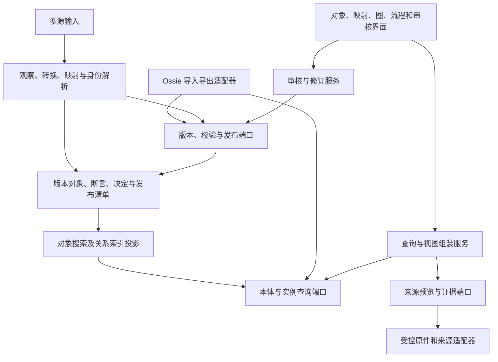

# 多源本体接入与审核工作台方案

## 1. 目标与建设范围

用户提供文档、表格、数据库、API 或 GUI 操作记录，系统映射到预设 Ontology，展示业务对象、来源与转换过程，支持用户纠正、审核和发布可供后续任务使用的数据。

| 用户任务 | 工作台提供的结果 |
| --- | --- |
| 查看接入情况 | 对象数量、已映射属性、缺失项、冲突、扩展项和读取完整性 |
| 核对一个对象 | 中文业务字段、关联对象、来源定位、转换说明、候选值和审核记录 |
| 核对一类输入 | 来源字段与本体属性的映射、样本预览、错误分布、影响范围 |
| 理解 GUI 操作 | 实际观察到的步骤与页面、业务动作候选、前后状态证据及可复用流程草案 |
| 修正与生效 | 明确修改对象、范围和版本，重算受影响结果，取得真实保存与发布回执 |

建设主线：`来源 → 观察记录 → 映射 → 候选实例 → 校验/审核 → 发布数据修订 → 下游使用`。原始内容、候选实例、已发布事实分别保存。自动通过范围由已有正式策略决定，只有需要裁定的事项进入人工队列。

用户已明确的约束：Ontology 预设；未覆盖的字段保留在 extensions；多源自动接入优先；GUI 固定操作可以转成数据表达。当前以本地组件安装和 Mint TUI/GUI 发起测试为交付目标；两端打开同一本地工作台并共享任务和修订，MintHub 后续用于分发。映射主页面、字段详情及全流程体验见[映射交互方案](15-ontology-mapping-experience-plan.md)。

首批包含来源预览、对象表与详情、字段证据、映射预览、审核纠正、数据发布。关系图、流程审核和 Ossie 交换按后续切片补齐。

## 2. 界面方案选择

| 方案 | 适合任务 | 建设与使用成本 | 选择 |
| --- | --- | --- | --- |
| 对象表与详情表单 | 单对象查询及字段修改 | 易实现，批量映射和跨来源核对需要额外界面 | 可作为首批的基础视图 |
| 对象表、来源对照、问题队列、映射编辑协作 | 高频核对、批量接入、纠正复用 | 需要统一证据与审核协议，业务用户可以逐项完成任务 | 推荐 |
| 以关系图为主入口 | 关联探索、身份重复与依赖检查 | 大规模图难以逐字段审核，需要单独处理分页和多元关系 | 作为辅助视图 |

## 3. 信息结构与用户角色

| 入口 | 默认内容 | 主要操作 |
| --- | --- | --- |
| 接入批次 | 来源、读取范围、进度、对象和问题统计 | 查看部分完成原因、进入待审核、重试失败分区 |
| 业务对象 | 按类型组织的列表、字段完整性、冲突和发布状态 | 搜索、筛选、打开详情、比较来源、纠正 |
| 映射规则 | 来源字段/路径 → 本体关系/属性 → 转换 | 调整绑定、预览样本、比较修订、提交生效 |
| 关联视图 | 当前对象的一跳关联、关系类型、证据与覆盖范围 | 展开邻居、查看关系元组、身份合并/拆分提案 |
| 操作流程 | GUI 实际轨迹、业务动作候选、流程草案 | 对照截图、纠正动作含义、参数化、审核分支与结束条件 |
| 定义与发布 | 业务词表、本体约束、数据发布修订和历史 | 查看定义、提出修订、核对影响、发布或回退 |

业务审核员处理对象与数据质量；映射维护者处理可复用转换；本体维护者处理正式定义；发布者按政策生效修订。角色可由同一人承担，但每次操作仍检查相应权限。普通用户默认看到中文业务标签、单位、来源和问题，技术 ID、路径表达式及交换格式放入高级详情。

## 4. 对象审核界面



图中数量、对象、金额与审核内容均为示例数据。草图展示布局与交互含义，不连接真实服务。

### 4.1 列表与批次

对象表以业务类型切换：采购单、客户、合同、工单、流程等。支持按业务字段、来源、冲突、缺失、扩展项及审核状态筛选；服务端过滤、排序与游标分页，保持查询快照和可见范围一致。

批次中同时报告：声明对象范围、已读取范围、源端分页/增量位置、成功转换、拒绝、未解决和未处理数量。读取完整性未知时显示“读取范围未确认”，不使用成功解析数量代表全量接入完成。

问题队列按业务必需性、冲突影响和依赖排序。置信度显示方法与来源；无置信度时显示“未提供”，人工确认状态、模型估计和规则校验结果分别展示。

### 4.2 三栏详情

| 区域 | 内容 | 联动 |
| --- | --- | --- |
| 左：来源材料 | PDF 页面、表格区域、数据库记录、API 返回或 GUI 截图/步骤 | 点击属性定位相应来源，切换源版本保留标记 |
| 中：业务对象 | 属性、关系、单位、候选/当前值、验证与审核状态 | 选择属性或关系，展开转换和冲突来源 |
| 右：核对与纠正 | 多个候选值、转换说明、约束失败、扩展字段、操作范围 | 选择来源、输入纠正、补证、拒绝候选、提出映射或定义修订 |

字段“金额”详情示例：PDF 记为 1,200 元；API 记为 126,000 分，转换后为 1,260 元。界面显示原值、单位转换和冲突，用户可裁定当前对象，或进一步修改映射。原始输入保持原样；人工纠正作为新的来源断言保存。

### 4.3 来源查看器

| 来源 | 最小定位单元 | 必要上下文 |
| --- | --- | --- |
| PDF / 图片 | 页码、文字区域、bbox | 页面版本、OCR/抽取版本、跨页引用 |
| 表格 | sheet、单元格或区域 | 表头、单位、公式与缓存值区别 |
| 数据库 | 源、表、主键、列、快照/读取时间 | 查询范围、是否支持历史读取、复合键与租户 |
| API | 端点引用、响应快照、JSON 路径 | 脱敏参数、分页/游标、响应时间、源版本 |
| GUI | 会话、步骤、截图区域、DOM/可访问性控件引用 | 应用版本、页面前后状态、输入输出、操作回执 |

页面提供“原始内容”“结构化内容”“来源信息”切换。大内容按需加载，证据查看重新判权。来源被撤权、过期或不可重读时显示证据缺口；不能用最新内容替换已经审核的历史证据。

现有 SourceAnchor 支持 PDF、文本、JSON、Excel 和记录键；GUI 控件/步骤选择器需要追加设计。新选择器须处理旧消费者的兼容性；图像坐标引用同时固定截图尺寸，视频定位同时固定帧/时间基准。

## 5. 映射审核与扩展字段

### 5.1 映射表

| 来源字段 | 源值样本 | 业务属性 | 转换 | 预览结果 | 问题 |
| --- | --- | --- | --- | --- | --- |
| `/order_no` | PO-1042 | 采购单编号 | 保留字符串 | PO-1042 | — |
| `/total_minor` | 126000 | 金额 | 十进制定点除以 100 | 1260.00 元 | 与文档冲突 |
| `/supplier_code` | SUP-7 | 供应商 | 按来源与业务键解析对象 | 供应商 SUP-7 | 同名候选需消歧 |
| `/legacy_tag` | priority-A | 扩展项 | 原样保留 | 来源扩展属性 | 未纳入正式本体 |

MappingSpec 至少保存：源结构指纹、适用范围、目标 ontology_ref、源路径、目标关系/角色、转换表达及实现、对象标识策略、单位/时间、缺失处理、扩展路由、验证用例、版本和发布状态。

模型生成候选映射；可验证的转换计划负责重复执行。映射修改在隔离的候选批次试跑，列出新增、改值、身份变化、删除候选、约束失败和无法重算项。用户确认的作用域固定为明确来源、对象选择器及时间范围。

“应用到同类输入”必须基于可检查的适用条件和预览，不以单样本纠正推定全部历史输入都应修改。自定义代码、未知方言和含任意执行能力的表达式须经过受限执行端口及既有验证，界面不直接执行用户输入的代码。

### 5.2 扩展、未知与冲突

| 情况 | 保存 | 用户操作 |
| --- | --- | --- |
| 含义明确、正式本体暂未覆盖 | namespaced extension、类型/局部 schema、原值与来源 | 保留、建立局部说明、提出本体修订 |
| 多个映射目标都可能正确 | 未决候选、依据、原字段 | 选择目标或补充说明 |
| 必填字段缺失、转换失败 | Issue、缺失/失败状态与影响范围 | 补证、修正转换、拒绝接入 |
| 同一属性有不同来源值 | 多个 Assertion 与冲突集 | 选择依据、记录纠正、保留未解决 |

扩展字段继承来源的访问、保留与披露要求。默认折叠但可筛选，批次统计单独报告；正式业务约束涉及未映射属性时，相关对象保持未完成状态。

## 6. 关系与 GUI 流程可视化

### 6.1 关系视图

初次只加载当前对象一跳、限定关系类型和节点数量，显示“已加载/仍有更多/权限或预算限制”。对象节点区分候选、已发布和冲突状态；每条关系可打开角色、来源与审核记录。

支持多元关系。比如“人员—供应商—金额—日期”构成一个付款事实，图中显示关系节点，详情中用角色元组表完整呈现；禁止将多元关系拆成没有共同事实标识的数条二元边。对象表中的单值属性是实体到值类型关系的便捷投影。

身份合并/拆分先生成提案，预览受影响关系、断言和下游结果；保留源端标识映射及历史身份事件。跨租户对象不因名称或自然键相同而合并。

### 6.2 GUI 流程

| 对象 | 展示 | 审核重点 |
| --- | --- | --- |
| WorkflowTrace | 实际步骤时间线、截图、动作与页面变化 | 哪一步发生过、是否有回执、记录是否缺失 |
| WorkflowDefinition | 流程图、参数、角色、分支、等待、前后置和完成条件 | 哪些步骤固定、哪些依赖条件、哪些分支尚未覆盖 |
| UIBinding | 业务动作与页面控件/接口的绑定 | 控件识别依据、应用版本、替代路径及失效条件 |

步骤表至少包含：顺序/时间、应用与页面、业务对象、控件、动作、输入引用、前后状态、回执、来源锚点。敏感输入在采集侧脱敏或引用保存，普通截图与列表不显示凭据。

“点击审批通过”记为观察事件；业务状态另由反馈或系统查询证实。用户审核流程草案不产生动作执行授权；未来自动重放须经过相应动作契约和授权机制。由单次记录生成的流程，明确展示未观察的分支和未验证条件。

## 7. 审核、纠正与发布协议

### 7.1 操作范围

| 用户选择 | 修改对象 | 后续影响 |
| --- | --- | --- |
| 确认/纠正此值 | 当前断言或对象修订 | 更新本对象候选结果，重验相关约束 |
| 更新同类输入的映射 | MappingSpec 新修订 | 预览并重跑指定批次或后续输入 |
| 修改业务定义 | OntologyRevision 提案 | 定义维护者按政策处理，评估所有相关映射和实例 |
| 发布此批次 | DatasetRelease | 下游使用新的已发布版本 |

操作按钮显示实际效果，例如“保存当前对象纠正”“预览 28 条映射变化”“发布已核验范围”。自由文本说明与结构化选择并存，用户可以输入“金额应取含税值”等纠正，系统先定位修改对象及范围。

### 7.2 状态分开保存

| 维度 | 状态或事实 | 规则 |
| --- | --- | --- |
| 来源断言质量 | observed / inferred / corrected；valid / invalid / unknown / conflict | 保留原值与来源，各维度独立 |
| 人工审核 | pending / accepted / rejected / needs_info / stale | accepted 表示人确认该范围，不替代规则验证 |
| 资产生命周期 | 复用 LifecycleStatus 合法子集 | 候选经过必要校验及授权后进入 active |
| 数据发布 | 不可变发布清单 + 当前发布指针 | 未决项和排除范围显式列出，发布不改源系统 |

ReviewDecision 绑定目标 digest、目标修订、来源/本体/映射/抽取器版本、问题集、实际审核主体、决定、作用域、理由、时间和策略引用。提交携带 expected_revision 与幂等键；同键异参拒绝。任何影响含义的绑定变化，都重算审核适用性。

并发审核遇到目标变化时返回冲突及差异，保留用户意见草稿。审批角色、允许范围和发布权限在服务端校验，前端按钮状态只作提示。

### 7.3 发布与重算

1. 固定候选数据、本体、映射、来源快照和验证/审核引用。
2. 检查适用策略、必需字段、身份及关系约束；未知或不支持的约束显式阻断要求其成立的范围。
3. 在同一存储工作单元中保存发布清单、更新发布指针与必要事件；查询索引从提交后的事实重建。
4. 返回真实发布回执、已发布范围、排除范围及重算/通知作业引用。

部分范围可以按正式政策单独发布，其他对象留在候选区；同一对象存在阻断性字段缺口时不标为完整通过。回退切换到先前发布修订，保留后续审核历史；外部业务系统写回走独立受控动作链。

## 8. Ontology 与实例存储实现

### 8.1 定义、实例、断言和展示

| 层 | 数据对象 | 责任 |
| --- | --- | --- |
| 定义 | OntologyRevision、概念、值类型、关系/角色、约束 | 确定用户预设本体的正式含义 |
| 映射 | SourceModelRevision、MappingSpec | 将来源结构映射到定义，固定转换与身份策略 |
| 实例 | EntityInstance、RelationFact | 稳定业务对象 ID、带类型的角色元组 |
| 来源断言 | Assertion、EvidenceBinding、ConflictSet | 保存多来源值、时间、依据与不确定性 |
| 审核与发布 | ReviewCase、ReviewDecision、DatasetRelease | 决定的适用版本、作用域及下游可用修订 |
| 展示投影 | ObjectView、RelationView、TraceView | 查询、搜索、对象表和图；可从权威事实重建 |

Assertion 最小字段：`assertion_id, scope_ref, relation_ref, role_bindings, ontology_revision, source_anchors, source_revision, observed_at, valid_time?, mapping_revision, extraction_revision, origin_kind, validation, confidence?, supersedes?`。关系事实保存按顺序带角色名的元组，成员可为实体或类型化值。

同一事实由两个来源支持时保留两条断言及来源，聚合为一个去重事实；重复事件按来源幂等键去重。缺失与未知保存在断言/问题中，只有角色完整的元组进入已解析关系。对象键至少包含租户作用域、概念与身份策略；源键和业务身份分别登记。

金额使用十进制定点和币种；业务时间、观察时间、系统记录时间分开。数据源无历史快照时记录可重读限制。人工纠正追加新断言并标明覆盖范围，不覆盖来源原件。

### 8.2 后端分层



候选发布使用与现有 runtime 端口兼容的存储实现。单机首批可沿用 SQLite 与内容存储；多人并发、容量与可用性要求超出时替换后端。关系图读取 RelationFact 投影，存储选型由查询、容量和部署约束决定。

前端不导入能力包内部存储，不直接改业务数据表。查询服务负责授权后的分页和组装；审核服务调用 DA03/DA04/DA11/DA12 的公开端口，持久化决定、修订和回执。发布提交与投影更新之间保留可重试的持久事件，界面显示索引更新进度。

### 8.3 服务契约

| 逻辑入口 | 输入 | 输出与并发要求 |
| --- | --- | --- |
| 查询批次/对象 | scope、过滤、字段、游标、查询快照 | ObjectViewPage、完整性、拒绝/缺口、下一游标 |
| 查询属性/关系证据 | 精确对象修订、属性或关系角色、查看主体 | 断言候选、来源锚点、转换与校验记录 |
| 预览映射修订 | MappingDraft、明确样本/批次、固定依赖 | PreviewJobRef、逐项差异与影响、未覆盖范围 |
| 提交审核或纠正 | ReviewDecisionDraft、目标 digest、expected_revision、幂等键 | 真实保存修订、重验入口、冲突或拒绝 |
| 身份合并/拆分提案 | 对象修订、候选身份、来源和作用域 | 受影响关系/断言及迁移草案 |
| 发布数据修订 | 固定候选/校验/决定清单、策略、expected_revision | DatasetRelease 或明确阻断项 |
| 查询关系/流程 | 对象/流程修订、边类型、限制与游标 | 覆盖受限的关系子图、角色元组或步骤视图 |

异步预览、重算与发布使用已有 CapabilityResult 调用封套；纯等待入口须补齐先前评估指出的 Continuation 接缝。协议字段定案后再生成 HTTP/MCP schema。

## 9. Apache Ossie 参考与适配边界

### 9.1 证据与定位

官方仓库固定为 `apache/ossie@d700cdeac41d15a7004eb2f9b0b38a2b1d517a18`，读取 README、core、ontology、mapping schema、Python 模型及示例，未执行其代码。读取范围与文件哈希见 [Ossie 证据记录](14-ontology-workbench/ossie-evidence.md)。

Ossie 提供语义/本体定义交换规范与相关校验工具。DataAgent 将其用作定义、逻辑模型和映射的适配参考，实例存储、来源断言、审核、发布、GUI 流程及受控动作由各自应用协议实现。[官方目录](https://github.com/apache/ossie/blob/d700cdeac41d15a7004eb2f9b0b38a2b1d517a18/README.md)

### 9.2 对应关系

| Ossie 构造 | DataAgent 实现 | 处理规则 |
| --- | --- | --- |
| EntityType / ValueType | 对象类型 / 业务值类型 | 保留稳定概念 ID 与外部 IRI 对照 |
| relationship / roles | 关系定义及带角色元组 | 单值属性作为 UI 投影；支持一元、二元及多元关系 |
| identify_by | 业务身份策略的定义输入 | 结合租户、来源和身份审核，不单靠字段同名合并对象 |
| requires / derived_by | 约束与派生规则声明 | 声明、解析、可执行校验分层；未实现方言不视为已验证 |
| logical semantic model | 数据集与字段的逻辑模型 | 数据库/API/文档抽取结果按可表达部分适配 |
| standalone mapping | MappingSpec 的交换投影 | 保存本体和逻辑模型引用，源提取/证据等运行数据留在 sidecar |
| custom_extensions | 交换元数据的显式厂商扩展 | 编解码适配，保持命名空间；实例扩展值另行保存 |

来源格式与本体之间的两段转换独立：`原始来源 → 来源结构化观察` 由 DataAgent 适配器承担，`逻辑模型 → 本体` 参考 Ossie 映射。GUI 流程建模可引用本体对象和事件，流程控制语义使用独立 WorkflowDefinition。

### 9.3 已核实的实施限制

1. **规范仍在开发。** 固定源码中的 core 文档明确标注未发布草案。锁定提交、传递 schema 依赖及适配版本，不自动跟随 main 更新。[Core 规范](https://github.com/apache/ossie/blob/d700cdeac41d15a7004eb2f9b0b38a2b1d517a18/core-spec/spec.md)
2. **独立映射与工具支持分开。** 规范定义了独立 mapping 文档，同时明确解析器和转换器支持需要另行补充；需要该格式时实现适配器并测试目标工具。[映射规范](https://github.com/apache/ossie/blob/d700cdeac41d15a7004eb2f9b0b38a2b1d517a18/ontology/ontology.md#mapping-documents)
3. **Python SDK 的现有模型面主要是逻辑语义模型。** 当前导出包括 dataset、field、metric、relationship 与 OssieDocument；本体定义和独立映射采用固定 JSON Schema 验证及自有模型适配，不预设 SDK 已覆盖整个本体运行时。[SDK 模型](https://github.com/apache/ossie/blob/d700cdeac41d15a7004eb2f9b0b38a2b1d517a18/python/src/ossie/models.py)
4. **扩展位置受 schema 限制。** 本体 root、component 等对象拒绝未声明字段；mapping/core 使用 custom_extensions，且厂商数据按字符串传递。DataAgent 实例 extensions、证据与审核信息保存在独立 sidecar，导出时只写目标 schema 允许的位置。[Ontology schema](https://github.com/apache/ossie/blob/d700cdeac41d15a7004eb2f9b0b38a2b1d517a18/ontology/ontology.json)、[Mapping schema](https://github.com/apache/ossie/blob/d700cdeac41d15a7004eb2f9b0b38a2b1d517a18/ontology/mapping.json)

适配验收覆盖：schema 校验、引用与概念存在性、角色/基数/身份语义、支持子集的导入导出往返、逐项损失报告、未知表达式处理。通过 JSON Schema 仅证明文档结构符合要求，业务约束由实现单独验证。

规范中的关系采用集合语义并保留角色；实例层以来源断言表达重复观察及未知值，发布事实按元组去重。图形显示和导出不得丢失角色顺序、类型或多元关系的共同事实身份。

### 9.4 交换文件组织

```text
ontology.json                正式业务定义的 Ossie 交换投影
source-model.json            一个来源逻辑模型的交换投影
source-mapping.json          该逻辑模型到本体的独立映射
dataagent-manifest.json      文件 digest、内部 ID/修订、格式 profile、依赖锁
dataagent-evidence.json      来源与抽取锚点、断言/实例引用、未映射项
dataagent-review.json        审核及发布清单的授权导出
```

后三项为 DataAgent 自有文件；导出清单标明格式归属和消费方。GUI/动作/审计等未覆盖语义保留为扩展或 sidecar，并列出往返损失和需要的执行能力。

## 10. 与现有模块的对应

| 模块 | 本方案增加或提前落实的能力 |
| --- | --- |
| DA01 | 多源观察、来源快照与定位、GUI 轨迹输入 |
| DA02 | 来源结构恢复、结构化抽取、GUI 步骤整理及缺口识别 |
| DA03 | 完整对象/关系/值类型、实体实例映射、身份策略、MappingSpec、Ossie 适配 |
| DA04 | 对象上下文修订、纠正事件、来源与资产关联 |
| DA05 | 对象检索、映射/类型检索、关系查询 |
| DA07 | 转换/重算作业、受限表达式执行、外部写入的独立执行控制 |
| DA10 / DA18.2 | 列表、来源对照、关系图、流程与审核交互 |
| DA11 | 映射一致性、必需信息、关系约束、跨格式与往返验收 |
| DA12 | 访问/证据披露、审核角色、变更范围、版本发布与追溯 |
| DA14 | 异步重算与等待、来源漂移后的映射失效通知 |
| DA16 | 需要有权主体裁定时的身份与授权决定；数据审核和业务动作审批分别处理 |

已有定义与实例协议分离、DA03.6 映射、DA10.4 纠正及 DA12.5 变更控制沿用。新增逻辑接口先按这些职责细化，不直接更改生成的总 Catalog 数量和能力编号。

## 11. 建设切片与验收

| 切片 | 交付范围 | 退出条件 |
| --- | --- | --- |
| A：对象与来源核对 | 一个预设本体；文档/表格 + API 快照；批次、对象表、字段证据和 extensions | 同一业务对象跨格式对齐；每个展示值可追溯；缺失/冲突不静默填补 |
| B：纠正与映射复用 | MappingSpec、样本预览、三类修改范围、审核、重验和发布 | 当前对象纠正与映射修订分别生效；作用域精确；并发冲突及过期审核可见 |
| C：关系与流程 | 多元关系查看、身份合并/拆分提案、GUI 轨迹与流程草案审核 | 角色元组完整；点击观察与业务状态分开；未观察分支明确 |
| D：交换与持续接入 | Ossie 定义/映射适配、增量、漂移、发布历史及兼容迁移 | 固定 schema 的支持子集往返通过；损失报告完整；旧实例和审核依赖可追溯 |

切片 A 的设计数据集至少包含：同一对象的文档与 API 金额一致、单位转换后冲突、同名不同对象、扩展字段、必填缺失、来源更新和不可重读历史。加入一批具有明确正确映射与字段锚点的独立验收样本。

| 类别 | 必须覆盖的验收 |
| --- | --- |
| 语义正确 | 精确数值/单位/时间、身份与复合键、关系角色和基数 |
| 来源可核对 | 点选属性定位正确原件位置；脱敏和撤权后视图正确 |
| 审核有效 | 绑定实际主体和目标版本；重复提交幂等；旧版本意见不误用于新结果 |
| 修改范围 | 当前对象、同类映射、正式本体三种修改互不混淆 |
| 批量与恢复 | 部分失败逐项呈现，重跑不重复建对象；发布指针与事实一致 |
| 用户可用 | 业务用户独立完成定位冲突、选择依据、纠正、发布和查看历史五项任务；记录成功率、误操作及耗时 |
| 规模与完整性 | 在约定容量下验证分页与局部图；权限/预算截断不能显示为全量 |
| 交换兼容 | 固定 schema 本地解析；不支持的表达式和扩展逐项报告 |

容量、响应时间和人工审核量在真实样本试用后形成基线，再由业务和部署条件确定门槛。

## 12. 方案交付与实施前决策

本方案交付：信息结构、对象审核草图、来源定位、映射与 GUI 审核、协议与数据模型、Ossie 适配边界、建设切片及验收。产品代码、运行数据库和既有飞书正文尚未修改。

| 决策 | 建议默认值 | 定案时点 |
| --- | --- | --- |
| 首个本体与业务样本 | 选择已有两类来源的单一业务；采购对象可作演示 | 切片 A 实施前 |
| 本体编辑权限 | 用户预设，正式定义通过有权维护者修订 | 定义服务接入前 |
| 自动通过政策 | 由正式规则明确字段/对象范围；冲突和必要信息缺失进入队列 | 审核服务接入前 |
| 界面载体 | 从 Mint TUI/GUI 发起并打开本地工作台；聊天与页面共享任务修订 | 前端实施前 |
| 存储容量与协作人数 | 单机复用现有端口，容量/并发决定后端替换 | 部署前 |
| Ossie 采用等级 | 先定义/映射交换与支持子集校验，运行时自有协议 | 交换适配器实施前 |

## 13. 系统环境探查与环境驱动工作流

### 13.1 目标与已有职责

系统级接入以客户 CRM、OA、ERP 等业务环境为对象：Agent 依据用户目标，在授权范围内发现资源和可用动作，观察实际业务状态，形成可执行工作流，在运行反馈中修订，并保存已验证的适用范围与复用配置。

流程以结构化数据表达，执行语义包含参数绑定、业务状态迁移、前后置条件、分支、等待、人工步骤、真实回执、异常处置与恢复。输入映射与环境驱动工作流共享业务对象及证据引用。

| 已有模块 | 可复用职责 | 本主线需要落实的接缝 |
| --- | --- | --- |
| DA01.8/01.9/01.10 | 环境资源、能力探测、凭据代理 | API 与 GUI 的统一环境观测及可用能力模型 |
| DA02.13/02.14 | 现状流程、分支例外、角色审批链 | 在真实使用中根据记录与反馈更新流程候选 |
| DA03.11/03.14 | 业务动作及对象状态迁移 | 业务语义与具体执行通道分别建模 |
| DA06.6/06.7 | 动作序列、人工/等待点、契约草案 | 根据当前环境事实生成并修订 WorkflowSpec |
| DA07.7/07.8/07.9 | 网关执行、幂等/对账、真实作业状态 | API/UI 共用动作账本、结果未知时协调查询 |
| DA14.6/14.8 | 持久等待、恢复、环境漂移 | 工作流运行实例、依赖失效及局部重规划 |
| DA11/DA12/DA16 | 验证、正式版本、授权及人在环 | 探索、流程生效、业务执行分别验证与留痕 |

上述能力在总规划中已有归属；本主线新增的是跨模块共用对象、运行链和验收范围。当前实现和本地接入切片仍需完成相应功能，不以目录中的能力定义代表已经实现。

### 13.2 两类探查通道

| 通道 | 探查依据 | 产物 |
| --- | --- | --- |
| API | 用户提供或授权访问的接口文档、schema、目录、读取结果及示例响应 | 资源/对象、参数与类型、分页/版本、调用限制、动作候选、实际回执入口 |
| Computer Use | 页面、可访问性结构或可用 DOM、截图、表单、菜单、用户示范及运行反馈 | 页面状态、业务对象候选、控件绑定、输入约束、可用动作和可观测反馈 |

API 可直接使用时按其真实能力绑定；界面流程可通过 Computer Use 进行观察和操作。一个工作流可逐步混合两类通道，例如 API 获取报销类型、GUI 上传材料、API 查询审批单状态。

动作能力分开记录“发现其存在”“参数与语义已识别”“在特定环境验证通过”“当前主体获准使用”。发现一个按钮或端点后，仍需观测它的前置条件及结果，才能将其作为已验证步骤。

### 13.3 业务动作与通道绑定

```text
业务动作：提交报销
  输入：报销单、明细、附件、所属组织
  前置：必要信息完整，当前状态允许提交，执行主体权限有效
  预期结果：目标系统产生报销单标识，且实际状态为已提交/待审批
  ├─ API 绑定：具体端点、参数映射、身份代理、回执与查询入口
  └─ UI 绑定：页面条件、表单/控件、输入映射、提交反馈及状态查询
```

两种绑定引用相同的动作语义和成功判据，分别记录能力限制与验证证据。通道切换是显式绑定修订；不能仅凭按钮名称相同认定等价。

已发出的提交请求结果未知时，先用远端请求号、业务键或目标状态查询。不能因 API 超时就改用 GUI 再提交；后续执行仍使用同一个业务动作实例及幂等/对账记录。

### 13.4 必需的共享对象

| 对象 | 最小内容 | 权威与生命周期 |
| --- | --- | --- |
| EnvironmentSnapshot | 环境/租户、主体范围、系统与资源、可用能力、当前观测、版本/时间、覆盖及缺口 | DA01 采集，DA17 绑定与引用；过期事实可重新探查 |
| CapabilityObservation | API 或 UI 的能力候选、参数/约束、作用对象、前后状态证据、回执入口、验证范围与时间 | 从发现到验证的证据记录，使用权由授权机制另行判断 |
| ActionBinding | 动作语义版本、提供方/通道、参数映射、环境前提、前后置检查、执行要求、验证记录 | DA15 声明和版本管理；DA07 执行时消费 |
| WorkflowSpec | 目标/判据、业务对象、步骤依赖、数据绑定、分支/状态条件、等待/人工点、失败与恢复、所选动作/环境版本 | DA06 生成修订，引用 DA03/DA15 正式定义；候选验证与生效分开 |
| WorkflowRun | 流程与任务修订、当前控制点、变量/对象引用、实际动作回执、等待事件、未决副作用及推进权引用 | DA14 持久运行控制，实际动作/作业状态由 DA07 提供；避免第二套作业权威 |
| WorkflowValidationReport | 实际经过的路径、输入/环境范围、结果/过程验证、失败样本、未观察分支及可复用条件 | DA11 产出；供 DA18 沉淀 Skill/Preset 与接入配置 |

这些字段属于工作流与运行协议，引用 Ontology 中的对象、关系、动作语义和状态。流程控制、等待与执行回执使用独立类型，不依赖把全部内容塞入无语义的扩展字典。

### 13.5 从探索到可复用流程

```text
用户目标与可选演示
  → 环境观察与资源/能力发现
  → 映射到业务对象、动作与状态
  → 生成包含未决项的工作流候选
  → 在选定范围试用，逐步观察、执行并校验
  → 保存真实轨迹，修订受影响步骤或通道绑定
  → 验证已覆盖路径与适用条件
  → 保存可复用流程及 Skill / Preset
```

用户约定业务目标、完成条件和可操作范围；Agent 可根据环境改变字段绑定、执行通道、子步骤和补证方法。遇到新增必填项或流程分支时，先更新当前环境观测与流程修订，再继续受影响步骤。

单次成功只证明该环境和输入范围内实际经过的路径。流程保存时保留尚未验证的例外路径；再次使用时复核关键环境条件，必要时局部探查和重验。

### 13.6 提交报销的静态示例

用户目标为“填写并提交报销，确认已进入审批”。以下为拟议运行流程，未操作真实客户系统。

| 阶段 | 当前环境中的发现 | 工作流中的动作与结果 |
| --- | --- | --- |
| 探查 | 发现报销入口、申请人、类型、金额、费用日期、附件、所属组织及提交入口 | 形成 ExpenseClaim、ExpenseLine、ReceiptAttachment、ApprovalRequest 的候选映射 |
| 准备 | API 提供报销类型；发票 PDF 提供金额/日期；GUI 显示组织字段为必需 | 读取枚举、解析发票、绑定组织；缺失值发起有依据的补充问题 |
| 填写 | 目标系统支持创建草稿及附件上传，具体通道按可用能力绑定 | 创建草稿、上传附件、读取校验反馈并记录实际单据 ID |
| 提交 | 当前草稿符合提交条件，主体已获相应授权 | 执行提交；保存请求标识与回执 |
| 核验 | 系统返回已提交或审批中状态 | 查询并核对单据、审批流程及状态；点击记录和后台状态分别保存 |
| 等待 | 审批结果由后续人工流程产生 | 若目标包含跟踪结果，持久等待事件或查询；结果到达后按实际状态继续 |

目标中的“提交成功”与“业务审批通过”分别定义。用户查看的是来源材料、报销对象、流程步骤、真实状态和待处理事项。

### 13.7 工作台增加的视图

1. **环境概览**：连接的系统、已发现的对象与动作、已验证能力、权限/访问状态、探查覆盖与缺口。
2. **流程构建**：业务步骤图，标出每步输入输出、API/UI 绑定、业务状态、分支、等待和验证条件；用户可用业务语言纠正。
3. **运行查看**：当前步骤、实际页面或 API 回执、已生成的业务对象、未决问题、暂停/接管与恢复入口。
4. **变化对照**：新旧环境差异、失效绑定、流程修订及受影响步骤；保留可继续复用的部分。

继续沿用映射工作台的来源、业务对象与证据联动。界面区分计划步骤和实际经过步骤；既有进度、上下文和材料在修订后继续保留。

### 13.8 本地功能验收

本地准备一个有共享业务状态的测试系统，同时暴露 API 与 GUI，包含草稿、必填字段、附件、提交、审批等待和结果查询。允许更改表单、接口字段和审批分支，模拟真实环境变化。

| 场景 | 验收目标 |
| --- | --- |
| API 接入 | 根据环境描述和读取结果发现对象/能力，形成并执行有回执的流程 |
| GUI 接入 | 从页面与记录识别表单、步骤、反馈和状态，生成可检查的动作绑定 |
| 混合通道 | 同一工作流组合 API 与 GUI，使用一致的业务对象和动作实例 |
| 首次使用 | 给定目标、可用环境和业务约束，Agent 探查并形成流程；无需预置整条固定操作脚本 |
| 环境变化 | 新增必填字段、页面改版、接口结构变化后定位影响并修订局部流程 |
| 提交状态未知 | 先查询与对账，通道切换不产生重复报销单 |
| 暂停与跨天等待 | 退出后恢复，保留业务对象、动作回执、控制点和待决问题 |
| 用户纠正 | 修改当前参数、映射或流程时范围明确，完成重验后从受影响步骤继续 |

该验收在本地组件组合和 Mint TUI/GUI 中进行，发布渠道不作为功能前提。首个闭环以一种业务流程为范围，后续通过另一种流程验证共享协议的复用。

来源：既有[数据层设计](../01-data-layer.md)、[执行应用层设计](../02-application-layer.md)、[评测与治理层设计](../03-governance-layer.md)、[持续运行与交付设计](../04-operations-fde-layer.md)、[契约设计](../05-contracts.md)，以及固定提交的 Ossie 官方源码。此前的[整体架构评估](../../fde-agent-2026-11-09/README.md)记录运行接缝；本方案覆盖多源接入、用户审核及系统环境到工作流的扩展。
