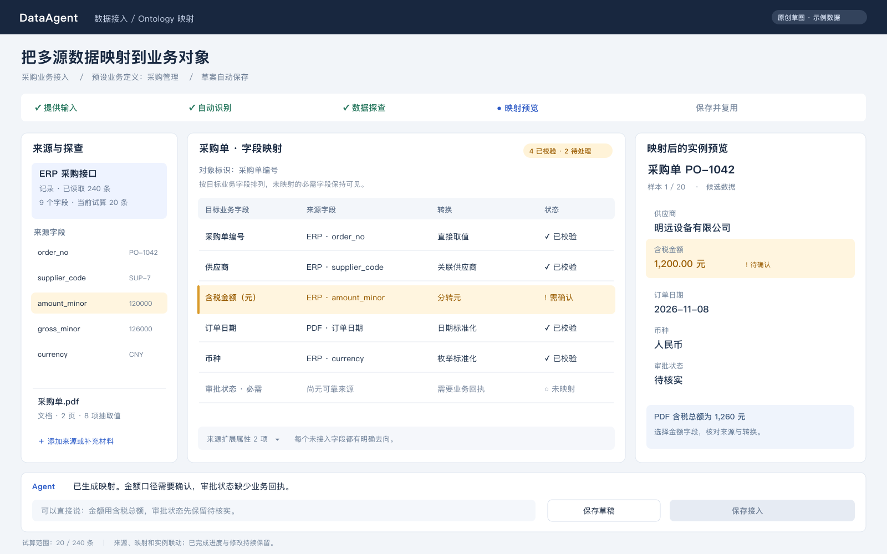
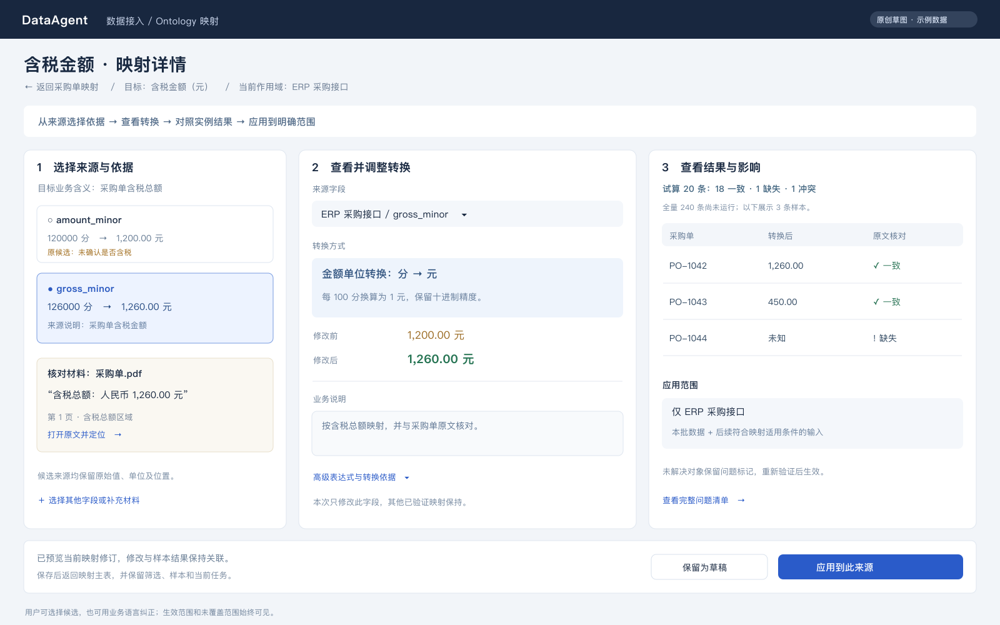

# Ontology 映射展示与交互方案

## 1. 目标与范围

用户从 Mint TUI 或 GUI 提供文档、表格、数据库/API 连接或 GUI 操作记录，Agent 自动识别数据、进行探查并生成到预设 Ontology 的映射。用户通过界面理解映射、核对样本、处理必要问题，保存可复用的接入配置并查看业务对象。

当前目标是本地完成上述功能并验证使用体验，组件从本地路径或本地制品安装。MintHub 是后续分发渠道；数据源和模型按测试环境连接，不额外规定断网部署。

| 用户应能回答的问题 | 界面提供的信息 |
| --- | --- |
| 这些输入被识别成什么 | 输入类型、业务对象候选、结构、读取与采样范围 |
| 映射到了哪里 | 目标业务对象、属性、身份和关系；未映射的必需信息 |
| 映射为何这样做 | 来源片段或记录、原值、转换、候选目标与依据 |
| 结果是否正确 | 转换后的实例样本、约束检查、冲突与缺失 |
| 修改后影响哪些数据 | 当前对象、指定来源映射、本体定义三种范围分别显示 |
| 下次能否复用 | 已保存接入配置、映射适用范围、来源结构变化与复检结果 |

本方案细化[本体工作台方案](14-ontology-workbench-plan.md)的映射交互；该方案继续承载实例、证据、审核和发布协议。

系统级接入还包括真实环境中的能力发现、API/UI 动作绑定和持续工作流，见本体工作台方案的“系统环境探查与环境驱动工作流”。本页的 GUI 输入映射与该运行链共享对象和证据，流程控制使用专门的工作流协议。

## 2. 产品参考

以下为官方文档中观察到的产品交互，以及本方案的设计取舍；未登录或运行这些产品的实际部署。

| 产品与来源 | 文档事实 | 本方案采纳与扩展 |
| --- | --- | --- |
| [Palantir Ontology Manager](https://www.palantir.com/docs/foundry/ontology-manager/overview) | 区分对象类型、属性编辑和链接类型视图；对象概览提供属性、关联和数据入口 | 将对象级概览、字段映射、关系配置分别组织，选中对象或字段后进入相应细节 |
| [Palantir 属性映射](https://www.palantir.com/docs/foundry/object-link-types/create-object-type) | 来源面板支持将列绑定到属性，属性面板支持反选来源列；还需配置对象标识 | 双向定位；目标字段为主表，来源字段可反查；身份映射单列为必要配置 |
| [Palantir 更换来源](https://www.palantir.com/docs/foundry/object-link-types/edit-object-type) | 更换 backing datasource 时，只有 schema 一致才自动重映射 | 来源变化时展示差异、受影响绑定及重新预览入口，避免静默延用 |
| [Fabric 属性绑定](https://learn.microsoft.com/en-us/fabric/iq/ontology/how-to-bind-data) | 先选择来源，再将来源列绑定到实体属性；支持选择已有属性；新增来源需定义关联列 | 显示“来源—属性—关联”的可检查配置，增加文档片段、JSON 路径和操作记录等来源定位 |
| [Fabric Ontology Agent](https://learn.microsoft.com/en-us/fabric/iq/ontology/how-to-use-ontology-agent) | 自然语言辅助发现、草拟、验证和应用，画布可查看候选定义与绑定 | Agent 自动准备映射与检查结果，用户以业务语言纠正，界面显示具体改动与生效范围 |

本项目使用预设 Ontology。来源未覆盖的属性显示缺口，多余字段进入 extensions 或未决队列；新增正式属性进入独立定义修订入口。

## 3. 推荐的信息结构

采用“目标字段映射表 + 来源对照 + 实例预览”，辅以对象级概览和关系视图。主表固定目标字段，来源不足时必需字段仍可见；选择来源字段时也可以反查映射到的目标。

```text
提供输入 → 自动识别/探查 → 映射预览 ↔ 定位问题/修改 → 保存接入 → 查看对象
                ↑              ↑                         │
                └──补充来源────┘          后续接入复用────┘
```

上方阶段栏表达真实任务状态，允许回看和修改；可以先预览已完成部分。Agent 能确定且符合策略的步骤自动推进，必要业务歧义才进入用户问题区。

| 层级 | 内容 | 默认展示 |
| --- | --- | --- |
| 接入概览 | 多个来源分别将产生哪些对象和关系 | 来源卡片、目标对象卡片、读取/采样范围和未解决项 |
| 对象映射 | 一个对象类型的身份、属性和关系如何来自这些输入 | 目标字段映射表，附原值、转换与结果样本 |
| 字段详情 | 当前字段的来源、转换、例外和复用范围 | 来源定位、转换编辑、前后预览与影响 |
| 结果查看 | 实际转换出的候选或已保存实例 | 对象列表与详情，可回到映射和来源 |

映射页处理来源到本体的可复用规则；实例审核处理一条对象事实。两页相互跳转，同时保持操作范围可见。

## 4. 映射主页面



草图中的来源、对象、数量和金额均为示例；不是实际产品运行结果。

### 4.1 页面布局

| 区域 | 显示内容 | 联动行为 |
| --- | --- | --- |
| 顶部阶段栏 | 识别、探查、映射、问题处理和可用结果 | 查看各阶段产物；保留已完成进度 |
| 左：来源 | 文件/表/API/操作记录；来源结构、字段、类型、样本和读取范围 | 选择来源过滤绑定；选择字段反查目标；点击原值打开来源片段 |
| 中：映射 | 目标对象的业务字段、来源、转换、状态 | 目标必需字段置顶；按未映射、类型冲突、需确认、扩展项筛选 |
| 右：实例预览 | 转换后的业务对象卡片，包含候选/已校验标记 | 选中字段定位其值、来源和问题；切换样本不丢当前修改 |
| 底部：Agent 与操作 | 自动完成摘要、必要问题、自然语言输入、保存草稿/接入 | 用户直接说“金额用含税总额”，系统定位映射并预览变化 |

对象级信息包含对象类型、对象标识来源、当前数据范围、映射适用范围和校验状态。业务标签、单位和解释默认可见；表达式、内部 ID 和调用记录放在高级详情。

### 4.2 映射表的最小列

| 列 | 示例 | 含义 |
| --- | --- | --- |
| 目标业务字段 | 含税金额 · 元 · 必需 | 本体属性与约束；未绑定也显示 |
| 来源 | ERP `/gross_minor`；PDF“含税总额” | 可以有多个来源候选、组合输入及核对来源 |
| 转换 | 分转元 | 默认业务语言，展开查看固定表达和实现 |
| 值样本 | 126000 → 1260.00 | 原值和结果成对；单位、类型转换可核对 |
| 状态 | 已校验 / 待确认 / 未映射 / 冲突 | 规则检查、人工决定和读取完整性分别保存 |

点击一行打开字段详情。双击、键盘选择和“选择来源”下拉均可操作，拖拽可作快捷方式。密集来源之间仅显示当前选中字段的连线，其余关系通过搜索和筛选定位。

## 5. 字段映射详情



示例：目标为含税金额，ERP 提供 `amount_minor=120000` 和 `gross_minor=126000`，PDF 为 1,260 元。初始候选若使用前者，预览显示口径冲突；用户切换到后者后，转换与文档一致。

### 5.1 三步完成修改

1. **选择依据。** 展示当前来源和替代来源，附业务说明、原值、类型和来源位置。支持选择多个输入进行组合转换。
2. **查看转换。** 常见转换提供业务模板：字段重命名、单位/币种、时间/时区、枚举、拆分合并、条件选择、关联查找。复杂表达式由 Agent 生成，用户通过样本核对。
3. **预览与应用。** 展示修改前后差异、验证结果、样本范围和未解决项。明确应用到哪一来源、哪些对象以及今后输入。

字段确认后返回主表，保留当前对象、筛选和样本位置。已明确授权且验证通过的更改直接保存相应修订；政策要求审批时才进入对应审批路径。

### 5.2 预览规则

| 情况 | 界面反馈 |
| --- | --- |
| 样本通过、全量尚未运行 | 显示已试算样本数、采样方式、全量待运行 |
| 部分值无法转换 | 保留通过样本，失败样本显示原值、原因与处理建议 |
| 用户改了来源或表达 | 将当前预览标为需要更新；旧结果保留对照 |
| 来源变化或引用已过期 | 提示受影响字段，提供重新读取和重验 |
| 验证器不支持某项规则 | 显示“尚未验证”，按该规则的重要性决定能否保存生效 |
| 多个来源值冲突 | 并排展示原值、单位、时间和来源，不由置信度直接覆盖 |

预览与映射修订绑定。表达、来源范围或本体版本变化后，先前验证报告不能继续表示当前草案已通过。

## 6. 对象、关系与身份映射

### 6.1 对象级映射

接入概览以“来源卡片 → 目标对象卡片”显示：订单 API 产生采购单，供应商表产生供应商，采购单中的供应商编码形成关联。用户点击目标对象进入属性映射，查看关联时切换到关系面板。

对象身份区域显示业务标识组成、来源键、租户范围、样本唯一性、缺失与重复。跨来源的同名对象保持候选，用户可以检查合并依据；身份变化须预览会改动的对象和关系。

### 6.2 关系映射

```text
采购单.供应商编码 ── 对齐规则与作用域 ── 供应商.编码
       ↓                                    ↓
    采购单实例 ────── 由供应商提供 ────── 供应商实例
```

关系面板同时展示来源键、目标角色、关联条件、匹配样本、未匹配及多匹配对象。保留复合键和时态条件，按采样/全量范围标明检查覆盖。多元关系使用角色表或关系节点，完整保留同一个事实的全部角色。

## 7. 多种输入的统一交互

| 输入 | 左侧来源展示 | 映射差异 |
| --- | --- | --- |
| 表格/数据库 | 表、列、类型、键、样本、数据范围 | 显示粒度、关联、单位和增量/快照范围 |
| API | 端点业务名、JSON 路径、响应样本、分页状态 | 数组展开、父子对象、编码及响应版本 |
| 文档/图片 | 页面、条款、表块、抽取字段及原文区域 | 抽取与业务映射分别追溯；识别不确定性可见 |
| GUI 操作记录 | 步骤、页面、控件、动作、输入和反馈 | 映射到业务对象/事件/流程；实际动作与业务状态分开 |

用户始终使用“来源—目标业务字段—结果预览”的主交互。GUI 的流程结构在流程视图展开；输入多种来源时可以先保存其中已完成的映射，未解决来源保留明确状态。

## 8. 未映射项和 extensions

| 类型 | 展示位置 | 处理入口 |
| --- | --- | --- |
| 来源特有、业务含义已知 | 扩展属性区；可查看原字段、原值、类型和来源 | 保留为 namespaced extension；可登记局部说明 |
| 源字段含义或目标不确定 | 待确认队列 | 选择候选、补充解释、查原件 |
| 目标必需字段没有来源 | 映射主表的未映射行 | 补充来源、调整正确绑定、记录无法提供 |
| 来源读取失败或被限制 | 来源卡片与全局进度 | 按实际原因修复连接、补权限或缩小范围 |
| 正式本体确需增加字段 | 定义修订提案 | 进入有权维护者的定义变更流程 |

每个来源字段有明确去向：本体属性、关系/身份、扩展项、尚未确定，或按明确选择不接入。后者保留原因和范围，不能被计入成功映射数。

## 9. 全流程体验要求

| 环节 | 默认体验 | 异常与继续方式 |
| --- | --- | --- |
| 提供输入 | 发送文件、已有路径或连接配置，并用一句话描述目标；允许追加和混合来源 | 缺少必要连接信息时只请求缺失部分，已提供材料保留 |
| 识别与探查 | 自动选择适配器，展示已识别类型、字段、样本、键和问题；先进样本再按需扩大 | 展示实际已完成范围与下一步；取消、暂停、恢复各有明确状态 |
| 自动映射 | 复用已验证配置，生成已有本体的映射候选，实时出现可核对结果 | 业务歧义提供少量候选和依据，支持自由输入；不逐字段强制确认 |
| 纠正 | 自然语言和结构化编辑均可；保留修改、撤销、前后差异 | 只重算受影响步骤，来源连接与无关字段不重做 |
| 保存接入 | 一次保存来源绑定、映射适用条件及版本，返回可打开的结果 | 阻断项定位到字段/来源；允许先保存草稿，不将草稿称为已生效 |
| 再次接入 | 选择已保存接入或提供同类新数据，复用映射 | 结构或语义变化列出差异，只处理变化与失效部分 |

### 9.1 状态与反馈

状态包括：正在识别、正在探查、映射草案可预览、需要补充信息、试算中、部分完成、可保存接入、已保存、暂停、失败。来源与字段各有局部状态，任务整体保留明确的下一步。

耗时操作立即返回任务受理状态和后续入口；有计数依据才显示进度比例，未知总量时显示已读取数量和当前阶段。首次结果出现后持续提供可查看产物，不依赖全部处理完成才展示页面。

错误消息至少包含“发生在何处、影响什么、已保留什么、下一步能做什么”。例如“ERP 第 3 页读取失败，前两页结果已保留；恢复连接后从第 3 页继续”。

### 9.2 保存动作的含义

| 按钮 | 实际效果 |
| --- | --- |
| 保存草稿 | 固定当前映射与未解决项，允许稍后继续 |
| 应用到此来源 | 保存经允许的映射修订及适用范围，产生受影响重算请求 |
| 保存接入 | 保存来源配置引用、映射和使用版本，提供后续复用入口 |
| 查看对象 | 打开当前预览或已生效的数据范围，清楚标注两者 |
| 修订业务定义 | 创建本体修订提案，与映射修改分别处理 |

生效不改外部业务系统，源系统写回使用独立动作链。凭据只通过受控配置入口绑定，聊天和映射表不显示密钥。

## 10. 页面需要的服务数据

| 视图协议 | 最小内容 |
| --- | --- |
| IngestionSessionView | 任务/范围、来源状态、已完成阶段、产物引用、阻断项、继续入口 |
| ObjectMappingView | 目标概念、身份策略、属性/关系、绑定、必需性、覆盖与草案修订 |
| FieldMappingView | 目标属性/角色、来源路径/锚点、原值、转换、候选、结果样本、校验、问题及修改范围 |
| MappingPreviewView | 草案修订、依赖版本、样本选择、逐项前后差异、覆盖、未处理项与影响范围 |
| SavedIngestionView | 来源配置引用、映射版本、适用条件、本体版本、结果入口与复用状态 |

这些是展示协议建议，后续从共享类型和公开端口组装；字段原值及预览读取继承来源权限。来源版本、映射版本与预览引用一致，刷新页面后能恢复用户所在任务和未提交编辑。

## 11. Mint 本地测试入口

本地组合包组织接入、识别/探查、映射/本体、可视化及引导 Skill，具体物理分包在实现时按依赖确定。通过相同业务服务和工作区数据，支持：

| 入口 | 用户操作与结果 |
| --- | --- |
| Mint TUI | 自然语言发起接入；查看阶段、必要问题与摘要；打开本地工作台链接核对映射和对象 |
| Mint GUI | 发起同一任务，查看进度并打开本地工作台；可用嵌入方式后续按客户端接口适配 |
| 已打开的工作台 | 修改映射、查看预览、保存接入；结果写回同一任务及修订，Agent 可以读取并继续 |

TUI 与 GUI 使用同一个 session/task 引用，聊天和可视化页面中的修改相互可见；恢复会话后继续原任务。首次测试提供样例来源、一键开始接入及环境检查；普通用户无需手动编排原子调用。

本地安装、真实数据源接入和两端发起任务纳入验收；MintHub 发布不作为本阶段入口条件。是否把工作台内嵌进 GUI，不影响先完成本地工作台的功能和体验。

## 12. 验收场景

| 场景 | 应达到的结果 |
| --- | --- |
| 初次接入一份未知布局文件 | 自动识别和探查，展示目标对象、字段和样本；必要歧义有业务解释 |
| API 和文档映射到同一对象 | 来源可对照、对象身份可核查、冲突可定位 |
| 金额字段映错 | 从主表打开详情，更换来源/转换，查看新样本并保存正确范围 |
| 目标必需字段缺失 | 主表保留缺失行，提供补充材料入口，已有成果不丢失 |
| 多余字段 | 明确显示 extensions、未决或不接入的去向与原因 |
| 中途连接失败 | 已完成分区保留，失败位置和恢复入口清楚 |
| 二次接入 | 复用已保存映射，结构变化时只处理受影响部分 |
| 用户用自然语言纠正 | 更新相同映射草案，界面与 Agent 显示一致的范围与版本 |
| 真实 Mint 本地测试 | 从 TUI 和 GUI 分别发起，打开工作台并走通识别、探查、映射、查看及纠正 |

以目标用户完成以下任务测量体验：首次获得可理解预览、定位一个错映射、修正并查看影响、补充缺失输入、复用已保存接入。记录成功率、完成时间、主动操作次数、额外澄清轮次和重做次数；采用真实样本基线确定具体门槛。

交付材料：本方案、两张原创界面草图、[产品参考记录](15-ontology-mapping-experience/product-references.md)。当前范围是映射体验设计，后续实施使用该方案与既有本体工作台协议共同验收。
