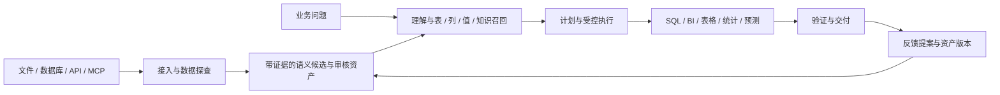

# DataAgent 竞品与模块技术调研：现状、难点和建设判断

研究截止：2026-10-31，Asia/Shanghai。本轮调度三个专题子 Agent，分别研究竞品、语义/ontology、模块技术；主 Agent 阅读 X 和具名工程案例、复核关键源码/文档并综合。先独立讨论 DataAgent，AgentOS/Mint 兼容放在最后。本报告是外部资料与静态代码研究，没有做产品租户对照测试、执行第三方代码或运行 benchmark。

## 1. 对 DataAgent 的整体判断

DataAgent 可以通俗理解为：**把业务问题转成数据工作，完成取数、理解、计算、检查和交付，并留下可复用资产的智能体。** 用户的目标可以是一个数、一份解释、一张工作簿、一份预测，也可以是持续监测和行动建议。

当前市场已有可用的组成能力：已建模数据的自然语言问数、文件探索、SQL/Python 辅助分析、多步研究和报告生成。公开文档及案例没有证明“任意企业接入原始数据后，系统即可无人准备、无人验收地完成任意业务分析”。更接近实际的产品形态是：**数据与业务知识先有一定准备，Agent 扩大自助分析范围，专业人员维护关键口径、权限和例外。**[竞品 §3–6](01-competitors-and-adoption.md)

最值得研究的竞争点有五个：

1. 从原始文件或企业源到第一个可信答案，要多少人工工作。
2. 新问题出现时，能否从值、列、指标、业务逻辑或会话对象中的有效线索出发，动态补齐所需语义与数据证据，并在成本、权限和正确性约束下完成回答。详见[自适应检索专题](../dataagent-retrieval-2026-10-31/00-adaptive-retrieval.md)。
3. 出错后能否定位原因，把纠正变成有作用域、有证据、可维护的知识。
4. 结果能否复算、审阅、继续编辑，并进入用户已有工作流。
5. 换数据版本、模型、入口或平台后，口径、结果与权限是否仍成立。

这些是本报告的研究判断，不是已测得的厂商排名。

## 2. 竞品先看三类路线

| 路线 | 代表产品 | 已有公开能力 | 采用的实际前提 | 最值得参考的设计 |
| --- | --- | --- | --- | --- |
| 数据平台/BI 内的问数与分析 | Snowflake Cortex Analyst/Agents、Databricks Genie、Looker、Fabric、ThoughtSpot、dbt Wizard Explore/Insights | 语义问数、SQL/DAX/KQL 或受控查询、多步分析、表图；部分支持 Python/文件/文档 | 已有平台、授权数据、领域模型/说明和负责人；功能随模式/版本不同 | 受控语义查询、终端用户权限边界、可见计划、业务题集回归 |
| 分析工作台与 AI analyst | Hex、Julius、ChatGPT 数据分析/Work | 文件、仓库、SQL/Python、可编辑分析、图表和报告；部分提供项目/上下文管理 | 清晰问题和可用数据；企业共享场景另需身份、语义和审核 | 即席探索与可继续维护的产物、低门槛入口、上下文与已有资产复用 |
| 中文 BI 场景集成 | Quick BI 智能小Q、FineChatBI | 问数、口径纠偏、报告/解读、波动贡献、部分预测和表格入口 | 数据集/指标中心、字段/维值/聚合/业务知识准备、套餐与权限 | 中文业务词和值映射、歧义确认、问数→解释→报告链路 |

分类表示主要入口，能力会交叠。逐产品十一家对照、出处与限制见[竞品专题](01-competitors-and-adoption.md)。原报告将 dbt 只放在语义参考中，遗漏其 AI 产品线；补充核查表明 Wizard 覆盖数据开发/验证和 Explore 问数，Copilot/Insights 与 MCP 也需纳入比较。[dbt AI 补充](05-dbt-ai-addendum.md)

几条容易被产品宣传模糊的边界：

- **ThoughtSpot：**已核到 AgentQL → QGen → governed SQL 的技术路径。确定性属于给定语义查询的编译；自然语言解释和 tokens/AgentQL/Python 路径选择仍由 Agent 决定。Python 仍用于预测、回归等。阶段性功能不能写成全面上线。[竞品 §4.2](01-competitors-and-adoption.md)
- **Looker：**常规路径选择字段与 filters，由 Looker 处理 join/aggregation/access；部分 Advanced Analytics 再用 Python。支持“受约束取数＋开放分析”组合。[竞品 §3–4](01-competitors-and-adoption.md)
- **Fabric：**data agent 明确只读取数。不能因同平台有 notebook 就推断它会训练预测模型；源数量、文件类型、输出大小和语言都有具体限制。[竞品 §3](01-competitors-and-adoption.md)
- **Hex：**可编辑的 SQL/Python/cells 和认证资产很有价值；Governed mode 是来源引导，文档明确它不是安全控制，权限仍依赖真实连接。[竞品 §4.5](01-competitors-and-adoption.md)
- **Julius：**已有共享连接的 schema 学习、冻结和人工编辑。共享学习不等于认证事实发布；连接过滤默认 ALL、连接级共享规则和数据处理条款需要联合核对。[竞品 §4.4–4.5](01-competitors-and-adoption.md)

开源实现方面，继续采用前轮固定提交研究作为基线：WrenAI 的文件化 MDL/语义重写，SuperSonic 的中文指标/维度/实体/值召回，DB-GPT 的表→字段分级检索，Vanna 的 user-aware 工具接口，RD-Agent 的假设→实验→评估链。它们提供可参考机制，未发现一个已核验实现完整覆盖本项目愿景；许可证、当前/归档架构和商业功能必须按版本区分。[前轮开源源码报告](../dataagent-2026-10-30/02-open-source-and-ontology.md)

## 3. 公开部署与 X 观点说明了哪些应用难点

### 3.1 有具名部署，但收益和适用范围需要保留

| 来源 | 具体实践 | 能得到的启示 | 证据限制 |
| --- | --- | --- | --- |
| [LangChain 使用 Hex，2026-07-27](https://www.langchain.com/blog/agent-data-stack) | dbt + semantic models + GitHub guides + endorsed assets；Slack/CLI/MCP 等入口；数据团队继续维护和验收 | 自助分析采用与已有工作流、知识维护、可信资产结合；专家工作发生变化 | 客户自报；约三成用户有 Agent 权限，2200 次对话不等于成功任务；正式 evals 在原文仍是下一步 |
| [LinkedIn，2026-10-09](https://www.linkedin.com/blog/engineering/infrastructure/inside-linkedins-data-context-layer-curating-trustworthy-context-for-humans-and-agents) | schema/code/query logs/wiki/脱敏样本生成上下文；与 owner-reviewed 知识分别存储；Git PR、稳定 URN、分层检索 | 渐进建设关键数据集；机器生成与人工知识分离，更新不会覆盖审核修订 | 内部工程自述；单业务区、考虑权限后的 acceptable-answer rate，由此前 analytics-agent experience 的25.9%到集成后的79.5%；不是公开可复现的固定模型消融，不能推广为普遍增益 |
| [Ramp / Ian Macomber，2026-08-30](https://www.iandmacomber.com/blog/post-ai-data-stack) | Agent 可读 Markdown/SQL/CSV；跨入口与模型检查指标、值、授权、必要证据；版本化非结构化标签 | 产物要可被其他 Agent 使用；输出和证据一起评；业务文本可转结构化事实 | 作者内部实践自述；跨入口一致也可能一致地错，仍需业务真值与源数据校验 |

### 3.2 X 上的争论不应简化为“还要不要语义层”

[Jamie Quint 的长文](https://x.com/jamiequint/status/2029705203457609785)提议先按问题读取 dbt 转换、依赖和必要应用代码，而非穷尽全量语义建模；同时仍建议人工维护核心 KPI。[Jason Cui 的长文](https://x.com/JasonSCui/status/2031371431129526446)强调来源路由、身份、时间和组织知识超出了静态 YAML。[Atlan 联合创始人 Prukalpa](https://x.com/prukalpa/status/2110748408885481950)则提出维护成本、自动学习污染、作用域冲突和可移植性的未解问题。

三者分别是建设者、投资人和厂商创始人的观点，不是独立用户调查。不过它们与具名工程案例共同提示一种值得验证的架构：**关键指标使用稳定、可执行的定义；新问题按需取证；重复出现且经过审核的知识再沉淀。** 动态探索不能取消 grain、join、权限和来源检查。

更完整的原帖、直接回复、数字限制和四条实际 GitHub issue，见[X 与案例专题](04-user-voices-and-cases.md)。本轮样本偏英语建设者与厂商，未据此估计渗透率/满意度/失败率。

### 3.3 落地难点有明确的失败形态

| 难点 | 应用中会发生什么 | 验收时要看到什么 |
| --- | --- | --- |
| 数据尚未准备好 | 多表头、日期系统、公式缓存、JSON 嵌套、API 分页、快照与流水混淆 | 原始证据、表范围、类型转换、行数/去重/分页一致性；公式经过可靠重算 |
| 业务问题存在隐含定义 | “收入”“活跃”“上季度”有多个合理解释 | 明确本次定义、财务日历、时间角色、单位、scope；关键歧义可澄清 |
| SQL 成功而结果错 | join fanout、漏桥表、跨租户同 ID、错误时间有效期、重复计数 | 关系基数/匹配覆盖、聚合守恒、反例数据、业务对账 |
| 找到了文档却未使用 | 上下文过长、漏召回、索引过时、scope 冲突 | 实际使用了哪些资料、版本与必要证据；召回失败可归因 |
| 自动纠错变成污染 | 个人反馈被全局记住，错例互相强化，刷新覆盖人工知识 | proposal 与发布分开，owner/scope/版本/回归/回滚完整 |
| 权限只覆盖 SQL 一段 | 采样、schema、缓存、历史对话、导出或共享连接泄露 | 请求者、连接身份、每种产物和索引的授权路径有实测证据 |
| 解释和预测被高估 | 贡献被写成因果，未来协变量泄漏，漂亮图表掩盖样本不足 | 方法假设、样本与不确定性；时间切分、baseline、区间和业务损失 |
| 交付维护成本被隐藏 | 每个行业仍要大量手调，模型升级或业务变更后口径漂移 | 首次上线及每次变更的工时、成本、失败分母、复跑与迁移记录 |

问题发生率需要实际场景测量；本表是失败类型清单，不是市场统计。

## 4. 一般理解下的八个模块：外部技术可以参考什么

以下是职责边界，便于研究输入/输出和故障；尚未决定对应多少个部署服务、Agent 或 AgentOS 包。权限、来源和版本贯穿所有模块。

| 模块 | 输入 → 主要输出 | 外部技术/机制参考 | 不能由这些技术代替的工作 |
| --- | --- | --- | --- |
| 1. 数据接入 | 文件/连接/权限 → 可定位数据、snapshot/as-of、覆盖范围与读取契约 | DuckDB/Arrow、dlt；数据库驱动与 MCP Toolbox 的受控工具配置 | 源身份、分页快照、增量/删除、限流、跨源一致性和授权边界 |
| 2. 探查与准备 | 原始数据 → 区域/类型/profile、质量与关系候选 | openpyxl、DuckDB Excel；Pandera 断言；Valentine schema matching 候选 | Excel 重算与布局保护、业务 grain、join 实证和非结构化抽取质量 |
| 3. 业务语义 | 候选与已有定义 → 实体/指标/维度/关系/mapping 和版本 | dbt/MetricFlow、Cube、Wren；DataHub/OpenMetadata；Ossie 交换草案 | 源数据满足声明、冲突口径、单位/日历/身份、审批与业务有效时间 |
| 4. 理解与召回 | 问题+身份+当前资产 → 类型化任务、有来源的上下文、必要 join 闭包与待澄清项 | SuperSonic 指标/维度/实体/值召回；DB-GPT 表→字段；Wren manifest hash；BM25+向量+图扩展与渐进读取 | 必需桥表/值/规则全召回、跨租户过滤、预算内信息完整性、知识过时处理 |
| 5. 计划与执行 | 可用定义+上下文+数据/语义/权限版本+预算 → 可审阅计划、SQL/代码、运行结果 | MetricFlow/Cube 编译；SQLGlot AST；Ibis backend；Temporal 持久工作流 | 业务正确、最小权限执行、资源与外部访问限制、取消/重试/副作用管理 |
| 6. 分析与计算 | 已取数据+方法/参数+时间契约 → BI/表格/统计/预测等工件 | pandas/Ibis；PandasAI 执行交互；StatsForecast；RD-Agent 实验链；领域求解函数 | 方法选择、因果假设、as-of 可知性、防泄漏、业务约束、可靠重算 |
| 7. 验证与交付 | 计划/结果/工件 → 校验记录与可复算交付 | Pandera、SQL/数值断言；产品 eval suites；OpenLineage 追踪 | 来源对账、图表和表格完整性、合适的统计检验、业务真值、分享授权 |
| 8. 状态与资产反馈 | trace/纠错/变更 → 可检索资产、评测案例、修订提案 | Git/PR、稳定 URN、DataHub/OpenMetadata；LinkedIn 双存储；OpenLineage | scope/owner、审核与发布、数据快照绑定、索引失效、错误传播与回滚 |

候选的固定 SHA、源码入口、许可证与逐模块工程机制见[模块技术专题](03-module-technologies.md)；中文召回和现有 Agent 产品源码见[前轮源码研究](../dataagent-2026-10-30/02-open-source-and-ontology.md)。上表是候选地图，不是同意把全部组件装入一个运行时。

特别应避免三个推断：SQLGlot 解析成功不证明查询安全或业务正确；PandasAI 提供可选 sandbox 不证明默认隔离已经成立；StatsForecast 使用 rolling cross-validation 也不证明协变量在历史预测时真实可知。[模块专题](03-module-technologies.md)

## 5. 语义层与 ontology：dbt / Apache Ossie 应怎样参考

### 5.1 四层职责需要分清

| 层 | 主要问题 | 参考 |
| --- | --- | --- |
| catalog / glossary | 有什么资产、谁负责、来自哪里、怎么命名 | DataHub、OpenMetadata |
| 可执行分析语义 | 指标如何算、按哪些维度切、join 如何合法生成 | dbt/MetricFlow、Cube、Wren MDL |
| 业务对象 ontology | 什么是客户/设备/合同、如何标识、关系和约束是什么；需要时连接动作 | Palantir 的对象/属性/链接/动作分层；Ossie ontology 草案 |
| 交换规范 | 怎样跨工具保存/传递定义，哪些信息会丢 | Apache Ossie core/ontology/expression/converters |

不能用 glossary 或 schema embedding 代替可执行指标语义，也不能把某个引擎的 join entity 当成完整企业对象模型。并非所有 DataAgent 都需要复杂对象动作，按业务范围增量建设即可。[语义专题 §2–4](02-semantic-layer-and-ontology.md)

### 5.2 dbt / MetricFlow：参考计算机制与工程流程

值得借鉴的是：实体类型约束、合法维度、指标请求→dataflow→SQL、解释计划、PR/CI 校验和部署 manifest。多事实指标先各自聚合再对齐，优于明细直接互连。类型化 join 仍依赖数据真实符合主键/基数声明。

具体限制必须纳入选型：复合键通常需要 surrogate expression；SCD 粗时间粒度默认使用粒度起点的属性，未必等于逐笔业务发生时点；SCD 模型对 measures/simple metrics 有限制。文档中 1.9–1.11 与 1.12 的 YAML 形状不同，不能混用。

版本方面，旧 `dbt-semantic-interfaces` 已宣布弃用，`0.10.5` 为最后 release；MetricFlow `0.210.0` 起由 `metricflow-semantic-interfaces` 接替。当前固定 MetricFlow 代码为 Apache-2.0，dbt 托管 Service/Gateway/API 属另行商业服务，历史许可也不能倒推。[语义专题 §3、5](02-semantic-layer-and-ontology.md)

### 5.3 Apache Ossie：参考交换边界，保留损失信息

Apache Ossie（incubating）原名 OSI，当前 `0.2.0.dev0` 明示未发布且 schema 可变，不应作为已稳定规范宣传。版本史记录 0.1.1，但本轮仅见 rc 标签，未核验正式 ASF 发行物。

其价值在于区分概念、逻辑模型和物理映射，显式记录字段/键/关系/metric/expression/extensions，并提供转换器。仍有关键缺口：一等 grain、时间/日历、聚合窗口、版本/治理等还在路线图；standalone ontology mapping 的 parser/converter 支持亦未齐备。

dbt→Ossie 会丢弃 natural entity、conversion/private metric；累计指标保留基础聚合并报告累计语义损失，其他指标遇不可移植窗口/粒度/偏移等语义会整项丢弃；反向拒绝成组复合键，时间维度默认 DAY。**DataAgent 若支持导入/导出，应同时返回支持矩阵和损失报告，并验证结果与政策等价。** 不能把“输出文件通过 schema”当成迁移验收。[语义专题 §7](02-semantic-layer-and-ontology.md)

### 5.4 建设判断：认证语义与动态上下文并行

对频繁、重要的 KPI，优先复用已有认证定义，由受控编译器取数。对新问题，按需读取表、转换、历史查询、文档与代码，明确范围和不确定性，再执行检查。可复用、经复核的结果进入共享资产。

建议保留五类相互关联但不同的版本：源结构、数据 as-of、业务语义 release、权限、索引/上下文。需要历史重算的业务，再增加口径的业务生效时间和系统记录时间。保存旧 YAML 并不保证旧源表仍能重放。[语义专题 §8](02-semantic-layer-and-ontology.md)

## 6. 扩展到广义应用：通用、升级和新建部分

| 应用范围 | 可以通用 | 必须升级 | 需要按场景补建 |
| --- | --- | --- | --- |
| 多文件即席分析 | 问题理解、代码/查询执行、结果检查、产物/trace | 表格布局/公式、JSON 结构、类型/日期/单位、文件间关联 | 会话级语义、临时版本和保留策略；需要复用时再审核提升为共享资产 |
| 企业持续问数 | 执行、检索、验证、报告工具 | 认证指标、值字典、scope、身份传播、增量漂移与多轮 | 有 owner 的语义发布、回归题集、跨系统映射和维护责任 |
| 销售/客服/运营调查 | 上下文检索、SQL/统计、证据交付、资产版本 | 客户/工单身份、时态事件、文档权限、来源可信度 | 版本化文本/音频抽取、taxonomy、标签质量与漂移、结构化事实和原文证据关联 |
| 预测/计划/优化 | 数据准备、运行编排、工件和复跑 | as-of 数据、协变量可知性、rolling backtest、实验预算 | 领域目标与损失函数、基线/区间、仿真校准与重复试验、solver 终态/可行性/最优性界限、人工决策接口 |
| 监测与业务动作 | 定时数据更新、结果验证、状态与通知基础 | 事件去重、长期状态、重试、幂等、授权过期和审计 | 场景阈值/升级规则、动作适配、授权和必要人工确认；分析结论不会自行成为执行权限 |

其中“需要补建”是需求归纳，不意味着从零自研全部基础设施。可调用现有库/平台，主要自有资产应是输入输出契约、证据、领域定义、校验和可迁移知识。

更广义的 DataAgent 会从回答“发生了什么”，走向诊断、预测、方案比较和执行协作。每扩一层都增加新的真值：预测要看未来误差，优化要看约束和目标，行动要看授权与副作用。不能由 NL2SQL 榜单推导这些能力已经成立。

## 7. 与领域合作：把通用能力和业务事实连接起来

跨行业的可复制性，建议用**接入与维护成本、可验证任务成功率**判断，而不是先数支持了多少行业名称。

| 合作方 | 提供什么 | DataAgent 通用侧负责什么 | 共同验收什么 |
| --- | --- | --- | --- |
| 数据负责人/IT | 来源与授权、更新方式、已有模型/BI、数据限制 | connector、探查、身份/证据/版本适配 | 读取完整性、可见边界、增量/快照与漂移 |
| 业务 owner / 领域专家 | 术语、关键口径、例外、正确案例、决策限制 | 候选整理、冲突展示、可审阅定义和来源关联 | grain/join/时间/单位、真实问题与错误反例 |
| 分析师/模型专家 | 方法、预测目标、实验/因果前提、业务损失 | 可替换函数、编排、回测/产物和成本记录 | 数据可知性、基线、方法适用范围、解释可信度 |
| 最终使用团队 | 工作入口、产物需求、失败反馈和升级规则 | 问答/文件/报告体验、可编辑结果、反馈提案 | 是否完成工作、是否愿意复用、需要多少人工复核 |

首批伙伴适合选择“有反复出现的问题、可取得授权样本、有业务 owner、愿意保留失败案例”的组织。可以同时包含有成熟数仓和主要靠文件/API 的两类伙伴，观察共有机制与差异；不必先横跨所有行业。

每个领域应交付可携带的最小资产包：授权样本/快照、源映射、语义与业务说明、验证过的关系和指标、分析函数契约、真实问题及反例、版本/owner/维护说明。是否封装为可安装包，待通用边界得到验证后再决定。

建议记录：首个可信答案耗时、首次接入工时、每次变更修复工时、需要专家处理的比例、业务任务成功率、失败类别、单任务成本/时延。对话量和 SQL 执行率可以辅助观察，不能替代这些指标。

## 8. 评测：现有 benchmark 怎样帮助，哪里需要自有样例

前轮已深入核验 benchmark 的任务、评估器与许可，本轮复用该研究，不重列不可比排行榜。[完整 benchmark 专题](../dataagent-2026-10-30/03-benchmarks-and-evaluation.md)

| 需要验证的能力 | 可参考的公开评测 | 仍需补的产品场景 |
| --- | --- | --- |
| 企业 schema/值/SQL 工作流 | BIRD、Spider 2.0、BEAVER、LiveSQLBench | 未知源冷启动、ontology 构造、危险 join、业务/权限版本变化 |
| 多轮澄清与修复 | BIRD-Interact、BIRD-CRITIC | 真实用户耐心、歧义成本、已有对话状态与最终业务交付 |
| 文件与深度分析 | InfiAgent-DABench、DSBench、DataSciBench、DiscoveryBench | API/文件混合、来源证据、业务口径、开放结论与完整产物 |
| Excel 操作 | SpreadsheetBench；SpreadsheetLLM 是方法参考 | 重算、日期系统、公式缓存、布局和未涉及区域保护 |
| 预测函数 | GIFT-Eval、Monash + rolling-origin backtest | 取对目标和序列、as-of、协变量、业务损失、层级一致性 |

尤其要区分三个轨道：**原始源冷启动 → 已审核语义上的问答 → 提供 gold 表/列/join/口径的诊断。** 提供正确 schema 后的分数不能证明自己会发现它。公开集结果还必须冻结任务/scorer、模型、工具预算和 oracle 条件，数据许可与代码许可分开核对。

竞品提供 eval 功能，也不代表已完成业务验收：Snowflake Analyst 目前单 view/单轮，由版本化 LLM judge 评 sql_correctness；Genie Chat 与 Agent mode 判据不同；LangChain 的 Hex 案例明确尚待加入正式 evals。一个 judge 分数不能替代结果对账、权限和工作簿完整性。[竞品 §4.3、5](01-competitors-and-adoption.md)

运行与生命周期另需自建测试：执行隔离、取消后实际资源释放、重试幂等、撤权与版本变更后的索引/缓存失效。全部任务固定分母，超时、漏答和工具失败计入结果；端到端通过应同时满足业务结果、权限、证据与工件完整性。仿真需要标定和重复试验，solver 的 FEASIBLE 不代表已证明最优。[模块专题 §8](03-module-technologies.md)

## 9. 最后再看 AgentOS / Mint 的兼容

以上模块是产品职责划分，不能直接按八行各造一个包。DataAgent 将来可以是 MintHub 的 bundle / preset / app；应先确认稳定依赖边界，再确定安装形态。

候选共享设施包括 connector/tool 注册、身份与凭据引用、受限代码执行、长任务、artifact/trace、版本资产和发布验证。领域语义、source mapping、分析方法、真实问题回归集可作为内容/配置资产；面向用户的入口和完整工作流属于 DataAgent 的应用组合。

这只是兼容方向，**本轮没有审计 Kernel/Mint 最新实现，也没有确认这些设施已具备。** 后续兼容研究应逐项核对数据契约、身份传播、执行语义、资产引用和生命周期。原始组件规划见[飞书抄录](../../official/agent-os-application-components.md)，它覆盖整个 Agent OS，不应全部归入 DataAgent。

## 10. 当前可以做什么，未来再验证什么

**当前值得聚焦的产品问题：**在限定业务域，走通文件即席与企业数据两条入口，提供有证据的探查、关键语义复用/候选、表列值召回、可检查查询与分析交付，把纠错和数据变更纳入资产维护。优先减少第一次可信答案及持续维护的人力，而非先承诺全面自动构造企业 ontology。

**未来的扩展方向：**非结构化业务事实、跨系统身份和事件链、更深统计与预测/优化、持续监测及行动协作。它们可共享检索、执行、证据和资产基础，但每个领域仍需新方法、新约束与新验收依据。

下一轮最有价值的工作是取得真实业务样本，围绕同一组问题比较“已有语义”“动态上下文”“二者结合”，分开记录正确性、专家工时、成本、维护和失败。还需补中文终端用户、无数仓组织、负向长期使用案例与真实账单。本轮没有足够证据给出统一最优技术栈、可靠 ROI 或厂商胜负，也没有把研究建议当成实施承诺。
