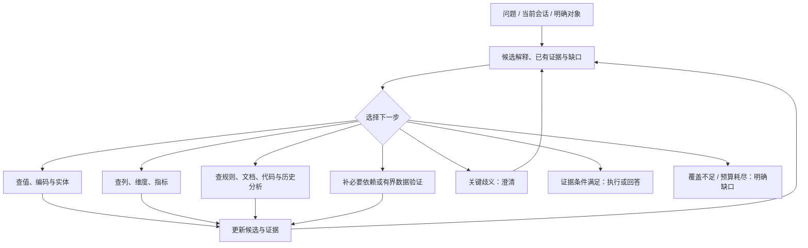

# DataAgent 的自适应检索：从固定流水线到按证据选择下一步

研究截止：2026-10-31，Asia/Shanghai。本专题回应：问题理解、表、业务逻辑、列、值是否必须按预定顺序召回，以及怎样支持值或列作为入口。三个子 Agent 分别研究产品实践、论文和开源调用链，主 Agent 综合并复核。本文属于讨论与外部研究，未实现产品功能、运行论文代码或进行产品准确率比较。

## 1. 核心判断：检索顺序应该动态，证据约束应该明确

用户提出的问题成立。固定 `理解问题 → 选表 → 找规则 → 选列 → 找值` 把一种实现顺序当成了所有问题的知识发现顺序：如果表一开始选错，后续列和值搜索通常被限制在错误范围内，后面模型能力再强也可能无法恢复。

但需要进一步区分三个问题：

1. **从哪里进入：**问题最强的线索可能是值、字段、指标、业务规则、已有分析，或上一轮已确认的对象。
2. **下一步查什么：**当前还缺的是含义、物理映射、过滤值、关联路径、时间定义，还是反例证据。
3. **何时算足够：**拿到若干相关片段不等于已经具备回答条件；也不应为了完成预设阶段而重复检索。

建议把原来“不同阶段依次产出结果”的理解，升级为：**维护当前问题的候选解释和证据，从多个入口定位对象，按缺口选择检索或验证动作，逐步形成足以执行的语义与数据子图。** 这是本报告的设计建议；没有单个已核验系统完整提供下面提出的全部机制。

这里也不宜把过去的行业设计一概说成固定链。CHESS 已有值→所属列的检索，SuperSonic 已有多类型 schema mapper，商业产品也有值匹配与动态上下文。真正需要比较的是自由度在哪一层、观察是否回到决策器，以及遇错能否改动已选范围。[产品专题](01-industry-practice.md) · [方法专题](02-methods-and-papers.md) · [源码专题](03-code-patterns.md)

## 2. 用户的起点会改变最有效的检索路径

以下为说明设计的虚构问题，不是宣称某竞品已经通过这些任务。

| 用户问题 | 可利用的初始线索 | 更合理的发现方向 | 不应过早确定的事 |
| --- | --- | --- | --- |
| “星河科技上季度续费了多少？” | 客户名“星河科技”是值候选；“续费”是业务概念 | 值/别名→客户身份与来源列；同时查续费口径→订单/合同/订阅映射→合法连接与时间 | 是否同名客户、是否集团口径、续费金额还是数量、签约还是入账 |
| “按获客渠道看留存” | 维度“获客渠道”和指标“留存” | 维度→所属业务对象、历史/当前属性；指标→cohort/分母/时间窗→两者可共同计算的粒度与路径 | 渠道是注册渠道、首单渠道还是最近触点；维度存在不代表能切全部指标 |
| “这个文件的 gross_margin 怎么比以前低？” | 文件及明确列名；可能还有既往分析 | 定位列和单元格/公式→定义与上游→历史版本/比较样本→分析方法 | 同名字段是否百分比、金额，文件能否与旧版直接比较 |
| “按新口径，退款跨月怎么处理？” | 业务规则和版本 | 规则/生效范围→受影响指标→转换逻辑和数据源→需要时取样验证 | 未明确要求数值时不必先读大量事实表；不能自动把新口径用于全部历史 |
| “还是看上面那几个客户，换成工单趋势” | 上轮确认的对象 ID、时间范围 | 复用对象与约束→工单来源映射→必要关联和值/时间验证 | 不必重找客户；也不能未经检查沿用不适用的新指标口径 |
| “业务掉下来了，原因是什么？” | 信号弱，且目标开放 | 小规模发现相关业务资产/既有看板→澄清指标和范围→再决定需要哪些表与方法 | 不能仅凭弱线索启动全库值扫描或生成唯一解释 |

同一个问题还可能同时有多个起点。第一行的客户名和值检索、续费规则检索可以并行，之后相互约束；无需先把问题硬分到“值类”或“指标类”中的唯一一个桶。

**问题理解也会迭代。** 第一次只能提出“可能是客户名”“可能按订单计算”等假设；查到文档或值分布后，才发现应该按合同或订阅、按业务发生时间或结算时间理解。因此 query understanding 不宜做成一次性、不可修订的前置输出。

## 3. 要改变四件事，只让 LLM 重排步骤还不够

### 3.1 对象需要独立可寻址，并允许反向导航

如果索引只有“每张表的一段描述”，即使 Agent 可以自由调用工具，也很难从“星河科技”定位到正确列。要支持不同入口，存储与索引至少需要能返回带类型的对象和关系：

| 起点 | 可用检索 | 应返回的关系/证据 |
| --- | --- | --- |
| 值或别名 | exact/编码/关键词/模糊匹配；必要时语义匹配 | 值出现在哪个列/来源、映射到哪个实体、匹配方式、范围/更新时间；同名候选分别保留 |
| 列/维度 | 名称/别名/描述/类型索引，稳定 column ID | 所属数据集、概念角色、粒度/时间角色、可用指标及来源映射 |
| 指标 | 指标/别名/适用场景检索 | 经审核定义、依赖字段、过滤、可切维度、时间与单位、适用版本 |
| 规则 | 业务词、作用域、生效期和文档定位 | 适用对象/指标/字段、优先级和例外、原文证据、审核状态 |
| 已有分析或 SQL | 问题/代码/资产检索 | 原问题、定义/数据版本、引用对象、可复用部分与失效条件 |

这里的“图”是一种对象关系表达，可以用关系表、搜索索引与 adjacency API 实现，不要求先引入专门图数据库。反向边也不必全部预先物化，但常用关系要能低成本访问。

值得强调：**具体数据值不全是 metadata。** 跨列搜客户名、地址或订单号，实际上在使用受数据授权约束的内容索引；不能只套目录可见性。业务逻辑还可能位于 dbt/LookML、代码、文档或已认证分析，不能只做 DDL 检索。

### 3.2 候选需要相互约束，不能只把多个 top-k 拼起来

从值搜到 `crm.account.name`，从“续费”搜到一个 subscription metric，不代表两者已经能组合。仍需确认实体映射、tenant、关系有效期和指标粒度。

建议给每个对象附上在本次问题中的角色，例如 `customer_filter`、`grouping_dimension`、`metric_dependency`、`time_filter`、`join_bridge`。同一个列在不同问题里可能扮演不同角色。

组合时检查：值是否属于该列/实体；维度是否允许切该指标；规则是否适用当前业务与时间；数据来源是否权威；已选关系是否保持目标粒度。**图上最短路径不一定是业务合法路径，连通也不等于可正确计算。**

“补关系闭包”也应限定含义：补齐本任务所需的键、桥表、tenant/time 条件和指标依赖；不沿图无限展开所有邻居。否则会换一种方式把全量 schema 放回 prompt。

### 3.3 检索决策需要看到实际观察

控制器应维护紧凑、可检查的状态：

- 用户目标、已明确约束、尚未明确的关键项。
- 候选解释和对象，以及支持/反对它们的证据。
- 已执行动作、返回范围、失败/截断/过时标记。
- 当前缺口：例如“客户身份两解”“缺续费口径”“连接基数未知”。
- 数据/语义/权限版本与剩余预算。

下一步不是固定地“现在轮到值检索”，而是例如“客户身份尚未确认，所以查候选编码”“这个 metric 缺时间定义，所以取其规则”“join 可能倍增，所以做有界验证”。

检索器应返回结构化命中和缺失信息，而非只给一段看似完整的总结。空结果至少区分：未命中、索引覆盖不足、索引过期、工具失败和结果截断；权限不可见的信息应由授权层限制，不能通过错误提示泄露。

源码研究发现，**有一个 Agent 选工具的循环，不代表它会根据实际证据做决策**。例如本轮 CHESS 固定提交中，局部工具返回给调度模型的是成功提示，状态没有在该路径显式序列化进消息；Vanna/APEX 则能看到真实工具或执行反馈。调度能力需要沿消息和状态流核查。[方法专题](02-methods-and-papers.md) · [源码专题](03-code-patterns.md)

### 3.4 停止应由任务所需证据决定

建议按任务检查以下条件，而非要求每题查齐全部表、列、值、规则：

| 任务 | 可以进入执行/回答前应满足的条件 | 可跳过的检索 |
| --- | --- | --- |
| 认证指标问数 | 明确指标、合法分组/过滤、时间范围、适用定义与数据授权 | 指标接口已提供物理计划时，无需向模型再次检索全部底层表列 |
| 值驱动查询 | 重要值已绑定正确列/实体；关键歧义解决；指标/时间/连接可验证 | 已通过稳定实体 ID 绑定时，无需每轮重复模糊搜值 |
| SQL 探索 | 输出/过滤/聚合的对象与含义已知；必要依赖和合法路径完整；关键未知已验证或明确标注 | 无关规则、未使用列、与目标无关的全量值分布 |
| 规则解释 | 规则来源、生效范围、版本与关键依赖齐全 | 用户不要求计算且规则不依赖数据验证时，可不执行事实表查询 |

这些是待验证的“充分性检查”，不是语义正确性的数学证明。开放调查和方法选择仍需人工校准。模型一句“信息足够”或一个自报 confidence 不能作为唯一判据。

遇到关键歧义时应澄清；继续检索无法提高证据时可以停止并说明缺口。预算耗尽属于未完成或受限结果，不能自动当作已经有足够证据。

## 4. 业界解法：至少有五种不同层次

| 解法 | 代表与一手证据 | 解决的具体问题 | 自由度与限制 |
| --- | --- | --- | --- |
| **值和多类型对象直接进入召回** | CHESS 的 entity retrieval；SuperSonic 多类型 mapper；Genie prompt matching；Snowflake literal search | CHESS 支持值→所属表列；Genie/Snowflake 支持已配置列或维度内的值 grounding；SuperSonic 将值与其他类型共同匹配 | 索引/语义模型范围通常预先准备；多入口不自动等于动态调度 |
| **双向合并，降低裁剪遗漏** | RSL-SQL：question→schema，与完整 schema 上的 preliminary SQL→schema 合并 | 两路证据在裁剪前取并集，降低单路 linking 漏列、漏关系的风险 | 固定多阶段流程；初步 SQL 依赖完整 schema，不能直接解决超大目录初始定位 |
| **有条件的主动探查** | ReFoRCE 最高票结果并列时触发列探索；Genie 对响应启用 Inspect 后写小 SQL 核对值/日期/join | 数据语义不清，或候选结果、检查暴露疑点 | 是特定触发/检查流程；ReFoRCE 的低置信是投票规则，不是通用模型 confidence |
| **按需上下文与层级导航** | LinkedIn 搜索/导航/ID 直取；Hex guides/repositories；Wren fetch context；ThoughtSpot context steering | 按相关性和作用域取上下文；LinkedIn 已知 ID 可直取，Hex 可深入代码，Wren 可指定类型或 model | Wren 小 schema 返回全文；Spotter 公开主动检索与排序，未公开观察回灌的完整调度契约 |
| **模型选择下一步并回看观察** | APEX 的探索/修订/SQL/确认；Vanna 2.x 工具循环 | 依据实际工具结果决定补什么、改什么、何时继续 | 开源可核消息/状态；仍需预算、范围、依赖与验证约束 |

### 4.1 最直接回答“从值开始”的例子

**CHESS** 的 entity retrieval 可以从关键词检索库内值，再带回所属表和列；catalog/context 另有检索通道。论文和代码的检索范围/过滤流程已读。它说明值识别可以帮助 schema linking，而不只是等选好表后才填 WHERE 值。外层团队调度仍有固定阶段，局部工具循环也有观察回灌限制，不能泛称为全局自由探索。[方法专题 §CHESS](02-methods-and-papers.md)

**Databricks Genie** 官方文档描述使用代表值/distinct 值匹配问题，示例可把 Florida 绑定到 `state='FL'`；值数量、列类型、刷新和范围有限制。它证明值是语义识别信号，不公开证明“任何问题都会先全库搜值”。[产品专题](01-industry-practice.md)

**Snowflake** 的 literal search 可以通过 `sample_values`，以及针对高基数/频繁变化维度配置 Cortex Search 来找真实过滤值。它仍需要预先把搜索服务挂到相应语义维度；属于值 grounding 的具体机制，不能描述为任意未知字段发现服务。[产品专题](01-industry-practice.md)

### 4.2 补检索与生成可以互相影响

**RSL-SQL** 的启示是：初步生成的 SQL 可以成为检索器的探针，其引用对象为初次 linking 补充线索。具体实现使用完整 schema 生成 preliminary SQL，再与 forward linking 取并集，最后裁剪；不能误写成先裁剪后由 SQL 自动找回不可见对象。与此同时，草稿 SQL 也是模型假设，可能加错列，不能把“被草稿引用”直接当真值。[方法专题](02-methods-and-papers.md)

**Genie Inspect** 的 Public Preview 文档描述：对某条响应显式启用后，检查初始 SQL，写较小 SQL 验证 filter values、日期窗口、join/aggregation，必要时改写并比较。它支持“生成→发现缺口→验证/改写”，但不公开保证每种业务约束都经过硬校验。[产品专题](01-industry-practice.md)

**APEX-SQL** 把 hypothesis–verification 用于 schema linking 和 SQL generation。论文中先逻辑计划、双路径剪枝、逐表探查，再全局综合；生成阶段有探索、状态整理、SQL、确认动作。官方代码存在实际结果回注，但本轮固定 BIRD 路径默认不开 pruning、workers 为 1，论文架构不能直接等同默认运行行为；CONFIRM 也不是独立语义证明。[方法专题](02-methods-and-papers.md)

### 4.3 动态查业务上下文已有明确工程实践

**LinkedIn** 提供语义搜索、层级索引导航和已知 ID 直接获取。已知团队时可从对应层开始；生成知识和审核知识分别存储，再按同一 asset ID 组合。它为“多入口、按需展开、知识版本与来源”提供具体工程参考，不是公开统一检索策略算法。

**Hex** 的 guides 可按 frontmatter 相关性动态读取，reference repositories 按描述判断相关后下载并定位文件/片段。这对“字段字面没说清，需要追 dbt/业务代码”尤其有参考价值。只看表注释会遗漏这一层。

**ThoughtSpot 26.10** 文档直接描述 Agent actively steers retrieval，先按作用域处理、再结合相关性/来源/时间等排序；跨 model 搜索还可按信心继续或澄清。但这里是已启用的语义 model、memory、外部连接来源，不能外推为任意裸库关联发现。[产品专题及准确 URL](01-industry-practice.md)

**dbt AI 增补：** 用户指出原竞品覆盖缺口后，补核了 Wizard/Explore、Copilot/Insights 和 MCP。当前 MCP 文档列出相似模型语义搜索、节点精取、有界双向 lineage、指标/维度/值及 SQL 工具；Wizard 文档描述结构化项目状态与按影响选择验证。它们为独立工具与按需取证提供另一组产品参考，但 `get_dimension_values` 仍是已知维度内取值，统一 `search` 标 Alpha，工具存在也不证明完整动态 policy 或充分性停止。[dbt AI 补充及来源](../dataagent-landscape-2026-10-31/05-dbt-ai-addendum.md)

## 5. 对 DataAgent 更合适的组合：便宜的发现＋有界的动态补查

以下是讨论建议，不是已批准的实施架构。至少有三种可选设计：

| 设计 | 优点 | 主要代价 | 适用判断 |
| --- | --- | --- | --- |
| 多路固定并行 | 值/列/指标/规则都查一遍，简单且易做回归 | 每题重复成本、噪声；仍难处理新发现和范围回退 | 可做强基线；小型目录或低成本索引尤其适合 |
| 完全由 Agent 自由选择工具 | 路径灵活，易利用新观察 | 重复调用、早停、工具选择错、延迟与不稳定；缺索引时仍找不到 | 适合受限探索实验，不宜直接视为可靠默认 |
| **混合策略** | 先利用便宜线索和已有可信资产，再按缺口补查；服务端维持约束 | 需要状态、工具契约、诊断和评测，比单链复杂 | 本报告更建议验证的方向 |

混合策略中的“先利用”是成本策略，不是另一条硬链：已有认证指标或稳定对象 ID 可以直接进入相应接口；线索不明时才做小规模多类型发现。不要用一个一次性 router 把问题锁死在 value-first / column-first / table-first 模板之一。

**动态的是下一步动作，稳定的是工具契约和强制约束。** 身份、允许来源、查询预算、必要依赖、版本一致性和结果验证不由模型临时取消。

### 5.1 工具怎样拆，才能避免“自由工具，固定能力”

候选 API 可按能力拆分，以下仅为讨论示意：

| 能力 | 示意接口 | 契约重点 |
| --- | --- | --- |
| 多类型发现 | `search_objects(text, types, scope)` | 返回稳定对象 ID、类型、来源、版本；不同类型分数需融合/重排，不直接比较原始距离 |
| 未知列的值定位 | `locate_value(text, scope, match_mode)` | 返回候选 source/column/entity 和匹配证据；可提示索引覆盖，不能伪造全库穷尽 |
| 已知列的值解析 | `resolve_value(column_id, text)` | 别名/编码→真实值、歧义候选、匹配方式；保留 exact/prefix/contains 等原始意图 |
| 对象详情/导航 | `get_object(id)`、`neighbors(id, relation_types)` | 已知 ID 直接取；邻居关系分类型、受版本/权限约束 |
| 业务定义 | `get_definition(id, scope, effective_time)` | 原文/可执行定义/依赖、owner、版本、生效范围及冲突 |
| 任务依赖 | `resolve_dependencies(selected, roles, target_grain)` | 仅补任务所需 metric/bridge/tenant/time 条件；无合法解时返回原因 |
| 验证假设 | `probe_values(...)`、`validate_join(...)` | 有界只读查询、采样/全量区别、查询 ID、观察而非越权发布关系 |
| 执行前检查 | `check_evidence(task, bindings, versions)` | 输出已满足项、未解项、冲突和允许的后续动作；不是模型自报总分 |

物理查询值时通常仍然需要表和列；“值先行”指**发现的逻辑起点**可以是值，通过反向索引/实体目录或受控定位工具找来源。没有这种能力，仅把一个必需 `table_name` 的 value 工具交给 Agent，不会自动获得 value-first。

同样，统一 `search()` 可以做入口，但底层需要类型化能力。把值、规则、SQL 和表描述塞进单一向量库，以相同 top-k 返回自由文本，会隐藏对象身份、匹配方式和依赖，难以做可靠组合。

### 5.2 值检索要按类型和成本选择办法

编码/订单号优先 exact 或格式校验；名称可 exact、词法、别名再补语义；枚举可用经允许的值字典；高基数列采用有边界的专用索引或查询。语义相似不能直接决定 SQL 的模糊匹配方式，找到标准值之后仍应保持用户的精确/包含等意图。

索引选择性建设：优先对高频业务实体、关键枚举和常用名称建值索引，长尾再受控探查。全库每个值都 embedding 的构建/刷新/存储成本高，也不能自然保留权限和高精度 ID 语义。

值命中不等于实体身份确认：“北京”可能是客户城市、发货地或部门名；“01”在多个列有完全不同含义。应保留 `mention → canonical value/entity → owning column/source → question role` 的关系，不把字符串出现过当成过滤依据。全局值搜索也必须基于当前身份授权，可见性不能只在最终 SQL 时才处理。

### 5.3 在线探索和离线语义建设要衔接，但不混用发布权限

离线/增量侧负责目录、值/术语索引、已知映射、关系证据、认证指标和更新失效；在线侧为本题取证、比较候选和发现缺口。运行中查到一种关系，可以用于受限假设验证；提升为企业共享 join 或业务事实时，仍需对应审核和回归。

`检索顺序动态` 不意味着需要每次重建 ontology，也不意味着离线知识不再需要。它要求离线资产既能支持多个入口，又允许在线发现不足后回退和扩展。

## 6. 难点不是灵活性本身，而是怎样控制错误与成本

| 风险 | 具体表现 | 对应机制 |
| --- | --- | --- |
| 早期范围锁死 | 初次选错 model/table，后续只在错误局部找值 | 候选并存、允许扩大/更换范围、索引覆盖反馈；不可见来源不泄露 |
| 确认偏误 | 草稿 SQL 指向某列，补检索只找支持证据 | 保留竞争解释、查反例、规则/数据交叉验证；草稿引用不作真值 |
| 无限制图展开 | 为补桥表而引入全部邻居 | 按目标 grain、角色和允许路径限定，控制 fanout 与预算 |
| 无效循环 | 反复改写同一关键词，结果不变 | 去重动作/结果摘要、记录新证据、无增益后换策略/澄清/结束 |
| 高估样本 | 少量值匹配被当作全量约束成立 | 返回采样范围；关键约束单独验证，不让样本结论冒充唯一性/FK |
| 工具成功假象 | 检索返回成功但无事实，错误/截断被摘要隐藏 | 结构化结果、可追溯 evidence ID、明确状态、观察回灌 |
| context budget 丢关键项 | 重排只保留最相似文本，桥表/定义依赖被挤掉 | 相关性与必需依赖分开；必要上下文优先，冲突与缺口不静默删除 |
| 多轮沿用过头 | 保留了客户，也错误沿用旧时间/指标/权限 | 对象可复用但约束逐项验证；改口径触发受影响绑定失效 |

信息增益可以作为动作选择的思想：优先解决会改变查询对象/结果的歧义，而不是多找几条相似片段。但真正的增益通常不可直接观测；第一版可用可解释规则和离线案例学习，不应宣称有一个未经校准的模型 confidence 就能最优调度。

## 7. 怎样证明比固定链更好

只提高 SQL EX 或平均 schema recall 不足以验证本题。应额外设计入口变化、早期误选恢复、多轮和业务依赖任务；保持底层模型、索引覆盖、可用工具和预算尽量一致。

### 7.1 最有信息量的对照

| 对照 | 分离什么因素 |
| --- | --- |
| 固定 table→column→value 链 | 原基线，保留合理业务规则检索 |
| 多类型固定并行 | 增益是否仅来自加了值/规则索引和更多候选 |
| 加双向 schema 回补/执行反馈 | 增益是否来自纠错而非自由规划 |
| 混合动态检索 | 在同等能力与成本约束下，自适应顺序是否进一步有用 |
| 全量上下文（放得下的子集） | 检索是否损失关键信息；不能用该子集替代大规模评价 |
| gold context 诊断 | 下游 SQL/分析的能力上界；不能当真实产品分数 |

如果动态策略获得了额外 value 索引、更多 token 和查询次数，而固定链没有，结果不能只归因于“agentic”。分别报告相同预算和真实运行成本下的质量曲线。

### 7.2 任务与指标

建议准备一批经授权、由业务专家审核的小规模对照包，至少覆盖：值/别名起问、列/维度起问、指标起问、规则解释、上下文跟进、同名冲突、未知值、索引陈旧、漏桥表、错误初始候选、多个合法路径和权限差异。

同一业务任务做成不同自然语言入口，例如客户名起问、字段名起问和完整业务描述；它们是相关变体，应按任务簇统计，不能当作大量独立样本。gold 可允许多条有效路径和不同 SQL 实现。

重点指标包括：

- **正确绑定：**值→列/实体、列→角色、指标→定义，及关键歧义澄清是否正确。
- **任务所需集合齐全：**必需对象、规则、键/桥表/时间条件的全召回；合法替代方案可通过，不强制复刻唯一 gold 路径。
- **恢复：**初始误选后能否恢复；是否把无命中误认为数据不存在；是否引入新的错误绑定。
- **停止：**关键证据缺失却继续执行的比例；信息已足够仍重复检索的成本；正确的不可回答/澄清。
- **最终工作：**业务答案与过滤/粒度/时间/单位正确性，可复算证据及权限共同通过。
- **效率：**p50/p95 时延、token、查询/扫描成本、工具次数、索引构建/刷新成本与人工维护时间。

不按“每题是否走了 value→column→table”评分。Agent 可能通过已认证指标接口更快正确回答；应验证必要证据和约束，而非规定唯一轨迹。固定全部任务分母，超时/漏答/工具失败不能删除。

公开评测可参考 BIRD 的值与 evidence、Spider 2.0 的大 schema/工作流、BEAVER 的 linking 分解、BIRD-Interact 的澄清；CHESS/RSL/APEX 的方法与消融适合设计对照。它们仍不足以覆盖自有业务规则、值身份、权限和更新生命周期。[方法专题](02-methods-and-papers.md) · [前轮 benchmark 核验](../dataagent-2026-10-30/03-benchmarks-and-evaluation.md)

## 8. 本轮结论与待回答的问题

建议把之前的研究点改为：**新问题出现时，能否从值、列、指标、业务逻辑或会话对象中的任意有效线索出发，动态补齐所需语义和数据证据，并在成本、权限和正确性约束下完成回答。**

最值得优先参考的机制是：CHESS/SuperSonic 的多类型与值定位、RSL 的反向补回、LinkedIn/Hex 的按需导航与代码取证、Genie 的验证性小查询、APEX/Vanna 的观察驱动动作环。并不需要先引入多个独立 Agent，单 Agent 加类型化工具和状态也可以研究这些机制；多 Agent 应由独立任务、规模和延迟需要决定。

目前还不能由公开材料回答：目标企业中值索引覆盖多少才划算；需要多少 probing；模型能否稳定区分缺知识与真无数据；怎样校准停止条件；动态策略在多少任务上真正优于更简单的并行召回；业务规则频繁变化后的维护成本。下一步应以同一批真实问题做控制变量比较，而不是继续按 Agent 数量或工具数量评价方案。

本轮没有给出已测得收益，也没有承诺具体实施。产品、论文、源码的细节和一手来源分别见下面三份专题。
