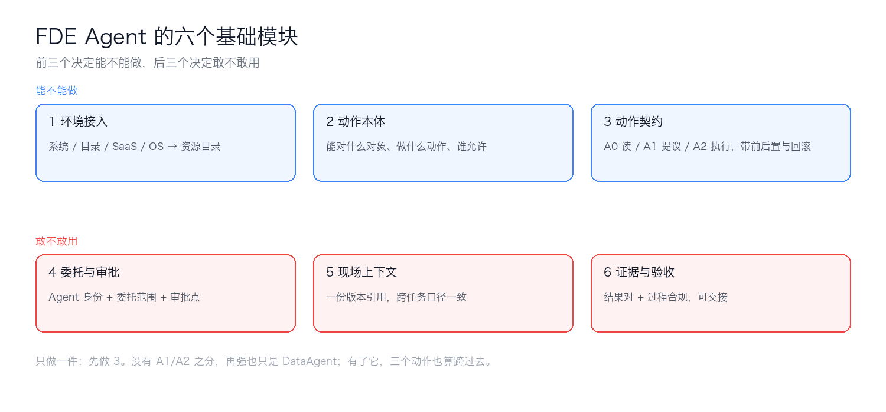

# 从 DataAgent 到 FDE Agent：六个基础模块

从「回答问题」到「改变世界」，只多了一样东西：**有副作用的动作**。下面六个模块是让这个动作可控的最小集合，缺一个就不成立。

| # | 模块 | 职责 | 输入 → 输出 | 缺了会怎样 | 最小形态 |
|---|---|---|---|---|---|
| 1 | **环境接入** | 把系统 / 目录 / SaaS / OS 变成可寻址、可探测的资源 | 客户系统清单 → 资源目录（有什么、能做什么、归谁） | 只能在给定库里打转，现场进不来 | 3 类适配器 + 一张能力清单 |
| 2 | **动作本体** | 定义「能对什么对象、做什么动作、谁允许」 | 现场勘查 → 对象 / 动作 / 权属定义 | 只能描述世界，不能作用于世界 | 10 个高频动作的声明式定义 |
| 3 | **动作契约** | 每个动作分 A0 读 / A1 提议 / A2 执行，带前置、后置、幂等、回滚 | 动作定义 → 可治理的动作契约 | 提议和执行混为一谈，无法治理 | 一个 YAML sidecar（挂在内核 `ToolSpec` 上） |
| 4 | **委托与审批** | Agent 自己的身份、委托范围、审批点 | 人与角色 → 委托范围 + 审批判据 | 要么越权，要么不能用 | 复用内核 `DelegationGrant`/`ApprovalRequest`，只写判据 |
| 5 | **现场上下文** | 一个现场一份版本引用：数据 / 本体 / 契约 / 权限 / 评测 | 各模块版本 → 一份引用集 | 跨天任务口径必漂移，多 Agent 各说各话 | 一份 JSON，内容是版本号不是内容 |
| 6 | **证据与验收** | 轨迹留痕 + 影子比对 + 双轨评测（结果对 + 过程合规） | 轨迹 → 验收报告 | 证明不了做对了，也交不出去 | 轨迹 + 一张人工比对表 |

## 三句话

- **1–3 是「能不能做」**：没有 1 看不见环境，没有 2 不知道能做什么，没有 3 分不清提议与既成事实。
- **4–6 是「敢不敢用」**：没有 4 越权，没有 5 口径乱，没有 6 无法验收。
- **只做一件就做 3**：没有 A1/A2 之分，系统再强也只是 DataAgent；有了它，三个动作也算跨过去。

## 不重做

DataAgent 已有的全部保留，只是工作对象从「库」扩到「环境」：数据接入、语义、召回、分析、图表、预测。

## 不做什么

- 不建通用 Agent 运行时、沙箱、调度——内核已有（`iface-env` / `session` / `policy` / `trace`）。
- 不建通用 RPA / UI 自动化——那是「更宽的读」。
- 不做无审批的全自动执行。

---

归档（不再维护，仅备查）

`archive/` 下是早期长文：FDE 调研、概念校准、16 模块清单、OS/FDE 边界分析、14 模块 v2，以及 `sources/` 里的外部证据快照。结论已被本页取代。

