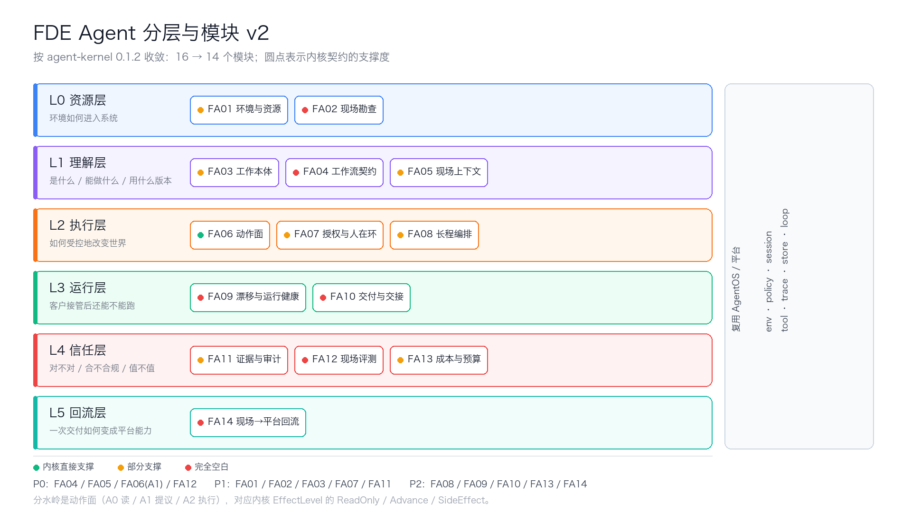

# FDE Agent 模块建设清单

> ⚠️ **编号已被 [04-模块清单v2.md](04-模块清单v2.md) 取代**（16→14：FA07+FA08 合并、FA09 执行网关下沉内核，后续编号顺移）。本文的二级/三级能力组内容仍然有效，按 v2 的新编号对号入座即可。

> 前置：[00-FDE调研.md](00-FDE调研.md)、[01-从DataAgent到FDEAgent.md](01-从DataAgent到FDEAgent.md)
> 本文给出：分层结构、16 个新增模块的职责与边界、与 AgentOS 的分工、Action Contract 规范、路线图与判据

---

## 1. 分层：在原有三层上加两层

现有 DataAgent 用「数据层 / 执行应用层 / 评测治理层 + 广义扩展」。FDE Agent 需要把「治理」拆细，并**补上两端：接入端和交付端**。

| 层 | 模块 | 关注点 | 与 DA 的关系 |
|---|---|---|---|
| **L0 资源层** | FA01 环境与资源接入；FA02 现场勘查 | 环境如何进入系统、如何被理解 | DA01 扩展 + 新建 |
| **L1 理解层** | FA03 工作本体；FA04 工作流契约；FA05 现场上下文 | 世界是什么、能做什么、以什么版本做 | DA03 升级 + 新建 |
| **L2 执行层** | FA06 动作面；FA07 身份委托；FA08 人在环；FA09 执行网关；FA10 长程编排 | 如何受控地改变世界 | DA06/07 升级 + 新建 |
| **L3 运行层** | FA11 漂移监控；FA12 交付与交接 | 客户接管后还能不能跑 | DA14 升级 + 新建 |
| **L4 信任层** | FA13 证据审计；FA14 现场评测；FA15 成本预算 | 对不对、合不合规、值不值 | DA11/12 升级 + 新建 |
| **L5 回流层** | FA16 现场→平台回流 | 一次交付如何变成平台能力 | 完全新建 |

**为什么把「交付」单列一层**：FDE 的产品是「客户能运营的系统」，交接本身就是核心能力。放在项目管理里，它就永远做不成模块。

---

## 2. 模块定义

> 约定：每个模块给出「作用与边界」——**做 X，不做 Y**。边界比职责更重要，因为 FDE 系统的失败几乎都来自边界含糊。

### L0 资源层

#### FA01｜环境与资源接入

把客户的真实工作环境（而不只是数据）接入为可寻址、可探测、可授权的工作对象。

| 二级能力组 | 关键三级能力 | 作用与边界 |
|---|---|---|
| FA01.1 资源适配器 | 01.1.1 系统与目录（OS/文件系统） 01.1.2 SaaS 与业务 API 01.1.3 Web/浏览器 01.1.4 代码仓与 CI 01.1.5 消息与工单 01.1.6 数据库与数仓（复用 DA01） | 把各类资源统一为「可寻址 + 可枚举 + 有结构 + 有权限」的对象。**不**替用户决定业务含义 |
| FA01.2 能力探测 | 01.2.1 动作能力枚举（能做什么） 01.2.2 参数与约束探测 01.2.3 限流与配额探测 | 输出「这个资源支持哪些动作、参数是什么、有什么限制」。**不**把「接口存在」当作「可安全使用」 |
| FA01.3 身份与凭据绑定 | 01.3.1 凭据代理 01.3.2 作用域声明 01.3.3 轮换与失效 | 绑定但不暴露凭据。**不**在 Agent 上下文中出现明文密钥 |
| FA01.4 环境清单 | 01.4.1 资源与归属登记 01.4.2 可达性与健康检查 01.4.3 变更登记 | 记录环境里有什么、归谁、当前是否可达。**不**做资产治理的审批流 |

> 最小版可只做 FA01.1 + FA01.2，其余借平台能力。

#### FA02｜现场勘查

把「流程、角色、例外」这些通常只存在于人脑里的东西，变成可计算的对象。

| 二级能力组 | 关键三级能力 | 作用与边界 |
|---|---|---|
| FA02.1 流程勘查 | 02.1.1 流程步骤与触发条件提取 02.1.2 分支与例外路径记录 02.1.3 人工步骤识别 | 还原 as-is 流程（含非正式做法）。**不**直接给 to-be 方案 |
| FA02.2 角色与职责 | 02.2.1 角色清单与权限现状 02.2.2 事实上的决定者识别 02.2.3 审批链还原 | 记录「谁实际决定」，而不只是「组织架构上谁负责」 |
| FA02.3 现状基线 | 02.3.1 人工耗时与频次 02.3.2 错误率与返工率 02.3.3 成本基线 | 建立可对比的基线。**不**承诺改进幅度 |
| FA02.4 隐性知识采集 | 02.4.1 访谈与文档结构化 02.4.2 例外规则登记 02.4.3 待确认项排序 | 把「这个客户特殊」变成显式规则。**不**把个例上升为通用规则 |

---

### L1 理解层

#### FA03｜工作本体（DA03 的超集）

不只描述「世界是什么」，还描述「能对世界做什么、谁允许、留什么证据」。

| 二级能力组 | 关键三级能力 | 作用与边界 |
|---|---|---|
| FA03.1 对象与关系 | 03.1.1 实体与属性（复用 DA03.1） 03.1.2 关系与基数（复用 DA03.3） 03.1.3 状态与生命周期 | 定义业务对象及其状态机。**不**等于物理表定义 |
| FA03.2 动作定义 | 03.2.1 Action Type 声明 03.2.2 参数 schema 03.2.3 前置/后置条件 03.2.4 影响面与可逆性 | 定义「可被执行的原子动作」。**不**包含具体执行实现（实现归 FA09） |
| FA03.3 权属模型 | 03.3.1 读/提议/执行三档 03.3.2 委托关系 03.3.3 审批策略 | 声明「谁在什么条件下可以做什么」。**不**做运行时鉴权（归 FA07） |
| FA03.4 证据模型 | 03.4.1 证据类型定义 03.4.2 充分性判据 03.4.3 证据与结论的绑定 | 定义「什么算证据充分」。**不**存储证据原文（归 FA13） |
| FA03.5 本体版本 | 03.5.1 版本与作用域 03.5.2 变更影响面 03.5.3 兼容与废弃 | 管理本体演进。**不**自动迁移已发布契约 |

#### FA04｜工作流契约

把业务目标编译成一份可执行、可治理、可验收的契约。

| 二级能力组 | 关键三级能力 | 作用与边界 |
|---|---|---|
| FA04.1 目标编译 | 04.1.1 目标→状态机 04.1.2 成功判据定义 04.1.3 边界与拒绝条件 | 把「降低对账时间」变成状态机 + 判据。**不**替业务设定目标值 |
| FA04.2 审批点设计 | 04.2.1 审批触发条件 04.2.2 审批人选择 04.2.3 升级与超时 | 决定哪里必须停下来等人。**不**默认「全都要审批」 |
| FA04.3 失败与回滚 | 04.3.1 失败模式枚举 04.3.2 回滚路径 04.3.3 补偿动作 | 为每个不可逆步骤准备退路。**不**假设「重跑一次」就是回滚 |
| FA04.4 预算与时限 | 04.4.1 成本预算 04.4.2 时延要求 04.4.3 熔断条件 | 给契约加资源上限。**不**做运行时限额执行（归 FA15） |
| FA04.5 契约评审 | 04.5.1 草案生成 04.5.2 人工确认与签署 04.5.3 契约版本发布 | 产出可被人签字的契约。**不**跳过确认直接生效 |

#### FA05｜现场上下文

让一个现场的所有任务、所有子 Agent 使用同一套版本与口径。

| 二级能力组 | 关键三级能力 | 作用与边界 |
|---|---|---|
| FA05.1 现场注册 | 05.1.1 现场/租户标识 05.1.2 环境绑定 05.1.3 责任人与联系人 | 建立「现场」这个一等对象。**不**做租户计费 |
| FA05.2 版本钉定 | 05.2.1 数据快照引用 05.2.2 本体与契约版本 05.2.3 权限策略版本 05.2.4 模型与配置版本 | 让一次执行可复现。**不**保证任意历史都能重算（缺快照时显式标注） |
| FA05.3 上下文派发 | 05.3.1 子任务裁剪 05.3.2 引用而非复制 05.3.3 摘要与预算 | 给子 Agent 最小充分上下文。**不**把全量轨迹复制给每个 Agent |
| FA05.4 口径仲裁 | 05.4.1 冲突检测 05.4.2 仲裁记录 05.4.3 修订传播与失效 | 出现口径冲突时由指定角色裁决。**不**让子 Agent 各自改口径 |

> 这一模块直接回答原文档「待商榷的点 1」。

---

### L2 执行层

#### FA06｜动作面与工具契约

把「能力」变成「可被治理地调用的动作」。

| 二级能力组 | 关键三级能力 | 作用与边界 |
|---|---|---|
| FA06.1 动作分档 | 06.1.1 A0/A1/A2 判定 06.1.2 档位与审批策略映射 06.1.3 越权拒绝 | 任何能力入口先判档。**不**允许「一档通吃」的万能工具 |
| FA06.2 契约封装 | 06.2.1 MCP/API → Action Contract 06.2.2 参数校验与默认值 06.2.3 语义化命名 | 把裸接口包装成有语义的动作。**不**改变下游接口语义 |
| FA06.3 安全执行特性 | 06.3.1 幂等键 06.3.2 dry-run 06.3.3 影响面预估 06.3.4 后置校验 06.3.5 补偿动作 | 让执行可控、可预演、可撤销。**不**承诺所有动作都可逆（不可逆必须显式标注） |
| FA06.4 能力目录 | 06.4.1 动作检索 06.4.2 适用范围与限制 06.4.3 弃用与替代 | 让 Agent 找得到正确动作。**不**做权限判定（归 FA07） |

#### FA07｜身份、委托与权限

回答「这个动作是以谁的名义、在什么授权下做的」。

| 二级能力组 | 关键三级能力 | 作用与边界 |
|---|---|---|
| FA07.1 主体建模 | 07.1.1 用户身份 07.1.2 Agent 身份 07.1.3 工具/服务身份 | 给 Agent 独立身份（可审计、可撤销）。**不**复用人的凭据 |
| FA07.2 委托 | 07.2.1 委托范围 07.2.2 委托时限 07.2.3 委托链与转委托限制 | 明确「代表谁、到什么时候、能做什么」。**不**允许无限期继承 |
| FA07.3 授权判定 | 07.3.1 最小权限计算 07.3.2 策略评估（含条件） 07.3.3 拒绝与降级 | 运行时判定。**不**把授权规则散落在业务代码里 |
| FA07.4 权责分离 | 07.4.1 审批权与执行权分离 07.4.2 双人复核 07.4.3 紧急豁免与留痕 | 让「提议的人」不等于「批准的人」。**不**允许 Agent 自批自执 |

#### FA08｜人在环与审批

把人的判断放在正确的断点上，而不是每步都问。

| 二级能力组 | 关键三级能力 | 作用与边界 |
|---|---|---|
| FA08.1 审批对象 | 08.1.1 证据包组装 08.1.2 影响面说明 08.1.3 一句话决策摘要 | 让审批人 30 秒内能判断。**不**要求审批人读完整轨迹 |
| FA08.2 审批流 | 08.2.1 队列与优先级 08.2.2 批量与抽样 08.2.3 超时升级 08.2.4 拒绝后的处理 | 支撑真实吞吐。**不**把审批做成阻塞点 |
| FA08.3 监督界面 | 08.3.1 执行前预览 08.3.2 执行中监控 08.3.3 执行后复核与撤销 | 人始终有「看得见、拦得住」的入口。**不**用聊天窗口代替监督界面 |
| FA08.4 审批负担度量 | 08.4.1 审批量与耗时 08.4.2 通过率与改写率 08.4.3 负担预警 | 度量「人是不是被 Agent 累死」。**不**把审批量当作价值 |

#### FA09｜执行网关与沙盒

真正把动作做出去，并且只按契约做。

| 二级能力组 | 关键三级能力 | 作用与边界 |
|---|---|---|
| FA09.1 受控执行 | 09.1.1 窄动作执行 09.1.2 并发与租约 09.1.3 超时与重试 09.1.4 部分失败处理 | 执行已批准的动作。**不**在执行中临时扩权 |
| FA09.2 预演环境 | 09.2.1 沙盒/影子副本 09.2.2 模拟下游 09.2.3 预演结果比对 | 允许先在不影响生产的地方跑。**不**保证沙盒与生产完全等价 |
| FA09.3 结果核对 | 09.3.1 后置条件校验 09.3.2 回执与状态对账 09.3.3 不一致告警 | 用真实状态确认成功。**不**以「接口返回 200」判定完成 |

> DA07.4 已有「写入回执与状态核对」的雏形，FA09 是它的完整形态。

#### FA10｜长程编排

让流程能跨天、等人、等外部事件、断点续跑。

| 二级能力组 | 关键三级能力 | 作用与边界 |
|---|---|---|
| FA10.1 触发器 | 10.1.1 定时 10.1.2 事件与数据到达 10.1.3 人工发起 | 决定何时开始。**不**承担平台调度器实现 |
| FA10.2 等待与恢复 | 10.2.1 等人（审批/回复） 10.2.2 等系统（外部回执） 10.2.3 断点续跑与幂等 | 支撑真实时长。**不**假设流程在一轮对话内完成 |
| FA10.3 多 Agent 编队 | 10.3.1 角色与子目标划分 10.3.2 上下文派发（走 FA05） 10.3.3 冲突仲裁与交接 | 分工与协作。**不**让子 Agent 各自持有独立口径 |
| FA10.4 中断与接管 | 10.4.1 人工接管 10.4.2 暂停/恢复 10.4.3 终止与善后 | 人随时能接手。**不**让 Agent 在无人监督下无限循环 |

---

### L3 运行层

#### FA11｜漂移监控与运行健康

FDE 系统的主要失效不是模型变差，而是**环境变了**。

| 二级能力组 | 关键三级能力 | 作用与边界 |
|---|---|---|
| FA11.1 环境漂移 | 11.1.1 系统版本/UI 变化 11.1.2 权限与角色变化 11.1.3 流程与制度变化 11.1.4 数据结构变化（复用 DA02.9） | 发现「世界变了」。**不**自动改契约 |
| FA11.2 运行健康 | 11.2.1 动作成功率与失败聚类 11.2.2 时延与积压 11.2.3 人工干预率 | 度量系统是否还在正常工作。**不**把「Agent 说成功」当成功 |
| FA11.3 渐进发布 | 11.3.1 影子流量 11.3.2 金丝雀 11.3.3 回滚 | 安全地上新版本。**不**用全量灰度替代验证 |

#### FA12｜交付与交接

决定规模化分母是「产品」还是「人头」。

| 二级能力组 | 关键三级能力 | 作用与边界 |
|---|---|---|
| FA12.1 Runbook 生成 | 12.1.1 日常操作手册 12.1.2 异常处置流程 12.1.3 责任矩阵 | 让客户能自己跑。**不**假设客户会读代码 |
| FA12.2 自助界面 | 12.2.1 任务发起与查看 12.2.2 审批与例外申请 12.2.3 指标与报表 | 客户日常操作的入口。**不**替代专业系统 |
| FA12.3 知识移交 | 12.3.1 本体/契约说明 12.3.2 评测集移交 12.3.3 培训材料 | 把「为什么这么做」交出去。**不**保留隐性知识作为议价筹码 |
| FA12.4 运营协议 | 12.4.1 SLA 定义 12.4.2 值班与升级 12.4.3 变更窗口 | 明确服务边界。**不**承诺不可验证的 SLA |
| FA12.5 退出与接管 | 12.5.1 退出检查清单 12.5.2 数据与资产归属 12.5.3 平替方案 | 让客户能离开（也是信任来源）。**不**做锁定 |

#### FA13｜证据、审计与可回放

| 二级能力组 | 关键三级能力 | 作用与边界 |
|---|---|---|
| FA13.1 全链追踪 | 13.1.1 证据→决策→动作→结果链 13.1.2 关键节点不可篡改 13.1.3 主体与时间戳 | 回答「为什么做了这件事」。**不**存储全部原始上下文（按策略裁剪） |
| FA13.2 回放 | 13.2.1 轨迹回放 13.2.2 反事实重跑 13.2.3 差异定位 | 支持复盘与定责。**不**承诺位级重放 |
| FA13.3 合规输出 | 13.3.1 审计报告导出 13.3.2 权限使用报告 13.3.3 保留期与销毁 | 满足外部审计。**不**替代客户自有合规体系 |

#### FA14｜现场评测与影子运行

现场没有 ground truth，这是 FDE 评测与 DataAgent 评测最大的不同。

| 二级能力组 | 关键三级能力 | 作用与边界 |
|---|---|---|
| FA14.1 验收判据 | 14.1.1 业务验收标准 14.1.2 容差与例外 14.1.3 成本与时效要求 | 定义「什么叫做成了」。**不**用 demo 通过代替验收 |
| FA14.2 影子运行 | 14.2.1 旁路执行 14.2.2 与人工结果比对 14.2.3 差异归因 | 在不影响生产的前提下积累证据。**不**把影子结果当成已生效 |
| FA14.3 双轨评测 | 14.3.1 结果正确性 14.3.2 过程合规性（越权、审批纪律、工具正确性） 14.3.3 轨迹级回归 | 同时评「对不对」和「该不该」。**不**只看最终答案 |
| FA14.4 上线门禁 | 14.4.1 分级准入标准 14.4.2 模型/契约变更回归 14.4.3 失败率熔断 | 决定能不能扩大自主度。**不**用一次评审永久放行 |

#### FA15｜成本与预算

| 二级能力组 | 关键三级能力 | 作用与边界 |
|---|---|---|
| FA15.1 成本归因 | 15.1.1 按现场/流程/动作归因 15.1.2 推理 vs 工具 vs 人审 15.1.3 失败与返工成本 | 算清「一次受控结果多少钱」。**不**只统计 token |
| FA15.2 分级路由 | 15.2.1 按风险选模型 15.2.2 按难度选流程 15.2.3 缓存与复用 | 在不降质的前提下省钱。**不**为省钱牺牲高风险动作的可靠性 |
| FA15.3 预算与熔断 | 15.3.1 预算设定 15.3.2 超支告警与降级 15.3.3 实验与生产分离 | 防止单流程烧穿预算。**不**让降级导致静默错误 |

### L5 回流层

#### FA16｜现场→平台回流

**这是 FDE 模式唯一的护城河，也是唯一防止退化成咨询的机制。**

| 二级能力组 | 关键三级能力 | 作用与边界 |
|---|---|---|
| FA16.1 摩擦聚类 | 16.1.1 同类问题识别 16.1.2 频次与成本排序 16.1.3 可抽象性判断 | 找出「值得变成平台能力」的重复劳动。**不**把一次性定制当共性 |
| FA16.2 抽象与产品化 | 16.2.1 抽象为动作/契约模板 16.2.2 抽象为领域包 16.2.3 抽象为评测用例 | 把现场产物变成可复用资产。**不**回流客户专有口径与可识别信息 |
| FA16.3 复用度量 | 16.3.1 模板复用率 16.3.2 新现场上线周期 16.3.3 单现场交付成本 | 证明「平台确实在变强」。**不**用交付数量掩盖复用率下降 |

---

## 3. 与 AgentOS 的分工：哪些不该我们建

调研结论很明确：**控制面正在被商品化**（GCP 的 Agent Identity / Registry / Gateway / Sandbox / Sessions / Memory Bank / Simulation / Evaluation / Observability 已经打包成一套）。重复造这层是浪费。

| 能力 | 应该由谁建 | 理由 |
|---|---|---|
| Agent 身份（密码学 ID、token 绑定） | **AgentOS / 平台** | 基础设施，单点建设 |
| 工具网关与策略执行点 | **AgentOS / 平台** | 需要与网络、密钥、审计打通 |
| 沙盒与运行时隔离 | **AgentOS / 平台** | 安全边界 |
| 会话、长期记忆存储 | **AgentOS / 平台** | 通用底座 |
| 轨迹存储与基础可观测 | **AgentOS / 平台** | 与上层评测解耦 |
| 调度器与重试 | **AgentOS / 平台** | 通用 |
| **工作本体（对象+动作+权限+证据）** | **我们** | 业务语义，平台无法替代 |
| **工作流契约（目标→状态机→审批点）** | **我们** | 交付物本体 |
| **动作契约（A0/A1/A2 与安全特性）** | **我们**（依赖平台执行） | 治理语义 |
| **现场上下文与口径仲裁** | **我们** | 多 Agent 一致性的根 |
| **现场评测与影子运行** | **我们** | 业务判据 |
| **交接物（Runbook/自助界面/移交）** | **我们** | 规模化关键 |
| **回流机制** | **我们** | 护城河 |

一句话：**平台建「能不能安全地做」，我们建「该不该做、做到什么算成、做完怎么交」。**

---

## 4. 路线图：三个阶段，每阶段有硬判据

### P0（0–3 个月）：把「读」做到环境级，把「提议」跑通

| 建什么 | 交付判据 |
|---|---|
| FA01 最小版（3 类资源适配器 + 能力探测） | 能对一个真实客户的 OS/目录/SaaS 做「有什么、能做什么」的清单 |
| FA03 最小版（对象 + Action Type 声明） | 能把 10 个高频动作声明成带前置/后置条件的契约 |
| FA05 最小版（现场上下文 + 版本钉定） | 同一现场两个并行任务使用同一份口径，结果可对比 |
| FA04 最小版（目标→状态机 + 成功判据） | 一个流程的契约能被业务方签字 |
| FA06 A1 档（dry-run + 影响面） | 能生成「如果我这么做会发生什么」的提案，且不落地 |
| FA14 影子运行 | 一个流程在旁路跑 2 周，与人工结果比对差异可解释 |

**P0 的验收不是「功能上线」，而是：一个真实流程，在不改变生产的前提下，被完整地理解、建模、提议、比对过一遍。**

### P1（3–6 个月）：把「受控执行」跑通

| 建什么 | 交付判据 |
|---|---|
| FA07 身份与委托 | 每个执行动作都能回答「谁、以什么身份、在什么委托下」 |
| FA08 审批与监督界面 | 高风险动作 100% 经过审批，审批人能在 30 秒内判断 |
| FA09 执行网关 | 动作经网关执行，越权请求 100% 被拒 |
| FA13 证据链 | 任一结果可追溯到证据、审批、执行回执 |
| FA06 A2 档（幂等 + 补偿） | 至少 3 个不可逆动作具备补偿路径 |
| FA10 长程编排 | 一个跨天流程能断点续跑 |

**P1 的验收：第一个 A2 动作在生产环境连续运行 4 周，零越权、零静默失败。**

### P2（6–12 个月）：把「运营与交接」跑通

| 建什么 | 交付判据 |
|---|---|
| FA12 交付与交接 | 客户团队独立运行 2 周，无需我方介入 |
| FA11 漂移监控 | 至少捕获 1 次真实环境变更并触发降级/修复 |
| FA15 成本 | 能报出「每条受控结果」的成本，并据此做路由优化 |
| FA16 回流 | 至少 2 个现场产物被抽象为可复用模板，新现场上线周期下降 |
| FA14 门禁 | 模型/契约变更必须过回归才能上线 |

**P2 的验收：单位结果成本下降，且新现场的上线周期比第一个现场短 50% 以上。**（这条是「是不是真的产品化」的唯一硬指标）

---

## 5. 明确不做

| 不做 | 原因 |
|---|---|
| 通用 Agent 运行时/沙盒 | 平台层已商品化，重复建设无收益 |
| 通用 RPA/UI 自动化引擎 | 更接近「更宽的读」，不是 FDE 的差异化；应作为 FA01 的一个适配器 |
| 全自动无人审批 | 高风险场景的商业与合规前提不成立 |
| 跨客户的通用行业本体 | 本体必须从现场长出来；先做「可抽象」的机制，再做抽象 |
| 自建模型 | 与本议题无关，且不构成壁垒 |

---

## 6. 风险与开放问题

| 风险 | 说明 | 缓解 |
|---|---|---|
| **抽象过早** | 现场没跑穿就做通用平台，最后谁都不好用 | P0 必须绑定至少 1 个真实现场；抽象只在第二个现场复用成功后才做 |
| **权限模型过重** | 三档动作 + 委托 + 审批，可能让每个动作都走不动 | 提供「低风险自动档」，只对 A2 强制治理 |
| **评测冷启动** | 现场没有标注数据 | 用影子运行 + 人工比对代替标注；把纠正转成用例（复用 DA11.5.2） |
| **责任边界** | 客户、我们、模型方三方责任如何划分 | 契约里显式写审批人、执行方、证据留存方 |
| **「驻场」成本结构** | 若仍需要 1:1 人力，规模化不成立 | 用 FA12 与 FA16 度量「人的边际投入是否下降」 |
| **品类不成熟** | 「FDE Agent」尚无行业定义，客户认知成本高 | 对外用「受控业务结果」而非「FDE」做价值主张 |

**三个还没想清楚的问题：**

1. **动作语言要不要标准化？** 如果 Action Contract 成为事实标准，生态会围绕它生长；如果各家自定义，则每次集成都要重做。倾向「内部严格、对外兼容 MCP」。
2. **本体与契约谁拥有？** 客户拥有语义，我们拥有机制？还是反过来？这直接决定交付后的议价能力。
3. **L4 的边界在哪？** 当客户能自己跑之后，我们卖什么——平台订阅、评测服务、还是新流程的驻场？商业模式会反向影响模块优先级。
