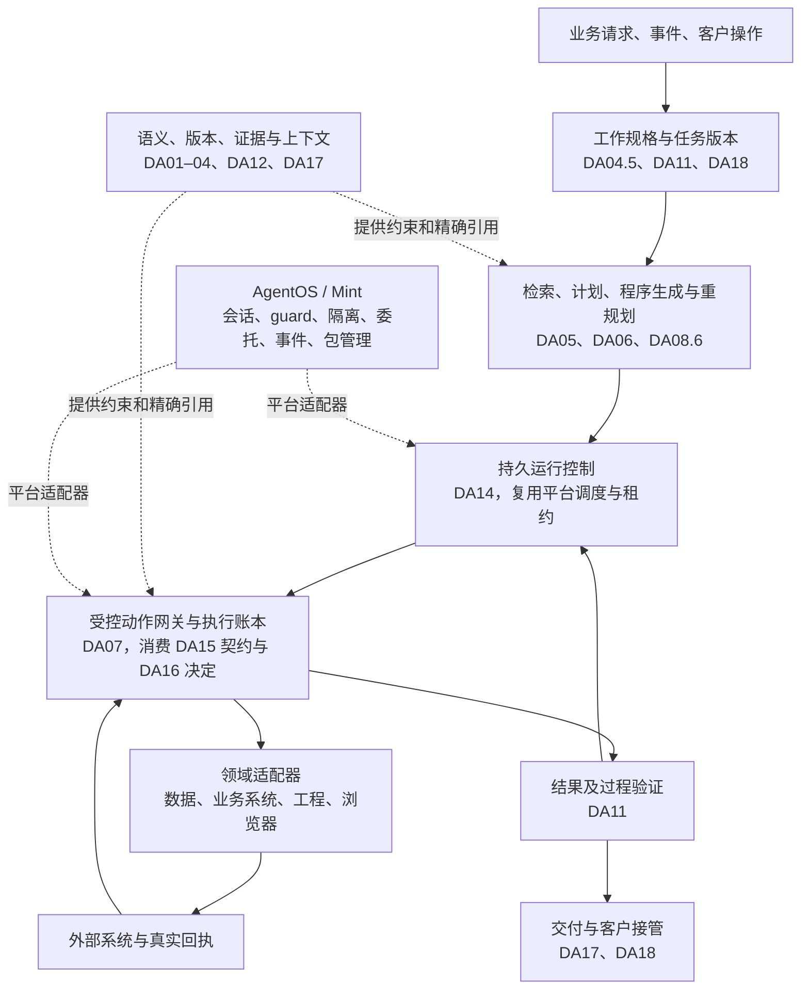

# DataAgent 到通用 FDE Agent 的架构评估

## 评估结论

现有架构可以作为升级基础，适合先完成以数据为中心的 FDE 闭环。通用 FDE 所需的持久流程、受控执行、跨系统一致性及跨领域验收，仍需补齐可执行协议、实现与故障验证。

| 判断对象 | 结论 | 依据 |
| --- | --- | --- |
| 能力职责覆盖 | 已覆盖主要方向 | 环境接入、动作本体、动作契约、审批、等待恢复、上下文、部署、交接均有归属 |
| 可执行架构 | 部分具备 | 已有统一调用封套、引用、端口设计；FDE 类型多为字段草案或预留，关键平台接缝仍待决 |
| 当前代码 | S0 能力实现基础 | 静态数得数据层 32、应用层 13、治理层 6 个注册原子；未发现 `dataagent-operations` 包 |
| 通用性证明 | 尚未建立 | 当前全局闭环族为判定、计算；持续运行示例也集中在审核和报表 |

这里将通用 FDE Agent 定义为：进入客户业务环境，发现约束，设计和实现方案，集成多个系统，持续完成可观察的业务结果，并交接给客户运营。规则审核、报表分析是其中的数据领域应用；代码修改、工单协作、业务系统操作可按领域包扩展。

建议保留 DA01–DA18 编号与已有能力，先抽出通用工作协议和运行接缝，再用数据业务与非数据业务共同验证。无需先实现全部 458 项，也无需立即拆分所有安装包。

## 证据与范围

使用本机 `lark-cli 1.0.96 docs +fetch --doc-format markdown` 获取四份线上文档全文，修订号见文首。核对总规划的模块定义与全局切片，重点展开执行应用、契约及持续运行设计。快照与内容校验和保存在 [sources/manifest.json](sources/manifest.json)。

| 来源 | 本地证据 | 核对范围 |
| --- | --- | --- |
| [飞书总规划](https://modelbest.feishu.cn/docx/TlN4dygs9oJR3Qx1FaictiPEn3c) | [总规划快照](sources/00-planning.md) | §2.3 平台待决、§2.4 契约、DA01–DA18、§4.1 切片 |
| [契约设计](https://modelbest.feishu.cn/docx/VavsdOWFeoLBFrxOt9JcjAsInDe) | [契约快照](sources/01-contracts.md) | core 字段、预留类型、action/delivery 与内核映射 |
| [执行应用层](https://modelbest.feishu.cn/docx/ReDXdJzLWoihZDxqaO0clUxInKf) | [执行应用快照](sources/02-application.md) | 动作计划、执行网关、幂等、对账、作业与重规划 |
| [持续运行与 FDE 交付](https://modelbest.feishu.cn/docx/NqS0dcV0CoaatHxJTTFc7amnnke) | [持续运行快照](sources/03-operations.md) | 等待、委托、授权、环境、交接、端口与权威状态 |

DataAgent 工作区已有 README 修改及 OCR 未提交文件，均未改动。当前源码核对集中在 contracts、runtime 及三个能力包的注册定义；未对全部能力进行运行验收。[S0 阶段报告](../dataagent-2026-11-03/archive/11-s0-stage-report.md) 的历史缺陷只作导航，不作为当前缺陷已复现的证据。

内核按仓库约定 fetch 后，从干净工作区快进 36 个提交至 `agent-kernel@9acc68c4218b4d6a1f4ad3557cefa917a60471f2`。`scripts/sync-iface-packages.sh --check` 返回停用提示，未实际执行旧分发包一致性检查；以下核对使用权威源 `kernel/iface/src`，不据此宣称已通过平台兼容验收。

## 已有能力

| 能力 | 已有设计 | 对升级的作用 |
| --- | --- | --- |
| 业务模型 | DA03 实体、身份、关系、动作语义、权属、证据和业务状态 | 可表达业务对象及其允许的变化 |
| 探索与重规划 | DA05 检索、DA06 修订计划、DA08.6 生成修复程序、DA11 验证 | 支持现场探索、换方法和换实现 |
| 受控动作 | DA15 声明，DA16 判权，DA07 执行，DA12.11 评估影响 | 具备清晰职责边界 |
| 长流程 | DA14.6 等待与恢复，DA07.9 作业，DA17 装配上下文 | 已考虑跨天等待、外部回执和人工介入 |
| 结果与交接 | 双轨评测、逐环节放权、Runbook、运营协议、效果度量 | 覆盖上线及客户接管 |

持续运行设计已经明确：审批绑定动作和参数 digest、恢复令牌原子消费、事件去重、未知副作用先对账、补偿独立授权、默认版本不覆盖任务固定版本。这些属于已有要求，下面的缺口针对其协议完整度与实施接缝。

## 架构缺口与改进

### 1. 工作目标与验收实例协议

**已有事实：** DA06.7 可起草目标状态机，DA18.6 组织业务要求，DA11 管理正式判据；`TaskContextRef` 当前主要包含版本引用、假设、策略和未决项，见 [core/task.py:19](../../../packages/capabilities/dataagent-contracts/src/dataagent_contracts/core/task.py#L19)。

**缺口：** 单次业务工作的目标、完成条件、禁止条件、责任主体、预算与时限，分散在 Skill、计划、判据和任务上下文中。尚缺一个有权确认、可版本化、贯穿重规划和交付的工作规格。现有 `OutcomeComparisonReport` 衡量上线收益，不能承担本次业务工作的完成判定。

**建议：** 在共享契约中增加 `WorkSpec`，字段至少包含 `objective`、`scope`、`constraints`、`acceptance_ref`、`owner`、`deadline`、`budget_ref`、`allowed_actions`、`stop_conditions`。DA04.5 固定其精确版本；DA06 的计划修订、DA14 的运行实例、DA18 的交付引用同一规格。业务状态归 DA03，运行控制归 DA14，实际动作状态归 DA07，工作总览只聚合这些事实。

**验收：** 更换模型、重写程序、重排步骤后，目标及正式判据保持一致；修改业务目标产生显式新修订，并给出受影响产物。

### 2. 持久运行与跨模块事务

**已有事实：** 设计要求持久等待、去重与原子恢复。当前 [VersionedRepository](../../../packages/capabilities/dataagent-runtime/src/dataagent_runtime/ports/versioned.py#L9) 提供单对象条件保存；SQLite 适配器有单次方法事务。未发现 FDE operations 实现，也未在该端口看到跨对象工作单元接口。

**缺口：** “消费审批事件、更新控制点、产生下一动作请求”需要一致提交。单对象 `expected_revision` 无法独自定义这一组事实的提交与崩溃恢复规则。通用调度、会话租约和事件日志仍需具体适配到业务运行实例。

**建议：** DA14 管理持久运行控制记录，DA07 管理动作执行账本；共享存储增加限定范围的事务端口，落实事件 inbox 去重、待发送请求 outbox、恢复令牌消费与状态条件更新。复用内核 [Lease.generation](../../../../../packages/agent-kernel/kernel/iface/src/lease.rs#L69) 作为推进权围栏的输入，并在网关实际发出动作前验证当前代次。外部后端有条件写入时继续携带其版本条件。

外部写入与本地事务分开处理：先持久记录意图，再发出调用，保存回执；崩溃后查询与对账。对缺乏可靠请求标识或查证能力的后端，保留 `unknown` 并转人工处理。补偿按新的受控动作执行。

**验收：** 在发送前、远端已成功但回执未保存、审批已消费但下一步未派发三个位置注入崩溃；重启后不重复写入、不丢失待处理事项；旧持有者恢复时被围栏拒绝。

### 3. 授权与写通道的强制边界

**已有事实：** 总规划 P1 建议写凭据仅发给网关进程，P2/P3 定义 guard 与业务策略的分工。当前 `OperationSpec` 有 `writes/idempotent/destructive` 元数据，见 [registry.py:24](../../../packages/capabilities/dataagent-runtime/src/dataagent_runtime/registry.py#L24)。这些字段本身不构成隔离。

**缺口：** 需要证明动态代码、直接 CLI、MCP 及所有写适配器都不能绕过受控执行；还需证明审批回执来自可信主体，并且只授权具体动作、参数、范围与版本。

**建议：** 将网关作为唯一持写凭据和写网络出口的进程边界。探索/生成代码运行在受限环境中，通过动作代理请求写入。网关校验请求者与委托交集、当前撤销状态、动作与参数 digest、目标版本、任务修订、契约版本、决定有效期、幂等状态及推进权。业务授权决定使用受保护的存储或可信签发与验证机制，模型可见引用不能作为凭证本身。

**内核边界：** 最新内核已有签名 mandate、有效期、grant/session 绑定与 nonce 验证，见 [policy/mandate.rs:1](../../../../../packages/agent-kernel/kernel/iface/src/policy/mandate.rs#L1)。其当前领活验证关联 `task.claim`，见 [agent/claim.rs:87](../../../../../packages/agent-kernel/kernel/host/src/transport/agent/claim.rs#L87)；工具子作业凭据“可验证但不被强制”的边界写在 [agent_spawn.rs:48](../../../../../packages/agent-kernel/kernel/host/src/transport/agent_spawn.rs#L48)。因此仍需逐条核验实际工具执行路径，不能据 mandate 的存在推定业务参数级授权已完成。

**验收：** 绕过网关直接调用写接口被拒；审批后修改参数、撤销委托、切换任务修订均触发重新判权；补偿动作不能继承已经失效的原授权。

### 4. 业务档位与技术副作用的映射

**已有事实：** 总规划 P3 与契约设计把 A0/A1/A2 对应到 `ReadOnly/Advance/SideEffect`。内核定义 `Advance` 为只改本会话状态，`SideEffect` 包括写文件、发请求、起进程；工具执行及模型启动采用保守副作用语义，见 [session/effect.rs:7](../../../../../packages/agent-kernel/kernel/iface/src/session/effect.rs#L7)。

**缺口：** A1 业务提议可能需要创建外部草稿或发起评审请求，技术上产生副作用。A0 业务读取也可能通过一个保守标为 `SideEffect` 的工具入口完成。业务档位无法直接决定底层调用的重试规则和准入等级。

**建议：** 独立记录三项：`business_tier` 表达读/提议/正式执行；`technical_effect` 按实际调用和内核协议判定；`impact_assessment_ref` 引用 DA12.11 的金额、数量、范围与可逆性评估。业务审批按正式策略解释，技术执行和重放按实际副作用约束；任何映射不得降低内核等级。

**验收：** 创建外部草稿仍走技术写控制；纯会话内草拟可按会话推进处理；有正式免审政策的小范围 A2 动作无需虚造额外人工签字。

### 5. 共享契约与等待协议

**已有事实：** 契约文档 §4 主要列出 action/delivery 类型名称；operations §2 补充了最小字段草案，但正式共享模型仍只有 core 目录。operations 允许 `pending` 携带等待、作业或订阅引用，现有 [CapabilityResult 校验](../../../packages/capabilities/dataagent-contracts/src/dataagent_contracts/core/envelope.py#L160) 强制 `continuation.job_ref`。

**已复现：** 使用当前源码和契约包已有 Python 环境构造 `status=pending`：仅有订阅引用与恢复条件时被拒，错误为 `pending result requires continuation.job_ref`；提供作业号时通过。这是纯等待接入需要解决的具体接缝，尚不能据此认定运行中的审批流程发生过故障。

**建议：** S1 开始前完成 WorkSpec、ActionContract、AuthorizationDecision、ActionReceipt、Wait/Checkpoint/Resume、ContextEnvelope 的字段、状态、校验和迁移规则。明确异步目标的可判别类型与对应查询/恢复入口；现有客户端兼容性通过协议协商或适配层保证，保留 core 已有字段含义。

同时统一文档依赖表达：总规划 §2.4 的 `contracts ← data ← application` 容易被理解为实现导入；统一成“共享类型依赖 + 注入的服务端口”，跨层共享对象只保留一份权威定义。

**验收：** 等审批、等系统回执、等异步作业分别完成序列化往返、版本兼容与恢复；Python/CLI/MCP 对同一结果给出一致结构。

### 6. 资源与适配器的可验证能力

**已有事实：** DA01.8/01.9 已覆盖文件、SaaS、工单、代码仓、浏览器等资源；DA15 声明幂等、预演、影响面和补偿。契约文档 §3.7 的 `ResourceRef/ConnectionRef/CredentialBindingRef` 等仍为字段待补的 core 预留对象。

**缺口：** 列出资源类型后，还需要可机器判定的提供方能力矩阵，才能决定一个动作能否安全运行、重试、对账与接管。API 的“支持幂等”声明与浏览器的“点击后可查询状态”具有不同保证。

**建议：** 每个适配器声明并通过一致性测试：资源寻址、对象版本、条件写、分页/快照、幂等键作用域和保留期、远端请求号、对账入口、取消边界、预演等级、补偿窗口、认证主体传播及事件投递语义。配置同时保存“声明支持”和“当前版本实测支持”。

代码领域包补充 patch、依赖锁、构建、测试、评审与 CI 回执；业务系统领域包补充对象迁移、逐项回执和源端对账。浏览器适配器明确目标识别与执行后查询能力；证据不足时输出未知。

**验收：** 适配器升级或替换后，完成契约测试、业务回归和故障注入；仅工具名称或输入 schema 相同不能认定等价。

### 7. 上下文信任与动态方法晋升

**已有事实：** DA17 已有最小上下文、来源版本、预算及必要约束保留；DA04/DA12 区分候选经验与生效资产，DA11 区分开发和独立验收样本。

**缺口：** 已读协议尚未明确表达来自文档、网页、消息和工具输出的内容是否具有指令权，以及摘要后如何保留这一信任属性。生成代码、修订 Skill 与选择验证方法也需要明确可变范围。

**建议：** ContextEnvelope 保留来源、内容角色、信任等级、允许用途及证据锚点；外部内容进入证据区，不能覆盖授权和正式验收条件。必要约束独立传递，不依赖自由文本摘要。候选代码和 Skill 经受限试运行、独立判据验证、授权发布后晋升，固定其内容 digest、依赖与适用范围。

**验收：** 材料中嵌入“忽略规则、替换审批人、上传数据”等指令不会改变权限或执行策略；模型可修方法，无法修改独立验收金标来使结果通过。

### 8. 通用性与运营验收

**已有事实：** 两个全局闭环族为判定、计算；DA18 有客户效果度量和交接，DA17 有离线部署、升级与回退。

**缺口：** 当前验收范围可验证数据领域的通用能力，尚不能验证非数据工作是否需要修改共享协议；运行实例升级时，等待点、旧契约、数据结构与已发动作的兼容规则也需纳入交付。

**建议：** 保留现有两族，增加以下验证场景；它们是协议压力测试，不是要求立即新建若干一级模块。

| 场景 | 业务结果 | 重点验证 |
| --- | --- | --- |
| 数据审核 | 形成可追溯结论并受控回写 | 证据、独立验收、正式口径 |
| 跨系统工单 | 核对业务对象，创建工单，等待责任人回应，更新业务状态 | 对象引用、异步事件、多系统部分成功、撤权与接管 |
| 工程变更 | 根据问题产出 patch，运行测试和 CI，完成授权范围内的交付 | 非表格产物、构建环境、代码权限、版本固定与升级恢复 |

将运行兼容性加入交付清单：实现/契约/schema/策略版本、在途实例处理方式、迁移或旧实例继续运行的条件、备份恢复演练、未决副作用清单、客户接管实操回执。DA02.15 基线在需要度量收益的项目中成为入口条件。

**验收：** 非数据场景可以只增加领域资产与适配器；确有跨领域共用的新类型时显式演进协议。客户在交付人员退出后可自行发起、查看、暂停、处理未知状态和恢复流程。

## 推荐架构与职责

图中工作规格、持久运行控制与执行账本是建议补齐的实现对象。沿用已有模块归属，避免产生第二套任务、作业或审批权威。

| 事实 | 唯一权威 | 其他模块使用方式 |
| --- | --- | --- |
| 业务对象及合法状态迁移 | DA03 与业务源系统 | 引用定义并查询真实状态 |
| 工作规格采用版本、任务上下文修订 | DA04.5 | 计划和子任务绑定精确修订 |
| 编排控制点、等待、恢复事件消费 | DA14，平台适配器执行机制 | UI 展示观测，不能直接写状态 |
| 动作是否已发出、远端回执、未知与对账 | DA07 | DA14 恢复前查询，DA18 交付引用 |
| 动作契约及技术要求 | DA15 | DA07 执行前校验 |
| 业务授权及审批决定 | DA16，依据正式策略与身份权威 | 网关执行时复核 |
| 环境默认与部署实例 | DA17 | 新任务选择，已有任务显式迁移 |
| 验收与交付 | DA11 产出验收事实；DA18 封装交接 | 固定范围、版本及未覆盖项 |

物理发布可先维持现有包。共享协议内部按基础引用、工作、动作、数据领域、交付组织；既有 core 通过兼容导出保留。待第二个非数据场景出现真实复用需求后，再确定独立 FDE 包边界。

## 具体场景走读

以下为建议架构的静态推演，未操作真实客户系统。输入为“核对订单变更，创建处理工单，待负责人确认后更新 CRM”。

| 步骤 | 执行者 | 中间对象与变化 | 结果或副作用 |
| --- | --- | --- | --- |
| 1 | DA18/DA04.5 | 固定 WorkSpec、对象范围、完成判据和责任人 | 形成任务修订 |
| 2 | DA01/DA03/DA05 | 读取订单与 CRM，解析对象身份和版本 | 形成有来源的事实集 |
| 3 | DA06/DA15/DA16 | 起草计划，绑定动作契约，判定授权与审批需求 | 形成可执行范围；仍未改源系统 |
| 4 | DA07 | 持久记录建单意图、幂等键和参数 digest，调用工单适配器 | 取得工单回执，或记录副作用未知 |
| 5 | DA14 | 若结果未知先对账；取得工单后持久登记等待点 | 进程可退出，等待不依赖对话存活 |
| 6 | DA14/DA16/DA07 | 去重消费负责人回应，复核任务版本与当前权限，检查推进权 | 更新 CRM；版本冲突则重新读取和规划 |
| 7 | DA11/DA18 | 查询真实 CRM 状态，校验正式判据，关联全部回执 | 形成验收与交接；残留未知项阻止宣称完成 |

运行中若权限撤销，历史事实保留，后续动作停止准入；人工接管后旧 Agent 不能继续推进。已创建工单的事实不因取消流程消失。

## 建设顺序

| 优先级 | 交付 | 依赖与退出条件 |
| --- | --- | --- |
| P0 | 平台接缝说明与共享类型 | 更新旧内核映射；明确每个入口经过哪个 guard/网关；补齐 action/wait 类型及兼容规则 |
| P0 | 单动作受控执行 | 一种真实后端；凭据隔离、可信身份、参数绑定、幂等预留、回执、后置验证和未知对账完整 |
| P0 | 跨天持久闭环 | 审批或系统等待；事件去重、恢复原子提交、围栏、重启及人工接管通过故障验收 |
| P1 | 两类领域的端到端验证 | 数据审核 + 跨系统工单；同一工作/动作/恢复协议运行，两者都满足业务与过程判据 |
| P1 | 工程领域适配与交付 | patch、依赖锁、测试/CI 证据、隔离及版本固定；确定泛化边界 |
| P1 | 持续运行与客户运营 | 漂移、预算、部署迁移、备份恢复、Runbook 与客户实操交接 |
| P2 | 扩展能力与包边界优化 | 根据真实复用、替换及运维边界扩展，保留能力编号与兼容入口 |

S1 已包含 DA14.6 等待恢复，而 P6 编队/接管的最晚定案写在 S2；应将 S1 实际使用的身份、等待与推进权适配提前定案。多 Agent 编队仍可后置。

| 方案 | 代价与收益 | 选择 |
| --- | --- | --- |
| 在现有结构内补通用协议与运行接缝 | 复用 51 项实现，改动集中，能快速检验跨领域复用 | 推荐 |
| 立即独立完整 FDE 框架及包体系 | 边界整齐，但在非数据场景不足时容易反复迁移协议 | 第二个领域验证后再评估 |
| 继续按原子目录横向建设 | 增加可选能力，运行接缝仍需单独闭合 | 只对业务切片需要的原子推进 |

## 统一验收清单

| 检查 | 通过条件 |
| --- | --- |
| 目标固定 | 重规划不改变正式目标与判据；修订可追溯 |
| 写通道 | CLI、MCP、动态代码、领域适配器均无法绕过受控执行 |
| 授权绑定 | 参数变化、撤权、过期和版本变化按策略拒绝或重判 |
| 幂等与未知 | 同键异参拒绝；远端成功但回执丢失时先对账 |
| 恢复与接管 | 重复事件不重复推进；旧推进者被围栏拒绝 |
| 部分失败 | 逐项保留已改、未改和未知，补偿有独立授权 |
| 信任边界 | 外部内容与摘要不能改权限、正式判据或工具策略 |
| 独立评测 | 结果正确与过程合规同时满足；验收样本不被修方法污染 |
| 跨领域 | 非数据闭环按相同协议完成，领域差异落在资产与适配器 |
| 客户接管 | 客户独立完成正常运行、异常定位、暂停和恢复演练 |

本次未执行完整测试套件、部署、生产写入、Mint 安装或跨系统故障注入。确认项为线上设计内容、所列源码事实、注册定义数量及纯等待协议校验结果；改进架构与退出条件为建议。
