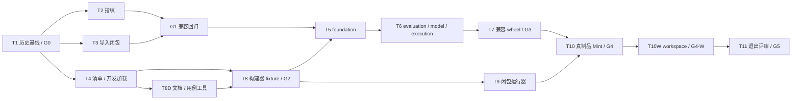

# RSI IFace v2 M0-pre 到 M1 实施计划

> **For agentic workers:** REQUIRED SUB-SKILL: Use superpowers:subagent-driven-development or superpowers:executing-plans to implement this plan task-by-task. Steps use checkbox (`- [ ]`) syntax for tracking. 本文只授权设计交付；产品实施在用户审阅后启动。

**Goal:** 在保留 `0.2.0` 数据、导入和 CLI 的前提下，交付 5 个可通过本地 Mint 安装、且运行时不执行 pip 的首批包。

**Architecture:** 唯一源码位于 RSI Git 的 modules，旧 service 路径 re-export。兼容 wheel/sdist 与 any bundle 都从该源码构建；启动器使用冻结闭包。已有 SQLite、CAS 和 MintHost 行为保持，数据与执行语义升级分别验收。

**Tech Stack:** Python >=3.13、标准库、pytest、开发环境 jsonschema、Hatchling、Mint CLI 0.1.11；M1 workspace 由 Mint 安装包，直接执行专用 home 内的 cpmrt 0.1.14 `--flavor core`。公开 artifact 声明为 `std@0.1.14`，实际 compiled/effective flavor 为 core，分别记录；std 能力仍 blocked。M1 无新增产品运行依赖。

**Spec:** [RSI IFace 模块化修订方案 v2](../specs/2026-10-28-rsi-iface-v2-design.md)。执行者先读设计，本文中的路径除明确说明外，均相对 `apps/plugins/rsi-toolkit` Git 根。

**新增交付（2026-10-28）：** 按 [MintHub 参考包](https://mint-hub.ea.modelbest.co/p/wujiahe/skill-document-generation-for-proofs) 的独立安装与宿主要求组织文档，补齐 [5 包说明与 49 条用例](../specs/2026-10-28-rsi-package-pages-and-tests.md)、[workspace Mint 测试代码指南](../../../workspace/rsi-iface-v2/README.md)。T8D 负责文档/case 工具，T5/T6 随包交付正文与 driver，T10W 在 `./workspace/rsi-iface-v2/` 实测；全部作为首批必需交付。本轮仍只修改计划和指南。

## Global Constraints

- Python >=3.13；首批能力默认运行路径只依赖标准库。
- 实际 Mint 探针 scope 固定为 `local/`；跨 scope 的 `fixture/` 仅用于合成安装目录的运行器测试，不上传；不登录、不发布 MintHub；M1 不接入 cpmrt ACP。用户已选择直接 cpmrt 0.1.14 执行，Mint 负责包安装/依赖/卸载。std 制品自报编译档位 core，执行显式选择 core 并绑定版本、二进制摘要、info 和 session；不得声称 std 兼容，也不得回退 Core 0.1.6。M6 应用 transport 按独立需求立项。
- 基线为 `44235f1060c64c3e3f1d8c32ea51ed9363e99850`；先记录实际 HEAD 和既有 12 个未跟踪文件，不提交、删除或改写它们。
- AgentOS 根目录无 Git；设计文件直接保留，产品源码在 RSI Git 提交。
- 不改动 5 个冻结领域 schema；所有制品内的 schema 与 Git 输入字节一致。
- 公共模块禁止导入 `rsi/control/harness/toolkit/connectors`；不在产品库中搜索 checkout 或修改 sys.path。
- `Evaluator.contract()` 保留旧设置；新身份独立存储；旧 qualification 不批量重写。
- M0-M1 不搬动 verifier 和 benchmark verifier 源码；保持完整 v1 描述比较。
- legacy canonical/CAS digest 不变；strict canonical 是单独入口。
- common/strict staging 分别保留原行为；不合并默认策略。
- 源码开发和测试可安装构建依赖；用户侧 Mint 安装、启动和调用不执行 pip。
- 首批启动命令使用 `python3 -I -S -B`；运行器校验应用和所有依赖，不提供跳过验证开关。
- 每个可合入任务完成定向测试；G1、G3、G5 跑全量回归。失败先定位，不凭旧次数宣称通过。
- 每包随带 README/REQUIREMENTS/TESTING/cases；安装态示例走校验闭包的 probe，不能假设 mint add 修改 Python 搜索路径或自动注册 MCP。
- workspace 人工项目和每次自动 run 独立；不覆盖 `workspace/job-bench`、`workbuddy-bench` 或现有配置。T10W 完成后保留 trial、data 和脱敏 evidence。
- scripted Agent 必须有实际 skill_read 的成功事件与包内正文，不能以最终文本/done 证明工具执行；真实模型和 M5 MCP 证据单列。

## Review Focus

- 历史嵌套 Composite/Rubric、未知指纹算法和第三方 evaluator：旧证据严格兼容，未知身份或算法明确拒绝。由 T2 覆盖。
- 布尔/整数、条件分支、本地 ref、时间格式注解和未知 schema 关键字：结构判定与固定参考实现一致，M1 不静默新增时间断言，未知能力拒绝。由 T5 覆盖。
- checkout 不在场、sdist 重建、旧异常类与新异常类：旧 CLI 和导入可用且对象一致。由 T7 覆盖。
- 跨 scope、重复 namespace、依赖替换、symlink、应用自身篡改、脏来源：不能误加载或静默通过。由 T4、T8、T9 覆盖。
- Mint 空缓存、安装后修改、卸载共享依赖和用户数据：记录实际覆盖，运行器拒绝篡改，删除应用不损坏保留的数据。由 T10、T10W 覆盖。
- 文档直接 import、无标签校准、只返回 marker 的 scripted 假阳性：命令需适用运行环境，5 条校准含布尔 pass 标签，检查实际技能读取。由 T8D、T10、T10W 覆盖。

---

## 1. 文件与接口地图

| 路径 | 职责 | 负责人角色 |
| --- | --- | --- |
| `service/rsi/evaluation.py`、新 fingerprint 模块 | v1/v2 兼容及应用 re-export | 源码 |
| `service/rsi/__init__.py`、`control/__init__.py`、`rsi/promotion.py` | 导入闭包 | 源码 |
| `service/rsi/trace_normalization.py` | legacy trace 归一，解除 toolkit 反向依赖 | 源码 |
| `modules/rsi-foundation/src/rsi_foundation/` | content、contracts、evidence、共享 DTO | 源码 |
| `modules/rsi-evaluation/src/rsi_evaluation/` | suites、evaluators、fingerprints、judge、statistics | 源码 |
| `modules/rsi-model-client/src/rsi_model_client/` | 现有兼容客户端与 network | 源码 |
| `modules/rsi-execution/src/rsi_execution/` | Host、结果归一、staging、拟议 DTO | 源码 |
| `service/build_hook.py`、`pyproject.toml`、`conftest.py`、`tests/conftest.py` | 单一源码的兼容构建与测试加载 | 源码 |
| `packaging/manifest.py`、`check_imports.py` | 清单与导入边界 | 分发 |
| `packaging/integrity.py`、`launcher/rsi-launch.py` | digest 与闭包运行 | 分发 |
| `packaging/contracts/`、`build_bundle.py` | 生成契约包和代码 bundle | 分发 |
| `packaging/dev_run.py` | checkout 开发入口 | 分发，与源码接口同步 |
| `packaging/run_cases.py` | 执行逐包用例并生成报告 | 分发 |
| `packaging/docs.py`、`packaging/tests/test_readme_commands.py` | 文档生成、运行环境标记和命令验证 | 分发 |
| `modules/<pkg>/{README.md,REQUIREMENTS.md,TESTING.md,cases.json,examples/}` | 使用文档、能力要求、测试与输入，规范见[包说明与用例](../specs/2026-10-28-rsi-package-pages-and-tests.md) | 源码填内容，分发校验 |
| `packaging/contracts/rsi-iface-data/` | 数据包文档和 case 的唯一源模板，无 Python lib | 分发 |
| `conformance/iface-v2/probe_app/src/rsi_probe/cases/` | 固定 ID 的 case driver；与文档命令共用输入和预期 | 源码填内容，分发校验 |
| `conformance/iface-v2/workspace_probe.py`、`workspace_probe_checks.py` | workspace 准备、真实 CLI 集成、证据判定 | 集成 |
| AgentOS `workspace/rsi-iface-v2/{README.md,trial/,runs/,data/,evidence/,mint-home/}` | 测试指南和实施后保留的人工验收现场 | 集成 |
| `conformance/iface-v2/`、`conformance/iface-v2/packages/` | 基线、构建、Mint、退出证据与逐包报告 | 集成 |

最终 import 公共面：

```python
from rsi_foundation.content import CAS, PrivateCAS, CorruptBlob, canonical, canonical_json_v1, sha256
from rsi_foundation.contracts import load, errors, require, ContractError, RecallPolicy
from rsi_foundation.evidence import Redactor, redact, model_description, model_usage
from rsi_evaluation import Case, TaskSuite, Evaluator, ExactEvaluator, ContainsEvaluator
from rsi_evaluation import JSONFieldsEvaluator, RubricEvaluator, CompositeEvaluator
from rsi_evaluation import evaluator_from_spec, qualify, qualification_matches
from rsi_evaluation import evaluator_fingerprint, evaluator_fingerprint_v1, EvaluatorIdentity
from rsi_evaluation import LLMJudge, paired_bootstrap, worst_case_evidence, PromotionError
from rsi_model_client import CompatibleModel
from rsi_execution import Host, normalize_result, stage_assets, safe_path, AssetPathError
```

`ExperimentService`、`PromotionService`、Controller、MintHost 和 PilotDeckHost 留在 service。`rsi_evaluation` 的 `__init__` 只导出本包对象，不导入应用服务。

## 2. 顺序、同步点与执行方式



推荐按连续小提交实施。T2/T3 修改同一应用区域，按顺序合入；T4/T8/T9 可由另一 worker 推进。T5/T6 每迁一个包，就同时更新其 shim、开发加载和 wheel 纳入规则，不能提交一个无法导入的中间状态。T7 是完整脱离 checkout 的独立验收，并非到 T7 才修构建。

工作区隔离在执行时按 `using-git-worktrees` 建立；本次计划编写不创建 worktree。已有相关 worktree 可复用。各任务的 commit 仅纳入该任务明确列出的文件，不使用 `git add .`。T5 等 G1、G2 均通过；T8D 的 fixture 文档/开发 runner 与 T8 工具一起形成 G2，不依赖正式模块。T10W 等 T10/G4，属于 M1 退出条件。

## T1：冻结历史行为和执行基线

**Files:**

- Create: `conformance/iface-v2/capture_baseline.py`
- Create: `conformance/iface-v2/baseline.json`
- Create: `service/tests/fixtures/fingerprint-v1/{exact,contains,json-fields,rubric,nested-composite}.json`
- Create: `service/tests/fixtures/verifier-v1/{ledger,workflow}.json`
- Create: `service/tests/test_iface_baseline.py`

**Interfaces:**

- Consumes: `Evaluator.contract()`、当前 `evaluator_fingerprint()`、`qualify()`、`verifier_description()`。
- Produces: 不随新代码自动更新的历史 qualification/descriptor/fingerprint fixture；baseline 的 commit、工具版本、未跟踪清单和测试结果。

- [ ] **Step 1：记录版本与工作区。**

  在 RSI 根运行 `git rev-parse HEAD`、`git status --porcelain=v1`、`service/.venv/bin/python --version`、`~/.mint/bin/mint --version`。保存完整 SHA、12 个既有未跟踪路径和 tracked diff；tracked 基线有差异时先把差异纳入评估，不覆盖用户更改。

- [ ] **Step 2：先写历史 fixture 测试。**

```python
def test_fixture_has_explicit_algorithm_and_baseline():
    import json
    from pathlib import Path
    root = Path(__file__).parent / "fixtures/fingerprint-v1"
    for name in ("exact", "contains", "json-fields", "rubric", "nested-composite"):
        value = json.loads((root / (name + ".json")).read_text())
        assert value["baseline_commit"] == "44235f1060c64c3e3f1d8c32ea51ed9363e99850"
        assert value["algorithm"] == "rsi.evaluator-fingerprint/v1"
        assert value["fingerprint"].startswith("sha256:")
        assert "qualification" in value
```

  运行 `cd service && .venv/bin/python -m pytest -q tests/test_iface_baseline.py`，预期先因 fixture 不存在失败。

- [ ] **Step 3：在独立临时目录执行基线提交，生成 fixture。**

  执行 `service/.venv/bin/python conformance/iface-v2/capture_baseline.py --repo . --commit 44235f1060c64c3e3f1d8c32ea51ed9363e99850 --out service/tests/fixtures`。生成器用 `git archive` 提取该提交，在子进程中显式加入其 service 路径，禁止从当前新 namespace 生成旧期望值。

  calibration 有 5 个 construct case，task 为 `calibration task i`，expected 为 `{"text":"ok","pass": i % 2 == 0}`。exact 使用 `ExactEvaluator("text")`，contains 使用 `ContainsEvaluator("text")`，两者正例输出 ok、负例 bad。json-fields 使用 JSONFieldsEvaluator，正例输出完整 expected 的 JSON、负例输出 `{}`。rubric 的 callback 只对输出 ok 给 1 分，固定 `judge_id="baseline-rubric/v1"`；nested composite 使用两层、权重各合计 1 的 Exact("text")/Contains("text")，同样使用 ok/bad。五份 qualification 都必须为 qualified。fixture 保存 factory spec、contract、完整 qualification、源码 digest 与 fingerprint。

  verifier fixture 从该提交的 `benchmarks.ledger.verify` 和 `benchmarks.workflow.verify` 生成完整 description；生成器记录实际 Python 版本，不写入凭据和机器用户目录。

- [ ] **Step 4：确认基线与 fixture。**

  重跑 T1 测试和现有 69 项相关测试；手工检查 qualification 的 case 不包含 audit。生成器增加保护：输出 fixture 已存在时默认拒绝覆盖，显式 `--replace` 仅供首次审查修正使用。

- [ ] **Step 5：提交 G0。**

  提交消息 `test: freeze iface migration baseline evidence`。证据记录命令、退出码、时间、commit、测试计数；G0 后才允许修改评分相关代码。

## T2：完整实现 evaluator 指纹兼容

**Files:**

- Create: `service/rsi/evaluator_identity.py`（T6 整体迁到新包）
- Modify: `service/rsi/evaluation.py`
- Create: `service/tests/test_fingerprint_migration.py`
- Test: `service/tests/test_rsi_evaluation.py`、`test_rsi_campaign.py`、`test_control_drift.py`

**Interfaces:**

```python
@dataclass(frozen=True)
class EvaluatorIdentity:
    id: str
    version: str
    implementation_sha256: str
    settings: dict

def evaluator_fingerprint_v1(evaluator: Evaluator) -> str: ...
def evaluator_fingerprint(evaluator: Evaluator) -> str: ...  # v2
def qualification_matches(value: dict | None, evaluator: Evaluator,
                          audit_cases: list[Case]) -> bool: ...
```

- [ ] **Step 1：使用历史 fixture 写失败测试。**

```python
def test_legacy_composite_matches_after_module_move(legacy_composite):
    import rsi.evaluation as ev
    evaluator, qualification = legacy_composite
    assert ev.qualification_matches(qualification, evaluator, [])
    original = type(evaluator).__module__
    try:
        type(evaluator).__module__ = "rsi_evaluation.evaluators"
        assert ev.qualification_matches(qualification, evaluator, [])
    finally:
        type(evaluator).__module__ = original
```

  `legacy_composite` fixture 根据 T1 的 factory spec 构造 evaluator 并读取 JSON qualification。再覆盖所有内建 evaluator、固定 ID rubric、嵌套子 evaluator 的模块搬动、设置修改、真实源码修改、未知算法、v2 失配不得 fallback，以及未注册第三方 evaluator。测试用可读取的临时 Python 模块改变真实源码，不把 mock 常量当源码变更。

- [ ] **Step 2：运行迁移测试，确认旧实现失败。**

  Run: `cd service && .venv/bin/python -m pytest -q tests/test_fingerprint_migration.py`。预期模块移动/未知算法测试暴露旧行为，记录具体失败。

- [ ] **Step 3：实现独立 identity 与递归 v1。**

  不给旧 contract 增加 id/version。v1 类路径使用完整别名：`rsi_evaluation.evaluators.<Class>` 对应 `rsi.evaluation.<Class>`；Exact/Contains/JSONFields/Rubric 的 legacy 设置与 T1 一致。Composite 单独生成 legacy parts，显式递归 v1；默认 `contract()` 的旧 parts 内容也继续使用 v1，保持旧 API。v2 descriptor 使用设计中的稳定 ID、源码摘要和设置，composite 用子 v2；没有注册 identity 的外部类报 `EvaluationError`。

  注册表持有当前评分 callable 和 settings 投影函数，每次计算重新读取源码与实例设置，不使用写死的实现 digest。新 evidence 写 `fingerprint_algorithm`；缺失按 v1，未知拒绝。algorithm 选择只发生一次，v2 不匹配直接返回 False。v1 fixture 不修改，保持 score/source change 导致失配。

- [ ] **Step 4：验证 verifier 没有意外变化。**

```python
def test_builtin_verifier_description_unchanged(ledger_v1):
    from benchmarks.ledger import verify
    from control.evidence import verifier_description
    assert verifier_description(verify) == ledger_v1
```

  workflow 同样覆盖；运行迁移、evaluation、campaign、control drift/feedback limits 测试。自定义 verifier 的不可证明变化仍报 drift，禁止放宽 `_check_measurement`。

- [ ] **Step 5：提交。**

  `feat: preserve legacy qualification with versioned evaluator fingerprints`。此次唯一预期记录变化是新 evidence 算法字段，执行记录明确列出。

## T3：修复 import closure

**Files:**

- Modify: `service/rsi/__init__.py`、`service/control/__init__.py`、`service/rsi/promotion.py`
- Create: `service/tests/test_import_closure.py`

**Interfaces:**

- Consumes: 现有包级 `__all__` 和公开名字。
- Produces: 相同包级导出；轻量模块导入不加载应用 Store/Controller。

- [ ] **Step 1：写全新进程导入测试。**

```python
def imported_modules(module, service_root, capability_paths=()):
    import json
    import subprocess
    import sys
    code = "import sys,json; sys.path[:0]=json.loads(sys.argv[1]); __import__(sys.argv[2]); print(json.dumps(sorted(sys.modules)))"
    paths = [str(service_root), *map(str, capability_paths)]
    result = subprocess.run([sys.executable, "-I", "-c", code,
                             json.dumps(paths), module], check=True,
                            capture_output=True, text=True)
    return set(json.loads(result.stdout))
```

  对 `rsi.promotion` 禁止 `rsi.store/control/yaml/jsonschema/harness.learners`；对 `control.redaction` 禁止 Controller/harness；对 harness CAS/common host 禁止应用包。测试不得使用当前 pytest 进程的 sys.modules。T3 时 capability_paths 为空；T5 起由同一 source_paths 显式传入，避免子进程遗漏 modules 路径。

- [ ] **Step 2：运行测试，预期加载闭包失败。**

  Run: `cd service && .venv/bin/python -m pytest -q tests/test_import_closure.py`。

- [ ] **Step 3：实现懒加载和内部依赖延迟。**

  PEP 562 `__getattr__` 通过固定 name->module 映射解析并缓存原对象；未知名抛 AttributeError。promotion 的 Store 类型放 TYPE_CHECKING，`now` 仅在实际应用方法使用时导入。pure statistics 不再经 Store 加载 toolkit。保持公开 `__all__`。

- [ ] **Step 4：验证并形成 G1。**

  跑 T2/T3 全部测试，再运行 `cd service && .venv/bin/python -m pytest -q`。G1 要同时满足历史 fingerprint/verifier fixture、import closure、完整现有回归。全量次数按实际输出记录。

- [ ] **Step 5：提交。**

  `refactor: isolate lightweight imports before capability extraction`。

## T4：冻结清单、依赖和开发加载

**Files:**

- Create: `packaging/manifest.py`、`packaging/check_imports.py`、`packaging/dev_run.py`
- Create: `packaging/tests/test_manifest.py`、`test_import_rules.py`、`test_dev_run.py`
- Create: `packaging/tests/fixtures/modules/fx-{base,app}/` 的完整清单、SKILL 和源码
- Create: `packaging/iface-baseline.toml`、`packaging/iface-baseline-drift.md`
- Create: `contracts/proposed/{blob,index,evaluation,evidence,asset,workspace-staging,runtime-executor}.v1.json` 及同名 `.CONTRACT.md`

**Interfaces:**

```python
def read_package(path: Path) -> dict: ...
def resolve_packages(modules_root: Path, names: list[str]) -> list[dict]: ...
def check_package(path: Path, baseline: dict) -> list[str]: ...
def provided_interfaces(iface: dict, *, has_lib: bool) -> list[str]: ...
def source_paths(repo: Path, names: list[str] | None = None) -> list[Path]: ...
```

- [ ] **Step 1：写清单正反例。**

```python
def test_optional_import_uses_import_name():
    package = {"optional_imports": {"yaml": {"distribution": "pyyaml"}}}
    assert optional_import_names(package) == {"yaml"}
```

  `optional_import_names` 在 manifest.py 定义，缺省空 dict；不支持 list 旧格式。另测 cycle、缺依赖、重复 namespace、非法 SemVer、defines+lib、未通过/过期 conformance 报告、proposes 草案缺失、Kernel references 不在基线。CLI 多条问题逐条输出并非零退出。

- [ ] **Step 2：固定清单字段与声明生成。**

  package 字段：name、version、python、kind、depends；capability 必须有 namespace，contract 禁止 namespace。optional_imports 为 import name 到 distribution 的表。iface schema 固定 `rsi.iface-manifest/v0`，defines/implements/references/proposes 均为表数组；references 包含 contract、version、relationship、status。provides 由 defines 或 implements 生成，不能让 references/proposes 进入 provides。

- [ ] **Step 3：固定 IFace 来源并写 C1-C7 草案。**

  在临时 MINT_HOME 逐个拉取 10 个线上包，记录完整 identity/version、制品/manifest digest、签名 key ID、provides。比较本地快照 trait/schema/docs，输出 drift。网络缺失时此任务不能声明完成，但 fixture 工具开发可继续。C1-C7 JSON 定义类型、方法、错误、幂等/取消/Unknown；每份 CONTRACT 对照旧附录 B 的问题逐条收录并标 proposed。C1 同时写 legacy canonical 与 strict 新入口的区别。

- [ ] **Step 4：实现 AST 规则与开发入口。**

  检查 Import/ImportFrom，包括函数内和相对 import；标准库、本 namespace、depends namespace 允许。optional_imports 只允许函数体内；禁止未声明延迟第三方。dev_run 从本仓库 modules 读取已存在的有效清单，显式插入 source_paths 和 service 后通过 runpy 执行指定模块；路径不隐式来自环境变量。`dev_run.py -m toolkit.cli --help` 保留目标 argv。

- [ ] **Step 5：验证并提交接口约定。**

  Run: `service/.venv/bin/python -m pytest -q packaging/tests/test_manifest.py packaging/tests/test_import_rules.py packaging/tests/test_dev_run.py`。测试中坏相对导入、动态 `importlib.import_module`/`__import__` 绕过声明的代码明确拒绝；fixture 测试使用开发环境 pytest，产品代码自身不依赖 pytest。提交 `build: define capability manifests and development loading`。源码 worker 等 T8/G2 通过后开始 T5。

## T5：抽取 foundation 并标准库化契约验证

**Files:**

- Create: `modules/rsi-foundation/{package.toml,iface.toml,SKILL.md}`
- Create: `modules/rsi-foundation/src/rsi_foundation/{__init__.py,content.py,evidence.py}`
- Create: `modules/rsi-foundation/src/rsi_foundation/contracts/{__init__.py,validator.py,policy.py,schemas/}`
- Create: `modules/rsi-foundation/tests/{conftest.py,test_content.py,test_evidence.py,test_contracts.py,test_differential.py}`
- Create: `modules/rsi-foundation/{README.md,REQUIREMENTS.md,TESTING.md,cases.json,examples/}`
- Create: `conformance/iface-v2/probe_app/src/rsi_probe/cases/foundation.py`
- Modify: `service/harness/util.py`、`harness/store/cas.py`、`control/redaction.py`、`control/evidence.py`
- Modify: `service/toolkit/contracts.py`、`rsi/{redact,store,experience,components}.py`
- Modify: `service/conftest.py`、`service/tests/conftest.py`、`service/build_hook.py`、`service/pyproject.toml`

**Interfaces:**

- Produces: 文件地图中的 foundation API；`validator.validate(schema, value) -> list[str]`；`validate_schema(schema) -> None`；仅当前 schema 本地 ref。
- Preserves: `canonical` 字节、CAS/PrivateCAS 区别、Redactor 输出、RecallPolicy 公共字段、contracts `load/errors/require` 的调用签名。

- [ ] **Step 1：先写 digest、类型身份和校验器失败测试。**

```python
def test_canonical_legacy_bytes():
    from rsi_foundation.content import canonical
    assert canonical({"b": 1.0, "a": "中文"}) == '{"a":"中文","b":1.0}'.encode()

def test_unknown_schema_keyword_fails():
    import pytest
    from rsi_foundation.contracts.validator import validate_schema
    with pytest.raises(ValueError, match="unsupported"):
        validate_schema({"type": "array", "contains": {"type": "string"}})
```

  还测 strict canonical 非有限数拒绝、旧 CAS 已知 blob digest、private 权限、tamper、bool≠integer、1.0 是 integer、enum 1/true 差异、uniqueItems 对象键顺序、allOf/if/then/oneOf、本地 ref 和 date-time 的注解行为。新包不存在时测试应失败。

- [ ] **Step 2：直接迁至最终 namespace，并同时接通兼容加载。**

  foundation 源码只用标准库；RecallPolicy 从 experience 迁到 contracts/policy.py，旧模块 re-export。validator 加载时检查未知关键字及外部 ref。format 支持项仅 date-time 且按基线作为注解，遇到其他未声明 format 报 unsupported，不从机器环境推断能力。schema 作为 package data 从 contracts 复制并比 digest。

  在 `service/conftest.py` 的第一个 harness 导入之前初始化 source_paths；通过 `importlib.util.spec_from_file_location` 从固定仓库路径加载 manifest.py，避免与 PyPI 的 packaging 包重名。service/tests/conftest 不重复初始化。T3 子进程显式传相同 capability_paths，不依赖父进程 sys.path。Hatch hook 将本包 src 映射为 wheel 顶层 namespace，sdist 纳入 `../modules` 和清单；同一提交内旧路径可 import。

  `toolkit.contracts.validator(name)` 保持 `.schema`、`.iter_errors()` 等仓库实际调用表面，通过轻量适配器提供 path/message，不继续隐含 jsonschema 运行依赖；先用 `rg` 核对真实调用，超出该面直接保留在开发辅助而不扩产品 API。通用 model_description/model_usage 迁移并 re-export，verifier_description 函数及 benchmark 文件不变。

- [ ] **Step 3：强制差分测试。**

```python
def assert_same_verdict(schema, payload):
    from jsonschema import Draft202012Validator, FormatChecker
    from rsi_foundation.contracts.validator import validate
    reference = Draft202012Validator(schema, format_checker=FormatChecker(formats=[]))
    assert (validate(schema, payload) == []) == reference.is_valid(payload)
```

  开发参考固定 `jsonschema==4.26.0`，对全部 19 个 fixture、逐关键字变异和固定 seed=17 的嵌套变异运行；CI 中 jsonschema 缺失必须失败。用无效时间字符串负例自检：参考与新实现都因 format 仅作注解而接受它；不要把该例写成“日期已验证”。严格 RFC3339 留给后续独立 profile。模块测试独立 conftest 只加入本包声明路径，不使用 service/tests/conftest。

- [ ] **Step 4：验证边界和兼容。**

  Run: `service/.venv/bin/python -I -m pytest -q modules/rsi-foundation/tests`；`service/.venv/bin/python packaging/check_imports.py modules/rsi-foundation`；再跑 service 的 contracts/store/redact/query/control drift。原 `test_m0_contracts` 测试内容迁入新包后，旧测试可做相同 API 的兼容验证，不删除有意义的断言。

  按包说明规范生成正文、requirements、testing 和 F-01–F-11 的 driver/索引；开发 profile 运行 `service/.venv/bin/python packaging/run_cases.py modules/rsi-foundation --levels L1,L2 --out conformance/iface-v2/packages/foundation-development.json`，11 项适用用例均需执行。README 的安装态命令到 G4 才执行，不写裸 Python import 冒充 Mint 接入。CAS 文档保留现有 delete，date-time 明示注解。

- [ ] **Step 5：提交。**

  `refactor: extract standard library foundation with compatibility shims`。记录 strict canonical 是新增入口；旧调用默认行为零变化。

## T6：抽取 evaluation、model-client、execution

此任务按 T6a、T6b、T6c 独立测试和提交；三个包均依赖 T5 的加载/构建基础。

### T6a：evaluation

**Files:** `modules/rsi-evaluation/` 的清单、SKILL、`src/rsi_evaluation/{__init__,suite,evaluators,fingerprints,judge,statistics}.py`、tests；修改 `service/rsi/{evaluation,judge,promotion}.py`、build_hook/pyproject。

另创建本包 README/REQUIREMENTS/TESTING/cases/examples 和 `conformance/iface-v2/probe_app/src/rsi_probe/cases/evaluation.py`，实现 E-01–E-12。

**Interfaces:** 文件地图中的 evaluation API；`EvaluatorIdentity` 与指纹双算法；无 Store/ExperimentService；judge 继续接受 `Callable[[str], str]`，不虚构 Kernel ModelContract transport。

- [ ] 从现有 evaluation/judge/promotion 迁入纯函数测试，增加旧新对象 `is`、嵌套 composite 历史 fixture 和无 yaml 环境下 JSON suite 可用的失败测试。
- [ ] 运行新测试确认缺失包失败；迁移实现，原 evaluate 方法源码保持一致，T2 legacy 别名更新。rsi.evaluation 留 ExperimentService 并显式导入所需公共/私有 helper；不要用 `import *` 隐藏应用对 `_fraction/_digest` 等符号的依赖。
- [ ] 清单只 references evaluator 数据、proposes evaluation/v1，implements 为空。`yaml` 只在 YAML from_file 函数分支延迟导入；缺少时抛明确的可选功能错误，JSON 路径可用。
- [ ] 用带 `expected={"text":"ok","pass":bool}` 的 5 条校准写 E-02/README，固定 ExactEvaluator("text")；4 条为 exploratory。执行本包 L1/L2 开发 cases 和 README 的 wheel profile；历史 fixture 类用例标 source-check，安装态适用集合到 G4 重跑。
- [ ] 运行 `service/.venv/bin/python -I -m pytest -q modules/rsi-evaluation/tests` 和原 evaluation/campaign/promotion；G0 fixture 不改。提交 `refactor: extract evaluation without unsupported conformance claims`。

### T6b：model-client 与 trace 归一

**Files:** `modules/rsi-model-client/` 的清单、SKILL、`src/rsi_model_client/{__init__,model,network}.py` 和 tests；修改 `service/toolkit/{model,network,m0_legacy}.py`、`rsi/{runtime,learning,legacy}.py`；新增 `service/rsi/trace_normalization.py`；同步 build_hook/pyproject。

另创建本包 README/REQUIREMENTS/TESTING/cases/examples 和 `conformance/iface-v2/probe_app/src/rsi_probe/cases/model.py`，实现 M-01–M-08。示例使用注入 transport，M-08 用 loopback 桩；所有默认 case 零外部模型请求。

**Interfaces:** `CompatibleModel` 的现有 constructor/`__call__/describe/last_usage`；`body_to_trace`、`_jsonl_trace` 旧签名和 trace 字节语义。

- [ ] 写同一调用方使用 CompatibleModel 的桩 HTTP transport 与替身 callable 的测试；两者输出相同文本。覆盖 key 脱敏、无重试、截断响应、重定向拒绝和远端 HTTP 拒绝。
- [ ] 迁入 model/network 的原实现，保留 toolkit re-export。trace 归一在 rsi 应用层抽出 timestamp/text/args/step 等依赖，禁止带入 PrototypeStore/migration 操作。旧 toolkit.m0_legacy 反向引用归一函数，rsi 不再引用 toolkit。
- [ ] Run: 新包 tests、原 `test_toolkit_launcher`、`test_m0_legacy`、`test_rsi_legacy`、`test_rsi_learning`；检查 `rg -n '^(from|import) toolkit' service/rsi` 无结果，并用 AST 检查包含函数内的导入。
- [ ] 提交 `refactor: extract model client and remove reverse toolkit imports`。

### T6c：execution

**Files:** `modules/rsi-execution/` 的清单、SKILL、`src/rsi_execution/{__init__,host,staging,types}.py` 和 tests；修改 `service/connectors/common/host.py` 及兼容构建配置。

另创建本包 README/REQUIREMENTS/TESTING/cases/examples 和 `conformance/iface-v2/probe_app/src/rsi_probe/cases/execution.py`，实现 X-01–X-10。

**Interfaces:** 旧 `Host.execute(request, cancel_event)`、safe_path/stage_assets/normalize_result；新增 `stage_assets_strict`；proposed DTO 见下方，不接入宿主。

```python
@dataclass(frozen=True)
class ExecRequest:
    execution_id: str
    target: str
    task: str
    workspace: str
    assets: dict[str, str]  # 冻结引用，不是内容
    model: str | None
    budget: dict
    approval_mode: str

@dataclass(frozen=True)
class ExecResult:
    execution_id: str
    verdict: str  # Completed / Incomplete / Unknown
    events_digest: str | None
    event_count: int
    usage: dict
    isolation: dict

@dataclass(frozen=True)
class CancelAck:
    execution_id: str
    state: str  # cancelled / already_terminal / unknown
```

- [ ] 写两种策略矩阵：均拒绝绝对路径、`..`、symlink；common 保持现有 `.git/.mint` 行为，strict 拒绝；hardlink 不改外部 inode。DTO 测试要求非空 task，区分 proposed 形状与当前 host result，不自动映射 Completed 为业务成功；M4 的适配器负责解析/校验 assets digest，再构造现有 Host 文本请求。
- [ ] 运行失败测试；搬 common 实现，strict 独立迁入 `MintHost._stage` 规则，MintHost 本身不改。平台无 O_NOFOLLOW 时 strict 报能力不支持，不静默降级。
- [ ] 同一调用方测试两个替身 Host，经 normalize_result 校验 execution_id；错 ID/非法状态回 result_unknown。执行 `test_common_host`、新包测试、原 mint/pilotdeck host 测试。
- [ ] model/execution 分别运行 `packaging/run_cases.py modules/rsi-model-client --levels L1,L2` 和 `packaging/run_cases.py modules/rsi-execution --levels L1,L2`，输出路径显式用 `--out`；文档里每个负例均关联 case ID。X-09 的安装态替换和剩余 L3 到 G4 执行。
- [ ] 提交 `refactor: extract execution port and preserve staging policies`。M1 不声明 submit/status/cancel 的持久生命周期已经实现。

## T7：完成兼容 wheel、sdist 和 checkout 隔离验收

**Files:**

- Modify: `service/build_hook.py`、`service/pyproject.toml`（补齐 T5/T6 的构建集成）
- Create: `packaging/tests/test_compat_build.py`
- Create: `conformance/iface-v2/compat_install.py`
- Output: `conformance/iface-v2/compat-install.json`

**Interfaces:**

- Consumes: 4 个最终模块源码、固定清单、旧 console scripts。
- Produces: 能脱离 checkout 使用的兼容 wheel/sdist；每个 namespace 的来源、旧新对象身份、CLI 输出和测试结果。

- [ ] **Step 1：写构建边界测试。**

  构建 wheel 后使用 zipfile 检查含四个顶层 namespace 和内置 schema，无 `modules/.../src` 层级残留。sdist 含模块源码和 package.toml。对缺失模块源码/缺失 schema 的构建明确失败，不能生成残缺 wheel。

```python
def test_legacy_exports_are_same_objects():
    from rsi.evaluation import Case as old_case
    from rsi_evaluation import Case as new_case
    from toolkit.contracts import ContractError as old_error
    from rsi_foundation.contracts import ContractError as new_error
    assert old_case is new_case
    assert old_error is new_error
```

- [ ] **Step 2：构建与安装到临时环境。**

  构建机使用已安装的 Hatchling；直接 wheel 与 sdist 解包重建分别产出。测试依赖从 CI 准备的 wheelhouse 离线安装到临时 venv；这是兼容路径测试，不是用户 Mint 安装。临时 cwd 在仓库外，清除 PYTHONPATH/RSI_CONTRACTS_DIR，禁止手动加入 checkout。

- [ ] **Step 3：运行实际兼容入口。**

  新环境执行 `rsi --help`、`rsi-toolkit --help`、`rsi-bench --help`，并执行一次 `rsi init --data-dir <tmp>/data --project compat`。调用新旧导入与 T1/T2 fixture 校验；断言所有 origins 均在新环境内。直接 wheel 和 sdist 重建 wheel 两条路径都要测试。

- [ ] **Step 4：形成 G3。**

  运行完整 service 回归、新包隔离测试、导入规则；确认 `rsi` 不再导入 toolkit；确认 verifier 完整 fixture 不变。Git tracked diff 限于批准路径。生成构建 hash、来源和输出摘要。

- [ ] **Step 5：提交。**

  `build: verify legacy CLI through clean wheel and sdist installs`。G3 通过后才能把实际模块交给 Mint 分发探针。

## T8：契约包、bundle 构建与完整性算法

**Files:**

- Create: `packaging/integrity.py`、`packaging/build_bundle.py`、`packaging/contracts/build_iface_data.py`
- Create: `packaging/tests/test_integrity.py`、`test_bundle.py`、`test_contract_bundle.py`、`test_source_ref.py`
- Create: `packaging/contracts/rsi-iface-data/{README.md,REQUIREMENTS.md,TESTING.md,cases.json,examples/}`
- Modify: `contracts/README.md`（标注旧 host 边界；不改 schema）

**Interfaces:**

```python
def tree_manifest(lib: Path) -> list[dict]: ...  # path, size, sha256
def tree_digest(lib: Path) -> str: ...
def build_bundle(module: Path, out: Path, *, scope: str = "local") -> Path: ...
def build_iface_data(repo: Path, out: Path, *, scope: str = "local") -> Path: ...
```

- [ ] **Step 1：写 fixture 构建正反例。**

  fx-base 提供 `fx_base.answer() -> 42`，fx-app 依赖它并输出 JSON。每包都有真实用途的 SKILL。测试 `.so/.pyd/.dist-info`、symlink、`.pyc`、未声明 import、非法 scope、缺 dependency、tracked 输入变更、相关 untracked 输入被拒；无关既有未跟踪文件不阻塞且进入排除报告。

- [ ] **Step 2：实现确定性 digest 与 provenance。**

  tree_manifest 按相对 POSIX 路径排序，记录 size 与内容 sha256；tree_digest 对该数组的 canonical UTF-8 JSON 做 sha256。忽略规则仅限构建前排除 pycache，构建产物出现 pycache 时拒绝。source-ref 包含完整 SHA、Git identity、输入文件 digest；内容与提交不一致时 release 构建失败。不要把干净 tracked 状态等同于“相关 untracked 输入不存在”。

- [ ] **Step 3：生成 bundle 与契约包。**

  代码 bundle 将唯一源码复制到 lib、技能到 skills、iface/release 放包根；Mint dependencies 的 key 使用完整 scope/name，值使用 path 表，不写 CLI source 字符串：

```toml
[dependencies]
"local/rsi-foundation" = { path = "../rsi-foundation" }
```

  生成单个 `local/rsi-iface-data`，5 个 schema、CONTRACT、SKILL、ORIGIN；provides 来自 defines，README 教 pull。host.v1 不进入包，文件内容仍留原仓库作为兼容边界。现有 mint-iface 生成器文首加新版入口链接，不复制维护新逻辑。

  所有包同时带 README/REQUIREMENTS/TESTING/cases/examples，数据包 ID-01–ID-08 按包规范生成。Mint provides.skills 与 SKILL 名称逐包固定为包叶名（例如 rsi-evaluation），正文含只出现在该技能中的固定测试 marker；T10W 据此验证实际读取。资料不进入 lib_sha256，单独绑定 test_input_sha256 和完整制品哈希；probe 的 driver 位于其 lib，受闭包校验。

- [ ] **Step 4：形成 G2。**

  Run: `service/.venv/bin/python -m pytest -q packaging/tests/test_manifest.py packaging/tests/test_import_rules.py packaging/tests/test_integrity.py packaging/tests/test_bundle.py packaging/tests/test_contract_bundle.py packaging/tests/test_source_ref.py`；对两个 fixture 执行 `~/.mint/bin/mint --offline --json pack <fixture-out> --out <packed-out>`。断言无平台 target 配置，manifest 的 kind=bundle。

  G2 还需 T8D 的 fixture runner/文档测试；解包真实 Mint 制品断言全部资料存在。真实 5 包和安装态命令在 G3 后执行，不把早期 fixture 结果当正式通过。

- [ ] **Step 5：提交。**

  `build: create reproducible any capability bundles and data contract bundle`。

## T8D：使用文档、用例执行器与文档命令校验

**Files:**

- Create: `packaging/{run_cases.py,case_manifest.py,docs.py}`
- Create: `packaging/tests/{test_case_manifest.py,test_run_cases.py,test_readme_commands.py}`
- Modify: T4 的 fx-base/fx-app，补 README/REQUIREMENTS/TESTING/cases/examples
- Create: `conformance/iface-v2/probe_app/src/rsi_probe/{__init__.py,registry.py,cases/__init__.py}`（冻结注册接口；各包 task 提交其 driver）

**Interfaces:**

```python
def validate_case(value: dict) -> None: ...
def validate_report(report: dict, *, expected_lib_digest: str | None,
                    expected_test_digest: str) -> list[str]: ...
def run_package_cases(package: Path, *, profile: str, levels: list[str],
                      project: Path | None, probe: Path | None, out: Path) -> dict: ...
def render_docs(package: Path, *, scope: str, mode: str, probe_version: str) -> dict[str, str]: ...
```

- [ ] **Step 1：写并运行失败测试。** manifest 测试加载固定 fixture，再覆盖重复 ID、空期望、未知 driver/profile、未注册 entry、非法超时；不允许用例 JSON 注入 shell/import。报告覆盖 blocked 不能算 passed、预期错误不匹配、lib/test digest 过期。

```python
def test_case_requires_an_expected_exit():
    import pytest
    from case_manifest import validate_case
    value = {"id": "F-02", "level": "L2", "profiles": ["installed"],
             "driver": "python", "entry": "rsi_probe.cases.foundation:f02",
             "expect": {"stderr_contains": ["CorruptBlob"]}}
    with pytest.raises(ValueError, match="exit"):
        validate_case(value)
```

  测试目录用固定本地加载规则导入 packaging 工具，避免与 PyPI packaging 冲突。运行 `service/.venv/bin/python -m pytest -q packaging/tests/test_case_manifest.py packaging/tests/test_run_cases.py packaging/tests/test_readme_commands.py`，初始应因工具缺失失败。

- [ ] **Step 2：实现注册 driver 与运行环境。** CLI 形状按[包规范 §3](../specs/2026-10-28-rsi-package-pages-and-tests.md)；每例新临时目录、argv 数组、shell=False、超时和输出上限。registry 提供显式 ID 到 lazy import 的 allowlist，T8D 先注册 fx-base/fx-app fixture，T5/T6 随 driver 追加各自 ID；不能扫描执行任意 cases.json 的 entry。开发 profile 使用 source_paths 和 probe src；安装 profile 只执行已安装 probe 的 `--case`，先验证闭包再运行注册 entry。父 runner 比对精确退出码和 JSON 路径，source-check 与 mint-lifecycle 分开，适用条件缺失明确 blocked。
- [ ] **Step 3：实现文档渲染与资料摘要。** 按包规范输出八节 README 和附件，生成 scope/version/probe-version、path/registry 模式命令。标记 `rsi:exec id=... profile=...` 与 cases 索引绑定；非法标签、悬空 ID、未展开变量、无上下文裸 import、把资料块当 shell 均测试拒绝。资料摘要覆盖文件相对路径和全部字节，报告与 lib/制品 hash 一起核对。
- [ ] **Step 4：执行 fixture 的正反例。** development 的返回 42 用例通过；改期望值、改 README 命令、空文件、timeout、旧摘要都必须失败。安装 fixture profile 等 T9 完成后执行；T8/G2 仅要求 fixture 开发与渲染门，真实包安装态到 T10 验收，不能形成循环依赖。
- [ ] **Step 5：提交工具。** `test: add executable package guides and case reporting`。T5/T6 只填各自正文/fixture/driver，不重复实现 runner；逐包 49 条必须在各 owner task 落地，不能只提交 Markdown 表格。

## T9：实现闭包运行器与跨 scope 校验

**Files:**

- Create: `packaging/launcher/rsi-launch.py`
- Modify: `packaging/build_bundle.py`（新增 `--app --entry module:callable`）
- Create: `packaging/tests/test_launcher.py`
- Create: `packaging/closure.schema.json`

**Interfaces:**

- Consumes: T4 dependency graph、T8 tree_digest。
- Produces: closure v1 与 `python3 -I -S -B bin/rsi-launch.py`；应用与全部依赖均校验后才执行。

```json
{
  "schema_version": "rsi.closure/v1",
  "python": ">=3.13",
  "entry": {"module": "fx_app.cli", "callable": "main"},
  "application": {"name": "local/fx-app", "version": "0.1.0", "namespace": "fx_app", "lib_sha256": "sha256:2b6e55f94cfb3aa07192d66fd26b21205e7cbf5d0ef2ef79cfb8d4a8b651f3d6"},
  "packages": [{"name": "fixture/fx-base", "version": "0.1.0", "namespace": "fx_base", "lib_sha256": "sha256:2b6e55f94cfb3aa07192d66fd26b21205e7cbf5d0ef2ef79cfb8d4a8b651f3d6"}]
}
```

上例仅展示字段形状；运行 fixture 的 digest 必须由 T8 针对各自 lib 计算，不能复制示例值。

- [ ] **Step 1：写运行器正反例并运行。**

  fx-app 安装在 local，fx-base 安装在 fixture，成功输出 `{"answer":42}`。负例包括错 scope、缺依赖、重复 name/namespace、非法 name/version、entry 越出 application namespace、依赖 lib 修改、应用 lib 修改、路径 symlink、闭包字段缺失和错误启动参数。最初因运行器未实现失败。

```python
def test_launcher_has_no_site_packages(run_installed_probe):
    result = run_installed_probe(["-I", "-S", "-B"])
    assert result.returncode == 0
    payload = __import__("json").loads(result.stdout)
    assert payload["site_paths"] == []
    assert payload["answer"] == 42
```

  `run_installed_probe` fixture 在临时 `.mint/packages` 布局中构建并启动 fixture 应用，子进程实际报告 sys.path。设置恶意 PYTHONPATH/同名工作目录模块，验证未加载；运行结束无 pycache。

- [ ] **Step 2：构建 closure 并实现运行器。**

  packages 使用完整 scope/name，从应用根的 `here.parent.parent` 定位 `.mint/packages`。字段校验通过后，用同一 tree_digest 算法验证 application 与依赖。运行器的 digest helper 是构建时生成的工具副本，来源与摘要记录在 release；它不成为第二份手工维护库。不跳过 app 自身校验，不提供 --no-verify。

- [ ] **Step 3：导入并执行 entry。**

  检查 Python 版本和 isolated/no_site/dont_write_bytecode，再加入依赖路径，使用 importlib 导入限定 module、getattr callable 并 `raise SystemExit(main())`。新运行器不 import site。缺依赖/篡改等错误输出到 stderr 且非零；正常 stdout 留给应用。

- [ ] **Step 4：验收并提交。**

  Run: `service/.venv/bin/python -m pytest -q packaging/tests/test_launcher.py`；以 fixture 真目录执行一次 `python3 -I -S -B <fixture-app>/bin/rsi-launch.py`。提交 `feat: run frozen cross-scope dependency closures without site packages`。

## T10：使用真实模块完成 Mint 分发探针

**Files:**

- Create: `conformance/iface-v2/dist_probe.py`、`probe_app/{package.toml,iface.toml,SKILL.md,src/rsi_probe/cli.py}`
- Create: `conformance/iface-v2/probe_app/src/rsi_probe/workspace_smoke.py`
- Modify: `conformance/iface-v2/probe_app/src/rsi_probe/registry.py`（核对全部正式 case；剔除只用于 G2 的 fixture 注册）
- Create: `conformance/iface-v2/probe_app/src/rsi_probe/cases/data.py`；其余 driver 随 T5/T6 已提交
- Output: `conformance/iface-v2/dist-probe.json`、`dist-probe.md`
- Create: `packaging/tests/test_dist_probe_checks.py`

**Interfaces:**

- Consumes: G3 的四个能力包、契约包、G2/T9 构建器与运行器。
- Produces: 每个步骤的 argv（脱敏）、cwd（相对）、exit、输出摘要、制品 hash、已装路径、调用结果；不把 fixture 探针算成真实模型测试。
- Probe CLI: 无参数保留最小 score 输出；`--case ID --tmp ABS` 跑单个注册 case，不传 tmp 时创建临时目录；`--package NAME --levels L1,L2` 跑适用集合；`--workspace-smoke --data-dir ABS` 执行 [workspace 指南 §4](../../../workspace/rsi-iface-v2/README.md) 的完整 run。仅在此应用解析 argv；T9 launcher 只负责校验与透传。

- [ ] **Step 1：先测探针断言。**

  test_dist_probe_checks 使用保留依赖和篡改场景的输入日志验证判定；退出码非零、无实际 score、origin 指向 checkout、site-packages 非空时报告失败。不能仅以包含 `done` 字符串判定成功。

- [ ] **Step 2：准备干净工程与可信缓存。**

  dist_probe 创建临时目录、MINT_HOME、工程；使用真实 `~/.mint/bin/mint`。在线阶段只 GET 公开 config/index/key 及 init 必需的公开元数据，记录 digest，随后显式 offline。若 init 还要求 Core 公共制品，记录并拉取固定版本；不复制用户认证文件、不登录。配置构建路径与 cache，任何网络受限步骤记录 blocked，已完成结果保留但 G4 不通过。

- [ ] **Step 3：构建真实 probe app 并安装。**

```python
def main():
    import json
    import sys
    from rsi_evaluation import Case, ExactEvaluator
    result = ExactEvaluator().evaluate(Case("probe", "construct", "echo", expected="ok"), "ok")
    print(json.dumps({"score": result["score"],
                      "site_paths": [p for p in sys.path if "site-packages" in p]}))
    return 0
```

  probe_app depends foundation/evaluation/model-client/execution，启动时同时验证后两包的 origins 和兼容接口，不调用外部模型。先运行探针源码的定向测试并提交 `test: add committed Mint capability probe application`，再从该完整 SHA 构建，确保 T8 provenance 守卫可通过。按拓扑构建所有包及应用，`mint add path:<out>/rsi-iface-data` 和 `mint add path:<out>/rsi-probe`；记录 tree/why/install 路径。用同一个临时工程二次 `mint install`，核对 identity 与路径稳定。后续只提交证据，不在构建后悄悄修改探针输入。

  另完成全部 case registry、§4 smoke 及 CLI 测试，保留 min_cases=5、text/pass 标签和四条 exploratory 语义。data driver 只从当前项目的已安装 rsi-iface-data 读取资源，对照 source-ref 的 5 个冻结摘要；数据包不进入 Python namespace 闭包。probe 源码/driver/文档都必须在正式构建前提交。不能在 digest 验证后执行未经校验的任意外部脚本。

  `--package` 模式逐例启动独立 launcher 子进程（例如 F-02 允许预期异常 exit=1），由父进程比对 expect 后生成 case 结论；不能把预期异常当整套运行失败，也不能吞掉未预期异常。该模式排除 source-check；mint-lifecycle 由外层 runner 管理，不在自己的已安装 probe 进程中卸载自身。自查结束总退出码以失败/blocked 的必需项决定。

- [ ] **Step 4：实际执行并验证篡改检测。**

  执行 `python3 -I -S -B .mint/packages/local/rsi-probe@0.1.0/bin/rsi-launch.py`，score=1、site_paths 为空、origin 均来自安装目录。分别删除依赖、改依赖源码、改 app 源码，运行器必须非零；各场景重新安装恢复后再试下一项。对修改前后分别运行 `mint verify`，单独记录其覆盖，不代替运行器结论。安装和运行阶段的子进程 argv 无 pip，临时工程不含 venv。

  用 T8D runner 执行 5 包安装适用 case 与标注的 README 命令；报告同时绑定 lib/test_input/artifact 摘要。source-check、历史 fixture 证据引用 G1/G3；ID-02 沿用 Step 5 的 pull 边界，其他必需用例 blocked 则 G4 不通过。

- [ ] **Step 5：验证卸载、共享依赖和本地契约消费。**

  先移除只依赖 probe 的包，孤儿清理结果与预期一致；再加第二个 fixture consumer 共享 foundation，移除 probe 后 foundation 保留，移除第二消费者后 orphan 才清理。工程外 data/fixture-user.txt 和配置保持。契约 `pull` 使用临时本地仓库按实际 CLI help 启动/停止并记录端口；如果当前 CLI 没有可用本地 registry 路径，记录 pull 未验证，G4 的内容安装通过但不声明 pull 已验收。

- [ ] **Step 6：形成 G4 并提交。**

  主门是新能力包的无 pip 安装/加载/运行/完整性/卸载；pull 未验证作为明确的发布前阻塞项留给 M5，不能漏报。探针报告保存 bundle 单制品限制，M5 固定 native 默认路线。提交 `test: verify installed capability bundles through real Mint CLI`。

## T10W：workspace Mint 安装与 Direct cpmrt 执行

**Files:**

- Create: `conformance/iface-v2/{workspace_probe.py,workspace_probe_checks.py}`
- Create: `conformance/iface-v2/workspace_project/{script.json,README.md}`（项目 mint.toml 由 prepare 基于真实 init 输出渲染）
- Create: `packaging/tests/{test_workspace_probe.py,test_workspace_checks.py}`
- Modify: AgentOS `workspace/rsi-iface-v2/README.md`、`workspace/README.md`
- Output: AgentOS `workspace/rsi-iface-v2/{trial/,runs/,data/,evidence/,mint-home/}`；本地生成目录加入该测试目录自身的 `.gitignore`
- Output: `conformance/iface-v2/workspace-report.{json,md}`（归档脱敏摘要，原始现场留 workspace）

**Interfaces:**

```python
def prepare_workspace(*, workspace: Path, out: Path, mint: Path, python: Path,
                      mint_home: Path, core_version: str, flavor: str) -> dict: ...
def run_workspace_suite(*, workspace: Path, out: Path, mint: Path, python: Path,
                        mint_home: Path, profiles: list[str]) -> dict: ...
def check_skill_read(records: list[dict], *, skill: str, marker: str,
                     returncode: int) -> list[str]: ...
```

CLI 必须实现指南中的 `prepare` 和 `run` 子命令及全部参数，公开 `--help`。prepare 只创建不存在的 trial，run 每次创建独立 runs/<run-id>；启动时拒绝 symlink workspace 和越出明确根目录的输出。对既有目录拒绝覆盖，打印可检查路径与原因。

- [ ] **Step 1：写判定与目录保护失败测试。** 从旧 conformance 日志提取不含凭据的事件 fixture，并绑定 CLI/Core 版本；只有最终 marker、只有 done、skill_read failed、缺失工具正文、安装 origin 指向 checkout、资料摘要过期、数据被卸载删除都必须失败。

```python
def test_final_marker_without_skill_read_is_not_success():
    from workspace_probe_checks import check_skill_read
    records = [{"event": {"event": "agent_message_chunk",
                          "content": {"text": "RSI_IFACE_SKILL_READ_OK"}}}]
    assert check_skill_read(records, skill="rsi-evaluation",
                            marker="RSI_EVALUATION_BODY_V1", returncode=0)
```

  添加 trial 存在不覆盖、run 失败保留日志、timeout 终止子进程与恢复的测试。Run: `service/.venv/bin/python -m pytest -q packaging/tests/test_workspace_probe.py packaging/tests/test_workspace_checks.py`；工具尚未实现时记录失败。

- [ ] **Step 2：实现 prepare 和显式 runtime 接入。** 校验 T10 commit/source-ref 后构建到新 `--out`，使用新现场 `workspace/rsi-iface-v2-cpmrt` 和专用 MINT_HOME；仅预热公开 config/index/key/runtime。真实 `mint init --no-preset` 后 `mint core install std@0.1.14 --use` 并核对 lock。Mint0.1.11 init 若仅因默认 core 缺失而返回精确 exit7/core.missing，须核对四条结构化事件、项目路径、诊断和完整生成骨架，原始非零保留为 bootstrap_observation；其他错误/截断/timeout 均拒绝，不下载或执行旧 Core。随后渲染 scripted provider 与 skill_read 脚本。prepare/run 接受 `--runtime "$MINT_HOME/cores/0.1.14-std/bin/cpmrt"`，拒绝个人默认路径和 symlink；记录 binary SHA/version/info，declared artifact std 与 actual compiled/effective core 分列。执行显式 `run --flavor core`；std 能力 blocked。trust 仅针对本测试项目，环境只传必要白名单，不复制个人认证。先提交 runner/fixture 输入，后正式 build。
- [ ] **Step 3：实现 library 与 Agent 实际调用。** 按[新测试代码指南](../../../workspace/rsi-iface-v2-cpmrt/README.md)执行真实 Mint add/list/tree/why/verify、已安装 smoke 和全部适用 cases。scripted provider 必须直接经专用 `cpmrt run --flavor core --json` 读取已安装 rsi-evaluation SKILL；逐行解析事件，绑定 `0.1.14/core`、call/session ID、completed 更新、正文 marker、成功终态和退出码。保留并严格检查 sandbox notice；不得从旧 Core fixture 改版本冒充新捕获。禁止 project/skills 同名正文覆盖。所有 stdout/stderr 截断 flag 即使 reason=exit_nonzero 也阻止验收；预期 F-02 和篡改/恢复命令均覆盖。
- [ ] **Step 4：完成 W-01–W-12 正反例。** 每项输入、预期和报告字段按指南 §6。篡改/缺失操作仅对该 run 的安装副本；恢复后重跑正例。W-12 使用两个事先提交的 fixture 版本，重算闭包，分别验证更新、旧摘要拒绝与原版本恢复。W-11 创建第二 consumer 检查共享依赖，data sentinel/config 安装前后逐字节比对。所有子进程记录 argv，安装/运行阶段不得出现 pip。
- [ ] **Step 5：用指南从头走一次并形成 G4-W。** 先运行上述定向测试，再从 AgentOS 根按指南创建 trial，完成 library + agent-scripted；自动 suite 在独立 runs 下执行。输出命令、事件、逐包报告和 summary；必需项 blocked/failed 均阻止 G4-W。ID-02 registry pull 缺口延续 G4 到 M5 的边界；agent-real/native-mcp 不以默认测试名义执行。
- [ ] **Step 6：提交代码与脱敏结果。** `test: verify Mint CLI integration from a retained workspace`。只提交产品仓库中的 runner、fixtures 和摘要，workspace 现场原地保留并链接。同步指南中的真实版本/命令；不得将计划步骤打勾当作执行证据。

## T11：首批退出评审与后续输入

**Files:**

- Create: `conformance/iface-v2/ACCEPTANCE.md`、`acceptance.json`
- Modify: `README.md`、`docs/ACCEPTANCE.md`（若该文件不存在则在实际 README 的验收入口链接新报告）
- Modify: AgentOS `docs/dev/rsi_toolkit/iface-review/README.md`，只更新执行结果入口
- Modify: AgentOS `docs/architecture/rsi-toolkit-modules.toml`，反映 15 内部模块、发布映射与实际依赖

**Interfaces:**

- Consumes: G0-G4 与 G4-W 的完整证据。
- Produces: 首批已完成/未完成清单、版本与制品 hash、M2-M5 输入条件；不生成“全部产品目标完成”的结论。

- [ ] **Step 1：逐项检查证据覆盖。**

  验收表至少有：历史 qualification、verifier、import closure、schema 差分、四包隔离、对象身份、wheel/sdist、跨 scope、缺失/篡改、Mint 安装/卸载、零 pip、IFace 声明、发布页字段与页面命令可执行、逐包用例报告的 lib digest 与制品一致。每行指向 commit、测试或探针结果；缺一项标未完成。

  增加 5 包 README/REQUIREMENTS/TESTING/cases/examples、49 条逐包用例适用集合、test_input/artifact 摘要、W-01–W-12、保留的 trial/data/evidence、实际 skill_read 事件和指南命令从头执行。包行为报告不得自动升级为 implements 的契约 conformance；真实模型、MCP 和学习收益仍分列。

- [ ] **Step 2：运行最终所需门禁。**

  完整 service 回归与四包测试各跑一次；packaging 全部测试；重跑一个实际已安装 probe 调用。保留统计与失败详情。只在代码/制品变化会使证据过期时重复对应探针，不进行无目标的额外测试。

- [ ] **Step 3：准备后续阶段输入。**

  M2 列出 worker 入口与 sandbox 依赖；M3 列出历史 SQL、同连接锁/savepoint、直接 SQL、原子 ingest/release 需求；M4 列出执行状态持久化及 Unknown；M5 列出 native MCP 的 macOS arm64 最小探针、解释器/SDK 构建路线、其他平台未支持。evaluator 数据 implements 保持待独立 conformance 任务。

- [ ] **Step 4：检查 tracked diff 与发布状态。**

  既有 12 个未跟踪文件仍保留；确认无凭据进入 evidence；所有新包使用 local，未执行 publish。记录新增行为只有版本化 fingerprint、strict canonical 新入口和显式可选功能错误；其余行为差异必须解释并单独验证。

- [ ] **Step 5：提交 G5 材料。**

  `docs: record first batch interface modularization acceptance`。汇报功能、兼容、分发和实际调用的独立结果。M1 完成不等于 MintHub 发布、Kernel 接入、cpmrt ACP/应用 transport 适配或收益提升；T10W 的 direct cpmrt runtime 验收单独列明。

## 3. 覆盖检查与工期

| 设计要求 | 任务 |
| --- | --- |
| 唯一源码、开发加载、旧 wheel/sdist | T4、T5、T6、T7 |
| evaluator 历史兼容与新算法 | T1、T2、T6a |
| verifier 保守处理 | T1、T2、T5、T11 |
| 清单、真实声明、C1-C7 草案、IFace 基线 | T4、T8 |
| foundation 标准库边界与差分 | T5 |
| 模型/执行替换与 staging 保留 | T6b、T6c |
| closure、跨 scope、隔离和来源完整性 | T4、T8、T9 |
| Mint 真实安装、调用与卸载 | T10、T10W |
| 阶段门、证据与后续范围 | T7、T10、T10W、T11 |
| 使用说明、宿主要求与可执行用例 | T5、T6、T8、T8D、T10、T11 |
| workspace 接入、测试代码、scripted skill_read、保留现场 | T10W、G4-W |

每个源码包任务提交前同时产出 README/REQUIREMENTS/TESTING/cases/examples，模板、5 包正文和 49 条用例见[包说明与测试用例](../specs/2026-10-28-rsi-package-pages-and-tests.md)。T8D runner 生成报告，按 profile 执行实际适用集合；G4 只接受 lib/test_input/artifact 摘要与当前制品一致的报告。数据包以 schemas 摘要代替 lib。README 标注块在对应阶段执行，失败即阻止该阶段；不能要求 G2 执行尚未交付的真包。M1 最后必须按 [workspace 指南](../../../workspace/rsi-iface-v2/README.md) 走一次，G4-W 后才允许 G5。

原首批 10-15 人日基础上，文档与用例工具预计新增 1-2 人日，workspace 接入和修复预计新增 1-2 人日；更新总计 12-19 人日。T2 历史等价、T5 校验器和实际 Core 技能发现仍是主要不确定项；按证据更新估算。并行安排不绕过阶段依赖。

## 4. 实施交接

当前交付停在设计与计划，已补 workspace 指南。建议源码 worker 完成 T1-T3、T5-T7 与各包文档/driver，分发 worker 完成 T4、T8D、T8-T9；集成人负责 T10、T10W、T11。若用单 Agent，则按同一依赖图逐任务执行。

开始产品实施前先审阅本计划；无论选择哪种执行方式，都不得从 M1 推导出发布授权。正式 MintHub 发布仍需用户后续明确指令。
