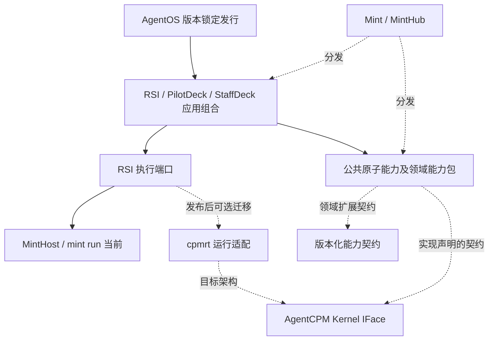

# RSI Toolkit 按 IFace 模块化设计

> **2026-11-02 更新**：`packages/kernel-iface` 已冻结为 0.1.0 历史快照，勿作对比基线；iface 契约现以
> `packages/agent-kernel/kernel/iface/src` 为权威源，可读副本为 `packages/agent-kernel/packages/iface-*`（0.1.2）。
> 对比前先同步 agent-kernel，见 AgentOS 根 `README.md`「iface 契约：位置与对比流程」。

## 1. 结论与交付范围

采用 **公共原子能力独立包 + RSI 应用编排 + 宿主适配 + Mint 分发**。先定义可替换契约及事务边界，再逐包迁移；模块可以同进程、同数据库运行，独立发包不要求独立进程。

本轮完成当前代码的模块化梳理、目标目录、源码映射、协议缺口和迁移门禁。本文与 [机器清单](../../architecture/rsi-toolkit-modules.toml) 是设计交付；没有搬动产品源码、创建可发布空包、修改 Kernel 契约或宣称完成 cpmrt 接入。后续实现以本文审核后的范围为依据。

用户约束：IFace 是组件协议的权威入口；优先抽公共原子能力；PilotDeck、StaffDeck 等应用按需组合。采用的实现假设：保留 Python 和本地 SQLite/CAS；第一阶段沿用当前 RSI Git 仓库管理独立模块，后续可迁公共仓库。

**当前执行决策（2026-10-28 用户确认）**：cpmrt 尚未发布，当前继续使用 `mint run --json`，MintHost 是本阶段正式执行适配。公共能力拆分、RSI 组合和安装验收均不依赖 cpmrt 发布；cpmrt 仅作为发布后的可选迁移项。

### 1.1 调研版本

| 对象 | 本轮证据 |
| --- | --- |
| RSI | `apps/plugins/rsi-toolkit`，`codex/rsi-toolkit-delivery`，commit `44235f1060c64c3e3f1d8c32ea51ed9363e99850`，`service/pyproject.toml:3` 为 `0.2.0`，Python >=3.13 |
| 工作区 | AgentOS 根无 Git；RSI 核心已跟踪文件无改动，有 12 个未跟踪 benchmark/文档/测试文件，保持原状 |
| IFace | `packages/kernel-iface/` 自述 2026-10-27 v0.1.0 快照；无独立 Git revision、Cargo.toml 或已确认的跨语言 binding |
| Mint 本机 | CLI `0.1.11`，旧 `mint-core 0.1.6`；PATH 与已检查的 `~/.mint` 中没有 cpmrt |
| Mint 源码 | `workspace/projects.yaml` 尚为 pending-connection，无法检查最新 cpmrt 实现 |
| 官网 | 2026-10-28 读取 [Mint 文档](https://mint.ea.modelbest.co/#docs) 与 [MintHub 文档](https://mint-hub.ea.modelbest.co/docs#architecture)；这是动态页面的读取记录，不是固定源码版本或本机实测 |

以下源码链接相对 AgentOS 根。方法和行为以当前实现为据，设计项明确使用“目标/拟议”。旧 [通用插件总体方案](2026-10-27-pluggable-rsi-toolkit-design.md) 继续提供产品需求；其中 Mint/Core 运行定位由本文四层边界更新，既有 schema 继续兼容，变更需版本化。

## 2. 四层架构与 RSI 定位

| 层 | 职责 | RSI 的关系 |
| --- | --- | --- |
| AgentOS | 锁定运行时、Kernel 档位、GUI 和 unit 的发行组合 | 按需加入 RSI 及各公共能力的精确版本 |
| cpmrt（目标架构，尚未发布） | 会话、Agent loop、模型、工具、审批、插件监管、ACP | 发布后再接入；当前 RSI 实验仍使用 mint run |
| AgentCPM kernel | IFace、常驻宿主与 loop 机制契约；不依赖 Mint | 公共机制协议权威，组件按具体协议及版本实现 |
| Mint / MintHub | 解析、验签、安装、锁、发布、分发及本机仓库 | 发布模块与应用组合；不承载 RSI Agent 执行逻辑 |

RSI 是**可选应用组合**，负责经验学习、召回、实验、候选优化、证据和发布工作流。它可以给 PilotDeck、StaffDeck 或其他应用复用能力；这些应用不需要依赖整个 RSI 产品。



“组件均为 IFace 实现实例”落实为：每个对外组件声明**具体契约 ID、版本、能力范围、错误及取消语义和验收证据**。不能仅声明 implements IFace；内部 hash/文本 helper 不单独造组件。现有 9 类 trait 不覆盖全部 RSI 领域，缺失部分先提出版本化扩展，再按治理流程纳入统一契约体系，不能给旧接口增加未定义语义。

### 2.1 三个命名必须分开

- `cpmrt`：Agent runtime。
- 当前 `rsi.runtime.RuntimeService`：经验召回应用服务，包含 Python capture 方法，公开 MCP 只有 `recall_experience/health`。目标内部名 `RecallService`；旧模块、服务名和 `rsi.runtime/v1` 兼容入口保留到明确弃用版本。
- `LearningService.daily`、`ExperimentService.run`：RSI 工作流；不是 `iface-loop.step` 的直接实现。将来确有 Agent 下一步策略时，另建 loop 组件并单独验收。

## 3. 现状：能力已经存在，包边界尚未建立

当前 `service/pyproject.toml` 将 `harness/control/connectors/benchmarks/benches/toolkit/rsi` 打进同一 wheel；Mint 0.2.0 stage 生成 control/runtime 两个 bundle，二者携带同一 wheel/source。它们是两种交付入口，尚非两个独立实现包。

| 当前区域 | 真实职责与证据 | 模块化影响 |
| --- | --- | --- |
| `rsi/store.py` | [Store](../../../apps/plugins/rsi-toolkit/service/rsi/store.py#L96) 同时管理项目 DB、trace、experience、bank/index、资产、组件、promotion、备份 | 先隔离 repositories 和 UoW；不能整体改名为 iface-store 实现 |
| `rsi/experience.py` | [ExperienceService](../../../apps/plugins/rsi-toolkit/service/rsi/experience.py#L116) 同时做经验状态、提炼、索引及检索 | 拆经验账本与词法召回，引用不可变 revision/hash |
| `rsi/policy.py` | [Selector](../../../apps/plugins/rsi-toolkit/service/rsi/policy.py#L47) 与 [AssetService](../../../apps/plugins/rsi-toolkit/service/rsi/policy.py#L113) 共处 | 召回筛选、资产版本和授权 policy 分开 |
| `rsi/evaluation.py` | [Evaluator](../../../apps/plugins/rsi-toolkit/service/rsi/evaluation.py#L102) 与 [ExperimentService](../../../apps/plugins/rsi-toolkit/service/rsi/evaluation.py#L413) 共处 | 通用评分/资格独立；baseline/candidate 编排留 RSI |
| `rsi/components.py` | [Registry](../../../apps/plugins/rsi-toolkit/service/rsi/components.py#L440)、artifact 校验、conformance、worker、sandbox | 作为一个执行组件边界抽出；worker 仅故障隔离 |
| 旧 `control/` | [Controller](../../../apps/plugins/rsi-toolkit/service/control/controller.py#L47) 有冻结、执行、审批、实文件发布；[History](../../../apps/plugins/rsi-toolkit/service/control/persistence.py#L18) 有锁与重启 unknown 恢复 | 保留兼容链；不能用新产品面的弱审批替换 |
| connectors | [MintHost](../../../apps/plugins/rsi-toolkit/service/connectors/mint/host.py#L168) 调 `mint run --json`；[PilotDeckHost](../../../apps/plugins/rsi-toolkit/service/connectors/agentcpm/host.py#L86) 用 Gateway WS 1.2 | MintHost 是当前正式执行适配；mint-core 直连保留兼容；cpmrt 接入后置 |
| 反向依赖 | [rsi.redact](../../../apps/plugins/rsi-toolkit/service/rsi/redact.py#L4) 导入 control；Store 导入 harness CAS/canonical 与 toolkit schema loader | 公共模块必须先移出产品命名空间，禁止反向 import |

### 3.1 已确认缺口，列为迁移要求

1. `ExperienceService.ingest_trace` 的归档、创建经验、trace_learning 链接、support 是多次事务；当前不能声称一次原子学习提交。
2. `CampaignService.release` 以持久 review、`human:` 引用、candidate hash 和 audit 检查控制发布，未实现旧 Controller 的认证、TTL、一次性 scoped approval；检查和写入也分多个事务。
3. `Store.put_release_set` 只切换 release_set；不同时切换 asset_release。`RuntimeService.recall` 仍选 latest index 和请求 policy，没有消费 active release set。因此 Skill/Policy/Index 一次激活、整体回滚是目标，不是现有保证。
4. 实验请求 `{target_id, skill, files}` 与 common Host 的 `{workspace, assets}` 不同；`MintExperimentHost` 负责转换。新 ExperimentService 只检查 completed/output，未统一校验 execution_id，需在执行端口收口。
5. 本地 IFace README/schema/trait 有漂移：Store trait 仅 append/read/checkpoint；Session 没有 README 所列 facts/list_ids/count；Policy trait 用 check，schema 写 authorize。实施前必须固定权威版本并核对资料一致性。
6. 当前 Selector 在 agentic 模型异常或解析失败时返回 `lexical-fallback`，仍渲染本地排序候选；自身没有 deadline。这与旧总体方案的“失败空注入”有差异。本次模块迁移保留当前行为并标明；若改变默认降级策略或增加独立 deadline，需作为显式行为变更单独验证。

## 4. 拆分方案选择

| 方案 | 收益与代价 | 结论 |
| --- | --- | --- |
| 公共原子包 + 同库 UoW + 薄应用组合 | 能单独复用和发布；先处理导入方向与事务；可渐进迁移 | **推荐** |
| 按 control/runtime/connectors 直接各打一包 | 移动较少，但大 wheel、共享 Store 和底层倒置依赖保留，其他应用仍依赖 RSI | 不满足公共能力优先目标 |
| 每模块独立进程/服务/数据库 | 独立部署，但引入分布式事务、取消和恢复协调，当前无部署需求证据 | 暂不采用 |

## 5. 目标模块清单

**13 个核心模块 = 1 个事务基础库 + 12 个功能能力包。** 名称是本地设计 ID，不代表已注册 Mint 包名。实现边界与分发边界可独立演进，不能为每个函数建立 unit。

| 模块 | 当前来源（service/ 下） | 目标公开面 | 直接模块依赖 |
| --- | --- | --- | --- |
| `storage-sqlite` | `rsi/store.py` 的连接、tx、migration、目录策略；对照 `harness/store/db.py` | ProjectUnitOfWork、transaction、migration coordinator；SQL 连接不向应用公开 | 无 |
| `content-store` | `harness/store/cas.py`、`harness/util.py` 的 canonical/hash、`rsi/store.py` 的私有权限 CAS | put/get/put_json/get_json、verify；JSON 规范化兼容已有 digest | 无 |
| `workspace-assets` | `connectors/common/host.py` 的 safe_path/stage_assets | 安全相对路径、文本 staging；本地实现或满足扩展能力的 WorkspaceStagingPort | 无 |
| `model-client` | `toolkit/model.py`、`toolkit/network.py` | 模型请求/响应、capabilities、非敏感身份和 usage；旧 prompt callable 为适配入口 | 无 |
| `measurement-evidence` | `control/evidence.py`、`control/redaction.py`、`rsi/redact.py` | 模型/评测器指纹、usage 归一、redact | 无 |
| `trace-archive` | `rsi/store.py:163-206`、trace schema 与归一入口 | put/get/list trace、原始引用、scope/完整性；宿主字段映射在 adapter | storage-sqlite、content-store、measurement-evidence |
| `experience-ledger` | `rsi/experience.py:116-262`、`rsi/store.py:209-338`、trace_learning migration | add/revise/transition/ingest、support、不可变 bank；整体学习命令拥有幂等语义 | storage-sqlite、content-store、trace-archive |
| `lexical-recall` | `rsi/experience.py` 的 compile_query/build_index/recall、`rsi/store.py:341-403` | 从显式 bank 构建不可变 index、snapshot、query | storage-sqlite、content-store、experience-ledger |
| `recall-selection` | `rsi/policy.py:17-110`；RecallPolicy 从 experience.py 迁入共享契约 | select/render、预算、允许全拒绝和空注入；可选模型通过注入 port | 无硬实现依赖；消费共享 recall 类型 |
| `evaluation-kit` | `rsi/evaluation.py:28-390`、`rsi/judge.py` | Case/TaskSuite/Evaluator、qualify、qualification_matches；judge 通过 port | content-store、measurement-evidence |
| `paired-evidence` | `rsi/promotion.py:15-71` | paired_bootstrap、worst_case_evidence；纯统计输入输出 | 无 |
| `component-runner` | `rsi/components.py`、`rsi/worker.py` | register/discover/conformance/load/invoke/close；注册持久化通过可选 port | measurement-evidence |
| `asset-ledger` | `rsi/store.py:452-572`、`rsi/policy.py` 的通用资产部分 | version/read、expected-current 比较、release intent/receipt、集合指针；不自行授予权限 | storage-sqlite、content-store |

`store.py` 的 evaluator/suite/experiment/promotion 存储不塞入通用 SQLite 库：它们保留在 RSI repository 适配层。component 表由 RSI 注入 RegistryRepository。schema loader 在契约制品内提供，不能继续依赖 toolkit。`content-store` 的 canonical helper 不独立拆微型包。

RecallPolicy 的共享 DTO 与校验归权威 recall contracts/types，供 lexical-recall、recall-selection 和 RSI policy-asset adapter 消费，不由 selection 实现包拥有。后续可将 QueryPolicy/SelectionBudget 分型，但当前字段与默认值保持兼容。`AssetService.add_recall_policy/active_policy` 等了解 RecallPolicy 的便利方法留 RSI adapter；通用 asset-ledger 仅保存带类型及 schema 引用的内容版本。

### 5.1 配套层与应用边界

| 落点 | 内容 |
| --- | --- |
| `integrations/mint/rsi/` | 当前 mint run 执行适配的接入投影，带 wrapper-only 声明；仓内 connector、model-only proxy 与独立进程 launcher 一起保留，mint-core 直连单独标兼容 |
| `integrations/cpmrt/`（后置） | cpmrt 发布后才实现 RuntimeExecutor、capture/context/tool bridge；届时源码在 RSI Git 的 `adapters/cpmrt/` 跟踪，本阶段不创建占位实现 |
| `integrations/pilotdeck/rsi/` | Gateway WS 1.2 接入投影；原生映射与执行源码在 RSI Git 跟踪；StaffDeck 等源码连接后按同一端口接入 |
| `packages/applications/rsi-toolkit/` | RSI 应用装配与发布入口的投影；真实依赖锁、Skill/MCP 门面、构建描述在 RSI Git 跟踪，不拥有公共原子实现 |
| RSI 应用源码 | LearningService、ExperimentService、CampaignService、PolicyOptimizer、PromotionService、RecallService、CLI、lifecycle、repositories |
| RSI 兼容源码 | 旧 control/harness、M0 legacy importer、旧 CLI/协议 facade；有测试保护后逐段替换 |
| Mint 分发适配 | `mint_distribution/bootstrap/install`、bundle helper、Skill/bridge 资源，属于发布和安装 tooling |
| 测试与样例 | benchmarks/benches、fixture、sample、模拟 AgentCPM executor 保留测试/开发职责，不默认装进生产核心 |

旧 [control.Controller._release](../../../apps/plugins/rsi-toolkit/service/control/controller.py#L716) 暂共置于兼容实现。完成 auth/approval/release 契约后，再抽 `approved-file-release`；它是第二阶段候选，未计入 13 模块。

## 6. IFace 映射与权威边界

以下是**语义映射**，当前 Python 包尚未证明是 Rust IFace 的可调用实现。每个适配必须记录 implements / consumes / extension-proposed，不能混写。

| 现有 IFace 与真实方法 | RSI 目标关系 | 缺口或限制 |
| --- | --- | --- |
| [model](../../../packages/kernel-iface/iface-model/src/model.rs#L8)：call/capabilities | model-client 拟提供实现适配；selector/judge 消费 model port | 需 Session/Turn/endpoint/opaque payload 映射，旧 str callable 不等价 |
| [env](../../../packages/kernel-iface/iface-env/src/fs_backend.rs#L27)：FsBackend；[ExecBackend](../../../packages/kernel-iface/iface-env/src/exec_backend.rs#L52) | workspace-assets 在能力满足时消费 env 扩展；cpmrt 执行适配消费执行环境 | FsBackend 无 mkdir/原子 replace/路径围栏；exec/handle/stream 生命周期亦未形成完整 Python transport |
| [store](../../../packages/kernel-iface/iface-store/src/store.rs#L8)：append/read/checkpoint | 会话事件日志 adapter 可实现它；trace 归档可消费它 | CAS、经验表、FTS、release ledger 不可直接声明为 store 实现 |
| [context](../../../packages/kernel-iface/iface-context/src/context.rs#L16)：assemble/rebuild_capabilities/trace_input | recall 为上下文实现的一个输入来源，完整 assembler 由宿主负责 | 单独 recall 不实现完整 assemble/原子留痕协议 |
| [tool](../../../packages/kernel-iface/iface-tool/src/tool.rs#L8)：register/list/invoke/abort | 原子能力可有 tool facade；由 cpmrt 负责权限和执行 | MCP/worker invoke 形状不同；需要身份、取消和 unknown 映射 |
| [policy](../../../packages/kernel-iface/iface-policy/src/mod.rs#L40)：check/record_audit/request_approval 等 | 发布流程消费授权/审批 port | RecallPolicy 和统计晋升不是授权 policy；需持久 receipt 绑定 |
| [extension](../../../packages/kernel-iface/iface-extension/src/extension.rs#L16)：describe/on_assembly_intent/assembly_status/deactivate | 对接 cpmrt 组件装配与停用 | RSI Registry 当前不是完整 extension 实现 |
| [session](../../../packages/kernel-iface/iface-session/src/mod.rs#L33)：create/advance/suspend/resume/archive 等 | 执行适配消费会话生命周期 | project/target/campaign/execution ID 仍分别保留 |
| [loop](../../../packages/kernel-iface/iface-loop/src/loop_.rs#L28)：describe/step/interrupt/status | 仅未来明确的 Agent loop 策略组件实现 | 整个学习/实验/晋升工作流不映射为一次 step |

### 6.1 扩展契约与数据契约

现有五类 `rsi.trace/v1`、`rsi.component/v1`、`rsi.experience/v1`、`rsi.evaluator/v1`、`rsi.recall/v1` 是领域 **JSON 数据契约**，不能代替调用协议。`rsi.host/v1` 是旧自有执行边界。

拟议扩展按以下最小调用面设计；这些名称**尚不是已发布 Kernel IFace**：

| 候选契约 | 最小调用面与用途 |
| --- | --- |
| `blob/v1` | put(bytes)->digest、get(digest)、verify；二进制跨进程编码须显式定义 |
| `index/v1` | build(immutable bank)、snapshot、query(snapshot, scope, budget)；返回固定 revision/hash |
| `evaluation/v1` | evaluate(case, output, trace_ref)、describe、qualification；unscored 独立于 score=0 |
| `evidence/v1` | 身份/来源/观测值/用途/完整性封装；不把供应商未披露变化当可检测事实 |
| `asset/v1` | version、read、prepare/commit receipt、active/rollback；绑定 expected-current 和授权引用 |
| `workspace-staging/v1` | 版本化 WorkspaceStagingPort：目录创建、同目录原子 replace、路径围栏、symlink 拒绝和能力声明；已有 FsBackend 不足以替代 |
| RSI 领域调用契约 | trace ingest/read、experience revise/support、recall select、component invoke 的调用/错误/幂等协议 |

所有契约只有一份权威源码。Kernel 机制保持 `packages/agent-kernel/kernel/iface/src` 的上游权威（0.1.0 时代的 `packages/kernel-iface` 快照已废弃）；新增通用/领域契约第一阶段在源码仓库 `contracts/` 跟踪并经审核，AgentOS `packages/contracts/` 只投影已冻结版本。公共契约接受统一 IFace 治理，是否晋升 Kernel 由契约维护者决定；RSI 私有领域模型不直接扩充 Kernel。缺正式协议的组件只能标 contract-proposed，不能带兼容声明发布。

workspace-assets 第一阶段保留已验证的本地文件实现；远程 env adapter 只有明确满足 staging 契约后才能启用。能力不足则拒绝 staging，不以多次 write_file 模拟原子替换或假设 stat 已检查 symlink。

### 6.2 当前 Mint 适配与后续 cpmrt

保留 Python typed ports，领域代码依赖协议/DTO；默认组合根注入 Python 实现。要被 Kernel/cpmrt 调用，另加官方 transport bridge。不能把 Rust trait 当 Python ABI；本地 schema 方法字符串不足以生成 binding。

官网 loop 文档描述 stdio 行分隔 JSON-RPC、initialize 和 `loop/next`，返回 action answer/stop，并提供 inspect/use/probe。它没有在已读取内容中定义完整请求、取消确认、重入及实验编排语义；本地 L-C 资料也未提供正式 wire schema。拿到版本化协议前，不实现猜测的 L-C/WIT/runtime/host。

新 `RuntimeExecutor` 是 RSI 侧消费端口，**不是现有 Kernel IFace 名称**：执行请求包含 execution_id、目标引用、独立 workspace、冻结资产引用、预算和取消；结果包含相同 execution_id、terminal status、raw events、usage、能力/完整性。适配层必须验证身份；提交后失联且无法确认终止返回 result_unknown，禁止隐式重放。

新端口本阶段接现有 MintHost，继续调用 `mint run --json`，保留当前参数、事件映射、取消和隔离行为。cpmrt 发布后再评估其正式 CLI 或 ACP；不替换当前默认命令。`mint_config.py` 目前只按 `mint-core` 文件名识别 core_direct，未来迁移不能只替换可执行路径。ACP 是客户端协议，也不自动等于内部 model/store/env 等全部 IFace transport。

RSI component-runner 保留离线组件和独立库调用；进入 cpmrt 的常驻部署时由 cpmrt 监管插件进程与会话，RSI 不再另起一套 Agent runtime。现有 MCP recall 服务生命周期仍是应用服务生命周期。

当前 SeatbeltMintHost 的安全部署还依赖 `toolkit/proxy.py` 与 `scripts/launch-model-proxy.py`：provider key 留在独立的 model-only proxy，隔离子进程不持有该 key。它们归 Mint 执行隔离 tooling，不能用 model-client/redact 替代。未来 cpmrt 适配需由其 credential broker 承接并验收密钥和工具/网络权限边界；没有证据时不宣称等价隔离。

## 7. 目录与源码所有权

为了避免把当前 Git 中的实现移动到未跟踪的外层目录，先采用“**版本化源码 + AgentOS 发布投影**”。下面为目标目录，尚未创建这些实现包。

```text
AgentOS/
  apps/plugins/rsi-toolkit/            # 当前 Git 仓库，第一阶段保留位置
    modules/
      content-store/                  # 其余 12 模块同形
        pyproject.toml
        src/<unique_python_namespace>/
        tests/
        packaging/                    # 被 Git 跟踪的真实构建/发布描述
      storage-sqlite/
      ...
    contracts/                        # 当前权威领域 schema；新调用契约审核后加入
    packaging/                        # 目标应用组装、依赖锁、Mint 构建描述
    service/                          # RSI 编排 + 渐进兼容 facade，公共实现逐包移出
    conformance/
  packages/
    agent-kernel/packages/iface-*/    # Kernel iface 分发包（权威源 agent-kernel/kernel/iface/src）
    contracts/<contract>/             # 审核冻结的扩展契约投影，不冒充 Kernel 现有包
    capabilities/<module>/
      README.md
      packaging/source-ref.toml       # 指向已提交的包内发布描述
      mint.toml                       # 仅在真实工具链确认且有可用制品后生成
    applications/rsi-toolkit/          # 应用组合、锁和发布入口
    applications/pilotdeck/
    applications/staffdeck/
  integrations/mint/rsi/               # 当前执行适配的接入投影
  integrations/pilotdeck/rsi/
  compatibility/rsi/                 # 验证矩阵和旧协议说明；源码仍固定引用
  conformance/capabilities/<module>/
  conformance/applications/rsi-toolkit/
  docs/architecture/rsi-toolkit-modules.toml
```

modules 的实际 Git 落点不限制它的消费者：公共包禁止导入 `rsi/control/harness/toolkit/connectors`。产品以 compatibility re-export 消费迁出包，不能复制后维护两份。独立构建不依赖整个根 wheel、源码绝对路径、开发者 PYTHONPATH 或 editable install。保留真实来源和许可证，不因目录迁移改变历史。

`source-ref` 至少固定仓库身份、完整 commit SHA、subdir、构建描述 digest、组件发行版本与制品 digest。开发路径可另登记到 workspace；不能用 HEAD/branch/本机绝对路径充当发布身份。外层根无 Git，故它不能是唯一发布权威；包内构建/发布描述必须随源码提交，外层投影可重建并校验漂移。以后将公共模块迁出 RSI 仓库，只需更新来源引用并验证制品一致性。

同样规则适用于 adapter 和应用装配：现有 Mint/PilotDeck adapter 与 distribution 源文件继续在 RSI Git 中维护，应用构建描述与锁在仓内 `packaging/`。cpmrt 发布后再新增仓内 `adapters/cpmrt/` 与外层 `integrations/cpmrt/` 投影。外层 integrations/compatibility/applications 是固定来源的接入/发布投影，不承载未跟踪的新实现。

协议包、Python wheel、Mint unit 是不同轴：契约包描述接口；wheel 是实现载体；unit 是不可变分发制品，不等于容器或进程边界。不能为方便测试给所有模块写假的 kind=app/loop 配置。

## 8. 依赖规则与事务所有权

### 8.1 单向依赖

```text
contracts/types
    -> 无产品依赖的原子能力
    -> repositories / index / asset 实现
    -> RSI application services
    -> CLI / MCP / HTTP / Mint / PilotDeck adapters
    -> Mint 打包与 AgentOS 发行组合
```

上面箭头表示“被下一层消费”。能力包不 import 组合层；adapter 不反向成为领域核心依赖。recall-selection 的模型和 renderer、evaluation 的 judge、component-runner 的 repository 均注入 port。机器清单列出实现包的默认依赖图；契约定义不依赖实现。

### 8.2 同库工作单元

storage-sqlite 提供事务基础和有序 migration coordinator，不拥有经验/资产业务规则。各领域 repository 拥有表与迁移，向协调器登记稳定 ID/checksum/依赖；应用不得直接访问 `.conn`、执行任意 SQL 或组合私有 store 方法。

现有 audit_log 的表、迁移和 SQL AuditRepository 由 RSI 应用的 repository adapter 唯一维护；公共契约定义 AuditWriter port，由 UoW 注入同事务实现。领域包仅消费该 port，不导入 RSI 实现；其他应用提供自己的实现。授权审计若发往 cpmrt，需另有持久 receipt/outbox 协议，不能将外部 RPC 当作本地已提交事务。

ProjectUnitOfWork 将同一 project 的 repositories 绑定同一连接/提交边界。对外只暴露领域命令与读取端口，不把 SQL connection 作为可发布协议。暂不引入跨包 RPC 分布式事务，也不建立每包独立 DB。

| 一致性单元 | 目标所有者与约束 |
| --- | --- |
| trace + experience revision + trace_learning + support + audit | experience-ledger 的 ingest 命令协调同一 UoW 的 repositories；重复投递/并发投递不重复支持、不留下半条学习记录 |
| bank + revision/hash + index build + snapshot | bank 由 experience-ledger 固定；lexical-recall 只读该 bank 构建临时索引，校验完成后发布不可变 build，失败不暴露半成品 |
| asset version + active pointer + approval consumption + release record + campaign audit | asset-ledger 事务 + 注入授权 receipt repository；Campaign 组合提交，持久唯一约束，不以先查后写防重 |
| DB 与真实 Skill 文件 | approved-file-release 单一状态机；准备意图、一次性授权消费、原子单文件 replace、回读 hash、receipt；间隙用 result_unknown，不宣称跨文件/DB 原子性 |
| Skill/Policy/Bank/Index 组合激活 | 先验证所有引用；一次切换 release-set 指针；RecallService 读取同一集合与内容，不用 latest_index 混装；宿主 Skill 加载另出 loaded receipt |

CAS/index 文件可以先写不可变内容再登记事务引用，失败留下未引用制品由显式维护清理；不能向消费者暴露未提交引用。backup/restore 必须协调 DB、CAS、index 的引用一致性，不能每模块各自复制而声明全局一致。

### 8.3 迁移期间保留的行为

- 提交过的执行不自动重试，终止不明保持 result_unknown，服务重启不重放。
- completed 只代表宿主结束，不等于业务成功；unscored/missing 不伪造为观测分数。
- construct/select/audit 的用途、独立 holdout 与 evaluator qualification 保留；缺失配对采用现有最不利方向分析。
- trace 身份不可重写；相同稳定 attempt_group 去重，缺失时按 semantic_key 保守合并；retry/fork 归入同一根任务需要 capture 端提供稳定身份，列入目标契约和验收。自动 ingest 对 synthetic/internal 和不完整轨迹限制支持计数；revision 不继承旧支持。
- 索引固定 revision/hash；scope/task_family 严格过滤；召回仍检查经验可用状态。Selector 当前异常/解析失败保留 lexical-fallback，依赖检索层已完成 scope/state/阈值检查，并限制条数和输出；独立 deadline 与空注入默认属于后续显式行为变更。
- worker 故障隔离不等于安全沙箱；untrusted 组件必须满足真实 sandbox 能力与 conformance。
- 审批绑定 target/operation/subject/version/expected hash/TTL，一次消费；单文件 replace 前复查 hash；实文件发布、账本指针激活、宿主已加载分别出证据。
- 保留 control/runtime/operator 和项目权限隔离；数据目录在安装目录之外；升级不覆盖用户改动或无关 MCP 配置。

## 9. 两条真实链路与拆后映射

### 9.1 日常学习与召回

当前链：`rsi.cli -> LearningService.daily -> put_trace -> ExperienceService.ingest_trace -> build_index`；在线 `RuntimeService.recall -> latest_index -> ExperienceService.recall -> Selector.select -> injection_block`，MCP/HTTP 对外返回。

静态示例（非实测）：项目 P/目标 T 导入一条含显式 experience 的有效 `rsi.trace/v1`，经验先是 draft。只有满足项目质量策略进入 eligible/validated，才参与 bank/index；相同 trace 再投递由 trace_learning 去重。默认 balanced-local 用本地词法查询，不调用模型；符合 scope/阈值的候选经过预算和渲染返回，否则空结果。

拆后：adapter 归一 trace -> trace-archive/experience-ledger 的统一 ingest UoW -> 不可变 bank -> lexical-recall build/snapshot -> RSI RecallService 绑定激活集合 -> lexical-recall query -> recall-selection -> context/tool adapter。低层包可被其他应用直接组合。

### 9.2 主动实验与发布

当前新链：`CampaignService.review -> ExperimentService.run -> MintExperimentHost -> MintHost -> mint run --json -> Evaluator -> qualification/audit -> review`；release 更新 DB 中的资产记录。旧 Controller 链额外负责操作者认证、scoped approval、实文件替换与 unknown 恢复。

本阶段拆后：RSI 冻结 suite/evaluator/model/assets -> RuntimeExecutor -> MintExperimentHost/MintHost -> `mint run --json` 执行独立 baseline/candidate -> evaluation-kit 评分 -> paired-evidence 判断 -> RSI audit/qualification/review -> 授权 port -> asset-ledger 提交 -> 如需写回真实文件，由 approved-file-release 执行。Mint 的安装分发 tooling 与执行 adapter 分开维护；cpmrt 发布后只替换执行适配实现并重新验收，公共模块不因此改变契约。

## 10. 迁移顺序与验收

以下是迁移路线与验收门，不是已完成状态，也不代替后续逐项实施计划。每阶段只迁一组可独立验证的边界。

| 阶段 | 工作 | 进入下一阶段的门 |
| --- | --- | --- |
| M0 契约基线 | 固定 IFace 上游来源/版本，核对 trait/schema/docs；定义调用 DTO/error/cancel/idempotency 与领域扩展；记录现有行为 | 每个对外组件有契约映射、fixture、错误/Unknown 规则；未取得 transport 的接入标 blocked-by-contract，不伪造兼容 |
| M1 无状态原子 | content-store、workspace-assets、model-client、measurement-evidence、paired-evidence、evaluation-kit | 各包脱离 checkout 构建/安装；原测试迁移；消费者不 import RSI；第二个独立消费者/替身验证替换边界 |
| M2 执行组件 | component-runner 与 schema/loader 的协议整理 | artifact/conformance/limits/kill/reap/sandbox 负例通过；保留现有 Mint 执行与隔离行为，不依赖 cpmrt |
| M3 状态模块 | storage-sqlite、trace-archive、experience-ledger、lexical-recall、recall-selection、asset-ledger；消除 direct SQL | 迁移/备份恢复；并发重放/故障注入；hash/snapshot/scope；ingest 和发布提交边界验收；release-set 驱动召回 |
| M4 当前宿主适配 | RuntimeExecutor 接现有 MintHost/mint run；保留 PilotDeck adapter | 确认 execution ID、事件完整性、超时/取消/断连 unknown、fresh workspace、资产加载、wrapper-only 覆盖及 credential proxy；不要求 cpmrt |
| M5 应用组装与分发 | RSI 薄应用、独立 wheels/units、source-ref/锁、AgentOS conformance | 脱离源码的安装/升级/卸载；冻结 unit manifest digest、依赖闭包、平台和 runtime 映射；真实 kind/入口/协议检查，分别验证内容安装、Python setup 和实际调用；无重复实现；其他应用可只选原子能力 |
| M6 可选运行时迁移（后置） | cpmrt 发布后取得正式版本 CLI/ACP/bridge，再实现新 adapter | 与 M4 同等执行/隔离验收；声明的接口/协议/档位与真实版本一致；如声明 loop/plugin，验证 selection/握手、fallback、坏版本/协议/超时/取消；不阻塞 M0-M5 |

现有回归入口：`test_common_host`、`test_rsi_store/query/learning/policy`、`test_rsi_evaluation/promotion/components/component_safety`、`test_control_core/drift/audit_regression`、`test_mint_host/trace/distribution/install`、`test_model_proxy`、`test_pilotdeck_host`。本阶段需完成跨包 clean install 和真实 mint run 消费验收；正式 cpmrt conformance 仅在 M6 迁移时要求。

发布记录分开列：功能回归、IFace conformance、实际宿主兼容、数据迁移、安装分发、收益证据。本轮未运行这些产品测试，未安装/升级 cpmrt，也未发布 MintHub。

## 11. 本轮完成定义

- 已识别 13 模块及配套层，记录真实来源、公开面、依赖、数据所有者和迁移阶段。
- 已区分现有 IFace、消费关系、拟议扩展与未取得 transport 的边界。
- 已记录事务、安全、恢复与版本锁要求，并区分当前保证和目标修复。
- 已交付可审核设计和可解析清单。**生产代码拆分与 cpmrt 接入尚未实施。**

后续首个实施范围为 M0 + M1 的单独实施计划；在正式协议未确定前，无状态公共包仍可按冻结的 Python ports 完成独立构建与测试，但不能声明 Kernel/cpmrt 兼容。

M0 的未知 transport 只限制相应 Kernel/cpmrt 兼容声明，不阻塞基于现有 MintHost 与已冻结领域调用契约的模块拆分、应用组装及 mint run 验收。
