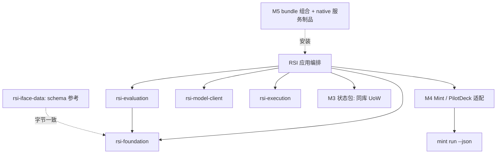

# RSI IFace 模块化修订方案 v2

## 1. 目标、范围与文档权威

目标：把 RSI 已有能力拆成可独立复用的 Python 模块，经 Mint 安装、校验和组合；保留现有数据、旧导入与 CLI，用户侧安装和运行不执行 pip。

本方案依据 [两方案评审](../../dev/rsi_toolkit/2026-10-28-iface-plans-review.md) 及本轮三路审阅修订。它替代旧评审附录 A、C、E、E1、E2 中冲突的执行决策；[附录 B](../../dev/rsi_toolkit/iface-review/B-capability-contracts.md) 继续作为 C1-C7 的需求输入，不代表这些调用契约已经实现。历史文档保留。

交付分两级：

- 首批详细实施范围是 M0-pre、M0、M1：源码兼容、契约基线、5 个包、本地 Mint 安装与运行证据。
- M2-M5 给出依赖、交付物和退出门；每阶段进入前制定独立实施计划。外部 cpmrt 已发布 0.1.14（artifact 声明 std），M1 测试直接使用其实际 core runtime；M6 应用 transport/ACP 适配需求见 [cpmrt transport 接入需求](2026-10-28-rsi-cpmrt-transport-design.md)，在 M4 退出门后立项，M1 不实现该适配器。

本轮生成设计和 [首批实施计划](../plans/2026-10-28-rsi-iface-v2-m0-m1.md)，不开始产品源码迁移，不登录或发布 MintHub。后续发布继续遵守用户此前“暂不发布”的决定。

用户补充要求纳入首批交付：[每包使用文档与测试用例](2026-10-28-rsi-package-pages-and-tests.md)，以及 [workspace Mint CLI 接入和测试代码指南](../../../workspace/rsi-iface-v2/README.md)。文档按独立安装、宿主要求、示例、验证、撤销组织；实施后必须在 `./workspace/rsi-iface-v2/` 保留人工试用项目和执行证据。

## 2. 基线与证据边界

| 对象 | 已确认事实 | 对方案的影响 |
| --- | --- | --- |
| RSI | `apps/plugins/rsi-toolkit`，`44235f1`，版本 `0.2.0`，Python >=3.13 | 兼容测试及历史 fixture 从该提交生成 |
| 工作区 | AgentOS 根目录无 Git；RSI 有 12 个既有未跟踪文件 | 产品代码在 RSI Git 中提交；既有未跟踪文件不进入提交 |
| 当前执行 | Mint 负责安装/依赖/卸载；专用 home 的 cpmrt 0.1.14 直接 `run --flavor core --json`，artifact 声明 std 与实际 core 分列，版本/二进制摘要/info/session 绑定 | 用户已选择新入口，旧 Core 0.1.6 仅历史证据；std 能力仍 blocked，M1 不声明 ACP 或 M6 transport 完成 |
| Mint | `~/.mint/bin/mint` 0.1.11 | 真实二进制用于探针，避免 PATH launcher 重写 MINT_HOME |
| bundle 内容 | 可保留 `lib/`；相对 `path:` 依赖能递归安装 | 首批纯 Python 能力包采用 bundle |
| 卸载 | 本地探针会删除两个孤儿依赖 | 不启用内嵌依赖退路；仍需用新制品重验 |
| bundle 平台 | `artifacts.layout = "target"` 被拒，错误为“bundle 是单制品，只能是 any” | 应用中编译型依赖默认采用 `plugin/native` 制品 |
| Python 隔离 | `-I` 仍加载系统或 venv 的 site-packages；`-I -S` 不加载 | 首批运行器使用 `python3 -I -S -B` |
| 当前测试 | 本轮相关基线 69 项通过 | 不能作为新模块、新启动器和 conformance 的通过证据 |

临时探针位于 `/private/tmp/mint-probe.IyNTBk`，可能被系统清理。正式实施需将命令、版本、退出码和必要输出重新写入 `conformance/iface-v2/`，不依赖临时文件存在。

历史 session 的 745 项测试和安装证据属于单体 `0.2.0`。WorkBuddy 目前只有 code 单任务完整 RSI 循环；office 尚未把评分接入完整循环，web 尚未接通执行与评分。模块化验收不扩大这些覆盖声明，也不把 `NO_IMPROVEMENT` 写成收益证明。

## 3. 保留的架构与修订决策

保持 Python、SQLite、CAS、同进程组合和同项目数据库。内部 15 个模块边界与发布包数量独立管理。

| 内部模块 | 发布包 | 阶段 |
| --- | --- | --- |
| 5 个领域数据 schema | `rsi-iface-data` | M1 |
| content-store、contracts-runtime、measurement-evidence | `rsi-foundation` | M1 |
| model-client | `rsi-model-client` | M1 |
| evaluation-kit、paired-evidence | `rsi-evaluation` | M1 |
| execution-port、workspace-assets | `rsi-execution` | M1 |
| component-runner | `rsi-component-runner` | M2 |
| storage-sqlite | `rsi-storage` | M3 |
| trace-archive、experience-ledger、lexical-recall | `rsi-experience-store` | M3 |
| recall-selection | `rsi-recall-selection` | M3 |
| asset-ledger | `rsi-asset-ledger` | M3 |



本版的六项修订：

1. v2 身份信息独立于旧 `Evaluator.contract()`；完整保留 v1 的递归指纹语义。
2. M1 同时交付源码开发加载、旧 wheel/sdist 构建和干净安装验证。
3. M1 的 `rsi-evaluation` 暂不声明 `implements rsi-evaluator.data`。
4. 首批能力 bundle 为 `any`；M5 应用服务默认是按目标平台构建的 `plugin/native`。
5. 闭包使用完整 `scope/name` 和固定结构，运行器从 `.mint/packages` 定位依赖，并关闭 site 自动加载。
6. M0-pre 同时处理模块内部顶层导入；不只修改 `__init__`。

## 4. 单一源码与兼容交付

### 4.1 源码布局

路径相对 RSI Git 根：

```text
modules/<package>/
  package.toml
  iface.toml
  SKILL.md
  src/<namespace>/
  tests/
packaging/
  manifest.py             # 清单、依赖与声明校验
  integrity.py            # lib 目录树 digest 算法
  build_bundle.py         # any 能力 bundle 与探针应用
  dev_run.py              # checkout 的显式模块加载
  check_imports.py        # AST 导入边界检查
  contracts/              # 契约包生成
  launcher/               # 首批标准库启动器
  tests/
service/
  rsi/ control/ ...       # 应用与旧导入 shim
  build_hook.py           # 构建时纳入 modules 源码
  pyproject.toml
conformance/iface-v2/     # 本轮正式证据
```

不创建 `_staging` 中转实现。可抽取源码直接进入最终 namespace，原路径 re-export。trace 归一属于应用兼容层，放在 `service/rsi/trace_normalization.py`，不为了消除循环而把 legacy 语义塞进 foundation。

### 4.2 三种加载环境

| 环境 | 加载方式 | 验收 |
| --- | --- | --- |
| checkout 开发 | `packaging/dev_run.py` 显式加入 `service` 及已声明模块的 `src`；`service/conftest.py` 在导入 harness 前初始化同一份清单路径；子进程显式传递这些路径 | 原测试命令、旧 CLI 和旧导入可用 |
| 兼容 wheel/sdist | Hatch hook 从 modules 的唯一源码构建 wheel 顶层 namespace；sdist 携带相同 modules 源码及清单 | 源码目录外安装后旧 CLI 可用，不读取 checkout |
| Mint bundle | `lib/<namespace>`，由闭包运行器加载 | `-I -S -B` 下仅标准库及冻结闭包可见 |

开发加载只作用于开发入口和测试，不在生产模块中搜索工作区或修改 sys.path。wheel 的源码复制是构建产物，不在仓库维护第二份实现。兼容 wheel 供既有安装方式回归使用，不是新的 Mint 用户安装流程；测试/CI 可使用 pip，用户侧 Mint 流程不调用 pip。

M1 退出前同时验证 wheel 直接构建和“sdist 解包后构建 wheel”。每个已迁移旧路径与新路径导出的是同一个类或函数对象，避免异常类型不一致。

## 5. 指纹、qualification 与 verifier

### 5.1 evaluator 的 v1 兼容

旧算法包含模块名、类名、`inspect.getsource(evaluate)` 的原文和整个 contract。迁移时保留这些输入的语义：

- `Evaluator.contract()` 继续返回旧设置形状，不添加稳定 ID/version。
- `evaluator_fingerprint_v1()` 用完整类路径别名映射还原旧名；内建 Exact、Contains、JSONFields、Rubric 和任意层 Composite 均有明确规则。
- Composite 的 legacy contract 显式递归调用 v1，不通过可被替换的默认指纹函数。
- legacy 实现源码维持原文；真正修改 evaluate 源码或其旧配置，历史 qualification 必须失配。
- 第三方 evaluator 不会自动获得身份；使用显式注册的身份适配器。需要跨模块兼容时另登记 legacy 路径映射，不按类名猜测。

在任何改动之前，用 `44235f1` 生成并提交历史 fixture，包括完整 qualification、设置、源代码摘要和预期 fingerprint。覆盖普通 evaluator、固定 judge_id 的 rubric、嵌套 composite；fixture 不随新实现自动重新生成。

### 5.2 evaluator 的 v2 身份

新增独立 `EvaluatorIdentity`，字段为 `id`、`version`、`implementation_sha256`、`settings`。内建 ID 为 `rsi.exact`、`rsi.contains`、`rsi.json-fields`、`rsi.rubric`、`rsi.composite`，起始身份版本为 `1`。

v2 哈希是上述 descriptor 的 canonical JSON sha256，不包含 Python 模块路径。注册表持有评分 callable，计算指纹时读取其当前源码，不保存预先写死的实现 digest；settings 同样从当前实例即时投影。若评分依赖本地 helper，注册项必须包含 helper。Composite settings 包含子 evaluator 的 v2 fingerprint 和权重。rubric 保留 judge_id 和阈值，不在此次迁移中扩大对模型身份的保证。

新 qualification 保持当前 `rsi.qualification/v1` 记录形状，在 evidence 中增加 `fingerprint_algorithm = "rsi.evaluator-fingerprint/v2"`。没有该字段的旧记录按 v1 校验；未知算法拒绝；v2 失配不得回退到 v1。`evaluator_sha256` 继续保存所选算法输出。此格式与冻结的 `rsi.evaluator/v1` 是两种数据，不合并或冒充。

### 5.3 verifier 保守迁移

M0-M1 不搬动 `verifier_description` 与 benchmark verifier 文件，不引入 verifier v2。完整保留其 module、source_hash、module_digests、source_module_digest、policy 等字段和比较语义。仅通用 model identity/usage 辅助函数可迁出，并保持输出相同。

如后续必须搬动 verifier，先单独设计完整历史描述的投影和迁移 fixture；不能只映射 module 字段。旧 run 遇到无法证明等价的变化，保留 `measurement_drift`，不得静默接受。

## 6. IFace 声明与数据契约

`contracts/` 中的 5 个领域 schema 是权威源码；`rsi-iface-data`、foundation 内置 schema 都从同一输入复制并比较字节 digest。Kernel IFace 以拉取的线上 `agentcpm/iface-*@0.1.0` 制品及固定 digest 为基线，本地 Rust 快照仅用于漂移对比。

`iface.toml` v0 使用 `defines`、`implements`、`references`、`proposes` 四类声明：

| 包 | M1 声明 | Mint provides.interfaces |
| --- | --- | --- |
| `rsi-iface-data` | defines 5 个 `rsi-*.data` | 5 个数据契约 ID |
| `rsi-foundation` | proposes blob/v1、evidence/v1；references 5 个数据 schema | 空 |
| `rsi-model-client` | references agentcpm/iface-model@0.1.0，标注 semantic-reference / transport-unavailable | 空 |
| `rsi-evaluation` | proposes evaluation/v1；references rsi-evaluator.data，标注 not-conformant | 空 |
| `rsi-execution` | proposes workspace-staging/v1、runtime-executor/v1 | 空 |

修订 `consumes` 为 `references` 是为了表达真实状态：现有 OpenAI-compatible Python 客户端并未调用 Kernel ModelContract transport。以后取得实际可调用 transport，再新增 `consumes` 声明和对应 conformance。

契约 bundle 的 provides 从 defines 生成；代码 bundle 从 implements 生成。defines 仅限无 lib 的契约包。implements 必须引用已冻结契约并绑定通过的机器可读 conformance 报告，不能以“目录存在”代替通过证明。报告至少含 contract ID/schema digest、制品 lib digest、测试命令、退出码、结果；避免过期报告给新制品背书。

`rsi-evaluation` 暂缓 implements，因为现有 contract、qualification 与冻结 schema 的 kind、必填字段和统计证据不一致。后续独立任务可以新增导出 DTO，并计算 schema 要求的误接受上界、覆盖率、注入测试结论；没有证据时不填虚构值。

C1-C7 首批只交付草案、Python 端口形状及问题清单。新增能力实现按后续阶段验收；M1 不承诺运行时取消、持久幂等、完整 evidence seal 或模型 transport 已接通。

RuntimeExecutor 请求必须包含明确的 `task` 文本。资产字段为冻结 digest 引用，由应用适配器在调用当前 Host 之前验证并解析为文本；公共端口不猜测 task 来源，也不把引用字符串直接写成资产正文。

## 7. Foundation 的标准库边界

### 7.1 schema 子集校验器

实现范围固定为 5 个冻结 schema，支持实际出现的 structural/validation keywords：`$schema/$id/$defs/$ref/title/description/type/properties/required/additionalProperties/const/enum/pattern/minimum/maximum/minLength/maxLength/minItems/maxItems/uniqueItems/items/allOf/if/then/oneOf/format`。注解只忽略明确列出的关键字；未知关键字在加载 schema 时直接报错。

本地 ref 只允许当前 schema 的 JSON Pointer；不读取网络或任意文件。JSON 类型匹配要区分 bool 与 number/integer，并按 JSON Schema 处理 `1.0` 的 integer、const/enum 的布尔差异和数值相等。

本轮复核发现 jsonschema 4.26.0 的 `FormatChecker` 未注册 `date-time`，因为基线环境没有可选的 rfc3339-validator。因此 M1 明确保持该基线：`format: date-time` 作为注解，不执行格式断言，也不因运行机多装了可选依赖而改变行为。这里只保证结构校验，不宣称完整格式 conformance。严格 RFC3339 校验留给独立的行为变更，届时新增显式 profile、锁定参考依赖并验证使用方。

差分测试必须在 CI 安装 `jsonschema==4.26.0` 并强制运行，参考侧显式使用 `FormatChecker(formats=[])`，发布门禁不能 skip。除了 11 个正例、8 个负例，增加逐关键字变异、嵌套条件、布尔/数字、重复元素、引用、时间注解和未知关键字测试。用固定 seed 批量变异 fixture，对判定结果做差分；错误文字不要求与 jsonschema 完全一致，但必须保留数据路径。新增一个无效时间字符串仍通过的回归用例，防止迁移时静默收紧行为。

### 7.2 canonical 与 CAS

现有 `canonical()` 字节算法和 CAS digest 不变，包括 Unicode、浮点数和旧数据读取。新的 `canonical_json_v1()` 用相同编码设置并拒绝非有限数；只供新契约调用，不替换 legacy canonical 的全部调用点。这是显式新增能力，避免把“禁止 NaN/Infinity”混入兼容性迁移。

公开 `CAS` 保留旧行为；产品 CAS 的权限加固通过 `PrivateCAS` 提供，`rsi.store.CAS` re-export 它。两者分别回归，不能把权限策略合并时的变化隐藏在抽包中。

## 8. Mint 制品与闭包

### 8.1 包清单

`package.toml` v1 包含 name（无 scope 的包叶子名）、namespace（契约包省略）、version、python、kind、depends、optional_imports。version 使用 SemVer，python 固定 `>=3.13`，kind 为 contract 或 capability；M1 生成的 Mint kind 均为 bundle。

depends 是本仓库包叶子名列表，版本取被引用包的清单，必须唯一且无环。optional_imports 使用 Python 导入名，例如 `yaml`，不使用分发名 `pyyaml`；另记录 distribution 用于开发环境说明。构建器使用确定的 package->namespace 映射检查全部 import，包括函数内的延迟导入。公共源码禁止导入 `rsi/control/harness/toolkit/connectors`，相对导入也要解析到完整 namespace 后检查。Mint 本地清单使用 `[dependencies]` 下的 `"local/rsi-foundation" = { path = "../rsi-foundation" }`；`path:...` 是 CLI source 参数，不是依赖值的 TOML 字符串格式。

### 8.2 closure.json v1

字段固定为 `schema_version = "rsi.closure/v1"`、`python`、`entry`、`application`、`packages`：

- entry 包含 module 和 callable；仅允许本应用 namespace 中的模块及一个可调用入口名。
- application 与 packages 每项包含完整 `name = scope/name`、version、namespace、lib_sha256。
- packages 包含全部传递依赖，按完整 name 排序；禁止重复 name、namespace 和相互冲突版本。
- lib_sha256 基于 lib 全部相对路径、大小和文件 sha256 的排序 JSON 清单；UTF-8，JSON sort_keys=True、separators=(",", ":")，不记录 mtime。
- 拒绝 symlink、字节码和编译扩展；资源文件纳入 digest。release.json 不在 lib 中，避免自引用。

应用位于 `.mint/packages/<scope>/<name>@<version>`。运行器的 `here` 是应用根，`packages_root = here.parent.parent`；依赖路径为 `packages_root / scope / (name + "@" + version)`。完整身份先校验合法字符，禁止绝对路径、空段和 `..`。必须覆盖跨 scope fixture，不能假设所有依赖与应用同 scope。

### 8.3 启动行为

首批启动方式固定为 `python3 -I -S -B <installed-app>/bin/rsi-launch.py`：

1. 检查 Python >=3.13 及 isolated/no_site/dont_write_bytecode 标志，不符合则报出正确命令并退出。
2. 校验 closure 字段、应用身份、全部依赖目录与 namespace 唯一性。
3. 校验应用及所有依赖 lib digest，任一缺失或篡改均拒绝。
4. 只加入已校验的 lib 路径，导入 entry，执行 main；新应用输出保持机器可读。

不提供发布版 `--no-verify`。开发运行走 dev_run。运行器不执行 pip，不读取 PYTHONPATH，不生成 pycache，也不把当前目录加入搜索路径。它不是 OS sandbox；拥有安装目录写权限的本机调用者仍可修改代码。

### 8.4 来源与离线探针

release/source-ref 固定 RSI Git identity、完整 commit、各输入子目录及文件 digest。release 构建仅接受输入文件与该提交一致；相关未跟踪输入也拒绝。与制品无关的既有 12 个未跟踪文件记录并排除，不要求删除或提交它们。

探针使用临时 MINT_HOME。先通过公开只读接口预热 config、index、验签 key 缓存，再运行离线安装/verify；网络不可用时记录未验证，不伪造离线通过。所有有服务端依赖的步骤使用本地 scope，不登录、不上传。

安装、原始制品签名验证、已安装 lib 篡改验证分别记录。Mint verify 的覆盖面按实测说明；无论它是否检查已安装 lib，运行器的 digest 验证都必须通过正反例。

## 9. M5 应用交付路线

首批库继续使用 any bundle。完整服务使用按目标平台构建的 `plugin/native`，带解释器与依赖，入口采用已验证的 stdio MCP 协议；应用 bundle 组合 Skill 与服务制品。不能把任意 Python 可执行文件当作某种未定义 native 协议的实现。

先做一个目标平台的最小 native MCP 服务探针，验证 Mint manifest、安装路径、MCP 注册、健康调用、退出和卸载，再扩大平台矩阵。初始平台为当前开发环境 macOS arm64；其他平台必须有各自构建与调用证据后才声明支持。保留 HTTP 模式作为独立可选入口。

不把“标准库重写 MCP”作为默认路线；优先使用现有 MCP SDK，减少协议维护。若 native MCP 入口不能被当前运行时装载，停止该阶段，整理上游缺口，不能靠 metadata 声明通过。对 native 单文件冻结器的选择在 M5 探针中评估，不在 M1 安装此类构建依赖。

## 10. 实施阶段与退出门

| 阶段 | 工作与顺序 | 退出门 |
| --- | --- | --- |
| M0-pre | 冻结历史 fixture；懒加载和顶层依赖解耦；实现 evaluator 指纹双算法；保留 verifier v1 | 历史 qualification 保持匹配；真实评分变化失配；import closure 和控制面漂移测试通过 |
| M0 | 固定线上 IFace；冻结 package/iface/closure schema；交付 C1-C7 草案与构建工具 fixture | schema/导入/依赖校验可执行；声明真实；基线来源完整 |
| M1 | foundation 标准库化；迁 evaluation/model/execution；兼容 wheel/sdist；Mint 探针；逐包文档/cases 与 workspace 接入 | 新库、旧回归、干净 wheel、无 pip、篡改拒绝、跨 scope、卸载和 workspace G4-W 全部有证据 |
| M2 | component-runner；解除 rsi.worker/RSI_ROOT 硬编码 | 新进程仅加载声明依赖；limits/kill/reap、artifact、sandbox 负例通过 |
| M3 | storage + experience-store + selection + asset-ledger；同库 UoW；release-set 驱动召回 | 历史 migration 不重写；savepoint/锁、幂等并发、故障回滚、备份恢复、授权消费与激活原子性通过 |
| M4 | Mint/PilotDeck 接 RuntimeExecutor；冻结生命周期持久记录 | 相同 ID 重复 submit 不重放；取消/断连/重启 Unknown；workspace/代理/事件完整性通过 |
| M5 | native MCP 探针；控制/召回两个应用组装 | 每个声明平台干净安装、启动、调用、升级、卸载；数据与配置保留；用户不运行 pip |
| M6 | cpmrt 0.1.14-std 已可用；按 [cpmrt transport 接入需求](2026-10-28-rsi-cpmrt-transport-design.md) 在 M4 后新增适配器 | 达到 M4 同等执行/隔离标准；独立发布 cpmrt 版本、ABI、事件和恢复证据；M1 不提前实现 |

M0-pre 不提前下沉 schema loader/model/trace 到临时目录；rsi->toolkit 的最终消除由 M1 抽取完成。这样每段迁移只有一次物理搬动。M0 工具开发可与 M0-pre 并行，但源码迁移必须等指纹兼容门通过。

## 11. 执行组织、估算与回退

推荐一位集成人维护连续提交，两个可选 worker 分别负责源码和分发；这是工作流建议，不自动启动执行。工作开始时使用隔离 worktree，复用适合的已有 worktree 优先。分支名在执行时确定，不要求执行者操作不存在的分支。

文件所有权：源码负责人维护 service、modules、build_hook、pyproject 和迁移测试；分发负责人维护 packaging、conformance/iface-v2；共享清单字段修改先合入，再让另一方基于新提交继续。构建兼容 wheel 与新源码迁移属于同一负责人，避免旧方案的所有权空缺。

同步点为 G0 历史基线、G1 指纹兼容、G2 清单/构建/文档 fixture、G3 四个源码包与兼容 wheel、G4 Mint 安装运行、G4-W workspace 用户接入、G5 首批退出评审。G1 与 G2 均通过后才做正式源码抽取；G4-W 是新增的 M1 必需门。

估算按有效工程日：原 M0-pre 2-3 人日、M0 2-3 人日、M1 6-9 人日，共 10-15 人日。新增文档/用例工具和 workspace 接入预计 2-4 人日，修订首批总计 12-19 人日；独立 worker 可并行，但阶段依赖仍串行。M2-M5 在各阶段计划完成后再估，不把当前数字当全产品交付承诺。

回退以阶段提交为单位，通过新修复提交恢复旧调用路径；不删除用户数据、不重写旧 qualification、不修改已应用迁移 SQL。M1 保留单体 wheel 的交付能力；新的 Mint 路径未通过 G4 前不替换现有用户入口。

## 12. 成功标准

- 5 个首批包均有明确来源、版本、依赖、SKILL 和真实契约关系。
- 同一个实现源码可构建能力 bundle 和兼容 wheel/sdist，旧路径保持对象一致。
- 历史 v1 qualification 可验证，新 v2 对 namespace 变化稳定，对评分实现/设置变化敏感。
- schema 校验器在强制差分测试中与参考实现一致，遇到未知 schema 关键字拒绝。
- 本地 Mint 干净工程中，用户不执行 pip 即可调用最小评分；依赖缺失、篡改、路径错误被拒绝。
- 完成报告分别列功能回归、历史兼容、独立复用、分发、实际调用和未接通的 Kernel/应用 transport 边界；M1 验收由 Mint 0.1.11 安装包，直接执行专用 home 内 cpmrt 0.1.14/core。报告必须区分 declared artifact std 与 actual compiled/effective core，绑定二进制 SHA/version/info/session，保留 sandbox notice 和旧 Core 历史证据；std 能力仍 blocked，不据此声明 ACP、M6 transport 或 `mint run` + std 兼容。正式新 G4-W 结果须从已提交来源重新 prepare/full run 获得。
- 每包交付 README/REQUIREMENTS/TESTING/cases/examples，首批 49 条用例形成带制品与输入摘要的报告，适用 profile 与 blocked 项明确。
- 按 workspace 指南真实执行 library 与 agent-scripted；保留 trial/data/evidence，实际 skill_read 成功、评分正确、负例拒绝，不能只靠模型 marker 判定接入成功。

## 13. 使用资料与 workspace 验收

参考 [wujiahe/skill-document-generation-for-proofs](https://mint-hub.ea.modelbest.co/p/wujiahe/skill-document-generation-for-proofs) 的公开安装说明与宿主能力组织。源码 owner 在迁移包时同时写文档/fixture/case driver，分发 owner 提供统一渲染、runner 和文档命令检查。资料随包分发并绑定 test_input/artifact 摘要，普通行为报告不自动充当 IFace 专属 conformance。

Mint 安装不自动改变 Python 搜索路径，也不自动把库注册为 Kernel 工具。M1 的安装调用通过校验闭包的 probe；技能发现通过固定 Core 的 scripted skill_read 实测；真实模型和 M5 native MCP 另有验收条件。`./workspace/rsi-iface-v2/` 的 W-01–W-12 检查安装、调用、负例、离线恢复、更新、原版本恢复及卸载，详细命令和代码以指南为准。

T8D 交付资料与 runner，T10 完成临时工程分发验收，T10W 在 workspace 重现用户流程并保留现场。首批没有本地 registry 时 pull 缺口按 G4 规则留给 M5，其余必需 workspace 条目失败或 blocked 都阻止 G4-W。此处新增的是交付和验收范围，本轮仍不安装产品、不执行模型调用或发布。
